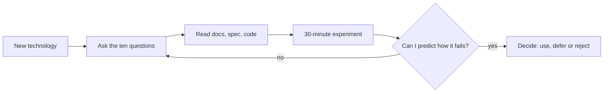
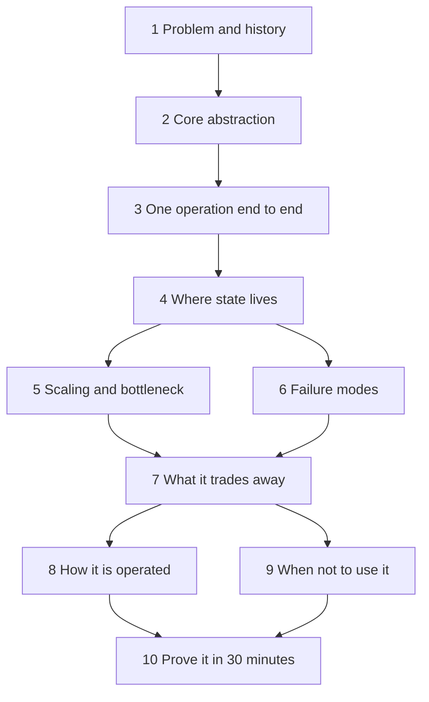

# Part 0 — How to Understand Any Technology

This is the first page of the book, and it is not about any one tool. It is about how to learn tools. Everything after this Part teaches a specific technology (JavaScript, HTTP, Git, NestJS, PostgreSQL, Redis, Kafka, Kubernetes) using the same small set of questions: why does it exist, what is the mental model, how does it work inside, how does it fail, what does it trade away. This Part names that method, gives it to you as a checklist you can carry to any technology the book does not cover, and then digs one layer down, to the computer and the language underneath every tool you will ever use.

If you are a complete beginner, read this Part first and do not worry if some examples mention tools you have not met yet. They are here to show the method moving from tool to tool, and every one of them is taught properly later. If you are already senior, read 0.2, 0.4 and 0.6 closely: the checklist, the reading habits and the language-switching map are the parts experienced engineers most often do implicitly and badly.

## 0.1 Why a method beats memorising tools

#### Concept

A **technology** in this book means any piece of software you build on: a language, a framework, a database, a message broker, a cloud service, a library. A **method** is a fixed set of questions you ask of every new technology, in the same order, until you can explain it, predict how it behaves under load and failure, and decide whether to use it.

Tools change every few years. The problems they solve barely change at all. A caching layer in 2005 (memcached), 2015 (Redis) and 2025 (Redis, Valkey, a CDN, an in-process LRU) solves the same problem: reading slow data quickly by keeping a copy closer to the reader, and paying for it with staleness. If you understand caching, each new cache is a weekend. If you memorised memcached commands, each new cache is a fresh start.

#### Why does it exist?

Because the tool list is endless and your time is not. A backend engineer meets a new library every week and a new "everyone is moving to X" every quarter. Engineers who chase them all know many tools shallowly: they can follow the getting-started guide but cannot predict what happens when the tool is full, slow, partitioned or upgraded, which is exactly when it matters.

The ideas underneath repeat. Here are the ones you will meet again and again in this book, in tool after tool:

| Idea | What it means in one line | Where you meet it |
|---|---|---|
| Caching | Keep a copy closer to the reader; accept that it can be stale | CPU caches, browser cache, CDN, Redis, PostgreSQL shared buffers, React Query |
| Queues | Put work in a line so producer and consumer can run at different speeds | Event loop task queue, RabbitMQ, SQS, Kafka, BullMQ, OS run queue |
| Indexes | A second, sorted structure that makes finding things fast and writing things slower | PostgreSQL B-tree, Elasticsearch inverted index, a `Map` in your code |
| Retries | Try again after a failure, which can duplicate the work | HTTP clients, Kafka producers, job queues, TCP itself |
| Consistency | Who sees which version of the data, and when | Database transactions, replicas, caches, distributed systems |
| Logs | An append-only record you can replay | PostgreSQL WAL, Kafka topics, Git history, event sourcing |
| Backpressure | A slow consumer pushes back on a fast producer instead of drowning | Node streams, TCP windows, Kafka consumer lag, connection pools |

Learn the column on the left once and the column on the right becomes a set of variations.

#### Mental model

Imagine learning to drive. You learn one car properly: steering, braking distance, mirrors, what a skid feels like. Then you rent a different car abroad. The wipers are on the wrong stalk and the handbrake is a button, and for ten minutes you fumble. But you never have to relearn braking distance, because physics did not change. Tools are the stalks and buttons. Ideas are the physics. A method is the habit of asking "where are the wipers, where is the handbrake, how does it brake" in the first five minutes of every rental.

#### How it works

The method has three steps, and the rest of this Part fills them in.

1. **Ask the ten questions** (0.2).
2. **Read the primary sources the right way** (0.4): docs, specs, the code, the error messages.
3. **Build a small thing and break it on purpose** (question 10, and 0.7). Reading tells you what the authors claim; an experiment tells you what is true.

Underneath all three sits the layer every technology shares (0.5). When a tool surprises you, the explanation is usually down there.

#### Practical example

Your team lead says: "We are adding a search box to the product catalogue. Look at Meilisearch." You have never heard of it. Without a method, you open the quickstart, copy the Docker command, index ten products and report back "it works and it is fast". With the method, you spend the same afternoon and come back with:

- It solves full-text search with typo tolerance; before it, you would use PostgreSQL full-text search or Elasticsearch/OpenSearch (see Part 34 — Search: PostgreSQL Full-Text to Elasticsearch/OpenSearch).
- Its core abstraction is an index of JSON documents, separate from your database, so you now have **two copies of every product** and a sync problem.
- Indexing is asynchronous: you submit a task and it completes later, so a product saved at 10:00:00 might not be searchable until a moment after. You must decide whether that is acceptable.
- You checked how it stores data on disk, what happens if the container is killed mid-index, and what the upgrade path looks like between major versions.
- The alternative for your 40,000 products is probably PostgreSQL full-text search with a `GIN` index, which needs no new server.

Same afternoon. Completely different quality of answer. That is the whole argument for a method.

#### Production scenario

A 30-engineer company running PostgreSQL, Redis, RabbitMQ and a NestJS monolith requires every new-technology proposal to answer the ten questions on one page (Part 81 — Writing as an Architect: RFCs, Design Docs and Decision Records covers the document). Of six proposals in two years, four die at question 9 ("PostgreSQL already does this well enough at our size"). The two adopted arrive with a runbook, because questions 6 and 8 forced someone to write down failure and operations before the first incident.

#### How a Senior Backend Engineer thinks about this

A senior is not someone who knows more tools. A senior is someone who, given a tool they have never seen, can within a day say what it is for, what it will cost to run, how it will break and whether it is worth it. They also hold a strong default: **every new technology is a liability until proven otherwise.** It is one more thing to monitor, upgrade, secure, back up, hire for and debug at 03:00. The question is never "is this tool good?" It is "is this tool better enough than what we already run to pay that cost for years?"

When a product manager asks why the team does not adopt the shiny thing, the senior's answer is plain: "It solves a problem we do not have yet, and it brings three problems we would have on day one."

#### Common mistakes

- **Learning the API before the problem.** You can call the functions but you cannot say when you would not call them.
- **Trusting the benchmark on the homepage.** It measures the vendor's best case, not your workload.
- **Equating "I ran the quickstart" with "I understand it".** The quickstart is designed never to fail. Production is not.
- **Ignoring the boring alternative.** The database you already run, used well, beats the new database used badly.

#### Interview questions

1. **You are asked to evaluate a technology you have never used. Walk me through your first day.** Expected answer: name the problem and what came before; find the core abstraction and data model; trace one operation end to end; find where state lives and how it survives a crash; check scaling limits, failure modes, operational cost; list the simpler alternative; run a small experiment that tries to break it. Why it matters: it shows whether the candidate evaluates or just follows tutorials. Follow-up: what would make you say no?
2. **Name three ideas that appear in many different tools.** Caching, queues, indexes, retries, logs, consistency. A strong answer gives two concrete tools for each and the shared tradeoff (a cache trades freshness for speed everywhere).
3. **Why might a team reject a tool that is genuinely excellent?** Because operating cost, team skills, and overlap with existing systems can outweigh the benefit. Follow-up: how would you write that up so the proposer does not feel dismissed?

#### Practical exercise

Pick a technology you use every day but have never questioned: your HTTP client library, your logging library, or `npm` itself. Write one paragraph for each of these three questions: what problem does it solve and what did people do before; where does its state live; what happens when it fails. Acceptance criteria: each paragraph names at least one concrete fact you had to look up rather than already knew, and the third paragraph describes a failure you could reproduce on your laptop.

## 0.2 The ten questions to ask of any technology

### 0.2.1 The checklist

Here is the method itself. Print it, pin it, paste it into the template your team uses for design documents. The questions are ordered so that each one builds on the last: you cannot reason about scaling (5) until you know where state lives (4), and you cannot say when not to use something (9) until you know what it trades away (7).

| # | Question | What you are really looking for | A weak answer sounds like | A strong answer sounds like |
|---|---|---|---|---|
| 1 | What problem does it solve, and what came before it? | The pain that made someone build it, and the older tool it replaced | "It is fast and modern" | "Before it, teams polled the database every second for new orders; this pushes changes instead" |
| 2 | What is its core abstraction or data model? | The one or two nouns everything else is built from | A list of features | "Everything is an append-only, partitioned log of records with offsets" |
| 3 | How does one request or operation flow through it? | The step-by-step path of a single read or write | "You call the API and it returns" | "Client, connection, parse, plan, execute, buffer cache, WAL, fsync, reply" |
| 4 | Where does state live, and how does it survive a crash? | Memory vs disk, replication, what is lost on `kill -9` | "It is persistent" | "Written to the WAL and fsynced before commit returns; a crash replays the WAL" |
| 5 | How does it scale, and what is the bottleneck? | The resource that runs out first and the unit of parallelism | "It scales horizontally" | "Throughput scales with partitions; one partition is read by one consumer in a group" |
| 6 | How does it fail, and what does failure look like from outside? | Error messages, timeouts, silent data loss, duplicate delivery | "It is highly available" | "On leader failover, producers see errors for a few seconds and retry, which can duplicate" |
| 7 | What does it trade away? | The cost of its main benefit | "Nothing, it is just better" | "It gives up per-message acknowledgement and arbitrary routing to get throughput and replay" |
| 8 | How is it operated? | Config, monitoring, backups, upgrades, the knobs that matter | "We will use the defaults" | "Watch consumer lag and disk; major upgrades need a rolling restart in a set order" |
| 9 | When should I NOT use it, and what are the alternatives? | The boundary of its usefulness and the cheaper option | "It works for everything" | "Under 1,000 messages a second with no replay need, a PostgreSQL table or SQS is simpler" |
| 10 | How can I prove it to myself in 30 minutes? | A small experiment that confirms one claim and one failure | "I read the docs" | "I killed the consumer mid-batch and watched the same messages arrive again" |

Three notes. **The weak answers are marketing:** "fast", "scalable", "highly available" and "persistent" carry no information until you attach a number, a mechanism or a condition. **Questions 4, 6 and 7 are the ones beginners skip and seniors start with:** state, failure and trade-offs decide whether a tool hurts you in production; features decide whether a demo looks good. **Short answers are fine:** for a small library, question 4 may be "no state". The point is to have asked.

### 0.2.2 Where to find the answers

Each question has a usual hiding place. Questions 1 and 2 live in the project's "why" page, its announcement post and its "concepts" or "architecture" page, which is rarely the first page of the docs. Question 3 lives in the architecture page and in talks by the authors; draw it as boxes and arrows, because every later question is answered by pointing at a box. Questions 4 to 8 live in the "limits", "production checklist", "operations" and "known issues" pages, and in other teams' postmortems. Question 9 lives in comparisons written by people who chose something else (Part 63 — Architecture Decision Framework has worked decision tables). Question 10 lives only on your own laptop. Throughout, apply the senior mantra: *Can it time out? Can it fail? Can it become slow? Can it duplicate? Can it return a wrong response? Can it partially succeed?*

### 0.2.3 An incident: the cart store nobody questioned

At 19:40 on the first evening of a sale, the support channel of a mid-sized online shop started filling with the same complaint: "My cart is empty." Customers had added items, browsed for a few minutes, come back, and found nothing. Conversion dropped by a third in an hour.

Six months earlier, a developer had moved shopping carts out of PostgreSQL and into Redis. The reasoning was sound as far as it went: carts are read on every page view, Redis answers in well under a millisecond, and the cart table had become a noticeable share of database load. The change was reviewed for correctness (keys, expiry of 30 days, JSON serialisation) and shipped. Nobody asked the ten questions.

The investigation took twenty minutes once someone looked at Redis itself. The `INFO memory` output showed the instance at its memory limit, and the `evicted_keys` counter was climbing by thousands per minute. The Redis cluster had been created by copying the configuration of the team's existing caching cluster, which used `maxmemory-policy allkeys-lru`: when memory is full, evict the least recently used key, any key. For a cache, that is exactly right; a missing cache entry is just a slower read. For carts, it meant that during the sale, as product-page caches flooded in, Redis quietly deleted the carts of anyone who had not touched theirs in the last few minutes. No error. No log line in the application. The cart simply was not there.

Here is how the ten questions would have caught it before the sale:

| Question | The answer nobody wrote down |
|---|---|
| 4. Where does state live, and how does it survive a crash? | In memory. Persistence depends on RDB snapshots or the AOF being enabled; the copied config had snapshots every 15 minutes, so a crash would also lose up to 15 minutes of carts |
| 5. What is the bottleneck? | Memory. Carts shared one instance with caches whose volume spikes during a sale |
| 6. What does failure look like from outside? | Under `allkeys-lru`, a full instance silently deletes keys. The application sees "cart not found", which looks like a new visitor |
| 7. What does it trade away? | Durability and capacity for speed. Acceptable for a cache; not automatically acceptable for user data |
| 8. How is it operated? | `maxmemory-policy`, `evicted_keys`, `used_memory`, and persistence settings are the knobs that matter, and none were on a dashboard |

The fix had three parts. Carts moved to a separate Redis instance with `maxmemory-policy noeviction`, so a full instance returns an error on write (loud) instead of deleting data (silent), and with AOF persistence enabled. An alert on `evicted_keys > 0` was added for that instance. And the team added a rule to their design-review template: any proposal that stores user data in a new system answers questions 4, 6 and 7 in writing. The deeper lesson in the postmortem was one line: *the tool did exactly what it was configured to do; we never asked what that was.* Part 27 — Caching and Redis covers eviction policies and persistence in depth.

#### Edge cases & failure modes

- **The questions get answered once and never again.** A tool's defaults and failure behaviour change between major versions. Re-ask questions 4, 6 and 8 at every major upgrade.
- **Copied configuration** carries the original system's trade-offs with it, as in the cart incident.
- **"Managed" read as "no failure modes".** A managed service still fails, throttles and has limits; you just cannot fix it yourself.
- **The proof skipped because "the docs are clear".** Docs describe intent; question 10 catches the gap between intent and behaviour.

#### Interview questions

1. **Apply the ten questions to Redis in two minutes.** Expected answer: an in-memory server of keys to typed values; one thread executes commands in order; state in memory, optionally persisted by RDB or AOF; bottlenecks are memory and that thread; fails by evicting, losing recent writes on crash, or stalling on slow commands like `KEYS *`; trades durability for speed; never the only copy of important data unless persistence is understood. Follow-up: which eviction policy would you choose for a session store, and why?
2. **Which of the ten questions do you think teams skip most often, and what does it cost?** Strong answers pick 4, 6 or 8 and give a story.
3. **What is a "silent failure", and why is it worse than a crash?** A failure that produces no error and no alert, such as an evicted key or a dropped message. Crashes get fixed in minutes; silent failures are discovered by customers weeks later.

#### Practical exercise

Run Redis in Docker with `--maxmemory 5mb --maxmemory-policy allkeys-lru`. Write a short TypeScript script that stores 1,000 "cart" keys, then writes 50,000 "cache" keys of 1 KB each, then counts how many carts survive. Repeat with `noeviction` and observe what your script sees instead. Acceptance criteria: you report the number of surviving carts under `allkeys-lru`, the exact error message your Redis client throws under `noeviction`, and one sentence on which behaviour you would want for user data and why.
