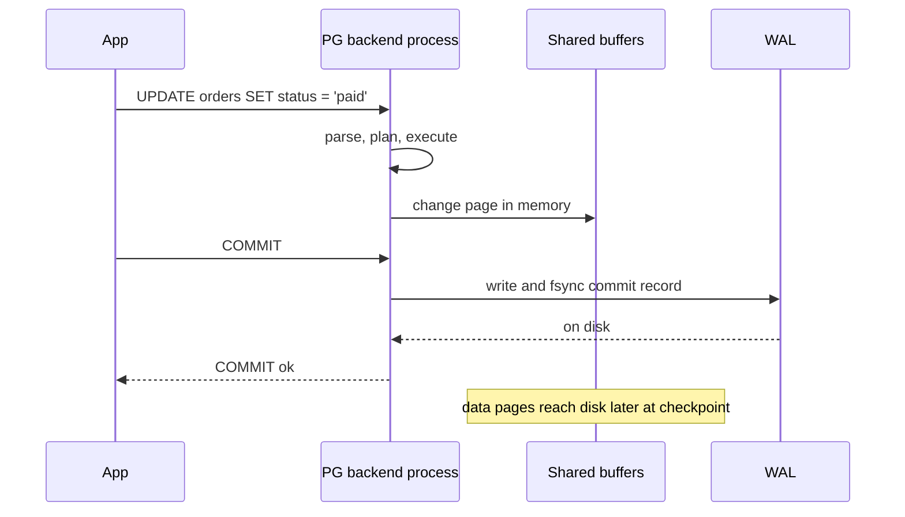
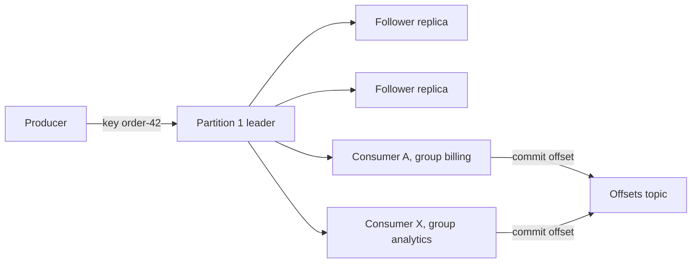

## 0.3 The method applied three times

A method is only worth something if it transfers. Here are the ten questions applied to three very different technologies: a database (PostgreSQL), a distributed log (Kafka) and a user-interface library (React). Each answer is a page you could write after one focused day, and each points to the Part that goes deep.

### 0.3.1 PostgreSQL

| # | Question | Short answer |
|---|---|---|
| 1 | Problem and history | Many users must change shared data at once without corruption, and survive crashes. Before: hand-rolled file formats and hierarchical databases navigated record by record. Codd's relational model (1970) separated *what* you want from *how* to fetch it. |
| 2 | Core abstraction | Tables of rows with typed columns, queried with SQL, changed inside **transactions** that are atomic, consistent, isolated and durable (ACID). |
| 3 | One operation | SQL arrives on a connection served by its own backend process; it is parsed, planned (the planner picks indexes and join order by estimated cost) and executed against pages in shared buffers. On `COMMIT`, the change is written to the write-ahead log (WAL) and flushed to disk before success returns. |
| 4 | State and crashes | Table and index files on disk, cached in shared buffers. After a crash, PostgreSQL replays the WAL: committed transactions survive, uncommitted ones vanish. |
| 5 | Scaling and bottleneck | Scales up on one machine; reads scale out with replicas; writes go to one primary. A common first bottleneck is **connections**: each is a process using several megabytes, hence poolers like PgBouncer. |
| 6 | Failure from outside | `FATAL: sorry, too many clients already` when connections run out; queries that hang waiting for a lock; slow queries after a plan changes; `ERROR: could not extend file` when the disk fills; stale reads from a lagging replica. |
| 7 | Trade-off | Strong consistency and rich queries, in exchange for limited horizontal write scaling. MVCC (old row versions for concurrent readers) trades disk and VACUUM work for readers never blocking writers. |
| 8 | Operations | Tested restores, autovacuum, `pg_stat_activity`, `pg_stat_statements`, replication lag, connections, disk growth, major upgrades via `pg_upgrade` or logical replication. |
| 9 | When not | Analytical scans over billions of rows (use a columnar warehouse); writes beyond one machine; extreme-rate key lookups (put an in-memory store in front); relevance-ranked fuzzy search at scale (a search engine). For most product backends, it is the right default. |
| 10 | 30-minute proof | Below. |

The experiment checks one claim (an index turns a scan into a lookup) and one failure (a forgotten transaction holds a lock and blocks everyone).

```bash
docker run --name pg-lab -e POSTGRES_PASSWORD=lab -p 5432:5432 -d postgres:16
docker exec -it pg-lab psql -U postgres
```

```sql
-- One million fake users, generated inside the database.
CREATE TABLE users (id bigint GENERATED ALWAYS AS IDENTITY PRIMARY KEY, email text NOT NULL);
INSERT INTO users (email) SELECT 'user' || g || '@example.com' FROM generate_series(1, 1000000) g;
ANALYZE users;

EXPLAIN ANALYZE SELECT * FROM users WHERE email = 'user777777@example.com';
-- Expect: Seq Scan on users ... Execution Time: roughly 40-100 ms

CREATE INDEX users_email_idx ON users (email);
EXPLAIN ANALYZE SELECT * FROM users WHERE email = 'user777777@example.com';
-- Expect: Index Scan using users_email_idx ... Execution Time: well under 1 ms

-- Failure: in this session, start a transaction and do not finish it.
BEGIN;
UPDATE users SET email = 'locked@example.com' WHERE id = 1;
-- Now open a second psql session and run:
--   UPDATE users SET email = 'other@example.com' WHERE id = 1;
-- It hangs. Back here, run COMMIT and watch the other session finish.
```

The second half is the important half. You have just reproduced, in one minute, the "idle in transaction" problem that takes down real APIs when application code opens a transaction and then awaits a slow HTTP call inside it. Deep dives: Part 20 — Databases and the Relational Model, Part 22 — PostgreSQL Internals, Part 23 — Database Indexing, Part 24 — Database Transactions and Concurrency Control.



### 0.3.2 Kafka

| # | Question | Short answer |
|---|---|---|
| 1 | Problem and history | Many systems need the same high-volume stream of events, and some must re-read history. Before: point-to-point pipelines between every pair of systems, or queues that delete a message once consumed. Built at LinkedIn around 2010. |
| 2 | Core abstraction | A **topic** is a named, append-only **log**, split into **partitions**. Each record in a partition has an increasing **offset**. Consumers in a **consumer group** share the partitions and remember how far they have read by committing offsets. |
| 3 | One operation | The producer hashes the record key to pick a partition (same key, same partition) and sends to that partition's leader broker, which appends and replicates to followers; with `acks=all`, success means the in-sync replicas have it. A consumer polls from its last offset, processes, then commits the new offset. |
| 4 | State and crashes | Segment files on broker disks, replicated, kept for a retention period (say seven days) whether read or not. Consumer offsets live in an internal topic; a crashed consumer resumes from its last commit. |
| 5 | Scaling and bottleneck | The **partition** is the unit of parallelism: in one group, each partition has at most one consumer, so ten partitions allow at most ten parallel consumers. Brokers are fast; the usual bottleneck is consumer processing, visible as **consumer lag**. |
| 6 | Failure from outside | Ever-growing lag; **rebalances** (partitions reassigned when a consumer joins, leaves or polls too slowly) that pause consumption; duplicates after a crash between processing and committing; one bad record retried forever, stalling its partition. |
| 7 | Trade-off | High throughput, durable replayable history and many independent readers, in exchange for ordering only within a partition, no built-in per-message dead-letter queue, no arbitrary routing, and real operational complexity. |
| 8 | Operations | Partitions and replication factor per topic, retention, disk, under-replicated partitions, lag per group, rolling upgrades. Recent versions run in KRaft mode without ZooKeeper. Managed offerings remove much of this. |
| 9 | When not | A few hundred jobs a minute with no replay need: BullMQ, SQS, RabbitMQ or a PostgreSQL table with `FOR UPDATE SKIP LOCKED`. Request/response: HTTP or gRPC. Per-message delayed retries and priorities: RabbitMQ or SQS. |
| 10 | 30-minute proof | Below. |

```bash
docker run -d --name kafka-lab -p 9092:9092 apache/kafka:3.8.0
docker exec -it kafka-lab /opt/kafka/bin/kafka-topics.sh --bootstrap-server localhost:9092 \
  --create --topic orders --partitions 3
# Terminal 1: a consumer in group "billing"
docker exec -it kafka-lab /opt/kafka/bin/kafka-console-consumer.sh --bootstrap-server localhost:9092 \
  --topic orders --group billing
# Terminal 2: produce keyed records, typed as key:value
docker exec -it kafka-lab /opt/kafka/bin/kafka-console-producer.sh --bootstrap-server localhost:9092 \
  --topic orders --property parse.key=true --property key.separator=:
# Terminal 3: inspect the group's partitions, offsets and lag
docker exec -it kafka-lab /opt/kafka/bin/kafka-consumer-groups.sh --bootstrap-server localhost:9092 \
  --describe --group billing
```

Try: a second consumer in the same group (partitions split between them); a fourth consumer with three partitions (one sits idle); stop all consumers, produce 20 records and read the lag; a consumer in a new group with `--from-beginning` reads history the first group already consumed, which a classic queue cannot do. Deep dive: Part 31 — Messaging: Queues, Topics, Kafka, RabbitMQ and SQS, especially 31.3 and 31.3.8 "When Kafka is overkill".



### 0.3.3 React

| # | Question | Short answer |
|---|---|---|
| 1 | Problem and history | Hand-written DOM updates (find this element, change its text) drifted out of sync with data as pages became applications. Before React (2013): jQuery patching the DOM, or two-way binding that was hard to trace. |
| 2 | Core abstraction | A **component**: a function of its inputs (props) and its own **state** that returns a description of the UI. "UI is a function of state": you change state; React works out the DOM edits. |
| 3 | One operation | Click, handler calls a state setter, React re-runs the component functions, reconciles the new description against the old, commits only the differences to the DOM, the browser paints. |
| 4 | State and crashes | In the memory of one browser tab. A refresh wipes it unless you saved it to the URL, `localStorage` or the server. An uncaught error during rendering unmounts the whole component tree (a blank page) unless an **error boundary** catches it. |
| 5 | Scaling and bottleneck | Re-rendering: a state change high in a large tree re-renders everything below. Long lists and expensive renders per keystroke are classic; fixes are moving state down, memoisation, virtualisation. Bundle size limits first load on phones. |
| 6 | Failure from outside | A white screen; a page that freezes while typing; an effect that fetches in a loop and hammers your API with requests; stale data shown after an update; a double-submitted form that creates two orders. |
| 7 | Trade-off | A predictable model and a vast ecosystem, in exchange for shipping a runtime library to every browser, an abstraction between you and the DOM, and a build toolchain. |
| 8 | Operations | Build and bundle, static files on a CDN, browser error monitoring, bundle-size budgets, ecosystem upgrades. |
| 9 | When not | Mostly static content is better as server-rendered HTML; one small widget may not justify a framework; many apps should adopt a React-based server-rendering framework such as Next.js instead. |
| 10 | 30-minute proof | `npm create vite@latest order-lab -- --template react-ts`; log in three nested components, click a counter in the parent and watch which children re-render. Then add an effect with no dependency array that fetches and sets state, and watch the Network tab fill. |

React row 6, "an effect that fetches in a loop", is a backend problem too: it arrives at your API as thousands of identical requests per minute from one user. Part 7 — Your First Frontend introduces the browser side from scratch; Part 77 — React Fundamentals for Backend Engineers goes deep, including 77.4 "Effects: `useEffect` done right" and 77.8 "Double-submit protection and idempotency from the form".

### 0.3.4 What transferred

The three tools share nothing at the surface, yet the same questions found the same kinds of truth. Question 3 exposed each internal pipeline, and the word "commit" appeared in all three, meaning "the point after which this change is real". Question 4 found what decides durability (the WAL, the replicated log, the tab's memory). Question 6 found the incident you will one day be paged for (a held lock, growing lag, a fetch loop). Question 9 found the simpler alternative every time.

How deep you go depends on how much the technology can hurt you. A decision table for that:

| You are evaluating... | Holds important state? | Questions you must answer in writing | Depth of experiment |
|---|---|---|---|
| A small utility library (date formatting, a CSV parser) | No | 1, 2, 7, 9 | Run its examples against your real edge cases (time zones, a malformed row) |
| A framework you will build on (NestJS, React, Spring) | No, but hard to remove later | 1, 2, 3, 6, 7, 8, 9 | Build one realistic feature end to end |
| A datastore, broker or cache | Yes | All ten | Load it, kill it mid-write, restore it from backup |
| A managed cloud service | Yes, and you cannot see inside | All ten, with extra care on 6 and 8 (limits, quotas, throttling, regional outages) | Hit its documented limits on purpose in a test account |
| A tool for your laptop only (an editor plugin, a CLI) | No | 1, 9 | Use it for a week |

## 0.4 Reading: docs, specs, codebases, errors, and asking for help

Most of an engineer's learning is reading, and technical reading is a skill: out of order, with a question in mind, stopping once it is answered.

### 0.4.1 How to read documentation

#### Concept

Good documentation usually comes in four kinds, and knowing which kind you are reading saves hours. A widely used way to name them (the Diátaxis framework) is: **tutorials** (a guided lesson for a beginner), **how-to guides** (steps for one specific task), **reference** (every option, parameter and return value, dry and complete) and **explanation** (concepts, architecture, design reasons).

#### How it works

1. **Start with explanation, not the tutorial.** Look for pages titled "Concepts", "Architecture", "How it works", "Design" or "Internals". They answer questions 1 to 4. The tutorial only shows the happy path.
2. **Do the tutorial once, fast, then use reference with a question in hand.** Never read reference front to back. Look up the default timeout, the meaning of a status, the exact return type.
3. **Read the limits and FAQ pages.** "Limits", "Quotas", "Known issues", "Caveats", "Production checklist" and "Operations" pages are where the authors admit the trade-offs. They answer questions 6 to 9 better than anything else.
4. **Read the changelog for the last two major versions.** It tells you what used to be broken, which default changed, and which blog posts you find online are now wrong.
5. **Check the version.** Docs sites default to the latest version; your production may run an older one.

### 0.4.2 How to read a specification or an RFC

A **specification** defines exactly how something must behave so that independent implementations agree: the ECMAScript spec for JavaScript, the SQL standard, the OpenAPI specification. An **RFC** ("Request for Comments") from the IETF is the form internet protocols are published in: HTTP semantics is RFC 9110, TCP is RFC 9293, JSON is RFC 8259, UTF-8 is RFC 3629.

You read specs when two systems disagree and you need to know who is right: "May a `DELETE` have a body?", "Is a `PUT` retry safe?". A method that works:

1. **Find the terminology section first.** RFCs define their words precisely, and RFC 2119 fixes the meaning of **MUST**, **SHOULD** and **MAY** in capitals. "MUST" is a requirement; "SHOULD" means "do this unless you have a good reason"; "MAY" is optional. Many real interoperability bugs come from an implementation treating a SHOULD as a MUST or the other way round.
2. **Jump to your question** with the table of contents, and read the examples there.
3. **Check whether it is obsoleted.** Every RFC header says "Obsoletes" and the IETF data tracker says "Obsoleted by". HTTP/1.1 was RFC 2616, then RFCs 7230 to 7235, and now RFC 9110 to 9112. A blog post quoting RFC 2616 is quoting a dead document.

For example, RFC 8259 says object member names "SHOULD be unique", not "MUST". That single word explains why different JSON parsers handle `{"amount": 100, "amount": 1}` differently (most keep the last value, but you cannot rely on it), and why a payment API that forwards raw JSON between two services written in different languages can be tricked by duplicate keys: one service validates the first value, the other acts on the last. Parsing differences between systems are a classic source of security bugs; Part 44 — Security (44.27 and 44.29) covers the wider family.

### 0.4.3 How to read an unfamiliar codebase

Joining a team means inheriting tens of thousands of lines you did not write. Nobody reads them top to bottom. Here is a reliable order:

1. **Read the README, the `package.json` (or `pom.xml`, `go.mod`, `pyproject.toml`) and the CI file.** Together they tell you the language version, the dependencies, how to build, how to test and how it deploys. The dependency list alone tells you the architecture: a codebase with `@nestjs/typeorm`, `ioredis` and `kafkajs` has already told you its shape.
2. **Find the entry points.** For a NestJS app: `main.ts`, then `app.module.ts`, then the modules it imports. For a worker: the file that starts consuming. Entry points are the roots of the tree.
3. **Trace one real request end to end.** Pick an important endpoint (`POST /orders`) and follow it: controller, service, repository, database, any events published. This is question 3 of the method, applied to code. Write the path down.
4. **Run it and break it.** Start the app locally, call the endpoint, put a breakpoint or a log in the service, change one line and watch a test fail. Running code teaches more in ten minutes than reading does in an hour.
5. **Read the tests:** executable documentation of what the authors thought mattered.
6. **Use history and ask why.** `git log --follow` and `git blame` (Part 5 — Git Basics and the Development Workflow, 5.8) usually lead to the commit that explains a strange line, which is often a fix for an incident you have not heard of.

```text
README / package.json / CI file
        ↓
main.ts → app.module.ts → orders.module.ts
        ↓
POST /orders: controller → service → repository → PostgreSQL
                                   ↘ publishes "order.created"
        ↓
tests for that path → git log / blame for the odd parts
```

### 0.4.4 How to read an error message and a stack trace

#### Concept

An **error message** is the system telling you, in one line, what went wrong. A **stack trace** is the list of function calls that were in progress when it went wrong, innermost first (in Node.js, Java and most languages) and outermost at the bottom. Python prints them the other way round, most recent call last. Beginners panic at a 40-line trace. Seniors read two lines of it.

#### How it works

Here is a real-shaped Node.js trace from a NestJS app:

```text
TypeError: Cannot read properties of undefined (reading 'map')
    at OrdersService.totalFor (/app/dist/orders/orders.service.js:41:32)
    at OrdersController.getTotal (/app/dist/orders/orders.controller.js:22:39)
    at /app/node_modules/@nestjs/core/router/router-execution-context.js:38:29
    at process.processTicksAndRejections (node:internal/process/task_queues:95:5)
```

Read it in this order:

1. **The first line: the type and the message.** `TypeError` means a value was not the type the code assumed. "Cannot read properties of undefined (reading 'map')" means something was `undefined` and the code called `.map` on it. You now know the bug class before looking at any code.
2. **The first frame that is your code.** `OrdersService.totalFor`, file `orders.service.js`, line 41, column 32. Frames inside `node_modules` and `node:internal` are almost never where the bug is; they are the framework calling you.
3. **Map back to source.** The path says `dist/...js`, compiled output. With source maps enabled (`"sourceMap": true` in `tsconfig.json` and Node started with `--enable-source-maps`), the trace points to the `.ts` file instead.
4. **Ask what was undefined and why.** Line 41 is probably `order.items.map(...)`. So `order.items` was undefined. Was the relation not loaded? Did the API return a different shape? That is the real question, and the trace has walked you straight to it.

Database and network errors have their own reliable shapes. Learn to read the parts:

```text
ERROR:  duplicate key value violates unique constraint "orders_idempotency_key_key"
DETAIL:  Key (idempotency_key)=(a1b2c3) already exists.
```

PostgreSQL names the constraint, column and value, and every error carries a five-character SQLSTATE code (`23505` for unique violation) to switch on instead of message text. `connect ECONNREFUSED 127.0.0.1:5432` means nothing is listening there (wrong host or port, or the database is down); `ETIMEDOUT` means no answer came in time (firewall, network, overload). They send you to completely different places.

#### Common mistakes

- Reading the last line of the trace (the framework's internals) instead of the first frame of your own code.
- Fixing the symptom (`order.items?.map(...)`) without asking why the value was missing, which turns a loud bug into a silent one.
- Throwing away the original error when re-throwing. In TypeScript, pass it as the cause: `throw new Error('Failed to total order', { cause: err })`.

### 0.4.5 How to ask a good question: the minimal reproduction

When you are stuck and ask a colleague, a forum or an AI assistant, the answer is capped by the question. The most powerful tool is the **minimal reproduction**: the smallest code and setup that still shows the problem. Building one is itself debugging: remove parts one at a time, checking the problem is still there. Often the removal that makes it disappear names the cause, and you never need to ask.

A good question contains:

1. **What you are trying to do**, in one sentence, including the goal behind it (people often know a better way to reach the goal).
2. **What you expected and what happened instead**, with the exact error message and stack trace pasted as text, not a screenshot.
3. **The minimal reproduction**: code that someone can paste and run.
4. **Versions**: language runtime, framework, database, operating system.
5. **What you already tried**, so nobody suggests it again.

```ts
// A minimal reproduction for "my timeout never fires".
// Node 20, no framework, no database: only the parts that show the bug.
async function slowProvider(): Promise<string> {
  await new Promise((resolve) => setTimeout(resolve, 5_000)); // pretends to be a slow API
  return 'charged';
}

async function main(): Promise<void> {
  const timeout = new Promise<never>((_, reject) =>
    setTimeout(() => reject(new Error('timed out after 1000 ms')), 1_000),
  );
  try {
    console.log(await Promise.race([slowProvider(), timeout]));
  } catch (err) {
    console.error('caught:', (err as Error).message); // prints after 1 s, as expected
  }
  // Observed: the process stays alive about 4 s more after the error is printed, until the 5 s mark.
  // Question: why does Node not exit, and does the slow call keep running?
}

void main();
```

That reproduction is 20 lines, runs anywhere, and already contains its own answer for anyone who knows the event loop: `Promise.race` does not cancel the losing promise, so the five-second timer keeps the process alive and the "slow call" keeps running. Part 2 — Asynchronous JavaScript (2.5) covers why, and how `AbortSignal` fixes it.

#### Interview questions

1. **You join a team with a 200,000-line codebase. What do you do in your first week?** Expected answer: run it locally, read the dependency file, CI and entry points, trace one or two critical requests end to end, read their tests, use `git log` and `blame` on confusing parts, ask people why before judging. Follow-up: how do you know when you understand enough to make your first change?
2. **What is the difference between `ECONNREFUSED` and `ETIMEDOUT`, and why does it matter during an incident?** Refused means the remote host actively rejected the connection because nothing listens there; timed out means no answer came. One points to a stopped process or wrong address; the other to network, firewall or overload.
3. **Why switch on a PostgreSQL SQLSTATE code instead of the error message?** Codes are stable and documented; message text can change between versions and locales.

#### Practical exercise

Take a real error you hit in the last month (or create one: call a NestJS endpoint that reads a relation you did not load). Write it up as a question following 0.4.5: goal, expected versus actual, the exact trace, a minimal reproduction under 30 lines, versions, and what you tried. Acceptance criteria: a colleague can paste your reproduction into an empty folder, run it with one command, and see the same error.
