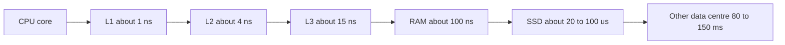
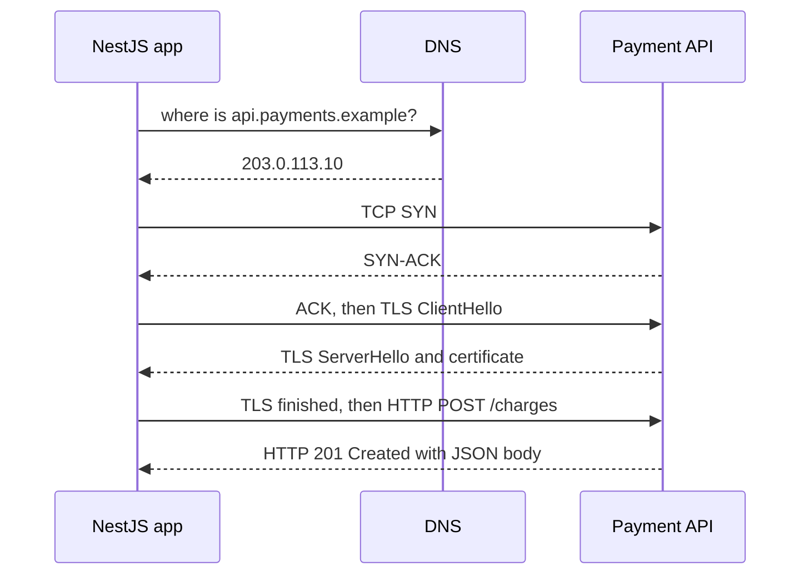

## 0.5 The layers under every technology

Every tool in this book runs on the same few layers: a CPU, a hierarchy of memories, bits that encode numbers and text, an operating system that hands out processes, files and sockets, and a network. When a technology surprises you (a query 100 times slower than expected, a total off by a cent, a username that breaks the database, a service out of "files"), the explanation is almost always down here. Each layer below comes at beginner depth, with real numbers and a pointer to the Part that goes deeper.

### 0.5.1 The CPU and the memory hierarchy

#### Concept

The **CPU** (central processing unit) is the chip that executes your program's instructions, one simple step at a time: load a number, add two numbers, compare, jump. A modern server CPU core runs at around 3 billion cycles per second (3 GHz), so one cycle is about a third of a nanosecond. A typical server has between a handful and a hundred or more cores, each able to run one instruction stream at a time.

The CPU is fast. Fetching data for it is slow. So computers keep data in a **memory hierarchy**: small, fast, expensive storage close to the CPU, and large, slow, cheap storage further away. Each level is a cache for the level below.

#### Why does it exist?

Because no memory can be huge, fast and cheap at once. The hierarchy is the compromise, and it works because programs reuse the same data soon (**temporal locality**) and use data stored next to what they just used (**spatial locality**).

#### Mental model

Imagine cooking. The knife in your hand is a register, the spices on the counter are L1, the fridge is RAM, the supermarket is the SSD, and a farm abroad reached by mail order is a server across the network. A good cook does not drive to the supermarket for each pinch of salt.

#### How it works

Here are the numbers. They are approximate and vary by hardware, but the ratios between them have stayed roughly stable for decades, and the ratios are what you should remember. The right-hand column rescales everything so that one L1 access takes one second.

| Where the data is | Typical size | Approximate time to read | If L1 took 1 second |
|---|---|---|---|
| CPU register | Bytes | Under 1 ns | Instant |
| L1 cache (per core) | 32 to 64 KB | About 1 ns | 1 second |
| L2 cache (per core) | 0.5 to 2 MB | About 3 to 5 ns | 4 seconds |
| L3 cache (shared) | Tens of MB | About 10 to 20 ns | 15 seconds |
| Main memory (RAM) | Tens to hundreds of GB | About 80 to 100 ns | 1.5 minutes |
| Local NVMe SSD, random read | Terabytes | About 20 to 100 µs | 6 hours to a day |
| Cloud network disk (block storage) | Terabytes | About 0.5 to 1 ms | 6 to 12 days |
| Spinning hard disk, random seek | Terabytes | About 5 to 10 ms | 2 to 4 months |
| Round trip inside one data centre | | About 0.2 to 0.5 ms | 2 to 6 days |
| Round trip across a continent or ocean | | About 80 to 150 ms | 2.5 to 5 years |

Read the last column slowly. If reading from the CPU's cache takes a second, reading from RAM takes a minute and a half, reading from an SSD takes most of a day, and asking a server on another continent takes years. That one table explains most of performance engineering:

- **Why caches win.** A Redis lookup in the same data centre (about 0.2 to 1 ms, mostly network) beats a PostgreSQL query that reads pages from disk (several ms); a value in your process's memory (about 100 ns) beats both by thousands of times. PostgreSQL keeps hot pages in RAM (shared buffers) for the same reason.
- **Why round trips dominate.** 20 sequential queries at 1 ms each cost 20 ms of waiting even if each does no work. The N+1 query problem is a memory-hierarchy problem before it is an ORM problem.
- **Why data layout matters.** An array's elements sit side by side, so one 64-byte cache line brings the next few along; a linked structure scattered across memory pays a RAM trip per element. Part 8 — Computer Science Fundamentals: Data Structures returns to this.



#### Production scenario

A product listing endpoint takes 180 ms at the 95th percentile. Tracing shows 3 ms in application code and the rest in 60 sequential queries to PostgreSQL, each around 2.5 ms including the network round trip, one per product to load its price. Rewriting it as one query with a join or `WHERE id = ANY($1)` drops it to 12 ms. No code got "faster"; the endpoint simply stopped paying for 59 round trips. Part 56 — Capacity Estimation and Back-of-the-Envelope Math (56.1) has the full table of numbers to carry in your head, and Part 42 — Performance Engineering shows how to find these costs.

#### Interview questions

1. **Roughly how long does a RAM access take compared with an SSD read and a cross-region network call?** About 100 ns, about 20 to 100 µs, and about 80 to 150 ms: each step is roughly a thousand times slower. Why it matters: it tells you where to look first when something is slow.
2. **Why does iterating over an array beat iterating over a linked list of the same size, even though both are O(n)?** Spatial locality: contiguous memory fills cache lines usefully and lets the CPU prefetch. Follow-up: where does the same idea appear in databases? Sequential scans versus random index lookups, and why clustered data reads faster.

### 0.5.2 Binary, integers and two's complement

#### Concept

Computers store everything as **bits**, each 0 or 1. Eight bits make a **byte**, which can represent 2^8 = 256 different values. Numbers, text, images and your code are all patterns of bytes; what the bytes *mean* depends entirely on how the program interprets them. Programmers often write bytes in **hexadecimal** (base 16, digits 0 to 9 and A to F) because two hex digits are exactly one byte: `0xFF` is 255, `0x2A` is 42.

#### How it works

An **unsigned** integer uses all its bits for magnitude. An 8-bit unsigned integer runs from 0 (`00000000`) to 255 (`11111111`).

To store negative numbers, almost every computer uses **two's complement**. The top bit carries a negative weight: in 8 bits, the place values are -128, 64, 32, 16, 8, 4, 2, 1. So `11111111` is -128 + 127 = -1, and `10000000` is -128. To negate a number, flip every bit and add one: 5 is `00000101`, flipped is `11111010`, plus one is `11111011`, which is -5. The beauty of the scheme is that the CPU's ordinary addition circuit works for negative numbers unchanged.

| Width | Signed range (two's complement) | Where you meet it |
|---|---|---|
| 16-bit | -32,768 to 32,767 | PostgreSQL `smallint` |
| 32-bit | -2,147,483,648 to 2,147,483,647 (about 2.1 billion) | PostgreSQL `integer`/`serial`, Java `int`, Go `int32` |
| 64-bit | About -9.2 to 9.2 quintillion | PostgreSQL `bigint`, Java `long`, Go `int64` |

When a calculation goes past the top of the range, it **overflows**. What happens next depends on the system, and this is exactly the kind of fact the ten questions should dig out:

- **Java and Go integers wrap around silently.** `Integer.MAX_VALUE + 1` in Java is -2,147,483,648. A counter or a money total can turn negative with no error.
- **PostgreSQL refuses.** Inserting past the range of an `integer` column raises `ERROR: integer out of range`. Right for data, but a table with an `integer` primary key stops accepting rows at about 2.1 billion; teams with a `serial` key on a busy events table have hit this as a full outage, fixed by a slow migration to `bigint` (see Part 17 — Databases and the Relational Model, 17.4.1).
- **JavaScript is different again.** Every `number` is a 64-bit floating-point value (next section), which represents integers exactly only up to `Number.MAX_SAFE_INTEGER` = 2^53 - 1 = 9,007,199,254,740,991. Past that, integers silently lose precision. And JavaScript's bitwise operators convert to 32-bit signed integers first, so `(2 ** 31) | 0` is -2147483648.

```ts
console.log(Number.MAX_SAFE_INTEGER);            // 9007199254740991
const big: number = 2 ** 53;                      // 9007199254740992
console.log(big + 1 === big);                     // true: 2^53 + 1 rounds back to 2^53
console.log(2n ** 63n - 1n);                     // 9223372036854775807n, a bigint, exact

// node-postgres returns PostgreSQL bigint (int8) columns as strings by default,
// precisely so that IDs above 2^53 are not silently corrupted.
const row = { id: '9007199254740993' };          // what the driver hands you
const id = BigInt(row.id);                        // exact; Number(row.id) would not be
```

#### Common mistakes

- Using a 32-bit `integer` or `serial` primary key for a table that may one day hold billions of rows. Use `bigint`.
- Converting a 64-bit database ID to a JavaScript `number`. Keep IDs as strings or `bigint`.
- Assuming overflow throws an error in every language. In most it does not.

### 0.5.3 Floating point, and why money is stored in integer cents

#### Concept

A **floating-point** number stores a value as a sign, a fraction and an exponent, like scientific notation in binary: roughly 1.0101 x 2^5. The standard almost every language uses is IEEE 754. A 64-bit "double" (JavaScript's `number`, Java's `double`, Python's `float`, Go's `float64`) gives about 15 to 17 significant decimal digits and a huge range.

#### Why does it exist?

Science and graphics need very large and very small numbers (the mass of a planet, the width of an atom) with a fixed amount of relative precision, and need the arithmetic to be fast in hardware. Floating point delivers that. It was never designed for exact decimal quantities like money.

#### Mental model

Imagine writing one third as a decimal with eight digits: 0.33333333. Add three of them and you get 0.99999999, not 1. Decimal cannot represent one third exactly. Binary has the same problem with one tenth: 0.1 in binary is an infinitely repeating pattern, so the computer stores the nearest value it can, which is very slightly off.

#### How it works

```ts
console.log(0.1 + 0.2);          // 0.30000000000000004
console.log(1.15 * 100);         // 114.99999999999999, not 115
console.log(Math.round(1.15 * 100)); // 115: rounding hides the error, once

// Converting user input "19.99" to cents, done safely:
function toCents(amount: string): number {
  if (!/^\d+(\.\d{1,2})?$/.test(amount)) throw new Error(`Invalid amount: ${amount}`);
  const [whole, fraction = ''] = amount.split('.');
  return Number(whole) * 100 + Number(fraction.padEnd(2, '0')); // pure integer arithmetic
}

console.log(toCents('19.99')); // 1999
console.log(toCents('1.15'));  // 115
```

The tiny errors are harmless in a physics simulation. In money they are not, because money must add up exactly and must match someone else's ledger. So backends represent money one of two ways:

1. **Integer minor units**: store 1999 meaning 19.99 dollars or rupees, in an integer or `bigint` column. All arithmetic is exact integer arithmetic. Part 1 — Programming Fundamentals in JavaScript and TypeScript introduces this habit in 1.1.1.
2. **A decimal type**: PostgreSQL `numeric(12,2)`, Java `BigDecimal`, Python `decimal.Decimal`. These store base-10 digits exactly, at some cost in speed. Part 17 (17.4.2 "Money: numeric vs float") compares the two, and Part 63 — Backend Anti-Patterns and Why They Hurt (63.32) tells the story of getting it wrong.

#### Edge cases & failure modes

- **Not every currency has two decimal places.** Japanese yen has none and some dinars have three. Store the currency alongside the amount and know each currency's minor unit.
- **Division still needs a rounding rule.** Splitting 1000 cents three ways gives 333, 333 and 334; decide who gets the extra cent, and write it down.
- **JSON has only one number type,** and many parsers read it as a double. Large amounts or IDs sent as JSON numbers can be silently rounded; send them as strings (Part 76 — Frontend–Backend Contracts, 76.7).
- **`NaN` and `Infinity` are floating-point values too.** `0 / 0` is `NaN` and `1 / 0` is `Infinity` in JavaScript, with no exception. Validate before you store.

#### Interview questions

1. **Why does `0.1 + 0.2` not equal `0.3`?** 0.1 and 0.2 have no exact binary representation; IEEE 754 stores the nearest values, and the rounding errors show in the sum. Follow-up: is this a JavaScript bug? No, every language using IEEE 754 doubles behaves the same.
2. **How would you store prices and order totals?** Integer minor units or a decimal type, with the currency code; never a float. Follow-up: how do you split a total across three payments?

### 0.5.4 Text: bytes, characters, Unicode and UTF-8

#### Concept

Text looks simple and is not. A computer cannot store "a letter"; it stores bytes. An **encoding** is the rule that maps characters to bytes and back. **Unicode** is the universal catalogue that gives every character in every writing system a number called a **code point**, written like `U+0041` (A), `U+00E9` (é), `U+0939` (the Devanagari letter ह) or `U+1F600` (😀). **UTF-8** is the encoding that turns those code points into bytes, and it is the encoding of the web, of JSON, and of almost every modern database and file.

#### Why does it exist?

ASCII used 7 bits for 128 characters: English letters, digits, punctuation. Other languages invented incompatible encodings, so a file from one country became garbage in another. Unicode gave everyone one catalogue; UTF-8 gave a byte format that is backwards compatible with ASCII and covers every code point.

#### Mental model

Imagine a library catalogue (Unicode) where every book has a unique number, and a shipping company (UTF-8) that packs each book into one, two, three or four boxes depending on its size. Short English books fit in one box. Most European and Indian-script books need two or three. Emoji need four. When someone asks "how big is this order?", you must say whether you are counting books or boxes.

#### How it works

UTF-8 uses 1 byte for code points up to `U+007F` (ASCII), 2 bytes up to `U+07FF` (most Latin accents, Greek, Cyrillic, Arabic, Hebrew), 3 bytes up to `U+FFFF` (Devanagari, Chinese, Japanese, most other scripts) and 4 bytes beyond (emoji and rarer scripts).

There is one more layer that catches JavaScript developers. JavaScript strings are sequences of **UTF-16 code units**, 16 bits each. Code points above `U+FFFF`, such as most emoji, need two code units (a "surrogate pair"). And `.length` counts code units, not characters. On top of that, what a human sees as one character (a **grapheme**) can be several code points: a letter plus a combining accent, or an emoji plus a skin-tone modifier.

```ts
const composed = 'é';          // é as one code point
const decomposed = 'é';       // e + combining acute accent: looks identical
console.log(composed.length, decomposed.length);   // 1 2
console.log(composed === decomposed);               // false
console.log(composed === decomposed.normalize('NFC')); // true: normalise before comparing

console.log('😀'.length);                    // 2: one code point, two UTF-16 code units
console.log([...'😀'].length);               // 1: spreading iterates by code point
console.log(Buffer.byteLength('é', 'utf8')); // 2 bytes
console.log(Buffer.byteLength('😀', 'utf8')); // 4 bytes

// Counting what a user sees as characters (graphemes):
const seg = new Intl.Segmenter('en', { granularity: 'grapheme' });
console.log([...seg.segment('👍🏽')].length, '👍🏽'.length); // 1 4
```

So `'é'.length` is 1 or 2 depending on how the é was typed or pasted, and the two strings are not `===` equal even though they look identical. That one fact is behind duplicate usernames, failed logins and search misses.

#### Production scenario

Two real-shaped bugs, both from this one layer:

- **The emoji that broke sign-up.** A service on MySQL used the column character set `utf8`, which in MySQL means at most 3 bytes per character. The first user to put an emoji in their display name got `Incorrect string value` and a 500 error. The fix was `utf8mb4`, MySQL's real 4-byte UTF-8. PostgreSQL databases created with `UTF8` encoding do not have this trap, and PostgreSQL's `varchar(n)` counts characters, not bytes.
- **The SMS that cost double.** An SMS segment holds 160 characters in the basic GSM alphabet but only 70 once any character outside it appears, because the message switches to a 16-bit encoding. One curly apostrophe pasted from a word processor into a template doubled the number of segments, and the bill, for a month of order-confirmation messages.

And a third you will meet on day one: **mojibake**, the garbage you see as `café` instead of `café`. It means UTF-8 bytes were decoded as a different encoding (usually Latin-1 or Windows-1252). The bytes are fine; the label is wrong. Fix the label (a `charset=utf-8` in the `Content-Type` header, the database connection's client encoding, the file reader's encoding argument), never the bytes.

#### Edge cases & failure modes

- `Content-Length` and most size limits (request body limits, Kafka message size, column byte limits) count **bytes**, not characters.
- Validation like "name must be at most 50 characters" needs a definition of character: code units, code points or graphemes. Pick one deliberately.
- Lookalike characters (Latin `a` and Cyrillic `а`) let attackers register usernames that look like someone else's.

### 0.5.5 The operating system: processes, files and sockets

The **operating system** (Linux, on almost every server you will deploy to) is the program that shares one machine among many programs. For a backend engineer, it provides three things you touch every day.

- **Processes.** A process is one running program with its own private memory, an ID (PID), and one or more **threads** (independent streams of execution inside it that share its memory). Your NestJS app is one Node.js process; PostgreSQL runs one process per connection; a Go service is one process with many lightweight goroutines. The OS scheduler decides which thread runs on which core, switching between them many times per second.
- **Files and file descriptors.** When a process opens a file, the OS hands it a small integer called a **file descriptor**. On Linux, the same mechanism is used for almost everything you read or write: files, pipes, and network connections. Each process has a limit on how many it may hold open (see `ulimit -n`), and hitting it produces `EMFILE: too many open files`, which in a busy API usually means a connection leak, not a file problem.
- **Sockets.** A **socket** is one end of a network connection: an IP address and a port on each side. When your app "listens on port 3000", it asks the OS for a listening socket; each incoming client gets its own connected socket, and its own file descriptor. Your code never touches the network card; it reads and writes sockets through **system calls** (requests from a program to the OS kernel), and the kernel does the rest.

```text
Your NestJS process (PID 4182)
  ├── thread: main (the event loop runs your JavaScript)
  ├── threads: libuv pool (file I/O, DNS, crypto)
  ├── fd 0, 1, 2   stdin, stdout, stderr
  ├── fd 21        listening socket  0.0.0.0:3000
  ├── fd 22..41    client sockets    one per open HTTP connection
  └── fd 42..51    sockets to PostgreSQL (the connection pool)
```

That picture explains why a pool of 10 database connections means 10 sockets and why a connection leak ends as "too many open files". Part 4 — Linux and the Command Line teaches the commands to inspect all of this (4.3 and 4.10), and Part 10 — Operating Systems and the Node.js Runtime goes deep: processes and threads (10.1), memory (10.3, 10.4), file descriptors (10.5), signals and graceful shutdown (10.6) and the event loop (10.16).

### 0.5.6 The network in one picture

Every API call you make crosses a network, and every one pays for the same steps before your first byte of business data moves. Here is a first HTTPS request from a NestJS service to a payment provider, in one picture:



Count the round trips before the request leaves: DNS (often cached), the TCP handshake, one or two for TLS. At 100 ms per round trip, that is 200 to 300 ms of setup before the provider starts on your charge, which is why connection pooling and keep-alive matter and why the first request after a deploy is the slowest.

The layers stack like envelopes: your JSON goes inside an HTTP message, which is encrypted by TLS, carried as a reliable byte stream by TCP, split into packets addressed by IP, and sent over Ethernet or Wi-Fi. Each layer only talks to the layer directly above and below it. When something breaks, the error usually tells you the layer: `ENOTFOUND` is DNS, `ECONNREFUSED` and `ETIMEDOUT` are TCP, `certificate has expired` is TLS, and a `502` or `504` is HTTP from a proxy in the middle. Part 3 — How the Web Works builds this from scratch; Part 11 — Networking and HTTP goes deep, ending with 11.14 "What exactly happens when I call a NestJS API from a browser or Postman?".

#### How a Senior Backend Engineer thinks about this

A senior uses a rough model of these layers to sanity-check claims. "This cache will make it faster": is the slow part memory, disk or network? "Another region adds a little latency": 100 ms per call, times how many calls? "We store the amount as a number": what happens at 2^31 or with 0.1? "Names can be 50 characters": bytes, code points or graphemes? No deep expertise needed, only the habit of looking one layer down.

#### Interview questions

1. **What does `'é'.length` return in JavaScript, and why might it not be 1?** It returns the count of UTF-16 code units: 1 for the composed form `U+00E9`, 2 for `e` plus a combining accent. Follow-up: how do you compare such strings safely? Normalise both to NFC first.
2. **How many bytes does an emoji take in UTF-8, and why does that matter for a backend?** Usually 4. Size limits and some column types count bytes, and MySQL's legacy `utf8` cannot store 4-byte characters at all.

#### Practical exercise

Write a TypeScript script that, for each of these strings, prints `.length`, the number of code points (`[...s].length`), the number of graphemes (`Intl.Segmenter`) and the UTF-8 byte length (`Buffer.byteLength`): `"order"`, `"café"` typed both composed and decomposed, `"नमस्ते"`, `"😀"`, `"👍🏽"`. Then write a `truncatePreview(text, maxGraphemes)` function for notification previews. Acceptance criteria: the table of counts is printed for all six strings, and `truncatePreview` never cuts an emoji or an accent in half (test it with a string whose limit falls inside `"👍🏽"`).
