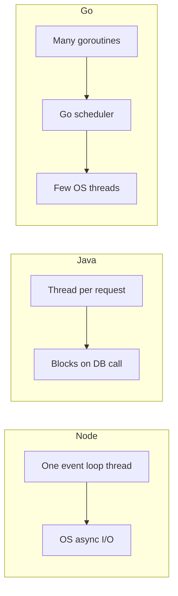

## 0.6 Switching languages

### 0.6.1 Why one language deeply is enough to start

#### Concept

This book teaches backend engineering in TypeScript. Sooner or later you will need another language: a Go service your new team owns, a Java monolith, a Python pipeline. **Mastering one language deeply is what lets you switch.** Variables, functions, types, modules, errors, HTTP, SQL, testing and debugging are the same ideas everywhere; a new language changes the spelling and a handful of real design decisions.

#### Why does it exist?

Because engineers waste weeks learning a language the slow way: syntax first, idioms last, while the parts that bite in production (concurrency, who frees memory, what happens on an error, how it builds and tests) sit in chapter 12 of the tutorial. Apply the ten questions of 0.2 to a language and you get the six below.

#### Mental model

Imagine you drive well and move to a country that drives on the other side of the road. You do not take lessons again; you learn a short list (which side, roundabout priority, the signs) and drive carefully for a week. The checklist below is that list for languages.

### 0.6.2 The checklist for a new language

| # | Ask | Why it matters in a backend | TypeScript/Node.js answer, for reference |
|---|---|---|---|
| 1 | What is the concurrency model? | Decides how one process serves many requests, and which bugs are possible | One event loop runs your code on one thread; I/O is asynchronous; `async`/`await` on promises |
| 2 | How is memory managed? | Decides whether you can leak, crash or corrupt memory, and how much you must think about it | Garbage collected by V8 |
| 3 | What is the type system? | Decides which mistakes the compiler catches and which reach production | Static types checked at compile time, structural, erased at runtime; JavaScript underneath coerces loosely |
| 4 | What is the error model? | Decides how failures travel and how easy they are to ignore | Exceptions (`throw`, `try`/`catch`), rejected promises |
| 5 | What are the build tool, package manager and test runner? | You need all three on day one | `npm` or `pnpm`, `tsc`, Jest or Vitest |
| 6 | What are the idioms and conventions? | Code that works but ignores idioms gets rejected in review and is hard for the team to maintain | ESLint and Prettier, `camelCase`, discriminated unions, async everywhere |

The first two are the deep ones. The last four are a few days each.

### 0.6.3 Concurrency model

**Concurrency** means making progress on many tasks in overlapping time; **parallelism** means literally running several at the same instant on several cores. A backend's job is to serve many requests at once, so every language must answer: when request A is waiting for the database, what runs?

| Model | Languages | How waiting is handled | What you must watch for |
|---|---|---|---|
| Event loop with async/await | JavaScript/TypeScript (Node.js), Python (`asyncio`) | One thread runs your code; I/O is handed to the OS or a thread pool; `await` gives the thread to other work | Any CPU-heavy or blocking call freezes every request on that process |
| Operating-system threads | Java (classic Spring MVC), C#, C++, Python threads | One thread per request blocks while waiting; the OS switches threads | Shared memory between threads: race conditions, locks, deadlocks; each thread costs memory |
| Virtual threads | Java 21 and later | Code looks blocking, but the runtime parks a cheap virtual thread and reuses the OS thread | Same shared-memory hazards; some blocking operations can still pin an OS thread |
| Goroutines and channels | Go | Code looks blocking; the Go runtime schedules millions of cheap goroutines onto a few OS threads | Data races on shared variables, goroutine leaks, forgotten cancellation |
| Async/await on a thread pool | C#, Rust (with a runtime such as Tokio) | `await` frees the thread; continuations may resume on any pool thread, so code also runs in parallel | Both async pitfalls and thread-safety rules apply |

Python wrinkle: standard CPython has a Global Interpreter Lock (GIL), so only one thread runs Python code at a time; threads help with I/O waits, not CPU work, which needs multiple processes. Recent releases offer an optional GIL-free build, so check your version.



The most important consequence when moving from Node.js to Java, Go or C#: **your code now really runs in parallel.** In Node.js, two requests never execute JavaScript at the same instant, so `this.counter++` on a shared object is safe (though async interleaving between `await`s is not). In Java or Go, two threads can run `counter++` at once and lose an update (`++` is read, add, write), so you need a lock, an atomic, or no sharing. Part 13 — Operating Systems and the Node.js Runtime covers race conditions (13.8), deadlocks (13.9), mutexes (13.10) and atomic operations (13.12); read those before you write your first multi-threaded service. Part 35 — Concurrency in Node.js and NestJS covers the event-loop side.

### 0.6.4 Memory management: the one real learning curve

Every program allocates memory for its data, and that memory must eventually be given back. Languages split into two families by who gives it back.

**Garbage-collected languages**: JavaScript, Java, Go, Python, C#, Kotlin, Ruby. A **garbage collector** (GC) is part of the runtime that periodically finds objects nothing refers to any more and frees them. You allocate freely and never free anything by hand. Moving between these languages is easy because the model is the same. What you still have to know:

- You can still leak, by keeping references you no longer need: a global `Map` used as a cache with no eviction, listeners never removed, closures holding large objects. Part 13 (13.13 and 13.25) covers how.
- The GC costs CPU and can pause your program briefly, and heap limits are set differently in each runtime (`--max-old-space-size` for Node, `-Xmx` for the JVM, `GOMEMLIMIT` for Go).

**Manual or ownership-based languages**: C, C++, Rust. Here memory management is part of your job, and this is the only part of switching languages that is a genuine learning curve rather than a list of facts.

- In **C**, you call `malloc` to allocate and `free` to release. Forget to free and you leak. Free twice, or use memory after freeing it, and the program can crash or, worse, keep running with corrupted data. Write past the end of a buffer and you have a classic security vulnerability.
- **C++** adds destructors and smart pointers (`std::unique_ptr`, `std::shared_ptr`) that free memory automatically when an owner goes out of scope (a pattern called RAII), which removes most manual frees but not the need to think about lifetimes.
- **Rust** makes ownership part of the type system. Every value has one owner and is freed when the owner goes out of scope; other code may *borrow* a reference, and the compiler proves that no reference outlives the value and no two places mutate the same data at once. You get memory safety and no data races without a GC; the price is satisfying the "borrow checker". The first weeks feel like arguing with the compiler; that argument is the learning.

Why is this the real curve? In a GC language, "who owns this object and when does it die?" never needs an answer. In C, C++ and Rust you answer it for every value, and your data structures change to keep the answer simple. Everything else on the checklist is new spelling for ideas you already have; this is a new idea.

### 0.6.5 Types, errors, tooling and idioms

**Type system.** Two separate questions. *Static or dynamic*: are types checked before the program runs (TypeScript, Java, Go, C#, Rust) or only while it runs (JavaScript, Python, Ruby)? *Strict or loose*: does the language convert between types silently? JavaScript does (`'5' * 2` is `10`); Python does not (`'5' + 1` raises `TypeError`), even though both are dynamic. Two more details trip TypeScript developers:

- TypeScript is **structural** (any object with the right shape fits an interface); Java and C# are **nominal** (a class must declare `implements OrderRepository`); Go satisfies interfaces implicitly, with no `implements` keyword.
- TypeScript types vanish at runtime, hence `class-validator` or `zod` for incoming JSON. Python hints are not enforced at runtime either (mypy or pyright check them). Java erases generic parameters, so `List<Order>` is just `List` at runtime.

**Error model.**

| Model | Languages | What it looks like | The trap |
|---|---|---|---|
| Exceptions | TypeScript, Java, Python, C# | `throw` unwinds the stack to the nearest `catch` | Easy to forget that a call can throw; errors travel invisibly |
| Checked exceptions | Java (some) | The method signature must declare `throws IOException` | Teams wrap everything in unchecked exceptions to escape the noise |
| Returned errors | Go | `order, err := repo.Find(ctx, id)`, then `if err != nil { return ..., err }` | Ignoring `err` with `_`; losing context by not wrapping with `fmt.Errorf("...: %w", err)` |
| Result types | Rust | `fn find(id: &str) -> Result<Order, DbError>`; the `?` operator returns early on error | Calling `.unwrap()` everywhere, which crashes on any error |

Go's verbosity is deliberate: every call that can fail shows it at the call site. Go's `panic` is reserved for programmer errors, not for "order not found".

**Build tool, package manager, test runner.** On day one, find the equivalents of the commands you already use:

| Language | Dependencies and build | Test runner | Format and lint |
|---|---|---|---|
| TypeScript/Node.js | `npm`, `pnpm` or `yarn`; `tsc` | Jest, Vitest, `node --test` | Prettier, ESLint |
| Java | Maven (`pom.xml`) or Gradle (`build.gradle`) | JUnit 5, with Mockito for mocks | Checkstyle, Spotless |
| Go | Go modules (`go.mod`), `go build` | `go test` (built in) | `gofmt`, `go vet` (built in) |
| Python | `pip` with a virtual environment, Poetry or uv (`pyproject.toml`) | pytest | Ruff, Black |
| C# | `dotnet` CLI and NuGet | xUnit or NUnit | `dotnet format` |
| Rust | Cargo (`Cargo.toml`) | `cargo test` (built in) | `rustfmt`, Clippy |

**Idioms.** Code review will enforce each community's conventions. Go prefers small interfaces, plain structs, short names, explicit error checks and no class hierarchies. Java leans on classes, interfaces and Spring dependency injection. Python has PEP 8, comprehensions and "easier to ask forgiveness than permission". Read the official style guide once (Effective Go, PEP 8), read one well-maintained open-source project, and let the formatter and linter correct you.

### 0.6.6 NestJS and Spring Boot, side by side

NestJS was openly inspired by Angular, which borrowed many ideas from Spring. So a NestJS developer who moves to Spring Boot, the dominant Java backend framework, finds a lot of familiar shapes. This table maps the concepts using only real annotations and APIs.

| Concept | NestJS | Spring Boot |
|---|---|---|
| Application entry | `NestFactory.create(AppModule)` in `main.ts` | A class annotated `@SpringBootApplication` calling `SpringApplication.run(...)` |
| Module | `@Module({ imports, controllers, providers, exports })` | No direct equivalent: components are found by package scanning; `@Configuration` classes with `@Bean` methods and `@Import` group wiring |
| Controller | `@Controller('orders')` | `@RestController` with `@RequestMapping("/orders")` |
| Route handlers | `@Get(':id')`, `@Post()` | `@GetMapping("/{id}")`, `@PostMapping` |
| Path, query, body | `@Param('id')`, `@Query('page')`, `@Body()` | `@PathVariable`, `@RequestParam`, `@RequestBody` |
| Service (injectable class) | `@Injectable()` | `@Service` (or the general `@Component`) |
| Dependency injection | Constructor parameters | Constructor parameters (a single constructor is injected automatically; `@Autowired` is optional) |
| DTO validation | `class-validator` decorators (`@IsString()`, `@IsInt()`, `@Min(1)`) with `ValidationPipe` | Jakarta Bean Validation (`@NotBlank`, `@NotNull`, `@Min(1)`, `@Size`) with `@Valid` on the parameter |
| Entity | TypeORM `@Entity()`, `@PrimaryGeneratedColumn()`, `@Column()` | JPA `@Entity`, `@Id` with `@GeneratedValue`, `@Column` |
| Repository | `@InjectRepository(Order)` giving a `Repository<Order>` | An interface extending Spring Data's `JpaRepository<Order, Long>`; Spring generates the implementation |
| Transactions | `dataSource.transaction(...)` or a `QueryRunner` | `@Transactional` on a service method |
| Error handling | Exception filters (`@Catch()`), `NotFoundException` | `@RestControllerAdvice` with `@ExceptionHandler`, `ResponseStatusException` |
| Configuration | `@nestjs/config` and `ConfigService` | `application.yml` with `@Value` or `@ConfigurationProperties` |
| Auth | Guards (`CanActivate`), `@nestjs/passport` | Spring Security's filter chain |
| Cross-cutting logic | Interceptors | `HandlerInterceptor`, or aspects with `@Aspect` |
| Tests | Jest with `Test.createTestingModule` | JUnit 5 with `@SpringBootTest` or `@WebMvcTest`, Mockito |

The biggest real difference is not in this table. A classic Spring MVC application handles each request on its own thread (0.6.3), so blocking calls are normal and shared mutable state needs care, while NestJS runs on one event loop where blocking calls are forbidden. Same shapes, different physics.

### 0.6.7 One task in four languages

The task: fetch an order from an internal HTTP API, total its items in integer cents, and give up after two seconds. It is small, but it touches everything on the checklist: concurrency, types, errors, money as integers, and a timeout.

```ts
// TypeScript (Node.js 18+): global fetch, AbortSignal.timeout
interface OrderItem { sku: string; priceCents: number; quantity: number }
interface Order { id: string; items: OrderItem[] }

export class OrderFetchError extends Error {}

export async function fetchOrderTotal(baseUrl: string, orderId: string, timeoutMs = 2_000): Promise<number> {
  const res = await fetch(`${baseUrl}/orders/${encodeURIComponent(orderId)}`, {
    signal: AbortSignal.timeout(timeoutMs), // one deadline for connect, headers and body
  });
  if (!res.ok) throw new OrderFetchError(`GET order ${orderId} failed: HTTP ${res.status}`);
  const order = (await res.json()) as Order; // a type assertion only; validate with zod in production
  return order.items.reduce((sum, item) => sum + item.priceCents * item.quantity, 0);
}
```

```java
// Java 17+: java.net.http.HttpClient, records, Jackson for JSON
import com.fasterxml.jackson.databind.ObjectMapper;
import java.io.IOException;
import java.net.URI;
import java.net.URLEncoder;
import java.net.http.HttpClient;
import java.net.http.HttpRequest;
import java.net.http.HttpResponse;
import java.nio.charset.StandardCharsets;
import java.time.Duration;
import java.util.List;

public class OrderTotals {
    record OrderItem(String sku, long priceCents, long quantity) {}
    record Order(String id, List<OrderItem> items) {}

    private static final HttpClient CLIENT = HttpClient.newBuilder().connectTimeout(Duration.ofSeconds(2)).build();
    private static final ObjectMapper JSON = new ObjectMapper();

    public static long fetchOrderTotal(String baseUrl, String orderId) throws IOException, InterruptedException {
        HttpRequest request = HttpRequest.newBuilder()
                .uri(URI.create(baseUrl + "/orders/" + URLEncoder.encode(orderId, StandardCharsets.UTF_8)))
                .timeout(Duration.ofSeconds(2)) // HttpTimeoutException if the response does not arrive in time
                .GET()
                .build();
        HttpResponse<String> response = CLIENT.send(request, HttpResponse.BodyHandlers.ofString()); // blocks this thread
        if (response.statusCode() != 200) {
            throw new IOException("GET order " + orderId + " failed: HTTP " + response.statusCode());
        }
        Order order = JSON.readValue(response.body(), Order.class);
        return order.items().stream()
                .mapToLong(item -> Math.multiplyExact(item.priceCents(), item.quantity())) // throws on overflow
                .sum();
    }
}
```

```go
// Go: net/http, context deadline, returned errors
package orders

import (
	"context"
	"encoding/json"
	"fmt"
	"net/http"
	"net/url"
	"time"
)

type OrderItem struct {
	SKU        string `json:"sku"`
	PriceCents int64  `json:"priceCents"`
	Quantity   int64  `json:"quantity"`
}

type Order struct {
	ID    string      `json:"id"`
	Items []OrderItem `json:"items"`
}

func FetchOrderTotal(ctx context.Context, client *http.Client, baseURL, orderID string) (int64, error) {
	ctx, cancel := context.WithTimeout(ctx, 2*time.Second) // deadline covers the whole call, body included
	defer cancel()

	req, err := http.NewRequestWithContext(ctx, http.MethodGet, baseURL+"/orders/"+url.PathEscape(orderID), nil)
	if err != nil {
		return 0, fmt.Errorf("build request: %w", err)
	}
	resp, err := client.Do(req)
	if err != nil {
		return 0, fmt.Errorf("get order %s: %w", orderID, err)
	}
	defer resp.Body.Close()
	if resp.StatusCode != http.StatusOK {
		return 0, fmt.Errorf("get order %s: HTTP %d", orderID, resp.StatusCode)
	}

	var order Order
	if err := json.NewDecoder(resp.Body).Decode(&order); err != nil {
		return 0, fmt.Errorf("decode order %s: %w", orderID, err)
	}
	var total int64
	for _, item := range order.Items {
		total += item.PriceCents * item.Quantity
	}
	return total, nil
}
```

```python
# Python 3.11+: asyncio and the httpx library
import asyncio
from urllib.parse import quote

import httpx


async def fetch_order_total(base_url: str, order_id: str, timeout_s: float = 2.0) -> int:
    async with asyncio.timeout(timeout_s):  # one overall deadline; raises TimeoutError
        async with httpx.AsyncClient(base_url=base_url, timeout=timeout_s) as client:  # per-phase limits
            response = await client.get(f"/orders/{quote(order_id, safe='')}")
            response.raise_for_status()  # raises httpx.HTTPStatusError on 4xx and 5xx
            order = response.json()
    return sum(item["priceCents"] * item["quantity"] for item in order["items"])


if __name__ == "__main__":
    print(asyncio.run(fetch_order_total("http://localhost:3000", "ord_123")))
```

What changed and what stayed the same:

| Aspect | TypeScript | Java | Go | Python |
|---|---|---|---|---|
| Waiting for the network | `await`: the event loop serves other requests | `send` blocks this thread; other requests run on other threads | `client.Do` blocks this goroutine; the runtime runs others | `await`: the asyncio loop runs other tasks |
| Timeout | `AbortSignal.timeout`: one deadline | Connect timeout plus request timeout on the builder | `context.WithTimeout`, passed down explicitly | `asyncio.timeout` for the total; httpx's `timeout` limits each phase (connect, read, write, pool) separately |
| Error on timeout | `DOMException` named `TimeoutError` is thrown | `HttpTimeoutException` is thrown | `client.Do` returns an error wrapping `context.DeadlineExceeded` | `TimeoutError` is raised |
| JSON to typed data | Cast only; no runtime check | Jackson maps to records, and fails on unknown fields by default | Struct tags map fields; unknown fields are ignored by default | Plain dicts; no types unless you add a library such as Pydantic |
| Money arithmetic | `number` (exact up to 2^53) | `long` with `Math.multiplyExact` to catch overflow | `int64`, wraps silently on overflow | `int`, arbitrary precision, never overflows |

And what stayed exactly the same, in all four: build the URL with the ID escaped; set a deadline; send the request; treat non-200 as an error; parse the JSON; sum integer cents. That list is the engineering; the table is the spelling. Note that "a timeout" means four slightly different things: a two-second per-phase read timeout can let a slowly dripping response run far longer than two seconds overall. Part 34 — Reliability Engineering: Timeouts, Retries, Circuit Breakers and Backpressure goes deep on deadlines.

#### How a Senior Backend Engineer thinks about this

A senior learns a language through the six checklist questions, one small real service (endpoint, database call, test, Dockerfile) and the team's existing code. They do not judge a language by syntax, the cheapest part, but by its concurrency, memory and error models and its ecosystem fit. When choosing a language for a new service, they weigh team skills heavily: a slightly better language nobody can operate at 03:00 is a worse choice.

#### Common mistakes

- Writing TypeScript in Go (classes simulated with structs and interfaces everywhere, exceptions simulated with `panic`) or Java in Python. Learn the idioms; reviewers will notice.
- Carrying event-loop assumptions into a threaded language and sharing mutable state without locks.
- Ignoring Go's returned errors with `_`, which is the exact equivalent of an empty `catch` block.
- Assuming "timeout" means the same thing in every HTTP client.

#### Interview questions

1. **You are moving from Node.js to Go. What do you learn first?** Expected answer: the concurrency model (goroutines, channels, `context` cancellation, data races and the `-race` detector), the error model (returned errors, wrapping with `%w`), then tooling (`go test`, modules) and idioms. Why it matters: these decide correctness; syntax does not. Follow-up: what Node.js habit is dangerous in Go? Assuming code never runs in parallel.
2. **Why is memory management the steepest part of moving to Rust or C++?** You must reason about ownership and lifetime of every value; in GC languages the runtime does it. Follow-up: can a garbage-collected program leak memory? Yes, by keeping unneeded references reachable.
3. **Compare exceptions with Go-style returned errors.** Exceptions keep the happy path clean but hide which calls can fail; returned errors make every failure visible at the call site at the cost of verbosity. Follow-up: what is the equivalent mistake in each? An empty `catch` versus `_` on the error.
4. **Map a NestJS module, controller, service and repository to Spring Boot.** Package scanning plus `@Configuration`; `@RestController`; `@Service`; a Spring Data `JpaRepository` interface.

#### Practical exercise

Implement `fetchOrderTotal` from 0.6.7 in a language you do not know (Go is a good first choice) and point it at a tiny stub server that sleeps a configurable time before answering. Acceptance criteria: with a 500 ms delay it returns the correct total; with a 3 s delay it fails after about 2 s with an error that clearly says "timeout"; with a 404 it returns an error containing the status; and you write three sentences on what surprised you, mapped to the checklist in 0.6.2.

## 0.7 A learning loop that lasts a career

### 0.7.1 Build, space, teach

#### Concept

A **learning loop** is a repeatable cycle you run for every new technology: read just enough, build something small with it, break it, explain it back, and return to it later. It turns the ten questions from a checklist you read into knowledge you can use under pressure.

#### Why does it exist?

Because reading feels like learning and mostly is not: you nod through a page on Kafka rebalancing and a month later cannot explain it. Learning research consistently points to **retrieval** (pulling it from your own head), **spacing** (returning over days and weeks) and **application** (using it on a real problem). The loop builds in all three.

#### How it works


1. **Build one small, real project,** the same one in every new technology: an orders service with a write endpoint, a read endpoint, a table, a test and a Dockerfile. You know the domain cold, so all attention goes to the new tool. Part 6 — Your First Backend is exactly that project in NestJS.
2. **Break it on purpose.** Kill the database mid-request, send a duplicate, slow the downstream API. This is question 10 at project scale.
3. **Teach it back.** Write a one-page explanation for a beginner. Where you cannot explain a step simply, you have found your gap (the Feynman technique).
4. **Space your practice.** Revisit after a day, a week and a month, answering from memory first. Spaced-repetition cards suit facts; rebuilding the project suits skills.

#### Common mistakes

- Collecting tutorials and courses instead of finishing one small project.
- Only ever building the happy path, so the first failure you see is in production.
- Never writing anything down, so every relearning starts from zero.

### 0.7.2 Using AI assistants as a tutor, not a replacement

AI coding assistants are a superb learning tool, and also the fastest way yet invented to *feel* you understand something you do not. The difference is whether the assistant thinks with you or for you.

Ways to use an assistant that build understanding:

- **Ask it to explain, then explain back.** "Explain Kafka consumer group rebalancing to someone who knows HTTP but not Kafka." Then write your own explanation and ask it to find the mistakes.
- **Ask it to quiz you** on the ten questions, and for the failure modes and alternatives (questions 6 and 9) that tutorials skip. Then verify each claim.
- **Write the code first, then compare.** Solve the exercise yourself, then ask for a review or an alternative, and make sure you understand every difference.

Rules that keep your understanding yours:

- **Verify against primary sources.** Assistants can state outdated or invented APIs and settings with complete confidence. No default, limit or guarantee is true until the docs for your version, or an experiment, confirm it.
- **Never ship code you cannot explain line by line.** "The assistant wrote it" is not an answer in review. You own every line you commit.
- **Keep the hard thinking.** Let the assistant draft boilerplate and test skeletons; do the design, failure analysis and trade-offs yourself, because those skills only grow with use.
- **Do not paste secrets or customer data** into a tool your company has not approved for it.

Part 57 — AI-Assisted Engineering covers working with AI assistants in production engineering in depth, and Part 69 — The Knowledge Map and Learning Roadmap lays out what to learn in which order across this book.

#### How a Senior Backend Engineer thinks about this

A senior treats learning as part of the job: a running "learned this week" file, the ten questions in writing for any tool entering the system, the standard project rebuilt in each new stack, and AI assistants used hard while they stay the one who decides. Above all, they can say "I do not know how this works yet; give me a day", and they know exactly how to spend that day.

#### Interview questions

1. **How do you learn a new technology quickly enough to make a decision about it?** Expected answer: the ten questions, the explanation and limits pages of the docs, a 30-minute experiment that tries to break it, and a one-page write-up. Follow-up: how do you know when to stop learning and decide?
2. **How do you use AI assistants without losing your own understanding?** Use them to explain, quiz and review; verify every factual claim against docs and experiments; never commit code you cannot explain.
3. **Tell me about a technology you learned recently. What surprised you?** A strong answer names a specific failure mode or trade-off found by experiment, not a feature.

#### Practical exercise

Choose a technology this book teaches later that you have never used (Redis, RabbitMQ or Docker are good choices). Spend at most three hours: answer the ten questions in a one-page document, run one 30-minute experiment that breaks it, and ask an AI assistant to critique your page. Acceptance criteria: every one of the ten questions has a concrete answer; at least one answer was corrected by your experiment or by checking the docs (note which); and one week later, you can re-answer questions 3, 4 and 6 from memory.

## Senior Checklist — Part 0

- [ ] I understand the concept
- [ ] I can explain it simply
- [ ] I can implement it
- [ ] I understand its failure modes
- [ ] I understand its scaling limitations
- [ ] I understand its security implications
- [ ] I understand its operational implications
- [ ] I can choose between alternatives
- [ ] I can explain the tradeoffs
- [ ] I can answer senior-level interview questions
- [ ] I can apply the ten questions to a technology I have never used, and write the answers on one page
- [ ] I can name what a tool trades away and when I would not use it
- [ ] I read explanation and limits pages before tutorials, and I check the docs version
- [ ] I can read a stack trace from the first frame of my own code, and tell `ECONNREFUSED` from `ETIMEDOUT`
- [ ] I can build a minimal reproduction before asking for help
- [ ] I know the rough latency of RAM, SSD, a data-centre round trip and a cross-continent round trip
- [ ] I store money as integer minor units or a decimal type, and I know where integers overflow
- [ ] I know the difference between bytes, code points and graphemes, and why `'é'.length` can be 2
- [ ] I can learn a new language through its concurrency, memory, type and error models first
- [ ] I can map NestJS concepts to Spring Boot
- [ ] I use AI assistants as a tutor and verify what they say

## Part 0 — Key Takeaways

- Tools churn; ideas repeat. Caching, queues, indexes, retries, logs and consistency show up in every stack.
- Ask the ten questions of every technology; questions 4, 6 and 7 (state, failure, trade-off) are where production pain hides.
- Every new technology is a liability until it proves it is better enough than what you already run.
- A 30-minute experiment that tries to break a tool beats a day of reading about it.
- Read the explanation, limits and changelog pages first; the tutorial only shows the happy path.
- In a stack trace, read the message and the first frame of your own code; the framework frames are rarely the bug.
- A minimal reproduction solves half your problems before you ask anyone.
- Each step down the memory hierarchy is roughly a thousand times slower; round trips, not computation, usually dominate latency.
- Floats cannot hold money exactly, integers overflow at fixed widths, and text length depends on whether you count bytes, code points or graphemes.
- Mastering one language lets you switch: learn the concurrency, memory, type and error models first, then the tools and idioms.
- Manual or ownership-based memory management is the one genuinely new idea when moving from garbage-collected languages.
- Use AI assistants to explain, quiz and review, never to replace your own understanding; verify every claim and own every line.
