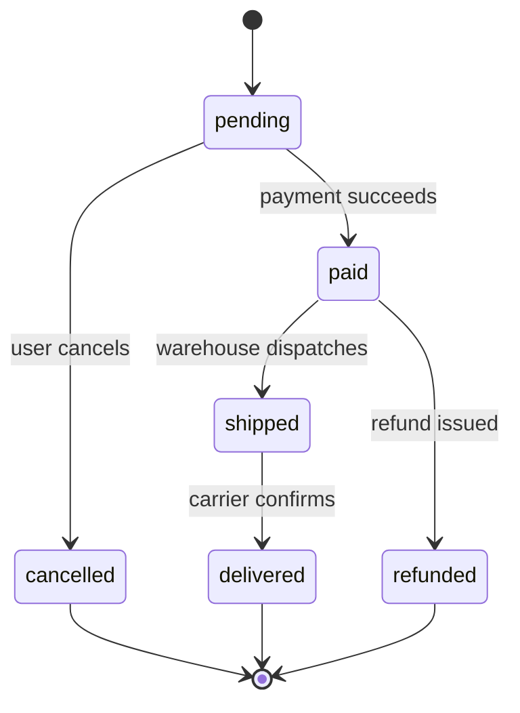

## 1.6 Control flow

### 1.6.1 Conditionals and branching

#### Concept

Control flow is how a program decides what to do next. Conditionals (`if`, `else`, `switch`) choose between paths. Loops (`for`, `while`) repeat. Together they turn a static list of statements into a program that reacts to its data.

#### Why does it exist?

Real logic is full of decisions. Is the order paid? Then ship it. Is the user an admin? Then allow the delete. Is the inventory zero? Then reject the purchase. Without branching, every program would do exactly the same thing every time regardless of its input, which is to say it would not be a program at all.

#### How it works

```ts
function describeOrder(status: OrderStatus): string {
  if (status === 'paid') {
    return 'ready to ship';
  } else if (status === 'pending') {
    return 'awaiting payment';
  } else {
    return 'closed';
  }
}
```

The **ternary** operator is a compact `if/else` that yields a value:

```ts
const label = isPaid ? 'Paid' : 'Unpaid';
```

`switch` is cleaner than a long `if/else if` chain when branching on one value:

```ts
function nextStatus(status: OrderStatus): OrderStatus {
  switch (status) {
    case 'pending':
      return 'paid';
    case 'paid':
      return 'paid';        // already paid, no change
    case 'cancelled':
      return 'cancelled';
    default:
      // With a union type, TypeScript ensures every case is handled.
      throw new Error(`unknown status: ${status}`);
  }
}
```

The `default` case with a union type gives you **exhaustiveness checking**: if someone later adds `'refunded'` to `OrderStatus` and forgets to handle it, TypeScript can flag the gap (with the `never` trick shown in 1.7). This is a quiet superpower — the compiler reminds you to update every switch when the set of statuses grows.

#### Guard clauses

A guard clause handles the exceptional or invalid case first and returns early, so the main logic is not buried inside nested `if`s. Senior code is full of guard clauses.

```ts
// Nested, hard to read:
function charge(order: Order) {
  if (order.status === 'pending') {
    if (order.totalCents > 0) {
      // ... the real work, two levels deep
    }
  }
}

// Guard clauses, flat and clear:
function chargeBetter(order: Order) {
  if (order.status !== 'pending') throw new Error('order not pending');
  if (order.totalCents <= 0) throw new Error('nothing to charge');
  // ... the real work, at the top level
}
```

#### Practical example — an order state machine

A state machine lists which transitions are allowed. This pattern prevents illegal states, like shipping a cancelled order. We draw it as a diagram because that is how backend engineers reason about states.



```ts
type Status = 'pending' | 'paid' | 'shipped' | 'delivered' | 'cancelled' | 'refunded';

const allowed: Record<Status, Status[]> = {
  pending: ['paid', 'cancelled'],
  paid: ['shipped', 'refunded'],
  shipped: ['delivered'],
  delivered: [],
  cancelled: [],
  refunded: [],
};

function canTransition(from: Status, to: Status): boolean {
  return allowed[from].includes(to);
}
canTransition('pending', 'shipped'); // false: must be paid first
```

This data-driven approach (a lookup table of allowed transitions) is cleaner than a tangle of `if`s and is easy to extend. We return to state machines in Part 67.

#### How a Senior Backend Engineer thinks about this

A senior keeps the happy path at the top indentation level and pushes error and edge cases into guard clauses at the top of the function. They prefer `switch` with exhaustiveness checking over long `if/else` chains on a single value, because the compiler then forces every branch to be handled when the set of values grows. They model important state changes as explicit state machines rather than scattering `if (status === ...)` checks across the codebase, because scattered checks drift out of sync and allow illegal states.

#### Common mistakes

- Deeply nested `if`s instead of guard clauses; hard to read and easy to get the logic wrong.
- `switch` with a missing `break` in plain JavaScript (falling through to the next case unintentionally); in the `return`-per-case style above this cannot happen.
- Scattering status checks everywhere instead of one state machine, so illegal transitions slip through.

#### Interview questions

1. **What is a guard clause and why use it?** An early return for an invalid or edge case, keeping the main logic unindented and readable.
2. **What is exhaustiveness checking in a `switch`?** Using a union type and a `never` default so the compiler forces you to handle every case, catching missed branches when the union grows.

#### Practical exercise

Implement `transition(order, to)` that uses the `allowed` table above, throws a clear error for an illegal transition, and returns a new order object (not mutated) with the updated status. Acceptance criteria: adding a new status to the `Status` union without updating `allowed` must cause a TypeScript error.

#### Worked answer to the exercise

```ts
type Status = 'pending' | 'paid' | 'shipped' | 'delivered' | 'cancelled' | 'refunded';

interface Order {
  readonly id: string;
  readonly status: Status;
  readonly totalCents: number;
}

// Record<Status, ...> demands one key per member of the union.
const allowed: Record<Status, readonly Status[]> = {
  pending: ['paid', 'cancelled'],
  paid: ['shipped', 'refunded'],
  shipped: ['delivered'],
  delivered: [],
  cancelled: [],
  refunded: [],
};

class IllegalTransitionError extends Error {
  constructor(orderId: string, from: Status, to: Status) {
    super(`order ${orderId}: cannot go from '${from}' to '${to}' (allowed: ${allowed[from].join(', ') || 'none'})`);
    this.name = 'IllegalTransitionError';
  }
}

function transition(order: Order, to: Status): Order {
  if (!allowed[order.status].includes(to)) {
    throw new IllegalTransitionError(order.id, order.status, to);
  }
  return { ...order, status: to }; // a new object; the input is untouched
}

const placed: Order = { id: 'ord_1001', status: 'pending', totalCents: 4299 };
const paid = transition(placed, 'paid');
console.log(placed.status, '->', paid.status, '| same object?', placed === paid);

try {
  transition(placed, 'shipped');
} catch (err) {
  console.log((err as Error).message);
}
try {
  transition({ ...paid, status: 'delivered' }, 'refunded');
} catch (err) {
  console.log((err as Error).message);
}
```

```text
pending -> paid | same object? false
order ord_1001: cannot go from 'pending' to 'shipped' (allowed: paid, cancelled)
order ord_1001: cannot go from 'delivered' to 'refunded' (allowed: none)
```

Now the acceptance test. Add `'disputed'` to the `Status` union and change nothing else; `npx tsc --noEmit --strict` fails:

```text
transition.ts(10,7): error TS2741: Property 'disputed' is missing in type '{ pending: ("cancelled" | "paid")[]; paid: ("refunded" | "shipped")[]; shipped: "delivered"[]; delivered: never[]; cancelled: never[]; refunded: never[]; }' but required in type 'Record<Status, readonly Status[]>'.
```

Why it is right: `Record<Status, readonly Status[]>` means "an object with exactly one key for every member of `Status`". The day someone adds a status, the table stops compiling until they decide which transitions the new status allows. The guard clause throws before anything changes, and the error names the order, both states and the legal options, so the log line explains itself. `{ ...order, status: to }` builds a new object; `placed === paid` is `false`, and `placed.status` is still `pending`. The `readonly` fields make `order.status = to` a compile error, so nobody can "simplify" it into a mutation later.

The trap most learners fall into is typing the table loosely, as `{ [key: string]: Status[] }` or `Partial<Record<Status, Status[]>>`. Both compile today and both quietly drop the exhaustiveness check, which is the whole point of the exercise. Then `allowed['disputed']` is `undefined` at runtime and `.includes` throws a confusing `TypeError` in production instead of a clear compile error on your laptop.

Check it yourself: run the file and compare the three lines, then add `'disputed'` to the union and confirm the compile error appears.

### 1.6.2 Loops

#### Concept

Loops repeat a block of code. The main forms are `for` (counted), `for...of` (over the values of an array or other iterable), `for...in` (over the keys of an object — use sparingly), and `while` (until a condition is false).

#### How it works

```ts
const ids = ['a', 'b', 'c'];

// for...of: the modern default for iterating values.
for (const id of ids) {
  console.log(id);
}

// Classic for: when you need the index.
for (let i = 0; i < ids.length; i++) {
  console.log(i, ids[i]);
}

// while: when you do not know the count in advance.
let remaining = 3;
while (remaining > 0) {
  remaining--;
}

// for...in iterates object KEYS (as strings). Rarely what you want for arrays.
const prices = { p1: 1000, p2: 2500 };
for (const key in prices) {
  console.log(key, prices[key as keyof typeof prices]);
}
```

`break` exits a loop early; `continue` skips to the next iteration. Use `break` when you have found what you are looking for and need not continue — this is the main reason to write a manual loop instead of an array method.

#### When to use a loop vs an array method

```text
Transform every element into a new value        -> map
Keep some elements                               -> filter
Combine into one value                           -> reduce
Find the first match, then stop                  -> find (or for...of + break)
Do a side effect for each (log, call an API)     -> for...of
Need the index, or step by 2, or go backwards    -> classic for
Repeat until a condition with no fixed count     -> while
```

#### Practical example — retry with a loop

```ts
async function withRetry<T>(fn: () => Promise<T>, maxAttempts = 3): Promise<T> {
  let lastError: unknown;
  for (let attempt = 1; attempt <= maxAttempts; attempt++) {
    try {
      return await fn();           // success: return immediately
    } catch (err) {
      lastError = err;
      // backoff would go here (Part 2)
    }
  }
  throw lastError;                 // all attempts failed
}
```

A counted `for` loop is the right tool here because we need the attempt number and an early `return` on success.

#### Edge cases & failure modes

- **Infinite loops.** A `while (true)` with no `break`, or a `for` whose condition never becomes false, hangs the process. On a single-threaded Node server, an infinite loop freezes the entire server for every user, not just one request (Part 10).
- **`for...in` over arrays** iterates indices as strings and includes inherited properties; use `for...of` for array values.
- **Modifying an array while iterating it** with a classic `for` can skip or repeat elements. Build a new array instead.
- **`await` inside a loop** runs iterations one after another (serial). If they are independent, that is needlessly slow; use `Promise.all` (Part 2) to run them together.

#### How a Senior Backend Engineer thinks about this

A senior defaults to array methods for data transformation and reserves explicit loops for early exit, index math, and side effects that read more clearly as a loop. They are acutely aware that on Node a long synchronous loop blocks the event loop and therefore every concurrent request (Part 10), so a loop over a million rows gets rewritten to stream or to yield control. They watch for the accidental-serial-`await`-in-a-loop pattern, one of the most common causes of a slow endpoint.

#### Common mistakes

- `await` in a loop for independent work, making an endpoint 10x slower than needed.
- A long synchronous loop blocking the event loop and freezing the server.
- `for...in` on arrays.
- Mutating the array being iterated.

#### Interview questions

1. **Why can a long synchronous loop freeze an entire Node server?** Node runs your JavaScript on one thread; while the loop runs, the event loop cannot handle any other request (see Part 10).
2. **What is wrong with `for (const x of items) { await save(x); }` when saves are independent?** It runs serially; `await Promise.all(items.map(save))` runs them concurrently and is far faster.
3. **When do you write a manual `for` loop instead of `map`/`filter`?** When you need early exit (`break`), the index, custom stepping, or side effects that are clearer as a loop.

#### Practical exercise

Rewrite a serial loop that fetches 20 product details one at a time (`for...of` with `await`) into a concurrent version using `Promise.all`, and explain in one sentence why the concurrent version is faster. Acceptance criteria: the concurrent version preserves the order of results.

#### Worked answer to the exercise

```ts
interface Product {
  id: number;
  name: string;
}

function wait(ms: number): Promise<void> {
  return new Promise((resolve) => setTimeout(resolve, ms));
}

// A pretend product API: each call takes 30-70 ms, in random order.
async function fetchProduct(id: number): Promise<Product> {
  await wait(30 + Math.floor(Math.random() * 40));
  return { id, name: `product-${id}` };
}

const ids = Array.from({ length: 20 }, (_, i) => i + 1);

// Before: serial. Each await waits for the previous fetch to finish.
async function fetchAllSerial(productIds: number[]): Promise<Product[]> {
  const results: Product[] = [];
  for (const id of productIds) {
    results.push(await fetchProduct(id));
  }
  return results;
}

// After: concurrent. Start all 20 fetches first, then wait for all of them.
async function fetchAllConcurrent(productIds: number[]): Promise<Product[]> {
  return Promise.all(productIds.map((id) => fetchProduct(id)));
}

async function main(): Promise<void> {
  let start = Date.now();
  const serial = await fetchAllSerial(ids);
  console.log(`serial:     ${serial.length} products in ${Date.now() - start} ms`);

  start = Date.now();
  const concurrent = await fetchAllConcurrent(ids);
  console.log(`concurrent: ${concurrent.length} products in ${Date.now() - start} ms`);

  // Order check: results come back in the order of the input ids, not finish order.
  const inOrder = concurrent.every((product, index) => product.id === ids[index]);
  console.log('order preserved:', inOrder, concurrent.slice(0, 3).map((p) => p.id));
}

main().catch((err) => {
  console.error(err);
  process.exitCode = 1;
});
```

```text
serial:     20 products in 1067 ms
concurrent: 20 products in 69 ms
order preserved: true [ 1, 2, 3 ]
```

The one sentence: the concurrent version is faster because all 20 requests are waiting at the same time, so the total is roughly the slowest single request (about 70 ms) instead of the sum of all twenty (about 1 second).

Why the order is preserved: `Promise.all` returns its results in the same positions as the promises you gave it, whatever order they finish in. Product 7 may arrive before product 2, but it still lands at index 6. The random delays in `fetchProduct` exist precisely to prove this: finish order is shuffled, result order is not. The code is wrapped in `main()` because top-level `await` only works when the file runs as an ES module (Part 2 explains `async`/`await` in depth).

The trap most learners fall into is `ids.forEach(async (id) => results.push(await fetchProduct(id)))`. `forEach` does not wait for async callbacks, so the function returns an empty array immediately, and when results do arrive they are pushed in finish order, not input order. The second trap is applying this pattern without limit: 20 concurrent calls are fine, but 5,000 at once can exhaust a connection pool or trip a rate limit; the worked answer in 2.3 shows how to cap concurrency. And remember that `Promise.all` rejects as soon as any one call fails; use `Promise.allSettled` when partial results are acceptable.

Check it yourself: run it a few times with `npx tsx`. The timings change slightly every run, but `order preserved: true` must never change.

## 1.7 Modules, interfaces and generics

### 1.7.1 Modules: splitting code across files

#### Concept

A module is a single file of code that explicitly states what it shares (`export`) and what it needs from other files (`import`). Modules are how a backend of thousands of lines stays organized — each file does one job and declares its public surface.

#### Why does it exist?

One giant file is unmaintainable. Modules let you put the order logic in `orders.service.ts`, the shipping logic in `shipping.service.ts`, and have each use the other through clear imports. The `export`/`import` boundary is also where you decide what is public (part of the module's contract) and what is private (an internal helper nobody else should call).

#### How it works

Modern JavaScript and TypeScript use **ES modules** (`import`/`export`). You will also see the older **CommonJS** (`require`/`module.exports`) in Node code; recognize it but write ES modules in new code.

```ts
// money.ts  -- a module that exports helpers
export function formatCents(cents: number): string {
  return `$${(cents / 100).toFixed(2)}`;
}

export const USD = 'USD';

// A default export (one per file, imported without braces):
export default function sum(amounts: number[]): number {
  return amounts.reduce((a, b) => a + b, 0);
}
```

```ts
// orders.ts  -- imports from money.ts
import sum, { formatCents, USD } from './money';   // default + named imports

const total = sum([1000, 2500]);
console.log(formatCents(total)); // "$35.00"
```

Named exports (in braces) are the common case; prefer them because they are explicit and tooling can rename them safely. The file path in the import is relative (`./money`) for your own files and a bare name (`'@nestjs/common'`) for installed packages.

#### Barrel files and import organization

A "barrel" is an `index.ts` that re-exports from several files so callers import from one place. Useful in moderation; overused, it creates circular imports.

```ts
// orders/index.ts
export * from './orders.service';
export * from './orders.controller';
```

#### How a Senior Backend Engineer thinks about this

A senior treats a module's exports as its public API and keeps it small: export the service, not every helper. They avoid circular imports (file A imports B which imports A), which cause subtle `undefined` bugs at startup, by keeping dependencies flowing in one direction — controllers depend on services, services depend on repositories, never the reverse. The module boundary is the first and cheapest form of architecture, long before you reach for layers or microservices (Part 12).

#### Common mistakes

- Circular imports, causing values to be `undefined` during module initialization.
- Exporting internal helpers that should stay private, widening the contract accidentally.
- Mixing CommonJS `require` and ES `import` in ways that break under the module system configured in `tsconfig.json`.

#### Interview questions

1. **What is the difference between a named export and a default export?** Named exports are imported by name in braces and there can be many; a default export is imported without braces and there is one per file. Named exports are generally preferred for clarity and tooling.
2. **What problem do circular imports cause and how do you avoid them?** A value may be `undefined` when first accessed because one module is still initializing. Avoid them by keeping dependency direction one-way.

#### Practical exercise

Split a single file containing money formatting, order totalling and a `main` that prints a summary into three modules (`money.ts`, `orders.ts`, `main.ts`) with explicit exports and imports. Acceptance criteria: `main.ts` imports only from `orders.ts`, and `orders.ts` imports only from `money.ts` — no circular imports.

#### Worked answer to the exercise

```ts
// money.ts: knows about cents and dollars, and nothing else. Imports nothing.
export function formatCents(cents: number): string {
  return `$${(cents / 100).toFixed(2)}`;
}

export function sumCents(amounts: readonly number[]): number {
  return amounts.reduce((total, amount) => total + amount, 0);
}
```

```ts
// orders.ts: order rules. Depends on money.ts only.
import { formatCents, sumCents } from './money';

export interface OrderLine {
  name: string;
  unitCents: number;
  qty: number;
}

export function orderTotalCents(lines: readonly OrderLine[]): number {
  return sumCents(lines.map((line) => line.unitCents * line.qty));
}

// main.ts needs a printable summary; orders.ts produces it, so main never touches money.ts.
export function orderSummaryText(orderId: string, lines: readonly OrderLine[]): string {
  const rows = lines.map((l) => `  ${l.qty} x ${l.name} @ ${formatCents(l.unitCents)}`);
  return [`Order ${orderId}`, ...rows, `  Total: ${formatCents(orderTotalCents(lines))}`].join('\n');
}
```

```ts
// main.ts: the entry point. Depends on orders.ts only.
import { orderSummaryText, type OrderLine } from './orders';

const lines: OrderLine[] = [
  { name: 'Sonic toothbrush', unitCents: 4999, qty: 1 },
  { name: 'Replacement heads (4)', unitCents: 1250, qty: 2 },
];

console.log(orderSummaryText('ord_1001', lines));
```

Run `npx tsx main.ts`, then list every import:

```text
$ npx tsx main.ts
Order ord_1001
  1 x Sonic toothbrush @ $49.99
  2 x Replacement heads (4) @ $12.50
  Total: $74.99

$ grep -n "^import" *.ts
main.ts:2:import { orderSummaryText, type OrderLine } from './orders';
orders.ts:2:import { formatCents, sumCents } from './money';
```

Why it is right: the dependencies form a straight line, `main -> orders -> money`, and nothing points back. `money.ts` imports nothing at all, so it can never be part of a cycle, and it could be reused by an invoices module tomorrow. The key design decision is that `orders.ts` exports a ready-made `orderSummaryText`, so `main.ts` gets a formatted summary without ever needing `formatCents` itself. Each file exports only what its callers need; `type OrderLine` imports just the type, which is erased at runtime.

The trap most learners fall into is letting `main.ts` "just quickly" import `formatCents` from `money.ts` to print one value. It works, and it breaks the acceptance criterion: `main` now depends on two layers. The second trap is the cycle: putting a `currencyForOrder(order: OrderLine)` helper into `money.ts` means `money.ts` imports from `orders.ts`, and you now have `orders -> money -> orders`, where one module can see the other's exports as `undefined` while the files are still loading.

Check it yourself: the `grep` above is the test, with exactly one import line per file and in the right direction. For a bigger project, `npx madge --circular --extensions ts .` scans every file and reports any import cycle it finds.

### 1.7.2 Interfaces, type aliases and unions

#### Concept

We met interfaces in 1.5. Here we complete the picture: interfaces and type aliases describe object shapes; unions describe "one of several"; intersections combine shapes. These are the tools you use to model a domain precisely.

#### How it works

```ts
// Union: a value that is one of several types.
type Id = string | number;
type Status = 'pending' | 'paid' | 'cancelled';   // union of string literals

// Intersection: a value that satisfies several shapes at once.
interface Timestamped { createdAt: Date; updatedAt: Date; }
interface Order { id: string; totalCents: number; }
type PersistedOrder = Order & Timestamped;        // has all four fields

// Discriminated union: the pro move for modelling events or results.
type PaymentResult =
  | { kind: 'success'; chargeId: string }
  | { kind: 'declined'; reason: string }
  | { kind: 'error'; message: string };

function handle(result: PaymentResult) {
  switch (result.kind) {
    case 'success':
      return result.chargeId;      // TypeScript knows chargeId exists here
    case 'declined':
      return result.reason;        // and reason here
    case 'error':
      return result.message;
    default:
      // Exhaustiveness: if a new kind is added, this line errors.
      const _never: never = result;
      return _never;
  }
}
```

The **discriminated union** (a union of objects that share a common literal field, here `kind`) is one of the most valuable patterns in TypeScript backend code. It models "a thing that is one of several shapes" — a payment result, a webhook event, a command — and the compiler narrows to the right shape inside each `case`. The `never` default gives you exhaustiveness checking for free.

#### How a Senior Backend Engineer thinks about this

A senior models the domain with unions so that illegal combinations cannot be represented. Instead of an object with `success: boolean`, `chargeId?: string` and `reason?: string` (where every combination is technically possible, including the nonsensical ones), they use a discriminated union where a success always has a charge id and a decline always has a reason, and nothing else is expressible. "Make illegal states unrepresentable" is the principle; discriminated unions are the main tool for it in TypeScript.

#### Common mistakes

- Boolean-and-optional-field soup (`{ ok: boolean; data?: T; error?: string }`) instead of a discriminated union, allowing impossible combinations.
- Using `interface` and `type` inconsistently across a codebase; pick a convention.

#### Interview questions

1. **What is a discriminated union and why is it useful?** A union of object types sharing a literal "tag" field; the compiler narrows to the correct shape per branch, and it prevents illegal field combinations.
2. **Interface vs type alias — when does it matter?** Rarely for plain object shapes; interfaces can be re-opened and are conventional for public contracts, type aliases can express unions and intersections. Consistency matters more than the choice.

#### Practical exercise

Model a `WebhookEvent` as a discriminated union with three kinds (`order.created`, `order.paid`, `order.cancelled`), each carrying different fields, and write a `process` function with exhaustiveness checking. Acceptance criteria: adding a fourth kind without handling it causes a compile error.

#### Worked answer to the exercise

```ts
// Each kind carries only the fields that make sense for it.
type WebhookEvent =
  | { type: 'order.created'; orderId: string; customerId: string; totalCents: number }
  | { type: 'order.paid'; orderId: string; chargeId: string; paidAt: string }
  | { type: 'order.cancelled'; orderId: string; reason: 'customer_request' | 'payment_failed' };

// Called only when every kind has been handled; otherwise `event` is not `never` and this fails to compile.
function assertNever(value: never): never {
  throw new Error(`unhandled webhook event: ${JSON.stringify(value)}`);
}

function processEvent(event: WebhookEvent): string {
  switch (event.type) {
    case 'order.created':
      return `create order ${event.orderId} for ${event.customerId}, ${event.totalCents} cents`;
    case 'order.paid':
      return `mark ${event.orderId} paid (charge ${event.chargeId})`;
    case 'order.cancelled':
      return `cancel ${event.orderId}: ${event.reason}`;
    default:
      return assertNever(event);
  }
}

const events: WebhookEvent[] = [
  { type: 'order.created', orderId: 'ord_1001', customerId: 'usr_42', totalCents: 4299 },
  { type: 'order.paid', orderId: 'ord_1001', chargeId: 'ch_9f3a', paidAt: '2026-11-05T09:31:00Z' },
  { type: 'order.cancelled', orderId: 'ord_1002', reason: 'customer_request' },
];
for (const event of events) console.log(processEvent(event));
```

```text
create order ord_1001 for usr_42, 4299 cents
mark ord_1001 paid (charge ch_9f3a)
cancel ord_1002: customer_request
```

The function is called `processEvent` rather than `process` so it does not shadow Node's global `process` object; the idea is identical.

Now the acceptance test. Add a fourth kind to the union, `| { type: 'order.refunded'; orderId: string; amountCents: number }`, without adding a `case`. `npx tsc --noEmit --strict` fails:

```text
webhooks.ts(22,26): error TS2345: Argument of type '{ type: "order.refunded"; orderId: string; amountCents: number; }' is not assignable to parameter of type 'never'.
```

Why it is right: inside each `case`, TypeScript narrows `event` to the one member whose `type` matches, which is why `event.chargeId` is allowed under `'order.paid'` and would be an error under `'order.cancelled'`. After the three handled cases, nothing is left, so in `default` the type of `event` is `never`, and passing it to `assertNever(value: never)` compiles. Add a fourth kind and `event` in `default` becomes that kind, which is not `never`, so the build fails and names exactly the case you forgot. If a bad value ever slips in at runtime anyway, `assertNever` throws instead of silently doing nothing.

The trap most learners fall into is a `default` that returns something harmless, such as `return 'ignored'`. It compiles today and stays compiling after the union grows, so new events are dropped without a trace. The other trap is typing the field as `type: string`: then there is nothing to narrow on, and every field has to be optional.

One production note: a real webhook arrives as untrusted JSON, so it is `unknown` until a validator has checked its shape (1.2.1). Only after that check is it a `WebhookEvent`.

Check it yourself: run it, then add the `order.refunded` member and confirm the build fails; add the missing `case` and it compiles again.

### 1.7.3 Generics: types that take parameters

#### Concept

A generic is a type with a blank to fill in. `Array<T>` is a generic: `T` is the blank, so `Array<string>` is an array of strings and `Array<Order>` is an array of orders. Generics let you write one reusable function or type that works for many element types while staying fully type-safe.

#### Why does it exist?

Without generics, you would either write a separate `firstString`, `firstNumber`, `firstOrder` for each type (repetitive), or use `any` and lose all safety. A generic `first<T>(items: T[]): T | undefined` works for every type and keeps the exact type: `first(orders)` returns `Order | undefined`, not `any`.

#### How it works

```ts
// A generic function. T is a placeholder filled in at the call site.
function first<T>(items: T[]): T | undefined {
  return items.length > 0 ? items[0] : undefined;
}

const o = first([{ id: 'ord_1' }]); // o is typed as { id: string } | undefined
const n = first([1, 2, 3]);          // n is number | undefined

// A generic interface: a reusable "page of results" shape.
interface Page<T> {
  items: T[];
  total: number;
  cursor: string | null;
}

const orderPage: Page<Order> = { items: [], total: 0, cursor: null };

// Constrained generic: T must have an id. "extends" sets the constraint.
function indexById<T extends { id: string }>(items: T[]): Map<string, T> {
  const map = new Map<string, T>();
  for (const item of items) map.set(item.id, item);
  return map;
}
```

The constraint `T extends { id: string }` means "T can be any type, as long as it has a string `id`". That lets the body safely read `item.id` while still working for any entity with an id.

#### Practical example — a typed generic repository

This previews a pattern used throughout the book: one generic base repository that every entity's repository extends.

```ts
interface Repository<T extends { id: string }> {
  findById(id: string): Promise<T | null>;
  save(entity: T): Promise<T>;
  delete(id: string): Promise<void>;
}

// A concrete repository just fills in T:
type OrderRepository = Repository<Order>;
```

#### How a Senior Backend Engineer thinks about this

A senior uses generics to remove duplication without sacrificing type safety — the generic `Page<T>`, the generic `Result<T, E>`, the generic repository. They do not over-engineer: a generic with four type parameters and nested constraints is usually a sign something is too clever. The rule is "reach for a generic when you are about to copy a function only to change its element type." The tools (`Page<T>`, `Promise<T>`, `Record<K, V>`, `Partial<T>`, `Pick<T, K>`) become second nature and let them describe real API shapes exactly.

#### Common mistakes

- Using `any` where a generic would keep the type (`function first(items: any[]): any`).
- Over-complicated generics that are harder to read than three concrete versions would be.
- Forgetting a constraint (`T extends ...`) and then being unable to touch the value's properties.

#### Interview questions

1. **What problem do generics solve?** Reuse across element types without losing type safety or resorting to `any`.
2. **What does `T extends { id: string }` mean?** A constraint: `T` may be any type that has a string `id` property, letting the function safely use `id`.
3. **Give a real backend use of a generic type.** A `Page<T>` pagination wrapper, a `Result<T, E>` type, or a base `Repository<T>`.

#### Practical exercise

Write a generic function `groupBy<T, K extends string>(items: T[], keyFn: (item: T) => K): Record<K, T[]>` that groups array elements by a computed key. Test it by grouping orders by status. Acceptance criteria: the return type correctly reflects the key type, and the original array is not mutated.

#### Worked answer to the exercise

```ts
function groupBy<T, K extends string>(items: readonly T[], keyFn: (item: T) => K): Record<K, T[]> {
  const groups = {} as Record<K, T[]>; // starts empty; filled below
  for (const item of items) {
    const key = keyFn(item);
    (groups[key] ??= []).push(item);    // create the bucket on first use, then add
  }
  return groups;
}

type OrderStatus = 'pending' | 'paid' | 'cancelled';
interface Order {
  id: string;
  status: OrderStatus;
  totalCents: number;
}

const orders: Order[] = [
  { id: 'ord_1', status: 'paid', totalCents: 4299 },
  { id: 'ord_2', status: 'pending', totalCents: 1500 },
  { id: 'ord_3', status: 'paid', totalCents: 12900 },
  { id: 'ord_4', status: 'cancelled', totalCents: 2500 },
];
const before = JSON.stringify(orders);

const byStatus = groupBy(orders, (o) => o.status); // Record<OrderStatus, Order[]>
console.log(Object.keys(byStatus));
console.log(byStatus.paid.map((o) => o.id));
console.log('original unchanged:', JSON.stringify(orders) === before);

// The key type flows through: a typo is a compile error, not undefined at runtime.
// byStatus.payed;  // Error: Property 'payed' does not exist on type 'Record<OrderStatus, Order[]>'

// The honest caveat: a status with no orders has no bucket at runtime.
const onlyPaid = groupBy(orders.filter((o) => o.status === 'paid'), (o) => o.status);
console.log(onlyPaid.pending); // undefined, although the type says Order[]
```

```text
[ 'paid', 'pending', 'cancelled' ]
[ 'ord_1', 'ord_3' ]
original unchanged: true
undefined
```

Why it is right: TypeScript infers `K` from what `keyFn` returns. `o.status` has the type `'pending' | 'paid' | 'cancelled'`, so `K` becomes that union and the result is `Record<OrderStatus, Order[]>`. That is what makes `byStatus.paid` autocomplete and `byStatus.payed` a compile error. The function only reads `items` (the `readonly T[]` parameter makes sure of it) and builds new arrays, so the input is untouched, which the `JSON.stringify` comparison checks. `groups[key] ??= []` means "if there is no bucket for this key yet, create an empty one", and the expression returns the bucket, ready for `push`.

The last two lines show the one honest weakness of the signature the exercise asks for: `Record<K, T[]>` promises a bucket for every key, but a status with no orders simply has none, so `onlyPaid.pending` is `undefined` while its type claims `Order[]`. `Partial<Record<K, T[]>>` is the truthful return type, and it is what the built-in `Object.groupBy` (Node 21 and later) returns. With it, the compiler makes you handle the missing bucket (`byStatus.pending ?? []`).

The trap most learners fall into is writing it with `reduce` and spread: `items.reduce((acc, item) => ({ ...acc, [keyFn(item)]: [...(acc[keyFn(item)] ?? []), item] }), {})`. It looks elegant, but it copies the whole accumulator for every item, which is quadratic and very slow on 100,000 rows. The second trap is a key function that returns a plain `string` (for example when `status` is typed as `string`), which makes `K` just `string` and loses the precise keys.

Check it yourself: run it and compare the four lines, then uncomment the `byStatus.payed` line and confirm the compile error.

## Senior Checklist — Part 1

- [ ] I understand the concept
- [ ] I can explain it simply
- [ ] I can implement it
- [ ] I understand its failure modes
- [ ] I understand its scaling limitations
- [ ] I understand its security implications
- [ ] I understand its operational implications
- [ ] I can choose between alternatives
- [ ] I can explain the tradeoffs
- [ ] I can answer senior-level interview questions
- [ ] I store money as integer cents and know why floating-point dollars are wrong
- [ ] I use `const` by default and know `const` protects the binding, not the object
- [ ] I use `===` and `??`, and I can list the falsy values
- [ ] I write small, well-named, side-effect-free functions and read stack traces
- [ ] I use `map`/`filter`/`reduce` and know which array methods mutate
- [ ] I model domain shapes with interfaces, unions and discriminated unions
- [ ] I use generics to remove duplication without losing type safety
- [ ] I split code into modules with small, explicit exports and no circular imports

## Part 1 — Key Takeaways

- Store money as integer cents; floating-point dollars accumulate rounding errors that break reconciliation.
- Default to `const`; it protects the variable binding, not the contents of an object.
- Use `===` always and `??` for defaults when `0`, `""` or `false` are valid values.
- TypeScript types are erased at runtime; their value is catching shape errors before the code runs. Enable `strict` and treat external data as `unknown`.
- Keep functions small, named for their output, and free of hidden side effects; pure functions are trivial to test.
- Closures carry their captured variables with them — useful for private state, dangerous for memory if captured by something long-lived.
- `map`/`filter`/`reduce` say what you mean; know that `sort`/`reverse`/`splice` mutate the original and copy first when the array is shared.
- Model the domain with interfaces and discriminated unions so illegal states cannot be represented.
- Use generics (`Page<T>`, `Repository<T>`) to reuse code across element types without resorting to `any`.
- Modules with small, explicit exports and one-way dependencies are the cheapest form of architecture.
