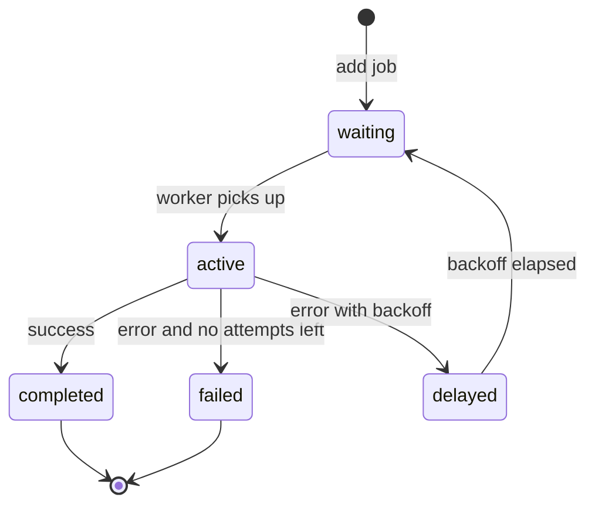

## 1.5 Stack

#### Concept

A stack is a collection where you add and remove from the same end: last in, first out (LIFO). The operations are `push` (add on top), `pop` (remove the top) and `peek` (look at the top). In JavaScript an array used only with `push` and `pop` *is* a stack, and it is the fastest stack you can have because both operations touch the end of a contiguous backing store.

#### Why does it exist?

Stacks exist because nesting is everywhere: function calls inside function calls, transactions with savepoints inside transactions, JSON objects inside objects, interceptors wrapping interceptors. Whenever you must "finish the most recent thing before returning to the thing that started it", you need LIFO order. The call stack that runs your NestJS controller is a stack; when it overflows you get `RangeError: Maximum call stack size exceeded`, which is one of the few errors that can crash a request without any of your `try/catch` blocks having a say.

#### Mental model

Imagine a stack of plates in a restaurant kitchen. Clean plates go on top; the next cook takes from the top. Nobody pulls a plate from the middle. If you keep adding plates without anyone taking them, the stack hits the ceiling; that ceiling is the call-stack limit.

#### How it works

1. **Array-backed.** `push` writes at index `length` and increments `length`; `pop` reads at `length - 1` and decrements. Both are O(1) amortized, with the same 1.5x growth rule as any array.
2. **The call stack.** Each function call pushes a frame (arguments, locals, return address) onto a fixed-size native stack, about 1 MB by default in Node.js, which is roughly 10,000 to 12,000 frames of typical size. Recursion deeper than that throws. `--stack-size` can raise it, but the correct fix is almost always an explicit stack in the heap.
3. **Recursion to iteration.** Any recursive algorithm can be rewritten with an explicit stack: push the initial work item, loop while the stack is non-empty, pop an item, do the work, push its children. The heap has gigabytes; the native stack has one megabyte.
4. **Nested savepoints.** PostgreSQL savepoints inside a transaction are a stack: `ROLLBACK TO SAVEPOINT a` discards every savepoint created after `a` and returns to that state, exactly like popping until you reach a marker.
5. **Middleware unwinding.** NestJS interceptors run their "before" logic in registration order and their "after" logic in reverse order, because each one wraps the `next.handle()` observable of the next. That reverse unwinding is a stack.

**Time complexity**

| Operation | Best | Average | Worst | Notes |
|---|---|---|---|---|
| `push` | O(1) | O(1) amortized | O(n) | worst case is backing-store growth |
| `pop` | O(1) | O(1) | O(1) | |
| `peek` | O(1) | O(1) | O(1) | `arr[arr.length - 1]` or `arr.at(-1)` |
| Search | O(1) | O(n) | O(n) | stacks are not for searching |
| Size | O(1) | O(1) | O(1) | |

**Memory implications (V8, Node.js)**

- Array-backed stacks over-allocate by 50 percent; after a burst, `pop` does not shrink the backing store. For a stack that is occasionally huge and normally tiny, recreate it after the burst.
- Each recursion frame costs roughly 50 to 150 bytes of native stack, and the limit is per thread; worker threads get their own (smaller by default) stacks.
- An explicit stack of work items in the heap costs 8 bytes per pointer plus the item; a 1-million-item explicit stack is fine, a 1-million-deep recursion is not.

#### Practical example

Computing the price of a product bundle that can contain other bundles. The recursive version is natural and dangerous; the iterative version uses an explicit stack and a visited set so a cyclic bundle definition cannot take the process down.

```ts
// pricing/bundle-pricer.ts
export interface Bundle {
  id: string;
  priceCents: number;         // own price for simple products
  components: { id: string; quantity: number }[]; // empty for simple products
}

export class CyclicBundleError extends Error {
  constructor(public readonly path: string[]) {
    super(`bundle cycle detected: ${path.join(' -> ')}`);
  }
}

export function totalPriceCents(root: Bundle, lookup: (id: string) => Bundle): number {
  const stack: { bundle: Bundle; multiplier: number; path: string[] }[] = [
    { bundle: root, multiplier: 1, path: [root.id] },
  ];
  let total = 0;
  let steps = 0;

  while (stack.length > 0) {
    const { bundle, multiplier, path } = stack.pop()!; // LIFO: depth-first
    if (++steps > 10_000) throw new Error(`bundle ${root.id} is too large to price`);
    if (bundle.components.length === 0) {
      total += bundle.priceCents * multiplier;
      continue;
    }
    for (const c of bundle.components) {
      if (path.includes(c.id)) throw new CyclicBundleError([...path, c.id]); // path is short
      stack.push({ bundle: lookup(c.id), multiplier: multiplier * c.quantity, path: [...path, c.id] });
    }
  }
  return total;
}
```

The `steps` guard is the equivalent of a timeout: a senior engineer bounds every loop whose size is controlled by data.

#### NestJS example

Nested savepoints with TypeORM's `QueryRunner`. When a transaction is already open, TypeORM's PostgreSQL driver turns `startTransaction()` into `SAVEPOINT typeorm_N`, `commitTransaction()` into `RELEASE SAVEPOINT`, and `rollbackTransaction()` into `ROLLBACK TO SAVEPOINT`. The service below places an order and tries to apply a promotion inside a savepoint; if the promotion fails, only that part is undone and the order still commits.

```ts
// orders/place-order.service.ts
import { Injectable, Logger } from '@nestjs/common';
import { DataSource } from 'typeorm';
import { Order } from './order.entity';
import { PromotionService } from '../promotions/promotion.service';

@Injectable()
export class PlaceOrderService {
  private readonly logger = new Logger(PlaceOrderService.name);

  constructor(
    private readonly dataSource: DataSource,
    private readonly promotions: PromotionService,
  ) {}

  async place(userId: string, items: { productId: string; qty: number }[], promoCode?: string) {
    const runner = this.dataSource.createQueryRunner();
    await runner.connect();
    await runner.startTransaction();                        // BEGIN (depth 1)
    try {
      const order = await runner.manager.save(Order, { userId, items, status: 'pending' });

      if (promoCode) {
        await runner.startTransaction();                    // SAVEPOINT typeorm_2 (depth 2)
        try {
          await this.promotions.apply(runner.manager, order.id, promoCode);
          await runner.commitTransaction();                 // RELEASE SAVEPOINT typeorm_2
        } catch (err) {
          await runner.rollbackTransaction();               // ROLLBACK TO SAVEPOINT typeorm_2
          this.logger.warn(`promo ${promoCode} rejected for order ${order.id}: ${String(err)}`);
        }
      }

      await runner.commitTransaction();                     // COMMIT (depth 1)
      return order;
    } catch (err) {
      await runner.rollbackTransaction();                   // ROLLBACK everything
      throw err;
    } finally {
      await runner.release();                               // return the connection to the pool
    }
  }
}
```

#### PostgreSQL example

```sql
BEGIN;
INSERT INTO orders (id, user_id, status) VALUES (8813, 42, 'pending');

SAVEPOINT promo;                                   -- push
UPDATE orders SET discount_cents = 500 WHERE id = 8813;
INSERT INTO promo_redemptions (code, order_id) VALUES ('WELCOME', 8813);
-- unique violation: this user already redeemed WELCOME
ROLLBACK TO SAVEPOINT promo;                       -- pop back to the marker; the order row survives
RELEASE SAVEPOINT promo;

COMMIT;
```

Without the savepoint, the unique violation would abort the whole transaction (`current transaction is aborted, commands ignored until end of transaction block`) and the order would be lost too. Each savepoint costs a little: PostgreSQL assigns a sub-transaction id, and more than 64 open sub-transactions per session spill to disk and slow down every visibility check on the server, so do not create a savepoint per row in a bulk loop.

#### TypeORM example

The `QueryRunner` pattern above is the explicit form. The nested `manager.transaction` form is shorter but hides the savepoint, which is why many teams prefer the explicit one for anything that must be reasoned about in an incident.

#### Sequelize example

```ts
await sequelize.transaction(async (t) => {
  const order = await Order.create({ userId, status: 'pending' }, { transaction: t });

  try {
    // A nested transaction with a parent becomes SAVEPOINT in PostgreSQL.
    await sequelize.transaction({ transaction: t }, async (sp) => {
      await PromoRedemption.create({ code, orderId: order.id }, { transaction: sp });
      await order.update({ discountCents: 500 }, { transaction: sp });
    });
  } catch (err) {
    logger.warn(`promo rejected for ${order.id}: ${String(err)}`); // outer transaction continues
  }
  return order;
});
```

#### Production scenario

A catalog with 40,000 products and 1,200 bundles serves 800 RPS of price lookups. Bundles nest at most four levels deep, so the explicit stack never holds more than a few dozen items and pricing costs under 20 microseconds. The stack matters not for speed but for safety: when a merchant misconfigures a bundle to contain itself, the request returns a 422 with the cycle path in 30 microseconds instead of taking down the pod.

The call stack shows up as a limit in another place: deeply nested JSON. A body with 20,000 nested arrays is accepted by `JSON.parse` in modern V8, but `class-transformer` and validators that recurse per level are not always so careful. Cap nesting depth at the edge (a 1 MB body limit rarely allows more than a few thousand levels anyway) and keep recursion out of request-path code you do not control.

#### Failure scenario

At 02:14 the on-call engineer is paged: `catalog-api` returns HTTP 500 for `GET /products/b-4471` and the error rate graph shows one product responsible for 100 percent of failures. The log line: `RangeError: Maximum call stack size exceeded at priceOf (bundle-pricer.ts:18)`. A merchant created bundle `b-4471` containing bundle `b-4470`, which a colleague had, five minutes earlier, edited to contain `b-4471`. The recursive pricer followed the cycle until the native stack ran out. The exception filter logged it and returned 500, but the product page, the cart and the search index refresh all called the same function, so a single bad row broke three user journeys. The fix was the iterative pricer with cycle detection plus a database-level guard: a trigger that rejects a `bundle_components` insert if a recursive CTE from the child reaches the parent. Two layers, because "the application validates it" is not a constraint.

#### Edge cases & failure modes

- **Stack overflow is not catchable where you think.** The `RangeError` unwinds many frames before any handler runs; state modified in those frames may be half-applied.
- **Popping an empty stack** returns `undefined` in JavaScript, silently. Check `length` or wrap in a class that throws.
- **Deep recursion inside async code** hides its depth across `await` boundaries and then overflows in a microtask, with a stack trace that does not name the loop.
- **Savepoint explosion.** A savepoint per row in a 100,000-row import creates 100,000 sub-transactions; beyond 64 per session PostgreSQL performance degrades sharply.
- **Forgetting `RELEASE`.** Unreleased savepoints accumulate until `COMMIT`; harmless in small numbers, a leak in loops.
- **LIFO unwinding order surprises.** An interceptor registered first runs its "after" logic last; a cleanup that assumes otherwise runs too early.

#### How a Senior Backend Engineer thinks about this

Recursion is allowed in tests, scripts and tree code with a proven small depth. On a request path, over data whose shape is controlled by users or merchants, the senior converts it to an explicit stack with a visited set and a step budget, because the alternative is a crash triggered by a single bad row. They also know that "the data cannot have cycles" is only true when a constraint, trigger or serializable check makes it true.

#### Common mistakes

- Recursive tree walks over user data without a depth or cycle guard.
- Using `shift`/`unshift` as the stack operations (front of the array, O(n)) instead of `push`/`pop`.
- Wrapping every statement of a bulk job in a savepoint "for safety".
- Catching the stack-overflow error and retrying, which overflows again.

#### Interview questions

1. **Why does Node.js throw "Maximum call stack size exceeded" at around 10,000 frames, and how do you process a tree deeper than that?** Expected: about 1 MB native stack per thread; use an explicit heap-allocated stack. Follow-up: is `--stack-size` a fix? (Rarely; it moves the cliff and can segfault.)
2. **How are savepoints a stack, and what does `ROLLBACK TO SAVEPOINT` do to savepoints created after it?** Expected: discards them; state returns to the marker. Follow-up: why avoid a savepoint per row?
3. **In NestJS, in what order do three global interceptors run before and after the handler?** Expected: before in registration order, after in reverse; explain with `next.handle()` wrapping.
4. **Design cycle-safe pricing for nested bundles.** Expected: iterative DFS with path tracking, a step budget, and a database guard against cyclic inserts.

#### Practical exercise

Implement an iterative `CategoryTreeService.flatten(rootId)` that returns categories with their depth, using an explicit stack, over a self-referencing `categories(id, parent_id)` table. Acceptance criteria: processes a seeded tree of 200,000 nodes and depth 50,000 without a stack overflow; detects an injected cycle and throws a typed error naming the cycle; the service loads children in batches with `WHERE parent_id = ANY($1)` (one query per level, not one per node); a test asserts at most `depth + 1` queries for a chain-shaped tree.

## 1.6 Queue

#### Concept

A queue is first in, first out (FIFO): you add at the back (`enqueue`) and remove from the front (`dequeue`). It is the data structure of *waiting*. Every job system, message broker, request buffer and event loop is a queue with extra guarantees layered on top.

#### Why does it exist?

Queues decouple the rate at which work arrives from the rate at which it is done. A checkout endpoint that must send an e-mail, update inventory, notify the warehouse and refresh analytics would take 900 ms and fail if any of those was down. With a queue it writes the order, enqueues "order placed", and returns in 40 ms; workers do the rest at their own pace and retry on failure. Without queues you either couple every latency and failure together, or you lose work during a burst.

#### Mental model

Imagine the line at a pharmacy counter. People join at the back and are served from the front in order. The line absorbs a bus-load of customers arriving at once; the pharmacist's pace does not change. If the line grows past the door, that is your signal to add a pharmacist (scale consumers) or tell people to come back later (backpressure).

#### How it works

1. **Ring buffer.** A fixed array with `head` and `tail` indexes that wrap around. Enqueue writes at `tail` and advances it; dequeue reads at `head` and advances it. Both O(1) with no shifting. When full, allocate a bigger array and copy the elements in order.
2. **Why not `Array.prototype.shift`?** `shift` removes index 0 and moves every remaining element down. Draining 100,000 items costs about 5 billion element moves.
3. **Boundedness.** A queue that can grow forever is a memory leak with a business justification. Production queues are bounded and define what happens when full: block the producer, drop the oldest, drop the newest, or reject with an error.
4. **Durability.** An in-memory queue dies with the process. Durable queues live in Redis (BullMQ), RabbitMQ (acknowledgements, persistence) or Kafka (append-only partitioned log with consumer offsets).
5. **The event loop's queues.** Node.js itself runs on queues: `process.nextTick` callbacks first, then promise microtasks, then timers, then I/O callbacks. A recursive `nextTick` or an endless chain of resolved promises starves I/O; the queue that never empties blocks everything behind it.



**Time complexity**

| Operation | Best | Average | Worst | Notes |
|---|---|---|---|---|
| `enqueue` (ring buffer) | O(1) | O(1) amortized | O(n) | worst case is growth |
| `dequeue` (ring buffer) | O(1) | O(1) | O(1) | |
| `dequeue` via `Array.shift` | O(1) | O(n) | O(n) | best case is a 1-element array |
| `peek` | O(1) | O(1) | O(1) | |
| `size` | O(1) | O(1) | O(1) | |
| Search | O(n) | O(n) | O(n) | queues are not for searching |

**Memory implications (V8, Node.js)**

- A ring buffer of capacity c costs 8c bytes of pointers plus the items, allocated once.
- Growable queues double capacity; after a burst of 1 million items the backing store stays at 1 million slots. Shrink explicitly or recreate.
- An unbounded in-process queue receiving 3,000 events per second of 1 KB each grows by 3 MB per second when the consumer stalls; a 1 GB container has about five minutes.

#### Practical example

A growable ring-buffer queue. The deque in Section 1.7 extends it.

```ts
// common/ring-queue.ts
export class RingQueue<T> {
  protected buf: (T | undefined)[];
  protected head = 0;   // index of the front element
  protected count = 0;

  constructor(initialCapacity = 16) {
    this.buf = new Array(initialCapacity);
  }

  get size(): number {
    return this.count;
  }

  enqueue(item: T): void {
    if (this.count === this.buf.length) this.grow();
    this.buf[(this.head + this.count) % this.buf.length] = item; // write at the tail
    this.count++;
  }

  dequeue(): T | undefined {
    if (this.count === 0) return undefined;
    const item = this.buf[this.head];
    this.buf[this.head] = undefined;                // release the reference for GC
    this.head = (this.head + 1) % this.buf.length;  // advance, wrapping around
    this.count--;
    return item;
  }

  peek(): T | undefined {
    return this.count === 0 ? undefined : this.buf[this.head];
  }

  protected grow(): void {
    const next = new Array<T | undefined>(this.buf.length * 2);
    for (let i = 0; i < this.count; i++) {
      next[i] = this.buf[(this.head + i) % this.buf.length]; // copy in logical order
    }
    this.buf = next;
    this.head = 0;
  }
}
```

#### NestJS example

A durable queue with `@nestjs/bullmq`: the producer enqueues from the order service with an idempotent job id, and a worker processes with retries and exponential backoff.

```ts
// notifications/notifications.module.ts
import { Module } from '@nestjs/common';
import { BullModule } from '@nestjs/bullmq';
import { NotificationsProcessor } from './notifications.processor';
import { NotificationsProducer } from './notifications.producer';

@Module({
  imports: [
    BullModule.forRoot({ connection: { host: process.env.REDIS_HOST, port: Number(process.env.REDIS_PORT) } }),
    BullModule.registerQueue({ name: 'notifications' }),
  ],
  providers: [NotificationsProcessor, NotificationsProducer],
  exports: [NotificationsProducer],
})
export class NotificationsModule {}

// notifications/notifications.producer.ts
import { Injectable } from '@nestjs/common';
import { InjectQueue } from '@nestjs/bullmq';
import { Queue } from 'bullmq';

@Injectable()
export class NotificationsProducer {
  constructor(@InjectQueue('notifications') private readonly queue: Queue) {}

  async orderPlaced(orderId: string, userId: string): Promise<void> {
    await this.queue.add(
      'order-placed',
      { orderId, userId },
      {
        jobId: `order-placed:${orderId}`,               // duplicate enqueues collapse into one job
        attempts: 5,
        backoff: { type: 'exponential', delay: 2_000 }, // 2s, 4s, 8s, 16s, 32s
        removeOnComplete: 1_000,                        // keep the last 1k for inspection
        removeOnFail: 10_000,
      },
    );
  }
}

// notifications/notifications.processor.ts
import { Logger } from '@nestjs/common';
import { OnWorkerEvent, Processor, WorkerHost } from '@nestjs/bullmq';
import { Job } from 'bullmq';

@Processor('notifications', { concurrency: 10 })
export class NotificationsProcessor extends WorkerHost {
  private readonly logger = new Logger(NotificationsProcessor.name);

  async process(job: Job<{ orderId: string; userId: string }>): Promise<void> {
    // Must be idempotent: the same job can run twice after a worker crash.
    await this.sendOrderPlacedEmail(job.data.orderId, job.data.userId);
  }

  @OnWorkerEvent('failed')
  onFailed(job: Job, err: Error) {
    this.logger.error(`job ${job.id} attempt ${job.attemptsMade} failed: ${err.message}`);
  }

  private async sendOrderPlacedEmail(orderId: string, userId: string) { /* provider call with timeout */ }
}
```

#### PostgreSQL example

When you already run PostgreSQL and need a modest, transactional queue, a jobs table with `FOR UPDATE SKIP LOCKED` is the standard pattern. Workers lock and claim one row each without blocking one another.

```sql
CREATE TABLE jobs (
  id         bigint GENERATED ALWAYS AS IDENTITY PRIMARY KEY,
  kind       text        NOT NULL,
  payload    jsonb       NOT NULL,
  status     text        NOT NULL DEFAULT 'queued',   -- queued | active | done | failed
  run_at     timestamptz NOT NULL DEFAULT now(),
  attempts   int         NOT NULL DEFAULT 0,
  locked_by  text
);
-- Partial index: only rows a worker could pick are indexed, so the index stays tiny.
CREATE INDEX jobs_ready_idx ON jobs (run_at, id) WHERE status = 'queued';

-- Claim one job atomically.
UPDATE jobs SET status = 'active', locked_by = $1, attempts = attempts + 1
WHERE id = (
  SELECT id FROM jobs
  WHERE status = 'queued' AND run_at <= now()
  ORDER BY run_at, id
  FOR UPDATE SKIP LOCKED
  LIMIT 1
)
RETURNING id, kind, payload;
```

```text
Update on jobs  (cost=0.57..8.61 rows=1 width=98) (actual time=0.091..0.094 rows=1 loops=1)
  InitPlan 1 (returns $1)
    ->  Limit  (cost=0.42..0.56 rows=1 width=22) (actual time=0.047..0.048 rows=1 loops=1)
          ->  LockRows  (cost=0.42..1418.32 rows=9812 width=22) (actual time=0.046..0.046 rows=1 loops=1)
                ->  Index Scan using jobs_ready_idx on jobs jobs_1  (cost=0.42..1320.20 rows=9812 width=22) (actual time=0.028..0.028 rows=1 loops=1)
                      Index Cond: (run_at <= now())
  ->  Index Scan using jobs_pkey on jobs  (cost=0.15..8.05 rows=1 width=98) (actual time=0.019..0.020 rows=1 loops=1)
        Index Cond: (id = $1)
Execution Time: 0.152 ms
```

This works well up to a few hundred jobs per second. Every claim is an `UPDATE`, which creates a dead tuple, so the table needs aggressive autovacuum settings; and thousands of workers polling creates lock traffic. Beyond that scale you move to Redis or Kafka.

#### TypeORM example

```ts
const job = await dataSource.transaction(async (manager) => {
  const candidate = await manager
    .createQueryBuilder(JobEntity, 'j')
    .setLock('pessimistic_write')
    .setOnLocked('skip_locked')          // FOR UPDATE SKIP LOCKED
    .where('j.status = :s AND j.run_at <= now()', { s: 'queued' })
    .orderBy('j.run_at', 'ASC').addOrderBy('j.id', 'ASC')
    .limit(1)
    .getOne();
  if (!candidate) return null;
  await manager.update(JobEntity, candidate.id, { status: 'active', lockedBy: workerId });
  return candidate;
});
```

#### Sequelize example

```ts
const job = await sequelize.transaction(async (t) => {
  const candidate = await JobModel.findOne({
    where: { status: 'queued', runAt: { [Op.lte]: new Date() } },
    order: [['runAt', 'ASC'], ['id', 'ASC']],
    lock: t.LOCK.UPDATE,
    skipLocked: true,                    // FOR UPDATE SKIP LOCKED
    transaction: t,
  });
  if (!candidate) return null;
  await candidate.update({ status: 'active', lockedBy: workerId }, { transaction: t });
  return candidate;
});
```

#### Production scenario

An order platform emits 3,000 events per second at peak. BullMQ on a single Redis instance handles this comfortably: each `add` is one round trip (about 0.3 ms from the same availability zone), and 20 worker pods with concurrency 10 give 200 in-flight jobs. The metrics that matter are **queue depth** (`waiting` count) and **oldest job age**. Depth alone lies: 50,000 waiting jobs with workers draining 4,000 per second is a 12-second backlog, which may be fine; 500 waiting jobs that are 40 minutes old means the workers are dead. Alert on age.

The moment a queue is in the path, the senior mantra applies to every consumer: *Can it duplicate?* Yes, after a worker crash the same job runs again, so every job handler is idempotent. *Can it become slow?* Yes, so every job has a timeout and a bounded attempt count. *Can it partially succeed?* Yes, so multi-step jobs record progress or are split into separate jobs.

#### Failure scenario

At 02:14 the on-call engineer is paged: three `api` pods were `OOMKilled` within ten minutes. An analytics interceptor pushed one event per request onto an in-process `events: AnalyticsEvent[]` array, and a `setInterval` flushed it to a warehouse HTTP endpoint every second. At 01:58 the warehouse started answering in 20 seconds instead of 200 ms. The flush awaited the slow response; meanwhile 2,800 requests per second kept pushing 1.2 KB events. In four minutes the array held 670,000 events and 800 MB. The pod died, its events were lost, and the replacement pod started the same climb.

The fix had three parts: a bounded `RingQueue` of 10,000 events that drops the oldest and increments a `analytics_events_dropped_total` counter when full; a flush with a 2-second timeout so one slow call cannot stall the drain; and an alert on the drop counter. The queue lost some analytics events for twenty minutes, which the business accepted, instead of losing the checkout API.

#### Edge cases & failure modes

- **Unbounded growth** when producers outpace consumers; always bound and define the overflow policy.
- **Duplicate delivery** after consumer crash, visibility timeout or network partition; make handlers idempotent with a job id or idempotency key.
- **Poison messages** that fail every time and block the head of a strictly ordered queue; use a dead-letter queue after N attempts.
- **Consumer lag and rebalancing** in Kafka: adding a consumer pauses the group briefly; a consumer that takes too long is kicked and its partition reassigned, often causing duplicates.
- **Out-of-order processing** when concurrency is greater than 1; events for the same order must be keyed to one partition or serialized by a lock.
- **Priority inversion**: a burst of cheap jobs starves urgent ones; use separate queues or a priority queue (Section 1.13).
- **Redis down** means enqueues fail; decide whether the request fails (safer for payments) or the work is written to an outbox table first (the transactional outbox pattern).
- **Lost in-memory work** on deploys; drain queues in `onApplicationShutdown` and keep jobs small.

#### How a Senior Backend Engineer thinks about this

A queue is the first tool the senior reaches for when a request does more than one thing, and the tool they refuse to run in-process for anything that must not be lost. They start with the simplest durable option that already exists in the stack (a PostgreSQL jobs table under 100 jobs per second, BullMQ on Redis up to tens of thousands per second) and only move to Kafka when they need replay, multiple independent consumer groups, or ordering across a firehose. They ask: what is the overflow policy, who owns idempotency, how do we see the age of the oldest message, and what happens on deploy.

To a product manager: "The order is saved instantly; the e-mail and the warehouse notification are queued and will happen within seconds even if the e-mail provider is having a bad day. If it is down for an hour, the e-mails go out an hour late; the orders are never lost."

#### Common mistakes

- `Array.shift()` as the dequeue operation on a hot path.
- In-memory queues for work that must survive a restart.
- Non-idempotent job handlers with `attempts: 5`; the customer gets five e-mails.
- No timeout inside the job, so a hung provider call holds a worker slot forever.
- Alerting on queue depth instead of oldest-job age.
- One giant job that does 10,000 things and cannot resume.

#### Interview questions

1. **Why is `Array.prototype.shift` the wrong dequeue for a hot queue, and what do you use?** Expected: O(n) shift of all elements; use a ring buffer with head/tail indexes or a linked list.
2. **Design the overflow policy for an in-process event buffer.** Expected: bounded size, drop-oldest or reject, metric on drops, flush timeout. Follow-up: when is dropping unacceptable? (Payments, audit logs: use an outbox.)
3. **How does `FOR UPDATE SKIP LOCKED` make PostgreSQL a queue, and what are its limits?** Expected: workers claim rows without blocking; limits are dead-tuple bloat, polling load, a few hundred jobs per second.
4. **A job ran twice and the customer got two refunds. Why, and how do you prevent it?** Expected: at-least-once delivery; idempotency key on the refund; store the result keyed by job id.
5. **When do you pick Kafka over BullMQ?** Expected: replay, multiple consumer groups, partition ordering, very high throughput; cost is operating a distributed log.
6. **What is head-of-line blocking in a queue and how do you avoid it?** Expected: a poison or slow message delays everything behind it; dead-letter after N attempts, separate queues per priority or tenant.

#### Practical exercise

Build `BoundedEventBuffer` on `RingQueue` plus a BullMQ-backed `EmailQueue`. Acceptance criteria: the buffer has capacity 10,000, drops the oldest on overflow and exposes `dropped` as a Prometheus counter; a flush that exceeds 2 seconds is abandoned via `AbortController` and the events are retried at the next tick; the e-mail job is idempotent using `jobId = order-placed:<orderId>`, proven by a test that enqueues twice and observes one send; a chaos test that pauses the worker for 60 seconds must show `oldest job age` climbing while `waiting` stays bounded by the number of test orders.

## 1.7 Deque

#### Concept

A deque (double-ended queue, pronounced "deck") supports O(1) insertion and removal at *both* ends: `pushFront`, `pushBack`, `popFront`, `popBack`. A queue is a deque you only use one way; a stack is a deque you only use at one end. Redis lists are deques (`LPUSH`, `RPUSH`, `LPOP`, `RPOP`), and the in-memory job list that BullMQ drains is used as one.

#### Why does it exist?

Several backend problems need both ends. A sliding time window keeps timestamps in order, adds new ones at the back and expires old ones from the front. A "retry this job first" feature pushes a job to the *front* of a queue (BullMQ's `lifo: true` option does exactly that with `RPUSH` instead of `LPUSH`). A "last 100 errors" buffer appends at the back and trims from the front. Work-stealing schedulers let the owning thread pop from one end while other threads steal from the opposite end to reduce contention. A queue or stack alone cannot do any of these in O(1).

#### Mental model

Imagine a train platform with doors at both ends of the carriage. Passengers may board or alight at either door, but nobody climbs through the windows in the middle. That is the whole contract: both ends are cheap, the middle is not your business.

#### How it works

The ring buffer from Section 1.6 already stores elements in a circular array with a `head` index. Adding to the front is one subtraction with wraparound: `head = (head - 1 + capacity) % capacity`, then write at `head`. Removing from the back is reading at `(head + count - 1) % capacity` and decrementing `count`. Nothing shifts. A doubly linked list gives the same O(1) at both ends with worse locality; the ring buffer wins in JavaScript unless you also need O(1) removal from the middle by node handle.

**Time complexity**

| Operation | Best | Average | Worst | Notes |
|---|---|---|---|---|
| `pushFront` / `pushBack` | O(1) | O(1) amortized | O(n) | worst case is growth |
| `popFront` / `popBack` | O(1) | O(1) | O(1) | |
| `peekFront` / `peekBack` | O(1) | O(1) | O(1) | |
| Index access | O(1) | O(1) | O(1) | ring buffer only; O(n) for linked list |
| Insert or remove in the middle | O(n) | O(n) | O(n) | not what deques are for |

**Memory implications**

Identical to the ring queue: one contiguous backing array, 8 bytes per slot plus items, no per-element allocation. The `denque` npm package is the standard production implementation and is what several Redis clients use for their pending-command queues.

#### Practical example

The deque itself, extending `RingQueue`, and a **monotonic deque** that answers "what is the maximum latency in the last N samples?" in O(1) amortized per sample. The trick: keep the deque sorted in decreasing order by evicting smaller values from the back when a bigger one arrives; the front is always the current maximum.

```ts
// common/deque.ts
import { RingQueue } from './ring-queue';

export class Deque<T> extends RingQueue<T> {
  pushBack(item: T): void {
    this.enqueue(item);
  }

  pushFront(item: T): void {
    if (this.count === this.buf.length) this.grow();
    this.head = (this.head - 1 + this.buf.length) % this.buf.length; // step back with wraparound
    this.buf[this.head] = item;
    this.count++;
  }

  popFront(): T | undefined {
    return this.dequeue();
  }

  popBack(): T | undefined {
    if (this.count === 0) return undefined;
    const idx = (this.head + this.count - 1) % this.buf.length;
    const item = this.buf[idx];
    this.buf[idx] = undefined;
    this.count--;
    return item;
  }

  peekBack(): T | undefined {
    return this.count === 0 ? undefined : this.buf[(this.head + this.count - 1) % this.buf.length];
  }
}

// metrics/sliding-max.ts  -- max of the last `windowSize` samples, O(1) amortized per push
export class SlidingMax {
  private readonly dq = new Deque<{ seq: number; value: number }>();
  private seq = 0;

  constructor(private readonly windowSize: number) {}

  push(value: number): void {
    const seq = this.seq++;
    // Drop smaller values from the back: they can never be the max while `value` is in the window.
    while (this.dq.size > 0 && this.dq.peekBack()!.value <= value) this.dq.popBack();
    this.dq.pushBack({ seq, value });
    // Expire the front if it has left the window.
    if (this.dq.peekFront()!.seq <= seq - this.windowSize) this.dq.popFront();
  }

  max(): number {
    return this.dq.size === 0 ? 0 : this.dq.peekFront()!.value;
  }
}
```

#### NestJS example

A sliding-window-log rate limiter guard with one deque of timestamps per client. New requests push at the back; timestamps older than the window pop from the front. Each client's memory is bounded by the limit itself, because we stop pushing once the deque is full. This is a per-pod limiter; for a cluster-wide one you move the same logic into a Redis sorted set (see the API Design part) or use `@nestjs/throttler` with a Redis storage.

```ts
// rate-limit/sliding-window.guard.ts
import { CanActivate, ExecutionContext, HttpException, HttpStatus, Injectable } from '@nestjs/common';
import { Deque } from '../common/deque';

@Injectable()
export class SlidingWindowGuard implements CanActivate {
  private readonly windows = new Map<string, Deque<number>>();
  private readonly limit = 100;          // requests
  private readonly windowMs = 60_000;    // per minute

  canActivate(ctx: ExecutionContext): boolean {
    const req = ctx.switchToHttp().getRequest<{ ip: string; headers: Record<string, string> }>();
    const key = req.headers['x-api-key'] ?? req.ip;
    const now = Date.now();

    let dq = this.windows.get(key);
    if (!dq) {
      dq = new Deque<number>(this.limit);
      this.windows.set(key, dq);
    }
    while (dq.size > 0 && dq.peek()! <= now - this.windowMs) dq.popFront(); // expire old hits

    if (dq.size >= this.limit) {
      const retryAfterSec = Math.ceil((dq.peek()! + this.windowMs - now) / 1000);
      throw new HttpException({ message: 'Too many requests', retryAfterSec }, HttpStatus.TOO_MANY_REQUESTS);
    }
    dq.pushBack(now);
    return true;
  }
}
```

The `windows` map must be swept periodically (drop keys whose deque is empty), otherwise one-off clients leak entries; that sweep is the hash-map hygiene covered in Section 1.8.

#### Production scenario

The natural home of the deque at scale is Redis. `LPUSH` a job and `BRPOP` from the other side gives you a durable FIFO shared by every pod; `RPUSH` a job to jump the line. A "recent activity" feed per user is `LPUSH user:42:feed <event>` followed by `LTRIM user:42:feed 0 99`, which keeps exactly the last 100 items in O(1) per write and reads them with `LRANGE 0 99` in about 0.3 ms. At 20,000 feed writes per second a single Redis node stays under 30 percent CPU, because every one of those commands touches only the ends of a list.

#### Failure scenario

A rate limiter used a plain array with `shift()` to expire old timestamps and `unshift()` for a "priority client" feature. At 200 RPS per client it was invisible. A partner integration then sent 4,000 RPS from a single API key; each request shifted an array of 4,000 entries, and the guard alone consumed 40 percent of the event loop while rejecting requests it was supposed to reject cheaply. The rate limiter became the thing that needed rate limiting. Replacing the array with a deque cut the guard's cost to under 1 microsecond per request.

#### Edge cases & failure modes

- **Wraparound arithmetic errors** (negative modulo in JavaScript) when stepping the head backwards; always add capacity before taking the modulus.
- **Growth while wrapped** must copy in logical order, not physical order, or the queue reorders silently.
- **Per-key deques leak** when keys are unbounded (IP addresses); sweep or use an LRU map of deques.
- **Clock skew** between pods makes per-pod sliding windows disagree; cluster-wide limits belong in Redis.

#### How a Senior Backend Engineer thinks about this

Deques are the workhorse for anything "bounded and recent": recent errors, recent latencies, recent timestamps, recent feed items. The senior picks the ring-buffer deque for locality, bounds it explicitly, and moves it to a Redis list the moment it must be shared across pods. They never touch the middle.

#### Common mistakes

- Using `unshift` for front insertion on large arrays.
- Implementing a deque with a linked list when a ring buffer would be 5 times faster and use a sixth of the memory.
- Forgetting `LTRIM` after `LPUSH`, so Redis feed lists grow forever.

#### Interview questions

1. **How do you get O(1) `pushFront` in an array-backed structure?** Expected: circular buffer with a head index that steps backwards with wraparound.
2. **Explain the monotonic deque and one backend use.** Expected: keep candidates in decreasing order, evict dominated ones from the back; sliding-window max latency, or max in-flight count over the last N seconds.
3. **How would you keep a per-user "last 100 events" list in Redis, and what is its complexity?** Expected: `LPUSH` plus `LTRIM 0 99`, O(1) amortized per write.
4. **A per-client rate limiter works at 100 RPS and collapses at 5,000 RPS from one client. Diagnose.** Expected: `shift`/`unshift` on arrays; replace with a deque; then discuss moving to Redis for multi-pod correctness.

#### Practical exercise

Implement `RecentErrorsService` that keeps the last 200 unhandled exceptions per pod in a `Deque`, captured by a global exception filter, and exposes them at `GET /internal/errors`. Acceptance criteria: memory is bounded regardless of error rate (prove with a test that raises 100,000 errors and checks `size === 200`); entries include timestamp, route and a truncated stack (max 2 KB per entry, truncated by bytes); the endpoint returns newest first without copying the whole deque more than once; and a `SlidingMax` over the last 1,000 request latencies is exposed on the same endpoint, verified against a brute-force `Math.max` in tests.
