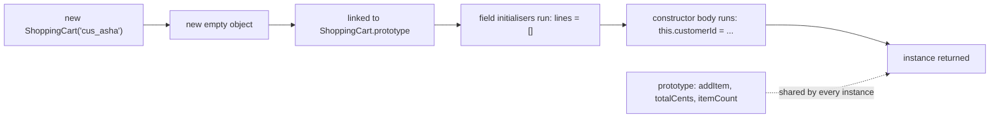
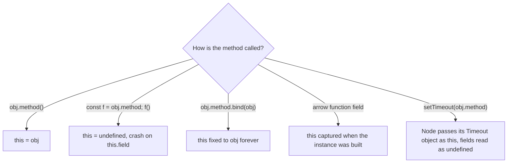
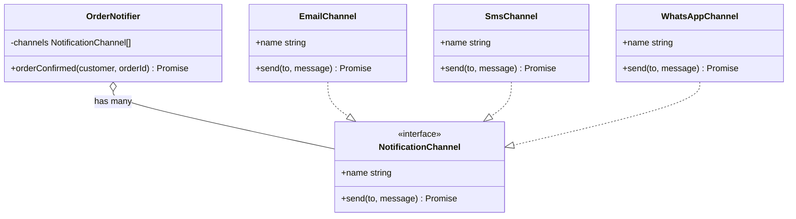
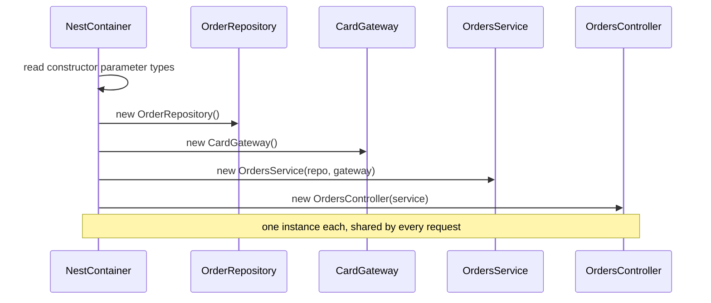

## 1.8 Classes and object-oriented code

So far we have modelled data with interfaces and plain objects, and behaviour with functions. That is enough for a surprising amount of backend code. But the moment you open a NestJS project you will see `class` everywhere: `OrdersController`, `OrdersService`, `CreateOrderDto`, `Order` entity. This section teaches classes from the ground up, the one JavaScript trap that comes with them (`this`), and the handful of design ideas (composition, SOLID) that decide whether class-based code stays pleasant or turns into a maze. It ends by showing exactly how these pieces become a NestJS service.

### 1.8.1 What a class is: fields, constructor, methods and `new`

#### Concept

A class is a blueprint for objects that carry both **data** (fields) and **behaviour** (methods) together. You write the blueprint once; `new` stamps out as many objects (called **instances**) as you need. A **constructor** is the special method that runs once when an instance is created and sets its starting state.

#### Why does it exist?

Imagine a shopping cart. With only plain objects and functions, the cart's data (`lines`) lives in one place and the rules (`addItem`, `totalCents`) live somewhere else. Nothing stops another file from pushing a line with a negative quantity straight into `cart.lines`. A class keeps the data and the rules that protect it in one unit, so the only way to change a cart is through its methods, and the methods can enforce the rules every time.

#### Mental model

Imagine a cookie cutter. The class is the cutter; each `new ShoppingCart()` is a cookie with the same shape but its own dough, so adding an item to Asha's cart does not touch Ravi's.

#### How it works

```ts
interface CartLine {
  sku: string;
  unitCents: number;
  qty: number;
}

class ShoppingCart {
  // Fields: the data each instance carries.
  readonly customerId: string;
  private lines: CartLine[] = [];          // every new cart starts empty

  // The constructor runs once, when `new ShoppingCart(...)` is called.
  constructor(customerId: string) {
    this.customerId = customerId;           // `this` is the instance being built
  }

  // Methods: behaviour that reads and changes this instance's data.
  addItem(line: CartLine): void {
    if (line.qty <= 0) throw new Error(`qty must be positive, got ${line.qty}`);
    const existing = this.lines.find((l) => l.sku === line.sku);
    if (existing) existing.qty += line.qty;  // same SKU: merge instead of duplicating
    else this.lines.push({ ...line });       // copy so the caller cannot mutate our line later
  }

  totalCents(): number {
    return this.lines.reduce((sum, l) => sum + l.unitCents * l.qty, 0);
  }

  itemCount(): number {
    return this.lines.reduce((sum, l) => sum + l.qty, 0);
  }
}

const asha = new ShoppingCart('cus_asha');
const ravi = new ShoppingCart('cus_ravi');
asha.addItem({ sku: 'BRUSH-01', unitCents: 4999, qty: 1 });
asha.addItem({ sku: 'BRUSH-01', unitCents: 4999, qty: 1 });
console.log(asha.itemCount(), asha.totalCents()); // 2 9998
console.log(ravi.itemCount());                     // 0: each instance has its own lines
```

What `new ShoppingCart('cus_asha')` does, step by step:

1. Creates a new empty object.
2. Links that object to `ShoppingCart.prototype`, the shared object where the methods live. Methods are stored once, not copied into every instance.
3. Runs the field initialisers (`lines = []`), then the constructor body, with `this` pointing at the new object.
4. Returns the object.



A class exists at runtime (`typeof ShoppingCart` is `'function'`), unlike an `interface`, which TypeScript erases (1.7.2). It is also a **type**: `function checkout(cart: ShoppingCart)` accepts anything with the class's public shape.

#### Common mistakes

- Forgetting `new`. `ShoppingCart('cus_1')` throws `TypeError: Class constructor ShoppingCart cannot be invoked without 'new'`.
- Exposing the internal array (`getLines() { return this.lines; }`). The caller can now `push` into it and skip every rule. Return a copy (`[...this.lines]`) or a read-only view.
- Writing a class with no behaviour, only public fields and getters and setters for each. That is a plain object wearing a costume; an interface is simpler.

### 1.8.2 `this`, and how it is bound

#### Concept

Inside a method, `this` means "the object this method was called on". The catch is the word **called**: `this` is decided at the moment of the call, by how the call is written, not by where the method was defined. Call `cart.totalCents()` and `this` is `cart`. Take the method out of the object and call it on its own, and `this` is `undefined`.

#### Why does it exist?

JavaScript functions are values that can be passed around (1.4). The same function can be attached to many objects, so the language decides `this` per call. That flexibility is why methods can be shared on the prototype, and it is also the source of the most common class bug in Node code.

#### Mental model

Imagine a waiter told "bring this table its bill". If the manager says it while standing at table 7, "this table" is table 7. If someone writes the instruction on a card and hands it to a new waiter with no table in sight, "this table" means nothing. Extracting a method is handing over the card without the table.

#### How it works — the extraction bug

```ts
class PriceFormatter {
  constructor(private readonly currency: string) {}

  format(cents: number): string {
    return `${this.currency} ${(cents / 100).toFixed(2)}`;
  }
}

const formatter = new PriceFormatter('USD');

console.log(formatter.format(1999));       // 'USD 19.99': called on formatter, so this = formatter

const prices = [1999, 500];
console.log(prices.map(formatter.format)); // TypeError: Cannot read properties of undefined (reading 'currency')
```

`prices.map(formatter.format)` passes only the function, not the object. `map` later calls it as a plain function, so `this` is `undefined`. (Class bodies always run in strict mode, which is why `this` is `undefined` and not the global object.) The same bug appears whenever a method is handed to someone else to call later: an event listener, a callback to a library, `promise.then(service.handle)`.



The last row deserves a warning: in Node, a timer calls its callback with `this` set to the internal `Timeout` object, so instead of a crash you silently read `undefined` fields. Silent bugs are worse than crashes.

#### How it works — three fixes

```ts
const formatter = new PriceFormatter('USD');
const prices = [1999, 500];

// Fix 1: wrap the call in an arrow function. The call is written as formatter.format(...),
// so this = formatter. Clear, local, and the most common fix.
prices.map((cents) => formatter.format(cents));

// Fix 2: bind. Returns a new function with this permanently set to formatter.
const boundFormat = formatter.format.bind(formatter);
prices.map(boundFormat);

// Fix 3: define the method as an arrow-function field inside the class.
class SafePriceFormatter {
  constructor(private readonly currency: string) {}

  // An arrow function has no `this` of its own; it uses the `this` of the place it was
  // created, which for a field initialiser is the instance being built.
  format = (cents: number): string => `${this.currency} ${(cents / 100).toFixed(2)}`;
}

const safe = new SafePriceFormatter('INR');
console.log(prices.map(safe.format)); // [ 'INR 19.99', 'INR 5.00' ]
```

Each fix has a cost. The arrow wrapper must be written at every call site. An arrow-function field is created **once per instance** (an own property, not on the shared prototype), so it costs memory across millions of instances, and a subclass cannot reach it with `super.format()`. Wrapping at the call site is the simplest default.

#### Production scenario

A payments team passes `this.webhookHandler.handle` as a callback to a message-queue library: `consumer.on('message', this.webhookHandler.handle)`. In local testing with a fake queue the handler is called directly and works. In staging, the library calls the callback as a plain function, `this.repo` is `undefined` inside `handle`, and every webhook fails with `Cannot read properties of undefined (reading 'repo')`. The fix is one line, `consumer.on('message', (msg) => this.webhookHandler.handle(msg))`, and the lesson is to treat "I passed a method as a value" as a code-review red flag.

#### Common mistakes

- Passing `service.method` as a callback and expecting `this` to follow.
- Using a regular `function () {}` callback inside a method and expecting it to see the outer `this`. Use an arrow function, which keeps the outer `this`.
- Turning every method into an arrow-function field "just in case". It hides the real rule and breaks `super` calls in subclasses.

#### Interview questions

1. **What decides the value of `this` in a JavaScript method?** How the function is called, not where it is defined. `obj.m()` gives `obj`; a detached call gives `undefined` in strict mode.
2. **Why does `array.map(obj.method)` fail but `array.map((x) => obj.method(x))` work?** The first passes a bare function, so `map` calls it without an object; the second writes the call as `obj.method(x)`.
3. **What is the trade-off of arrow-function class fields?** `this` is always the instance, but the function is created per instance and cannot be reached with `super`.

### 1.8.3 Access modifiers: `public`, `private`, `protected`, `readonly` and `#private`

#### Concept

Access modifiers say who may read or change a member of a class. They let a class publish a small, safe surface and hide its internals, the same idea as exporting only what callers need from a module (1.7.1).

| Modifier | Who can access | Enforced when |
|---|---|---|
| `public` (the default) | Anyone | Always allowed |
| `private` | Only code inside this class | Compile time only (TypeScript) |
| `protected` | This class and its subclasses | Compile time only (TypeScript) |
| `readonly` | Anyone may read; assigned only in the declaration or constructor | Compile time only (TypeScript) |
| `#field` | Only code inside this class body | Runtime (JavaScript itself) |

#### Why does it exist?

Without them, any file can reach into an object and break its rules: set a wallet's balance to `-500`, or reassign an order's id. Modifiers turn "please do not touch this" comments into errors.

#### How it works — `private` versus `#private`

The crucial difference: TypeScript's `private`, `protected` and `readonly` are **erased** when TypeScript compiles to JavaScript, like every other type annotation (1.2). They protect you while you write code, not while it runs. The `#` prefix is a real JavaScript feature, enforced by the runtime.

```ts
class Wallet {
  #balanceCents = 0;                 // hard private: the runtime itself blocks outside access
  private auditNote = 'opened';      // soft private: TypeScript blocks it, JavaScript does not
  readonly id: string;

  constructor(id: string) {
    this.id = id;
  }

  deposit(cents: number): void {
    if (!Number.isInteger(cents) || cents <= 0) throw new Error('deposit must be a positive integer');
    this.#balanceCents += cents;
  }

  get balanceCents(): number {       // read-only view of the hidden field
    return this.#balanceCents;
  }
}

const w = new Wallet('wal_1');
w.deposit(2500);
// w.#balanceCents = 1;      // SyntaxError in JavaScript, compile error in TypeScript
// w.auditNote;              // compile error: 'auditNote' is private
// w.id = 'wal_2';           // compile error: cannot assign to 'id' because it is read-only
console.log(JSON.stringify(w));      // {"auditNote":"opened","id":"wal_1"}  (no balance)
console.log((w as any).auditNote);   // 'opened': the TypeScript check is gone at runtime
```

Notice the `JSON.stringify` output. A `private` field is an ordinary property at runtime, so it appears in JSON, in `Object.keys`, and in anything that serialises the object, such as a log line or an API response. A `#` field does not. That matters for a backend: a `private passwordHash` on a user object will happily appear in a JSON response if the object is returned from a controller as is, whereas `#passwordHash` would not.

`protected` is `private` plus subclasses: a `BasePaymentProvider` can keep a `protected log()` helper that subclasses call but outside code cannot.

#### How a Senior Backend Engineer thinks about this

The default is `private readonly` for collaborators, `private` for state, and public only for what callers need. `private` is a design tool, not a security boundary, so secrets are kept out of logs and responses by an explicit response DTO (6.2) and log redaction, never by a modifier. `#private` is for when runtime privacy genuinely matters, such as a library used from plain JavaScript. NestJS code conventionally uses TypeScript `private`, partly because parameter properties (1.8.4) only exist in that form.

#### Common mistakes

- Believing `private` hides a field from `JSON.stringify` or `console.log`. It does not.
- Thinking `readonly` makes an object deeply immutable. `readonly items: string[]` stops reassigning `items`, not `items.push(...)`; use `readonly string[]` for that (1.5.2).
- Making everything `public` "for tests". Test through the public methods; if that is hard, the class probably does too much (1.8.8).

#### Practical exercise

Extend `Wallet` with `withdraw(cents)` that rejects non-positive or non-integer amounts and refuses to go below zero, throwing an `InsufficientFundsError` that carries the shortfall. Acceptance criteria: the balance can only change through `deposit` and `withdraw`, a failed withdrawal leaves the balance unchanged, and the balance never appears in `JSON.stringify`.

#### Worked answer to the exercise

```ts
class InsufficientFundsError extends Error {
  constructor(readonly shortfallCents: number) {
    super(`insufficient funds: short by ${shortfallCents} cents`);
    this.name = 'InsufficientFundsError';
  }
}

class Wallet {
  #balanceCents = 0;
  constructor(readonly id: string) {}

  deposit(cents: number): void {
    this.#assertAmount(cents);
    this.#balanceCents += cents;
  }

  withdraw(cents: number): void {
    this.#assertAmount(cents);
    if (cents > this.#balanceCents) {
      throw new InsufficientFundsError(cents - this.#balanceCents); // check first, change nothing
    }
    this.#balanceCents -= cents;
  }

  get balanceCents(): number {
    return this.#balanceCents;
  }

  #assertAmount(cents: number): void {          // private methods can use # too
    if (!Number.isInteger(cents) || cents <= 0) {
      throw new Error(`amount must be a positive integer of cents, got ${cents}`);
    }
  }
}

const wallet = new Wallet('wal_7');
wallet.deposit(3000);
wallet.withdraw(1200);
try {
  wallet.withdraw(5000);
} catch (e) {
  if (e instanceof InsufficientFundsError) console.log(e.message, e.shortfallCents);
}
console.log(wallet.balanceCents, JSON.stringify(wallet));
```

```text
insufficient funds: short by 3200 cents 3200
1800 {"id":"wal_7"}
```

Why it is right: the only writes to `#balanceCents` are inside `deposit` and `withdraw`, and the runtime forbids any other code from touching it, so the balance can only change through the rules. `withdraw` validates and checks the balance **before** subtracting, so a failed withdrawal changes nothing (1,800 is 3,000 minus 1,200; the 5,000 attempt left it alone). The error carries `shortfallCents` as data, so a caller can show "you need 32.00 more" without parsing the message.

The trap most learners fall into is subtracting first and checking afterwards (`this.#balanceCents -= cents; if (this.#balanceCents < 0) throw ...`), which leaves the wallet negative after the throw. In a real system the balance lives in PostgreSQL, and this same rule becomes a `CHECK (balance_cents >= 0)` constraint plus a row lock (Part 24 — Database Transactions and Concurrency Control); the class is the first line of defence, not the last.

### 1.8.4 Parameter properties: the constructor form NestJS uses

#### Concept

A **parameter property** is a TypeScript shortcut that declares a field and assigns it from a constructor parameter in one go. You get it by putting a modifier (`private`, `public`, `protected` or `readonly`) in front of a constructor parameter.

#### How it works

The two constructors below compile to the same JavaScript:

```ts
interface OrderRepository {
  findById(id: string): Promise<{ id: string; status: string } | null>;
}

// Long form: declare, accept, assign.
class OrdersServiceLong {
  private readonly repo: OrderRepository;
  constructor(repo: OrderRepository) {
    this.repo = repo;
  }
}

// Parameter property: the modifier does all three.
class OrdersService {
  constructor(private readonly repo: OrderRepository) {}

  async getStatus(id: string): Promise<string> {
    const order = await this.repo.findById(id);   // available as this.repo
    if (!order) throw new Error(`order ${id} not found`);
    return order.status;
  }
}
```

`constructor(private readonly repo: OrderRepository) {}` reads as: "this class needs an `OrderRepository` to exist; keep it in a field called `repo`; nobody outside may see it; nobody, not even this class, may replace it after construction". That sentence is exactly what you want to say about a collaborator, which is why almost every NestJS controller and service starts this way (you have already seen `constructor(private readonly products: ProductsService) {}` in 6.2).

#### Edge cases & failure modes

- A parameter **without** a modifier is just a parameter. `constructor(repo: OrderRepository) {}` stores nothing, and `this.repo` is a compile error.
- Parameter properties are TypeScript-only syntax that generates code, so they need a real compiler step (`tsc`, `tsx`, SWC, or the Nest CLI). Recent Node versions can run a `.ts` file directly, but only by stripping erasable type syntax, so `node orders.service.ts` stops with a syntax error at the first parameter property. TypeScript's `erasableSyntaxOnly` option (TypeScript 5.8 and later) flags them for the same reason. NestJS projects compile with `tsc` or SWC, so this only bites if you try to run `.ts` files with plain `node`.

### 1.8.5 Interfaces versus abstract classes

#### Concept

Both describe a contract that other classes fulfil. An **interface** is a pure shape: names and types, no code, erased at runtime. An **abstract class** is a class that cannot be instantiated with `new`; it can hold shared code and fields, and marks some methods `abstract`, meaning "every subclass must write this one".

#### How it works

```ts
interface ChargeResult {
  providerRef: string;
  status: 'succeeded' | 'declined';
}

// Interface: the contract only. A class promises to fit it with `implements`.
interface PaymentGateway {
  charge(orderId: string, amountCents: number): Promise<ChargeResult>;
}

// Abstract class: contract plus shared behaviour.
abstract class BasePaymentGateway implements PaymentGateway {
  protected abstract readonly providerName: string;

  // Every subclass must implement this.
  protected abstract doCharge(orderId: string, amountCents: number): Promise<ChargeResult>;

  // Shared code, written once: validation and logging around the provider call.
  async charge(orderId: string, amountCents: number): Promise<ChargeResult> {
    if (!Number.isInteger(amountCents) || amountCents <= 0) throw new Error('invalid amount');
    const started = Date.now();
    const result = await this.doCharge(orderId, amountCents);
    console.log(`${this.providerName} charge ${orderId}: ${result.status} in ${Date.now() - started} ms`);
    return result;
  }
}

class CardGateway extends BasePaymentGateway {
  protected readonly providerName = 'card';
  protected async doCharge(orderId: string): Promise<ChargeResult> {
    return { providerRef: `card_${orderId}`, status: 'succeeded' };   // a real one calls the provider's API
  }
}

// new BasePaymentGateway();  // compile error: cannot create an instance of an abstract class
```

#### Decision table

| Question | Interface | Abstract class |
|---|---|---|
| Exists at runtime? | No, erased | Yes, a real class |
| Can hold shared code or fields? | No | Yes |
| How many can one class use? | Implement many | Extend only one |
| Usable as a NestJS injection token? | No, needs a string or symbol token | Yes, the class itself is the token |
| Best for | Describing shapes and pluggable behaviours | A family that genuinely shares an algorithm |

#### How a Senior Backend Engineer thinks about this

Start with an interface; it is the lightest promise. Reach for an abstract class only when implementations really share code, as above where validation and timing are identical for every provider. The runtime row matters in NestJS: interfaces vanish, so Nest cannot find "the `PaymentGateway`" by its interface. Teams either register it under a token (`@Inject(PAYMENT_GATEWAY)`) or make the contract an abstract class and use that as the token, as 1.8.9 shows.

### 1.8.6 Inheritance versus composition

#### Concept

**Inheritance** (`class B extends A`) says "B is a kind of A": B gets all of A's members and can override some. **Composition** says "B has an A": B keeps a reference to another object and delegates work to it. The long-standing advice, which Part 16 — Clean Code Principles and Design Patterns covers in depth (16.8), is to **prefer composition**.

#### Why does it exist?

Inheritance looks like free reuse, and for one level it often is. The trouble starts when requirements combine. Imagine order notifications: email first, then SMS, then "email and SMS for high-value orders", then "WhatsApp but only in India". With inheritance, every combination becomes a new subclass, and a change to the base class ripples into all of them.

```ts
// Inheritance going wrong: one subclass per combination.
class OrderNotifier { notify(orderId: string): void { /* email */ } }
class SmsOrderNotifier extends OrderNotifier { /* overrides notify to send SMS */ }
class EmailAndSmsOrderNotifier extends OrderNotifier { /* copies code from both */ }
class HighValueEmailAndSmsOrderNotifier extends EmailAndSmsOrderNotifier { /* ... and so on */ }
```

#### Mental model

Imagine a phone. Inheritance is buying a different phone model for each new feature. Composition is one phone that takes apps: install the email app, the SMS app, remove one, add another, without buying anything new.

#### How it works — the composed version

```ts
interface NotificationChannel {
  readonly name: string;
  send(to: string, message: string): Promise<void>;
}

class EmailChannel implements NotificationChannel {
  readonly name = 'email';
  async send(to: string, message: string): Promise<void> {
    console.log(`[email to ${to}] ${message}`);    // a real one calls an email provider
  }
}

class SmsChannel implements NotificationChannel {
  readonly name = 'sms';
  async send(to: string, message: string): Promise<void> {
    console.log(`[sms to ${to}] ${message}`);
  }
}

interface Customer { id: string; email: string; mobile: string }

// The notifier HAS channels. Which channels is decided when it is built, not by its class.
class OrderNotifier {
  constructor(private readonly channels: readonly NotificationChannel[]) {}

  async orderConfirmed(customer: Customer, orderId: string): Promise<void> {
    const message = `Order ${orderId} is confirmed`;
    for (const channel of this.channels) {
      const to = channel.name === 'sms' ? customer.mobile : customer.email;
      await channel.send(to, message);
    }
  }
}

const standard = new OrderNotifier([new EmailChannel()]);
const highValue = new OrderNotifier([new EmailChannel(), new SmsChannel()]);
```

Adding WhatsApp is now a new `WhatsAppChannel` class and one change where notifiers are built. No existing class is edited.



Read the diagram like this: a hollow-diamond line means "has" (composition), and a dashed line with a hollow triangle means "implements". `-` marks a private member and `+` a public one.

#### When inheritance is right

Inheritance is fine for a genuine, stable "is a" relationship with shared code, usually one level deep: the `CardGateway extends BasePaymentGateway` template in 1.8.5, or custom errors (`class InsufficientFundsError extends Error`, which you have already written). Test it with one question: "Could the subclass be used everywhere the parent is used without surprising anyone?" If not, it should not inherit.

#### Common mistakes

- Inheriting to reuse one helper method. Move the helper to its own class or function and compose it.
- Hierarchies three or more levels deep, where understanding one method means reading four files.
- Overriding a parent method to throw "not supported". The subclass is not really a kind of the parent.

#### Practical exercise

A payments module has `class PaymentProcessor` with a `pay()` method, and subclasses `RetryingPaymentProcessor`, `LoggingPaymentProcessor` and now a requested `RetryingLoggingPaymentProcessor`. Redesign it with composition so that retrying and logging can be combined in any order without new classes. Acceptance criteria: a `CardProcessor` that fails twice then succeeds is wrapped with retry (three attempts) and logging, the payment succeeds, and the log shows every attempt.

#### Worked answer to the exercise

```ts
interface PaymentProcessor {
  pay(orderId: string, amountCents: number): Promise<string>;   // returns a provider reference
}

class CardProcessor implements PaymentProcessor {
  private calls = 0;
  constructor(private readonly failuresBeforeSuccess: number) {}
  async pay(orderId: string): Promise<string> {
    this.calls += 1;
    if (this.calls <= this.failuresBeforeSuccess) throw new Error(`provider timeout (call ${this.calls})`);
    return `card_${orderId}`;
  }
}

// Each wrapper HAS an inner processor and adds one behaviour around it.
class RetryingProcessor implements PaymentProcessor {
  constructor(private readonly inner: PaymentProcessor, private readonly maxAttempts: number) {}
  async pay(orderId: string, amountCents: number): Promise<string> {
    let lastError: unknown;
    for (let attempt = 1; attempt <= this.maxAttempts; attempt++) {
      try {
        return await this.inner.pay(orderId, amountCents);
      } catch (e) {
        lastError = e;              // a real version waits with backoff between attempts (Part 34)
      }
    }
    throw lastError;
  }
}

class LoggingProcessor implements PaymentProcessor {
  constructor(private readonly inner: PaymentProcessor) {}
  async pay(orderId: string, amountCents: number): Promise<string> {
    try {
      const ref = await this.inner.pay(orderId, amountCents);
      console.log(`pay ${orderId} ok ${ref}`);
      return ref;
    } catch (e) {
      console.log(`pay ${orderId} failed: ${(e as Error).message}`);
      throw e;
    }
  }
}

// Logging inside retry: every attempt is logged.
const processor = new RetryingProcessor(new LoggingProcessor(new CardProcessor(2)), 3);
processor.pay('ord_42', 4999).then((ref) => console.log('result', ref));
```

```text
pay ord_42 failed: provider timeout (call 1)
pay ord_42 failed: provider timeout (call 2)
pay ord_42 ok card_ord_42
result card_ord_42
```

Why it is right: every class implements the same `PaymentProcessor` interface, and each wrapper holds an inner one. Because they all fit the same contract, they stack in any order with no new classes. Order matters and is now visible in one line: logging **inside** retry logs every attempt (what the acceptance criteria asked for); `new LoggingProcessor(new RetryingProcessor(...))` would log only the final outcome. This shape has a name, the Decorator pattern (Part 16, 16.16).

The trap most learners fall into is keeping one class with flags (`{ retry: true, log: true }`) and `if` statements inside `pay`: every new behaviour edits the same method. The second trap: retrying a payment is only safe if the provider call is idempotent, so a real retry sends the same idempotency key every time (Part 33 — Distributed Transactions: Sagas, Outbox, Inbox and Idempotency).

### 1.8.7 Static members, getters and setters

#### Concept

A **static** member belongs to the class itself, not to any instance: you call `OrderNumber.next()`, not `someOrderNumber.next()`. A **getter** (`get total()`) is a method you read like a field; a **setter** (`set qty(v)`) is a method you assign like a field.

#### How it works

```ts
class OrderNumber {
  static readonly PREFIX = 'ORD';                    // one shared constant
  private static issued = 0;                          // shared counter (in memory, for illustration only)

  private constructor(readonly value: string) {}     // private: force callers through the factories

  // Static factory methods: named ways to build an instance.
  static next(): OrderNumber {
    OrderNumber.issued += 1;
    return new OrderNumber(`${OrderNumber.PREFIX}-${String(OrderNumber.issued).padStart(6, '0')}`);
  }

  static parse(raw: string): OrderNumber {
    if (!/^ORD-\d{6}$/.test(raw)) throw new Error(`not an order number: ${raw}`);
    return new OrderNumber(raw);
  }
}

class OrderLine {
  #qty = 1;
  constructor(readonly sku: string, readonly unitCents: number) {}

  get qty(): number { return this.#qty; }
  set qty(value: number) {                            // validation runs on every assignment
    if (!Number.isInteger(value) || value < 1 || value > 99) throw new Error(`qty out of range: ${value}`);
    this.#qty = value;
  }

  get totalCents(): number { return this.unitCents * this.#qty; }  // computed, never stale
}

console.log(OrderNumber.next().value, OrderNumber.parse('ORD-000042').value); // ORD-000001 ORD-000042
const line = new OrderLine('BRUSH-01', 4999);
line.qty = 3;
console.log(line.totalCents);                         // 14997
```

Static factories (`fromRow`, `parse`, `create`) are the most useful static members in backend code: they give construction a name and a place for validation. Static mutable state, like the counter above, is risky in a server: shared by every request, lost on restart, different in every process. Real order numbers come from a database sequence.

Getters are good for computed values such as `totalCents`, which cannot go stale because they are calculated on read. Keep them cheap and free of side effects; a getter that runs a database query surprises everyone. One gotcha: getters live on the prototype, so `JSON.stringify(line)` does **not** include `totalCents` or `qty`. If a value must appear in an API response, put it on the response DTO explicitly.

### 1.8.8 SOLID in plain words

SOLID is five design principles for class-based code. Part 16 — Clean Code Principles and Design Patterns (16.1) treats each in depth with NestJS examples, and Part 73 — Low-Level Design and Machine Coding uses them under interview pressure. Here is the beginner version: one sentence and one tiny before and after each.

#### S — Single Responsibility: a class should have one reason to change

```ts
// Before: pricing rules, SQL and email in one class. A tax change, a schema change
// and a new email template all edit the same file.
class OrderManager {
  calculateTotal(): number { return 0; }
  saveToDatabase(): void {}
  sendConfirmationEmail(): void {}
}

// After: each class changes for one reason.
class OrderPricing { calculateTotal(): number { return 0; } }
class OrderRepository { save(): void {} }
class OrderMailer { sendConfirmation(): void {} }
```

#### O — Open/Closed: add behaviour by adding code, not by editing working code

```ts
// Before: every new discount type edits this switch.
function discountCents(type: 'none' | 'student', totalCents: number): number {
  switch (type) {
    case 'none': return 0;
    case 'student': return Math.round(totalCents * 0.1);
  }
}

// After: a new discount is a new class; the checkout code is untouched.
interface DiscountRule { discountCents(totalCents: number): number }
class StudentDiscount implements DiscountRule {
  discountCents(totalCents: number): number { return Math.round(totalCents * 0.1); }
}
```

(A `switch` over a closed union is fine, as 1.7.2 showed; the principle matters when new cases arrive often, from different teams.)

#### L — Liskov Substitution: a subclass must work anywhere its parent works

```ts
// Before: a "refund-only" gateway that breaks callers who expect charge() to work.
class Gateway { async charge(cents: number): Promise<string> { return 'ref_1'; } }
class RefundOnlyGateway extends Gateway {
  async charge(): Promise<string> { throw new Error('not supported'); } // surprise
}

// After: model what each thing can actually do.
interface Charger { charge(cents: number): Promise<string> }
interface Refunder { refund(ref: string): Promise<void> }
```

#### I — Interface Segregation: do not force a class to depend on methods it does not use

```ts
// Before: the shipping label printer must accept a whole Order service it barely uses.
interface OrderOperations {
  create(): void; cancel(): void; refund(): void; shippingAddress(id: string): string;
}

// After: it depends only on what it needs.
interface ShippingAddressReader { shippingAddress(orderId: string): string }
```

#### D — Dependency Inversion: depend on a contract, and let someone else provide the concrete thing

```ts
// Before: the service builds its own concrete gateway. Hard to test, hard to swap.
class CardGatewayImpl { async charge(cents: number): Promise<string> { return 'ref'; } }
class CheckoutServiceBefore {
  private gateway = new CardGatewayImpl();
}

// After: the service asks for a contract in its constructor; the caller decides which one.
interface PaymentCharger { charge(cents: number): Promise<string> }
class CheckoutService {
  constructor(private readonly gateway: PaymentCharger) {}
  pay(cents: number): Promise<string> { return this.gateway.charge(cents); }
}
```

The last principle is the bridge to NestJS. "The caller decides which one" needs a caller, and in NestJS that caller is the framework.

### 1.8.9 How this becomes NestJS

#### Concept

A NestJS application is a collection of classes that the framework creates and connects for you. You mark classes with **decorators** (`@Controller()`, `@Injectable()`), list what each needs as constructor parameter properties, and Nest's **dependency injection (DI) container** builds each class once and passes it to every constructor that asks for it.

#### Why does it exist?

Without a container, someone has to write the wiring by hand: `new OrdersController(new OrdersService(new OrderRepository(dataSource), new CardGateway(config)))`, in the right order, for dozens of classes. DI moves that job to the framework and makes testing easy: in a test you hand the service a fake gateway instead of the real one, with no change to the service.

#### How it works

1. A **decorator** is a function, written as `@Name()` above a class, that attaches information to the class. `@Injectable()` says "the container may create this class and inject things into it". Nest's TypeScript setup turns on `experimentalDecorators` and `emitDecoratorMetadata` in `tsconfig.json`.
2. With `emitDecoratorMetadata`, the compiler records the **types** of the constructor parameters of a decorated class. That is how Nest learns that `OrdersService` needs an `OrderRepository` and a `PaymentGateway`, just from `constructor(private readonly repo: OrderRepository, private readonly payments: PaymentGateway)`.
3. A **module** lists the classes (providers) it owns. At startup Nest reads the constructor types, builds each dependency first, creates one instance of each provider (the default "singleton" scope), and injects them.
4. Because the recorded type must exist at runtime, the token is a **class**. An interface has been erased by then, which is exactly the runtime row of the 1.8.5 table.



#### NestJS example

```ts
import { Controller, Get, Injectable, Module, NotFoundException, Param } from '@nestjs/common';

// The contract as an abstract class, so it can be the injection token (1.8.5).
export abstract class PaymentGateway {
  abstract refund(providerRef: string, amountCents: number): Promise<void>;
}

@Injectable()
export class CardGateway extends PaymentGateway {
  async refund(providerRef: string, amountCents: number): Promise<void> {
    // a real one calls the card provider's API with a timeout and an idempotency key
  }
}

@Injectable()
export class OrderRepository {
  async findStatus(orderId: string): Promise<string | null> {
    return orderId === 'ord_1' ? 'paid' : null;     // a real one queries PostgreSQL (6.3)
  }
}

@Injectable()
export class OrdersService {
  // Parameter properties (1.8.4) + dependency inversion (1.8.8): ask, do not build.
  constructor(
    private readonly repo: OrderRepository,
    private readonly payments: PaymentGateway,
  ) {}

  async status(orderId: string): Promise<string> {
    const status = await this.repo.findStatus(orderId);
    if (!status) throw new NotFoundException(`order ${orderId} not found`);
    return status;
  }
}

@Controller('orders')
export class OrdersController {
  constructor(private readonly orders: OrdersService) {}

  @Get(':id/status')
  status(@Param('id') id: string): Promise<string> {
    return this.orders.status(id);     // `this` is safe: Nest calls the method on the instance
  }
}

@Module({
  controllers: [OrdersController],
  providers: [
    OrdersService,
    OrderRepository,
    { provide: PaymentGateway, useClass: CardGateway },  // "when someone asks for PaymentGateway, give a CardGateway"
  ],
})
export class OrdersModule {}
```

The `{ provide, useClass }` line is composition and dependency inversion turned into configuration: swap `CardGateway` for another implementation in one place and `OrdersService` never changes.

#### Why services are classes

Services are classes, rather than loose functions, because the class gives the container three things: a constructor that declares dependencies, a runtime value to use as a token, and one shared instance that holds those dependencies for the lifetime of the app. Part 6 — Your First Backend builds a complete module this way, and Part 16 (16.7) explains the container in depth, including scopes and custom providers.

#### Common mistakes

- Calling `new OrdersService(...)` yourself inside another service. You bypass the container and get a second, unconfigured instance.
- Storing per-request data (the current user, a request id) in a field of a singleton service. Every concurrent request shares that field and overwrites it.
- Injecting an interface type and getting `Nest can't resolve dependencies of the OrdersService (?)`. Use an abstract class or an explicit `@Inject(TOKEN)`.

#### Interview questions

1. **How does NestJS know what to inject into a constructor?** `emitDecoratorMetadata` records the constructor parameter types of decorated classes; Nest uses those classes as tokens to find providers.
2. **Why can you not inject by interface in NestJS?** Interfaces are erased at compile time, so there is no runtime token; use an abstract class or a string or symbol token with `@Inject`.
3. **What is the default lifetime of a Nest provider, and what does it imply?** Singleton: one instance per application, so a provider must not keep per-request state in its fields.

#### Practical exercise

Write a unit test, without starting Nest, showing that `OrdersService.status` returns the status for a known order and throws `NotFoundException` for an unknown one. Acceptance criteria: the test uses a fake repository and a fake gateway passed through the constructor, and no database or network is touched.

#### Worked answer to the exercise

```ts
import { NotFoundException } from '@nestjs/common';
import { OrdersService, OrderRepository, PaymentGateway } from './orders';

describe('OrdersService.status', () => {
  // Fakes that satisfy the classes' public shape. TypeScript is structural (1.7.2),
  // so an object with the same public methods is accepted.
  const repo: Pick<OrderRepository, 'findStatus'> = {
    findStatus: async (id: string) => (id === 'ord_9' ? 'shipped' : null),
  };
  const payments: PaymentGateway = { refund: async () => undefined };
  const service = new OrdersService(repo as OrderRepository, payments);

  it('returns the status of a known order', async () => {
    await expect(service.status('ord_9')).resolves.toBe('shipped');
  });

  it('throws NotFoundException for an unknown order', async () => {
    await expect(service.status('ord_missing')).rejects.toBeInstanceOf(NotFoundException);
  });
});
```

```text
 PASS  src/orders/orders.service.spec.ts
  OrdersService.status
    ✓ returns the status of a known order (2 ms)
    ✓ throws NotFoundException for an unknown order (1 ms)
```

Why it is right: because `OrdersService` asks for its collaborators in the constructor instead of creating them, the test simply builds it with fakes, which is dependency inversion paying off. The fake repository answers from an in-memory rule, so the test runs in milliseconds with no PostgreSQL. `rejects.toBeInstanceOf(NotFoundException)` checks the type of the error, which is what the controller layer turns into a `404`.

The trap most learners fall into is reaching for `Test.createTestingModule` and a real database for a test like this. That is the right tool for an integration test (Part 45 — Testing Backend Systems with Jest and NestJS), but for one service method it is slow and tests the framework's wiring rather than your rule. The other trap is a service that does `private repo = new OrderRepository()` internally: then there is no way to pass a fake, and the test has to hit a real database.

## Senior Checklist — Part 1

- [ ] I understand the concept
- [ ] I can explain it simply
- [ ] I can implement it
- [ ] I understand its failure modes
- [ ] I understand its scaling limitations
- [ ] I understand its security implications
- [ ] I understand its operational implications
- [ ] I can choose between alternatives
- [ ] I can explain the tradeoffs
- [ ] I can answer senior-level interview questions
- [ ] I store money as integer cents and know why floating-point dollars are wrong
- [ ] I use `const` by default and know `const` protects the binding, not the object
- [ ] I use `===` and `??`, and I can list the falsy values
- [ ] I write small, well-named, side-effect-free functions and read stack traces
- [ ] I use `map`/`filter`/`reduce` and know which array methods mutate
- [ ] I model domain shapes with interfaces, unions and discriminated unions
- [ ] I use generics to remove duplication without losing type safety
- [ ] I split code into modules with small, explicit exports and no circular imports
- [ ] I write classes that protect their own rules, and I can spot and fix a lost `this` when a method is passed as a callback
- [ ] I know `private` is erased at runtime while `#private` is enforced, and I prefer composition and constructor injection over inheritance

## Part 1 — Key Takeaways

- Store money as integer cents; floating-point dollars accumulate rounding errors that break reconciliation.
- Default to `const`; it protects the variable binding, not the contents of an object.
- Use `===` always and `??` for defaults when `0`, `""` or `false` are valid values.
- TypeScript types are erased at runtime; their value is catching shape errors before the code runs. Enable `strict` and treat external data as `unknown`.
- Keep functions small, named for their output, and free of hidden side effects; pure functions are trivial to test.
- Closures carry their captured variables with them — useful for private state, dangerous for memory if captured by something long-lived.
- `map`/`filter`/`reduce` say what you mean; know that `sort`/`reverse`/`splice` mutate the original and copy first when the array is shared.
- Model the domain with interfaces and discriminated unions so illegal states cannot be represented.
- Use generics (`Page<T>`, `Repository<T>`) to reuse code across element types without resorting to `any`.
- Modules with small, explicit exports and one-way dependencies are the cheapest form of architecture.
- `this` is decided by how a method is called; passing `obj.method` as a callback loses it, so wrap the call in an arrow function.
- A NestJS service is a class that asks for its collaborators in a `private readonly` constructor parameter; composition plus injection keeps it swappable and testable.
