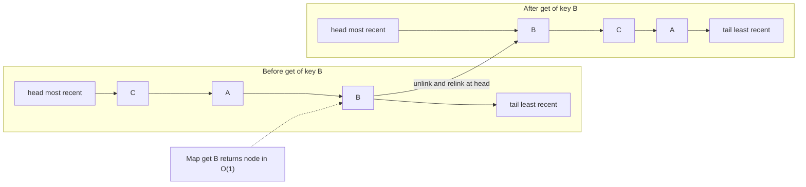
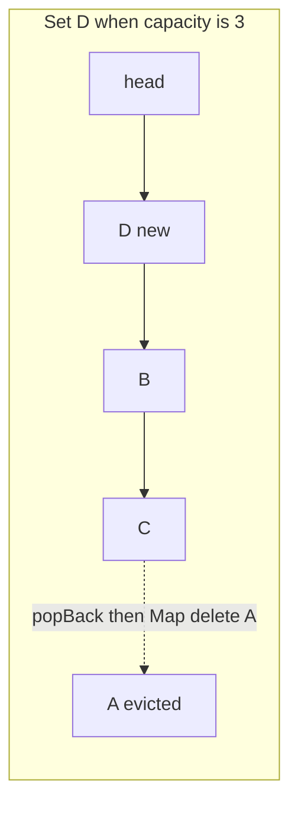

## 1.17 LRU Cache

#### Concept

An LRU (least recently used) cache is a bounded key-value store that, when full, evicts the entry that has gone longest without being read or written. It is the structure behind almost every in-process cache you will use (`lru-cache`, the memory store of `@nestjs/cache-manager`, HTTP client caches) and the policy behind Redis's `allkeys-lru` and, in spirit, PostgreSQL's buffer cache. It combines two structures from this Part: a **hash map** for O(1) lookup by key and a **doubly linked list** ordered by recency for O(1) "move to front" and "drop the back".

#### Why does it exist?

Memory is finite and access patterns are skewed: a small fraction of products, users and sessions receive most of the reads, and what was hot a minute ago is likely hot now (temporal locality). A cache without eviction is the six-day memory leak from Section 1.8. A cache that evicts randomly throws away hot entries. LRU keeps the recent working set with a policy that is cheap (O(1) per operation), needs no statistics, and is right often enough that it became the default everywhere.

#### Mental model

Imagine a desk with room for ten documents. Every time you use one, you put it on top of the pile. When an eleventh document arrives, the one at the bottom, untouched the longest, goes back to the archive. You never search the pile for the oldest; it is always at the bottom, because using a document moves it to the top. The hash map is the index card that tells you where in the pile a document currently is, so you never rummage.

#### How it works

1. **Two structures, one entry.** Each cache entry is a node in a doubly linked list holding the key and value. A `Map` maps the key to that node. The list's front is the most recently used entry; its back is the least.
2. **`get(key)`.** Look up the node in the map (O(1)). If absent, miss. If present, unlink it and relink it at the front (O(1), four pointer writes), then return the value.
3. **`set(key, value)`.** If the key exists, update the value and move the node to the front. Otherwise create a node at the front and add it to the map. If the size now exceeds capacity, unlink the back node and delete its key from the map.
4. **TTL.** Store an `expiresAt` per entry and treat an expired entry as a miss on read (lazy expiry); optionally sweep periodically. TTL bounds staleness; capacity bounds memory; you usually want both.
5. **The `Map`-only shortcut.** Because a JavaScript `Map` iterates in insertion order, `delete` followed by `set` moves a key to the end, and `map.keys().next().value` is the oldest. That gives an O(1) LRU in fifteen lines with no list at all; the explicit list version is clearer, supports eviction callbacks cleanly, and is what libraries do.
6. **Weaknesses and cousins.** LRU is not scan-resistant: one pass over a million cold keys evicts the entire hot set. LFU (least frequently used) resists scans but adapts slowly. 2Q, ARC and W-TinyLFU (used by Caffeine on the JVM) combine recency and frequency. Redis approximates LRU by sampling a few keys (`maxmemory-samples`, default 5) rather than maintaining a list, and offers LFU with a logarithmic counter and decay. PostgreSQL uses a **clock sweep**: each buffer has a usage count (max 5) incremented on access; a clock hand walks the buffers decrementing counts and evicts the first buffer it finds at zero, and large sequential scans get a private 256 KB ring so they cannot flush the working set.





**Time complexity**

| Operation | Best | Average | Worst | Notes |
|---|---|---|---|---|
| `get` | O(1) | O(1) | O(n) | worst case is a pathological hash collision in the map |
| `set` (new or existing) | O(1) | O(1) | O(n) | includes eviction; worst case is a map resize |
| `delete` | O(1) | O(1) | O(1) | node handle from the map |
| Evict least recent | O(1) | O(1) | O(1) | it is always the tail |
| Iterate by recency | O(n) | O(n) | O(n) | |
| Sweep expired entries | O(n) | O(n) | O(n) | run off the request path |

**Memory implications (V8, Node.js)**

- Per entry: a map entry (about 50 bytes), a list node (about 56 bytes), the key string and the value. Budget about 150 bytes of overhead per entry plus the payload. Ten thousand product records of 2 KB each is about 21.5 MB per pod.
- Capacity is in *entries*; if values vary wildly in size (a 20 KB product with 200 images next to a 300-byte one), either count bytes (`Buffer.byteLength(JSON.stringify(v))` at `set` time, which costs CPU) or cap the value size at insertion.
- Values are shared by reference. A caller that mutates a cached object mutates it for everyone. Freeze cached objects (`Object.freeze`) in development, or clone on read for mutable use.
- Churn creates garbage: at 20,000 sets per second the old nodes and values are short-lived young-generation objects, which V8 handles well; long-lived entries promoted to old space cost more on major GCs. Keep capacity modest and let TTL do the rest.

**Decision table: eviction policy**

| Policy | Keeps | Weakness | Where you meet it |
|---|---|---|---|
| LRU | recently used | scans flush the hot set | `lru-cache`, cache-manager memory store, Redis `allkeys-lru` (approximate) |
| LFU | frequently used | slow to adapt; needs decay | Redis `allkeys-lfu` |
| FIFO | newest | ignores popularity | simple ring buffers |
| TTL only | everything until expiry | unbounded memory | TypeORM query cache, naive `Map` with timestamps |
| Clock sweep with usage counts | recently and repeatedly used | approximate LRU | PostgreSQL `shared_buffers` |
| 2Q / ARC / W-TinyLFU | recency plus frequency, scan-resistant | complexity | Caffeine, some database buffer pools |

#### Practical example

A production-grade LRU with TTL, eviction callback and hit statistics on top of the `DoublyLinkedList` from Section 1.4, followed by the fifteen-line `Map`-only version.

```ts
// common/lru-cache.ts
import { DoublyLinkedList, ListNode } from './doubly-linked-list';

interface Entry<K, V> { key: K; value: V; expiresAt: number }

export class LruCache<K, V> {
  private readonly map = new Map<K, ListNode<Entry<K, V>>>();
  private readonly list = new DoublyLinkedList<Entry<K, V>>();
  hits = 0;
  misses = 0;
  evictions = 0;

  constructor(
    private readonly capacity: number,
    private readonly defaultTtlMs = 0,                        // 0 = no expiry
    private readonly onEvict?: (key: K, value: V) => void,
  ) {
    if (!Number.isInteger(capacity) || capacity <= 0) throw new RangeError('capacity must be a positive integer');
  }

  get(key: K): V | undefined {
    const node = this.map.get(key);
    if (!node) { this.misses++; return undefined; }
    if (node.value.expiresAt !== 0 && node.value.expiresAt <= Date.now()) {
      this.drop(node);                                          // lazy expiry
      this.misses++;
      return undefined;
    }
    this.list.moveToFront(node);                                // O(1): now the most recently used
    this.hits++;
    return node.value.value;
  }

  set(key: K, value: V, ttlMs = this.defaultTtlMs): void {
    const expiresAt = ttlMs > 0 ? Date.now() + ttlMs : 0;
    const existing = this.map.get(key);
    if (existing) {
      existing.value.value = value;
      existing.value.expiresAt = expiresAt;
      this.list.moveToFront(existing);
      return;
    }
    this.map.set(key, this.list.pushFront({ key, value, expiresAt }));
    if (this.map.size > this.capacity) {
      const victim = this.list.popBack()!;                      // least recently used is always the tail
      this.map.delete(victim.key);
      this.evictions++;
      this.onEvict?.(victim.key, victim.value);
    }
  }

  delete(key: K): boolean {
    const node = this.map.get(key);
    if (!node) return false;
    this.drop(node);
    return true;
  }

  get size(): number { return this.map.size; }
  get hitRate(): number { const t = this.hits + this.misses; return t === 0 ? 0 : this.hits / t; }

  private drop(node: ListNode<Entry<K, V>>): void {
    this.list.remove(node);
    this.map.delete(node.value.key);
  }
}

// common/tiny-lru.ts -- the Map insertion-order trick, also O(1)
export class TinyLru<K, V> {
  private readonly map = new Map<K, V>();
  constructor(private readonly capacity: number) {}

  get(key: K): V | undefined {
    const value = this.map.get(key);
    if (value === undefined) return undefined;
    this.map.delete(key);
    this.map.set(key, value);                                   // re-insert: now the newest entry
    return value;
  }

  set(key: K, value: V): void {
    if (this.map.has(key)) this.map.delete(key);
    this.map.set(key, value);
    if (this.map.size > this.capacity) this.map.delete(this.map.keys().next().value as K); // oldest first
  }
}
```

#### NestJS example

Two ways to get an LRU in NestJS. The framework way: `@nestjs/cache-manager` with `max` and `ttl`, whose memory store is an LRU. The explicit way: a provider around `LruCache` that exposes metrics and, crucially, a bypass flag so bulk jobs cannot flush the hot set (the failure scenario below).

```ts
// app.module.ts (framework way)
import { CacheModule } from '@nestjs/cache-manager';

@Module({
  imports: [CacheModule.register({ isGlobal: true, ttl: 60_000, max: 10_000 })], // ms in cache-manager v5
})
export class AppModule {}

// products/products.controller.ts
import { CacheInterceptor, CacheKey, CacheTTL } from '@nestjs/cache-manager';

@Controller('products')
@UseInterceptors(CacheInterceptor)                 // caches GET responses by URL, per pod
export class ProductsController {
  @Get('menu')
  @CacheKey('products:menu')
  @CacheTTL(30_000)
  menu() { /* ... */ }
}

// products/product-cache.service.ts (explicit way)
import { Injectable } from '@nestjs/common';
import { LruCache } from '../common/lru-cache';
import { Product } from './product.entity';

@Injectable()
export class ProductCacheService {
  private readonly cache = new LruCache<string, Product>(10_000, 60_000);

  async getOrLoad(id: string, load: (id: string) => Promise<Product>, opts: { bypass?: boolean } = {}): Promise<Product> {
    if (opts.bypass) return load(id);              // bulk exports and backfills must not touch the hot set
    const hit = this.cache.get(id);
    if (hit) return hit;
    const product = await load(id);                // wrap in SingleFlight (Section 1.8) for hot misses
    this.cache.set(id, Object.freeze(product));    // callers cannot mutate a shared cached object
    return product;
  }

  invalidate(id: string): void {
    this.cache.delete(id);                          // called from a product.updated event on every pod
  }

  stats() {
    return { size: this.cache.size, hitRate: this.cache.hitRate, evictions: this.cache.evictions };
  }
}
```

Expose `stats()` on an internal metrics endpoint or as Prometheus gauges. A cache without a hit-rate graph is a cache you cannot reason about during an incident.

#### PostgreSQL example

PostgreSQL's `shared_buffers` is the LRU-like cache you already run. You can see what it holds, how hot each buffer is, and how often queries hit it.

```sql
CREATE EXTENSION IF NOT EXISTS pg_buffercache;

-- Which relations occupy the buffer cache, and how "hot" their buffers are (usagecount 0..5).
SELECT c.relname, count(*) AS buffers, round(avg(b.usagecount), 2) AS avg_usage
FROM pg_buffercache b
JOIN pg_class c ON b.relfilenode = pg_relation_filenode(c.oid)
WHERE b.reldatabase = (SELECT oid FROM pg_database WHERE datname = current_database())
GROUP BY c.relname ORDER BY buffers DESC LIMIT 5;

-- Overall buffer hit ratio; below ~99% on an OLTP database deserves attention.
SELECT round(100.0 * blks_hit / nullif(blks_hit + blks_read, 0), 2) AS cache_hit_pct
FROM pg_stat_database WHERE datname = current_database();
```

```text
       relname        | buffers | avg_usage
----------------------+---------+-----------
 orders               |  312440 |      3.87
 orders_pkey          |   88120 |      4.62
 products             |   41200 |      4.91
 order_items          |   38810 |      2.10
 users_email_lower_uq |    9024 |      4.98

 cache_hit_pct
---------------
         99.31
```

In `EXPLAIN (ANALYZE, BUFFERS)` output, `shared hit=1489` means those pages came from this cache; `read=212` means they came from the operating system or disk. A nightly report that scans a 400 GB table does not flush the cache, because PostgreSQL routes large sequential scans through a small ring of buffers: the scan-resistance that plain LRU lacks and that you must add yourself in application caches.

**Redis as the shared LRU.** With `maxmemory 4gb` and `maxmemory-policy allkeys-lru`, Redis evicts approximately least-recently-used keys by sampling `maxmemory-samples` (5 by default; 10 is closer to true LRU at slightly more CPU). Each key header carries a 24-bit clock for this purpose. Use `volatile-lru` when the same instance holds data that must not be evicted (only keys with a TTL are candidates), `allkeys-lfu` for skewed, stable popularity, and `noeviction` with alerting for anything that is a queue or a lock store, where losing a key is a bug rather than a cache miss.

#### TypeORM example

TypeORM has a query result cache. It is TTL-based, not LRU, so bound it by putting it in Redis with an eviction policy rather than in the database table option.

```ts
// data-source.ts
export const AppDataSource = new DataSource({
  type: 'postgres',
  // ...
  cache: { type: 'ioredis', options: { host: process.env.REDIS_HOST, port: 6379 }, duration: 30_000 },
});

// cached query: key + TTL; invalidate with dataSource.queryResultCache?.remove(['products:menu'])
const menu = await productRepo.find({
  where: { isActive: true },
  order: { position: 'ASC' },
  cache: { id: 'products:menu', milliseconds: 30_000 },
});
```

#### Sequelize example

Sequelize has no built-in result cache; wrap repository methods with `ProductCacheService` above, and invalidate from `afterUpdate` and `afterDestroy` hooks by publishing the id to every pod.

#### Production scenario

A catalog read path at 6,000 RPS uses three layers. Per pod, a 10,000-entry LRU with a 60-second TTL (about 20 MB) serves 92 percent of reads in about 2 microseconds. Redis (`allkeys-lru`, 4 GB, 96 percent hit rate on what reaches it) serves most of the rest in about 0.3 ms. PostgreSQL sees roughly 200 queries per second instead of 6,000, and its own buffer cache answers 99.3 percent of those from memory in 1 to 3 ms. Invalidation flows the other way: a product update publishes `product.updated` on Redis pub/sub; every pod deletes its local entry and the Redis key, so the staleness window is the propagation delay (milliseconds) rather than the TTL, and the TTL remains as the safety net for missed messages.

The per-pod layer costs 20 MB times 12 pods and one subtle behaviour: each pod warms independently, so a fresh deploy briefly shifts load to Redis and PostgreSQL. Rolling deploys of a few pods at a time keep that spike small; a full restart of all pods at once during peak is a self-inflicted stampede.

#### Failure scenario

At 07:40 the on-call engineer is paged: checkout p99 has climbed from 90 ms to 3 seconds since 06:00, PostgreSQL CPU is at 95 percent, and the per-pod cache hit rate has dropped from 92 percent to 5 percent. Nothing was deployed. The nightly partner-feed export, moved from 02:00 to 06:00 the previous day to fit a new SLA, walks all 2 million products through the same `ProductReadService.byId` used by the storefront. The export runs at 800 products per second per pod, so every 12 seconds it cycles a full 10,000-entry LRU: the storefront's hot set is evicted continuously, every customer read misses, and the database absorbs the difference. The LRU worked exactly as designed; the design lacked scan resistance.

The fix took twenty minutes: the export passes `bypass: true` (the flag in the service above) and reads through a keyset-paginated query instead of `byId`. The follow-up was an alert on cache hit rate below 70 percent for five minutes, which would have paged at 06:05 instead of 07:40. This is the same problem PostgreSQL solves with buffer rings for sequential scans and that 2Q and W-TinyLFU solve inside the cache itself.

#### Edge cases & failure modes

- **Scan pollution** from bulk jobs; add a bypass or a separate cache.
- **Stampede on expiry**: a hot key expiring on twelve pods at once produces twelve concurrent database loads; use single-flight per pod, jittered TTLs, or stale-while-revalidate (serve the stale value while one loader refreshes).
- **Negative caching**: cache "not found" for a short TTL so repeated misses for missing keys do not reach the database (complements the Bloom filter in Section 1.16).
- **Mutable shared values**: a handler that does `product.price = discounted` on a cached object changes the price for every subsequent reader. Freeze or clone.
- **Key collisions across tenants or versions**: include tenant id and a schema version in the key (`v3:tenant:42:product:8813`).
- **Invalidation gaps**: a pod that missed the pub/sub message serves stale data until TTL; keep TTLs short enough that this is acceptable and monitor pub/sub disconnects.
- **Size skew**: capacity in entries with unbounded value sizes is not a memory bound.
- **Caching errors and partial results**: never cache an exception or a half-loaded aggregate.
- **Clock jumps** affect TTL math; use `Date.now()` consistently and tolerate small skew.
- **Redis eviction of non-cache data**: a queue, a lock or a Bloom filter placed on an `allkeys-lru` instance will be evicted under pressure.
- **Hot key on Redis**: one product id read 50,000 times per second lands on one shard; the per-pod LRU exists precisely to absorb that.

#### How a Senior Backend Engineer thinks about this

The senior treats every cache as a promise about staleness and memory, and writes both numbers down: "at most 60 seconds stale, at most 20 MB per pod, at most 10,000 entries". They put a hit-rate graph next to the latency graph, because a cache that quietly stops hitting is the most common explanation for "the database got slow and nothing changed". They separate traffic classes (interactive reads versus bulk scans) so one cannot evict the other. They know that a per-pod cache is a cache, Redis is a cache, and PostgreSQL's buffer pool is a cache, and that invalidation must reach all three. And they resist caching until they have measured: a 20 MB cache with a 92 percent hit rate is a great trade; a cache with a 30 percent hit rate is memory and complexity for nothing.

To a product manager: "Product pages read from memory for up to a minute after an edit. The export job was accidentally flushing that memory every twelve seconds, so every customer read went to the database. We separated the two paths; the export is unchanged and the site is fast again."

#### Common mistakes

- Unbounded `Map` "caches" (Section 1.8).
- LRU with no TTL (stale forever for keys that stay hot) or TTL with no capacity (memory unbounded).
- Letting bulk jobs share the interactive cache.
- No hit-rate metric.
- Caching by reference and mutating.
- Using `allkeys-lru` on a Redis instance that also stores queues or locks.
- Full-fleet restarts at peak, turning cold caches into a database stampede.

#### Interview questions

1. **Implement an LRU cache with O(1) get and set.** Expected: hash map plus doubly linked list, move-to-front on access, evict tail; or the `Map` insertion-order trick. Follow-up: how do you add TTL without a sweep? (Lazy expiry on read, plus an optional periodic sweep.)
2. **What is scan resistance, and how do PostgreSQL and Redis deal with it?** Expected: LRU evicts the hot set during a scan; PostgreSQL uses a buffer ring for large sequential scans and usage counts; Redis LFU or application-level bypass.
3. **How does Redis implement LRU, and why is it approximate?** Expected: sampling `maxmemory-samples` keys with a per-key 24-bit clock; avoids a global list.
4. **Your database load doubled but nothing was deployed. Where do you look first?** Expected: cache hit rate; find the traffic class or job that changed access patterns.
5. **Design cache invalidation for product edits across 12 pods and Redis.** Expected: event on update, delete locally and in Redis, short TTL as the safety net, versioned keys for schema changes.
6. **Why cache a 404?** Expected: negative caching stops repeated misses; short TTL to limit staleness after creation; combine with a Bloom filter.

#### Practical exercise

Build `ProductCacheModule` with `LruCache`, single-flight loading, negative caching and pub/sub invalidation. Acceptance criteria: 100 concurrent misses for one key produce exactly one database query (assert with a query counter); a product update is invisible on both pods of a two-instance integration test within 200 ms; a simulated export of 1 million ids with `bypass: true` leaves the hit rate for concurrent interactive reads above 85 percent (compare with the same run without bypass, which must drop below 20 percent, proving the mechanism); memory per pod stays under 40 MB with `max = 10,000` and values up to 4 KB (reject larger values at `set`); and `GET /internal/cache/stats` reports size, hit rate, evictions and the age of the oldest entry.
