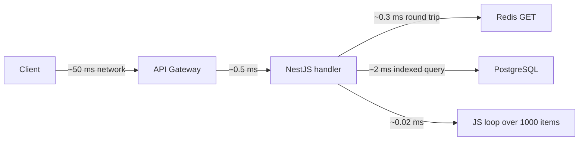
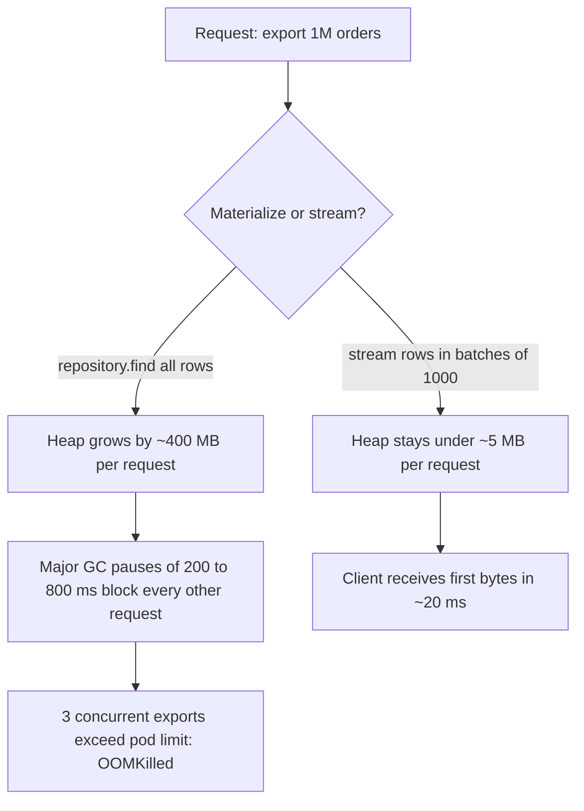

# Part 2 — Algorithms for Backend Engineers

Most backend engineers meet algorithms twice: once in an interview, and then again at 02:00 when an endpoint that "worked fine in staging" takes 40 seconds in production. This part is about the second meeting.

You will rarely implement a red-black tree in a NestJS service. But every day you make algorithmic decisions without naming them: you call `array.includes` inside a `map`, you write a query that the planner turns into a nested loop, you build a 1-million-element array in a request handler, you sort in the application because "the DB was slow". Each of these is an algorithm choice with a cost curve, and a senior engineer sees the curve before the incident does.

The algorithms in this part are chosen because they show up in real backend systems: in the PostgreSQL query planner, in Redis eviction, in Node's `Array.prototype.sort`, in rate limiters, job schedulers, dependency graphs, delivery routing and fuzzy search. For each one we explain the mechanism, then show exactly where you will meet it in a NestJS + PostgreSQL + Redis stack.

## 2.1 Big O — what it measures and what it hides

#### Concept

Big O notation describes how the cost of an operation grows as the input grows. "Cost" is usually time (number of steps) or space (memory). `O(n)` means "the work grows in proportion to the input size". `O(1)` means "the work does not depend on the input size". `O(n²)` means "double the input, quadruple the work".

Big O is not a stopwatch. It says nothing about how long one step takes. It only tells you the *shape* of the growth curve. That is its power and its trap.

#### Why does it exist?

Without a growth model, you can only learn about performance by running the code at every input size, which nobody does. Big O lets you reason about an endpoint at 10,000 users when you have only tested it with 50. It answers the question every senior engineer asks in review: *"What happens to this when the table is 100 times bigger?"*

What breaks without it: code that is fast on the developer's laptop with 20 seed rows becomes an outage at 2 million rows, and nobody can explain why because "we didn't change anything". The data changed. The algorithm's growth curve did the rest.

#### Mental model

Imagine a warehouse picker fulfilling an order. If every product has a fixed shelf address printed on the pick list, the picker walks straight there: the time per item is constant, `O(1)`, no matter how big the warehouse is. If the pick list only says "a blue kettle", the picker walks every aisle until they find it: `O(n)` in the number of shelves. If for every item on the list they have to walk every aisle, and the list has `n` items in a warehouse of `n` shelves, that is `O(n²)`.

Now the trap: a picker with a perfect shelf address (`O(1)`) who has to drive to a different warehouse across the city for every item is much slower than a picker who checks ten shelves by hand (`O(n)`, n=10) in the room they are already standing in. Big O told you the first picker had the better algorithm. Reality told you the second picker finished first. The difference is the constant: the drive.

#### How it works

Big O is derived by counting the steps an operation performs as a function of input size `n`, then simplifying:

1. Count the operations in terms of `n`. A loop over `n` orders is `n` steps; a nested loop over `n` orders and `m` products is `n * m`.
2. Drop constants. `3n + 20` becomes `O(n)`. A loop that does five things per item is still `O(n)`.
3. Keep only the dominant term. `n² + n log n + n` becomes `O(n²)`, because for large `n` the square dwarfs everything else.
4. Say which case you mean. Worst case is the default. Average case matters for hash tables (`O(1)` average, `O(n)` worst when everything collides). Amortized cost matters for dynamic arrays (`push` is `O(1)` amortized because the occasional resize copies everything, but rarely).

Here is that reasoning applied to an order-total handler:

```ts
// orders/pricing.service.ts
export class PricingService {
  // n = number of lines in the order, p = number of products in the catalog
  computeTotal(lines: OrderLine[], catalog: Product[]): number {
    let total = 0;
    for (const line of lines) {                                   // n iterations
      const product = catalog.find((p) => p.id === line.productId); // O(p) each
      if (!product) throw new ProductNotFoundError(line.productId);
      total += product.priceCents * line.quantity;                 // O(1)
    }
    return total;                                                  // total: O(n * p)
  }

  // Same result, O(n + p): build the index once, then every lookup is O(1)
  computeTotalIndexed(lines: OrderLine[], catalog: Product[]): number {
    const byId = new Map(catalog.map((p) => [p.id, p]));          // O(p)
    let total = 0;
    for (const line of lines) {                                   // O(n)
      const product = byId.get(line.productId);                   // O(1) average
      if (!product) throw new ProductNotFoundError(line.productId);
      total += product.priceCents * line.quantity;
    }
    return total;
  }
}
```

With 50 lines and a 20,000-product catalog, the first version does about one million comparisons per order; the second does about 20,050 operations. Same output, fifty times less work, and the difference grows as the catalog grows.

Now the part Big O hides. Every "step" above is assumed to cost the same. In a real backend the steps are wildly different:

| Operation | Typical latency | Relative to L1 cache hit |
|---|---|---|
| L1 cache reference | ~1 ns | 1x |
| Main memory reference | ~100 ns | 100x |
| Compare two integers in a JS loop | ~1–5 ns | ~3x |
| `Map.get` on a small map | ~20–50 ns | ~30x |
| SSD random read (4 KB) | ~20–100 µs | ~50,000x |
| Redis GET, same availability zone | ~0.2–1 ms | ~500,000x |
| PostgreSQL indexed query, same AZ | ~1–5 ms | ~2,000,000x |
| HTTP call to another service, same region | ~2–20 ms | ~10,000,000x |
| Cross-region HTTP call | ~80–150 ms | ~100,000,000x |

This is why "an O(1) Redis call is slower than an O(n) scan over a 10-element array" is not a joke but an engineering fact. Scanning 10 elements in memory costs about 20–50 nanoseconds. One Redis round trip costs about 300,000 nanoseconds. The array scan is roughly ten thousand times faster, even though its Big O is worse.

Big O hides four things you must add back by hand:

- **Constants.** `O(1)` with a 1 ms constant loses to `O(n)` with a 2 ns constant until `n` is around 500,000.
- **Cache locality.** A contiguous array of numbers is read sequentially and the CPU prefetches it; a linked list or an array of heap-allocated objects chases pointers and misses cache. Two `O(n)` loops can differ by 10x for this reason alone.
- **I/O versus CPU.** A Node request handler that does 20 CPU operations and 3 database queries is dominated by the queries. The CPU part could be `O(n²)` and you would not notice until `n` is in the thousands. The I/O part could be `O(1)` per item and it will kill you at `n = 200`.
- **The runtime.** V8 JIT-compiles hot loops, but it also deoptimizes when object shapes change, and garbage collection pauses happen when you allocate heavily. A "linear" loop that allocates a new object per iteration can stall for tens of milliseconds in a major GC.



The diagram is the whole lesson: inside one request, the in-process loop over a thousand items is the cheapest box on the page. The network hops are where the time goes.

#### Practical example

A checkout service must apply tax rules per order line. A developer stores tax rules in Redis, keyed by `tax:{countryCode}:{categoryId}`, and looks up the rule for every line:

```ts
// O(n) Redis round trips: each is "O(1)" and each costs ~0.3 ms
async applyTax(order: Order): Promise<number> {
  let tax = 0;
  for (const line of order.lines) {
    const raw = await this.redis.get(`tax:${order.country}:${line.categoryId}`);
    const rule = raw ? (JSON.parse(raw) as TaxRule) : DEFAULT_RULE;
    tax += Math.round(line.totalCents * rule.rate);
  }
  return tax;
}
```

For a 40-line B2B order that is 40 sequential round trips: roughly 12 ms of pure waiting, on every checkout. The fix is not a better data structure; it is fewer network hops. Fetch all rules for the country once with a single `MGET` (or cache the whole country's rule set in process memory for 60 seconds), then do the per-line work in a local `Map`. The per-line lookup is still `O(1)`, but the constant dropped from 300 µs to 30 ns.

#### NestJS example

A small in-process cache in a provider keeps the hot path off the network. This is a normal pattern for reference data that changes rarely (tax rules, feature flags, currency rates):

```ts
// tax/tax-rules.service.ts
import { Injectable, Logger } from '@nestjs/common';
import { InjectRedis } from '@nestjs-modules/ioredis';
import Redis from 'ioredis';

interface TaxRule { rate: number; }

@Injectable()
export class TaxRulesService {
  private readonly logger = new Logger(TaxRulesService.name);
  // country -> (categoryId -> rule), refreshed at most every 60 s
  private cache = new Map<string, { loadedAt: number; rules: Map<string, TaxRule> }>();
  private readonly ttlMs = 60_000;

  constructor(@InjectRedis() private readonly redis: Redis) {}

  async rulesFor(country: string): Promise<Map<string, TaxRule>> {
    const hit = this.cache.get(country);
    if (hit && Date.now() - hit.loadedAt < this.ttlMs) return hit.rules; // ~30 ns

    // One round trip for the whole country instead of one per order line
    const raw = await this.redis.hgetall(`tax:${country}`);           // ~0.3 ms
    const rules = new Map<string, TaxRule>();
    for (const [categoryId, json] of Object.entries(raw)) {
      rules.set(categoryId, JSON.parse(json) as TaxRule);
    }
    this.cache.set(country, { loadedAt: Date.now(), rules });
    this.logger.debug(`tax rules for ${country} refreshed: ${rules.size} entries`);
    return rules;
  }
}
```

The `ioredis` injection decorator comes from the community `@nestjs-modules/ioredis` package; if you wire Redis yourself, inject the client through a custom provider token instead. The important part is the shape: one I/O operation per country per minute, then pure memory.

#### PostgreSQL example

The PostgreSQL planner is a Big O calculator with constants filled in. It estimates the cost of each plan using tunable unit costs, then picks the cheapest:

```sql
SHOW seq_page_cost;    -- 1.0   cost to read one 8 KB page sequentially
SHOW random_page_cost; -- 4.0   cost to read one page randomly (set ~1.1 on SSD)
SHOW cpu_tuple_cost;   -- 0.01  cost to process one row
SHOW cpu_index_tuple_cost; -- 0.005

EXPLAIN SELECT * FROM orders WHERE customer_id = 4821;
```

```text
Index Scan using orders_customer_id_idx on orders  (cost=0.43..37.12 rows=9 width=112)
  Index Cond: (customer_id = 4821)
```

The `cost=0.43..37.12` is the planner's estimate in abstract units: 0.43 to return the first row, 37.12 to return all of them. Compare it with the same query on a tiny table:

```text
Seq Scan on orders  (cost=0.00..1.06 rows=1 width=112)
  Filter: (customer_id = 4821)
```

The planner chose the `O(n)` sequential scan over the `O(log n)` index scan, because with five rows on one page the "worse" algorithm has a smaller constant. That is Big O with the constants put back, computed for you on every query. When `random_page_cost` is left at the HDD default of 4.0 on an SSD box, the planner overestimates index cost and picks sequential scans too often. Tuning that one constant changes plans across the whole database.

#### Production scenario

An order-history endpoint serves 400 requests per second at p50 of 18 ms. A profile of one request shows: 0.4 ms in the NestJS pipeline (guards, pipes, serialization), 2.1 ms in one PostgreSQL query returning 50 rows, 0.6 ms in two Redis calls, 0.1 ms in application code that maps and sorts the 50 rows, and the remainder waiting on the network to the client. The application code is `O(n log n)` because of the sort, and it is the smallest number on the page.

A product manager asks for "order history with the product name on each line". A developer adds a `productRepository.findOne` inside the map. Same `O(n)` shape as before, but each step now carries a 2 ms constant. The endpoint goes from 18 ms to 120 ms and the database connection pool saturates at 400 RPS. Nothing about the Big O of the code changed. The constant did.

#### Failure scenario

At 02:14 the on-call gets paged: checkout p99 has crossed 8 seconds and the Redis connection pool is exhausted. The last deploy added "per-line loyalty multiplier lookup". The multiplier lives in Redis. It is a single `GET`, "O(1), can't be the problem", the author says in the incident channel.

The problem is a B2B customer with an order of 2,300 lines. 2,300 sequential `GET`s at 0.4 ms is 0.9 seconds of waiting per checkout attempt; the customer's client retries on a 5-second timeout, so three concurrent attempts hold three connections each for a second, while every other request queues behind them. The fix that ships at 02:50 is a single `MGET` of all keys for the order, which takes 1.2 ms. The post-mortem action item: "any per-item I/O inside a loop requires a comment explaining why batching is impossible".

#### Edge cases & failure modes

- **Small n hides everything.** With `n = 20`, an `O(n²)` loop finishes in microseconds. It will show up when the data grows, not in code review by measurement, only by reasoning.
- **Large constants hide in "O(1)".** Any `await` inside a loop is a network round trip per iteration. The Big O is honest; the wall clock is not.
- **Amortized costs bunch up.** A `Map` or array that resizes copies everything at the resize. In a hot path that builds and discards large structures, those copies become GC pressure.
- **Average versus worst case.** A hash map degrades to `O(n)` when many keys collide. Attackers used to exploit this (hash-flooding); V8 randomizes hash seeds, but a home-made hash function in your code might not.
- **Cache locality reverses rankings.** Iterating an array of 1,000 numbers beats iterating a `Set` of 1,000 numbers, even though both are `O(n)`, because the array is one contiguous block.
- **The planner's constants are wrong.** Stale statistics or default `random_page_cost` on SSDs lead PostgreSQL to pick the wrong algorithm for your data.

#### How a Senior Backend Engineer thinks about this

A senior engineer uses Big O as a first filter and constants as the second. The questions, in order:

1. What is `n` here, and how big can it get? Not today: in two years, or for the biggest customer.
2. Is the cost per step nanoseconds (memory), microseconds (disk), or milliseconds (network)? A single network hop inside a loop is a red flag regardless of Big O.
3. Where does the endpoint spend its time *now*? Measure before optimizing. A 10x improvement in a part that is 1% of the latency is invisible.
4. Is the growth curve acceptable for the worst realistic input, or only for the average one?

What they refuse to do: optimize an in-memory loop from `O(n log n)` to `O(n)` in a handler that spends 95% of its time waiting on the database. What they insist on: no I/O inside loops without a written justification.

Explained to a product manager: "The feature is fine for a normal order. For your biggest customer, the same feature makes 2,000 trips to a server instead of one. We need to make it one trip before we ship it."

#### Common mistakes

- Treating `O(1)` as "fast" and `O(n)` as "slow" without asking what one step costs.
- Optimizing CPU-bound code in an I/O-bound endpoint.
- Believing the developer laptop with 20 rows. Complexity problems are invisible at small `n` by definition.
- Assuming `Array.prototype.includes`, `indexOf` and `find` are cheap. They are `O(n)` scans, and inside another loop they are `O(n²)`.
- Ignoring memory allocation. An algorithm with a good time complexity that allocates a new object per iteration can be slower than a "worse" algorithm that allocates nothing, because of GC.

#### Interview questions

1. **"Why can an O(1) operation be slower than an O(n) one?"** Expected: Big O drops constants; an `O(1)` network call costs about a million times more than an `O(1)` memory read, so for small `n` the memory scan wins. Why it matters: shows the candidate reasons about real latency, not notation. Follow-up: at what `n` does the ranking flip for a 0.3 ms Redis call versus a 3 ns comparison? (Around 100,000.)
2. **"What does the PostgreSQL planner's cost number represent, and why might it choose a sequential scan when an index exists?"** Expected: an abstract estimate built from page and tuple costs; on small tables or low-selectivity predicates the sequential scan has a lower total cost. Follow-up: what setting would you tune on SSD storage?
3. **"Explain amortized complexity with a backend example."** Expected: dynamic array `push` is `O(1)` amortized because resizes are rare; a Redis hash that rehashes incrementally spreads the cost. Follow-up: when does amortized cost bite you? (Latency-sensitive paths where one request pays for the resize.)
4. **"A handler is O(n) in the number of order lines and still takes 3 seconds for 2,000 lines. What do you look for?"** Expected: an `await` per iteration, so the constant is a network round trip. Fix by batching (`MGET`, `WHERE id = ANY($1)`).
5. **"How does cache locality affect two algorithms with the same Big O?"** Expected: contiguous memory is prefetched by the CPU; pointer chasing misses cache; can be a 5–10x difference.
6. **"Worst case, average case, amortized: give one backend example of each mattering."** Expected: hash collisions (worst), hash lookup (average), array growth or Redis rehash (amortized).

#### Practical exercise

Take an existing endpoint in your codebase that loops over a collection. Instrument it with `performance.now()` at three points: before the loop, after the loop, and around any `await` inside it. Run it with 10, 100 and 1,000 items. Produce a small table of wall time versus `n`.

Acceptance criteria:

- You can state the Big O of the loop body and of the whole handler.
- You can say what fraction of the time is I/O versus CPU at each `n`.
- If there is an `await` inside the loop, you have rewritten it as a single batched call and measured the difference.

## 2.2 Time complexity

#### Concept

Time complexity is Big O applied to running time: how many elementary steps an algorithm performs as a function of input size. The common classes, from cheapest to most expensive, are constant `O(1)`, logarithmic `O(log n)`, linear `O(n)`, linearithmic `O(n log n)`, quadratic `O(n²)`, cubic `O(n³)` and exponential `O(2ⁿ)`.

Knowing the class tells you which inputs are safe. Backend inputs have predictable shapes: request payloads (tens to thousands of items), query results (tens to millions of rows), and tables (millions to billions of rows). Matching the class to the input shape is the whole skill.

#### Why does it exist?

Because "it works" is not a property of code; it is a property of code at a particular input size. Time complexity lets you predict the input size at which "works" turns into "times out". The load balancer's 30-second timeout, the Kubernetes liveness probe and the customer's patience are all fixed numbers. Your algorithm's cost is a curve. Where the curve crosses the fixed number is where the incident starts.

#### Mental model

Imagine a queue at a passport office. `O(1)` is a self-service kiosk: every person takes the same time regardless of how many are in the building. `O(log n)` is a receptionist who splits the queue in half at each question ("surname A–M or N–Z?"): even a million people are sorted into the right room after twenty questions. `O(n)` is one clerk handling each person in turn. `O(n log n)` is sorting everyone by appointment time before serving them. `O(n²)` is every person having to shake hands with every other person before anyone is served. At ten people it is a friendly morning. At a thousand people, nobody leaves the building today.

#### How it works

The classes become concrete when you attach numbers to them. Assume a JavaScript loop body performs roughly 100 million simple operations per second (V8 can do more for tight numeric loops, less for object-heavy ones; 10⁸ is a safe planning figure).

| Class | n = 1,000 | n = 1,000,000 | n = 1,000,000,000 | What it means in a backend |
|---|---|---|---|---|
| O(1) | 1 op, ~10 ns | 1 op | 1 op | Hash lookup, array index, Redis `GET`, primary-key fetch (plus the constant) |
| O(log n) | ~10 ops | ~20 ops | ~30 ops | B-tree index descent, binary search, heap push/pop |
| O(n) | 1k ops, ~10 µs | 1M ops, ~10 ms | 1B ops, ~10 s | Sequential scan, one pass over a result set, `Array.map` |
| O(n log n) | 10k ops, ~100 µs | 20M ops, ~200 ms | 30B ops, ~5 min | Sorting, merge join with unsorted inputs, building an index |
| O(n²) | 1M ops, ~10 ms | 10¹² ops, ~3 hours | 10¹⁸ ops, ~300 years | Nested loops, `includes` inside `map`, nested-loop join without index |
| O(2ⁿ) | 10³⁰¹ ops | never | never | Brute-force subset search; only survivable for n under ~25 |

Three things to read off this table:

1. `O(n)` at a billion rows takes seconds even in a tight loop, and you cannot hold a billion rows in Node memory anyway. Anything linear over a whole table belongs in the database or in a batch job, never in a request handler.
2. `O(n²)` is fine at a thousand and fatal at a million. The transition happens around `n = 10,000–50,000`, which is exactly the size where "a large customer's export" lives.
3. `O(log n)` barely moves. Thirty steps for a billion rows is why a B-tree index makes a billion-row table feel like a thousand-row table.

The rules for combining complexities in code:

- Sequential blocks add: an `O(n)` loop followed by an `O(n log n)` sort is `O(n log n)`.
- Nested blocks multiply: an `O(m)` search inside an `O(n)` loop is `O(n * m)`.
- Independent variables stay separate: `O(n + m)` is not `O(n)`. If `n` is order lines and `m` is catalog size, say both.
- Recursion multiplies depth by work per level: a balanced tree traversal is `O(n)`; a naive recursive Fibonacci is `O(2ⁿ)` because each call spawns two.

#### Practical example

A warehouse service receives a shipment manifest of `n` SKUs and must find which ones are already in stock (an `m`-row inventory list returned from the database). Two implementations:

```ts
// O(n * m): with n = 5,000 SKUs and m = 200,000 inventory rows this is 10^9 comparisons
function findKnownSkusSlow(manifest: string[], inventory: InventoryRow[]): string[] {
  return manifest.filter((sku) => inventory.some((row) => row.sku === sku));
}

// O(n + m): build the set once, then each check is O(1)
function findKnownSkus(manifest: string[], inventory: InventoryRow[]): string[] {
  const known = new Set(inventory.map((row) => row.sku)); // O(m)
  return manifest.filter((sku) => known.has(sku));        // O(n)
}
```

The first version takes roughly ten seconds. The second takes about two milliseconds. The developer who wrote the first one tested it with a manifest of 12 rows.

The senior fix goes one step further: do not load 200,000 rows into Node at all. Send the manifest to the database and let the index do the work:

```sql
SELECT sku FROM inventory WHERE sku = ANY($1::text[]);
-- $1 = the 5,000-element manifest; index on inventory(sku) makes this O(n log m)
```

#### NestJS example

Complexity mistakes hide in places that do not look like algorithms. This validation pipe checks that every product in a bulk-update request exists, and is quietly `O(n)` in database round trips:

```ts
// products/pipes/products-exist.pipe.ts
import { Injectable, PipeTransform, BadRequestException } from '@nestjs/common';
import { InjectRepository } from '@nestjs/typeorm';
import { In, Repository } from 'typeorm';
import { Product } from '../product.entity';
import { BulkUpdateDto } from '../dto/bulk-update.dto';

@Injectable()
export class ProductsExistPipe implements PipeTransform<BulkUpdateDto> {
  constructor(@InjectRepository(Product) private readonly products: Repository<Product>) {}

  async transform(dto: BulkUpdateDto): Promise<BulkUpdateDto> {
    const ids = [...new Set(dto.items.map((i) => i.productId))]; // dedupe, O(n)

    // One query, O(n log m) inside PostgreSQL, instead of n queries of ~2 ms each
    const found = await this.products.find({ select: { id: true }, where: { id: In(ids) } });
    const foundIds = new Set(found.map((p) => p.id));           // O(n)

    const missing = ids.filter((id) => !foundIds.has(id));      // O(n)
    if (missing.length > 0) {
      throw new BadRequestException(`Unknown product ids: ${missing.slice(0, 10).join(', ')}`);
    }
    return dto;
  }
}
```

Cap the size of `dto.items` with `@ArrayMaxSize(1000)` from `class-validator` on the DTO. A complexity analysis that assumes unbounded `n` is a denial-of-service analysis.

#### PostgreSQL example

PostgreSQL chooses between join algorithms with different time complexities, and `EXPLAIN` shows you which one it picked:

```sql
EXPLAIN (ANALYZE, BUFFERS)
SELECT o.id, c.email
FROM orders o
JOIN customers c ON c.id = o.customer_id
WHERE o.created_at > now() - interval '1 day';
```

```text
Hash Join  (cost=2891.00..14210.55 rows=48120 width=40) (actual time=9.812..61.334 rows=47955 loops=1)
  Hash Cond: (o.customer_id = c.id)
  Buffers: shared hit=3120
  ->  Index Scan using orders_created_at_idx on orders o  (cost=0.43..9860.10 rows=48120 width=16) (actual time=0.031..31.902 rows=47955 loops=1)
        Index Cond: (created_at > (now() - '1 day'::interval))
  ->  Hash  (cost=1650.00..1650.00 rows=99280 width=32) (actual time=9.701..9.702 rows=99280 loops=1)
        Buckets: 131072  Batches: 1  Memory Usage: 7237kB
        ->  Seq Scan on customers c  (cost=0.00..1650.00 rows=99280 width=32) (actual time=0.008..4.120 rows=99280 loops=1)
Planning Time: 0.301 ms
Execution Time: 63.870 ms
```

The three join strategies and their complexity, with `n` outer rows and `m` inner rows:

| Join | Complexity | When the planner picks it |
|---|---|---|
| Nested Loop | O(n * m) without index; O(n log m) with an index on the inner side | Small outer set, indexed inner side |
| Hash Join | O(n + m) plus memory for the hash table | Medium or large sets, equality condition, hash fits in `work_mem` |
| Merge Join | O(n + m) if both sides are already sorted, else plus sort cost | Both inputs sorted (often by an index), range or equality conditions |

When you see `Nested Loop` with `loops=48000` and a `Seq Scan` on the inner side, you are looking at `O(n * m)` inside the database. The usual cure is an index on the inner join column, which turns each inner probe into `O(log m)`.

#### Production scenario

A reporting endpoint aggregates daily revenue per merchant. At launch there are 300 merchants and 20,000 orders per day; the handler loads all orders, then for each merchant filters the orders array. That is `O(merchants * orders)` = 6 million comparisons, about 60 ms. Acceptable.

Eighteen months later there are 4,000 merchants and 900,000 orders per day. The same code does 3.6 billion comparisons: roughly 40 seconds, well past the 30-second gateway timeout. The dashboard shows a 504 every morning. The fix is a `GROUP BY merchant_id` in SQL with an index on `(created_at, merchant_id)`: about 400 ms for the day's rows, and a materialized daily rollup brings it to 5 ms.

#### Failure scenario

At 09:03 on a Monday, the operations team reports the fulfilment dashboard "spinning". The on-call engineer sees the pod CPU pinned at 100% and the event loop lag metric at 9 seconds. The Node process is not waiting on anything; it is computing. A CPU profile via `--cpu-prof` shows 98% of time in `Array.prototype.indexOf` called from `mergeShipments`. Over the weekend a new integration started sending manifests with 80,000 lines instead of 800. The `indexOf` inside a loop that was `O(n²)` at 800 (640,000 operations, invisible) is now 6.4 billion operations. Because Node is single-threaded, every other request on that pod waits behind it: an `O(n²)` in one endpoint became an outage for all of them.

#### Edge cases & failure modes

- **Two variables, one name.** Calling both the manifest size and the inventory size "n" hides that `O(n * m)` can be far worse than `O(n²)` when `m` is a whole table.
- **Hidden linear operations.** `array.includes`, `array.indexOf`, `array.find`, `Object.keys(obj).length`, spreading into a new array (`[...arr, item]`) inside a loop, `string.concat` in a loop building a large string: all linear per call.
- **Sorting by accident.** Calling `.sort()` inside a loop to get "the latest" item turns `O(n)` into `O(n² log n)`.
- **Event loop monopoly.** A CPU-bound `O(n²)` in one request blocks every request on the process. Node has no preemption.
- **Complexity in the database.** A missing index on a join column is an `O(n * m)` nested loop that you never wrote in TypeScript.
- **Regex backtracking.** A catastrophic regex like `(a+)+$` is `O(2ⁿ)` on adversarial input (ReDoS). Validation regexes on user input need bounded patterns.

#### How a Senior Backend Engineer thinks about this

The senior question is not "what is the complexity?" but "what is the complexity in terms of the thing that grows?" Order lines grow with customer size. Orders grow with time. Tables grow forever. Any algorithm that is linear or worse in "rows in a table" must live in the database, behind an index, or in an offline job with a bounded window.

The second question: "where is the ceiling?" Every input needs a cap enforced at the boundary (DTO array size, pagination limit, upload size), because an algorithm that is safe at the cap is safe everywhere.

What a senior refuses to do: ship a handler whose cost grows with a whole table, no matter how small the table is today.

#### Common mistakes

- Loading a table into Node to filter it in JavaScript. The database has the index; use it.
- Nested `find`, `filter`, `includes` on two lists that both come from the database.
- Believing `O(n log n)` is "basically linear". At a billion rows it is 30x more work; sorting a billion rows is a different engineering problem from scanning them.
- Forgetting that `O(n)` over the request payload becomes `O(n * RPS)` per second on the server. A 10 ms loop at 500 RPS is 5 CPU-seconds per second: five cores, just for that loop.
- Ignoring exponential regexes in validation.

#### Interview questions

1. **"At what n does O(n²) become a production problem in Node, and why is that number what it is?"** Expected: around 10⁴–10⁵ items, because 10⁸–10¹⁰ operations is 1–100 seconds on one core, and Node is single-threaded so it blocks the whole process. Follow-up: how would you find it in production? (Event loop lag metric, CPU profile.)
2. **"Compare hash join, merge join and nested loop join in terms of complexity and when the planner picks each."** See the table above. Follow-up: what does `loops=48000` under a nested loop tell you?
3. **"A bulk endpoint is O(n) in database round trips. Rewrite it so it is O(1) round trips and explain the new complexity inside PostgreSQL."** Expected: `WHERE id = ANY($1)` or `IN`, `O(n log m)` with an index.
4. **"Why does a linear scan over a whole table never belong in a request handler even though O(n) is 'fine'?"** Expected: `n` is unbounded and grows with time; latency and memory grow with it; the request path has a fixed timeout.
5. **"Give a case where O(n log n) in the app is the right choice over doing it in the DB."** Expected: small `n` already in memory, or sorting by a computed value the DB cannot index, or offloading CPU from a saturated primary.

#### Practical exercise

Write a script that generates 1,000, 10,000 and 100,000 fake order lines and runs both `findKnownSkusSlow` and `findKnownSkus` against an inventory list of the same size. Record the timings in a table. Then implement the SQL version against a local PostgreSQL with an index on `sku` and add its timing.

Acceptance criteria:

- The quadratic version shows roughly 100x growth per 10x input; the linear version roughly 10x.
- You can explain why the SQL version's cost is `O(n log m)` and where the constant comes from (network + planning + index descents).
- You add an `@ArrayMaxSize` cap to the DTO and justify the number.

## 2.3 Space complexity

#### Concept

Space complexity is how much memory an algorithm needs as a function of input size. `O(1)` space means a fixed number of variables regardless of input. `O(n)` space means memory proportional to the input: building a `Set` of all SKUs, materializing a query result as an array, buffering a file into memory.

In a backend, space complexity has a multiplier that interview problems do not: concurrency. A handler that uses 50 MB per request is not a 50 MB problem. At 40 concurrent requests it is a 2 GB problem, and the pod limit is 512 MB.

#### Why does it exist?

Memory is the resource that fails suddenly. CPU saturation makes things slow; memory exhaustion makes things die. In Node the death is a `FATAL ERROR: Reached heap limit` crash; in Kubernetes it is `OOMKilled` and a restart loop. Before death there is a long illness: as the heap fills, V8 runs garbage collection more often and each major GC pauses the event loop for tens to hundreds of milliseconds. Space complexity is how you predict both the illness and the death.

#### Mental model

Imagine a restaurant kitchen with one counter. A cook who prepares one plate at a time and sends it out uses a fixed amount of counter space no matter how many orders come in: `O(1)`. A cook who insists on plating every dish for a 300-person banquet before sending any of them out needs 300 plates of counter space: `O(n)`. Now imagine forty cooks sharing that one counter, each plating a banquet. That is a Node process with forty concurrent export requests, each building the full result in memory.

#### How it works

Node's memory, in the terms that matter for space complexity:

1. **The V8 heap** holds JavaScript objects, arrays, strings and closures. It is split into a small "new space" for short-lived objects (collected very frequently by a fast scavenger) and an "old space" for objects that survived a few collections (collected by a slower mark-sweep-compact).
2. **The heap limit** is finite. Older Node versions defaulted to roughly 1.5 GB of old space on 64-bit; current versions size it from available system memory, often 2–4 GB. Check it with `node -e "console.log(v8.getHeapStatistics().heap_size_limit / 1048576)"` and set it with `--max-old-space-size=<MB>`. In a container, the limit must be below the container's memory limit or the kernel kills the process before V8 can.
3. **Buffers and external memory** (file contents, `Buffer` from network sockets, `pg` driver row buffers) live outside the V8 heap but inside the process's RSS and inside the container's limit.
4. **GC cost scales with live heap.** A major GC has to walk everything alive. A process holding 1.5 GB of live objects pauses for hundreds of milliseconds per major GC, and during that pause no request makes progress.

Rough object sizes in V8 (64-bit with pointer compression, which is the default):

| Value | Approximate heap cost |
|---|---|
| Small integer in a packed array | 4 bytes |
| Double in a packed double array | 8 bytes |
| Short string (ASCII, ~10 chars) | ~24–32 bytes |
| Empty object `{}` | ~28–56 bytes |
| Object with 5 small properties | ~60–100 bytes |
| Array of 1,000,000 small integers | ~4 MB |
| Array of 1,000,000 objects with 5 fields | ~80–150 MB |
| Array of 1,000,000 rows from `pg` with 10 columns incl. strings and dates | ~250–500 MB |

The last row is the one that matters. "Load all rows, then process" for a million-row table costs a quarter to half a gigabyte, plus the temporary copies made by `map`, `filter` and `JSON.stringify` (which creates a string as large as the output, so serializing 300 MB of objects can peak at 600 MB or more).



#### Practical example

An admin endpoint exports all orders for a merchant as CSV. The first implementation:

```ts
// O(n) space in the number of orders, for the whole duration of the request
async exportOrders(merchantId: string): Promise<string> {
  const orders = await this.orders.find({ where: { merchantId } }); // 1M rows -> ~400 MB heap
  const lines = orders.map((o) => `${o.id},${o.total},${o.createdAt.toISOString()}`); // another ~100 MB
  return lines.join('\n');                                            // another ~60 MB string
}
```

The peak heap for one request is around 560 MB. Two admins exporting at once and the pod is dead. The `O(1)`-space version streams rows from PostgreSQL in batches and writes each batch to the HTTP response as it arrives; memory stays flat at a few megabytes regardless of `n`.

#### NestJS example

Streaming a large result through NestJS with TypeORM's query-builder stream and a `PassThrough`:

```ts
// orders/orders-export.controller.ts
import { Controller, Get, Param, Res } from '@nestjs/common';
import { Response } from 'express';
import { InjectDataSource } from '@nestjs/typeorm';
import { DataSource } from 'typeorm';
import { Transform } from 'node:stream';
import { pipeline } from 'node:stream/promises';

@Controller('merchants/:merchantId/orders')
export class OrdersExportController {
  constructor(@InjectDataSource() private readonly dataSource: DataSource) {}

  @Get('export.csv')
  async exportCsv(@Param('merchantId') merchantId: string, @Res() res: Response): Promise<void> {
    res.setHeader('Content-Type', 'text/csv');
    res.setHeader('Content-Disposition', `attachment; filename="orders-${merchantId}.csv"`);
    res.write('id,total_cents,created_at\n');

    // Node stream over a PostgreSQL cursor: rows arrive in batches, memory stays flat
    const rowStream = await this.dataSource
      .createQueryBuilder()
      .select(['o.id AS id', 'o.total_cents AS total_cents', 'o.created_at AS created_at'])
      .from('orders', 'o')
      .where('o.merchant_id = :merchantId', { merchantId })
      .orderBy('o.created_at', 'ASC')
      .stream();

    const toCsv = new Transform({
      objectMode: true,
      transform(row: { id: string; total_cents: number; created_at: Date }, _enc, cb) {
        cb(null, `${row.id},${row.total_cents},${row.created_at.toISOString()}\n`);
      },
    });

    // pipeline handles backpressure: if the client reads slowly, PostgreSQL is paused too
    await pipeline(rowStream, toCsv, res);
  }
}
```

Backpressure is the key property. If the client downloads at 1 MB/s, `pipeline` stops pulling rows from the cursor until the response buffer drains. Without it, a fast database and a slow client fill your heap with unsent rows.

#### PostgreSQL example

PostgreSQL applies the same discipline on its side. Each backend process gets `work_mem` (default 4 MB) per sort or hash operation; if the operation needs more, it spills to disk rather than growing without bound:

```sql
SET work_mem = '4MB';
EXPLAIN (ANALYZE, BUFFERS)
SELECT customer_id, sum(total_cents) FROM orders GROUP BY customer_id;
```

```text
HashAggregate  (cost=145210.00..146410.00 rows=98000 width=40) (actual time=812.4..1450.9 rows=98211 loops=1)
  Group Key: customer_id
  Batches: 5  Memory Usage: 4145kB  Disk Usage: 20480kB
  ->  Seq Scan on orders  (cost=0.00..120210.00 rows=5000000 width=12) (actual time=0.02..410.3 rows=5000000 loops=1)
```

`Batches: 5 ... Disk Usage: 20480kB` tells you the hash table did not fit in 4 MB and was processed in five passes with temporary files. Raising `work_mem` for that session to 64 MB turns it into `Batches: 1` and roughly halves the time. But `work_mem` is per operation per connection: 200 connections each running a query with three hash operations at 64 MB can theoretically ask for 38 GB. That is space complexity at the database tier, multiplied by concurrency, exactly like the Node heap.

For consuming a large result without loading it into the client, PostgreSQL offers server-side cursors, which is what the TypeORM `.stream()` above uses underneath:

```sql
BEGIN;
DECLARE orders_cur CURSOR FOR SELECT id, total_cents FROM orders WHERE merchant_id = $1;
FETCH FORWARD 1000 FROM orders_cur;   -- repeat until empty
CLOSE orders_cur;
COMMIT;
```

#### TypeORM example

Beyond `.stream()`, the simpler pattern for batch jobs is keyset batching, which is `O(batch)` in memory and does not hold a transaction open for the whole run:

```ts
// jobs/reindex-products.job.ts
async reindexAll(): Promise<void> {
  const batchSize = 1000;
  let lastId = '00000000-0000-0000-0000-000000000000';
  for (;;) {
    // Keyset pagination: O(log n) to find the start, O(batch) rows in memory
    const batch = await this.products
      .createQueryBuilder('p')
      .where('p.id > :lastId', { lastId })
      .orderBy('p.id', 'ASC')
      .take(batchSize)
      .getMany();
    if (batch.length === 0) break;
    await this.searchIndex.upsertMany(batch);
    lastId = batch[batch.length - 1].id;   // the batch is garbage-collectable after this
  }
}
```

#### Sequelize example

Sequelize has no built-in row streaming. Use the same keyset loop with `Op.gt`, or drop to the underlying `pg` client with `pg-query-stream` for true streaming:

```ts
import { Op } from 'sequelize';

async function forEachProduct(handle: (rows: Product[]) => Promise<void>): Promise<void> {
  let lastId = '00000000-0000-0000-0000-000000000000';
  for (;;) {
    const rows = await Product.findAll({
      where: { id: { [Op.gt]: lastId } },
      order: [['id', 'ASC']],
      limit: 1000,
      raw: true,          // plain objects, roughly half the memory of model instances
    });
    if (rows.length === 0) break;
    await handle(rows);
    lastId = rows[rows.length - 1].id;
  }
}
```

`raw: true` matters for space: a Sequelize model instance carries change-tracking metadata and is noticeably heavier than a plain object.

#### Production scenario

An analytics pod runs with a Kubernetes memory limit of 512 MiB and `--max-old-space-size=384`. Its baseline heap is 90 MB. A "download report" endpoint materializes results; a typical report is 20,000 rows (~8 MB), fine. One enterprise tenant has 1.4 million rows. Their single request pushes the heap to 700 MB. V8 hits the 384 MB limit first and the process dies with `FATAL ERROR: Reached heap limit Allocation failed - JavaScript heap out of memory`; Kubernetes restarts it; the tenant's browser retries; the pod dies again. Twenty other tenants see their dashboards fail every 40 seconds because of one tenant's report. The fix is streaming plus a hard cap: reports over 100,000 rows are generated asynchronously by a worker and delivered as a signed S3 link.

#### Failure scenario

At 11:20 the on-call sees p99 latency climbing across every endpoint on the orders service, with no errors. CPU is moderate. The GC metrics (exposed via `prom-client`'s default collectors) show major GC pauses of 600–900 ms happening every few seconds. Heap used is at 1.3 GB and climbing slowly. A heap snapshot shows 900 MB of `Order` entities held in a `Map` on a singleton service: someone added an "in-memory cache of recent orders" without a size bound. The cache is `O(n)` in orders since restart. Memory does not fail suddenly here; it makes every request slow first, because each GC has to walk the ever-larger live set. The fix: an LRU with a maximum of 10,000 entries (see the cache eviction section later in this part).

#### Edge cases & failure modes

- **Concurrency multiplies space.** Per-request memory times concurrent requests must fit under the container limit, with headroom for GC.
- **Temporary copies.** `map`, `filter`, spread, `JSON.stringify` and `Buffer.concat` all create full copies. Peak memory is often 2–3x the size of the data.
- **Unbounded caches.** Any `Map` on a singleton provider that only ever grows is a memory leak with a business justification.
- **`JSON.parse` of large payloads.** Parsing a 50 MB request body creates the string (50 MB), then the object graph (often 100–200 MB), synchronously, on the event loop.
- **External memory is invisible to the heap limit.** `Buffer`s and native driver memory push RSS past the container limit while `heapUsed` looks fine.
- **Slow consumers without backpressure.** Reading from PostgreSQL faster than the client accepts data buffers the difference in your process.
- **Closures capturing large scopes.** A callback stored for later (event listener, promise chain) keeps everything it references alive.

#### How a Senior Backend Engineer thinks about this

The senior rule: **request handlers use O(1) memory in the size of the data.** Bounded page sizes, streamed exports, batched jobs. The only things allowed to be `O(n)` in memory are explicitly sized caches and in-flight batches with a fixed batch size.

The questions before approving code that materializes a collection: What is the maximum size? Is that maximum enforced or assumed? How many of these can run concurrently? What is the container limit, and is `--max-old-space-size` set below it so V8 fails gracefully instead of the kernel killing the process mid-write?

To a product manager: "Downloading all 1.4 million rows in one click will crash the server for every other customer. We will generate the file in the background and email a link in about a minute."

#### Common mistakes

- `repository.find()` with no `take` on a table that grows.
- Building the full response, then `res.json()`, for anything larger than a page.
- Adding an unbounded in-memory cache "for performance".
- Setting `--max-old-space-size` equal to or above the container memory limit, so the kernel OOM-kills the process without a stack trace.
- Loading a whole file upload into a `Buffer` before validating its size.
- Using `LIMIT/OFFSET` batching for full-table jobs; each page re-scans from the start, so the job is `O(n²/batch)` in rows read.

#### Interview questions

1. **"A request handler loads a million rows and the pod gets OOMKilled. Walk me through why, with numbers, and the fix."** Expected: ~300–500 MB per request for a million rows with copies, times concurrency, exceeds the limit; fix with streaming or async job plus caps. Follow-up: what does `--max-old-space-size` do and how should it relate to the container limit? (Below it, with ~25% headroom.)
2. **"Why does a growing heap make every endpoint slower before anything crashes?"** Expected: major GC pauses scale with live heap and block the event loop.
3. **"Explain backpressure and why `pipeline` matters when streaming from PostgreSQL to an HTTP client."** Expected: slow consumer would otherwise buffer unbounded rows in memory.
4. **"What is `work_mem` and why is it dangerous to set it high globally?"** Expected: per operation, per connection; multiplied across concurrency.
5. **"Compare `LIMIT/OFFSET` and keyset batching for a full-table job in terms of both time and space."** Expected: keyset is `O(log n)` per batch start; offset is `O(offset)` per batch, so quadratic overall; both are `O(batch)` in memory.
6. **"Where does Node memory live outside the V8 heap and why does it matter for containers?"** Expected: Buffers, native driver allocations, count toward RSS and the cgroup limit but not toward `heap_size_limit`.

#### Practical exercise

Build an export endpoint two ways: materialized (`find()` then `res.json()`) and streamed (`.stream()` with `pipeline`). Seed a table with 500,000 rows. Run each version while watching `process.memoryUsage().heapUsed` sampled every 100 ms, and Node's `--trace-gc` output.

Acceptance criteria:

- You have a chart or table of heap usage over time for both versions.
- The streamed version stays under 30 MB of additional heap regardless of row count.
- You can point to the GC pauses in the materialized run and explain their duration.
- The endpoint enforces a maximum row count or a time window, and you can explain the number.
