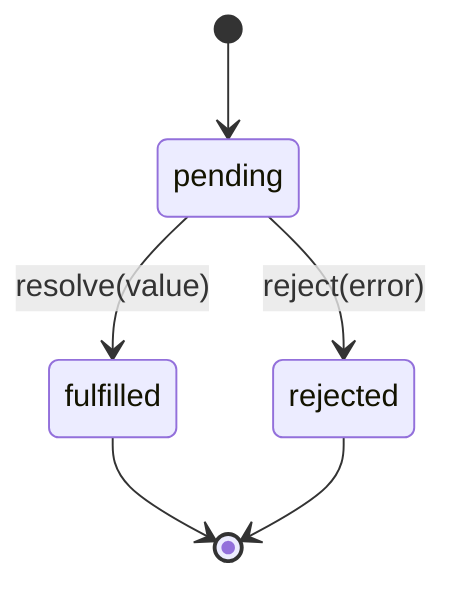

## 2.3 Promises

### 2.3.1 What a promise is

#### Concept

A promise is an object that represents a value that is not ready yet but will be (or will fail) in the future. It is a placeholder for an asynchronous result. Instead of handing a callback into a function, the function hands you back a promise, and you attach what to do on success (`.then`) and on failure (`.catch`).

A promise is always in one of three states: **pending** (still working), **fulfilled** (succeeded, has a value), or **rejected** (failed, has an error). Once it settles (fulfilled or rejected) it never changes again.

#### Why does it exist?

Promises exist to fix the problems with callbacks: the nesting pyramid, the duplicated error handling, and the fact that `try/catch` could not catch asynchronous errors. A promise is a first-class object you can pass around, return, store and combine. That object-ness is what lets you flatten the pyramid into a chain, handle all errors in one place, and run several asynchronous operations together.

#### Mental model

A promise is a tracking number for a parcel. The moment you order, you do not have the parcel, but you have a tracking number — a handle to the eventual delivery. You can check its status (pending, delivered, failed). You can say "when it is delivered, do this" (`.then`) and "if delivery fails, do that" (`.catch`). You can even say "when all five of my parcels arrive, start the party" (`Promise.all`). The tracking number exists now; the parcel comes later.

#### How it works



```ts
// A promise that resolves after a delay. This is the promise version of setTimeout.
function delay(ms: number): Promise<void> {
  return new Promise((resolve) => {
    setTimeout(resolve, ms);
  });
}

// Using .then / .catch
delay(1000)
  .then(() => console.log('one second passed'))
  .catch((err) => console.error('something failed', err));
```

A promise that already comes from a library (a database driver, an HTTP client) is the common case; you rarely build one with `new Promise` yourself. When you do, you call `resolve(value)` on success or `reject(error)` on failure.

#### A promise you can watch change state

This script builds a promise-returning version of a product lookup and prints the promise itself at two moments, so you can see the state change with your own eyes.

```ts
type Product = { id: string; name: string; priceCents: number };

const catalog: Record<string, Product> = {
  '42': { id: '42', name: 'Dental Mirror', priceCents: 1299 },
};

// A pretend database call that returns a promise instead of taking a callback.
function findProduct(id: string): Promise<Product> {
  return new Promise((resolve, reject) => {
    setTimeout(() => {
      const product = catalog[id];
      if (product) resolve(product);                       // pending -> fulfilled
      else reject(new Error(`product ${id} not found`));   // pending -> rejected
    }, 30);
  });
}

const found = findProduct('42');
console.log('right away:', found);                 // the promise exists, the value does not yet

found.then((product) => console.log('fulfilled with:', product.name));

findProduct('999')
  .then((product) => console.log('never printed:', product.name))
  .catch((err) => console.log('rejected with:', err.message));

setTimeout(() => console.log('50 ms later:', found), 50);
```

```text
right away: Promise { <pending> }
fulfilled with: Dental Mirror
rejected with: product 999 not found
50 ms later: Promise { { id: '42', name: 'Dental Mirror', priceCents: 1299 } }
```

Walk through it:

1. `findProduct('42')` runs the function you passed to `new Promise` (it is called the **executor**) straight away. The executor only starts a timer, so the promise comes back **pending**. That is the first line.
2. `.then(...)` does not run anything yet. It registers "when this promise fulfils, call me", like leaving your name with the barista.
3. After 30 ms the timer calls `resolve(product)`. The promise becomes **fulfilled**, and the registered `.then` callback runs with the product.
4. The second lookup calls `reject(...)`. Its `.then` is skipped and its `.catch` runs.
5. At 50 ms we print the first promise again. Node now shows the value inside: it is fulfilled and will stay that way forever.

Compared with the callback `findUser` in 2.2, the work is the same, but the caller gets an **object** back immediately, and success and failure travel down separate paths (`.then` and `.catch`).

#### Chaining and flattening

The key improvement over callbacks: `.then` returns a new promise, so you chain instead of nesting. Dependent steps go **down**, not **right**.

```ts
fetchOrder(orderId)                       // returns Promise<Order>
  .then((order) => fetchCustomer(order.customerId))  // returns Promise<Customer>
  .then((customer) => sendReceipt(customer.email))   // returns Promise<void>
  .then(() => console.log('done'))
  .catch((err) => console.error('any step failed:', err.message));
```

Two things to notice. First, the flow reads top to bottom even though each step depends on the previous — no pyramid. Second, **one** `.catch` at the end handles a failure in **any** of the steps. If `fetchCustomer` rejects, the chain skips the remaining `.then`s and jumps straight to `.catch`. This is the single biggest practical win over callbacks: error handling in one place.

A subtle but critical rule: you must **return** the inner promise from a `.then` (`return fetchCustomer(...)`), or the chain does not wait for it. Forgetting the `return` is a classic bug where the next step runs before the previous one finished.

#### The three rules of `.then`

Everything about chaining follows from three rules about what you do inside a `.then` callback:

| Inside the `.then` you... | The next step in the chain... |
|---|---|
| return a plain value | receives that value straight away |
| return a promise | waits until that promise settles, then receives its value |
| throw an error (or return a rejected promise) | is skipped; the chain jumps to the nearest `.catch` |

Here are all three in one runnable chain, using an order subtotal in cents:

```ts
function wait(ms: number): Promise<void> {
  return new Promise((resolve) => setTimeout(resolve, ms));
}

Promise.resolve(2000)                          // start with an order subtotal in cents
  .then((subtotal) => subtotal + 599)          // rule 1: return a value -> next step gets it
  .then((total) => wait(20).then(() => total)) // rule 2: return a promise -> next step waits for it
  .then((total) => {
    console.log('total with shipping:', total);
    if (total > 2500) throw new Error('over the guest checkout limit'); // rule 3: throw -> skip to catch
    return 'charged';
  })
  .then((status) => console.log('this line is skipped:', status))
  .catch((err) => console.log('caught:', err.message))
  .then(() => console.log('a .then after .catch runs again'));
```

```text
total with shipping: 2599
caught: over the guest checkout limit
a .then after .catch runs again
```

`Promise.resolve(2000)` is a shortcut for "a promise that is already fulfilled with 2000". The last line shows one more detail: `.catch` also returns a promise, and once it has handled the error the chain is healthy again, so a `.then` after it runs. That is how you "recover" from an error and continue.

#### Seeing the forgotten return

Now the classic bug, made visible. The customer must only be told "all done" after the receipt has been sent.

```ts
function wait(ms: number): Promise<void> {
  return new Promise((resolve) => setTimeout(resolve, ms));
}

function saveOrder(): Promise<void> {
  return wait(30).then(() => console.log('order saved'));
}

function sendReceipt(): Promise<void> {
  return wait(10).then(() => console.log('receipt sent'));
}

saveOrder()
  .then(() => {
    sendReceipt();          // BUG: no return, so the chain does not wait for it
  })
  .then(() => console.log('step 3: told the customer "all done"'));
```

```text
order saved
step 3: told the customer "all done"
receipt sent
```

Because the second step's callback returns nothing (`undefined`, which is rule 1, a plain value), step 3 runs at once. The receipt arrives afterwards. If `sendReceipt` had failed, its error would have escaped the chain entirely, because nothing was waiting on it. The fix is `return sendReceipt();`, or the arrow shorthand without braces: `.then(() => sendReceipt())`. An arrow function with no braces returns its expression automatically; with braces it returns nothing unless you write `return`. That one pair of braces causes this bug more often than anything else.

#### Promise callbacks run before timers

One ordering rule is worth learning now, because it explains outputs that otherwise look random:

```ts
console.log('1: sync');
setTimeout(() => console.log('4: timer'), 0);
Promise.resolve().then(() => console.log('3: promise callback'));
console.log('2: sync');
```

```text
1: sync
2: sync
3: promise callback
4: timer
```

Synchronous code always runs first. After that, callbacks from already-settled promises run **before** timer callbacks, even a 0 ms timer. The beginner's version of the rule: *promise callbacks go in a small priority queue that is emptied completely before the event loop moves on to timers and I/O.* The proper names are the **microtask queue** (promises) and the **macrotask** or task queues (timers, I/O); Part 13.17 explains them in full. You rarely need this in day-to-day code, but you will need it the first time a test prints lines in an order you did not expect.

#### Combining promises

```ts
// Promise.all: run several in parallel, wait for all, fail if any fails.
const [order, inventory, pricing] = await Promise.all([
  fetchOrder(id),
  fetchInventory(id),
  fetchPricing(id),
]);
// All three ran concurrently. Total time ~= the slowest one, not the sum.

// Promise.allSettled: wait for all, never short-circuit; get each result or error.
const results = await Promise.allSettled([sendEmail(a), sendEmail(b), sendEmail(c)]);
// results[i] is { status: 'fulfilled', value } or { status: 'rejected', reason }

// Promise.race: settle as soon as the FIRST one settles (used for timeouts).
const data = await Promise.race([
  fetchFromSlowService(),
  rejectAfter(2000, new Error('timeout')),
]);

// Promise.any: resolve as soon as the first SUCCESS; useful for redundant sources.
```

The difference between `Promise.all` and `Promise.allSettled` matters in production. `Promise.all` **short-circuits**: the moment one promise rejects, the combined promise rejects, and you lose the other results (they still run, but you do not see their outcomes). Use `Promise.all` when you need every one to succeed (fetch three things to build a page — if one fails, the page fails). Use `Promise.allSettled` when you want all outcomes regardless (send three notifications — report which succeeded and which failed, do not abandon the rest).

#### Watching `all` and `allSettled` side by side

Here are the same three notifications sent both ways. SMS is "down" and fails after 10 ms; email takes 40 ms and push takes 20 ms. (Top-level `await`, used here, is explained in 2.4; read it as "wait for this promise".)

```ts
function send(channel: string, ms: number, fails = false): Promise<string> {
  return new Promise((resolve, reject) => {
    setTimeout(() => {
      if (fails) reject(new Error(`${channel} provider is down`));
      else resolve(`${channel} delivered`);
    }, ms);
  });
}

const start = Date.now();

// Promise.all: rejects as soon as ONE input rejects.
try {
  const results = await Promise.all([send('email', 40), send('sms', 10, true), send('push', 20)]);
  console.log('all:', results);
} catch (err) {
  console.log(`all: rejected after ${Date.now() - start} ms with "${(err as Error).message}"`);
}

// Promise.allSettled: waits for every input and reports each outcome.
const settled = await Promise.allSettled([send('email', 40), send('sms', 10, true), send('push', 20)]);
for (const r of settled) {
  if (r.status === 'fulfilled') console.log('allSettled:', r.value);
  else console.log('allSettled: failed ->', r.reason.message);
}
```

```text
all: rejected after 11 ms with "sms provider is down"
allSettled: email delivered
allSettled: failed -> sms provider is down
allSettled: push delivered
```

`Promise.all` gave up after 11 ms, when SMS failed. The email and push **were still sent** (nothing cancels them), but your code never learned that, which is how the duplicate-email incident below happened. `Promise.allSettled` waited for all three and told you exactly which one to retry.

#### Practical example — parallel vs serial

```ts
// SERIAL: three queries one after another. Total ~= sum of all three.
async function serial(id: string) {
  const a = await fetchOrder(id);        // wait 5 ms
  const b = await fetchInventory(id);    // then wait 5 ms
  const c = await fetchPricing(id);      // then wait 5 ms
  return { a, b, c };                     // ~15 ms total
}

// PARALLEL: three queries at once because they are independent. Total ~= slowest.
async function parallel(id: string) {
  const [a, b, c] = await Promise.all([
    fetchOrder(id),
    fetchInventory(id),
    fetchPricing(id),
  ]);
  return { a, b, c };                      // ~5 ms total
}
```

This is one of the most common real performance wins. Three independent 40 ms calls take 120 ms serially and 40 ms in parallel. On an endpoint that does several independent lookups, switching from serial `await`s to `Promise.all` can cut latency by 3x with a one-line change. Only parallelize **independent** work; if step B needs step A's result, they must be serial.

#### Production scenario

A product-detail endpoint originally did six `await` calls in sequence — product, inventory, reviews, recommendations, price, shipping estimate — for a p50 of 95 ms. Four of the six were independent of each other. Grouping those four into a `Promise.all` and keeping the two dependent ones serial dropped p50 to 38 ms. No new infrastructure, no caching, just stopping the thread from waiting serially on things that could wait together.

#### Failure scenario

A notification service sent three messages with `Promise.all([sms, email, push])`. One day the SMS provider had an outage. Because `Promise.all` short-circuits on the first rejection, the whole call rejected, the error handler logged "notifications failed", and **the email and push were treated as failed too** even though they had actually succeeded — and worse, a retry then re-sent the email and push, so users got duplicate emails. Switching to `Promise.allSettled` fixed it: each channel's outcome was handled independently, only the failed SMS was retried, and the duplicates stopped. The lesson: `Promise.all` is for "all must succeed"; for independent best-effort work, use `allSettled`.

#### Edge cases & failure modes

- **Forgetting to return the inner promise** in a `.then`, so the chain does not wait and later steps run too early.
- **An unhandled rejection** (a promise that rejects with no `.catch` and no surrounding `try/catch`) crashes the Node process in modern versions. Every promise chain needs error handling.
- **`Promise.all` loses sibling results** on the first rejection; use `allSettled` when you need them all.
- **Creating promises in a loop and not awaiting them** fires them all at once with no concurrency limit, which can open 10,000 database connections and exhaust the pool. For large batches, limit concurrency (a batching helper or a library like `p-limit`).
- **A promise never settles** (a bug where `resolve`/`reject` is never called) hangs that chain forever; always have a timeout on external calls.

#### How a Senior Backend Engineer thinks about this

A senior sees `await a; await b; await c` on independent operations as a latency bug and reaches for `Promise.all`. They choose `all` vs `allSettled` deliberately based on whether partial success is acceptable. They never fire an unbounded number of promises in a loop against a shared resource (database, downstream service) without a concurrency limit, because that turns a batch job into a self-inflicted denial-of-service. And they put a timeout on every call that leaves the process, because a promise that waits forever on a hung dependency is how one slow service takes down yours (Part 34 — Reliability Engineering covers timeouts, retries and circuit breakers in depth).

#### Common mistakes

- Serial `await`s for independent work (slow endpoints).
- Forgetting `return` inside `.then`.
- Unhandled rejections crashing the process.
- Unbounded `Promise.all` over a huge array, exhausting connections.
- Using `all` where `allSettled` is needed, abandoning or duplicating sibling work on one failure.

#### Interview questions

1. **What are the three states of a promise?** Pending, fulfilled, rejected; once settled it never changes.
2. **What is the difference between `Promise.all` and `Promise.allSettled`?** `all` rejects as soon as any input rejects and loses the other results; `allSettled` waits for all and reports each outcome. Use `all` when every one must succeed, `allSettled` for independent best-effort work.
3. **How do you convert serial awaits into parallel execution, and when must you not?** Group independent operations into `Promise.all`; you must keep operations serial when one depends on another's result.
4. **What happens to an unhandled promise rejection in modern Node?** It crashes the process; every chain needs a `.catch` or a surrounding `try/catch`.
5. **Why is firing thousands of promises in a loop against the database dangerous?** It opens all those operations at once with no concurrency limit, exhausting the connection pool and overwhelming the database.

#### Practical exercise

Given functions `fetchUser(id)`, `fetchOrders(id)` and `fetchRecommendations(id)` (all independent, each ~30 ms), write a `getDashboard(id)` that runs them in parallel with `Promise.all` and returns a combined object. Then write a `notifyAll(users)` that sends an email to each user with `Promise.allSettled`, limiting concurrency to 10 at a time, and returns counts of succeeded and failed. Acceptance criteria: the dashboard completes in ~30 ms not ~90 ms, and `notifyAll` never has more than 10 emails in flight at once.

#### Worked answer to the exercise

The dashboard is a direct use of `Promise.all`, with pretend 30 ms lookups:

```ts
function wait(ms: number): Promise<void> {
  return new Promise((resolve) => setTimeout(resolve, ms));
}

// Three independent pretend lookups, about 30 ms each.
async function fetchUser(id: string) { await wait(30); return { id, name: 'Alice' }; }
async function fetchOrders(id: string) { await wait(30); return [{ id: 'ord_1001', totalCents: 2000 }]; }
async function fetchRecommendations(id: string) { await wait(30); return ['probe-02', 'gloves-10']; }

async function getDashboard(id: string) {
  const [user, orders, recommendations] = await Promise.all([
    fetchUser(id),
    fetchOrders(id),
    fetchRecommendations(id),
  ]);
  return { user, orders, recommendations };
}

const start = Date.now();
const dashboard = await getDashboard('usr_7');
console.log(`dashboard for ${dashboard.user.name} built in ${Date.now() - start} ms`);
```

```text
dashboard for Alice built in 30 ms
```

`notifyAll` is the harder half, because `Promise.allSettled(users.map(sendEmail))` would start all the emails at once. The trick is a small pool of "workers": start 10 of them, and let each one keep taking the next user from a shared list until the list is empty. At most 10 are ever busy.

```ts
function wait(ms: number): Promise<void> {
  return new Promise((resolve) => setTimeout(resolve, ms));
}

let inFlight = 0;
let maxInFlight = 0;

// A pretend email provider: 20 ms per email, and every 7th address bounces.
async function sendEmail(userId: number): Promise<void> {
  inFlight++;
  maxInFlight = Math.max(maxInFlight, inFlight);
  try {
    await wait(20);
    if (userId % 7 === 0) throw new Error(`mailbox for user ${userId} is full`);
  } finally {
    inFlight--;
  }
}

// Run `task` for every item, but never more than `limit` at the same time.
async function mapWithLimit<T, R>(
  items: T[],
  limit: number,
  task: (item: T) => Promise<R>,
): Promise<PromiseSettledResult<R>[]> {
  const results: PromiseSettledResult<R>[] = new Array(items.length);
  let next = 0;

  async function worker(): Promise<void> {
    while (next < items.length) {
      const index = next++;               // safe: no await between the check and the ++
      try {
        results[index] = { status: 'fulfilled', value: await task(items[index]) };
      } catch (reason) {
        results[index] = { status: 'rejected', reason };
      }
    }
  }

  // Start `limit` workers; each one keeps pulling the next item until none are left.
  await Promise.all(Array.from({ length: limit }, () => worker()));
  return results;
}

async function notifyAll(userIds: number[]) {
  const results = await mapWithLimit(userIds, 10, sendEmail);
  const succeeded = results.filter((r) => r.status === 'fulfilled').length;
  return { succeeded, failed: results.length - succeeded };
}

const start = Date.now();
const userIds = Array.from({ length: 100 }, (_, i) => i + 1);
const summary = await notifyAll(userIds);
console.log(summary, `max in flight: ${maxInFlight}`, `took ${Date.now() - start} ms`);
```

```text
{ succeeded: 86, failed: 14 } max in flight: 10 took 209 ms
```

Check it against the acceptance criteria. 100 emails at 20 ms each, 10 at a time, is 10 rounds of about 20 ms, so roughly 200 ms; we measured 209 ms. The counter proves no more than 10 were ever in flight. The 14 failures (every 7th user) did not stop the other 86. Why is `next++` safe when ten workers share it? Because JavaScript runs one piece of code at a time and there is no `await` between reading `next` and increasing it, so no other worker can sneak in between. In production you would usually reach for a small library such as `p-limit` instead of writing this yourself, but now you know what it does inside.

#### Try it yourself

**1. When does the executor run?**

```ts
const p = new Promise<string>((resolve) => {
  console.log('A: inside the executor');
  resolve('B: resolved value');
});
p.then((value) => console.log(value));
console.log('C: after .then');
```

**2. Why `undefined`?**

```ts
Promise.resolve(3)
  .then((qty) => { qty * 1299; })
  .then((total) => console.log('total:', total));
```

**3. How long does each half take?**

```ts
function wait(ms: number): Promise<void> {
  return new Promise((resolve) => setTimeout(resolve, ms));
}

let start = Date.now();
await Promise.all([wait(100), wait(50), wait(80)]);
console.log(`together: ${Date.now() - start} ms`);

start = Date.now();
await wait(100);
await wait(50);
await wait(80);
console.log(`one after another: ${Date.now() - start} ms`);
```

**Answers.**

1. `A: inside the executor`, `C: after .then`, `B: resolved value`. The executor runs immediately and synchronously, inside `new Promise(...)`. Only the `.then` callback is delayed, and it always runs after the current synchronous code, even when the promise is already resolved.
2. It prints `total: undefined`. The arrow function has braces, so it needs an explicit `return`. Without one it returns `undefined`, and rule 1 passes `undefined` to the next step. Write `(qty) => qty * 1299` or `(qty) => { return qty * 1299; }`.
3. `together: 100 ms` and `one after another: 233 ms`. Together takes as long as the slowest (100 ms). One after another takes the sum (100 + 50 + 80 = 230 ms, plus a few milliseconds of timer overhead).
