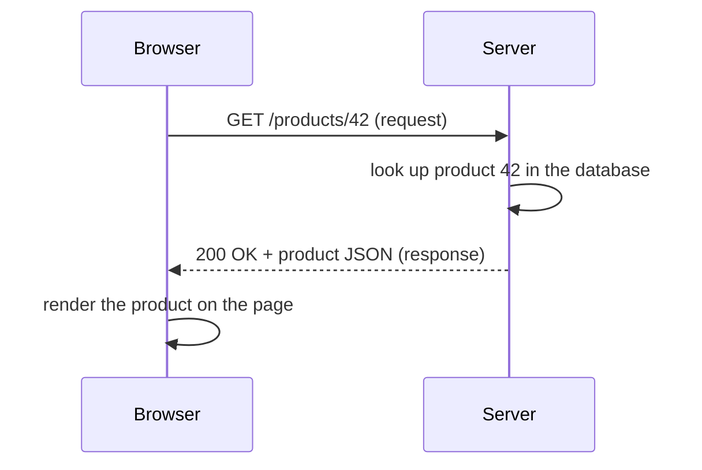

# Part 3 — How the Web Works

Before you build a backend, you need a clear picture of what a backend actually does. A backend is a program that sits on a computer somewhere, waits for requests to arrive over the internet, and sends back responses. That is the whole job, at the highest level. Everything else — databases, caches, authentication — is detail in service of that one loop: receive a request, produce a response.

This Part explains the web from the ground up for a beginner: what a client is and what a server is, what the browser does, what an HTTP request and response look like, status codes and headers, URLs, JSON, and what people mean when they say "REST API". Part 10 covers the networking stack (TCP, DNS, TLS) in full depth and Part 14 covers API design as a craft; this Part is the on-ramp, the mental model you need before those make sense. We keep it concrete: every example is a real request you could send with a browser or with `curl`.

## 3.1 Client and server

### 3.1.1 The request-response model

#### Concept

The web runs on a simple pattern: a **client** asks, a **server** answers. The client sends a **request**; the server sends back a **response**. That single exchange — one request, one response — is the atom of the web. A web page loading is dozens of these exchanges; using an app is thousands.

The client is whatever makes the request: a web browser, a mobile app, another server, or a tool like Postman or `curl`. The server is the program that listens for requests and produces responses — that program is your backend.

#### Why does it exist?

Your data and logic cannot live only on the user's device. If an e-commerce site kept every product and every order on each shopper's phone, no two shoppers would see the same catalog, nobody could place an order anyone else could fulfil, and a lost phone would lose the business. So the shared truth lives on a server, and clients talk to it over the network. The request-response model is the agreed way for millions of clients to safely share one source of truth.

#### Mental model

Imagine a restaurant with a kitchen behind a serving hatch. You (the client) write your order on a slip and pass it through the hatch (the request). The kitchen (the server) prepares the dish and passes it back (the response). You cannot walk into the kitchen; you can only pass slips and receive plates. Many customers use the same hatch and the same kitchen. The hatch is the network; the slip format is HTTP; the kitchen's rules for which slips it accepts are your API.

#### How it works



1. The client builds a request: a method (what it wants to do), a URL (what it wants to act on), headers (extra information), and sometimes a body (data it is sending).
2. The request travels over the internet to the server (Part 10 explains how — DNS in 10.3, TCP in 10.4, TLS in 10.12).
3. The server reads the request, does its work (query a database, call another service), and builds a response.
4. The response travels back: a status code (how it went), headers, and usually a body (the data).
5. The client uses the response — the browser renders it, the mobile app updates the screen, another server continues its logic.

The connection is usually closed or reused after the exchange, and the server forgets about you. This is what "stateless" means (3.5): each request stands alone and carries everything the server needs to handle it.

#### Practical example

When you open `https://shop.example.com/products/42` in a browser, the browser sends roughly this request:

```text
GET /products/42 HTTP/1.1
Host: shop.example.com
Accept: text/html
User-Agent: Mozilla/5.0 ...
```

The server responds with roughly:

```text
HTTP/1.1 200 OK
Content-Type: text/html; charset=utf-8
Content-Length: 5120

<!doctype html><html>... the product page ...</html>
```

That page then triggers more requests — for the stylesheet, the images, and often a call to an API like `GET /api/products/42` that returns JSON for the dynamic parts. A single page load can be fifty request-response exchanges.

#### See it yourself: a real server and a real client

Reading request text is one thing; watching your own server receive one is another. This is a complete web server in about twenty lines, using only Node's built-in `node:http` module (no framework). Save it as `server.ts` and run `node server.ts` (Node 22.18 or newer runs TypeScript directly; on older versions use `npx tsx server.ts`).

```ts
import { createServer } from 'node:http';

const products: Record<string, { id: string; name: string; priceCents: number }> = {
  '42': { id: '42', name: 'Dental Mirror', priceCents: 1299 },
};

const server = createServer((req, res) => {
  // 1. Read the request: method, path, headers.
  console.log(`server got: ${req.method} ${req.url}`);
  console.log(`  host=${req.headers.host}  accept=${req.headers.accept}`);

  // 2. Do the work.
  const id = req.url?.split('/')[2];                 // "/products/42" -> "42"
  const product = id ? products[id] : undefined;

  // 3. Build the response: status code, headers, body.
  if (!product) {
    res.writeHead(404, { 'Content-Type': 'application/json' });
    res.end(JSON.stringify({ error: { code: 'not_found', message: `product ${id} not found` } }));
    return;
  }
  res.writeHead(200, { 'Content-Type': 'application/json' });
  res.end(JSON.stringify(product));
});

server.listen(4020, () => console.log('listening on http://localhost:4020'));
```

Leave it running. In a second terminal, run this client, which uses `fetch` (built into Node 18 and newer, and into every browser):

```ts
for (const path of ['/products/42', '/products/999']) {
  const res = await fetch(`http://localhost:4020${path}`, {
    headers: { Accept: 'application/json' },
  });
  console.log(`client got: ${res.status} ${res.statusText}`);
  console.log(`  content-type=${res.headers.get('content-type')}`);
  console.log(`  body=${await res.text()}`);
}
```

```text
client got: 200 OK
  content-type=application/json
  body={"id":"42","name":"Dental Mirror","priceCents":1299}
client got: 404 Not Found
  content-type=application/json
  body={"error":{"code":"not_found","message":"product 999 not found"}}
```

And the server's terminal shows the other side of the same two exchanges:

```text
listening on http://localhost:4020
server got: GET /products/42
  host=localhost:4020  accept=application/json
server got: GET /products/999
  host=localhost:4020  accept=application/json
```

Match the two outputs up. Every request the client sent appears once on the server. Every response has the three parts from step 4 above: a status code, headers, and a body. Your future NestJS controllers do exactly this; the framework just writes the `createServer` part for you (Part 6).

#### Reading `curl -v` output

`curl` is the command-line tool every backend engineer uses to poke an API. With `-v` (verbose) it prints the whole conversation. With the server above still running:

```bash
curl -sv http://localhost:4020/products/42
```

```text
* Host localhost:4020 was resolved.
* IPv6: ::1
* IPv4: 127.0.0.1
*   Trying [::1]:4020...
* Connected to localhost (::1) port 4020
> GET /products/42 HTTP/1.1
> Host: localhost:4020
> User-Agent: curl/8.7.1
> Accept: */*
> 
* Request completely sent off
< HTTP/1.1 200 OK
< Content-Type: application/json
< Date: Thu, 05 Nov 2026 10:51:20 GMT
< Connection: keep-alive
< Keep-Alive: timeout=5
< Transfer-Encoding: chunked
< 
{ [63 bytes data]
* Connection #0 to host localhost left intact
{"id":"42","name":"Dental Mirror","priceCents":1299}
```

The three kinds of line are easy to tell apart once you know the code:

- Lines starting with `*` are curl talking to you: it looked up `localhost` (DNS, Part 10.3) and opened a connection.
- Lines starting with `>` are the **request** curl sent: the request line (`GET /products/42 HTTP/1.1`), then headers, then a blank line that means "headers finished".
- Lines starting with `<` are the **response**: the status line (`HTTP/1.1 200 OK`), headers, a blank line, then the body.

Two headers you did not write appeared by themselves. Node added `Date`, and because our code never said how long the body was, Node sent it in pieces and said so with `Transfer-Encoding: chunked` instead of `Content-Length` (Part 10.10 explains chunked transfer). `Connection: keep-alive` means the connection stays open for the next request instead of being torn down (Part 10.9). The `-s` flag only hides curl's progress bar. Use `curl -i` when you want just the response status, headers and body without the `*` and `>` lines.

#### Production scenario

A product API server handles 3,000 requests per second. Each request is independent: it arrives, the server reads it, queries PostgreSQL, builds a response and sends it, all in a few milliseconds, then forgets about it. Because each request is self-contained, the business can run twenty identical copies of the server behind a load balancer (Part 88.7), and any copy can handle any request — there is no "your" server that remembers you. This is only possible because of the stateless request-response model.

#### Edge cases & failure modes

- **The request never arrives** (network drops). The client sees a timeout and may retry.
- **The response never arrives** even though the server did the work. The client cannot tell "did it fail?" from "did the reply get lost?" — which is exactly why writes need idempotency (Part 14.12 and Part 29 — Distributed Transactions).
- **The server is slow**, so the client waits. A client should have a timeout (Part 2).
- **A large body** (a big upload or a huge response) takes time and memory; servers stream large bodies rather than loading them whole (Part 9.23).
- **A client sends a request to the wrong port or the server is not running.** `fetch` rejects with `TypeError: fetch failed` and curl prints `Failed to connect`. That is a connection error, not an HTTP error: there is no status code because no response ever came.

#### How a Senior Backend Engineer thinks about this

A senior keeps the request-response atom in mind constantly, especially its failure mode: the client can never be sure whether a request that got no response actually happened. That single fact drives idempotency keys, retries, and the design of every write endpoint. They also lean on statelessness as the thing that makes horizontal scaling possible — keep the server forgetful between requests, push any shared state into the database or cache, and you can run as many copies as you need.

#### Common mistakes

- Assuming a request always reaches the server and a response always comes back; the network loses both.
- Keeping per-client state in the server's memory, which breaks the moment you run more than one copy.
- Not setting client timeouts, so a slow server hangs the client.

#### Interview questions

1. **What is the request-response model?** A client sends a request, a server sends back one response; each exchange is independent and self-contained.
2. **Why is statelessness important for scaling?** If the server keeps no per-client memory between requests, any copy can handle any request, so you can run many copies behind a load balancer.
3. **Why can't a client be sure a write succeeded if it gets no response?** The failure could be before the work (safe to retry) or after the work but the reply was lost (retry would duplicate); this is why writes need idempotency.

#### Practical exercise

Using `curl` (or a browser's network tab), make a `GET` request to any public API and identify in the output: the method, the URL, three request headers, the status code, and three response headers. Acceptance criteria: you can label each part and say in one sentence what it is for.

#### Worked answer to the exercise

Using the server from "See it yourself" and `curl -sv http://localhost:4020/products/42`:

| Part | Value in our output | What it is for |
|---|---|---|
| Method | `GET` | What the client wants to do: read |
| URL (path) | `/products/42` | Which resource to act on |
| Request header | `Host: localhost:4020` | Which site the client wants; one server can host many sites |
| Request header | `User-Agent: curl/8.7.1` | Which program sent the request |
| Request header | `Accept: */*` | Which response formats the client can handle (`*/*` means "anything") |
| Status code | `200 OK` | How it went: success |
| Response header | `Content-Type: application/json` | The body is JSON, so parse it as JSON |
| Response header | `Date: ...` | When the server produced the response |
| Response header | `Connection: keep-alive` | The connection stays open for reuse |

#### Try it yourself

1. With the server running, what status code does `curl -i http://localhost:4020/products/7` print, and which line of the server code produced it?
2. Stop the server (Ctrl+C) and run the `fetch` client again. What happens, and is there a status code?
3. A colleague says "the server remembered me between my two requests". Using the server code above, explain why that is not true.

**Answers.**

1. `HTTP/1.1 404 Not Found`, produced by `res.writeHead(404, ...)` because product `7` is not in `products`.
2. `fetch` rejects with `TypeError: fetch failed` (the cause says the connection was refused). There is no status code: no server answered, so no response exists. Your client code must handle this case separately from a `4xx` or `5xx`.
3. The handler only reads what is in the current request (`req.method`, `req.url`, `req.headers`). It stores nothing about the client between calls. Each request stands alone; that is statelessness.

## 3.2 HTTP: the language of the web

### 3.2.1 Requests, methods and URLs

#### Concept

HTTP (HyperText Transfer Protocol) is the set of rules for how clients and servers phrase requests and responses. It defines the shape of a request (method, URL, headers, body) and a response (status code, headers, body). Almost every backend you build speaks HTTP. Understanding its pieces is understanding the web.

#### Why does it exist?

Clients and servers are written by different people in different languages on different machines. They need a shared, agreed format so a browser written by one company can talk to a server written by another. HTTP is that shared format — a universal envelope that everyone understands.

#### Mental model

HTTP is like the format of a physical letter. There is an action on the outside (the method: deliver, return, update), an address (the URL), information on the envelope (the headers: who it is from, what language, how urgent), and the contents inside (the body). The post office (the network) does not care what is inside; it just follows the envelope. A server reads the envelope and the contents and writes a reply in the same format.

#### How it works — the methods

The HTTP **method** (also called the verb) says what the client wants to do. The common ones:

| Method | Means | Changes data? | Idempotent? | Typical use |
|---|---|---|---|---|
| `GET` | Read something | No | Yes | Fetch a product, a list, a profile |
| `POST` | Create something, or do an action | Yes | No | Create an order, log in, trigger a job |
| `PUT` | Replace something entirely | Yes | Yes | Replace a whole resource |
| `PATCH` | Change part of something | Yes | Usually | Update one field |
| `DELETE` | Remove something | Yes | Yes | Delete a resource |

Two properties in that table matter a lot. **"Changes data"** (the technical word is "safe" for methods that do not) tells you whether the request is a read or a write; reads can be cached and retried freely. **"Idempotent"** means doing it twice has the same effect as doing it once. `GET`, `PUT` and `DELETE` are idempotent — deleting an already-deleted thing still ends with it deleted. `POST` is not — posting the same order twice creates two orders. This is why retrying a lost `GET` is safe but retrying a lost `POST` needs care (Part 71.13 covers the "unknown outcome").

Here is idempotency as a tiny simulation. A client sends a request, the reply is lost on the way back, and the client retries once.

```ts
type Order = { productId: string; quantity: number };

const orders = new Map<string, Order>();
let nextId = 1001;

// What a POST /v1/orders handler does: always create a NEW order with a new id.
function handlePost(body: Order): string {
  const id = `ord_${nextId++}`;
  orders.set(id, body);
  return id;
}

// What a PUT /v1/orders/:id handler does: store THIS order under THIS id.
function handlePut(id: string, body: Order): void {
  orders.set(id, body);
}

const body = { productId: '42', quantity: 2 };

// The client sends the request, the reply is lost, so it retries once.
handlePost(body);
handlePost(body);
console.log('after POST + retry:', orders.size, 'orders', [...orders.keys()]);

orders.clear();
handlePut('ord_2001', body);
handlePut('ord_2001', body);
console.log('after PUT + retry: ', orders.size, 'order ', [...orders.keys()]);
```

```text
after POST + retry: 2 orders [ 'ord_1001', 'ord_1002' ]
after PUT + retry:  1 order  [ 'ord_2001' ]
```

The `POST` retry created a second order: the customer is charged twice. The `PUT` retry wrote the same thing to the same place: no harm done. Real APIs make `POST` safe to retry with an **idempotency key**, a unique id the client sends in a header so the server can recognize a repeat (Part 14.12 and Part 71.12).

#### How it works — the URL

A URL (Uniform Resource Locator) is the address of what the client wants to act on. Its parts:

```text
https://api.shop.example.com:443/v1/products/42?color=red&size=l#reviews
\___/   \____________________/\_/\_____________/\_____________/\______/
scheme        host           port   path          query        fragment
```

- **Scheme**: `https` (encrypted) or `http` (not). Always `https` in production.
- **Host**: which server to reach (`api.shop.example.com`). DNS turns this into an IP address (Part 10).
- **Port**: which door on the server (443 for https, 80 for http, often omitted because they are the defaults).
- **Path**: which resource (`/v1/products/42`). This is what your backend routes on.
- **Query string**: optional parameters after `?`, as `key=value` pairs joined by `&`. Used for filtering, pagination, search.
- **Fragment**: after `#`, used only by the browser (to jump to a section); it is never sent to the server.

#### Taking a URL apart with `new URL()`

You never need to split a URL by hand with string functions. JavaScript has a built-in `URL` class (in Node and in browsers) that parses one for you.

```ts
const url = new URL('https://api.shop.example.com:8443/v1/products/42?color=red&size=l#reviews');

console.log('protocol:', url.protocol);
console.log('hostname:', url.hostname);
console.log('port:    ', url.port);
console.log('pathname:', url.pathname);
console.log('search:  ', url.search);
console.log('color:   ', url.searchParams.get('color'));
console.log('hash:    ', url.hash);

// Default ports are hidden: 443 is the default for https, so url.port is empty.
console.log('default port shown as:', JSON.stringify(new URL('https://api.shop.example.com:443/').port));
```

```text
protocol: https:
hostname: api.shop.example.com
port:     8443
pathname: /v1/products/42
search:   ?color=red&size=l
color:    red
hash:     #reviews
default port shown as: ""
```

The names differ slightly from the diagram (`protocol` for scheme, `hash` for fragment), but the pieces are the same. `searchParams.get('color')` reads one query parameter, already decoded.

#### Percent-encoding, step by step

A query string uses `&` to separate parameters and `=` to separate a name from its value. So what happens when a user searches for `gloves & masks`?

```ts
const search = 'gloves & masks';

// WRONG: pasting user input straight into a URL.
const broken = new URL(`https://api.shop.example.com/v1/products?q=${search}&page=2`);
console.log('broken q   =', JSON.stringify(broken.searchParams.get('q')));
console.log('broken keys=', [...broken.searchParams.keys()]);

// RIGHT: let URLSearchParams do the encoding.
const params = new URLSearchParams({ q: search, page: '2' });
const fixed = new URL(`https://api.shop.example.com/v1/products?${params}`);
console.log('fixed url  =', fixed.href);
console.log('fixed q    =', JSON.stringify(fixed.searchParams.get('q')));

// For a single path segment, use encodeURIComponent.
console.log(encodeURIComponent('Dr. Shah / Clinic #2'));
```

```text
broken q   = "gloves "
broken keys= [ 'q', ' masks', 'page' ]
fixed url  = https://api.shop.example.com/v1/products?q=gloves+%26+masks&page=2
fixed q    = "gloves & masks"
Dr.%20Shah%20%2F%20Clinic%20%232
```

In the broken version, the `&` inside the search text was read as "new parameter here", so the server received `q` = `"gloves "` and a strange parameter called `" masks"`. The user searched for one thing and got results for another. `URLSearchParams` encoded the `&` as `%26` (and the spaces as `+`), so the value arrived intact. For a value that goes into the **path**, such as a clinic name, `encodeURIComponent` turns `/` into `%2F` and `#` into `%23`; without it, the `/` would create an extra path segment and the `#` would cut the URL short, because everything after `#` is the fragment and never reaches the server.

The path is the heart of API design. `/products/42` names "product number 42". `/products` names the collection. Good APIs use nouns for paths and methods for actions, so `GET /products/42` reads product 42 and `DELETE /products/42` removes it.

#### The request body

`POST`, `PUT` and `PATCH` usually carry a **body** — the data being sent. For APIs the body is almost always JSON (3.4). A `GET` has no body; its inputs go in the path and query string.

```text
POST /v1/orders HTTP/1.1
Host: api.shop.example.com
Content-Type: application/json
Content-Length: 65

{"items":[{"productId":"42","quantity":2}],"couponCode":"SAVE10"}
```

#### Practical example

Here is a small API's endpoints expressed as method-plus-path, the way you will design them:

```text
GET    /v1/products            -> list products (with ?category=&page=)
GET    /v1/products/42         -> get product 42
POST   /v1/products            -> create a product (admin)
PATCH  /v1/products/42         -> update some fields of product 42
DELETE /v1/products/42         -> delete product 42
POST   /v1/orders             -> place an order
GET    /v1/orders/ord_1001    -> get one order
```

#### Edge cases & failure modes

- **Using `GET` to change data** (for example `GET /deleteUser?id=5`) is a classic mistake: search engines and browsers prefetch and cache `GET`s, so a crawler could delete your data. Reads must be safe; writes must use `POST`/`PUT`/`PATCH`/`DELETE`.
- **Very long URLs** (huge query strings) can be truncated by proxies; there is a practical limit around 2,000 to 8,000 characters. Large inputs belong in a `POST` body.
- **Query-string injection**: query values are user input and must be validated like any other (Part 39 — Security).
- **Unencoded characters** in a URL (spaces, `&`, non-ASCII) break parsing; they must be percent-encoded (`%20` for a space).

#### How a Senior Backend Engineer thinks about this

A senior maps each operation to the method whose safety and idempotency match it: reads are `GET`, creates are `POST`, full replacements are `PUT`, partial updates are `PATCH`, removals are `DELETE`. They never hide a write behind a `GET`, because safe methods get retried, prefetched and cached by machinery outside their control. They design paths as nouns and keep them stable, because a URL printed in a mobile app or an integration is a contract that is expensive to change (Part 24 on compatibility).

#### Common mistakes

- Changing data with `GET`, inviting accidental deletions by crawlers and prefetchers.
- Putting actions in the path (`/getProduct`, `/createOrder`) instead of using the method on a noun.
- Forgetting to percent-encode special characters in URLs.
- Cramming large data into the query string instead of the body.

#### Interview questions

1. **What does it mean for an HTTP method to be idempotent, and which methods are?** Doing it twice has the same effect as once; `GET`, `PUT`, `DELETE` are idempotent, `POST` is not. It matters for safe retries.
2. **Why should a read never use `POST` and a write never use `GET`?** Reads should be safe and cacheable; writes must not be, because `GET`s are prefetched and cached by browsers, crawlers and proxies, which would trigger the write unexpectedly.
3. **What are the parts of a URL and which part never reaches the server?** Scheme, host, port, path, query, fragment; the fragment (after `#`) stays in the browser.
4. **Where do a `GET` request's inputs go, versus a `POST`?** `GET` inputs go in the path and query string; `POST` inputs go in the body.

#### Practical exercise

Design the endpoints (method + path) for a simple "notes" API that supports listing notes, getting one note, creating a note, editing a note's text, and deleting a note. Mark which are idempotent. Acceptance criteria: reads use `GET`, writes use the correct write method, paths are nouns, and no write is hidden behind a `GET`.

#### Worked answer to the exercise

```text
GET    /v1/notes            -> list notes (paginated: ?limit=20&cursor=...)   idempotent: yes (and safe)
GET    /v1/notes/{id}       -> get one note                                   idempotent: yes (and safe)
POST   /v1/notes            -> create a note                                  idempotent: no
PATCH  /v1/notes/{id}       -> edit the note's text                           idempotent: yes, for "set text to X"
DELETE /v1/notes/{id}       -> delete a note                                  idempotent: yes
```

Two details are worth a sentence each. `PATCH` that **sets** the text to a given value is idempotent; a `PATCH` that **appends** to the text would not be, which is why the table above said "usually". And a second `DELETE` of the same note may return `404` instead of `204`, but the state of the server (the note is gone) is the same, so it still counts as idempotent.

#### Try it yourself

1. In `https://shop.example.com/v1/orders?status=paid&page=3#top`, which parts reach the server?
2. Which is the better design for "cancel order 1001": `GET /v1/orders/1001/cancel`, `POST /v1/orders/1001/cancel`, or `DELETE /v1/orders/1001`? Why?
3. What does `new URLSearchParams({ email: 'a+b@example.com' }).toString()` produce, and why does the `+` matter?

**Answers.**

1. The scheme, host, path `/v1/orders` and query `?status=paid&page=3` all reach the server (the scheme and host decide where and how to connect). The fragment `#top` never leaves the browser.
2. `POST /v1/orders/1001/cancel` (or `POST /v1/orders/1001/cancellations`). Cancelling changes data, so it must not be a `GET`. `DELETE` would suggest the order record disappears, but a cancelled order still exists with status `cancelled`, and you will need it for refunds and reports.
3. `email=a%2Bb%40example.com`. In a query string a raw `+` means a space, so without encoding the server would read `a b@example.com`, a different (and invalid) address.
