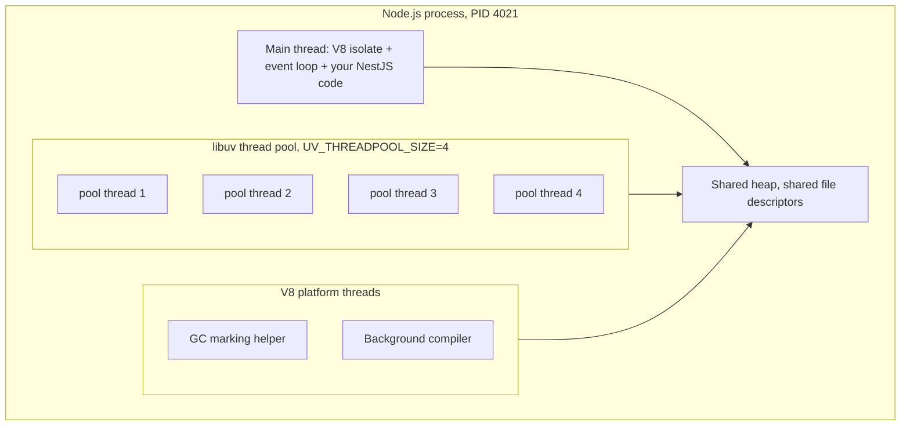
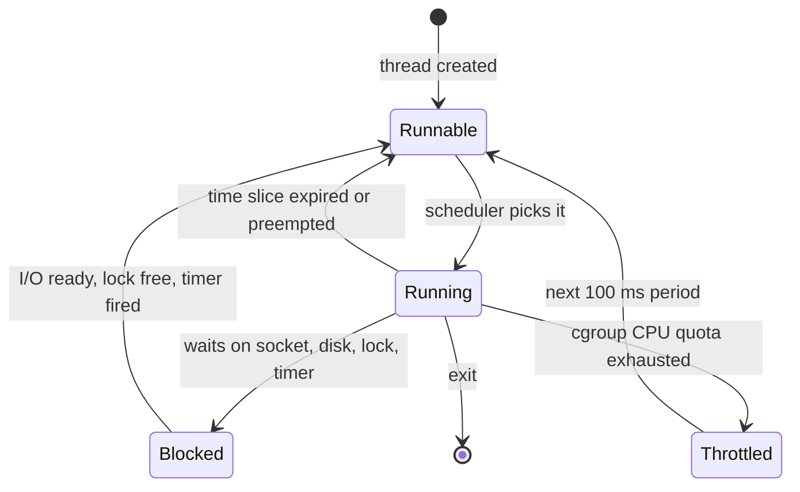

# Part 3 — Operating Systems and the Node.js Runtime

A NestJS application is a single operating-system process running one JavaScript thread on top of V8 and libuv. Every production incident you will ever debug in that application eventually bottoms out in one of a handful of operating-system ideas: a process ran out of memory, a file descriptor leaked, a signal was ignored, a thread blocked, a scheduler throttled you, a lock was taken in the wrong order. Senior engineers are not faster typists than mid-level engineers. They are the people in the room who can say "this is an FD leak, not a database problem" at 02:14 and be right.

This part builds that instinct in two layers. Section A covers the operating-system concepts every backend engineer must own. Section B goes deep into the Node.js runtime: V8, the event loop, libuv, workers, streams, memory and garbage collection. Section C ties it together by tracing one NestJS request from the kernel's TCP accept queue to the keep-alive socket write, showing exactly where CPU is spent, where I/O waits, and where p99 latency hides.

## 3.1 Processes and threads

#### Concept

A **process** is a running program. When you type `node dist/main.js`, the kernel creates a process: it gets a process id (PID), its own private virtual address space (memory that no other process can see), its own table of open file descriptors (files, sockets, pipes), its own environment variables, its own signal handlers, and at least one thread of execution.

A **thread** is a path of execution inside a process. Every thread has its own call stack, its own CPU registers and its own program counter (the "where am I in the code" pointer), but all threads in a process share the same heap, the same file descriptors and the same address space. A Node.js process is not single-threaded. It runs one JavaScript thread (the main thread, where your NestJS code executes), plus a libuv thread pool (4 threads by default), plus V8 helper threads for garbage collection and compilation. What is single-threaded is *your JavaScript*.

#### Why does it exist?

Without processes, every program on a machine would share one memory space, and a bug in a PDF library would corrupt the memory of your database. Processes give **isolation**: one crashes, the others survive. They also give **accounting**: the kernel can limit CPU, memory and file descriptors per process, which is exactly what a Kubernetes container limit is under the hood (a cgroup wrapped around a process tree).

Threads exist because processes are expensive to create and cannot share memory without ceremony. If you want two things to happen at once *inside* one program and share data cheaply, you use threads. The price is that shared memory needs coordination (mutexes, atomics), and coordination is where race conditions and deadlocks live.

#### Mental model

Imagine a restaurant. The building is the process: it has its own pantry (memory), its own set of keys to doors and delivery bays (file descriptors), and its own address. Each cook inside is a thread: cooks have their own notepad (stack) but share the pantry (heap). Two cooks reaching for the last onion at the same time is a race condition. A second restaurant across the street is another process: it cannot reach into your pantry. If it wants an onion, it has to send a delivery (inter-process communication through a pipe or a socket).

Node.js is a restaurant with one head chef (the JavaScript thread) who never does the slow chores. Chopping and washing (file reads, DNS lookups, password hashing) are handed to four kitchen helpers (the libuv thread pool) or to the building's own dumbwaiter system (the kernel's asynchronous network I/O), and the chef keeps taking orders.

#### How it works

1. The shell calls `fork()` to clone itself and then `execve("/usr/bin/node", ...)` to replace the clone with the Node binary. The kernel builds a fresh address space: code pages mapped from the binary, a stack for the main thread, an empty heap, and file descriptors 0, 1 and 2 (stdin, stdout, stderr) inherited from the parent.
2. Node's C++ bootstrap creates a V8 isolate (one JavaScript heap) and a libuv event loop on the main thread. It also starts a small V8 platform thread pool (default 4 threads, controlled by `--v8-pool-size`) that V8 uses for concurrent garbage-collection marking and background compilation.
3. The libuv thread pool is created lazily the first time something needs it (the first `fs.readFile`, `dns.lookup`, `crypto.pbkdf2` or `zlib` call). Its size is `UV_THREADPOOL_SIZE`, default 4, maximum 1024.
4. Threads are created with the `clone()` system call sharing the address space. Each thread gets its own stack (8 MB of *virtual* space by default on Linux, `ulimit -s`; only the pages actually touched are backed by physical memory).
5. The kernel scheduler sees threads, not processes, as the unit of scheduling. Your 11-thread Node process is 11 schedulable entities, but only one of them runs JavaScript.
6. When the process exits, the kernel reclaims everything: memory, descriptors, threads. This is why "restart the pod" fixes leaks: the kernel is the ultimate garbage collector.



You can count them on a running pod:

```bash
# threads of the node process inside the container
cat /proc/1/status | grep Threads
# Threads: 11

# list them with names (Linux)
ls /proc/1/task | wc -l
```

**Processes vs threads**

| Aspect | Process | Thread |
|---|---|---|
| Memory | Own private address space | Shares the process's heap and globals |
| Creation cost | Hundreds of microseconds to milliseconds; a new Node process is 30–70 ms because V8 must bootstrap | Tens of microseconds for an OS thread; a Node `worker_thread` is 10–30 ms because it needs its own V8 isolate |
| Memory cost | A fresh Node process is roughly 30–50 MB RSS | An OS thread is a few hundred KB touched; a Node worker is 5–10 MB because it has its own heap |
| Failure isolation | A crash (segfault, OOM kill) affects only that process | An uncaught native crash kills the whole process; in Node, an uncaught JS exception in a worker only terminates that worker |
| Communication | Pipes, sockets, shared memory segments, message queues; data must be serialized | Direct memory access; in Node, `postMessage` (structured clone) or `SharedArrayBuffer` |
| Context switch | More expensive: page tables change, TLB flushes | Cheaper: same address space |
| Node.js mapping | `child_process`, `cluster`, one container per replica | `worker_threads`, the libuv pool, V8 helpers |
| PostgreSQL mapping | One backend process per client connection | Not used for connections; used internally for parallel workers via processes, not threads |

#### Practical example

An e-commerce order service runs as one container: one Node process, ~11 threads, ~180 MB RSS under load. It keeps a TypeORM pool of 10 connections to PostgreSQL. On the database side, each of those 10 connections is a **separate PostgreSQL backend process**, forked by the postmaster, each costing roughly 5–10 MB of RSS plus whatever `work_mem` its queries use. Twenty replicas of the order service therefore create 200 backend processes on the database. That relationship, "one pooled connection here equals one process there", is the single most useful fact about PostgreSQL's process model, and it explains why connection poolers like PgBouncer exist.

```bash
# on the database host
ps -o pid,rss,cmd -C postgres | head
#   PID   RSS CMD
#  1188 24512 postgres: checkpointer
#  1189  9876 postgres: background writer
#  1190 11240 postgres: walwriter
#  1191  8420 postgres: autovacuum launcher
#  2310 18904 postgres: orders orders_db 10.0.3.14(51234) idle
#  2311 21112 postgres: orders orders_db 10.0.3.14(51236) SELECT
```

#### NestJS example

A small runtime-info endpoint is worth having in every service. It answers "which process am I talking to, how long has it been alive, how many threads does it have" in one HTTP call, which is invaluable when a rolling deploy leaves you unsure which pod version is serving traffic.

```ts
// runtime/runtime.controller.ts
import { Controller, Get } from '@nestjs/common';
import { readFileSync } from 'node:fs';
import { threadId } from 'node:worker_threads';
import * as os from 'node:os';

@Controller('internal/runtime')
export class RuntimeController {
  @Get()
  info() {
    // /proc/self/status is Linux-only; guard it so local macOS dev does not crash
    let threads: number | null = null;
    try {
      const status = readFileSync('/proc/self/status', 'utf8');
      threads = Number(/Threads:\s+(\d+)/.exec(status)?.[1] ?? null);
    } catch {
      threads = null;
    }

    return {
      pid: process.pid,                 // process id inside the container namespace
      ppid: process.ppid,               // 0 or 1 if node is PID 1 without an init process
      threadId,                         // 0 on the main thread, >0 inside a worker_thread
      threads,                          // main + libuv pool + V8 helpers
      uptimeSeconds: Math.round(process.uptime()),
      nodeVersion: process.version,
      uvThreadPoolSize: process.env.UV_THREADPOOL_SIZE ?? '4 (default)',
      cpus: os.availableParallelism(),  // what the kernel exposes, not the cgroup quota
      hostname: os.hostname(),          // equals the pod name in Kubernetes
    };
  }
}
```

Protect this route behind an internal-only guard or network policy; it leaks nothing secret, but you do not want it indexed.

#### PostgreSQL example

PostgreSQL is a multi-process system. The postmaster listens on port 5432 and forks a new backend process for every accepted connection. That process lives for the whole session, which is why connecting to PostgreSQL costs 20–50 ms (fork, authentication, TLS handshake) and why you always pool.

```sql
-- every row is a process; backend_type tells you which kind
SELECT pid, backend_type, usename, application_name, state, wait_event_type, wait_event
FROM pg_stat_activity
ORDER BY backend_type, pid;

-- how close are we to the ceiling?
SELECT count(*) AS connections,
       current_setting('max_connections')::int AS max_connections
FROM pg_stat_activity;

-- parallel query = real parallelism using extra *processes* (not threads)
SET max_parallel_workers_per_gather = 4;
EXPLAIN (ANALYZE, BUFFERS)
SELECT status, count(*) FROM orders WHERE created_at > now() - interval '30 days' GROUP BY status;
--  Finalize GroupAggregate  (cost=... rows=5) (actual time=812.4..815.1 rows=5 loops=1)
--    ->  Gather Merge  (workers planned: 4, workers launched: 4)
--          ->  Partial HashAggregate ... (actual time=790.2..790.3 rows=5 loops=5)
--                ->  Parallel Seq Scan on orders  (actual rows=1240000 loops=5)
--                      Buffers: shared hit=98432 read=41220
```

`loops=5` in the parallel scan means the leader plus four worker processes each scanned about 1.24 million of the 6.2 million rows. Each worker is a full OS process with its own `work_mem` allowance, so parallel queries multiply memory usage.

#### TypeORM example

Pool size is the knob that maps your process to PostgreSQL's processes. In TypeORM the `pg` pool options go under `extra`.

```ts
// database.module.ts
import { TypeOrmModule } from '@nestjs/typeorm';
import { ConfigService } from '@nestjs/config';

export const databaseModule = TypeOrmModule.forRootAsync({
  inject: [ConfigService],
  useFactory: (config: ConfigService) => ({
    type: 'postgres',
    url: config.getOrThrow<string>('DATABASE_URL'),
    autoLoadEntities: true,
    extra: {
      max: config.get<number>('DB_POOL_MAX', 10),    // 10 pooled connections = 10 PG backend processes
      idleTimeoutMillis: 30_000,                     // close idle connections, freeing PG processes
      connectionTimeoutMillis: 5_000,                // fail fast instead of hanging when PG is saturated
      statement_timeout: 15_000,                     // server-side kill for runaway queries
      application_name: `orders-api-${process.env.HOSTNAME ?? 'local'}`, // visible in pg_stat_activity
    },
  }),
});
```

`application_name` is a small habit with a big payoff: when the DBA sees 200 idle backends, they can tell which service and which pod owns each one.

#### Sequelize example

```ts
import { SequelizeModule } from '@nestjs/sequelize';

export const sequelizeModule = SequelizeModule.forRoot({
  dialect: 'postgres',
  host: process.env.DB_HOST,
  port: 5432,
  username: process.env.DB_USER,
  password: process.env.DB_PASSWORD,
  database: 'orders_db',
  autoLoadModels: true,
  pool: {
    max: 10,          // upper bound on PG backend processes from this replica
    min: 2,           // keep two warm to avoid the 20-50 ms connect cost on the first request
    acquire: 5_000,   // wait at most 5 s for a free connection, then throw
    idle: 30_000,
  },
  dialectOptions: { application_name: `orders-api-${process.env.HOSTNAME ?? 'local'}` },
});
```

#### Production scenario

A payments platform runs 24 replicas of a NestJS service, pool size 20 each. That is up to 480 backend processes on a PostgreSQL primary configured with `max_connections = 500`. Under normal load only about 120 of them are active at any moment; the other 360 are idle backends each holding 8–10 MB, about 3.5 GB of RAM doing nothing. When a marketing campaign doubles traffic, the autoscaler adds 12 replicas, the 25th replica's pool tries to open its 20 connections, and PostgreSQL answers `FATAL: sorry, too many clients already`. The service handled 2,000 requests per second fine; the process model, not the query plan, was the limit.

The standard fix is PgBouncer in transaction-pooling mode between the services and the database. The services keep pools of 20, PgBouncer multiplexes those 720 client connections onto 60 real backend processes, and the database's memory is spent on `shared_buffers` instead of idle processes.

#### Failure scenario

At 09:40 on a Monday, a deploy scaled the catalog service from 10 to 40 pods to absorb an expected traffic peak. Each pod opened its TypeORM pool eagerly on startup. PostgreSQL hit `max_connections` at pod 31. Pods 31 through 40 failed their startup connection, NestJS threw during `TypeOrmModule` initialisation, the process exited with code 1, and Kubernetes put them into `CrashLoopBackOff`. Worse, every restart attempt grabbed a few connections during its brief life, so the *healthy* pods started seeing `connectionTimeoutMillis` errors as well. The on-call fixed it by scaling back to 25 pods and raising `max_connections` temporarily; the permanent fix was PgBouncer plus `min: 0` in the pool so pods do not hold connections they are not using.

#### Edge cases & failure modes

- Node running as PID 1 in a container without an init process does not reap zombie child processes and does not get default signal behaviour. Use `docker run --init`, `tini`, or make sure your Dockerfile uses the exec form `CMD ["node", "dist/main.js"]` rather than the shell form.
- A Node process that forks children (`child_process`) and then dies leaves the children orphaned; in Kubernetes the whole container is torn down, but with PM2 on a VM they can linger and keep ports open.
- `os.cpus().length` reports the host's CPUs, not the container's CPU quota. A 64-core node with a `500m` CPU limit still reports 64.
- PostgreSQL backend processes are per connection, not per query: an idle-in-transaction connection is a live process holding locks and a snapshot, which blocks `VACUUM` from cleaning rows.
- Each PostgreSQL backend can allocate `work_mem` *per sort or hash operation*, so a query with three hash joins in 200 concurrent backends can consume 200 × 3 × `work_mem`, which is how database servers get OOM-killed.
- Thread-per-connection servers (classic Java servlet containers) allocate a stack per connection; 10,000 idle WebSocket connections cost 10,000 stacks. Node's model costs one small object per connection.

#### How a Senior Backend Engineer thinks about this

The first question a senior asks about any component is "what is the unit of isolation and what is the unit of cost?" For Node it is the process (isolation) and the event loop (cost: one blocked loop blocks every request in that process). For PostgreSQL it is the backend process, so the true capacity of a database is measured in *active connections against cores*, not in `max_connections`.

They refuse to scale pods without checking the pool math: `replicas × pool.max` must stay below `max_connections` minus a reserve for migrations, admins and replication. They prefer more small processes over a few huge ones because the blast radius of an OOM kill or an event-loop stall is smaller. And they explain it to a product manager like this: "Every copy of our service reserves ten seats at the database. If we add copies without adding seats, new copies cannot sit down, and they crash on the doorstep."

#### Common mistakes

- Believing Node is single-threaded and therefore that `bcrypt.hash` "cannot block anything". It occupies one of only four libuv threads; four concurrent logins with cost 12 stall every file read and DNS lookup for 250 ms.
- Sizing pools by feel (`max: 100` "to be safe"), which multiplies across replicas into a database process storm.
- Running `cluster` inside a container that already has a CPU limit of one core, creating four workers that time-slice one CPU and add context-switch overhead for no throughput.
- Ignoring `application_name`, then spending an hour on the database trying to figure out which of 14 services owns the 300 idle connections.

#### Interview questions

1. *Is Node.js single-threaded?* Expected: the JavaScript execution is single-threaded; the process has a libuv pool (default 4) and V8 helper threads. Follow-up: name three operations that use the pool. (fs, `dns.lookup`, `crypto.pbkdf2`/`scrypt`/`randomBytes`, zlib.)
2. *Why does PostgreSQL need a connection pooler, but Redis usually does not?* Expected: PostgreSQL forks a process per connection (5–10 MB, 20–50 ms setup); Redis serves all clients from one thread with a small per-client struct, so thousands of connections are cheap.
3. *You have 30 replicas with pool size 20 and `max_connections = 400`. What happens on the next scale-up, and what are two fixes?* Expected: `too many clients already`; fixes are PgBouncer/RDS Proxy or reducing pool size and using `min: 0`.
4. *What does a process own that a thread does not?* Expected: address space, FD table, PID, signal dispositions, environment, cgroup accounting.
5. *When would you choose `child_process.fork` over `worker_threads`?* Expected: when you need failure isolation, a different binary, or separate memory limits; workers are for CPU-bound JS that shares memory cheaply.
6. *What does `Threads: 11` in `/proc/self/status` mean for a Node process?* Expected: main thread + libuv pool + V8 platform threads (+ inspector when enabled); it does not mean 11 JavaScript threads.

#### Practical exercise

Build a `GET /internal/runtime` endpoint as above and run the service under Docker with `--cpus=0.5 --memory=256m`. Then:

- Open 50 concurrent connections to PostgreSQL through the pool (set `max: 50`) and observe them in `pg_stat_activity` with `application_name`.
- Lower `max_connections` on a local PostgreSQL to 20 and reproduce the startup crash. Fix it with `min: 0` and a pool size the database can afford.

Acceptance criteria: you can state, from the endpoint and from `pg_stat_activity`, exactly how many threads your process has and how many backend processes it owns on the database, and the service starts cleanly when the database has only 20 free connection slots.

## 3.2 CPU scheduling and context switching

#### Concept

**CPU scheduling** is how the kernel decides which runnable thread gets which CPU core, and for how long. A core can run exactly one thread at a time. If there are more runnable threads than cores, the scheduler gives each a time slice (typically a few milliseconds), then switches. On Linux the scheduler is CFS (Completely Fair Scheduler), replaced by EEVDF in kernel 6.6, both aiming to give every thread a fair share weighted by its priority (`nice` value).

A **context switch** is the act of stopping one thread on a core and starting another: saving the registers and program counter of the outgoing thread, loading those of the incoming one, and, if it belongs to a different process, switching page tables. The direct cost is 1–5 microseconds. The indirect cost is larger: the new thread finds the CPU caches and the TLB (the cache of virtual-to-physical address translations) full of the previous thread's data, so its first few thousand memory accesses are slow. Realistic all-in cost is 10–30 microseconds of lost work per switch.

#### Why does it exist?

Scheduling exists because there are always more things to do than cores: 400 concurrent HTTP requests on an 8-core box. Context switching is the mechanism that lets one core serve them all. But it is not free, and a design that creates one thread per request pays for it on every I/O wait. Node's design avoids most of it: one thread waits for *all* sockets at once using the kernel's readiness notification (epoll), so there is no switch when a request blocks on the database; the JavaScript thread just moves on to another ready callback.

#### Mental model

Imagine one bank teller and a queue of customers, each of whom needs to leave the counter for five minutes to fetch a document. A thread-per-request bank hires 1,000 tellers, most of whom are standing around waiting, and the manager (scheduler) spends the day walking between counters deciding who gets to work. Node's bank has one teller and a pager system: when a customer leaves to fetch a document, the teller serves the next person; when the document is ready, the customer's pager buzzes and they rejoin the front of the line. One teller, no walking, as long as no single customer takes 30 minutes at the counter (a blocked event loop).

#### How it works

1. Every thread is in one of three states: **running** (on a core), **runnable** (ready, waiting in a per-core run queue) or **blocked** (waiting for I/O, a lock, a timer, or a `futex`). Blocked threads cost no CPU.
2. The scheduler assigns a virtual runtime to each runnable thread. The one with the smallest virtual runtime (the one that has had the least fair share) runs next. Slices are 1–6 ms depending on the number of runnable threads (`sched_min_granularity_ns` and friends).
3. A switch happens when the slice expires (preemption), when the running thread blocks (voluntary switch), or when a higher-priority thread wakes up.
4. On a switch, the kernel saves the outgoing thread's registers into its kernel stack, picks the next thread, restores its registers, and if the process differs, loads a new page-table root (`CR3` on x86), which invalidates most of the TLB.
5. In a container with a CPU **limit**, the kernel's CFS bandwidth controller adds a quota: with `limits.cpu: 500m`, the container's threads may run for a combined 50 ms in every 100 ms period. Once the quota is used, all its threads are **throttled** until the next period, even if the cores are idle. A Node process that does 60 ms of JSON work in one period is frozen for 40 ms, and every in-flight request sees that as latency.



Why 1,000 threads is not free, in numbers: 1,000 threads on 8 cores means 992 are always waiting. If each does 1 ms of work between I/O waits, the machine performs roughly 8,000 switches per second per core just to keep them rotating, spending 10–20% of its CPU on switching and cache misses. Each thread also carries a kernel stack (16 KB) and a user stack (8 MB virtual, 50–100 KB touched), so the thread stacks alone are 50–100 MB, plus the scheduler's bookkeeping for 1,000 entries per run queue.

How Node avoids it: one JavaScript thread runs callbacks back-to-back with no kernel involvement between them; a "switch" between two requests is just a function return followed by a function call, roughly 100 nanoseconds. Blocking on I/O never blocks the thread, because the I/O is asynchronous at the kernel level. The libuv pool threads do context-switch, but there are only four of them and they sleep on a condition variable when idle.

#### Practical example

A food-delivery API processes 1,200 requests per second on a 2-vCPU pod. Each request costs about 0.8 ms of JavaScript CPU (routing, validation, serialisation) and waits 12 ms for PostgreSQL. In a thread-per-request design that is ~15 threads live at any moment, fine. At 12,000 requests per second it becomes 150 live threads and the switch overhead starts to bite. In Node the 12 ms wait costs nothing; the loop is busy 0.8 ms × 1,200 = 960 ms per second of wall time, so one process is at ~96% loop utilisation, and the honest fix is a second replica, not more threads.

#### NestJS example

The most common scheduling surprise in Kubernetes is CFS throttling. You cannot see it from `process.cpuUsage()`. Read it from the cgroup and expose it as a metric. This service polls `cpu.stat` every 15 seconds and logs when the throttle counter grows.

```ts
// runtime/cpu-throttle.service.ts
import { Injectable, Logger } from '@nestjs/common';
import { Interval } from '@nestjs/schedule';
import { readFile } from 'node:fs/promises';

@Injectable()
export class CpuThrottleService {
  private readonly logger = new Logger(CpuThrottleService.name);
  private lastThrottled = 0;

  @Interval(15_000)
  async sample() {
    let stat: string;
    try {
      stat = await readFile('/sys/fs/cgroup/cpu.stat', 'utf8'); // cgroup v2 path
    } catch {
      return; // not in a cgroup v2 container (local dev)
    }
    // cpu.stat lines look like "nr_throttled 1234"
    const get = (key: string) =>
      Number(new RegExp(`(?:^|\\n)${key} (\\d+)`).exec(stat)?.[1] ?? 0);
    const periods = get('nr_periods');
    const throttled = get('nr_throttled');
    const throttledUsec = get('throttled_usec');

    if (throttled > this.lastThrottled) {
      const delta = throttled - this.lastThrottled;
      this.logger.warn(
        `CPU throttled in ${delta} of the last periods (${((throttled / Math.max(periods, 1)) * 100).toFixed(1)}% lifetime), ` +
          `total throttled time ${(throttledUsec / 1000).toFixed(0)} ms`,
      );
    }
    this.lastThrottled = throttled;
  }
}
```

If you run Prometheus, prefer the kubelet's `container_cpu_cfs_throttled_periods_total` and alert when throttled periods exceed 25% of total periods for a latency-sensitive service. The remedy is almost always to raise or remove the CPU *limit* while keeping the CPU *request* for scheduling.

#### PostgreSQL example

PostgreSQL suffers from the same physics. Every active backend is a runnable process; 400 of them on a 16-core server spend more time switching than executing.

```sql
-- active backends versus cores; if this is routinely > 2-3x your cores, you are thrashing
SELECT count(*) FILTER (WHERE state = 'active') AS active,
       count(*) FILTER (WHERE state = 'idle')   AS idle,
       count(*) FILTER (WHERE state = 'idle in transaction') AS idle_in_tx
FROM pg_stat_activity
WHERE backend_type = 'client backend';

-- a common sizing rule: pool_size ~= (2 * cores) + effective_spindle_count
-- for a 16-core, NVMe box: 32-40 active connections; put PgBouncer in front for the rest
SHOW max_parallel_workers;                 -- caps how many extra processes parallel queries may spawn
SHOW max_parallel_workers_per_gather;      -- per query
```

That rule is why a busy PostgreSQL box behaves *better* with PgBouncer limiting it to 40 active backends than with 400 connections all hammering it: fewer runnable processes, fewer switches, better cache locality.

#### Production scenario

A ride-booking pricing service was given `limits.cpu: 1` and `requests.cpu: 1`. Its p50 was 6 ms but p99 was 180 ms, with a suspicious cluster around 40–100 ms. `container_cpu_cfs_throttled_periods_total` showed 38% of periods throttled. The cause: V8's garbage collector uses helper threads, and a scavenge on the helper threads plus the main thread's work exceeded the 100 ms quota in busy periods, so the whole container was frozen for the rest of the period. Raising the limit to `2` (keeping the request at `1`) dropped throttled periods below 2% and p99 to 24 ms. No code changed.

#### Failure scenario

At 18:05 a batch job in the same process (a `@Cron` that re-priced 50,000 products in a tight loop) started. The loop took 900 ms of CPU. With a `500m` limit, the container was throttled for 50 ms of every 100 ms, stretching the 900 ms of work to about 1.8 s, and during that entire window the event loop was busy, so every HTTP request queued behind it. Readiness probes timed out (they were served by the same loop), Kubernetes pulled the pod from the Service endpoints, the remaining pods took the load and hit the same cron a few seconds later. A cascading brownout from one loop and one CPU limit. The fix was to move the job to a worker thread and chunk it with `setImmediate` yields, and to run crons on a dedicated worker deployment rather than on API pods.

#### Edge cases & failure modes

- CPU limits throttle by quota, not by core: a multithreaded GC can use your whole quota in 30 ms and freeze the main thread for 70 ms.
- `nice` and priorities are process-wide inside a container; you cannot make the event loop thread higher priority than the libuv pool without native code.
- Hyper-threads are not cores: 2 vCPUs on most clouds is one physical core with SMT. CPU-bound throughput does not double.
- Noisy neighbours on a shared node steal cache and memory bandwidth; identical pods can show 30% different latency depending on placement.
- Timers are scheduled by the loop, not the kernel: a `setTimeout(fn, 10)` fires *at least* 10 ms later, and if the loop is busy or throttled, much later.
- Clock time keeps moving while you are throttled; a 5 s HTTP timeout can expire on a request that did 20 ms of real work.

#### How a Senior Backend Engineer thinks about this

They separate *latency* from *throughput*. Throughput problems are solved with more replicas; latency problems are usually solved by taking CPU work off the event loop and by removing CPU throttling. They set CPU requests honestly (for the scheduler) and are sceptical of CPU limits for latency-sensitive services, because a limit converts a brief burst into a guaranteed stall. They never run heavy crons on API pods. And they explain throttling to a product manager as a prepaid phone plan: you get 50 minutes every 100, and when they are gone the phone goes dead even if the tower is idle.

#### Common mistakes

- Reading `os.cpus().length` and spawning that many cluster workers inside a 1-CPU container.
- Diagnosing throttling as "the database is slow" because the timing wrapper around the query includes the time the process was frozen.
- Setting `limits.cpu` equal to `requests.cpu` on a service with bursty CPU (JSON-heavy endpoints, GC) and then chasing p99 in application code.
- Believing that adding threads to a CPU-bound workload beyond the core count increases throughput; it only increases switching.

#### Interview questions

1. *What is the cost of a context switch and why does it matter for a thread-per-request server?* Expected: 1–5 µs direct, 10–30 µs with cache effects; at thousands of switches per second per core, 10–20% of CPU disappears.
2. *How does Node serve 10,000 concurrent connections with one thread?* Expected: the kernel's readiness notification (epoll) lets one thread wait on all sockets; the loop runs ready callbacks back-to-back; no thread blocks on I/O.
3. *What does a Kubernetes CPU limit of `500m` actually do?* Expected: a CFS quota of 50 ms per 100 ms period across all threads of the container; exceeding it freezes the container until the next period. Follow-up: why can a GC cause throttling? (Helper threads consume quota.)
4. *Why is a pool of 40 active connections often faster than 400 on a 16-core PostgreSQL?* Expected: fewer runnable processes, fewer switches, better cache use, less lock contention.
5. *A `setTimeout(fn, 100)` fires after 900 ms. List three possible reasons.* Expected: busy event loop, CPU throttling, GC pause; the timer is a lower bound.

#### Practical exercise

Run a NestJS service with `docker run --cpus=0.5`. Add an endpoint that does 30 ms of synchronous CPU work (a loop computing hashes). Load it at 20 requests per second with `autocannon` and record p50/p99. Then read `/sys/fs/cgroup/cpu.stat` before and after. Repeat with `--cpus=2`.

Acceptance criteria: you can show the `nr_throttled` delta, correlate it with the p99 difference between the two runs, and explain in two sentences why the latency did not simply double at half the CPU.
