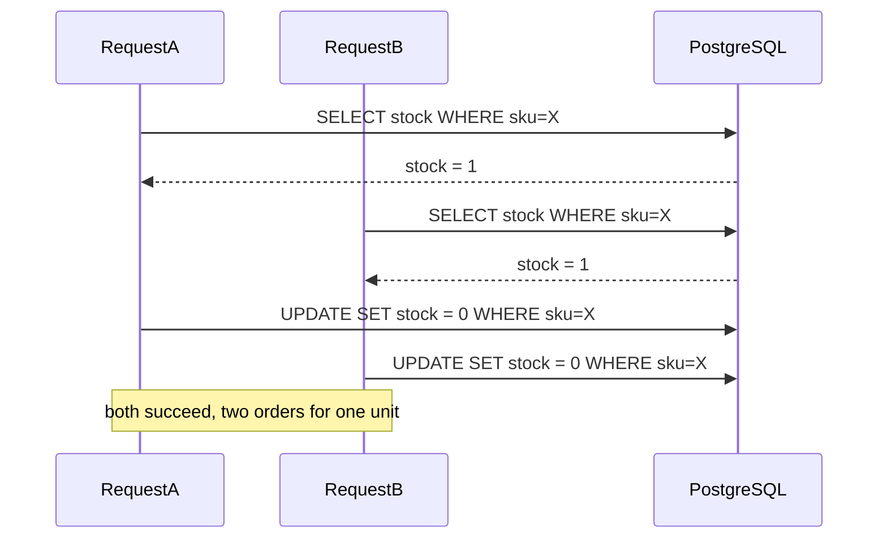
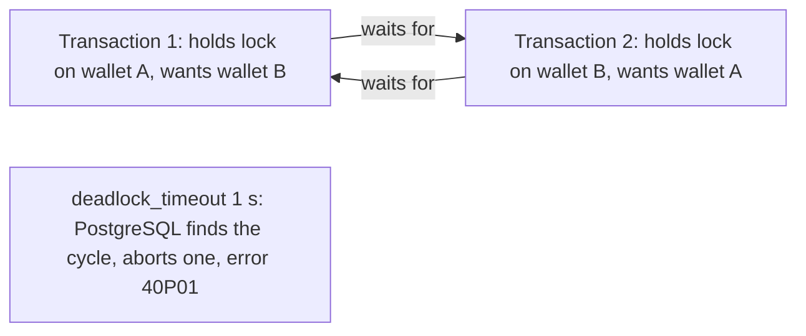

## 3.7 Concurrency vs parallelism

#### Concept

**Concurrency** is dealing with many things at once: several tasks are *in progress* during the same period, taking turns. **Parallelism** is doing many things at the same instant: several tasks *execute simultaneously* on different cores.

Node.js is concurrent by design and parallel only by choice. One JavaScript thread interleaves thousands of in-flight requests, switching between them at every `await`. It becomes parallel only when work leaves that thread: the kernel performing socket I/O, the libuv pool hashing a password, a worker thread rendering a PDF, or a second process on another core. A single NestJS process handling 2,000 concurrent requests is running one of them at a time; it just never waits.

#### Why does it exist?

The distinction exists because most backend time is spent *waiting*, not computing. A typical request does 0.5–2 ms of JavaScript and waits 5–50 ms for PostgreSQL, Redis and other services. Concurrency turns that waiting into throughput without adding cores. Parallelism is needed only when the computing itself is the bottleneck, and it comes with a cost: shared memory needs coordination, and coordination is where the bugs in 3.8 and 3.9 live.

#### Mental model

Imagine one barista with a row of espresso machines. She starts a shot on machine 1, and while it pours she steams milk for order 2, then takes payment for order 3, then returns to machine 1 when the shot is done. That is concurrency: one worker, many orders in progress, zero idle time as long as no single step requires her full attention for a minute. Parallelism is hiring a second barista. If the coffee shop's bottleneck is the *pouring time* (I/O), a second barista barely helps; if the bottleneck is *grinding beans by hand* (CPU), she doubles output.

#### How it works

1. A request handler runs synchronously until its first `await` on something not yet resolved (a database query, an HTTP call).
2. The `async` function returns a pending promise; its remaining code is stored as a continuation. The call stack unwinds to the event loop.
3. The loop picks up the next ready callback: another request's continuation, a timer, an incoming connection. Thousands of requests can be suspended this way; each costs a few hundred bytes of closure, not a thread.
4. The kernel and libuv do the actual I/O in parallel with your JavaScript. When a response arrives, the promise resolves, and its continuation is queued as a microtask and runs at the next opportunity.
5. Two requests' code never runs at the same instant on the main thread, so a plain variable can never be corrupted mid-write. But their *sequences of steps* interleave, so check-then-act logic across an `await` is exactly as racy as it would be with threads.

```text
time ->
Request A: [validate]--await pg--------------[serialize]--
Request B:            [validate]--await redis--[serialize]------------
Request C:                        [validate]---await pg----------------[serialize]
Main thread: A  B  C   (idle: kernel + PG working)   B  A  C
```

The wall time for A, B and C together is roughly the longest individual wait, not the sum. The main thread was busy for six small slices and free the rest of the time.

#### Practical example

An order-detail endpoint needs the order, the customer, and current inventory for each line. Sequential awaits cost 8 + 6 + 9 = 23 ms of waiting. Concurrent awaits with `Promise.all` cost about 9 ms. The catch a senior notices: each concurrent query takes its own pooled connection. Three concurrent queries per request at 400 requests per second is 1,200 connection-acquisitions per second; with a pool of 10 and 9 ms per query, the pool is at ~108% utilisation and requests start queueing *for a connection*. Concurrency inside a request is a lever, and pool size is the counterweight.

#### NestJS example

```ts
// orders/order-detail.service.ts
import { Injectable } from '@nestjs/common';
import { InjectRepository } from '@nestjs/typeorm';
import { In, Repository } from 'typeorm';
import { Order } from './order.entity';
import { Customer } from '../customers/customer.entity';
import { InventoryItem } from '../inventory/inventory-item.entity';

@Injectable()
export class OrderDetailService {
  constructor(
    @InjectRepository(Order) private readonly orders: Repository<Order>,
    @InjectRepository(Customer) private readonly customers: Repository<Customer>,
    @InjectRepository(InventoryItem) private readonly inventory: Repository<InventoryItem>,
  ) {}

  async get(orderId: number) {
    const order = await this.orders.findOneOrFail({ where: { id: orderId }, relations: { lines: true } });

    // Independent I/O: run concurrently. Each takes its own pooled connection for ~5-10 ms.
    const [customer, stock] = await Promise.all([
      this.customers.findOneByOrFail({ id: order.customerId }),
      this.inventory.findBy({ sku: In(order.lines.map((l) => l.sku)) }),
    ]);

    return { order, customer, stock };
  }
}
```

Two rules: use `Promise.all` only for *independent* work, and never fan out over an unbounded list (see the failure scenario). For partial tolerance (the recommendation widget may fail without failing the order), use `Promise.allSettled` and degrade explicitly.

#### PostgreSQL example

PostgreSQL is parallel in two senses. Across connections it is truly parallel: each backend is a process on its own core, and MVCC lets readers proceed without blocking writers. Within one connection it is strictly sequential: the wire protocol processes one statement at a time, so "concurrent" queries on a single connection are queued by the driver. That is why `Promise.all` inside a *transaction* gains nothing: a transaction is one connection.

```sql
-- two sessions: parallel across backends, no blocking between reader and writer (MVCC)
-- session 1
BEGIN; UPDATE inventory_items SET stock = stock - 1 WHERE sku = 'SKU-1';   -- holds a row lock
-- session 2
SELECT stock FROM inventory_items WHERE sku = 'SKU-1';                     -- returns the old committed value, does not wait
-- session 1
COMMIT;

-- within a single query, parallelism is explicit and uses extra processes
SET max_parallel_workers_per_gather = 4;
EXPLAIN (ANALYZE) SELECT count(*) FROM order_events WHERE created_at > now() - interval '7 days';
--  Gather  (workers planned: 4, workers launched: 4)
```

#### TypeORM example

Inside `dataSource.transaction`, everything must go through the transaction's `manager` and must be awaited in sequence. Queries fired in parallel on the transactional manager are serialised on the one connection anyway; they just make the code misleading.

```ts
await this.dataSource.transaction(async (manager) => {
  // sequential on purpose: one connection, one statement at a time
  await manager.decrement(InventoryItem, { sku: 'SKU-1' }, 'stock', 1);
  await manager.save(Order, { sku: 'SKU-1', status: 'PLACED' });
});

// outside a transaction, independent reads may run concurrently on separate pooled connections
const [a, b] = await Promise.all([this.orders.count(), this.customers.count()]);
```

Never use an injected `Repository` (which acquires its own connection) for a write that must be part of the transaction; that write commits independently.

#### Sequelize example

```ts
await this.sequelize.transaction(async (t) => {
  await this.inventoryModel.decrement('stock', { by: 1, where: { sku: 'SKU-1' }, transaction: t });
  await this.orderModel.create({ sku: 'SKU-1', status: 'PLACED' }, { transaction: t });
});
```

Sequelize supports `CLS` (`Sequelize.useCLS(namespace)`) to pass the transaction implicitly; with concurrent code that is easy to get wrong, so prefer passing `transaction: t` explicitly.

#### Production scenario

A checkout endpoint fans out to five internal services: pricing, tax, shipping, fraud, loyalty. Sequentially that is 5 × 40 ms = 200 ms; concurrently it is the slowest of the five, ~50 ms. But fraud is occasionally slow (2 s at p99). With `Promise.all` and no timeout, checkout's p99 became fraud's p99. The fix was a per-call timeout (`AbortSignal.timeout(300)`) and `Promise.allSettled`, with fraud falling back to a rule-based check when it times out. Concurrency multiplies exposure to the slowest dependency; every fan-out needs a timeout and a fallback decision.

#### Failure scenario

At 07:30 a nightly job started: "recalculate loyalty tiers for all customers". The implementation was `await Promise.all(customers.map((c) => this.recalc(c)))` over 180,000 customers. Every `recalc` opened a query. Within a second, 180,000 promises were pending, the pool of 10 had 179,990 waiters, `connectionTimeoutMillis` fired for most of them, and the process's heap climbed to 1.2 GB holding the closures and the error objects. The pod was OOM-killed, restarted, and the cron ran again. Unbounded concurrency is not concurrency; it is a self-inflicted denial of service. The fix was a concurrency limiter (`p-limit(20)`) and batching by keyset, which finished the job in nine minutes at a flat 90 MB of heap.

#### Edge cases & failure modes

- `Promise.all` rejects on the first failure but does not cancel the others; they keep running and holding connections.
- Concurrency inside one transaction is an illusion (one connection); across transactions it is real and raises lock contention.
- Concurrent writes to the same row serialise on the row lock; concurrency can *reduce* throughput on hot rows (see Part 13 on lock contention).
- A `for...of` with `await` is sequential; `forEach` with an async callback is fire-and-forget with unhandled rejections. Both are common bugs in opposite directions.
- Interleaving at `await` means any invariant that spans two awaits can be violated by another request in between.
- Worker threads and processes give real parallelism but pay serialisation costs on every message; a 10 MB payload copied to a worker can cost more than the computation.

#### How a Senior Backend Engineer thinks about this

They ask two questions about any slow path: "Is it waiting or is it computing?" Waiting is solved by concurrency and by removing round trips; computing is solved by moving work off the loop or to more processes. They bound every fan-out with a concurrency limit and a timeout, and they size pools against the concurrency they intend to allow. They explain it to a product manager as the barista: one person can serve many customers as long as no single order needs ten minutes of grinding.

#### Common mistakes

- Sequential awaits for independent work ("it works, it is just slow").
- `Promise.all` over thousands of items.
- Believing "Node is single-threaded, so I cannot have race conditions".
- Using a repository inside a transaction callback and wondering why the write survived a rollback.
- Adding worker threads to an I/O-bound service.

#### Interview questions

1. *Explain concurrency versus parallelism with Node as the example.* Expected: interleaving at `await` on one thread versus simultaneous execution on multiple cores; Node is concurrent by default and parallel via libuv, workers, processes, and the kernel.
2. *Why does `Promise.all` inside a TypeORM transaction not speed anything up?* Expected: one transaction is one connection and the protocol is sequential per connection.
3. *A fan-out to five services makes your p99 equal the worst service's p99. What do you change?* Expected: per-call timeouts, `allSettled` with explicit degradation, circuit breakers.
4. *You have 400 requests per second, each running three concurrent 9 ms queries. How big must the pool be?* Expected: Little's law: 1,200 × 0.009 ≈ 11 connections busy on average; size for peaks, ~20.
5. *When does adding a worker thread help, and when does it hurt?* Expected: helps for CPU-bound work over ~5–10 ms; hurts for I/O-bound work and for tiny tasks where message copying dominates.

#### Practical exercise

Take an endpoint that makes three independent queries sequentially. Measure p50/p99 with `autocannon` at 300 requests per second. Convert to `Promise.all`, measure again, then reduce the pool to 5 and measure a third time. Add a `waitingCount` gauge on the pool.

Acceptance criteria: you can show the latency improvement, the point at which pool waiting appears, and explain from the numbers why "more concurrency" stopped helping.

## 3.8 Race conditions

#### Concept

A **race condition** is a bug where the result depends on the *timing* of operations that were assumed to be ordered. The two classic shapes are **check-then-act** ("if stock > 0 then decrement") and **read-modify-write** ("read balance, add 10, write balance"). Between the check and the act, or between the read and the write, someone else changes the state, and your action is based on stale information.

In Node, races do not come from threads preempting each other mid-statement. They come from two places: **interleaving at `await`** inside one process, and **multiple processes** (20 replicas of the same service) acting on shared state in PostgreSQL or Redis. The second is by far the more common in production, and it is why the atomic primitives in 3.12 matter more than any in-process lock.

#### Why does it exist?

Races exist because state is shared and operations are not instantaneous. Every "read it, think about it, write it back" sequence that spans a network round trip is a window of a few milliseconds during which the world can change. Under low traffic the window is rarely hit and the bug looks like a ghost; under a flash sale it is hit hundreds of times a second.

#### Mental model

Imagine two ticket agents at two windows, both looking at the same board that says "1 seat left". Both tell their customer "yes, you got it", both walk over to the board, and both cross out the last seat. Two people hold a ticket for one seat. The board was correct; the *sequence* "look, promise, update" was not atomic. The fix is not a faster agent; it is a rule that the promise and the update are one motion (an atomic decrement) or that only one agent may touch the board at a time (a lock).

#### How it works



1. Request A reads stock = 1 and awaits the result (the main thread moves on).
2. Request B, on the same pod or on another pod, reads stock = 1.
3. A computes 1 - 1 = 0 and writes 0. B computes 1 - 1 = 0 and writes 0.
4. Both proceed to create an order. Inventory shows 0; two customers are promised the same unit.

The same pattern with an in-process cache: request A misses the cache and starts loading; request B misses too and starts loading; both write the cache (harmless) but both hit the database (a stampede). Or worse: a value is invalidated, and a slow request that read the *old* value before the invalidation writes it back into the cache *after* the invalidation, poisoning the cache with stale data until the next TTL.

#### Practical example

The four races every e-commerce backend has met:

| Race | Symptom | Correct primitive |
|---|---|---|
| Oversell: two orders for the last unit | negative stock, cancellations | atomic conditional `UPDATE`, or `SELECT ... FOR UPDATE` |
| Double coupon redemption | coupon used 3 times | unique constraint on `(coupon_id, order_id)` plus atomic `UPDATE ... WHERE uses < max_uses` |
| Duplicate signup with the same email | two users, login chaos | unique index; catch `23505`, never "check then insert" |
| Get-or-create (customer profile) | duplicate profiles | `INSERT ... ON CONFLICT DO NOTHING RETURNING`, then select |

Every one of these was originally written as `findOne` followed by `save`, and every one passed its unit tests.

#### NestJS example

The buggy version and the fixed version of stock reservation. The fix delegates atomicity to PostgreSQL: one statement that checks and decrements under the row lock.

```ts
// inventory/inventory.service.ts
import { Injectable, ConflictException } from '@nestjs/common';
import { InjectRepository } from '@nestjs/typeorm';
import { Repository } from 'typeorm';
import { InventoryItem } from './inventory-item.entity';

@Injectable()
export class InventoryService {
  constructor(@InjectRepository(InventoryItem) private readonly items: Repository<InventoryItem>) {}

  // RACY: two requests can both pass the check
  async reserveRacy(sku: string, qty: number): Promise<void> {
    const item = await this.items.findOneByOrFail({ sku });
    if (item.stock < qty) throw new ConflictException('OUT_OF_STOCK');
    item.stock -= qty;                       // computed from a stale read
    await this.items.save(item);             // UPDATE ... SET stock = <stale - qty>
  }

  // CORRECT: the check and the decrement are one statement, serialised by the row lock
  async reserve(sku: string, qty: number): Promise<void> {
    const result = await this.items
      .createQueryBuilder()
      .update(InventoryItem)
      .set({ stock: () => 'stock - :qty' })
      .where('sku = :sku AND stock >= :qty', { sku, qty })
      .execute();
    if (result.affected !== 1) throw new ConflictException('OUT_OF_STOCK');
  }
}
```

The in-process race, single-flight loading, is solved with a map of in-flight promises so concurrent callers share one load:

```ts
// common/single-flight.ts
export class SingleFlight<T> {
  private readonly inFlight = new Map<string, Promise<T>>();

  run(key: string, loader: () => Promise<T>): Promise<T> {
    const existing = this.inFlight.get(key);
    if (existing) return existing;                         // second caller joins the first load
    const p = loader().finally(() => this.inFlight.delete(key));
    this.inFlight.set(key, p);
    return p;
  }
}
```

This only de-duplicates within one process. Across 20 pods you still get up to 20 loads, which is usually acceptable; if not, a Redis lock (3.10) is the next step.

#### PostgreSQL example

PostgreSQL gives you three tools, in increasing order of cost:

```sql
-- 1. Atomic conditional update (cheapest; no explicit transaction needed)
UPDATE inventory_items
SET stock = stock - 2
WHERE sku = 'SKU-1' AND stock >= 2
RETURNING stock;
-- Under READ COMMITTED, if another transaction holds the row lock, this waits, then RE-EVALUATES
-- the WHERE clause against the newly committed row. If stock is now 1, zero rows are updated.

-- 2. Pessimistic lock when you need to read, decide in application code, then write
BEGIN;
SELECT stock FROM inventory_items WHERE sku = 'SKU-1' FOR UPDATE;   -- other writers wait here
-- application decides...
UPDATE inventory_items SET stock = stock - 2 WHERE sku = 'SKU-1';
COMMIT;

-- 3. Constraints as the last line of defence: a race cannot produce an impossible row
ALTER TABLE inventory_items ADD CONSTRAINT stock_non_negative CHECK (stock >= 0);
CREATE UNIQUE INDEX coupon_once_per_order ON coupon_redemptions (coupon_id, order_id);
```

The `CHECK` constraint means that even a racy code path fails loudly (`23514`) instead of producing negative stock. Constraints are the cheapest race-condition insurance you will ever buy.

#### TypeORM example

Optimistic locking: keep a `version` column, and make the update conditional on the version you read. `@VersionColumn` makes TypeORM increment the column on `save()`, but do not rely on `save()` to detect a conflict; write the conditional update explicitly and check `affected`.

```ts
@Entity('orders')
export class Order {
  @PrimaryGeneratedColumn() id: number;
  @Column() status: string;
  @VersionColumn() version: number;
}

async transition(orderId: number, from: string, to: string, expectedVersion: number): Promise<void> {
  const res = await this.orders
    .createQueryBuilder()
    .update(Order)
    .set({ status: to, version: () => 'version + 1' })
    .where('id = :id AND status = :from AND version = :v', { id: orderId, from, v: expectedVersion })
    .execute();
  if (res.affected !== 1) throw new ConflictException('ORDER_MODIFIED_CONCURRENTLY');
}

// pessimistic alternative inside a transaction
await this.dataSource.transaction(async (manager) => {
  const order = await manager.findOne(Order, { where: { id: orderId }, lock: { mode: 'pessimistic_write' } });
  // ... decide, then manager.save(order)
});
```

#### Sequelize example

Sequelize has built-in optimistic locking: set `version: true` on the model and `save()` adds `WHERE version = <read value>`, throwing `OptimisticLockError` when the row changed underneath you.

```ts
@Table({ tableName: 'orders', version: true })
export class Order extends Model { /* columns */ }

const order = await this.orderModel.findByPk(orderId);
order.status = 'SHIPPED';
try {
  await order.save();                     // UPDATE ... WHERE id = ? AND version = ?
} catch (err) {
  if (err instanceof OptimisticLockError) throw new ConflictException('ORDER_MODIFIED_CONCURRENTLY');
  throw err;
}

// pessimistic
const locked = await this.orderModel.findByPk(orderId, { lock: t.LOCK.UPDATE, transaction: t });
```

#### Production scenario

A flash sale offers 1,000 units at 09:00. In the first ten seconds, 52,000 reserve requests arrive across 16 pods. With the atomic `UPDATE`, exactly 1,000 succeed; the other 51,000 get a fast `409` because their `UPDATE` affects zero rows. The hot row is the bottleneck: each update holds the row lock for ~0.3 ms, so the row can absorb ~3,000 updates per second, and the queue at the lock adds up to 15 ms of latency at the peak. Acceptable. With the racy version, the team once sold 1,340 units. The postmortem's line "it passed all tests" is the sentence every senior remembers.

#### Failure scenario

At 02:14 the on-call was paged: `stock_non_negative` constraint violations spiking. Good news: the constraint had caught a race. Bad news: the code path was a new "reserve for cart" feature written as `findOne`, compare, `save`. Under a bot-driven burst, dozens of requests interleaved. Because of the constraint, the damage was errors rather than oversell; the fix was a one-line change to the atomic update. Without the constraint, the page would have come from the warehouse three days later.

#### Edge cases & failure modes

- Retries create races: a client that times out and retries a non-idempotent decrement double-decrements. Idempotency keys are part of race-condition hygiene.
- Replication lag: reading from a replica, deciding, and writing to the primary is check-then-act with an extra few hundred milliseconds of staleness.
- Cache invalidation races: a slow reader can repopulate a cache with stale data after a write invalidated it. Use short TTLs or versioned keys.
- "First request wins" by timestamp fails under clock skew between pods; use a database sequence or a Redis `INCR` for ordering.
- Under `SERIALIZABLE` isolation, PostgreSQL detects many races and aborts with `40001`; you must retry. It is the heavyweight answer for complex invariants.
- Node races often hide behind `Promise.all`: two branches of the same request touching the same row.
- Unique-constraint checks in TypeORM's `save()` for "upsert" logic are not atomic; use `INSERT ... ON CONFLICT` (`repository.upsert` or `createQueryBuilder().insert().orIgnore()`).

#### How a Senior Backend Engineer thinks about this

They assume every `await` is a point where the world changes, and they push every invariant into a place that can enforce it atomically: a single conditional `UPDATE`, a unique index, a `CHECK`, a Redis command. They never trust a read to still be true a millisecond later. They prefer optimistic techniques for low-contention rows (order status transitions) and pessimistic locks for high-contention rows updated in complex ways (wallet balances). To a product manager: "Two customers can click within the same millisecond; the database is the only referee fast enough to say who was first, so we let it decide, not the application."

#### Common mistakes

- `findOne` then `save` for anything that another request could also change.
- Checking uniqueness in code and inserting without a unique index.
- Assuming single-threaded means race-free.
- "Fixing" a race with an in-process mutex while running 20 replicas.
- Retrying without an idempotency key, converting a timeout into a duplicate.

#### Interview questions

1. *Node is single-threaded. Can it have race conditions?* Expected: yes; interleaving at `await` within a process and across replicas; show the oversell example.
2. *How does `UPDATE ... WHERE stock >= n` prevent oversell under READ COMMITTED?* Expected: the row lock serialises updaters and PostgreSQL re-evaluates the WHERE on the latest committed version after waiting.
3. *Optimistic versus pessimistic locking: when do you choose which?* Expected: optimistic for low contention and long user think-time; pessimistic for hot rows with short critical sections. Follow-up: what happens to a `FOR UPDATE` when the client disconnects? (Rolled back on socket close.)
4. *What is a cache stampede and how do you prevent it in one process and across many?* Expected: single-flight map in-process; a lock or probabilistic early refresh across processes.
5. *Why are unique constraints and check constraints part of race-condition design?* Expected: they make racy code fail loudly instead of corrupting data.

#### Practical exercise

Write the racy `reserveRacy` and the atomic `reserve`. Seed stock = 50 and fire 500 concurrent requests with `autocannon -c 100`. Count successful orders and final stock for each version. Then add the `CHECK` constraint and repeat the racy version.

Acceptance criteria: the racy version oversells; the atomic version ends at exactly zero stock with exactly 50 successes; the constrained racy version produces `23514` errors and never negative stock.

## 3.9 Deadlocks

#### Concept

A **deadlock** is a standstill: two or more parties each hold a resource and wait for a resource another party holds, in a cycle, so none can ever proceed. Four conditions must all be true (Coffman's conditions): resources are exclusively held (mutual exclusion), holders wait for more while holding (hold and wait), resources cannot be taken away (no preemption), and the waits form a cycle (circular wait). Break any one condition and deadlock is impossible; in practice you break **circular wait** by always acquiring resources in the same order.

Backend engineers meet deadlocks in two places: in PostgreSQL, where two transactions lock rows in opposite orders and the database detects and kills one; and in application code, where an `await` waits for something that cannot happen until the current code releases what it holds, such as a connection pool.

#### Why does it exist?

Deadlock is not a feature; it is a consequence of having locks at all. It exists because locks are the only way to protect multi-step updates, and multi-step updates in different orders create cycles. Understanding the four conditions matters because the fixes are direct: ordered acquisition, shorter transactions, lock timeouts, and retries.

#### Mental model

Imagine a one-lane bridge with a car entering from each end at the same time. Each is now on the bridge, holding its half, waiting for the other to back up. Neither will. PostgreSQL is a traffic warden who, after one second, orders one car to reverse (aborts one transaction with `deadlock detected`) so the other can cross. Your application code has no such warden: a deadlocked pool hangs until a timeout, and if there is no timeout, forever.

#### How it works



1. Transaction 1 updates wallet A (row lock on A). Transaction 2 updates wallet B (row lock on B).
2. Transaction 1 tries to update B and waits for T2's lock. Transaction 2 tries to update A and waits for T1's lock. Cycle.
3. After `deadlock_timeout` (default 1 s) of waiting, the waiting backend runs the deadlock detector: it builds the wait-for graph among all backends and looks for a cycle.
4. If it finds one, it aborts *its own* transaction with `ERROR: deadlock detected` (SQLSTATE `40P01`) and a `DETAIL` naming the processes and the rows. The other transaction proceeds as if nothing happened.
5. The client of the aborted transaction gets an exception. The correct response is to **retry the whole transaction**, because the other transaction has now committed and the world is different.

The application-level deadlock, which PostgreSQL cannot see:

1. A request starts a transaction with a `QueryRunner`, taking one of 5 pooled connections.
2. Inside the transaction, it calls a service method that uses an injected repository, which needs *another* connection from the same pool.
3. Under load, 5 requests are each inside step 1, holding all 5 connections, each waiting for a 6th. Nobody releases. The pool's acquire timeout (or nothing) ends it.

#### Practical example

The textbook case is a wallet transfer. Two users pay each other at the same time: transfer A -> B locks A then B; transfer B -> A locks B then A. Under 100 transfers per second on a payments platform this happens several times a minute. Two more that surprise people: updating a parent row and inserting child rows (an `INSERT` into `order_items` takes a `FOR KEY SHARE` lock on the referenced `orders` row, and an `UPDATE` on that order in another transaction conflicts) and bulk updates that touch overlapping row sets in different physical orders.

#### NestJS example

Ordered locking plus a retry on `40P01`:

```ts
// wallets/wallet-transfer.service.ts
import { Injectable, ConflictException } from '@nestjs/common';
import { DataSource, QueryFailedError } from 'typeorm';
import { Wallet } from './wallet.entity';

const DEADLOCK = '40P01';
const SERIALIZATION_FAILURE = '40001';

@Injectable()
export class WalletTransferService {
  constructor(private readonly dataSource: DataSource) {}

  async transfer(fromId: number, toId: number, cents: number, idempotencyKey: string): Promise<void> {
    await this.withDeadlockRetry(async () => {
      await this.dataSource.transaction(async (manager) => {
        // Break circular wait: always lock the lower id first, whatever the transfer direction
        const [firstId, secondId] = fromId < toId ? [fromId, toId] : [toId, fromId];
        const rows = await manager
          .createQueryBuilder(Wallet, 'w')
          .setLock('pessimistic_write')
          .where('w.id IN (:...ids)', { ids: [firstId, secondId] })
          .orderBy('w.id', 'ASC')            // deterministic lock order
          .getMany();

        const from = rows.find((w) => w.id === fromId)!;
        const to = rows.find((w) => w.id === toId)!;
        if (from.balanceCents < cents) throw new ConflictException('INSUFFICIENT_FUNDS');

        await manager.decrement(Wallet, { id: fromId }, 'balanceCents', cents);
        await manager.increment(Wallet, { id: toId }, 'balanceCents', cents);
        await manager.insert('wallet_transfers', { idempotencyKey, fromId, toId, cents }); // unique key
      });
    });
  }

  private async withDeadlockRetry<T>(work: () => Promise<T>, attempts = 3): Promise<T> {
    for (let i = 1; ; i++) {
      try {
        return await work();
      } catch (err) {
        const code = err instanceof QueryFailedError ? (err.driverError as { code?: string }).code : undefined;
        if ((code !== DEADLOCK && code !== SERIALIZATION_FAILURE) || i >= attempts) throw err;
        await new Promise((r) => setTimeout(r, 20 * i + Math.random() * 50));   // jittered backoff
      }
    }
  }
}
```

The `idempotencyKey` insert with a unique constraint makes the retry safe even if the client also retries.

#### PostgreSQL example

Reproduce, observe and defend:

```sql
-- session 1                                   -- session 2
BEGIN;                                         BEGIN;
UPDATE wallets SET balance_cents = balance_cents - 100 WHERE id = 1;
                                               UPDATE wallets SET balance_cents = balance_cents - 50 WHERE id = 2;
UPDATE wallets SET balance_cents = balance_cents + 100 WHERE id = 2;   -- waits
                                               UPDATE wallets SET balance_cents = balance_cents + 50 WHERE id = 1;  -- waits... 1 s later:
-- ERROR:  deadlock detected
-- DETAIL:  Process 2311 waits for ShareLock on transaction 71822; blocked by process 2310.
--          Process 2310 waits for ShareLock on transaction 71823; blocked by process 2311.
-- HINT:  See server log for query details.

-- who is blocking whom, right now
SELECT pid, pg_blocking_pids(pid) AS blocked_by, state, left(query, 60) AS query
FROM pg_stat_activity
WHERE cardinality(pg_blocking_pids(pid)) > 0;

-- defences
SET lock_timeout = '2s';                       -- give up waiting for a lock (error 55P03) instead of piling up
SELECT * FROM wallets WHERE id = 1 FOR UPDATE NOWAIT;      -- fail immediately if locked
SELECT * FROM jobs WHERE status = 'queued' FOR UPDATE SKIP LOCKED LIMIT 10;   -- queue workers never deadlock
SHOW deadlock_timeout;                         -- 1s; do not lower it much, detection is expensive
```

`log_lock_waits = on` writes a line for every wait longer than `deadlock_timeout`, which is the best early warning for contention that has not yet become a deadlock.

#### TypeORM example

The pool deadlock and its fix: everything inside the transaction must use `manager`, never an injected repository.

```ts
// WRONG: this.customers is a Repository bound to the DataSource, it acquires a second connection
await this.dataSource.transaction(async (manager) => {
  const customer = await this.customers.findOneBy({ id });      // 2nd connection from the same pool
  await manager.save(Order, { customerId: customer!.id });
});

// RIGHT: derive the repository from the transactional manager
await this.dataSource.transaction(async (manager) => {
  const customer = await manager.getRepository(Customer).findOneBy({ id });
  await manager.save(Order, { customerId: customer!.id });
});
```

Set `extra.connectionTimeoutMillis` so that if this mistake ships, it produces errors within seconds rather than a silent hang.

#### Sequelize example

Sequelize can retry deadlocks for you at the connection level, and the same pool-deadlock rule applies: pass `transaction: t` to every query inside the callback.

```ts
SequelizeModule.forRoot({
  dialect: 'postgres',
  retry: { match: [/deadlock detected/i, /could not serialize access/i], max: 3 },  // retry whole queries
  pool: { max: 10, acquire: 5_000 },       // acquire timeout turns a pool deadlock into an error
});

await this.sequelize.transaction(async (t) => {
  const wallets = await this.walletModel.findAll({
    where: { id: [fromId, toId] },
    order: [['id', 'ASC']],                // deterministic lock order
    lock: t.LOCK.UPDATE,
    transaction: t,
  });
  // ... decrement/increment with { transaction: t }
});
```

Note that `retry` re-runs a *query*, not your whole transaction; for multi-statement transactions you still need application-level retry.

#### Production scenario

A wallet service processes 300 transfers per second. Before ordered locking, it logged 40–80 `40P01` errors per hour, each retried transparently, each costing one second of `deadlock_timeout` wait plus the retry. After ordering by id, deadlocks dropped to zero, and the p99 of transfers fell from 1.2 s (dominated by the 1 s detection wait) to 18 ms. Deadlocks are rarely an availability problem in PostgreSQL; they are a *latency* problem, because detection costs a full second.

#### Failure scenario

At 14:20 the orders API stopped responding. CPU was near zero, PostgreSQL showed 12 idle-in-transaction backends and nothing else, and every request timed out after 30 s. A new "create order" flow opened a transaction with a `QueryRunner`, then called `customersService.ensureProfile()`, which used its own injected repository and therefore needed a second pooled connection. Pool size was 12. The moment 12 orders were in flight, all 12 connections were held by transactions waiting for a 13th connection that could never come. There was no `connectionTimeoutMillis`, so nothing ever errored; the pod just stopped. Kubernetes did not restart it because the liveness probe was a static `200`. The fix was the `manager.getRepository` rule, a 5-second connection timeout, and a liveness check that runs a real query.

#### Edge cases & failure modes

- Foreign keys take `FOR KEY SHARE` locks on parent rows; parent updates plus child inserts across transactions can deadlock without any explicit `FOR UPDATE`.
- Index page locks and `SELECT ... FOR UPDATE` on ranges can deadlock even with consistent row ordering if two scans traverse in different directions; ordering by the primary key on an index scan is the safe pattern.
- Lowering `deadlock_timeout` speeds detection but makes the detector run more often; keep it at 1 s and fix the ordering instead.
- `lock_timeout` aborts the *statement*; the transaction is then in an aborted state and must be rolled back.
- Async application deadlocks include: awaiting a mutex you already hold (non-reentrant), two services awaiting each other's `onModuleInit`, and `Atomics.wait` on the main thread waiting for a worker that is waiting for the main thread.
- A retry without idempotency turns a deadlock into a duplicate.

#### How a Senior Backend Engineer thinks about this

They design lock order into the code, not into comments: sort ids, lock parent before child, always the same order in every code path. They keep transactions short (no HTTP calls inside a transaction, ever) so that locks are held for milliseconds. They set `lock_timeout`, `statement_timeout`, and pool acquire timeouts so that a mistake produces an error, not a hang. They treat every `40P01` as a retryable event with a metric on it, and they alert when the rate changes. To a product manager: "Two payments occasionally try to cross the same bridge from opposite ends; the database makes one of them back up and try again a moment later. We make sure that retry is invisible."

#### Common mistakes

- Locking rows in the order the request happened to list them.
- Calling another service (which opens its own connection) inside a transaction.
- No acquire timeout on the pool, so a pool deadlock is a silent hang.
- Retrying only the failed statement instead of the whole transaction.
- Treating `deadlock detected` as a bug to be swallowed rather than a signal to fix ordering.

#### Interview questions

1. *Explain how PostgreSQL detects a deadlock and what the client should do.* Expected: wait-for graph after `deadlock_timeout`; one transaction aborted with `40P01`; client retries the whole transaction with backoff.
2. *How do you make wallet transfers deadlock-free?* Expected: acquire row locks in a global order (by id), keep the transaction short, retry `40P01`.
3. *Describe a deadlock that involves no explicit locks.* Expected: FK `FOR KEY SHARE` on parent rows versus parent updates; or a pool deadlock in application code.
4. *Why is a connection pool deadlock invisible to PostgreSQL?* Expected: the waiting happens in the application before a connection exists; PG sees only idle-in-transaction sessions.
5. *What does `SKIP LOCKED` change for queue workers?* Expected: workers never wait on each other's rows, so no contention or deadlock; each takes the next unlocked job.

#### Practical exercise

Implement `transfer` without ordering and run 200 concurrent random transfers among 10 wallets; count `40P01` errors and measure p99. Add ordered locking and the retry helper; repeat. Then reproduce the pool deadlock with `max: 2` and an injected repository inside a transaction, and watch it hang; add `connectionTimeoutMillis` and fix the code.

Acceptance criteria: measurable deadlock count before and zero after; a demonstrable hang that becomes a fast error with the timeout; total wallet balance unchanged across all runs.
