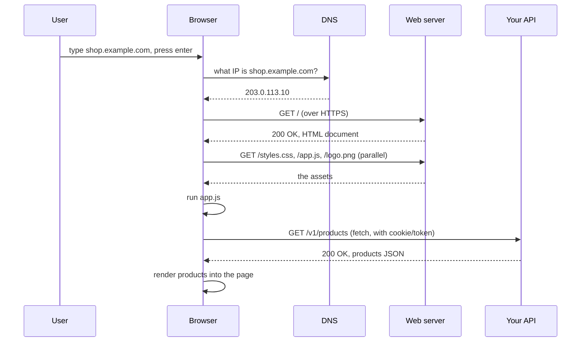

## 3.5 REST APIs

### 3.5.1 What a REST API is

#### Concept

A REST API is a style of building web APIs where you expose your data as **resources** (nouns like products, orders, users), each with a URL, and you act on them with the standard HTTP methods (`GET` to read, `POST` to create, `PATCH` to update, `DELETE` to remove). "REST" stands for Representational State Transfer, but for a beginner the useful definition is simpler: an API organized around nouns and the HTTP methods, speaking JSON, using status codes honestly, and keeping each request self-contained.

#### Why does it exist?

Before REST became the common style, every API invented its own conventions, so learning one taught you nothing about the next. REST is a set of conventions widely enough agreed that a developer who has used one REST API can guess how another works: `GET /things` lists, `GET /things/5` fetches one, `POST /things` creates, and the status codes mean what they always mean. That predictability is the value. Part 18 covers REST design as a craft and Part 19 covers the alternatives (GraphQL, gRPC) and when they win; here we establish the baseline.

#### Mental model

A REST API is like a well-organized library with a strict filing system. Every book (resource) has a shelf location (URL). The actions are standardized: borrow (`GET`), add a new book (`POST`), update a record (`PATCH`), remove a book (`DELETE`). Because every library uses the same system, once you know it you can walk into any branch and find your way. REST is that shared filing system for data over HTTP.

#### How it works — the resource pattern

The core idea is: pick your nouns, give each a URL for the collection and for an individual item, and use the methods consistently.

```text
Collection URL:  /v1/products
Item URL:        /v1/products/42

GET    /v1/products       -> list products        (200, array of products)
POST   /v1/products       -> create a product     (201, the new product + Location header)
GET    /v1/products/42    -> get product 42        (200 product, or 404)
PUT    /v1/products/42    -> replace product 42    (200, or 404)
PATCH  /v1/products/42    -> update some fields     (200, or 404)
DELETE /v1/products/42    -> delete product 42      (204, or 404)
```

Relationships become nested paths:

```text
GET    /v1/orders/ord_1/items        -> the items in order ord_1
POST   /v1/orders/ord_1/items        -> add an item to order ord_1
GET    /v1/users/usr_7/orders        -> that user's orders
```

Filtering, sorting and pagination go in the query string, never in the path:

```text
GET /v1/products?category=dental&sort=price&page=2&limit=20
GET /v1/orders?status=paid&from=2026-01-01&to=2026-01-31
```

#### Pagination

A list endpoint must never return "all" rows — a `GET /orders` on a table with ten million rows would try to send ten million objects and fall over. Lists are paginated. The two common styles:

```text
Offset pagination:  ?page=2&limit=20   (simple; slow and unstable deep in large tables)
Cursor pagination:  ?cursor=eyJ...&limit=20  (stable and fast; the professional default)
```

Part 18.5 covers why cursor pagination is preferred for large tables; for now, remember that every list endpoint is paginated and returns a bounded page plus a way to get the next one.

#### Practical example — a consistent response shape

A small but important discipline: make your responses predictable. A single resource returns the object; a list returns a page object with the items and pagination info; an error returns a consistent error shape.

```json
// GET /v1/products/42
{ "id": "42", "name": "Dental Mirror", "priceCents": 1299 }

// GET /v1/products?limit=2
{
  "items": [
    { "id": "42", "name": "Dental Mirror", "priceCents": 1299 },
    { "id": "43", "name": "Probe", "priceCents": 899 }
  ],
  "nextCursor": "eyJpZCI6IjQzIn0",
  "total": 1284
}

// Any error
{
  "error": { "code": "not_found", "message": "Product 999 not found" }
}
```

#### Production scenario

A company's mobile app, website, and a partner integration all talk to the same REST API. Because the API follows REST conventions, the mobile team, the web team and the partner each understood it from the endpoint list alone, with minimal hand-holding. When the company added a new "wishlists" feature, they added `GET/POST /v1/wishlists` and `GET /v1/users/{id}/wishlists` following the same pattern, and every consumer immediately knew how to use it. The consistency is what let three independent teams move fast against one API.

#### Failure scenario

An early API grew without conventions: `POST /getProducts`, `GET /product_delete?id=5`, some endpoints returning `{data: ...}` and others returning the object directly, errors sometimes `200` with an error body and sometimes `500`. Every new integration took weeks because nothing was predictable, a crawler that prefetched `GET /product_delete?id=5` links deleted products, and the client code was full of special cases. Refactoring to consistent REST conventions — nouns, correct methods, honest status codes, one response shape — cut integration time from weeks to a day and ended the accidental deletions. The lesson: conventions are not pedantry; they are what makes an API usable and safe.

#### Edge cases & failure modes

- **Verbs in the path** (`/createOrder`) instead of methods on nouns; works, but throws away the conventions that make REST valuable.
- **Unbounded lists** with no pagination, which fall over on large tables.
- **Inconsistent response shapes** across endpoints, forcing clients into special cases.
- **Actions that are not CRUD** (create/read/update/delete) — like "refund an order" or "send a password reset" — do not fit neatly; model them as a sub-resource (`POST /orders/1/refunds`) or accept a pragmatic action endpoint. Dogmatic REST is not the goal; a usable, consistent API is.
- **Breaking changes**: once published, a URL and its response shape are a contract; changing them breaks every consumer (Part 28 on versioning and compatibility).

#### How a Senior Backend Engineer thinks about this

A senior uses REST as a strong default because its predictability lowers the cost for everyone who consumes the API, but they are not dogmatic — when an operation is genuinely an action rather than a CRUD operation, they model it pragmatically rather than contorting it. They paginate every list from day one, keep response shapes consistent, use status codes honestly, and treat every published endpoint as a long-lived contract. They also know when REST is the wrong tool: a mobile app that needs to fetch deeply nested data in one round trip may be better served by GraphQL, and internal service-to-service calls may be better as gRPC (Part 19).

#### Common mistakes

- Verbs in paths instead of methods on nouns.
- List endpoints with no pagination.
- Inconsistent response and error shapes.
- Changing a published URL or response shape and breaking consumers.
- Forcing every operation into strict CRUD even when it is awkward.

#### Interview questions

1. **What makes an API "RESTful" in practical terms?** Resources as nouns with URLs, standard HTTP methods for actions, JSON bodies, honest status codes, consistent shapes, and self-contained (stateless) requests.
2. **How do you handle filtering and pagination in REST?** In the query string (`?status=paid&limit=20&cursor=...`), never in the path; every list is paginated.
3. **How would you model "refund an order" in a REST API?** As a sub-resource action, for example `POST /orders/{id}/refunds`, since a refund is a thing you create against an order.
4. **Why is a published URL a contract, and what does that imply?** Clients (apps, integrations) depend on it; changing it breaks them, so changes must be backward-compatible or versioned (Part 28).

#### Practical exercise

Design a REST API for a food-delivery service covering restaurants, menus, orders and order status. Include collection and item URLs, the correct methods, how to filter restaurants by cuisine and location, how to paginate, and how to model "mark an order as delivered". Acceptance criteria: nouns in paths, correct methods and status codes, pagination on every list, and a sensible model for the status-change action.

#### Worked answer to the exercise

```text
GET    /v1/restaurants?cuisine=thai&lat=12.97&lng=77.59&radiusKm=5&limit=20&cursor=...
                                                    -> 200, a page of restaurants
GET    /v1/restaurants/{restaurantId}               -> 200 restaurant, or 404
GET    /v1/restaurants/{restaurantId}/menu-items?limit=50&cursor=...
                                                    -> 200, a page of menu items
POST   /v1/orders                                   -> 201 + Location, or 422 (item not on that menu)
GET    /v1/orders/{orderId}                         -> 200 order (includes its current status), or 404
GET    /v1/users/{userId}/orders?status=active&limit=20&cursor=...
                                                    -> 200, a page of that user's orders
PATCH  /v1/orders/{orderId}  {"status":"delivered"} -> 200, 409 if the order is not out for delivery
```

The status change is a `PATCH` on the order, because "delivered" is a new value of a field the order already has. The `409 Conflict` protects the order's state machine: an order that was never picked up cannot jump to delivered. Some teams prefer `POST /v1/orders/{orderId}/deliveries`, which records who delivered it and when; both are defensible if used consistently. Location goes in the query string because it filters the collection; it is not a resource of its own.

## 3.6 What the browser does

### 3.6.1 From URL to rendered page, and why the backend engineer cares

#### Concept

When a user types a URL and presses enter, the browser does a surprising amount of work: it resolves the domain to an address, opens a secure connection, sends an HTTP request, receives HTML, and then fetches everything that HTML references (styles, scripts, images, and API data), running JavaScript that may send still more requests. A backend engineer does not need to render pages, but they need to understand this flow, because it explains where their API fits and why certain things (CORS, caching, cookies) behave the way they do.

#### Why does it exist?

A web page is not one file; it is a document that pulls in many resources from potentially many servers. The browser orchestrates all of that. Understanding it tells you why a single page view produces dozens of requests to your backend, why a browser enforces rules (CORS) that Postman does not, and why your API's caching and cookie headers matter.

#### Mental model

The browser is a general contractor building a house from a blueprint. It gets the blueprint (the HTML), reads it, and realizes it needs materials from various suppliers: the paint supplier (CSS), the electrician (JavaScript), the furniture store (images), and the data from your backend (JSON via API calls). It places all those orders, often in parallel, assembles everything into the finished house (the rendered page), and keeps calling suppliers as the occupants use the house (more API calls as the user clicks).

#### How it works



1. **DNS lookup**: turn the domain name into an IP address (Part 14.3).
2. **Connect and TLS**: open a TCP connection and set up encryption (Part 14.4 and 14.12).
3. **Request the document**: `GET /`, receive HTML.
4. **Fetch sub-resources**: the browser parses the HTML and requests the CSS, JavaScript, fonts and images it references, in parallel.
5. **Run JavaScript**: modern apps then call your API (via `fetch`) to get the dynamic data as JSON and render it.
6. **Keep going**: as the user interacts, the JavaScript sends more API requests.

For a backend engineer, steps 5 and 6 are where your work lives: the browser's JavaScript calls your API, your API returns JSON, and the browser renders it. Part 75 — How the Browser Builds a Page follows the rest of the journey, from HTML bytes to pixels (75.1).

#### CORS: the rule that confuses every beginner

Browsers enforce a security rule called the **same-origin policy**: JavaScript running on `shop.example.com` cannot, by default, read responses from `api.other.com`. This stops a malicious site from using your logged-in browser to read your bank's API. **CORS** (Cross-Origin Resource Sharing) is how a server opts in to allowing specific other origins to call it: the server sends headers like `Access-Control-Allow-Origin: https://shop.example.com`, and the browser then permits the call.

The key insight for a beginner: CORS is enforced **by the browser, for browser JavaScript only**. A request from Postman, `curl`, or another server is not subject to CORS — those are not browsers. So "it works in Postman but fails in the browser with a CORS error" is extremely common and means exactly one thing: your server is not sending the CORS headers the browser requires. The fix is on the server (allow the frontend's origin), not in the frontend. NestJS enables CORS with one line (Part 14.13).

#### Watching a CORS preflight with curl

For many requests (a `POST` with a JSON body, any request with an `Authorization` header) the browser first sends a **preflight**: an `OPTIONS` request that asks "may this origin send this method with these headers?". Only if the answer is yes does it send the real request. You can play the browser's part with curl against this small server:

```ts
import { createServer } from 'node:http';

const ALLOWED_ORIGIN = 'https://shop.example.com';

createServer((req, res) => {
  res.setHeader('Vary', 'Origin');                                  // the answer depends on Origin
  if (req.headers.origin === ALLOWED_ORIGIN) {
    res.setHeader('Access-Control-Allow-Origin', ALLOWED_ORIGIN);   // "this origin may read my responses"
  }
  if (req.method === 'OPTIONS') {                                   // the browser's preflight question
    res.setHeader('Access-Control-Allow-Methods', 'GET, POST, PATCH, DELETE');
    res.setHeader('Access-Control-Allow-Headers', 'Content-Type, Authorization');
    res.setHeader('Access-Control-Max-Age', '600');                 // remember this answer for 10 minutes
    res.writeHead(204).end();
    return;
  }
  res.writeHead(200, { 'Content-Type': 'application/json' }).end('{"items":[]}');
}).listen(4030);
```

```bash
curl -s -i -X OPTIONS http://localhost:4030/v1/orders \
  -H "Origin: https://shop.example.com" \
  -H "Access-Control-Request-Method: POST" \
  -H "Access-Control-Request-Headers: content-type"
```

```text
HTTP/1.1 204 No Content
Vary: Origin
Access-Control-Allow-Origin: https://shop.example.com
Access-Control-Allow-Methods: GET, POST, PATCH, DELETE
Access-Control-Allow-Headers: Content-Type, Authorization
Access-Control-Max-Age: 600
```

That is a "yes", so a browser on `shop.example.com` would now send the real `POST`. Now pretend to be a different site:

```bash
curl -s -i http://localhost:4030/v1/orders -H "Origin: https://evil.example"
```

```text
HTTP/1.1 200 OK
Vary: Origin
Content-Type: application/json

{"items":[]}
```

(Some response headers are trimmed from both outputs.) Look closely: the server **still answered with the data**. There is simply no `Access-Control-Allow-Origin` header, so a browser would refuse to hand the response to the evil page's JavaScript. curl does not care and printed it anyway. That is the whole lesson in one picture: CORS protects users' browsers from other websites; it is **not** a way to stop anyone else from calling your API. Authentication does that. Part 14.13 shows the NestJS `app.enableCors({ origin: [...] })` setup, and Part 81 covers browser security in depth.

#### Cookies and tokens

The browser stores cookies the server sets (via `Set-Cookie`) and automatically attaches them to future requests to that domain (via `Cookie`). This is how a server remembers a logged-in session across the stateless request-response model. Modern APIs often use a token in the `Authorization` header instead (Part 44.3). Either way, the thing the backend engineer must know: the browser handles cookies automatically, which is convenient but also why cookie security settings (`HttpOnly`, `Secure`, `SameSite`) matter (Part 14.8 and Part 44).

#### Practical example — why a page is slow

A product page loads slowly. The network tab shows the browser made 60 requests: the HTML, 8 scripts, 12 images, 3 fonts, and 36 separate API calls (one per product in a list, the "N+1 over the network" problem). The backend engineer's fix is to add a single `GET /v1/products?ids=...` batch endpoint so the browser makes one API call instead of 36. Understanding what the browser does — that it makes a request per resource unless told otherwise — is what lets the backend engineer see and fix the problem.

#### Edge cases & failure modes

- **CORS errors** when a frontend on one origin calls an API on another and the server has not allowed that origin.
- **Mixed content**: an HTTPS page calling an HTTP API is blocked by the browser; everything must be HTTPS.
- **Too many requests** (N+1 over the network) making pages slow; batch endpoints fix it.
- **Caching surprises**: the browser caches responses per `Cache-Control`; a wrong header serves stale data or re-fetches needlessly.
- **Cookies not sent cross-origin** unless the request uses `credentials: 'include'` and the server allows it, a common authentication-in-the-browser gotcha.

#### How a Senior Backend Engineer thinks about this

A senior understands the browser well enough to design APIs that serve it well: batch endpoints to avoid N+1 network calls, correct `Cache-Control` so the browser caches what it safely can, correct CORS configuration so the frontend can call the API, and secure cookie settings. They recognize the "works in Postman, fails in the browser" symptom instantly as CORS and fix it on the server. They know the browser is both a consumer of their API and an enforcer of security rules (same-origin, mixed-content) that server-to-server callers do not have, so an API consumed by browsers has extra requirements.

#### Common mistakes

- Debugging a CORS error in the frontend when the fix is server-side CORS headers.
- Serving user-specific API responses with a cacheable `Cache-Control`, letting the browser cache private data.
- Designing APIs that force the browser into dozens of calls per page.
- Mixing HTTP and HTTPS and being blocked by the browser.

#### Interview questions

1. **What is CORS and where is it enforced?** A browser security mechanism where a server opts in to allowing specific other origins to read its responses; it is enforced by the browser for browser JavaScript, not for Postman, curl or server-to-server calls.
2. **Why does an API call work in Postman but fail with a CORS error in the browser?** Postman is not a browser and ignores CORS; the browser requires the server to send allow-origin headers, which it is not. Fix it on the server.
3. **How does a stateless server remember a logged-in user across requests?** Via cookies the browser stores and resends, or a token the client sends in the `Authorization` header; the server verifies it each request.
4. **What is the N+1 problem over the network and how do you fix it from the backend?** A page making one API call per item instead of one call for all; add a batch endpoint that returns many items at once.

#### Practical exercise

Open any web app's network tab and count the requests one page load makes. Identify the HTML document, at least one CSS and JavaScript request, and at least one API (JSON) call. Then find one place where the page makes several similar API calls that a batch endpoint could collapse into one. Acceptance criteria: you can describe the full load as request-response exchanges and propose one batching improvement.
