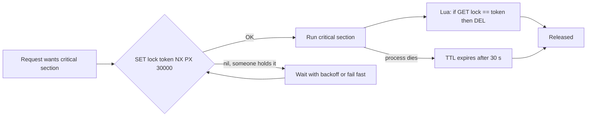
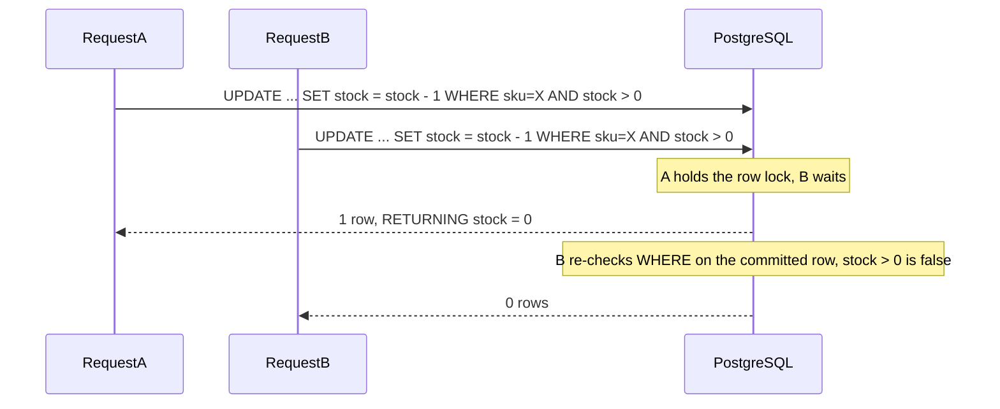

## 3.10 Mutex

#### Concept

A **mutex** (mutual exclusion lock) is a lock with one holder. Whoever holds it may run the protected code (the **critical section**); everyone else waits until it is released. It is the simplest tool for turning a multi-step sequence into something that behaves as if it were one step.

A backend engineer meets mutexes at three scopes:

- **In-process**: protecting a sequence that spans `await`s inside one Node process, for example refreshing an OAuth token exactly once when it expires. Libraries such as `async-mutex` provide this.
- **In the database**: row locks (`SELECT ... FOR UPDATE`) and **advisory locks** (`pg_advisory_xact_lock`), which make PostgreSQL act as a mutex service for any key you choose.
- **Distributed**: a lock held in Redis (`SET key token NX PX ttl`) so that only one of 20 replicas performs an action, such as running a scheduled job or processing a given order.

#### Why does it exist?

Because some sequences cannot be made atomic by a single statement. "Fetch a new token from the identity provider, store it, then use it" involves an HTTP call in the middle. "Regenerate the daily report" takes minutes. When you cannot make the operation atomic, you make it *exclusive*. The cost is serialisation: whatever is behind the mutex runs one at a time, so it must be short, and it must always be released.

#### Mental model

Imagine a single-occupancy bathroom with a key hanging on a hook. You take the key (acquire), go in, come out, hang the key back (release). If you walk off with the key in your pocket (an exception path that never releases), everyone waits forever. If the key has a rule "auto-returns to the hook after 30 seconds" (a TTL), then a slow occupant might still be inside when the next person walks in (two holders). Every mutex design is a trade between "never stuck" and "never two inside".

#### How it works

1. **Acquire** must itself be atomic: a test-and-set or compare-and-swap that checks "is it free?" and marks it "taken" in one indivisible step. In-process, JavaScript's single thread makes a plain `if (!locked) locked = true` atomic *as long as there is no `await` between the check and the set*. In Redis, `SET key value NX` is atomic because Redis executes one command at a time. In PostgreSQL, the lock manager does it.
2. Waiters queue. A fair mutex hands the lock to waiters in order; an unfair one lets whoever tries first take it.
3. The holder runs the critical section, which must be as short as possible and must not itself wait for anything that could need the same lock (non-reentrant deadlock).
4. **Release** must happen on every path, hence `try/finally`. Distributed locks also need **ownership**: release only if the lock value is *your* token, otherwise a slow holder whose lock expired could release the *next* holder's lock.
5. **Liveness protection**: a TTL (Redis `PX`), a transaction scope (PostgreSQL `xact` advisory locks are released on commit or rollback, including on disconnect), or a watchdog. A lock that cannot expire is a lock that will one day be held by a dead process.



#### Practical example

Three real uses in an e-commerce backend:

- **Single-flight token refresh**: 200 concurrent requests notice the payment gateway token expired. Without a mutex, 200 refresh calls hit the identity provider (and it rate-limits you). With one, the first refreshes, the other 199 wait ~100 ms and reuse the result.
- **One scheduled job across replicas**: the `@Cron('0 * * * *')` "expire abandoned carts" job must run once per hour, not once per pod. A PostgreSQL advisory lock is the simplest leader election you will ever deploy.
- **Per-order processing lock**: a webhook from the payment provider and a user's "cancel" click arrive for the same order in the same 50 ms. A Redis lock keyed by `order:{id}` serialises them.

#### NestJS example

In-process single flight with `async-mutex`:

```ts
// payments/gateway-token.service.ts
import { Injectable } from '@nestjs/common';
import { Mutex } from 'async-mutex';

@Injectable()
export class GatewayTokenService {
  private token: { value: string; expiresAt: number } | null = null;
  private readonly refreshMutex = new Mutex();

  async get(): Promise<string> {
    if (this.token && this.token.expiresAt > Date.now() + 30_000) return this.token.value;

    // Only one refresh at a time; concurrent callers wait here, then re-check
    return this.refreshMutex.runExclusive(async () => {
      if (this.token && this.token.expiresAt > Date.now() + 30_000) return this.token.value; // double-check
      const fresh = await this.fetchToken();       // one HTTP call for the whole burst
      this.token = fresh;
      return fresh.value;
    });
  }

  private async fetchToken(): Promise<{ value: string; expiresAt: number }> {
    const res = await fetch(process.env.GATEWAY_TOKEN_URL!, { method: 'POST', signal: AbortSignal.timeout(3_000) });
    if (!res.ok) throw new Error(`token refresh failed: ${res.status}`);
    const body = (await res.json()) as { access_token: string; expires_in: number };
    return { value: body.access_token, expiresAt: Date.now() + body.expires_in * 1000 };
  }
}
```

A distributed lock in Redis with ownership-checked release:

```ts
// common/redis-lock.service.ts
import { Injectable } from '@nestjs/common';
import Redis from 'ioredis';
import { randomUUID } from 'node:crypto';

const RELEASE_IF_OWNER = `
  if redis.call('GET', KEYS[1]) == ARGV[1] then return redis.call('DEL', KEYS[1]) end
  return 0
`;

@Injectable()
export class RedisLockService {
  constructor(private readonly redis: Redis) {}

  // Returns a release function, or null if the lock is held by someone else.
  async tryAcquire(key: string, ttlMs: number): Promise<(() => Promise<void>) | null> {
    const token = randomUUID();
    const ok = await this.redis.set(`lock:${key}`, token, 'PX', ttlMs, 'NX');   // atomic in Redis
    if (ok !== 'OK') return null;
    return async () => {
      await this.redis.eval(RELEASE_IF_OWNER, 1, `lock:${key}`, token);         // never delete someone else's lock
    };
  }

  async withLock<T>(key: string, ttlMs: number, work: () => Promise<T>): Promise<T | null> {
    const release = await this.tryAcquire(key, ttlMs);
    if (!release) return null;                                                  // caller decides: skip, retry, 409
    try {
      return await work();
    } finally {
      await release();
    }
  }
}
```

And the once-per-cluster cron, using PostgreSQL:

```ts
// carts/cart-expiry.job.ts
import { Injectable, Logger } from '@nestjs/common';
import { Cron } from '@nestjs/schedule';
import { DataSource } from 'typeorm';

@Injectable()
export class CartExpiryJob {
  private readonly logger = new Logger(CartExpiryJob.name);
  constructor(private readonly dataSource: DataSource) {}

  @Cron('0 * * * *')
  async run() {
    // Transaction-scoped advisory lock: released on commit, rollback, or disconnect (pod death)
    await this.dataSource.transaction(async (manager) => {
      const [{ locked }] = await manager.query('SELECT pg_try_advisory_xact_lock($1) AS locked', [42_001]);
      if (!locked) { this.logger.log('another replica holds the cart-expiry lock, skipping'); return; }
      const res = await manager.query(
        `UPDATE carts SET status = 'EXPIRED' WHERE status = 'OPEN' AND updated_at < now() - interval '7 days'`,
      );
      this.logger.log(`expired ${res[1]} carts`);
    });
  }
}
```

#### PostgreSQL example

```sql
-- transaction-scoped advisory lock keyed by a string: serialise all work on one order
BEGIN;
SELECT pg_advisory_xact_lock(hashtext('order:8812'));     -- waits until free; auto-released at COMMIT/ROLLBACK
-- ... multi-statement work on order 8812 ...
COMMIT;

-- non-blocking variant for "skip if busy"
SELECT pg_try_advisory_xact_lock(hashtext('report:daily'));  -- true or false immediately

-- bound the wait so a stuck holder produces an error, not a pile-up
SET lock_timeout = '3s';

-- see who holds advisory locks
SELECT l.pid, l.objid, a.application_name, a.state
FROM pg_locks l JOIN pg_stat_activity a USING (pid)
WHERE l.locktype = 'advisory';
```

Advisory locks cost one row in the lock table and nothing on disk; they are the right tool for "one at a time per key" whenever the work is database-centric.

#### TypeORM example

Inside `dataSource.transaction`, the advisory lock is one `manager.query` away, as in the cron above. For row-level exclusivity, `setLock('pessimistic_write')` inside a transaction is the mutex; TypeORM throws `PessimisticLockTransactionRequiredError` if you forget the transaction, which is a helpful guard.

#### Sequelize example

```ts
await this.sequelize.transaction(async (t) => {
  await this.sequelize.query('SELECT pg_advisory_xact_lock(hashtext(:key))', { replacements: { key: `order:${id}` }, transaction: t });
  // ... exclusive work on the order using { transaction: t } ...
});
```

#### Production scenario

A subscription-billing service runs a renewal job hourly on 6 replicas. Before locking, each replica charged every due subscription, and the deduplication relied on the payment provider's idempotency keys, which worked until a key-generation bug made them per-attempt. Twelve customers were charged six times. After adding `pg_try_advisory_xact_lock`, exactly one replica runs each hour; the others log "skipping" in under a millisecond. Cost: one query per replica per hour. This is the entire "leader election" implementation, and for database-centric jobs it beats a Kubernetes lease or ZooKeeper by a mile of simplicity.

#### Failure scenario

At 03:10 the nightly "rebuild search index" job did not run, and neither did the next three nights. The job held a Redis lock with no TTL (`SET NX` without `PX`), and the pod that held it had been OOM-killed mid-run three days earlier. Every subsequent attempt saw the lock and skipped. The fix was a TTL slightly longer than the job's worst-case runtime (2 h), plus a heartbeat that extends the TTL while the job is alive, plus a metric "job last succeeded at" with an alert at 26 h. The deeper lesson: a lock with no expiry is a promise that the holder will never crash, and nobody can keep that promise.

#### Edge cases & failure modes

- TTL too short: the holder is still working when the lock expires; a second holder enters. Use a **fencing token** (a monotonically increasing number the protected resource checks) when correctness depends on it, or keep the critical section far shorter than the TTL.
- Redis failover: a lock written to the primary may not have replicated to the replica that gets promoted; two holders. Redlock exists for this; for most jobs, a PostgreSQL advisory lock is simpler and strictly consistent.
- Non-reentrant mutexes deadlock if the critical section calls a function that acquires the same mutex.
- Holding an in-process mutex across an HTTP call with no timeout blocks every waiter until the call returns.
- Session-level advisory locks (`pg_advisory_lock`) live until unlocked or the session ends; with a pooler in transaction mode, "the session" is not yours, and the lock may be released or leak unexpectedly. Prefer `xact` locks.
- `hashtext()` collisions between different strings are possible (32-bit); use a namespace integer plus id, or `pg_advisory_xact_lock(int, int)` with two keys.

#### How a Senior Backend Engineer thinks about this

They reach for a mutex only after asking whether the operation can be made atomic instead (3.12). When they do, they choose the smallest scope that works: in-process for per-process state, PostgreSQL advisory for database work, Redis for cross-service coordination that must be fast. Every lock they write has a TTL or a transaction scope, ownership-checked release, and a metric. They keep critical sections tiny and never put a network call inside one unless it is the whole point. To a product manager: "Only one person can hold the key to the report room; if they faint inside, the key returns to the hook automatically after ten minutes."

#### Common mistakes

- `SET NX` without `PX`.
- `DEL` on release without checking the token.
- Using an in-process mutex to protect state that lives in the database, while running many replicas.
- Long critical sections (a mutex around an entire request).
- Forgetting the double-check after acquiring: the reason you waited may already be resolved.

#### Interview questions

1. *How do you implement a safe distributed lock in Redis?* Expected: `SET key token NX PX ttl`, release with a Lua compare-and-delete, TTL longer than the critical section, optional heartbeat. Follow-up: what breaks during failover?
2. *When would you use a PostgreSQL advisory lock instead of Redis?* Expected: database-centric work, need for strict consistency, automatic release on disconnect, no extra infrastructure.
3. *What is a fencing token and when is a TTL alone insufficient?* Expected: a monotonically increasing token the resource validates; needed when a paused holder resuming after expiry could corrupt state.
4. *How do you run a cron once across N replicas?* Expected: `pg_try_advisory_xact_lock` inside the job's transaction, or a Redis lock with TTL and a heartbeat.
5. *Why is a mutex around `await fetch()` risky?* Expected: it serialises all callers behind the slowest network call; needs a timeout and should be single-flight only.

#### Practical exercise

Implement `GatewayTokenService` with and without the mutex, then fire 200 concurrent requests that need a token while the token endpoint is stubbed to take 200 ms. Count calls to the stub. Then implement `CartExpiryJob` with the advisory lock and run three instances of the service against one database.

Acceptance criteria: 1 stub call with the mutex versus ~200 without; exactly one instance performs the expiry each run and the others log "skipping"; killing the running instance mid-job releases the lock immediately.

## 3.11 Semaphore

#### Concept

A **semaphore** is a counter with a wait queue: it holds N permits, `acquire` takes one (waiting if none are free) and `release` returns one. A mutex is a semaphore with N = 1. Semaphores exist to say "at most N of these at once".

The most important semaphore in your stack is one you never call by that name: the **database connection pool**. `max: 10` is ten permits; `pool.connect()` is `acquire`; `client.release()` is `release`; `connectionTimeoutMillis` is the acquire timeout. Every other bounded resource is the same shape: worker-thread pools, outbound HTTP connection caps, BullMQ `concurrency`, `p-limit`.

#### Why does it exist?

Every real resource has a capacity: PostgreSQL has cores, a payment gateway allows 20 concurrent calls per merchant, a worker pool has 4 threads, your own process has a memory limit that 10,000 in-flight PDF renders would blow. Unbounded concurrency does not make things faster; it turns capacity limits into cascading failures. A semaphore makes the limit explicit and turns "overload" into a queue with a timeout, which is something you can measure and alert on.

#### Mental model

Imagine a car park with 10 spaces and a counter at the barrier. The counter is the semaphore. Cars enter while the counter says spaces are free; when it reaches zero, cars queue at the barrier. When a car leaves, the barrier lets one in. If cars queue for more than five minutes, they give up and go elsewhere (acquire timeout) instead of blocking the road behind them (a full event loop of waiters).

#### How it works

1. State: a permit count and a FIFO queue of waiters.
2. `acquire`: if permits > 0, decrement and return immediately. Otherwise append the caller to the queue and return a promise; start a timer that removes the caller and rejects the promise if it fires first.
3. `release`: if there is a waiter, hand the permit straight to it (wake it); otherwise increment the count.
4. Observability: the current in-use count, the queue length (`waitingCount` in `pg`), and the time spent waiting are the three metrics. Queue length rising is the earliest sign that a dependency is slowing down.
5. Sizing follows **Little's law**: permits needed = arrival rate × average hold time. 800 queries per second × 12 ms average = 9.6 connections busy on average; size for peaks and variance, so 15–20.

```text
pool.max = 10
in use  [##########]  10/10
waiting [ 7 requests ]  <- each has connectionTimeoutMillis = 5000 ticking
```

#### Practical example

An orders API calls a shipping-rate provider that allows 8 concurrent connections per API key and returns HTTP 429 beyond that. Without a semaphore, a burst of 50 checkouts produces 42 rate-limit errors and 42 retries, which produce more 429s. With a semaphore of 8 permits and a 2-second acquire timeout, 8 calls run, the rest wait up to 2 seconds, and anything beyond that gets a fast, honest 503 with `Retry-After`. This pattern is also called a **bulkhead**: the slow dependency cannot consume all of the process's capacity.

#### NestJS example

A small semaphore (about 30 lines) is often better than a dependency, because you control the timeout and the metrics:

```ts
// common/semaphore.ts
export class Semaphore {
  private permits: number;
  private readonly queue: Array<() => void> = [];

  constructor(readonly max: number) { this.permits = max; }

  get inUse() { return this.max - this.permits; }
  get waiting() { return this.queue.length; }

  async acquire(timeoutMs: number): Promise<() => void> {
    if (this.permits > 0) { this.permits--; return this.releaser(); }
    return new Promise((resolve, reject) => {
      const timer = setTimeout(() => {
        const i = this.queue.indexOf(waiter);
        if (i >= 0) this.queue.splice(i, 1);
        reject(new Error('SEMAPHORE_ACQUIRE_TIMEOUT'));
      }, timeoutMs);
      const waiter = () => { clearTimeout(timer); this.permits--; resolve(this.releaser()); };
      this.queue.push(waiter);
    });
  }

  private releaser(): () => void {
    let released = false;
    return () => {
      if (released) return;                 // idempotent release
      released = true;
      this.permits++;
      const next = this.queue.shift();
      if (next) next();                     // hand the permit to the oldest waiter
    };
  }
}
```

```ts
// shipping/shipping-rates.service.ts
import { Injectable, ServiceUnavailableException } from '@nestjs/common';
import { Semaphore } from '../common/semaphore';

@Injectable()
export class ShippingRatesService {
  private readonly gate = new Semaphore(8);                    // provider allows 8 concurrent calls

  async quote(address: string, weightGrams: number) {
    let release: () => void;
    try {
      release = await this.gate.acquire(2_000);                // bounded wait
    } catch {
      throw new ServiceUnavailableException({ message: 'shipping provider busy', retryAfterSeconds: 2 });
    }
    try {
      const res = await fetch(process.env.SHIPPING_URL!, {
        method: 'POST',
        body: JSON.stringify({ address, weightGrams }),
        signal: AbortSignal.timeout(3_000),                    // hold time is bounded too
      });
      return await res.json();
    } finally {
      release();
    }
  }
}
```

For queue consumers, the semaphore is a config line: `@Processor('pdf', { concurrency: 4 })` in `@nestjs/bullmq` limits each worker process to 4 jobs at once.

#### PostgreSQL example

The connection pool is a client-side semaphore; the database has its own hard limit and no queue: beyond `max_connections`, it refuses. PgBouncer adds a server-side semaphore *with* a queue.

```sql
SHOW max_connections;                 -- hard limit, no queueing: excess gets "too many clients"
SHOW superuser_reserved_connections;  -- keep 3 for admins so you can still log in during an incident

-- PgBouncer (pgbouncer.ini, not SQL): a real semaphore in front of PostgreSQL
-- pool_mode = transaction
-- default_pool_size = 40           ; permits per database/user pair
-- max_client_conn = 2000           ; clients allowed to wait
-- query_wait_timeout = 5           ; acquire timeout in seconds
```

Pool waiting is invisible from inside PostgreSQL: a request waiting for a permit has not sent a byte to the server. If your database dashboard is calm and your API is slow, check `waitingCount`.

#### TypeORM example

Expose the `pg` pool's counters. TypeORM's PostgreSQL driver keeps the `pg.Pool` in `driver.master`; it is internal but stable, and widely used for metrics.

```ts
// database/pool-metrics.service.ts
import { Injectable } from '@nestjs/common';
import { Interval } from '@nestjs/schedule';
import { DataSource } from 'typeorm';
import { Gauge } from 'prom-client';
import type { Pool } from 'pg';

@Injectable()
export class PoolMetricsService {
  private readonly total = new Gauge({ name: 'pg_pool_total', help: 'connections open' });
  private readonly idle = new Gauge({ name: 'pg_pool_idle', help: 'connections idle' });
  private readonly waiting = new Gauge({ name: 'pg_pool_waiting', help: 'requests waiting for a connection' });

  constructor(private readonly dataSource: DataSource) {}

  @Interval(5_000)
  sample() {
    const pool = (this.dataSource.driver as unknown as { master: Pool }).master;
    this.total.set(pool.totalCount);
    this.idle.set(pool.idleCount);
    this.waiting.set(pool.waitingCount);     // the number to alert on
  }
}
```

#### Sequelize example

Sequelize's pool (`sequelize-pool`) exposes `size`, `available`, `using`, `waiting` via `sequelize.connectionManager.pool`. The `acquire` option is the acquire timeout; when it fires you get `TimeoutError: ResourceRequest timed out`, which is the Sequelize spelling of "semaphore acquire timeout".

```ts
SequelizeModule.forRoot({
  dialect: 'postgres',
  pool: { max: 15, min: 0, acquire: 5_000, idle: 10_000 },  // 15 permits, 5 s acquire timeout
});
```

#### Production scenario

An order service at 800 requests per second with a 12 ms average query and 1.3 queries per request needs 800 × 1.3 × 0.012 ≈ 12.5 connections busy on average. With `max: 10`, the pool is over capacity, `waitingCount` sits at 30–60, and p99 climbs to 200 ms with a healthy database. With `max: 20`, waiting is zero and p99 is 28 ms. With `max: 100`, nothing improves on the API, and the database now has 12 × 100 = 1,200 potential backends across 12 replicas. The right number was 20, found from Little's law and confirmed by the `waiting` gauge.

#### Failure scenario

At 12:50 a report endpoint began running a 9-second query. Fourteen users clicked it. With `max: 10`, ten connections were held for 9 seconds each while every checkout request waited in the pool queue; `connectionTimeoutMillis` was 30 s, so nothing failed, everything just took 9 seconds. The API looked "down" for two minutes while the database was at 8% CPU. Fixes: a separate small pool for reporting (a bulkhead: `max: 3` on its own `DataSource`), `statement_timeout` on that pool, and a 5-second acquire timeout on the main pool so overload surfaces as a fast 503, not a slow success.

#### Edge cases & failure modes

- A permit held across an unbounded operation (no timeout) is a permit lost for the duration; hold time must be bounded as strictly as acquire time.
- FIFO queues can starve latency-sensitive callers behind bulk work; give bulk work its own semaphore.
- Releasing twice corrupts the count (the idempotent releaser above prevents it).
- Per-process semaphores multiply by replica count; a provider limit of 8 with 12 replicas needs 8 *total*, not 8 each. Use Redis for a global counting semaphore or set per-replica permits to `floor(8 / replicas)`.
- `min` connections in a pool are permits pre-paid at startup; with 40 replicas and `min: 5`, that is 200 idle backends.
- In `pg`, a client that throws inside `pool.connect()` callback style without release is a permanently lost permit; the pool shrinks silently to zero.

#### How a Senior Backend Engineer thinks about this

They see every dependency as a car park with a fixed number of spaces and insist on knowing the number. They give each dependency its own bulkhead so that one slow provider cannot consume the capacity meant for another. They size with arithmetic, verify with the waiting gauge, and set acquire and hold timeouts so overload becomes a fast, visible error. To a product manager: "The shipping provider lets eight of our requests in at a time. We queue politely behind that door for two seconds; after that we tell the customer to try again rather than making everyone else wait."

#### Common mistakes

- No acquire timeout, converting overload into a silent hang.
- One pool for both interactive requests and heavy reports.
- Semaphore per replica when the limit is global.
- Raising `max` instead of finding why hold time grew.
- Not measuring `waitingCount`, so pool saturation is misdiagnosed as database slowness.

#### Interview questions

1. *Why is a connection pool a semaphore, and what are its acquire and release?* Expected: N permits; `connect()`/`release()`; timeouts and queue length as the key metrics.
2. *Compute the pool size for 800 rps at 12 ms per query.* Expected: Little's law, ~10 average, size ~15–20 for variance.
3. *What is a bulkhead and how would you implement one in NestJS?* Expected: separate semaphores/pools per dependency so one cannot exhaust the others; a `Semaphore` or separate `DataSource`.
4. *Your API is slow but the database is idle. Name the first metric you check.* Expected: pool `waitingCount` / acquire wait time.
5. *How do you enforce a global concurrency limit across 12 replicas?* Expected: a Redis-backed counting semaphore (with TTL per permit), or divide permits per replica.

#### Practical exercise

Wrap a stubbed slow dependency (300 ms, max 5 concurrent before it returns 429) with the `Semaphore` above. Load with 50 concurrent clients. Measure 429s, 503s and latency with permits at 5, 10 and unlimited; graph `inUse` and `waiting`.

Acceptance criteria: zero 429s at 5 permits, a bounded waiting queue with 2-second timeouts producing 503s under overload, and a written sentence explaining why unlimited permits produced the worst overall latency.

## 3.12 Atomic operations

#### Concept

An **atomic operation** is one that cannot be observed half-done and cannot interleave with another operation on the same target. Either it happened entirely or not at all, and no one saw the middle. Atomicity is what turns "read, compute, write" into a single safe step, which is why it is the best answer to race conditions: no locks to forget, no TTLs to tune.

Backend engineers have three atomic primitives at hand:

- **In the CPU / across worker threads**: `Atomics.add`, `Atomics.compareExchange`, `Atomics.wait` / `Atomics.notify` on a `SharedArrayBuffer`, implemented with hardware instructions such as `lock xadd` and compare-and-swap.
- **In Redis**: every single command is atomic because Redis executes commands one at a time on one thread: `INCR`, `INCRBY`, `SET NX`, `HINCRBY`, `LPUSH`; `MULTI`/`EXEC` and Lua scripts make *multi-command* sequences atomic.
- **In PostgreSQL**: a single statement executes atomically with respect to other transactions on the rows it touches: `UPDATE inventory_items SET stock = stock - 1 WHERE sku = $1 AND stock > 0`. This is the atomic primitive of relational databases and the one you will use most.

#### Why does it exist?

Because "check then act" across a network is a race, and locks are expensive and fragile. An atomic decrement is faster than a lock (no round trip to acquire, no round trip to release), cannot be left held by a crashed process, and cannot deadlock. When the invariant can be expressed as one statement or one command, atomicity is strictly better than locking.

#### Mental model

Imagine a turnstile at a stadium. Counting people by having a clerk look at the counter, add one on a notepad, and write it back is a race: two clerks can both read 500. A turnstile increments the count as part of the same physical motion that lets one person through. Nobody can pass without incrementing; the count can never be off by one. `INCR` and `stock = stock - 1` are turnstiles.

#### How it works

For the PostgreSQL primitive, step by step:

1. The `UPDATE` finds the row via the index and tries to take the row lock. If another transaction holds it (it is mid-update), this statement **waits**.
2. When the lock is granted, under `READ COMMITTED` PostgreSQL **re-evaluates the WHERE clause** against the newest committed version of the row (the mechanism is called `EvalPlanQual`). If `stock > 0` no longer holds, the row is skipped: zero rows updated.
3. If the condition still holds, the new row version is written with `stock - 1` computed from the *current* value, not from anything the application read earlier.
4. `RETURNING` sends back the new value, so the application learns the result without a second query.
5. Concurrent updaters serialise on the row lock, one after another, each seeing the previous one's result. No lost updates, no oversell, no lock code in your application.



For Redis: `INCR key` reads the value, adds one and writes it back inside the single command thread; no other command can run between the read and the write. For `Atomics`: the CPU performs the read-modify-write as one bus-locked instruction, so two worker threads incrementing the same `Int32Array` slot never lose an update.

#### Practical example

The three everyday uses:

- **Inventory**: the conditional decrement above.
- **Rate limiting**: `INCR` the key `rl:{userId}:{minute}`; set an expiry when the result is 1; reject when the result exceeds the limit. Round trip ~0.3 ms.
- **Idempotency claim**: `SET idem:{key} processing NX EX 86400`; only the first of N duplicate requests gets `OK` and proceeds.

#### NestJS example

A rate limiter with an atomic `INCR` and expiry in one Lua script (two commands, one atomic step):

```ts
// ratelimit/rate-limit.service.ts
import { Injectable } from '@nestjs/common';
import Redis from 'ioredis';

// INCR and PEXPIRE must be atomic together; otherwise a crash between them leaves a key with no TTL
const INCR_WITH_TTL = `
  local c = redis.call('INCR', KEYS[1])
  if c == 1 then redis.call('PEXPIRE', KEYS[1], ARGV[1]) end
  return c
`;

type RedisWithCommands = Redis & { incrWithTtl(key: string, ttlMs: number): Promise<number> };

@Injectable()
export class RateLimitService {
  private readonly redis: RedisWithCommands;

  constructor(redis: Redis) {
    redis.defineCommand('incrWithTtl', { numberOfKeys: 1, lua: INCR_WITH_TTL });   // loads once, EVALSHA after
    this.redis = redis as RedisWithCommands;
  }

  // Fixed window: at most `limit` hits per `windowMs` per subject
  async hit(subject: string, limit: number, windowMs: number): Promise<{ allowed: boolean; remaining: number }> {
    const window = Math.floor(Date.now() / windowMs);
    const count = await this.redis.incrWithTtl(`rl:${subject}:${window}`, windowMs);
    return { allowed: count <= limit, remaining: Math.max(0, limit - count) };
  }
}
```

(`@nestjs/throttler` with a Redis storage does the same thing for you; the point here is to see the atomicity.)

Counting across worker threads without a lock:

```ts
// workers/progress.ts (main thread)
import { Worker } from 'node:worker_threads';

const shared = new SharedArrayBuffer(2 * Int32Array.BYTES_PER_ELEMENT);
const counters = new Int32Array(shared);            // [0] = processed, [1] = failed
for (let i = 0; i < 4; i++) new Worker(__dirname + '/resize.worker.js', { workerData: { counters } });
setInterval(() => console.log('processed', Atomics.load(counters, 0), 'failed', Atomics.load(counters, 1)), 1000);

// workers/resize.worker.ts
import { workerData } from 'node:worker_threads';
const counters = workerData.counters as Int32Array;   // same memory, not a copy
// after each image:
Atomics.add(counters, 0, 1);                           // safe from 4 threads at once; counters[0]++ is not
```

#### PostgreSQL example

```sql
-- THE atomic primitive: check and change in one statement
UPDATE inventory_items
SET stock = stock - 1, updated_at = now()
WHERE sku = 'SKU-1' AND stock > 0
RETURNING stock;
-- 1 row: success and the new stock. 0 rows: out of stock. Nothing else is possible.

-- atomic upsert counter (page views per product per day)
INSERT INTO product_views (product_id, day, views)
VALUES (881, current_date, 1)
ON CONFLICT (product_id, day) DO UPDATE SET views = product_views.views + 1
RETURNING views;

-- atomic claim of the next job for exactly one worker
UPDATE jobs SET status = 'RUNNING', worker = 'pod-7', started_at = now()
WHERE id = (
  SELECT id FROM jobs WHERE status = 'QUEUED' ORDER BY id FOR UPDATE SKIP LOCKED LIMIT 1
)
RETURNING *;

-- what is NOT atomic: two statements, even in a transaction, are two steps others can interleave with
-- unless you lock: SELECT stock ... FOR UPDATE; UPDATE ...
```

#### TypeORM example

```ts
// query builder form: full control of the SET expression and WHERE
const res = await this.items
  .createQueryBuilder()
  .update(InventoryItem)
  .set({ stock: () => 'stock - 1' })
  .where('sku = :sku AND stock > 0', { sku })
  .returning(['stock'])
  .execute();
if (res.affected !== 1) throw new ConflictException('OUT_OF_STOCK');
const newStock = res.raw[0].stock as number;

// repository sugar for the unconditional case, still atomic in SQL
await this.items.increment({ sku }, 'reservedCount', 1);
await this.items.decrement({ sku, stock: MoreThan(0) }, 'stock', 1);   // criteria can carry the condition
```

#### Sequelize example

```ts
const [affected] = await this.inventoryModel.update(
  { stock: this.sequelize.literal('stock - 1') },
  { where: { sku, stock: { [Op.gt]: 0 } } },
);
if (affected !== 1) throw new ConflictException('OUT_OF_STOCK');

// sugar
await this.inventoryModel.increment('reservedCount', { by: 1, where: { sku } });
```

#### Production scenario

A ticketing platform sells 20,000 seats for a concert; 300,000 requests arrive in the first minute. Each seat row gets its own conditional `UPDATE`, so contention is spread across 20,000 rows and the database processes ~9,000 updates per second at 40% CPU. Before the seats, a Redis `DECR` on a per-event counter (`available:{eventId}`) sheds the hopeless requests in 0.3 ms without touching PostgreSQL: when the counter is below zero, respond "sold out" immediately. Two atomic primitives, in two systems, one for speed and one for truth.

#### Failure scenario

At 02:14 the on-call was paged for a Redis memory alert. Keys: 41 million. A rate limiter had been written as `INCR` followed by a separate `EXPIRE` call, and a deploy had introduced a bug that threw between the two calls for one class of users. Every one of their windows created a key that never expired. Redis hit `maxmemory`, and with the `noeviction` policy every write in the platform (sessions, carts, locks) began failing. The Lua version above cannot leave a key without a TTL, because the two commands are one atomic step. The postmortem also added `maxmemory-policy volatile-lru` so that a future leak evicts expiring keys before failing writes.

#### Edge cases & failure modes

- Atomic is not durable: a Redis `INCR` acknowledged before `fsync` can be lost on a crash; use PostgreSQL for money.
- Atomic per key is not atomic across keys; use `MULTI`/Lua (same-slot keys in Cluster, via hash tags `{order:123}`) or a database transaction.
- `Atomics` work only on integer typed arrays over `SharedArrayBuffer`; objects still need message passing.
- A single PostgreSQL statement is atomic, but it *waits* for the row lock; a hot row is a serialisation point at ~3,000 updates per second.
- Under `REPEATABLE READ`, an `UPDATE` that finds the row changed since the snapshot fails with `40001` instead of re-evaluating; retry the transaction.
- Replicas: reading the counter from a replica after an atomic update on the primary can show the old value for hundreds of milliseconds.
- `RETURNING` on zero rows returns nothing; do not confuse "no row" with "stock was zero" if the sku might not exist. Distinguish with a second check or a `CASE` expression.

#### How a Senior Backend Engineer thinks about this

Their first instinct for any invariant is "can I write it as one statement?" If yes, they do, and they let the database or Redis be the referee. They reserve locks for multi-step sequences that cannot be collapsed, and transactions with `FOR UPDATE` for complex decisions that need application code. They choose Redis atomics for speed on data they can afford to lose and PostgreSQL atomics for truth. To a product manager: "We never count seats by looking and then writing; we use a turnstile, so the count cannot be wrong even if a hundred people push through at the same instant."

#### Common mistakes

- `findOne` then `save` (read-modify-write in the application).
- `INCR` and `EXPIRE` as separate calls.
- `MULTI`/`EXEC` for keys in different Redis Cluster slots (it fails with `CROSSSLOT`).
- Trusting a replica read immediately after an atomic write on the primary.
- Using `counters[0]++` on a `SharedArrayBuffer` and getting "mostly right" counts.

#### Interview questions

1. *Why is `UPDATE ... SET stock = stock - 1 WHERE stock > 0` safe under concurrency?* Expected: row lock serialises updaters; the WHERE is re-evaluated on the current committed row; the arithmetic uses the current value. Follow-up: what changes under `REPEATABLE READ`? (`40001` and retry.)
2. *How would you implement a rate limiter with Redis, and what is the classic mistake?* Expected: atomic `INCR` with TTL in one Lua script; the mistake is a separate `EXPIRE` that can be skipped.
3. *What makes a Redis command atomic?* Expected: single-threaded command execution; multi-command atomicity via `MULTI`/`EXEC` or Lua.
4. *When are `Atomics` the right tool in Node?* Expected: shared counters and flags across worker threads over `SharedArrayBuffer`; not for objects, not across processes.
5. *Atomicity versus durability: give a Redis example.* Expected: `INCR` is atomic but may be lost before `fsync`; money belongs in PostgreSQL.

#### Practical exercise

Implement the rate limiter twice: `GET`/`SET` in application code, and the Lua `INCR` version. Fire 2,000 requests in one second with `autocannon -c 200` at a limit of 1,000 per minute and count how many were allowed. Then implement the inventory decrement with `RETURNING` and race it as in 3.8.

Acceptance criteria: the naive limiter allows noticeably more than 1,000; the atomic one allows exactly 1,000; every key it creates has a TTL (`TTL key` is never -1); inventory ends at exactly zero.
