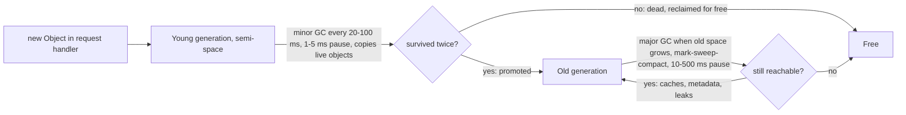

## 3.13 Garbage collection

#### Concept

**Garbage collection** (GC) is automatic reclamation of memory that a program can no longer reach. You allocate objects freely; a collector periodically finds which objects are still reachable from the program's **roots** (the call stack, global variables, closures currently in scope, native handles such as open sockets and timers) and frees everything else.

Three ideas carry most of the weight:

- **Reachability, not "unused"**: an object is garbage only when nothing can reach it. An object you never read again but that sits in a `Map` is *reachable*, and therefore not garbage. That single sentence explains most memory leaks in Node (see 3.25).
- **Generational collection**: empirically, most objects die young (a request's DTO, a query result, a JSON string), and objects that survive a while tend to survive a long time (entity metadata, caches, connection objects). So the heap is split into a small **young generation** collected very often and cheaply, and a large **old generation** collected rarely and expensively.
- **Stop-the-world pauses**: while the collector moves or marks objects, JavaScript cannot run. A pause on the main thread stops *every* request in flight in that process, which is why GC shows up in your latency percentiles rather than in your CPU graph.

#### Why does it exist?

Manual memory management (`malloc`/`free`) produces the two worst bug classes in systems programming: use-after-free (reading memory that has been recycled, a security hole) and leaks from forgotten frees. GC trades a little CPU and some unpredictable pauses for the guarantee that memory safety is never the application programmer's problem. For a backend team shipping features daily, that trade is almost always right. The job is to understand the pauses well enough to keep them out of the p99.

#### Mental model

Imagine a hotel. Guests check in constantly (allocations). Housekeeping cannot clean a corridor while guests walk through it, so the corridor is closed for a few seconds (stop-the-world). The ground-floor rooms turn over every night (young generation): cleaning them is fast because most are empty by morning, and the staff simply carry the few remaining guests' bags to a long-stay floor (promotion). The long-stay floors (old generation) are cleaned once a week; that takes hours because every room must be checked (marking) and furniture rearranged to close gaps (compaction). A hotel that keeps every guest's luggage forever in the lobby (a cache with no eviction) makes every weekly clean longer, until the corridors are closed more than they are open.

#### How it works

1. **Allocation** in the young generation is a pointer bump: "the next free byte is here; you get 64 bytes; the pointer is now 64 bytes further." Nanoseconds.
2. When the young generation fills, a **minor GC** (a scavenge, in V8's vocabulary) runs: it walks from the roots (and from a small record of old-to-young pointers called the remembered set) and *copies* the live young objects to a fresh area. Everything not copied is garbage by construction. Cost is proportional to *live* objects, not to garbage, so a young generation full of dead request objects is collected in 1–5 ms.
3. Objects that survive two minor collections are **promoted** to the old generation.
4. When the old generation grows past a threshold, a **major GC** runs: **mark** (walk every reachable object from the roots and flag it), **sweep** (put unmarked space on free lists), and sometimes **compact** (move objects together so free space is contiguous). Cost is proportional to the *size of the old generation*, which is why big caches make every major GC slower.
5. Modern collectors reduce the pause: marking is done **incrementally** (in small steps between your callbacks) and **concurrently** (on helper threads while JavaScript runs). The remaining stop-the-world part in V8 is typically tens of milliseconds on a 500 MB old generation, but hundreds of milliseconds to seconds on multi-gigabyte heaps or under CPU throttling.
6. **Write barriers** keep the incremental/concurrent marking correct: every time JavaScript writes a pointer into an object, a tiny check records it so the collector does not miss an object that became reachable mid-mark. That is part of the "GC tax" on every property write.



**Why long GC pauses appear as p99 latency, in numbers.** A service handles 800 requests per second with a median of 12 ms. Once every 30 seconds a major GC pauses the main thread for 150 ms. During those 150 ms about 120 requests are either in flight or arriving; every one of them gains up to 150 ms. That is 120 out of 24,000 requests per 30 seconds, exactly 0.5%, so the p99 is untouched but the p99.5 and p99.9 jump to ~160 ms. Halve the interval (a bigger allocation rate, or a heap twice as full) and the p99 itself moves. GC never appears in the *average*; it lives entirely in the tail.

#### Practical example

An order service's allocation profile per request: the parsed body (~2 KB), DTO instances (~1 KB), a TypeORM query result hydrated into entities (~1 KB per row, 20 rows), the response object and its JSON string (~30 KB). Roughly 60 KB of garbage per request; at 800 requests per second that is ~48 MB per second, so a 16 MB young generation fills three times per second and scavenges run every ~330 ms, each taking 1–3 ms. That is healthy. The service also holds a 300 MB in-memory product cache in the old generation. Every major GC must mark all 300 MB of it, so major pauses are 80–120 ms instead of the 15 ms they would be with the cache in Redis. The cache is "free" in CPU terms until you look at the tail.

#### NestJS example

Measure GC pauses in production rather than guessing. Node's `perf_hooks` emits an entry for every collection; `prom-client`'s default metrics already export `nodejs_gc_duration_seconds` by kind, but a small observer lets you log the outliers with context.

```ts
// runtime/gc-monitor.service.ts
import { Injectable, Logger, OnModuleDestroy, OnModuleInit } from '@nestjs/common';
import { PerformanceObserver, constants } from 'node:perf_hooks';

const KIND: Record<number, string> = {
  [constants.NODE_PERFORMANCE_GC_MINOR]: 'minor',            // scavenge
  [constants.NODE_PERFORMANCE_GC_MAJOR]: 'major',            // mark-sweep-compact
  [constants.NODE_PERFORMANCE_GC_INCREMENTAL]: 'incremental', // marking steps
  [constants.NODE_PERFORMANCE_GC_WEAKCB]: 'weakcb',
};

@Injectable()
export class GcMonitorService implements OnModuleInit, OnModuleDestroy {
  private readonly logger = new Logger(GcMonitorService.name);
  private observer?: PerformanceObserver;

  onModuleInit() {
    this.observer = new PerformanceObserver((list) => {
      for (const entry of list.getEntries()) {
        const kind = KIND[(entry.detail as { kind: number } | undefined)?.kind ?? 0] ?? 'unknown';
        if (entry.duration > 50) {                                // log only pauses that matter to latency
          const { heapUsed, heapTotal } = process.memoryUsage();
          this.logger.warn(
            `GC ${kind} paused ${entry.duration.toFixed(1)} ms; heapUsed=${(heapUsed / 1048576).toFixed(0)}MB heapTotal=${(heapTotal / 1048576).toFixed(0)}MB`,
          );
        }
      }
    });
    this.observer.observe({ entryTypes: ['gc'] });
  }

  onModuleDestroy() {
    this.observer?.disconnect();
  }
}
```

Correlate the warnings with your latency histogram: if every p99.9 spike lines up with a `major` line, you have your answer before opening a profiler.

#### PostgreSQL example

PostgreSQL has a garbage collector too, and it has the same failure modes. Under MVCC, an `UPDATE` does not overwrite a row; it writes a new version and leaves the old one as a **dead tuple**. `VACUUM` is the collector that reclaims dead tuples, and **autovacuum** is the generational heuristic: it triggers per table when dead tuples exceed `autovacuum_vacuum_threshold + autovacuum_vacuum_scale_factor × rows` (50 + 20% by default). A table with 10 million rows can accumulate 2 million dead tuples before autovacuum runs, and those dead tuples make every index scan read pages full of garbage: **bloat**.

```sql
-- the PostgreSQL equivalent of watching heapUsed grow
SELECT relname, n_live_tup, n_dead_tup,
       round(100.0 * n_dead_tup / greatest(n_live_tup + n_dead_tup, 1), 1) AS dead_pct,
       last_autovacuum, last_autoanalyze
FROM pg_stat_user_tables
ORDER BY n_dead_tup DESC
LIMIT 5;
--  relname        | n_live_tup | n_dead_tup | dead_pct | last_autovacuum
--  order_events   |  48210033  |   9120455  |     15.9 | 2026-09-06 02:11:07
--  inventory_items|    812000  |    640120  |     44.1 | 2026-09-05 23:40:12   <- hot rows, updated constantly

-- more aggressive collection for a hot table, the equivalent of a smaller young generation
ALTER TABLE inventory_items SET (autovacuum_vacuum_scale_factor = 0.02, autovacuum_vacuum_cost_delay = 2);

-- what blocks the collector: long transactions hold a snapshot, so dead tuples cannot be removed
SELECT pid, now() - xact_start AS age, state, left(query, 50)
FROM pg_stat_activity WHERE xact_start IS NOT NULL ORDER BY age DESC LIMIT 3;
```

The parallel is exact: a leaked reference in Node (a `Map` entry) and a long-open transaction in PostgreSQL (an idle-in-transaction session) both keep the collector from reclaiming what is otherwise dead. And PostgreSQL's ultimate stop-the-world is transaction ID wraparound protection: if autovacuum cannot keep up, the database eventually refuses writes until a `VACUUM` completes.

#### Production scenario

A catalog API runs 12 pods, each with a 1 GiB limit and `--max-old-space-size=768`. Steady state: heapUsed oscillates between 220 and 380 MB; scavenges every 200 ms at 1–2 ms; major GCs every 45 seconds at 25–40 ms. The p99 is 35 ms and the p99.9 is 70 ms; the second number is the GC. A feature adds a 400 MB in-process cache. Major GC pauses rise to 140–180 ms and, because the old generation is now near the limit, they run every 8 seconds instead of every 45. The p99 becomes 160 ms with no change to any query. Moving the cache to Redis (0.3 ms per lookup) restores the p99 to 36 ms; the "free" cache had cost 125 ms of tail latency.

#### Failure scenario

At 02:14 the on-call was paged for p99 latency on the notifications API, which had been climbing for six hours. CPU was at 90% but throughput was flat. `--trace-gc` on one pod (attached via `kill -USR1` and the inspector) showed a major GC every 1.5 seconds, each pausing 400–600 ms, each recovering almost nothing: heap 740 MB before, 735 MB after. The old generation was full of live objects, so V8 was collecting frantically and finding no garbage: the death spiral just before `heap out of memory`. The cause was a `Map<string, Promise<Notification>>` used as a "recent notifications" cache with no eviction; six hours of traffic had put 3.2 million entries in it. The full story is in 3.30. The tell-tale signature is worth memorising: **frequent major GCs that reclaim little** means the heap is full of reachable objects, which means a leak, not a tuning problem.

#### Edge cases & failure modes

- GC pause duration scales with *live* old-generation size; a 2 GB heap of legitimate cache means 500 ms+ pauses whatever you tune. Big state belongs outside the process.
- CPU throttling in Kubernetes stretches pauses: a 30 ms concurrent mark that needs three threads can be frozen by the CFS quota into a 100 ms stall (see 3.2).
- Promotion of short-lived objects: if the young generation is too small for your allocation rate, objects that would have died young get promoted, and the old generation fills with garbage that only a major GC can reclaim. `--max-semi-space-size` is the knob (see 3.26).
- Large objects (over ~128 KB) skip the young generation entirely; an endpoint that builds many big arrays pressures the major collector directly.
- Finalizers and `WeakRef` cleanup run at unpredictable times; never depend on them for resource release (sockets, file handles).
- A `global.gc()` call in production code (with `--expose-gc`) is a stop-the-world *full* collection; it is a debugging tool, not a fix.
- Heap snapshots themselves pause the process for seconds on large heaps; take them on one pod pulled from the load balancer.

#### How a Senior Backend Engineer thinks about this

They treat the heap as a working set, not a storage tier: what lives in the old generation should be small, stable, and worth marking on every major GC. Caches with growth potential go to Redis; big result sets are streamed; per-request data is allowed to die young. They watch three signals: major GC frequency, major GC pause duration, and heap reclaimed per major GC. A change in the first two is a capacity or allocation issue; a fall in the third is a leak. They explain GC to a product manager as housekeeping: "The corridors close for a moment while the rooms are cleaned; the more luggage we keep in the lobby, the longer the corridors stay closed, so we keep the lobby empty."

#### Common mistakes

- Blaming the database for p99 spikes that align perfectly with major GC events.
- Adding an unbounded in-memory cache "because memory is cheap", then paying for it in latency.
- Raising `--max-old-space-size` to "fix" a leak, which only makes the eventual pauses longer.
- Alerting on average latency, where GC is invisible.
- Ignoring `n_dead_tup` in PostgreSQL and then discovering a 10x bloated table during an incident.

#### Interview questions

1. *Why is GC visible in p99 but not in average latency?* Expected: pauses are rare and short relative to the interval, so they affect a small fraction of requests severely; the mean barely moves while the tail jumps. Follow-up: show the arithmetic for 800 rps and a 150 ms pause every 30 s.
2. *Explain the generational hypothesis and what it buys.* Expected: most objects die young; a small young generation collected by copying live objects is cheap because cost is proportional to survivors, not garbage.
3. *What is the signature of a memory leak in GC logs?* Expected: increasingly frequent major GCs that reclaim little; heap-after-GC trends upward.
4. *How does a long-running transaction in PostgreSQL resemble a leaked reference in Node?* Expected: both prevent the collector from reclaiming dead data (dead tuples versus unreachable-but-referenced objects).
5. *Your major GC pauses are 300 ms. Name three possible causes and the fix for each.* Expected: large live heap (move state out of process), CPU throttling (raise limit), promotion of short-lived objects (larger semi-space).

#### Practical exercise

Run a NestJS endpoint under `autocannon` at 500 requests per second with `--trace-gc` enabled, and record the interval and pause of major collections. Then add a `Map` that stores each request's body forever, run for five minutes, and watch the trace change. Finally add the `GcMonitorService` and correlate its warnings with `autocannon`'s p99.9.

Acceptance criteria: you can read a `--trace-gc` line and state heap before, heap after, and pause; you can show the "frequent major GC, little reclaimed" pattern from your own leak; and you can point to the exact latency percentile at which the GC first becomes visible.
