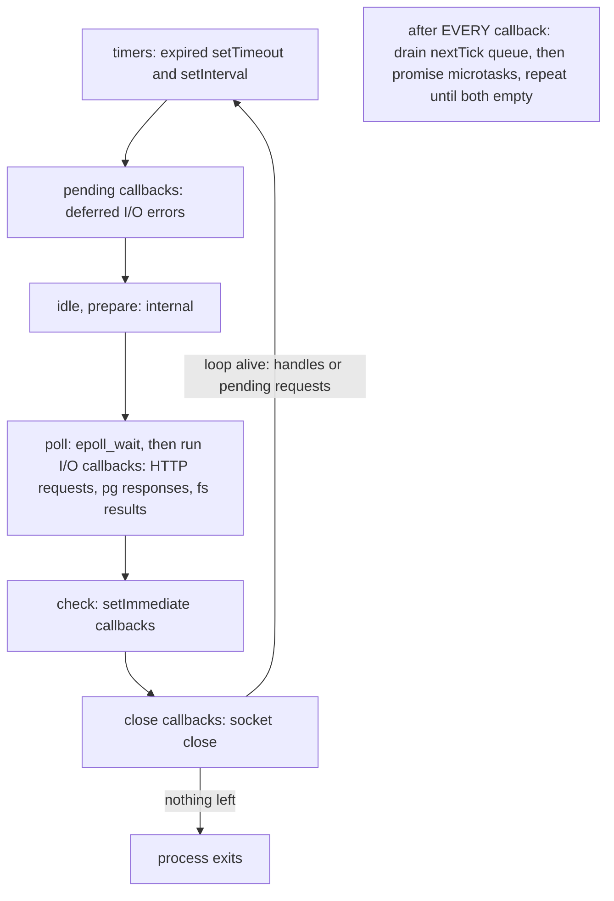

## 3.16 The event loop

#### Concept

The **event loop** is the program that runs your program. It is a loop inside libuv, on the main thread, that repeatedly asks the kernel "what is ready?" and runs the JavaScript callbacks for whatever is: an incoming HTTP request, a PostgreSQL response, a timer that has expired, a file read that finished. Your NestJS controllers, services, guards and interceptors all run *inside* callbacks invoked by this loop. When no callback is running, the loop is blocked in the kernel waiting for events, costing nothing.

Each turn of the loop visits a fixed sequence of **phases**, each with its own queue of callbacks:

1. **timers**: callbacks of `setTimeout` and `setInterval` whose time has come.
2. **pending callbacks**: I/O callbacks deferred from the previous turn (for example certain TCP error reports).
3. **idle, prepare**: internal bookkeeping.
4. **poll**: wait for I/O events and run their callbacks: socket data, connection accepted, file read completed, DNS lookup returned. This is where the loop sleeps when there is nothing to do, and where almost all of a web server's work happens.
5. **check**: `setImmediate` callbacks.
6. **close callbacks**: `socket.on('close')` and similar.

And one rule that matters more than the phases: **after every single callback**, Node drains the `process.nextTick` queue completely, then the promise **microtask** queue completely, before running the next callback. `await` continuations, `.then` handlers and `queueMicrotask` all run there.

#### Why does it exist?

A thread-per-request server spends its life switching threads (3.2). The event loop replaces that with one thread and a list of things to do, fed by the kernel's readiness notification. The result is that a single process serves thousands of concurrent connections with no locks and no context switches between requests. The price is a hard rule: **no callback may run for long**, because while one runs, every other request in the process waits.

#### Mental model

Imagine an air-traffic controller with one radio. She works from a rotating clipboard of lists: scheduled departures (timers), planes reporting in (poll), things to do right after the current call (nextTick and promises), and things to do after the current sweep of the lists (setImmediate). She handles each radio call quickly and moves on. If one pilot keeps her on the radio for five minutes (a synchronous 5-second computation), every other plane circles. Nothing about the clipboard is slow; it only breaks when one call is long.

#### How it works



1. libuv updates its notion of "now" once per turn (so all timers in one turn agree on the time).
2. **timers**: for each timer whose deadline is at or before now, run its callback (then drain microtasks). `setTimeout(fn, 0)` is really 1 ms; timers are a *lower bound*, never a schedule.
3. **poll**: libuv computes how long it may block: zero if `setImmediate` callbacks are queued or handles are closing; otherwise the time until the nearest timer; or forever if there are no timers. It calls `epoll_wait` with that timeout. When it returns, each ready descriptor's callback runs (then microtasks). An HTTP request arrives here; a `pg` response is parsed here.
4. **check**: all `setImmediate` callbacks queued so far run (then microtasks after each).
5. **close callbacks**, then the loop asks "am I alive?": are there active handles (a listening server, open sockets, referenced timers) or pending requests (an in-flight file read)? If not, the process exits. A `setInterval` for metrics keeps a process alive forever unless you `unref()` it.

The ordering rules, with exact output. Inside an I/O callback the order is fully deterministic:

```ts
// ordering.ts - run with: node ordering.js
import { readFile } from 'node:fs';

readFile(__filename, () => {
  console.log('A: inside readFile callback (poll phase)');
  setTimeout(() => console.log('F: setTimeout 0 (timers phase, next turn)'), 0);
  setImmediate(() => {
    console.log('D: setImmediate (check phase, this turn)');
    process.nextTick(() => console.log('E: nextTick queued inside setImmediate'));
  });
  process.nextTick(() => console.log('B: nextTick (drained right after this callback)'));
  Promise.resolve().then(() => console.log('C: promise then (after the nextTick queue)'));
  console.log('A2: end of the callback');
});
```

```text
A: inside readFile callback (poll phase)
A2: end of the callback
B: nextTick (drained right after this callback)
C: promise then (after the nextTick queue)
D: setImmediate (check phase, this turn)
E: nextTick queued inside setImmediate
F: setTimeout 0 (timers phase, next turn)
```

Why: the callback runs to completion (A, A2). Node drains nextTicks (B) then promises (C). The poll phase is over and immediates are pending, so the loop goes to check (D), and after that callback drains its nextTick (E). The next turn begins with timers (F). This is the rule to remember: **from inside an I/O callback, `setImmediate` always runs before `setTimeout(0)`**.

From the *main module*, the same two lines are non-deterministic:

```ts
setTimeout(() => console.log('timeout'), 0);
setImmediate(() => console.log('immediate'));
// Sometimes "timeout, immediate", sometimes "immediate, timeout":
// if the loop starts less than 1 ms after these lines ran, the timer is not yet due when the timers
// phase runs, so the poll phase is entered, then check (immediate), then timers on the next turn.
```

And the microtask drain happens between *every* callback, not between phases (Node 11 and later):

```ts
setTimeout(() => { console.log('T1'); Promise.resolve().then(() => console.log('T1 micro')); }, 0);
setTimeout(() => { console.log('T2'); Promise.resolve().then(() => console.log('T2 micro')); }, 0);
// T1, T1 micro, T2, T2 micro
```

One more rule that surprises people: **awaiting an already-resolved promise does not yield to I/O.** It only yields to other microtasks.

```ts
for (let i = 0; i < 1_000_000; i++) {
  await Promise.resolve();      // one microtask hop per iteration; the poll phase never runs during this loop
}
// HTTP requests, pg responses and timers all wait until the loop finishes.
// To yield to I/O, await a macrotask:
import { setImmediate as yieldToLoop } from 'node:timers/promises';
await yieldToLoop();
```

#### Practical example

A request's life across the phases: the connection is accepted in poll; the request bytes are parsed in poll; your controller runs inside that poll callback; `await repository.find()` sends the query and returns to the loop; the loop serves other requests; the response bytes arrive in a later poll phase; the `pg` driver resolves the promise; your continuation runs in the microtask drain right after that poll callback; the response is written; `socket.on('close')` fires in close callbacks when the client disconnects. A `setTimeout` for a retry runs in timers; a chunked batch job that `await setImmediate()`s between chunks runs one chunk per turn in check, with every other phase served in between.

Which primitive to use:

| Need | Use | Runs |
|---|---|---|
| Run after the current operation, before any I/O (emit an event after the constructor returns) | `process.nextTick` | before promises, before the loop continues |
| Same, but respect promise ordering, or you are in a library that must be platform-neutral | `queueMicrotask` / `Promise.resolve().then` | after nextTicks, before the loop continues |
| Yield to I/O between chunks of CPU work | `await setImmediate()` from `timers/promises` | check phase, after poll |
| Delay by at least N ms (retry backoff, debounce) | `setTimeout` | timers phase, N ms is a lower bound |
| Recurring background work | `setInterval` with `.unref()` if it must not keep the process alive | timers phase |

#### NestJS example

Cooperative chunking: a reindex job that would otherwise hold the loop for 2 seconds, rewritten to run in 5 ms slices so that HTTP requests are served between slices.

```ts
// search/reindex.service.ts
import { Injectable, Logger } from '@nestjs/common';
import { setImmediate as yieldToLoop } from 'node:timers/promises';
import { performance } from 'node:perf_hooks';

@Injectable()
export class ReindexService {
  private readonly logger = new Logger(ReindexService.name);

  async reindex(products: Array<{ id: number; name: string; tags: string[] }>) {
    const CHUNK = 200;                                 // ~5 ms of CPU per chunk on this workload
    const started = performance.now();
    let cpuMs = 0;

    for (let i = 0; i < products.length; i += CHUNK) {
      const t0 = performance.now();
      this.indexChunk(products.slice(i, i + CHUNK));   // synchronous CPU work
      cpuMs += performance.now() - t0;
      await yieldToLoop();                             // check phase: every pending I/O callback runs before we continue
    }

    this.logger.log(
      `reindexed ${products.length} products: ${cpuMs.toFixed(0)} ms CPU over ${(performance.now() - started).toFixed(0)} ms wall`,
    );
  }

  private indexChunk(chunk: Array<{ id: number; name: string; tags: string[] }>) {
    for (const p of chunk) this.tokenise(p.name, p.tags);
  }

  private tokenise(name: string, tags: string[]) { /* build inverted index entries */ }
}
```

Total CPU is unchanged; the *maximum* delay any other request sees drops from 2,000 ms to about 5 ms. For work beyond a few hundred milliseconds total, or work that must not compete with requests at all, use a worker thread (3.20).

#### PostgreSQL example

Timeouts live in two places, and the event loop decides which one you can trust. `pg`'s `query_timeout` is a JavaScript timer: it can only fire when the loop reaches the timers phase. PostgreSQL's `statement_timeout` runs in the backend process and does not care whether your loop is blocked.

```ts
// database.module.ts (TypeORM extra options are passed to pg)
extra: {
  statement_timeout: 10_000,   // server-side: the backend cancels the query at 10 s, always
  query_timeout: 12_000,       // client-side: a JS timer; fires late if the loop is busy, never early
  idle_in_transaction_session_timeout: 30_000,
},
```

If the loop is blocked for 4 seconds by a big `JSON.parse`, a query that started just before will show as 14 seconds of "database latency" from the application's point of view, while `pg_stat_statements` shows 2 ms. Measuring latency in JavaScript measures the event loop as much as the database.

#### TypeORM example

TypeORM's `maxQueryExecutionTime` logs queries whose wall time, measured in JavaScript, exceeds a threshold. That wall time includes loop delays, pool waits and GC pauses.

```ts
TypeOrmModule.forRoot({ /* ... */ maxQueryExecutionTime: 1000, logging: ['warn'] });
// "query is slow: SELECT ... execution time: 1432" may mean the loop was busy, not the query.
// Cross-check with pg_stat_statements.mean_exec_time before blaming the database.
```

#### Sequelize example

Sequelize's `benchmark: true` passes the same JavaScript-measured duration to the `logging` function; the same caveat applies.

```ts
SequelizeModule.forRoot({ /* ... */ benchmark: true, logging: (sql, ms) => { if (ms && ms > 1000) logger.warn(`${ms} ms: ${sql}`); } });
```

#### Production scenario

A rides API runs one process per pod. Its event loop utilisation (`performance.eventLoopUtilization()`), which is the fraction of time the loop spends running callbacks rather than waiting, sits at 0.35 at 600 requests per second. At 1,400 requests per second it reaches 0.8, and p99 climbs from 30 ms to 140 ms with the database untouched: requests are queueing *for the loop*. The autoscaler was keyed to CPU, which read 55% because the libuv and GC threads made the process look less busy than its loop was. Switching the scaling signal to loop utilisation (target 0.6) fixed the p99 and, as a bonus, cut the pod count at night.

```ts
// runtime/loop-utilization.service.ts
import { Injectable } from '@nestjs/common';
import { Interval } from '@nestjs/schedule';
import { performance, EventLoopUtilization } from 'node:perf_hooks';
import { Gauge } from 'prom-client';

@Injectable()
export class LoopUtilizationService {
  private last: EventLoopUtilization = performance.eventLoopUtilization();
  private readonly gauge = new Gauge({ name: 'nodejs_eventloop_utilization', help: '0..1 busy fraction' });

  @Interval(5_000)
  sample() {
    const now = performance.eventLoopUtilization();
    this.gauge.set(performance.eventLoopUtilization(now, this.last).utilization);   // delta over the last 5 s
    this.last = now;
  }
}
```

#### Failure scenario

At 02:14 the on-call was paged: one pod of the payments API was failing its liveness probe every 40 seconds and restarting, over and over. CPU on the pod was 100% on one core. A metrics client library had been configured to "retry immediately" on send failure, implemented as `process.nextTick(() => this.flush())`. The metrics sink was down. Every flush failed and queued another nextTick, and because the nextTick queue is drained *completely* before the loop continues, the loop never reached the poll phase again: no HTTP, no health check, no database responses, forever. Kubernetes killed the pod, the new pod connected to the same dead sink, and the cycle repeated. The fix was a `setTimeout` backoff (a timer yields to every phase) and a bounded retry count. Recursive `nextTick` is the one way to hang an idle Node process with zero I/O.

#### Edge cases & failure modes

- `setTimeout(fn, 0)` is clamped to 1 ms; timers with the same deadline run in insertion order; a timer can fire late by however long the loop was busy, never early.
- `setInterval` drifts: if a callback takes longer than the interval, invocations are not queued up, but the schedule slides. For precise schedules use `@nestjs/schedule` cron with idempotent jobs, not accumulated intervals.
- Unhandled promise rejections are processed at the end of the microtask drain; since Node 15 the default is to throw, which crashes the process. Every fire-and-forget promise needs a `.catch`.
- A long synchronous callback delays *every* phase, including timers that were due, `statement_timeout`-style client timers, health checks, and graceful-shutdown signal handlers (signals are delivered to the loop as events).
- `unref()`'d timers do not keep the process alive; a cron-only worker with nothing else referenced exits immediately.
- Callbacks scheduled from a worker thread run on the *worker's* loop; each worker has its own event loop.
- `await` in a `for` loop over an array of already-resolved values is a microtask storm that starves I/O; batch and yield.

#### How a Senior Backend Engineer thinks about this

They see the loop as the one shared resource in the process and budget it like money: no callback over a few milliseconds, CPU work chunked or moved to workers, timers treated as lower bounds, and loop utilisation and lag on the dashboard next to latency. They scale on loop utilisation, not on CPU percent. They know the ordering rules cold, because they explain "the timeout fired late", "the health check failed while the pod was fine" and "the event was emitted before anyone listened". To a product manager: "One controller handles every plane; we keep every radio call under a few milliseconds so nobody circles."

#### Common mistakes

- Blocking the loop with synchronous work and then blaming the database for the resulting timeouts.
- Using `setTimeout` as a scheduling guarantee.
- Recursive `process.nextTick` or a tight `await Promise.resolve()` loop.
- Scaling on CPU percent when the loop is the bottleneck.
- Forgetting `.catch` on background promises and discovering the process exits on the first rejection.

#### Interview questions

1. *List the phases of the event loop and say where an HTTP request is handled.* Expected: timers, pending, idle/prepare, poll, check, close; requests and most I/O in poll; microtasks drained after every callback.
2. *Inside an I/O callback, in what order do `setTimeout(0)`, `setImmediate`, `process.nextTick` and `Promise.then` run?* Expected: nextTick, promise, setImmediate, setTimeout; explain why each. Follow-up: and from the main module? (setTimeout versus setImmediate is non-deterministic.)
3. *Why does `await Promise.resolve()` in a loop not let HTTP requests through?* Expected: microtasks drain fully before the loop advances; only a macrotask (`setImmediate`) yields to the poll phase.
4. *A `setTimeout(fn, 5000)` fires after 9 seconds. Name the causes.* Expected: loop blocked by synchronous work, CPU throttling, GC pauses, a microtask or nextTick flood.
5. *How would you decide whether a service needs more pods?* Expected: event loop utilisation or lag, not CPU percent, because helper threads inflate CPU while the loop is the bottleneck.
6. *What keeps a Node process alive, and how do you let it exit?* Expected: active handles and requests; `unref()` timers and close servers and sockets.

#### Practical exercise

Reproduce the three ordering examples and confirm the output. Then write a request handler that runs 500 ms of synchronous CPU, load it at 20 requests per second, and measure the latency of a separate trivial endpoint on the same process. Rewrite with `await setImmediate()` chunking and measure again. Finally implement the nextTick starvation and watch the health check fail.

Acceptance criteria: exact printed output for each example with a one-line explanation per line; a before/after latency table for the trivial endpoint showing the chunking effect; and a demonstration that `setTimeout` backoff instead of `nextTick` lets the health check respond.

## 3.17 Microtasks and macrotasks

#### Concept

A **macrotask** (or just "task") is one callback from one of the loop's phases: a timer firing, an I/O completion, a `setImmediate`, a close event. A **microtask** is a piece of work that must run *before the loop moves on to the next macrotask*: a promise reaction (`.then`, `.catch`, `.finally`, the continuation after an `await`), a `queueMicrotask` callback, and, in Node, a `process.nextTick` callback.

Node keeps two microtask queues and drains them in a fixed order after every macrotask: first the whole `nextTick` queue, then the whole promise queue, and it repeats until both are empty. Microtasks queued by microtasks run in the same drain. The loop does not advance until the drain is finished, which is why microtasks are both a precise ordering tool and a starvation hazard.

#### Why does it exist?

Promises need "run this as soon as the current operation finishes, before anything else happens" so that async code has predictable ordering: a `.then` on a resolved promise always runs asynchronously (never inline), but always before the next I/O event. `process.nextTick` predates promises and exists for the same reason in Node's own APIs: to let an object finish constructing before it emits events, so that listeners attached right after `new` are not missed.

#### Mental model

Imagine finishing a phone call at a help desk. Before you pick up the next call from the queue (macrotask), you deal with the sticky notes you wrote during the call (microtasks): "email the customer the link", "update the ticket". If a sticky note says "write another sticky note", you do that too before picking up the phone. The queue of callers does not move until the notes are done. Write yourself an infinite chain of notes and nobody ever gets through.

#### How it works

1. A macrotask callback runs to completion.
2. Node runs `processTicksAndRejections`: pop and run every `nextTick` callback (including ones added meanwhile).
3. Ask V8 to run all promise jobs (including ones added meanwhile).
4. If steps 2 or 3 added new nextTicks, go back to step 2. Repeat until both queues are empty.
5. Process unhandled promise rejections that were detected during the drain: by default since Node 15, an unhandled rejection is thrown as an uncaught exception, which terminates the process unless a `process.on('unhandledRejection')` handler exists.
6. Only now does the loop pick the next macrotask.

A worked example with exact output:

```ts
process.nextTick(() => console.log('tick 1'));
Promise.resolve().then(() => {
  console.log('promise 1');
  process.nextTick(() => console.log('tick inside promise'));   // goes to the nextTick queue
});
process.nextTick(() => console.log('tick 2'));
Promise.resolve().then(() => console.log('promise 2'));
console.log('sync');
```

```text
sync
tick 1
tick 2
promise 1
promise 2
tick inside promise
```

`sync` runs first. Then the nextTick queue drains (`tick 1`, `tick 2`). Then the promise queue drains (`promise 1`, which queues a new nextTick, then `promise 2`, which was already queued). The nextTick queue is now non-empty, so it drains again (`tick inside promise`). Only then would the loop proceed to the next macrotask.

How `await` fits: `await x` on a native promise costs one microtask hop before the continuation runs; the continuation runs in the drain, on an empty stack, before any I/O callback. An `async` function with three sequential `await`s on already-resolved values completes within one drain and never touches the loop's phases.

#### Practical example

The three places microtask ordering matters in application code:

- **Emit after construction**: an `EventEmitter` subclass that emits `'ready'` in its constructor emits before the caller has attached a listener; `process.nextTick(() => this.emit('ready'))` defers just enough.
- **Batching within a tick**: a data loader that collects every `load(id)` call made during one macrotask and issues one `WHERE id IN (...)` query. It schedules the flush with `process.nextTick` (or a microtask), so calls made synchronously and in the same promise chain coalesce. This is the mechanism behind `dataloader` and the N+1 fix in GraphQL resolvers.
- **Fire-and-forget safety**: `this.audit.record(event)` without `await` or `.catch` is a background promise; a rejection there terminates the process at the end of some unrelated request's microtask drain.

#### NestJS example

An ID batcher for resolvers and services, coalescing all lookups requested in the same tick into one query:

```ts
// customers/customer-batch-loader.ts
import { Injectable, Scope } from '@nestjs/common';
import { InjectRepository } from '@nestjs/typeorm';
import { In, Repository } from 'typeorm';
import { Customer } from './customer.entity';

@Injectable({ scope: Scope.REQUEST })                 // one batcher per request: no cross-request data leaks
export class CustomerBatchLoader {
  private pending = new Map<number, { resolve: (c: Customer | null) => void; reject: (e: unknown) => void }[]>();
  private scheduled = false;

  constructor(@InjectRepository(Customer) private readonly customers: Repository<Customer>) {}

  load(id: number): Promise<Customer | null> {
    return new Promise((resolve, reject) => {
      const waiters = this.pending.get(id) ?? [];
      waiters.push({ resolve, reject });
      this.pending.set(id, waiters);
      if (!this.scheduled) {
        this.scheduled = true;
        process.nextTick(() => this.flush());        // runs after the current sync code and all loads queued with it
      }
    });
  }

  private async flush() {
    const batch = this.pending;
    this.pending = new Map();
    this.scheduled = false;
    try {
      const rows = await this.customers.findBy({ id: In([...batch.keys()]) });   // one query for N ids
      const byId = new Map(rows.map((r) => [r.id, r]));
      for (const [id, waiters] of batch) for (const w of waiters) w.resolve(byId.get(id) ?? null);
    } catch (err) {
      for (const waiters of batch.values()) for (const w of waiters) w.reject(err);
    }
  }
}
```

Fifty `loader.load(id)` calls made while mapping fifty order lines become one `SELECT ... WHERE id IN (...)`. Note the request scope: a singleton batcher would merge lookups from different users' requests, which is a correctness and privacy bug.

And the safety net for fire-and-forget work, registered once in `main.ts`:

```ts
process.on('unhandledRejection', (reason) => {
  // Log with full context, then exit: the process state is unknown after an unhandled rejection
  logger.error({ err: reason }, 'unhandled promise rejection');
  process.exitCode = 1;
  setTimeout(() => process.exit(1), 1_000).unref();   // give the logger a moment to flush
});
```

The right long-term fix is never to have background promises without `.catch`, but this handler turns a silent crash into a logged one.

#### Production scenario

A GraphQL gateway resolving `orders { customer { name } }` for 100 orders issued 100 customer queries per request: 100 × 2 ms = 200 ms of database time and 100 pool acquisitions. With the tick-batched loader it issues one query in 4 ms. The mechanism is nothing but the microtask drain: every resolver's `load()` runs in the same drain, the flush is queued once, and it runs after all of them. Same code shape scales to any "N small lookups triggered by one event" pattern: notification fan-out, permission checks, price lookups.

#### Failure scenario

At 11:30 a queue consumer stopped consuming but showed 100% CPU. It polled a local in-memory buffer with `async function pump() { const item = await buffer.take(); handle(item); pump(); }`. `buffer.take()` returned an already-resolved promise when the buffer was empty (a bug: it resolved `undefined` instead of waiting). The result was an infinite chain of microtasks: `await` (one hop), `pump()` again, `await`, forever, with the loop never reaching the poll phase to receive new messages from the broker or answer the health check. The process looked busy and alive, and it was doing nothing. Fix: make `take()` return a promise that resolves only when an item exists, and put an `await setImmediate()` in the loop as a guard so that even a bug like this yields to I/O.

#### Edge cases & failure modes

- `nextTick` runs before promises; libraries that assume promise-ordering can be surprised by Node-specific nextTick users. Prefer `queueMicrotask` in shared code.
- An exception thrown inside a `nextTick` callback is an uncaught exception, not a rejected promise; it takes the process down unless `process.on('uncaughtException')` handles it.
- Non-native thenables (objects with a `then` method) cost extra microtask hops when awaited; ORMs and drivers that return custom thenables can add ordering surprises.
- Long microtask chains (thousands of `.then`s created in one macrotask) are indistinguishable from a blocked loop to every other request.
- `await` inside `try/catch` catches rejections; a promise created before the `try` and awaited inside it still catches, but a promise that rejects *before* being awaited registers as unhandled briefly; Node only reports it if it is still unhandled at the end of the drain, so the common pattern is safe.
- Request-scoped providers in NestJS (as in the loader) make the whole injection subtree request-scoped, with a per-request instantiation cost; measure before using them widely.

#### How a Senior Backend Engineer thinks about this

They use microtask ordering deliberately in two idioms, batching and emit-after-construct, and avoid it everywhere else. They treat every background promise as a liability that needs a `.catch` and a metric. They assume any loop of awaits over local data will starve I/O and insert a real yield. To a product manager: "Between handling two customers, the agent clears a small pile of follow-up notes; we make sure the pile is small and never self-replenishing."

#### Common mistakes

- Fire-and-forget promises without `.catch`.
- Emitting events in constructors.
- Recursive polling with always-resolved promises.
- Using `process.nextTick` in library code intended to run in browsers or other runtimes.
- A singleton batcher that merges data across requests.

#### Interview questions

1. *In what order do `process.nextTick` and `Promise.then` callbacks run, and what happens if a promise callback queues a nextTick?* Expected: nextTick queue first, then promises, then back to nextTick; show the six-line example.
2. *What is an unhandled rejection, when is it detected, and what does Node do by default?* Expected: a rejected promise with no handler at the end of the microtask drain; since Node 15 it throws and terminates the process.
3. *How does a dataloader turn N+1 queries into one, in event-loop terms?* Expected: all loads in one macrotask register in a map; a nextTick/microtask flush runs once after them with `WHERE id IN`.
4. *Why must such a loader be request-scoped in a web server?* Expected: a singleton would batch and cache across users' requests.
5. *Describe a microtask starvation bug you could write by accident.* Expected: a recursive async pump awaiting an already-resolved promise; fix with a real yield.

#### Practical exercise

Implement `CustomerBatchLoader`, wire it into a resolver or service that looks up 100 customers, and count queries with `pg_stat_statements` before and after. Then write the always-resolved pump bug, observe the health check fail, and fix it.

Acceptance criteria: query count drops from ~100 to 1 per request; the six-line ordering example prints in the documented order; the pump bug is reproduced and fixed with a one-line `await setImmediate()` guard plus the real fix in `take()`.
