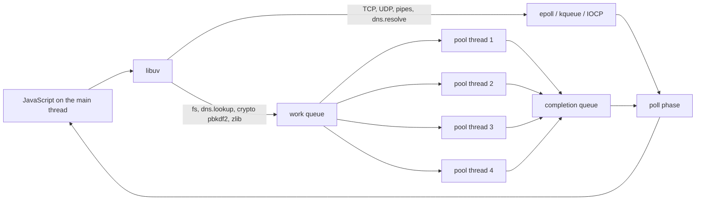
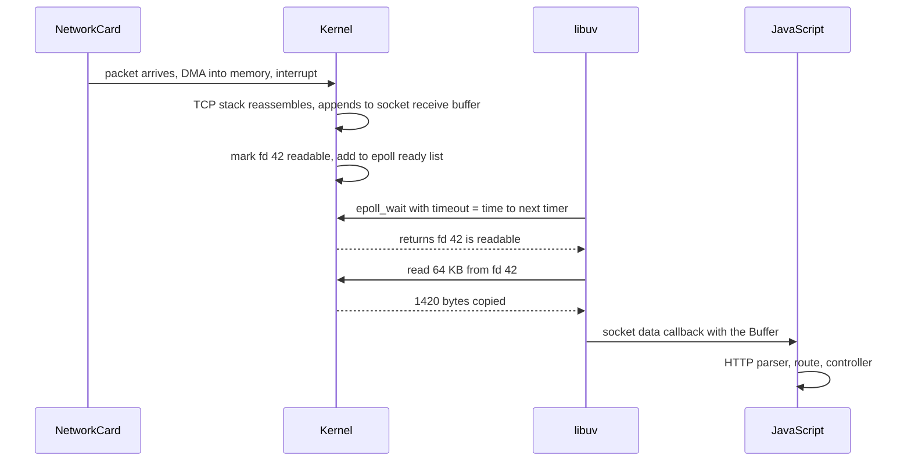

## 3.18 libuv and the thread pool

#### Concept

**libuv** is the C library that gives Node.js its asynchronous behaviour. V8 (3.14) runs JavaScript; libuv does everything else: it owns the event loop (3.16), it talks to the kernel's readiness notification mechanism (`epoll` on Linux, `kqueue` on macOS/BSD, IOCP on Windows), it manages timers, TCP and UDP sockets, pipes, signals, child processes, DNS, and it owns a small pool of real operating-system threads for the work that the kernel cannot do asynchronously.

That last part is the piece most engineers get wrong. Node is often described as "single-threaded", and the *JavaScript* is. But a Node process at rest already has more than one thread: the main thread running V8 and the loop, four libuv thread-pool threads, and several V8 helper threads for garbage collection and JIT compilation. Run `ps -T -p <pid>` on a plain `node -e "setInterval(()=>{},1000)"` and you will typically see 7 to 11 threads.

The thread pool has **four threads by default**, sized by the `UV_THREADPOOL_SIZE` environment variable, with a maximum of 1024. It exists because some kernel operations have no usable asynchronous interface. Reading a file on Linux, for example, has no good readiness model: a regular file is *always* "ready" as far as `epoll` is concerned, even when the read will block for 8 ms on a spinning disk or a slow NFS mount. So libuv hands file operations to a thread, that thread performs a blocking `pread()`, and when it finishes it pushes a completion back to the loop.

#### Why does it exist?

Without the pool, `fs.readFile` would have to block the main thread, and one slow disk read would freeze every request in the process. With the pool, the main thread stays free; the cost is that the pool is a **fixed, shared, four-slot resource** for the entire process, and anything that occupies a slot for a long time makes everything else that needs the pool queue behind it.

This is the single most under-appreciated bottleneck in production Node. It is invisible in CPU graphs, invisible in event-loop lag, and invisible in database metrics. It shows up only as latency.

#### Mental model

Imagine a restaurant with one waiter (the main thread) and four cooks in the kitchen (the pool). The waiter is fast: he takes orders, carries plates, and never stands still. Anything the customer asks for that the waiter can just hand over from the counter (a bottle of water, a bill) he does himself instantly. Anything that needs cooking goes to the kitchen, and there are only four cooks. If five customers order a dish that takes 90 seconds, the fifth waits 90 seconds before a cook is even free. The waiter is not the bottleneck; the kitchen is. And you cannot see the kitchen from the dining room.

#### How it works



1. You call `fs.readFile('/data/invoice.pdf', cb)`.
2. libuv creates a `uv_work_t` request and pushes it onto the global work queue.
3. If a pool thread is idle it picks the item up; otherwise the item waits in FIFO order.
4. The pool thread calls the blocking syscall (`open`, `pread`, `close`). This thread blocks; the main thread does not.
5. When the syscall returns, the thread writes the result into the request and signals the loop by writing a byte to an internal `uv_async` pipe. That write makes `epoll_wait` return.
6. In the **poll phase** of the next loop turn, libuv drains its completion queue and invokes your JavaScript callback on the main thread.
7. Microtasks drain, and the loop moves on.

Step 3 is the whole story. There are four slots. FIFO. Process-wide.

#### The definitive table: what uses the pool and what does not

| Operation | Where it runs | Notes |
|---|---|---|
| `fs.readFile`, `fs.writeFile`, `fs.stat`, `fs.readdir`, `fs.open`, all async `fs.*` | **libuv thread pool** | Every file operation, including the ones your logger does |
| `fs.createReadStream` / `createWriteStream` | **libuv thread pool** | Each chunk read is a pool task |
| `dns.lookup` (and therefore every `http.request` to a hostname by default) | **libuv thread pool** | Wraps the blocking `getaddrinfo(3)` |
| `crypto.pbkdf2`, `crypto.scrypt`, `crypto.randomBytes`, `crypto.randomFill`, `crypto.generateKeyPair` — **async forms only** | **libuv thread pool** | The sync forms run on the main thread and block the loop |
| `zlib.gzip`, `gunzip`, `deflate`, `brotliCompress` — async forms | **libuv thread pool** | Response compression at high RPS is a real pool consumer |
| Most native addons using `napi_create_async_work` (`bcrypt`, `argon2`, `sharp`, `libpq` async helpers) | **libuv thread pool** | This is why `bcrypt` competes with your logger |
| TCP sockets: `net`, `http`, `https`, `http2` server and client | **OS async I/O (epoll/kqueue/IOCP)** | No thread. 10,000 sockets cost 10,000 file descriptors and no threads |
| UDP: `dgram` | **OS async I/O** | |
| `dns.resolve*` (`resolve4`, `resolveMx`, ...) | **OS async I/O** | Uses c-ares, which speaks DNS over UDP/TCP sockets directly |
| Child process stdio pipes, `child_process` spawn/exec | **OS async I/O** | The *child* is a separate process with its own threads |
| Signals (`SIGTERM`) and `process.nextTick` | **main thread** | |
| TLS handshake crypto (`tls`) | **main thread** | Asymmetric crypto during handshakes is CPU on the main thread |
| Timers, `setImmediate` | **main thread** | |

Two lines deserve emphasis. **`dns.lookup` uses the pool.** If your service calls three HTTP APIs by hostname and DNS is slow, you are consuming pool slots on every request unless you keep a DNS cache or use `dns.resolve`. And **`crypto.randomBytes` async uses the pool** — generating 100 idempotency keys per second is fine; generating a 1 MB random buffer per request is not.

#### Practical example

Prove the four-slot limit in ten lines:

```ts
// pool-demo.ts - run: node pool-demo.js   then: UV_THREADPOOL_SIZE=8 node pool-demo.js
import { pbkdf2 } from 'node:crypto';
const start = Date.now();

for (let i = 0; i < 8; i++) {
  // ~200 ms of CPU each, on a pool thread
  pbkdf2('password', 'salt', 300_000, 64, 'sha512', () => {
    console.log(`task ${i} done at ${Date.now() - start} ms`);
  });
}
```

With the default pool on a 4-core machine you see roughly `200, 200, 200, 200, 400, 400, 400, 400`. Tasks 4 to 7 waited for a free thread. With `UV_THREADPOOL_SIZE=8` on a 4-core machine you see roughly `400` for all eight: the work is now competing for **cores**, not threads. That is the crucial second lesson — raising `UV_THREADPOOL_SIZE` above your CPU count does not create CPU, it only reorders the queueing.

#### NestJS example

A password service that measures its own pool wait, so the bottleneck is visible in metrics instead of being guessed at during an incident:

```ts
// auth/password.service.ts
import { Injectable, Logger } from '@nestjs/common';
import { scrypt as scryptCb, randomBytes, timingSafeEqual } from 'node:crypto';
import { promisify } from 'node:util';
import { Histogram } from 'prom-client';

const scrypt = promisify(scryptCb) as (p: string, s: Buffer, k: number) => Promise<Buffer>;

@Injectable()
export class PasswordService {
  private readonly logger = new Logger(PasswordService.name);
  private readonly hashDuration = new Histogram({
    name: 'password_hash_duration_seconds',
    help: 'Wall time of a password hash, including libuv pool queueing',
    buckets: [0.05, 0.1, 0.2, 0.4, 0.8, 1.6, 3.2],
  });

  async hash(plain: string): Promise<string> {
    const end = this.hashDuration.startTimer();
    const salt = randomBytes(16);                       // pool task, sub-millisecond
    const key = await scrypt(plain, salt, 64);          // pool task, ~120 ms of CPU
    const seconds = end();
    // Wall time far above the CPU cost means we queued behind other pool work.
    if (seconds > 0.5) this.logger.warn(`password hash took ${(seconds * 1000).toFixed(0)} ms - libuv pool contention?`);
    return `scrypt$${salt.toString('base64')}$${key.toString('base64')}`;
  }

  async verify(plain: string, stored: string): Promise<boolean> {
    const [, saltB64, keyB64] = stored.split('$');
    const key = await scrypt(plain, Buffer.from(saltB64, 'base64'), 64);
    return timingSafeEqual(key, Buffer.from(keyB64, 'base64'));   // constant time, main thread, microseconds
  }
}
```

Set the pool size once, before anything reads it, in the container spec rather than in code — libuv reads `UV_THREADPOOL_SIZE` when the pool is first used, so `process.env.UV_THREADPOOL_SIZE = '8'` at the top of `main.ts` sometimes works and sometimes does not, depending on what ran first.

```yaml
# deployment.yaml
env:
  - name: UV_THREADPOOL_SIZE
    value: "8"        # 1 vCPU pod doing bcrypt: raise cautiously and measure
```

#### PostgreSQL example

The `pg` driver is pure JavaScript over a TCP socket, so **PostgreSQL queries do not use the thread pool**. They use `epoll` like any other socket. That is why a Node process can hold a pool of 20 database connections and 5,000 HTTP connections on 1 vCPU without threads exploding.

But there are two exceptions worth knowing:

- `pg-native` (libpq bindings) *does* use the libuv pool for query execution. Using `pg-native` for "speed" on a service that also hashes passwords means your queries and your hashes fight over four threads. Almost nobody should use `pg-native` today.
- Connecting to `db.internal.example.com` triggers `dns.lookup`, which is a pool task. During a DNS outage, connection attempts pin pool threads for the resolver timeout (often 5 s), and your `fs` logging stalls with them.

```sql
-- The database side sees nothing unusual during pool starvation:
SELECT query, calls, round(mean_exec_time::numeric, 2) AS mean_ms
FROM pg_stat_statements
ORDER BY total_exec_time DESC LIMIT 5;
--  query                            | calls  | mean_ms
--  SELECT * FROM users WHERE email=$1| 412000 |    1.90
-- 1.9 ms in the database while the application reports p99 of 3,100 ms is the signature
-- of a runtime problem, not a query problem.
```

#### TypeORM example

TypeORM adds no threads of its own; it sits on `pg`. The one place it touches the pool is migrations and entity loading, which read files from disk at boot:

```ts
// data-source.ts
export const AppDataSource = new DataSource({
  type: 'postgres',
  url: process.env.DATABASE_URL,
  entities: [Order, OrderItem, Customer],     // explicit classes: no glob, no fs scan at boot
  migrations: ['dist/migrations/*.js'],       // globs here are fine, they run once
  poolSize: 20,
});
```

Prefer explicit entity classes over glob patterns (`'dist/**/*.entity.js'`). Globs make TypeORM walk the filesystem at startup, which is thousands of pool tasks and adds hundreds of milliseconds to cold start in a container with a slow overlay filesystem.

#### Production scenario

A retail checkout service runs on 6 pods, 2 vCPU each, serving 900 requests per second. Ninety percent of requests are reads that never touch the pool. The remaining ten percent generate a PDF receipt, which reads a template file (`fs`, pool), compresses the output (`zlib`, pool) and uploads it. At 90 receipts per second with roughly 25 ms of pool work each, the pool is about 56% utilised on 4 threads. Fine.

Then marketing enables gzip response compression in Node for all responses instead of at the ingress. Suddenly every one of 900 requests per second per pod needs a `zlib.gzip` pool task of about 1.5 ms. Pool demand goes from 2.25 thread-seconds per second to over 3.5. Queueing begins, the receipt path's p99 goes from 60 ms to 900 ms, and the fix is a one-line ingress change: compress at nginx/Envoy, not in Node.

#### Failure scenario

**The bcrypt incident.** At 09:05 on the morning of a campaign launch, the login endpoint's p99 went from 220 ms to 3.1 seconds. CPU was 60%. Event-loop lag was 4 ms — healthy. PostgreSQL mean execution time for the login query was 1.9 ms. Every dashboard said the system was fine, and every customer said login was broken.

The login flow called `bcrypt.hash` (the async, native-addon form, which uses the libuv pool) at cost factor 12, about 250 ms of CPU per call. Traffic had risen to 20 logins per second per pod. Twenty concurrent hashes, four pool threads: at any instant, sixteen of them were queued. Little's law gives the answer immediately — 20 arrivals per second at 0.25 s of service time needs 5 servers' worth of capacity, and there were 4. The queue grew without bound until arrivals dropped.

Worse, `fs` writes from the logger and `dns.lookup` for the payment API were queued behind the hashes, so unrelated calls slowed down too. The classic five-concurrent-hashes demonstration is exactly this: five `bcrypt.hash` calls issued at the same moment complete at roughly 250 ms for the first four and 500 ms for the fifth, and it scales linearly from there.

The mitigations, in the order they were applied:
1. `UV_THREADPOOL_SIZE=8` — bought 30 minutes; p99 fell to 1.4 s but the pods were now CPU-saturated because there was still only 2 vCPU of actual compute.
2. Scaled from 6 pods to 14 — restored p99 to 300 ms. Expensive, but immediate.
3. The real fix, shipped that afternoon: move hashing to a dedicated worker-thread pool with `piscina` (3.20) sized to the CPU count, add a per-IP rate limit on login, and keep the cost factor at 12 while measuring hash time as a first-class metric.

The lesson: **password hashing capacity is a capacity-planning number, not an implementation detail.** At cost factor 12 and 250 ms per hash, a 2 vCPU pod can hash at most about 8 passwords per second, whatever you set `UV_THREADPOOL_SIZE` to.

#### Edge cases & failure modes

- `UV_THREADPOOL_SIZE` is read **once**, when the pool is first used. Setting it in code after any `fs` call has already happened silently does nothing.
- The pool is **process-wide**, shared by every library, including your logger, your metrics client and your ORM's file loading. There is no per-caller isolation and no priority.
- Raising the pool size above the CPU count converts thread-queueing into CPU-queueing plus more context switches (3.2). Past roughly `2 x vCPU` it usually makes things worse.
- Each pool thread has its own stack (default 8 MB virtual, a few hundred KB resident). `UV_THREADPOOL_SIZE=128` in a 512 MiB container is a real memory cost and an OOMKilled risk.
- **Sync APIs never use the pool.** `fs.readFileSync`, `crypto.pbkdf2Sync` and `zlib.gzipSync` run on the main thread and block the event loop for every request in the process.
- A native addon that blocks forever inside a pool thread permanently removes a slot. There is no timeout and no cancellation for `uv_queue_work`.
- In Kubernetes with a CPU limit of `1`, the CFS quota (3.2) is shared by all threads. Four pool threads plus the main thread plus GC threads can burn the quota in 25 ms of a 100 ms period and then be throttled for 75 ms, producing latency spikes that look exactly like GC pauses.
- `dns.lookup` results are not cached by Node. A hot loop of outbound HTTP calls to a hostname is a hot loop of pool tasks; use an agent with `keepAlive: true` and a DNS cache.

#### How a Senior Backend Engineer thinks about this

They classify every operation before they write it: *main thread, pool, socket, or worker?* They treat the four pool threads as a shared, unprioritised, uncancellable queue and refuse to put unbounded or long work on it. They know that `UV_THREADPOOL_SIZE` is a mitigation, not a fix, because it does not create CPU. When latency rises with healthy loop lag and healthy database metrics, the pool is their second hypothesis (after downstream latency) rather than their tenth.

To a product manager: "Node has one waiter and four cooks. Login needs a cook for a quarter of a second. Twenty logins a second needs five cooks. We either hire cooks (more pods) or make the dish faster."

#### Common mistakes

- Believing Node is "single-threaded" and therefore that `fs` and `crypto` are free.
- Setting `UV_THREADPOOL_SIZE=128` as a cargo-cult fix and then being OOMKilled or CPU-throttled.
- Using `bcrypt.hashSync` in an HTTP handler, which is strictly worse: it blocks the loop instead of a pool thread.
- Gzipping responses in Node when a reverse proxy is already in the path.
- Using `pg-native` for a marginal parsing speedup and moving all queries onto the pool.
- Loading TypeORM entities by glob in production images.

#### Interview questions

1. *Is Node.js single-threaded?* Expected: JavaScript executes on one thread; the process has a libuv pool of 4 threads plus V8 helper threads; I/O is mostly kernel-async with no threads at all.
2. *Which Node APIs use the libuv thread pool?* Expected: `fs.*`, `dns.lookup`, async `crypto` KDFs and `randomBytes`, `zlib`, and native addons using async work. Follow-up: which do not? TCP/UDP sockets, `dns.resolve`, child process pipes.
3. *Five concurrent `bcrypt.hash` calls at 250 ms each. When does the fifth finish, and why?* Expected: about 500 ms; four pool threads, FIFO queue. Follow-up: what does `UV_THREADPOOL_SIZE=8` change on a 2-core box? Little, because CPU becomes the constraint.
4. *Latency is up, loop lag is 3 ms, CPU is 55%, database mean time is 2 ms. What do you check?* Expected: downstream dependency latency, then libuv pool saturation, then connection pool waits.
5. *Why does `dns.lookup` matter for a service that only talks to HTTP APIs?* Expected: it is a pool task per connection unless cached or replaced by `dns.resolve`; a DNS outage pins threads for the resolver timeout.
6. *When would you raise `UV_THREADPOOL_SIZE`, and to what?* Expected: when profiling shows pool queueing with idle CPU (I/O-bound pool work like slow network filesystems); roughly to `2 x vCPU`, never blindly.

#### Practical exercise

Write a service with two endpoints: `GET /ping` returning `{ ok: true }` immediately, and `POST /hash` doing `crypto.scrypt` with a cost tuned to about 200 ms. Load `/hash` at 4, 8, 16 and 32 concurrent requests with `autocannon` and record p50/p99 for both endpoints at each level. Then repeat with `UV_THREADPOOL_SIZE=8` and again with the hashing moved into a `piscina` worker pool.

Acceptance criteria: a table of nine measurements showing that `/hash` p99 grows linearly with concurrency past 4 in the default configuration; a demonstration that `/ping` stays fast in all pool configurations but degrades if you switch to `scryptSync`; and a one-paragraph explanation of why the worker-pool version behaves differently from the raised-pool-size version.

## 3.19 Async I/O: epoll, kqueue and IOCP

#### Concept

For sockets, Node does not use threads at all. It asks the kernel a single question — *"which of these 10,000 file descriptors can I read from or write to right now?"* — and the kernel answers in one syscall. That mechanism is `epoll` on Linux, `kqueue` on macOS and BSD, `IOCP` on Windows, and `event ports` on Solaris. libuv hides the differences behind one API.

There are two families of design:

- **Readiness model** (`epoll`, `kqueue`): the kernel tells you *"fd 42 is now readable"*. You then perform the `read()` yourself, and it returns immediately because data is waiting in the socket buffer.
- **Completion model** (IOCP, and Linux's newer `io_uring`): you tell the kernel *"read 4 KB from fd 42 into this buffer and tell me when it is done"*. The kernel performs the copy and notifies you afterwards.

libuv normalises both into a completion-style callback API, which is why your JavaScript looks identical on every platform.

#### Why does it exist?

The naive way to serve many connections is one thread per connection. That works to a few thousand and then collapses: each thread needs a stack (default 8 MB of virtual address space, and real memory as it is touched), the scheduler must consider every runnable thread (3.2), and each context switch costs 1 to 5 microseconds plus cache and TLB pollution. Ten thousand mostly-idle threads means a scheduler run queue full of threads that have nothing to do, and gigabytes of stacks.

The older polling syscalls, `select` and `poll`, avoid the threads but scale badly for a different reason: you pass the *entire* set of descriptors on every call and the kernel walks all of them, so cost is O(n) per call even when only one is ready. `select` is additionally capped at `FD_SETSIZE`, typically 1024.

`epoll` fixes the algorithmic problem. You register interest once (`epoll_ctl`), and when the kernel's network stack marks a socket readable it moves *that socket* onto a ready list. `epoll_wait` returns only the ready ones: O(ready), not O(registered). This is the mechanical reason a single Node process can hold 50,000 idle WebSocket connections comfortably.

#### Mental model

Imagine a hotel with 10,000 rooms. The thread-per-connection design hires 10,000 receptionists, one standing outside each door, waiting. Almost all of them are doing nothing, but you pay them all and they crowd the corridors.

`select`/`poll` is one receptionist who walks the entire corridor every few seconds knocking on all 10,000 doors to ask "do you need anything?" — thorough, and slower the bigger the hotel.

`epoll` is a call-button system. Each room has a button wired to a single panel at the desk. One receptionist watches the panel. When three lights come on, she handles exactly those three rooms. Ten thousand silent rooms cost her nothing at all: the panel is dark. This is why 10,000 idle connections in Node are nearly free, and 10,000 threads are not.

#### How it works



Step by step for an inbound HTTP request:

1. The network card copies the frame into memory by DMA and raises an interrupt.
2. The kernel's TCP/IP stack validates and reassembles the segment and appends the payload to that socket's **receive buffer** (sized by `net.core.rmem_default` and grown adaptively).
3. The kernel marks the descriptor readable and, because your process registered interest in it, links it into the epoll instance's ready list. If a thread is blocked in `epoll_wait` on that instance, the kernel wakes it.
4. libuv, blocked in `epoll_wait` with a timeout equal to the time until the nearest timer (3.16), returns with a list of ready descriptors.
5. For each one, libuv calls `read()` into a reusable buffer and invokes the corresponding handle's callback. This is the **poll phase**.
6. Node's HTTP parser (`llhttp`) consumes the bytes and, when it has a complete head, emits `request` into JavaScript.

Writes work in mirror image. `socket.write(buf)` calls `write()` immediately. If the kernel's **send buffer** has room, the bytes are copied in and `write()` returns the count — no event loop involvement at all. If the buffer is full (because the client is slow or the network is congested), `write()` returns `EAGAIN`, libuv keeps the remaining bytes in a queue, registers interest in *writability* for that descriptor, and returns `false` from `socket.write()`. That `false` is exactly the backpressure signal covered in 3.24. When the peer acknowledges data and space frees up, the kernel marks the descriptor writable, `epoll_wait` reports it, libuv flushes the queue, and Node emits `'drain'`.

#### Readiness versus completion, and why it matters

| | Readiness (epoll, kqueue) | Completion (IOCP, io_uring) |
|---|---|---|
| Kernel says | "fd is ready, go read it" | "your read is finished, here are the bytes" |
| Who copies the data | Your process, after the notification | The kernel, before the notification |
| Syscalls per operation | 2 (wait + read) | 1 (submit), plus batched completions |
| Works for regular files | **No** — files are always "ready" | Yes |
| Node exposure | Linux/macOS sockets | Windows sockets; files still use the pool on Linux |

The "works for regular files" row is the reason 3.18 exists at all. A regular file's descriptor is always reported readable by `epoll`, even when the read will take 8 ms waiting on the disk, because the readiness model has no way to express "I will block on I/O but I am not a socket". So libuv falls back to real threads for files. On Windows, IOCP *does* handle files properly, which is why Node's file I/O behaves slightly differently there.

`io_uring` brings a completion model to Linux and would remove the need for the pool for file operations. libuv has experimental `io_uring` support for some file operations on recent kernels, but at the time of writing you should still plan capacity as if `fs` uses the pool.

#### Practical example

The concrete number that makes the model real. Hold 10,000 idle TCP connections open against a Node server:

```ts
// idle-connections.ts - a server that holds connections and reports its own cost
import { createServer } from 'node:net';
import { setInterval } from 'node:timers';

const sockets = new Set<import('node:net').Socket>();

createServer((socket) => {
  sockets.add(socket);
  socket.on('close', () => sockets.delete(socket));
}).listen(9000);

setInterval(() => {
  const { rss, heapUsed } = process.memoryUsage();
  console.log(`${sockets.size} sockets | rss ${(rss / 1e6).toFixed(0)} MB | heap ${(heapUsed / 1e6).toFixed(0)} MB`);
}, 5_000).unref();
```

Typical result on Linux with 10,000 idle connections: **RSS around 250 to 400 MB, CPU essentially 0%.** The cost is roughly 10 to 20 KB per connection in kernel socket buffers plus a few KB of JavaScript objects, and one file descriptor each. There is no thread per connection, so `epoll_wait` returns instantly with zero events and the process sleeps.

The same 10,000 connections with a thread each would need 10,000 stacks (even at a reduced 512 KB stack that is 5 GB of virtual memory and hundreds of MB resident), and the scheduler would have 10,000 threads to consider. This is the "C10K problem" and its solution in one paragraph.

#### NestJS example

Because idle connections are cheap but not free, the limits you must set are about descriptors and timeouts, not threads:

```ts
// main.ts
import { NestFactory } from '@nestjs/core';
import { AppModule } from './app.module';

async function bootstrap() {
  const app = await NestFactory.create(AppModule);
  const server = await app.listen(3000);

  // Every open connection is one file descriptor (3.5). Guard against descriptor exhaustion.
  server.maxConnections = 10_000;

  // Keep-alive must outlive the load balancer's idle timeout, or the LB will reuse
  // a connection Node is closing and clients see sporadic 502s.
  server.keepAliveTimeout = 65_000;   // ALB default idle timeout is 60 s
  server.headersTimeout = 66_000;     // must exceed keepAliveTimeout
  server.requestTimeout = 30_000;     // kill slowloris-style stalled request bodies
}
bootstrap();
```

And a health indicator that surfaces socket-level pressure, which no CPU metric will show you:

```ts
// health/sockets.health.ts
import { Injectable } from '@nestjs/common';
import { HealthIndicator, HealthIndicatorResult, HealthCheckError } from '@nestjs/terminus';

@Injectable()
export class SocketsHealthIndicator extends HealthIndicator {
  async isHealthy(key: string, max = 9_000): Promise<HealthIndicatorResult> {
    // Active handles include listening servers, sockets and timers held by libuv.
    const handles = (process as unknown as { _getActiveHandles(): unknown[] })._getActiveHandles().length;
    const requests = (process as unknown as { _getActiveRequests(): unknown[] })._getActiveRequests().length;
    const result = this.getStatus(key, handles < max, { handles, requests });
    if (handles >= max) throw new HealthCheckError('too many active handles', result);
    return result;
  }
}
```

#### Production scenario

A notifications service holds 45,000 WebSocket connections across 6 pods (7,500 each), pushing an average of 0.4 messages per connection per minute. Steady-state CPU per pod is 4%, RSS is 620 MB, and `epoll_wait` returns with a handful of events per call. The binding constraint is not CPU and not threads; it is the descriptor limit (`ulimit -n`, raised to 65,536) and the kernel memory for socket buffers.

The interesting failure mode is a **thundering broadcast**: a system-wide announcement to all 7,500 sockets in one pod means 7,500 `socket.write()` calls in a single event loop callback. Each write that fits in the send buffer is a syscall of a few microseconds; 7,500 of them is roughly 40 ms of blocked loop plus the serialization cost. The fix is to chunk the broadcast with `await setImmediate()` every 250 sockets (3.16) and to respect `write()` returning `false` (3.24).

#### Failure scenario

At 14:20 a payments API began returning 502s from the load balancer for roughly 0.3% of requests, in a pattern nobody could reproduce. Node's own logs showed no errors: from the application's point of view, those requests never arrived.

The cause was a race in the keep-alive lifecycle. Node's default `server.keepAliveTimeout` was 5 seconds; the AWS ALB's idle timeout was 60 seconds. The ALB kept pooled connections and reused them. When a connection had been idle for slightly more than 5 seconds, Node closed it. If the ALB dispatched a request onto that connection in the same instant, the request hit a socket that the kernel had already sent `FIN` on, and the ALB reported a 502 to the client.

The diagnosis came from `ss -tan state time-wait | wc -l` on the pod (unusually high) and a packet capture showing `FIN` from the server immediately before a request. The fix was one line — `server.keepAliveTimeout = 65_000` with `headersTimeout` above it — a rule worth memorising: **the server's keep-alive timeout must always be longer than the load balancer's idle timeout.**

#### Edge cases & failure modes

- **Descriptor exhaustion.** Every socket, every file, every pipe is an fd. Hitting the process limit gives `EMFILE`; `accept()` then fails and new connections are silently refused. Raise `ulimit -n` and fix the leak (3.5).
- **Ephemeral port exhaustion** on the *client* side: an outbound-heavy service without keep-alive burns through the 28,232 default ephemeral ports and gets `EADDRNOTAVAIL`. Use a keep-alive agent.
- **Half-open connections.** A client that disappears without `FIN` (laptop lid closed, NAT timeout) leaves a socket that `epoll` never reports. Only TCP keep-alive probes or an application-level heartbeat reclaims it.
- **Slowloris.** Connections that send one byte per minute hold descriptors indefinitely. `requestTimeout` and `headersTimeout` exist for this.
- **`epoll` level-triggered versus edge-triggered.** libuv uses level-triggered mode, which is more forgiving: if you do not drain the socket fully, you get notified again. Native addons that register their own edge-triggered watchers can hang if they under-read.
- **Large writes are not atomic.** A 10 MB `socket.write()` will not fit in the send buffer; it queues in userspace and consumes heap until the peer drains it. This is the memory leak behind "our streaming endpoint OOMs when one client is on hotel Wi-Fi".
- **`accept()` storms.** With `SO_REUSEPORT` across cluster workers the kernel distributes connections; without it, all workers wake on one listening socket and only one wins (3.22).
- **Container CPU limits interact badly.** A pod throttled by CFS quota can sit for 50 ms without running `epoll_wait` even though the kernel has events ready. The latency looks like network latency and is not.

#### How a Senior Backend Engineer thinks about this

They know the machine's real limits: descriptors, memory per connection, and loop time — not threads. When someone proposes "we will need 200 pods for 100,000 WebSocket connections", they do the arithmetic (100,000 connections at roughly 40 KB each is 4 GB, so maybe 8 pods) and ask what the *message rate* is, because that, not the connection count, is the load. They set keep-alive, header and request timeouts explicitly on every server, because the defaults are wrong for every load balancer. They read `ss`, `netstat` and `/proc/<pid>/fd` during incidents instead of guessing.

To a product manager: "Holding a connection open costs us almost nothing, like a phone line that is connected but silent. What costs us is what we send over it."

#### Common mistakes

- Assuming a connection costs a thread and over-provisioning by 20x.
- Leaving `keepAliveTimeout` at Node's default behind a load balancer, then chasing phantom 502s.
- No `requestTimeout`, so a handful of slow clients hold descriptors forever.
- Broadcasting to thousands of sockets in one synchronous loop.
- Not raising `ulimit -n` in the container, then hitting `EMFILE` at exactly 1024 connections.
- Ignoring `socket.write()` returning `false` and buffering unbounded data in the process heap.

#### Interview questions

1. *How does Node know a socket has data without a thread per socket?* Expected: the kernel's readiness mechanism (`epoll`/`kqueue`/IOCP); registration once, ready-list notification, O(ready) per wait.
2. *Why is `epoll` better than `select` for 10,000 connections?* Expected: `select` is O(n) per call and passes the whole set each time, capped at `FD_SETSIZE`; `epoll` registers once and returns only ready descriptors.
3. *Why do file reads need a thread pool when sockets do not?* Expected: regular files are always reported ready by a readiness-based mechanism, so there is no way to wait asynchronously; `io_uring`/IOCP change this.
4. *What does 10,000 idle connections cost a Node process?* Expected: 10,000 fds, roughly 10 to 40 KB each in kernel buffers plus JS objects, near-zero CPU, no threads. Follow-up: what is the first limit you hit? Usually `ulimit -n`.
5. *A load balancer reports intermittent 502s but the app logs nothing. What is your first hypothesis?* Expected: keep-alive timeout race — server closing idle connections the LB still considers usable.
6. *What does it mean when `socket.write()` returns `false`?* Expected: the kernel send buffer is full, libuv is queueing in userspace, and you must wait for `'drain'` or you will grow the heap without bound.

#### Practical exercise

Write a TCP server that accepts and holds connections, and a client script that opens 10,000 sockets to it. Record RSS, CPU and `wc -l < /proc/<pid>/fd` on the server at 0, 1,000 and 10,000 connections. Then use `strace -c -p <pid>` for 10 seconds while idle and again while pushing 1,000 messages per second, and compare the syscall counts. Finally, lower `ulimit -n` to 1,100 and observe the exact error and the server behaviour when you exceed it.

Acceptance criteria: a table of memory and CPU per connection count with a derived per-connection cost in KB; syscall count evidence that idle connections cost nothing; the exact `EMFILE` behaviour reproduced and one paragraph on how you would detect it in production before customers do.
