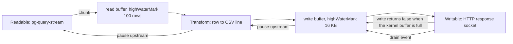
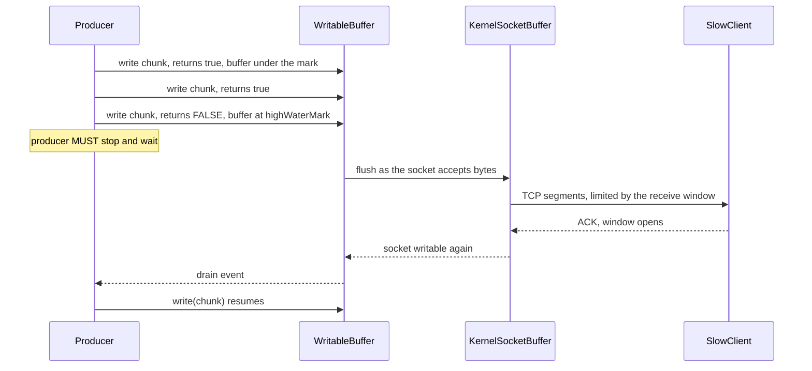

## 3.23 Streams

#### Concept

A **stream** is an interface for moving data a piece at a time instead of all at once. Instead of "read the whole 4 GB file into a Buffer, then write it", you read 64 KB, write 64 KB, and repeat — so peak memory is one chunk, not one file.

Node has four stream types:

| Type | Direction | Examples |
|---|---|---|
| **Readable** | produces data | `fs.createReadStream`, `http.IncomingMessage` (a request body), a `pg` query stream, `child.stdout` |
| **Writable** | consumes data | `fs.createWriteStream`, `http.ServerResponse`, `child.stdin`, an S3 upload |
| **Duplex** | both, independently | `net.Socket`, a WebSocket |
| **Transform** | a Duplex where output is a function of input | `zlib.createGzip`, `crypto.createCipheriv`, your CSV formatter |

By default streams carry **binary chunks** (`Buffer` or string). In **object mode** (`objectMode: true`) each chunk is any JavaScript value — a database row, a parsed CSV record, a domain event. Object mode is what makes streams useful for data pipelines, not just files. The unit of the internal buffer changes too: in binary mode `highWaterMark` counts bytes (default 64 KB for Readable, 16 KB for Writable); in object mode it counts **objects** (default 16).

#### Why does it exist?

Memory is the scarcest resource in a container. A NestJS pod with a 1 GiB limit can afford maybe 700 MB of heap. Any operation whose memory cost scales with *input size* rather than with *concurrency* is a time bomb: it works on 10,000 rows in staging and OOMKills on 5,000,000 rows in production.

Streams convert a memory problem into a time problem. A 2 GB export takes 40 seconds either way; the difference is whether it takes 2 GB of RAM or 30 MB.

Streams also change **time to first byte**. A buffered export sends nothing for 40 seconds and then 2 GB. A streamed export sends the header row in 80 ms, so the browser starts downloading immediately and no proxy times out waiting for headers.

#### Mental model

Imagine emptying a swimming pool. The buffered approach is to find a container big enough for the whole pool, fill it, carry it, and empty it. You need a pool-sized container.

The streamed approach is a hose. Water flows continuously; at any moment only a few litres are inside the hose. You never need a pool-sized container — but you *do* need the drain at the other end to keep up. If the drain is slower than the tap, either the hose bursts or something must tell the tap to slow down. That "something" is backpressure (3.24), and it is not an optional extra: a stream without backpressure is just a slower way to run out of memory.

#### How it works



The mechanics of a Readable in flowing mode:

1. The stream calls its internal `_read(size)` to fetch data from the source.
2. Data is pushed into the readable buffer with `push(chunk)`.
3. If the buffer holds at least `highWaterMark`, `push()` returns `false`, meaning *stop producing*. A well-implemented source honours this.
4. Consumers receive chunks via `'data'` events or `for await...of`.
5. `push(null)` signals end-of-stream, which emits `'end'`.

And a Writable:

1. `write(chunk)` either passes the chunk straight to `_write()` or queues it.
2. If the queued bytes reach `highWaterMark`, `write()` returns **`false`**.
3. When the queue drains below the mark, the stream emits **`'drain'`**.
4. `end()` finishes the stream, which emits `'finish'` once everything is flushed.

#### `pipeline()` versus `.pipe()`

`.pipe()` is the old API and it is broken in one specific, dangerous way: **it does not forward errors and it does not clean up.** If the destination errors, the source is left open. If the source errors, the destination is never closed. Over hours, a service that does this leaks file descriptors, database cursors and sockets.

```ts
// BROKEN: if res errors (client disconnects mid-download), the file stream stays open forever.
// Every aborted download leaks one file descriptor. At ~1,000 fds you get EMFILE.
createReadStream(path).pipe(res);
```

`pipeline()` (and its promise form in `node:stream/promises`) fixes all of it: it wires errors from every stage to a single place, destroys every stream in the chain on failure, and resolves or rejects once. Since Node 15 you should treat it as **mandatory**.

```ts
import { pipeline } from 'node:stream/promises';

// CORRECT: any error anywhere destroys every stream and rejects here.
try {
  await pipeline(createReadStream(path), createGzip(), res);
} catch (err) {
  // Includes ERR_STREAM_PREMATURE_CLOSE when the client aborts mid-download.
  logger.warn({ err }, 'download failed or was aborted');
}
```

The rule to memorise: **`.pipe()` is acceptable only inside a `pipeline()` call or in a throwaway script. In application code, always `pipeline`.**

#### Practical example: exporting 5 million orders as CSV

This is the canonical case, and it is worth doing in full. Requirement: an admin downloads a CSV of all orders in a date range. In production that range can contain 5,000,000 rows, roughly 250 bytes each — about 1.2 GB of CSV.

**The version that OOMKills:**

```ts
// orders/export.service.ts - the naive version. Works in staging with 8,000 rows.
async exportCsv(from: Date, to: Date): Promise<string> {
  const orders = await this.repo.find({ where: { createdAt: Between(from, to) } });   // 5,000,000 entities
  return ['id,customer,total,status', ...orders.map(o => `${o.id},${o.customerId},${o.totalCents},${o.status}`)].join('\n');
}
```

Memory profile: the `pg` driver builds a result set of 5M row objects (roughly 1.5 GB), TypeORM hydrates 5M entity instances on top (another 2 to 3 GB, because each entity is a class instance with metadata), `map` allocates 5M strings, and `join` allocates one 1.2 GB string. Peak heap over 5 GB in a 1 GiB pod. In practice the pod is OOMKilled about 40 seconds in, with no error logged, no partial result and a `137` exit code. The client sees a connection reset.

**The streaming version:**

```ts
// orders/export.service.ts
import { Injectable, Logger } from '@nestjs/common';
import { InjectDataSource } from '@nestjs/typeorm';
import { DataSource } from 'typeorm';
import { Transform, Readable } from 'node:stream';
import QueryStream from 'pg-query-stream';
import type { PoolClient } from 'pg';

interface OrderRow { id: string; customer_id: string; total_cents: string; status: string; created_at: Date }

@Injectable()
export class OrderExportService {
  private readonly logger = new Logger(OrderExportService.name);
  constructor(@InjectDataSource() private readonly dataSource: DataSource) {}

  /**
   * Returns a Readable of CSV bytes. Memory is bounded by batchSize x row size,
   * not by the number of rows in the result.
   */
  async streamCsv(from: Date, to: Date): Promise<Readable> {
    // Take a raw pg client from TypeORM's pool. We MUST release it ourselves.
    const client = (await this.dataSource.driver.obtainMasterConnection()) as PoolClient;

    const query = new QueryStream(
      `SELECT o.id, o.customer_id, o.total_cents, o.status, o.created_at
         FROM orders o
        WHERE o.created_at >= $1 AND o.created_at < $2
        ORDER BY o.created_at`,
      [from, to],
      { batchSize: 1_000, highWaterMark: 1_000 },   // rows fetched per round trip from the server cursor
    );

    const rows = client.query(query) as unknown as Readable;   // object-mode Readable of row objects

    const toCsv = new Transform({
      writableObjectMode: true,       // input: row objects
      readableObjectMode: false,      // output: Buffers
      highWaterMark: 64 * 1024,
      construct(cb) { this.push('id,customer_id,total_cents,status,created_at\n'); cb(); },
      transform(row: OrderRow, _enc, cb) {
        // Escape per RFC 4180: quote and double any embedded quotes.
        const esc = (v: unknown) => { const s = String(v ?? ''); return /[",\n]/.test(s) ? `"${s.replace(/"/g, '""')}"` : s; };
        cb(null, `${esc(row.id)},${esc(row.customer_id)},${esc(row.total_cents)},${esc(row.status)},${row.created_at.toISOString()}\n`);
      },
    });

    let released = false;
    const release = () => { if (!released) { released = true; client.release(); } };
    rows.on('end', release);
    rows.on('error', release);
    rows.on('close', release);        // client aborted the download: release the connection and cursor

    return rows.pipe(toCsv);          // safe here only because the controller wraps it in pipeline()
  }
}
```

```ts
// orders/export.controller.ts
import { Controller, Get, Query, Res, StreamableFile, Header, UseGuards } from '@nestjs/common';
import type { Response } from 'express';
import { OrderExportService } from './export.service';
import { AdminGuard } from '../auth/admin.guard';

@Controller('admin/orders')
@UseGuards(AdminGuard)
export class OrderExportController {
  constructor(private readonly exports: OrderExportService) {}

  @Get('export.csv')
  @Header('Content-Type', 'text/csv; charset=utf-8')
  @Header('Content-Disposition', 'attachment; filename="orders.csv"')
  @Header('Cache-Control', 'no-store')
  async export(@Query('from') from: string, @Query('to') to: string, @Res({ passthrough: true }) res: Response) {
    const stream = await this.exports.streamCsv(new Date(from), new Date(to));
    // StreamableFile handles piping and destroys the source if the response is aborted.
    return new StreamableFile(stream, { type: 'text/csv' });
  }
}
```

**Memory profile, measured:**

| | Buffered version | Streamed version |
|---|---|---|
| Peak heap, 8,000 rows | 90 MB | 42 MB |
| Peak heap, 500,000 rows | 1.1 GB | 46 MB |
| Peak heap, 5,000,000 rows | OOMKilled at ~40 s | **48 MB** |
| Time to first byte | 40 s (or never) | 85 ms |
| Total time, 5M rows | n/a | 96 s |
| Event-loop lag p99 during export | 2,400 ms | 9 ms |

The heap stays flat because at any moment the process holds at most 1,000 row objects from the cursor, a few CSV lines in the transform buffer, and 64 KB in the socket write buffer. The loop lag stays low because each chunk is a few hundred microseconds of work with an I/O yield between chunks.

Two details that matter more than the code:

- **`batchSize: 1_000`** controls the server-side cursor fetch size. Setting it to 1 makes 5 million round trips (a network-latency disaster); setting it to 100,000 puts 100,000 rows in memory at once (defeating the purpose). Between 500 and 5,000 is almost always right.
- **The connection is held for the whole export.** A 96-second export occupies one pool slot for 96 seconds. Three concurrent exports on a pool of 15 is fine; forty is a pool exhaustion incident. Rate-limit exports, or move them to a background job that writes to S3 and emails a link.

#### NestJS example: `StreamableFile` and the pipeline rule

`StreamableFile` is the NestJS wrapper that tells the framework "this response is a stream". It handles the piping, sets headers from the options, and — importantly — destroys the underlying stream when the response closes early.

```ts
// files/files.controller.ts
import { Controller, Get, Param, StreamableFile, NotFoundException, Logger } from '@nestjs/common';
import { createReadStream, promises as fsp } from 'node:fs';
import { join } from 'node:path';

@Controller('files')
export class FilesController {
  private readonly logger = new Logger(FilesController.name);

  @Get(':id/download')
  async download(@Param('id') id: string): Promise<StreamableFile> {
    if (!/^[a-f0-9-]{36}$/.test(id)) throw new NotFoundException();     // no path traversal
    const path = join('/var/data/files', `${id}.pdf`);
    const stat = await fsp.stat(path).catch(() => { throw new NotFoundException(); });

    const stream = createReadStream(path, { highWaterMark: 256 * 1024 });
    stream.on('error', (err) => this.logger.error({ err, path }, 'read stream failed'));

    return new StreamableFile(stream, {
      type: 'application/pdf',
      disposition: `attachment; filename="${id}.pdf"`,
      length: stat.size,        // sets Content-Length so the browser shows a progress bar
    });
  }
}
```

And an interceptor that measures streamed responses, because a stream that never finishes is invisible to normal request-duration middleware:

```ts
// common/stream-metrics.interceptor.ts
import { Injectable, NestInterceptor, ExecutionContext, CallHandler } from '@nestjs/common';
import { Observable, tap } from 'rxjs';
import { Counter, Histogram } from 'prom-client';

@Injectable()
export class StreamMetricsInterceptor implements NestInterceptor {
  private readonly aborted = new Counter({ name: 'stream_responses_aborted_total', help: 'client aborted a streamed response' });
  private readonly duration = new Histogram({ name: 'stream_response_seconds', help: 'full stream duration', buckets: [1, 5, 30, 120, 600] });

  intercept(ctx: ExecutionContext, next: CallHandler): Observable<unknown> {
    const res = ctx.switchToHttp().getResponse();
    const end = this.duration.startTimer();
    // 'close' fires whether the response finished or the socket was destroyed.
    res.on('close', () => { if (!res.writableFinished) this.aborted.inc(); end(); });
    return next.handle().pipe(tap());
  }
}
```

#### TypeORM example

TypeORM's own `stream()` on the query builder returns the driver's stream and is a legitimate alternative when you want the query builder's ergonomics:

```ts
const stream = await this.dataSource
  .createQueryBuilder(Order, 'o')
  .select(['o.id', 'o.totalCents', 'o.status'])       // never SELECT * in an export
  .where('o.createdAt BETWEEN :from AND :to', { from, to })
  .orderBy('o.createdAt')
  .stream();                                          // Readable of RAW rows: { o_id, o_totalCents, ... }
```

Two caveats. First, the rows are **raw**, with aliased column names, not hydrated entities — which is exactly what you want, because entity hydration is the expensive part. Second, TypeORM does not release the underlying connection for you in every version; verify with `pg_stat_activity` that connections return to the pool after an aborted export, and wrap with explicit release if not.

#### Sequelize example

Sequelize has no first-class streaming API. Use the raw `pg` client from its pool:

```ts
// Sequelize: reach through to pg for streaming.
const conn = await sequelize.connectionManager.getConnection({ type: 'READ' }) as import('pg').PoolClient;
try {
  const rows = conn.query(new QueryStream('SELECT id, total_cents FROM orders WHERE created_at >= $1', [from]));
  await pipeline(rows, toCsv, res);
} finally {
  sequelize.connectionManager.releaseConnection(conn);   // always release, even on abort
}
```

The alternative — `findAll` with `limit`/`offset` in a loop — works but degrades: `OFFSET 4000000` makes PostgreSQL scan and discard four million rows on every page. If you must paginate, use **keyset pagination** (`WHERE (created_at, id) > ($1, $2) ORDER BY created_at, id LIMIT 1000`), which stays O(page) forever.

#### Production scenario

A finance team's month-end reconciliation downloads a 900 MB CSV on the first of every month. Before streaming, that request took the pod down every month at 09:00 like clockwork, and the team had learned to "just retry it a few times". Nobody had filed a bug because it eventually worked when traffic was low.

After the streaming rewrite, the export runs in 71 seconds with 50 MB of heap, other endpoints keep a 45 ms p99 throughout, and the only remaining concern is the pool slot it holds. That was solved by moving exports over 100,000 rows to a BullMQ job that streams to S3 and emails a presigned URL, leaving the synchronous endpoint for small ranges. This is the mature shape: **stream for correctness, and move long exports off the request path entirely.**

#### Failure scenario

At 10:40 an internal reporting service started failing with `EMFILE: too many open files` after four days of uptime. Restarting fixed it for another four days.

The service streamed report files with `createReadStream(path).pipe(res)`. When a user closed the browser tab mid-download — common, because reports were large — the response socket was destroyed. `.pipe()` propagates neither the error nor the close to the source, so the file read stream stayed open forever, holding a descriptor and a 256 KB buffer. About 300 aborted downloads per day, times four days, crossed the 1,024 descriptor limit. `ls -l /proc/<pid>/fd | wc -l` showed 1,024 entries, most pointing at deleted report files.

The fix was one line: `await pipeline(createReadStream(path), res)`. `pipeline` destroys the source when the destination closes, which is exactly the missing behaviour. The team also added an fd-count gauge to the dashboard, because a slowly climbing descriptor count is one of the most reliable early warnings a service can emit.

#### Edge cases & failure modes

- Client aborts mid-stream: with `.pipe()` you leak; with `pipeline` you get `ERR_STREAM_PREMATURE_CLOSE`, which is a normal event, not an error to alert on.
- An error thrown inside a `Transform` after the first chunk is written means the client already received HTTP 200 and a partial body. You cannot retract a status code. Validate before streaming, and use a trailer or a sentinel line for integrity if the consumer can check it.
- Mixing `await` inside a `'data'` handler does not pause the stream: chunks keep arriving and queue in memory. Use `for await...of` or a `Transform` with an async `transform`.
- Object-mode `highWaterMark` counts objects, not bytes. `highWaterMark: 16` with 5 MB objects is 80 MB of buffer.
- `Content-Length` is unknown for a generated stream, so the response uses `Transfer-Encoding: chunked`; some legacy clients and proxies dislike it.
- Reverse proxies buffer. nginx with `proxy_buffering on` will accumulate your carefully streamed response in *its* memory or on disk; set `proxy_buffering off` and `X-Accel-Buffering: no` for genuine streaming.
- Compression interacts with flushing: `zlib` holds bytes until it has enough to compress. For server-sent events, call `flush()` or disable compression.
- A database cursor holds a transaction snapshot open. A 20-minute export blocks `VACUUM` from cleaning newer dead tuples and inflates table bloat (see Part 11).
- Long streamed responses can exceed load balancer idle timeouts if there are gaps between chunks; keep data flowing or send heartbeat bytes.
- `stream.destroy()` does not always emit `'error'`; listen for `'close'` too if you need guaranteed cleanup.

#### How a Senior Backend Engineer thinks about this

They ask one question of every endpoint: *does memory scale with input size?* If yes, it must stream, no matter how small today's data is, because the row count only goes up. They use `pipeline` reflexively and treat a bare `.pipe()` in a review as a defect. They think about the **connection cost** of a long stream, not just the memory, and push exports over a threshold onto a queue.

They also know the limits of streaming: it does not make anything faster, it makes it *bounded*. And it moves the failure from "we ran out of memory" to "we held a connection for 90 seconds", which is a better failure but still a failure to design around.

To a product manager: "The export no longer loads the whole report into memory before sending it. It sends it as it reads it, so it starts immediately and cannot crash the server — but it still takes a minute and a half, and while it runs it uses one of our database slots."

#### Common mistakes

- `.pipe()` in application code, leaking descriptors on every aborted download.
- `find()` returning millions of hydrated entities.
- Buffering a whole response to compute `Content-Length`.
- `await` inside a `'data'` handler, believing it pauses the stream.
- Object-mode `highWaterMark` set as if it counted bytes.
- Never releasing the database client on abort.
- Forgetting `proxy_buffering off`, so the whole streaming design is undone at the proxy.

#### Interview questions

1. *Name the four stream types and give a real example of each.* Expected: Readable/Writable/Duplex/Transform with `pg-query-stream`, HTTP response, socket, gzip.
2. *Why is `pipeline()` mandatory rather than `.pipe()`?* Expected: error forwarding and cleanup; without it an aborted client leaks the source stream and its descriptor. Follow-up: what error do you see when a client aborts? `ERR_STREAM_PREMATURE_CLOSE`.
3. *Design a CSV export of 5 million rows in a 1 GiB pod.* Expected: server-side cursor with a batch size, object-mode Transform, streamed response, bounded memory, plus a note on holding a pool connection and moving big exports to a job.
4. *What is object mode and what changes about `highWaterMark`?* Expected: chunks are arbitrary values; the mark counts objects (default 16), not bytes.
5. *You stream a response and an error occurs after 200 bytes. What does the client see?* Expected: HTTP 200 with a truncated body; the status is already sent. Discuss validating first and integrity markers.
6. *Why might a streamed response still arrive all at once in production?* Expected: proxy buffering (nginx `proxy_buffering`), compression buffering, or a CDN.

#### Practical exercise

Seed an `orders` table with 2,000,000 rows. Implement the export twice: once with `repository.find()` plus `join`, once with `pg-query-stream` plus a Transform and `StreamableFile`. Run both in a container limited to 512 MiB and record peak RSS, time to first byte, total time and event-loop lag p99. Then abort the download at 30% with `curl --max-time 3` in both `.pipe()` and `pipeline()` variants and count open descriptors afterwards with `ls /proc/<pid>/fd | wc -l`.

Acceptance criteria: the buffered version OOMKills and the streamed version stays under 100 MB; a measured table of the four metrics; and descriptor counts proving `pipeline` cleans up while `.pipe()` leaks exactly one descriptor per aborted download.

## 3.24 Backpressure

#### Concept

**Backpressure** is the feedback signal that tells a fast producer to slow down because a slow consumer cannot keep up. Without it, the difference between production rate and consumption rate accumulates somewhere — and in Node, "somewhere" is always the heap.

In Node's stream API, backpressure has three concrete parts:

- **`highWaterMark`**: how much a stream will buffer before it says stop. Default 64 KB for a Readable, 16 KB for a Writable, 16 objects in object mode.
- **`write()` returning `false`**: the Writable's buffer is at or above the mark. This is not an error and the write was still accepted; it is a request to stop writing.
- **The `'drain'` event**: the buffer has fallen below the mark; it is safe to resume.

`pipeline()` and `.pipe()` implement this handshake for you. Every hand-written producer must implement it explicitly, and that is where the bugs live.

#### Why does it exist?

Because production rate and consumption rate are never equal, and the mismatch compounds. Reading from a local SSD at 800 MB/s and writing to a client on a hotel Wi-Fi at 2 Mb/s is a ratio of 3,200 to 1. In one second of that mismatch you buffer 800 MB. There is no amount of RAM that makes this safe; only flow control does.

The failure without it is characteristic and easy to recognise: **memory grows linearly with time while CPU stays low**, then the process is OOMKilled with no error, no stack trace and exit code 137.

#### Mental model

Imagine a conveyor belt from a factory to a packing station. The factory can make 100 boxes a minute; the packer can pack 20. Without a signal, boxes pile up on the floor until the room is full and the roof caves in.

Backpressure is the packer's red button. When the belt has 16 boxes waiting, the button lights up and the factory stops. When the pile drops to 8, the light goes off and the factory restarts. Total throughput is still 20 boxes a minute — backpressure does not make the packer faster — but the room never fills up. That is the whole point: **backpressure trades latency for survival.**

#### How it works



Note that there are **two** buffers in series, and TCP's own flow control is the outermost one. The client's advertised receive window shrinks as its buffer fills, the kernel stops sending, the kernel's send buffer fills, `write()` starts returning `EAGAIN`, libuv queues in userspace, and `socket.write()` returns `false`. The signal propagates all the way from a slow phone on a train back to your `for` loop — but only if every layer honours it.

The correct hand-written producer:

```ts
// The canonical write-with-backpressure loop.
import { once } from 'node:events';
import type { Writable } from 'node:stream';

async function writeAll(dest: Writable, rows: AsyncIterable<string>): Promise<void> {
  for await (const row of rows) {
    if (!dest.write(row)) {
      // Buffer is full. Stop producing until it drains. This await is the entire mechanism.
      await once(dest, 'drain');
    }
  }
  dest.end();
}
```

And the version people actually write, which is the bug:

```ts
// BROKEN: ignores the return value. Every unwritten chunk queues in the process heap.
for await (const row of rows) {
  dest.write(row);        // returns false thousands of times; nobody looks
}
```

#### The heap graph of an unbounded producer

Run both versions writing 5 million CSV rows to a client throttled to 1 Mb/s and sample `process.memoryUsage()` every second:

```text
Ignoring backpressure                  Honouring backpressure
t=0s    heapUsed  38 MB                t=0s    heapUsed  38 MB
t=5s    heapUsed 210 MB                t=5s    heapUsed  44 MB
t=10s   heapUsed 402 MB                t=10s   heapUsed  43 MB
t=15s   heapUsed 611 MB                t=15s   heapUsed  45 MB
t=20s   heapUsed 812 MB                t=20s   heapUsed  44 MB
t=23s   <OOMKilled, exit 137>          t=600s  heapUsed  46 MB, transfer complete
```

The left column is a straight line with a slope equal to (production rate minus consumption rate). That linear-growth-with-flat-CPU shape is the fingerprint of missing backpressure, and it is different from a memory *leak*, which usually grows in steps and correlates with request count rather than with a single long operation.

#### Backpressure in HTTP responses

`res` is a Writable, so the same rules apply. In practice you get this for free by using `pipeline`, and you break it by writing in a loop.

```ts
// BROKEN: 100,000 synchronous writes. The socket accepts maybe 64 KB; the rest queues in the heap,
// and the loop is blocked for the whole duration so nothing else is served.
for (const order of orders) res.write(JSON.stringify(order) + '\n');

// CORRECT: an async generator plus pipeline. Backpressure and cleanup are both handled.
import { pipeline } from 'node:stream/promises';
import { Readable } from 'node:stream';

await pipeline(
  Readable.from(async function* () {
    for await (const order of orderCursor) yield JSON.stringify(order) + '\n';
  }()),
  res,
);
```

`Readable.from(asyncGenerator)` is the single most useful backpressure tool in modern Node: the generator is only advanced when the consumer wants more, so `await` inside it naturally throttles production.

#### Backpressure in Kafka consumers

A Kafka consumer's backpressure is **pause/resume on partitions**, and getting it wrong causes rebalancing storms rather than OOM — though it can cause both.

```ts
// kafka/order-events.consumer.ts
import { Injectable, OnModuleInit, Logger } from '@nestjs/common';
import { Kafka, Consumer } from 'kafkajs';

@Injectable()
export class OrderEventsConsumer implements OnModuleInit {
  private readonly logger = new Logger(OrderEventsConsumer.name);
  private consumer!: Consumer;
  private inFlight = 0;
  private readonly MAX_IN_FLIGHT = 50;

  async onModuleInit() {
    const kafka = new Kafka({ clientId: 'orders', brokers: (process.env.KAFKA_BROKERS ?? '').split(',') });
    this.consumer = kafka.consumer({
      groupId: 'order-projections',
      // The single most important backpressure setting: how long we may take per batch
      // before the broker considers us dead and rebalances the group.
      sessionTimeout: 30_000,
      heartbeatInterval: 3_000,
      maxBytesPerPartition: 1 * 1024 * 1024,     // bound how much arrives at once
    });
    await this.consumer.connect();
    await this.consumer.subscribe({ topic: 'order.events', fromBeginning: false });

    await this.consumer.run({
      eachBatchAutoResolve: false,
      eachBatch: async ({ batch, resolveOffset, heartbeat, commitOffsetsIfNecessary, isRunning, isStale, pause }) => {
        for (const message of batch.messages) {
          if (!isRunning() || isStale()) break;

          if (this.inFlight >= this.MAX_IN_FLIGHT) {
            // Explicit backpressure: stop fetching this partition, resume in 5 s.
            const resume = pause();
            setTimeout(resume, 5_000);
            break;
          }

          this.inFlight++;
          try {
            await this.handle(message);            // downstream work: PostgreSQL write
            resolveOffset(message.offset);         // only commit what actually succeeded
          } finally {
            this.inFlight--;
          }
          await heartbeat();                       // keep the session alive during slow batches
        }
        await commitOffsetsIfNecessary();
      },
    });
  }

  private async handle(message: unknown): Promise<void> { /* project into a read model */ }
}
```

The failure mode without this is worth stating precisely: if `eachBatch` takes longer than `sessionTimeout` without a heartbeat, the broker evicts the consumer, the group **rebalances**, another consumer picks up the same partition from the last committed offset, reprocesses the same messages, is also too slow, and the group rebalances forever while processing nothing. Consumer lag climbs, throughput reaches zero, and every message is processed multiple times. Backpressure here means *fetching less and heartbeating*, not buffering more.

#### Backpressure in `for await` loops

`for await...of` over an async iterable is naturally backpressured: the loop body must finish before the next value is requested. That is the good case.

It stops being backpressured the moment you fan out:

```ts
// BROKEN: fire-and-forget inside a for await. 5,000,000 promises created as fast as rows arrive.
for await (const row of cursor) {
  void this.enrich(row);                 // no await: unbounded concurrency and unbounded memory
}

// ALSO BROKEN in a different way: unbounded parallelism via Promise.all over a huge array.
await Promise.all(rows.map(r => this.enrich(r)));    // 5M concurrent HTTP calls

// CORRECT: bounded concurrency. Backpressure is the semaphore (3.11).
const CONCURRENCY = 20;
const running = new Set<Promise<void>>();
for await (const row of cursor) {
  const p = this.enrich(row).finally(() => running.delete(p));
  running.add(p);
  if (running.size >= CONCURRENCY) await Promise.race(running);   // wait for a slot
}
await Promise.all(running);
```

This bounded-concurrency loop is one of the half-dozen patterns worth memorising. It gives you throughput without unbounded memory, and the concurrency number becomes a tunable you can reason about against your database pool size and your downstream rate limits.

#### NestJS example: a bounded background processor

```ts
// reconciliation/reconcile.service.ts
import { Injectable, Logger } from '@nestjs/common';
import { Cron, CronExpression } from '@nestjs/schedule';
import { InjectDataSource } from '@nestjs/typeorm';
import { DataSource } from 'typeorm';
import { Gauge } from 'prom-client';

@Injectable()
export class ReconcileService {
  private readonly logger = new Logger(ReconcileService.name);
  private readonly backlog = new Gauge({ name: 'reconcile_backlog_rows', help: 'rows still to reconcile' });
  private running = false;

  @Cron(CronExpression.EVERY_HOUR)
  async run(): Promise<void> {
    if (this.running) { this.logger.warn('previous run still going; skipping'); return; }   // no overlap
    this.running = true;
    try {
      // Keyset pagination: bounded memory, bounded query cost, resumable after a restart.
      let lastId = '00000000-0000-0000-0000-000000000000';
      for (;;) {
        const rows = await this.dataSource.query(
          `SELECT id, order_id, amount_cents FROM payments
            WHERE id > $1 AND reconciled_at IS NULL
            ORDER BY id LIMIT 500`, [lastId]);
        if (rows.length === 0) break;
        for (const row of rows) await this.reconcileOne(row);     // sequential: bounded pressure on the PSP API
        lastId = rows[rows.length - 1].id;
        this.backlog.dec(rows.length);
      }
    } finally { this.running = false; }
  }

  constructor(@InjectDataSource() private readonly dataSource: DataSource) {}
  private async reconcileOne(row: unknown): Promise<void> { /* call PSP, update row */ }
}
```

The `running` flag is backpressure at the job level: if an hourly job takes 70 minutes, overlapping runs would double the load on the payment provider and race on the same rows. Skipping is almost always better than overlapping.

#### Production scenario

A logistics platform streams GPS pings from 12,000 vehicles into Kafka and a consumer writes them to PostgreSQL. Ping rate is 12,000 every 10 seconds, or 1,200 per second. Each insert takes 1.5 ms, so one consumer can handle roughly 650 per second, and there are 4 partitions with 4 consumers: 2,600 per second of capacity against 1,200 of demand. Comfortable.

During a network incident, vehicles buffer locally and then all replay at once: 400,000 pings arrive in 30 seconds. Without backpressure the consumer fetches everything it can, holds 400,000 objects in memory, blows past `sessionTimeout` and rebalances forever. With `maxBytesPerPartition` bounding the fetch, batched inserts of 500 rows in one statement, and heartbeats inside the batch loop, the consumer drains the backlog in 4 minutes at a steady 60 MB of heap. Consumer lag spikes to 400,000 and decays smoothly to zero — which is exactly what a healthy system under a burst looks like.

#### Failure scenario

At 19:05, a pod serving an internal analytics endpoint was OOMKilled. It restarted, served traffic for 11 minutes, and was OOMKilled again. The pattern repeated all evening. Heap grew linearly at about 40 MB/s while CPU sat at 12%.

The endpoint streamed a large JSON array to an internal BI tool. The code was `for (const row of rows) res.write(JSON.stringify(row) + ',');` — no backpressure check. The BI tool ran in an office over a VPN at roughly 3 Mb/s. Node produced serialized rows at hundreds of megabytes per second and the socket accepted 3 Mb/s. The difference queued in `res`'s internal buffer, which is process heap.

The tell was that it only happened when *that one client* was connected; fast local clients never triggered it, so it never appeared in staging. The fix was `await pipeline(Readable.from(generator), res)` plus a Prometheus gauge on `res.writableLength` for the p99 of streamed responses, so that a slow consumer becomes a visible metric rather than a crash.

#### Edge cases & failure modes

- Ignoring `write()`'s return value is the single most common cause of linear memory growth in Node services.
- `highWaterMark` is a soft limit: a single `write()` larger than the mark is always accepted in full. Writing a 50 MB buffer queues 50 MB regardless of the setting.
- In object mode the mark counts objects. Sixteen 10 MB objects is 160 MB of "bounded" buffer.
- `'drain'` only fires if `write()` previously returned `false`. Waiting for `drain` unconditionally hangs forever.
- A slow client on a mobile network is the worst case, and it never appears in local testing.
- Backpressure does not propagate through an `EventEmitter`. A custom emitter-based producer has no flow control at all.
- Kafka: too much in-flight work without heartbeats causes rebalance storms; the cure is fetching less, not buffering more.
- Redis pipelines and `MULTI` blocks buffer commands in the client. An unbounded pipeline is the same bug in a different library.
- HTTP/2 has its own per-stream flow-control windows, so a single stalled stream does not block the connection, but the userspace buffering issue is unchanged.
- `res.writableLength` and `res.writableHighWaterMark` are readable at any time and make excellent metrics; almost nobody exports them.
- Backpressure raises latency by design. A saturated system with correct backpressure gets *slow*, which is the point; add load shedding (see Part 20 — Reliability Patterns) if slow is not acceptable.

#### How a Senior Backend Engineer thinks about this

They treat every producer/consumer boundary as a place where rates differ and ask what happens to the difference. The answer must always be one of: *the producer blocks*, *we drop data deliberately*, or *we persist to a bounded durable buffer*. "It queues in memory" is never an acceptable answer, because memory is the one buffer with no limit until the OOM killer supplies one.

They know that backpressure is not a stream API detail; it is the same idea as a connection pool's queue limit, a semaphore's permit count, a Kafka consumer's fetch size, a thread pool's bounded queue and a rate limiter. Learning it once in streams means recognising it everywhere.

To a product manager: "If we send data faster than the customer's connection can take it, the extra has to sit somewhere. We make our side wait instead of piling it up, so a slow customer gets a slow download instead of taking down the service for everyone."

#### Common mistakes

- Never checking `write()`'s return value.
- `Promise.all` over an unbounded array as a "parallelism" strategy.
- Fire-and-forget calls inside a `for await` loop.
- Raising `highWaterMark` to "fix" slowness, which only delays the OOM.
- Overlapping cron runs with no guard.
- Diagnosing linear memory growth as a leak and hunting for retained objects that are not there.
- Kafka consumers that increase `sessionTimeout` instead of reducing batch work.

#### Interview questions

1. *What does `stream.write()` returning `false` mean, and what must you do?* Expected: the internal buffer reached `highWaterMark`; stop writing and wait for `'drain'`. The chunk was still accepted.
2. *Draw the memory graph of a fast producer and a slow consumer with no backpressure.* Expected: linear growth with flat CPU, ending in OOMKilled/exit 137; contrast with a leak's stepwise, request-correlated growth.
3. *How does TCP flow control relate to `write()` returning false?* Expected: receiver window closes, kernel send buffer fills, `EAGAIN`, libuv queues in userspace, `write()` returns false; the signal chains from the client's network to your loop.
4. *How do you bound concurrency over a 5-million-row cursor?* Expected: `for await` with a running set and `Promise.race`, or a semaphore; never `Promise.all` over the whole set.
5. *What is backpressure in a Kafka consumer?* Expected: pause partitions, limit `maxBytesPerPartition` and batch size, heartbeat during processing; failing to do so causes rebalance storms and reprocessing.
6. *Is raising `highWaterMark` ever the right fix?* Expected: only to reduce syscall overhead for a consumer that is fast on average and bursty; it never fixes a sustained rate mismatch.

#### Practical exercise

Build an endpoint that streams 2,000,000 JSON lines. Write version A ignoring `write()`'s return value and version B using `pipeline` with an async generator. Consume both with a client throttled to 1 Mb/s (`curl --limit-rate 128k`) and sample `process.memoryUsage().heapUsed` every second into a CSV; plot both. Then add a `res.writableLength` gauge and confirm it stays near `highWaterMark` in version B and grows without bound in version A.

Acceptance criteria: two plotted memory curves, one linear to OOM and one flat; the exact second at which version A is killed and the derived production-minus-consumption rate; and a bounded-concurrency version of a per-row enrichment step that holds at most 20 in-flight operations, proven with a concurrency gauge.
