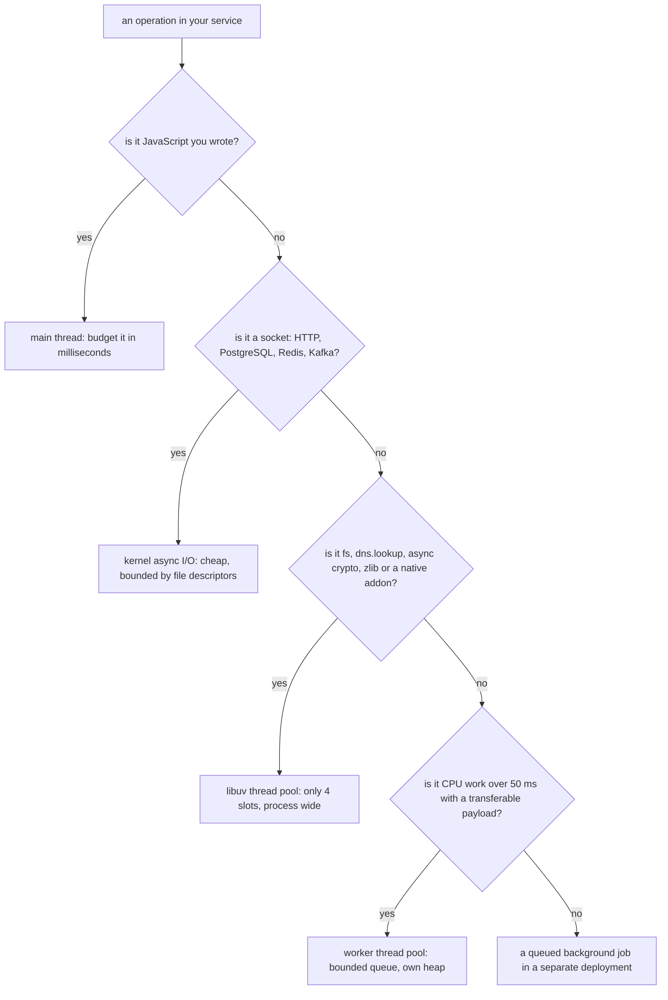

## 3.29 Tuning the runtime in production

#### Concept

Tuning the Node runtime is not about finding magic flags. It is about knowing, for every operation your service performs, **which execution resource it consumes** — the main thread, the libuv thread pool, kernel async I/O, or a worker thread — and then sizing the handful of settings that bound each of those resources.

Four resources, four ways to run out:

| Resource | How many | Runs out when | Symptom |
|---|---|---|---|
| Main thread (event loop) | 1 | Any callback runs long | Loop lag; every request slows |
| libuv thread pool | 4 by default | More than 4 concurrent pool tasks | Latency with healthy CPU and healthy loop |
| Kernel async I/O | thousands of fds | `ulimit -n` or memory | `EMFILE`, connection refused |
| Worker threads | what you create | Pool queue full | Bounded queue rejects, or unbounded memory growth |



#### The definitive operation table

| Operation | Main thread | libuv pool | OS async | Worker thread |
|---|---|---|---|---|
| Your JavaScript, JSON parse/stringify, validation, serialization | **yes** | | | |
| `Array.sort`, `map`, business logic, template rendering | **yes** | | | |
| Regex matching (including ReDoS) | **yes** | | | |
| TypeORM SQL building, entity hydration | **yes** | | | |
| `pg` wire-protocol parsing of result rows | **yes** | | | |
| JWT sign/verify (`jsonwebtoken`, sync) | **yes** | | | |
| TLS handshake asymmetric crypto | **yes** | | | |
| `fs.*Sync`, `crypto.*Sync`, `zlib.*Sync` | **yes** | | | |
| `fs.readFile`, `writeFile`, `stat`, `readdir`, streams | | **yes** | | |
| `dns.lookup` (default hostname resolution) | | **yes** | | |
| `crypto.pbkdf2`, `scrypt`, `randomBytes`, `generateKeyPair` (async) | | **yes** | | |
| `zlib.gzip`, `brotliCompress` (async) | | **yes** | | |
| `bcrypt`, `argon2`, `sharp` (native async addons) | | **yes** | | |
| `pg-native` query execution | | **yes** | | |
| TCP/HTTP/HTTPS server and client sockets | | | **yes** | |
| UDP (`dgram`) | | | **yes** | |
| `dns.resolve*` (c-ares) | | | **yes** | |
| Redis, Kafka, RabbitMQ clients (JS drivers) | | | **yes** | |
| Child process stdio pipes | | | **yes** | |
| PDF generation, image processing offloaded via `piscina` | | | | **yes** |
| CPU-heavy password hashing moved off the pool | | | | **yes** |
| Timers, `setImmediate`, `process.nextTick`, microtasks | **yes** | | | |
| Signals (`SIGTERM`, `SIGUSR2`) | **yes** | | | |
| V8 GC marking and sweeping | own threads | | | |

Two rows deserve a second look every time you read this table. **`pg` result parsing is on the main thread**, so a 100,000-row query blocks the loop for hundreds of milliseconds even though the query itself was async. And **`dns.lookup` is a pool task**, so outbound HTTP calls consume the same four threads as your file logging.

#### The settings that actually matter

**`UV_THREADPOOL_SIZE`** (default 4, max 1024). Raise it only when profiling shows pool queueing while CPU is idle — which means the pool work is I/O-bound (slow network filesystem, slow DNS), not CPU-bound. For CPU-bound pool work (`bcrypt`, `zlib`), raising it past the core count converts thread queueing into CPU queueing and adds context switches. Practical ceiling: `2 x vCPU`. Set it in the container environment, never in code, because libuv reads it once at first use.

**`--max-old-space-size=<MB>`** (default derived from *host* memory, which is wrong in every container). Set it to about **75% of the container memory limit**. This is the single highest-value setting in this list: get it wrong upward and you get `OOMKilled` with no stack trace; get it wrong downward and you get avoidable GC pressure. See 3.26 for the full arithmetic.

**`--max-semi-space-size=<MB>`** (default 16 on 64-bit). Controls the young generation. Raising to 32 or 64 for allocation-heavy services means fewer scavenges and fewer premature promotions to old space, often halving major GC frequency for about 150 MB more RSS. The one flag beyond heap size that reliably pays for itself — but measure before and after.

**`NODE_OPTIONS`** is how you pass all of the above without editing the entrypoint. It is read at startup and applies to child Node processes too, which is a trap: `NODE_OPTIONS=--max-old-space-size=768` is inherited by every worker you `fork`, so four forked children each think they may use 768 MB.

**Keep-alive timeouts.** `server.keepAliveTimeout` **must exceed** your load balancer's idle timeout, or you get intermittent, unexplainable 502s (3.19). `server.headersTimeout` must exceed `keepAliveTimeout`. `server.requestTimeout` bounds slowloris-style stalled bodies.

**Connection pool size.** Not a Node flag, but the number that most often shapes p99 (3.28). The arithmetic: `pods x processes-per-pod x pool size` must stay comfortably under PostgreSQL's `max_connections`, and the pool must be large enough that its queue is usually empty. Start at 10 to 20 per process and watch the pool wait metric.

**`ulimit -n`.** Every socket, file and pipe is a descriptor. The container default is often 1024, which a busy service exceeds. Raise it to 65,536 and monitor the count.

#### A recommended baseline: NestJS pod, 1 vCPU / 1 GiB

```yaml
# deployment.yaml - a defensible starting point, not a universal truth
apiVersion: apps/v1
kind: Deployment
metadata:
  name: orders-api
spec:
  replicas: 4
  template:
    spec:
      terminationGracePeriodSeconds: 45      # must exceed your longest request + drain time
      containers:
        - name: api
          image: registry.example.com/orders-api:1.42.0
          command: ["node", "dist/main.js"]   # one process. No PM2, no cluster (3.22)
          resources:
            requests: { cpu: "500m", memory: "1Gi" }
            limits:   { cpu: "1",    memory: "1Gi" }   # memory request == limit: Guaranteed QoS
          env:
            - name: NODE_ENV
              value: "production"
            - name: NODE_OPTIONS
              value: "--max-old-space-size=768 --heapsnapshot-near-heap-limit=1"
            - name: UV_THREADPOOL_SIZE
              value: "4"                      # 1 vCPU: more threads would only add switching
            - name: DB_POOL_SIZE
              value: "12"
            - name: DB_STATEMENT_TIMEOUT_MS
              value: "10000"
          readinessProbe:
            httpGet: { path: /health/ready, port: 3000 }
            periodSeconds: 5
            failureThreshold: 3               # 15 s to leave the load balancer
          livenessProbe:
            httpGet: { path: /health/live, port: 3000 }
            periodSeconds: 10
            failureThreshold: 6               # 60 s: slower than readiness, on purpose
          lifecycle:
            preStop:
              exec:
                command: ["sh", "-c", "sleep 10"]   # let endpoints propagate before SIGTERM
```

```ts
// main.ts - the runtime settings that live in code
import { NestFactory } from '@nestjs/core';
import { ValidationPipe } from '@nestjs/common';
import { json } from 'express';
import { AppModule } from './app.module';

async function bootstrap() {
  const app = await NestFactory.create(AppModule, { bufferLogs: true });

  app.use(json({ limit: '1mb' }));                      // bound step 6 of the request trace (3.28)
  app.useGlobalPipes(new ValidationPipe({ whitelist: true, forbidNonWhitelisted: true, transform: true }));
  app.enableShutdownHooks();                            // onModuleDestroy runs on SIGTERM

  const server = await app.listen(3000, '0.0.0.0');
  server.keepAliveTimeout = 65_000;                     // > ALB idle timeout of 60 s
  server.headersTimeout = 66_000;                       // > keepAliveTimeout
  server.requestTimeout = 30_000;
  server.maxConnections = 10_000;

  process.on('SIGTERM', async () => {
    // 1. readiness starts failing (probe sees the flag), 2. drain, 3. close pools, 4. exit
    await app.close();
    process.exit(0);
  });
}
bootstrap();
```

```ts
// database.module.ts - the pool and timeout settings
TypeOrmModule.forRootAsync({
  useFactory: () => ({
    type: 'postgres',
    url: process.env.DATABASE_URL,
    poolSize: Number(process.env.DB_POOL_SIZE ?? 12),
    extra: {
      statement_timeout: Number(process.env.DB_STATEMENT_TIMEOUT_MS ?? 10_000),  // server-side, always fires
      idle_in_transaction_session_timeout: 30_000,                               // kills stuck transactions
      connectionTimeoutMillis: 3_000,                                            // fail fast on pool exhaustion
      keepAlive: true,
    },
    maxQueryExecutionTime: 1_000,                       // log slow queries (measured in JS - see 3.16)
    entities: [Order, OrderItem, Customer],             // explicit, not globs (3.18)
    synchronize: false,                                 // never true in production
  }),
});
```

The reasoning behind each number for this specific shape:

- **One process, 4 replicas** rather than 4 workers in one pod: visible failures, simple memory budget, one-quarter the database connections (3.22).
- **768 MB heap in a 1 GiB pod**: leaves roughly 256 MiB for the binary, native stacks, socket buffers, external Buffers and fragmentation (3.26).
- **`UV_THREADPOOL_SIZE=4`** unchanged: with 1 vCPU, four threads already exceed the available parallelism. Raise it only if profiling shows pool queueing with idle CPU.
- **Pool size 12**: 4 pods x 12 = 48 connections plus health checks, comfortable against a `max_connections` of 200, and large enough that the pool queue is normally empty at a few hundred requests per second.
- **`statement_timeout` 10 s and `connectionTimeoutMillis` 3 s**: the database enforces its own limit regardless of loop state, and pool exhaustion fails fast instead of piling up.
- **`preStop: sleep 10`** plus a 45-second grace period: Kubernetes removes the pod from the Service asynchronously, so a pod can receive traffic for a few seconds after `SIGTERM`. The sleep covers the gap; `app.close()` drains the rest.

#### Scaling signals

Autoscale on **event loop utilisation** (target ~0.6) rather than CPU percent. CPU is misleading because GC threads and libuv pool threads inflate it while the loop, the real bottleneck, may be idle — or the reverse, where a throttled pod shows low CPU while being unable to run. Where the platform only supports CPU, use a custom metric adapter to expose `nodejs_eventloop_utilization`.

The five dashboard panels every Node service should have, in order of diagnostic value:

1. `nodejs_eventloop_lag_p99_seconds` and `nodejs_eventloop_utilization`
2. `nodejs_gc_pause_seconds` p99 by kind, and major GC frequency
3. Database pool: in use, waiting, wait duration p99
4. `node_memory_heap_used_bytes` versus `container_memory_working_set_bytes` versus the limit
5. Open file descriptors and active handles

Those five explain the overwhelming majority of "the app is slow and everything looks fine" incidents.

## 3.30 Three incidents from the runtime

#### Incident A: the event loop blocked by synchronous bcrypt

**Symptom.** 19:02 on a Friday. A marketing campaign went live at 19:00 with a push notification to 400,000 users. Login traffic rose from 8 to 140 requests per second across 6 pods. Within two minutes, *every* endpoint on the service — product search, cart, order history — was timing out at the API gateway's 10-second limit. Error rate 78%. Pods were not restarting; they were answering, just far too slowly.

**Timeline.**

```text
19:00  campaign push sent
19:02  gateway 5xx rate crosses 5%, first page
19:04  on-call joins. CPU per pod: 99% on one core. Memory: normal. GC: normal.
19:06  PostgreSQL checked: 4 active connections, mean_exec_time 1.4 ms. Database exonerated.
19:09  scaled 6 -> 18 pods. No improvement. Each new pod also pinned at 99% of one core.
19:14  event loop lag dashboard: p99 = 8,400 ms. Not a database problem. A CPU problem on the loop.
19:17  CPU profile from one pod (kubectl exec, node --prof for 20 s, --prof-process):
       71% of ticks in bcrypt_lib, called synchronously.
19:19  git blame on auth.service.ts: a refactor 9 days earlier changed
       `await bcrypt.compare(...)` to `bcrypt.compareSync(...)` "to simplify the code".
       Cost factor had also been raised from 10 to 14 in the same PR for "security".
19:24  hotfix deployed: revert to the async form.
19:31  loop lag back to 4 ms; error rate 0.2%. Scaled back to 6 pods at 20:15.
```

**Investigation.** The two changes compounded. `bcrypt.compareSync` runs on the **main thread** rather than the libuv pool, so each call blocked the entire event loop. Cost factor 14 is 16 times more work than cost factor 10: roughly **1.1 seconds of CPU per verification** instead of 70 ms.

At 140 logins per second across 6 pods, each pod handled about 23 logins per second at 1.1 seconds each — demanding 25 seconds of CPU per second on a resource that provides one. The loop was permanently saturated and the backlog grew without bound. Scaling to 18 pods reduced it to about 8 logins per second per pod, still 8.8 seconds of demand per second. Scaling could never have fixed this; it needed about 150 pods.

**Why the dashboards lied.** CPU at 99% looked like "we need more pods". The database looked healthy because it *was* healthy. Loop lag was the only metric that pointed at the truth, and it was on a secondary dashboard nobody opened for twelve minutes.

**Fix and prevention.**

```ts
// The permanent fix: async form, a justified cost factor, offloaded to a bounded worker pool,
// and hash time as a first-class metric with an alert.
@Injectable()
export class AuthService {
  constructor(private readonly hashPool: HashPoolService) {}      // piscina, maxThreads = cpus - 1

  async verify(plain: string, hash: string): Promise<boolean> {
    return this.hashPool.compare(plain, hash);                     // never *Sync on the main thread
  }
}
```

- Cost factor set to 12 (about 250 ms) with a documented capacity number: **a 1 vCPU pod can verify at most 4 passwords per second**. That number now appears in the capacity plan.
- Per-IP and per-account rate limiting on `/auth/login` with `@nestjs/throttler`.
- An ESLint rule banning `*Sync` crypto and `fs` outside `src/bootstrap/`.
- Loop lag promoted to the primary dashboard, with a page at p99 > 500 ms for 3 minutes.

**The one-sentence lesson.** *A `Sync` suffix in a request path is a decision to serialize your entire service behind that call.*

#### Incident B: file-descriptor exhaustion from a leaked `pg` client (EMFILE)

**Symptom.** 06:40 on a Tuesday, four days after a release. One pod started returning `Error: connect EMFILE 10.4.2.11:5432` on every request. Over the next three hours the other five pods failed the same way, one at a time, in the order they had been started. Restarting a pod fixed it for exactly four days.

**Timeline.**

```text
Fri  release deployed. All 6 pods restarted.
Tue 06:40  pod-3 starts throwing EMFILE. Removed from service by readiness probe.
Tue 06:45  on-call restarts pod-3. Recovers instantly. Assumed transient.
Tue 07:55  pod-1 throws EMFILE. Pattern noticed.
Tue 08:10  ls -l /proc/1/fd | wc -l inside pod-5 (still healthy): 812 and rising ~8/minute.
           Container ulimit -n: 1024.
Tue 08:14  ls -l /proc/1/fd | grep socket | wc -l  ->  766 sockets.
           ss -tanp | grep 5432 | wc -l  ->  741 ESTABLISHED connections to PostgreSQL.
           But the TypeORM pool size is 15.
Tue 08:22  pg_stat_activity on the primary: 4,300 connections from the API's pod CIDR,
           almost all state='idle', backend_start spread over four days.
Tue 08:35  code review of the release finds an admin export endpoint using
           dataSource.driver.obtainMasterConnection() with no release on the error path.
Tue 09:05  hotfix with try/finally deployed. FD count flat at 61 thereafter.
```

**Investigation.** The release added the CSV export from 3.23 — but an earlier draft of it. It took a raw client from the pool and released it on `'end'`, but not on `'error'` or `'close'`. Every aborted download (a user closing the tab, a gateway timeout at 60 seconds on large exports) leaked one client: one file descriptor in the pod, one backend process in PostgreSQL, and one open cursor holding a transaction snapshot.

Roughly 8 leaked clients per hour, times 96 hours, is about 770 descriptors — plus the pod's legitimate sockets, HTTP connections and open files, crossing 1,024. `EMFILE` then affects *everything*: new PostgreSQL connections fail, incoming HTTP connections cannot be accepted, and even opening a log file fails. The error message names whichever operation happened to be next, which is why it looked like a database problem.

There was a second, quieter casualty. Each leaked connection held an idle transaction with an old snapshot, so `VACUUM` could not remove dead tuples newer than the oldest snapshot. The `orders` table had grown 40% in dead space over those four days, and query plans were degrading in parallel.

**Fix and prevention.**

```ts
// Always release in a finally. Always.
const client = await this.dataSource.driver.obtainMasterConnection() as PoolClient;
try {
  await pipeline(client.query(new QueryStream(sql, params)), toCsv, res);
} finally {
  client.release();          // runs on success, error, and client abort
}
```

- `idle_in_transaction_session_timeout = 30000` on the database, so a leaked connection is reaped server-side within 30 seconds even when the client forgets. This alone would have prevented the outage.
- `ulimit -n` raised to 65,536, which buys time but is not a fix.
- A `process_open_fds` gauge with an alert at 60% of the limit. **A linearly rising descriptor count is the most reliable early warning a service can emit**, and it would have paged someone on Saturday morning.
- A `pg_stat_activity` alert on connections older than one hour in `idle in transaction`.

**The one-sentence lesson.** *Every resource you acquire manually needs a `finally`, and every resource count needs a gauge — a leak is a straight line on a graph and a mystery without one.*

#### Incident C: OOMKilled pods from an in-memory Map plus a heap limit above the container limit

**Symptom.** 03:12 Sunday. Four of six payment API pods `OOMKilled` within ten minutes; the remaining two absorbed the traffic and died by 03:26. Complete outage for 12 minutes. No application error logs — the logs simply stopped mid-line.

**Timeline.**

```text
Fri 18:40  release: "recently viewed products" feature.
Sat 00:00  pods running 5 h. RSS 480 MiB. Nobody looking.
Sun 03:12  pod-2 and pod-4 OOMKilled (exit 137). Pods restart.
Sun 03:16  pod-1, pod-5 OOMKilled.
Sun 03:19  on-call paged. kubectl describe pod: "Last State: Terminated, Reason: OOMKilled, Exit Code: 137".
Sun 03:22  no stack trace, no FATAL ERROR from V8. So V8 never hit ITS limit -> the kernel killed it.
           NODE_OPTIONS: --max-old-space-size=2048. Container limit: 1Gi. The bug is visible in one line.
Sun 03:24  release diff reviewed: a Map<sessionId, Product[]> on a singleton, no eviction.
Sun 03:26  remaining pods die. Full outage.
Sun 03:31  rollback started.
Sun 03:38  service restored.
```

**Investigation.** Two independent mistakes that were individually survivable and together fatal.

*Mistake one: the unbounded `Map`.* A singleton provider stored up to 20 recently viewed products per session id, with no TTL and no eviction. At roughly 30,000 unique sessions per hour and about 2 KB per entry, that is 60 MB per hour of pure leak.

*Mistake two: `--max-old-space-size=2048` in a 1 GiB pod.* Someone had raised it months earlier "to give the app more room" after an unrelated incident. It meant V8 believed it could grow to 2 GB and therefore applied no memory pressure at all: no aggressive collection, no heap-limit error, no warning. It sailed straight past the 1 GiB cgroup limit and the kernel killed it with `SIGKILL` — which is why there was no stack trace, no snapshot, no log line and no graceful shutdown.

*Why all four pods at once.* All six had started within minutes of each other on Friday evening and leaked at the same rate, so they crossed the limit together. And the leak had been invisible all week because weekday deploys restarted the pods every few hours. **The service had been broken since Friday; the weekend simply stopped hiding it.**

**Fix and prevention.**

```ts
// Bounded, TTL'd, and observable. Moved to Redis a week later so it survives deploys
// and is shared across replicas.
private readonly recentlyViewed = new LRUCache<string, Product[]>({
  max: 20_000,
  ttl: 30 * 60_000,
  updateAgeOnGet: true,
});
```

```yaml
env:
  - name: NODE_OPTIONS
    # 75% of the 1 GiB limit. Now V8 hits ITS limit first and dies with a stack trace and a snapshot.
    value: "--max-old-space-size=768 --heapsnapshot-near-heap-limit=1"
```

- Alert: `container_memory_working_set_bytes / container_spec_memory_limit_bytes > 0.85` for 15 minutes. This would have paged someone on **Saturday afternoon**, with hours to spare and no customer impact.
- A CI check asserting `--max-old-space-size` is between 60% and 80% of the manifest's memory limit. A ten-line script that makes this class of incident structurally impossible.
- A code review rule: every module-level or provider-level collection must state its bound.
- Pod start times deliberately staggered, so correlated failures become sequential ones and the first pod's death is a warning rather than part of the outage.

**The one-sentence lesson.** *A heap limit above the container limit converts every memory bug into an unexplained kill; and a service that only stays up because you deploy often is already broken.*

## 3.31 Edge cases and failure modes

A consolidated list for Part 3. Each of these has caused a real outage somewhere.

**Processes, threads and scheduling**

- `os.cpus().length` returns the **host's** core count inside a container, so anything auto-sizing from it (PM2, worker pools, GC heuristics in libraries) over-provisions wildly. Read the cgroup quota.
- CFS throttling produces latency spikes that look identical to GC pauses and to network latency. Check `container_cpu_cfs_throttled_seconds_total` before theorising.
- A CPU limit below 1 core means the process is descheduled mid-period; a 100 ms period with 200 ms of demand gives you 100 ms of pure stall.
- Setting `requests` far below `limits` puts the pod in Burstable QoS and makes it an eviction candidate under node pressure.

**Memory and GC**

- Node's default heap limit derives from host memory: always set `--max-old-space-size` explicitly in a container.
- A heap limit at or above the container limit guarantees `OOMKilled` (exit 137, `SIGKILL`, no stack trace) instead of a diagnosable V8 error.
- `--max-old-space-size` bounds only the **main isolate**. Worker threads need `resourceLimits`; child processes need their own budget; `Buffer`s live outside the heap in `external`.
- Heap sawtooth peaks are noise; only the **troughs after major GCs** reveal a leak.
- A large live set makes every major GC expensive forever. Scaling out duplicates the problem rather than solving it.
- Taking a heap snapshot pauses the process for seconds and needs heap-sized headroom, so it can trigger the OOM you are diagnosing. Remove the pod from service first.
- Prometheus label cardinality (per-user, per-URL labels) is a memory leak wearing a monitoring costume.

**Event loop and microtasks**

- A recursive `process.nextTick` or a tight `await Promise.resolve()` loop starves I/O completely: the process is 100% busy and answers nothing, including health checks.
- `setTimeout` is a lower bound, never a schedule; a blocked loop makes client-side query timeouts fire late and the database look slow.
- Unhandled promise rejections terminate the process by default since Node 15. Every fire-and-forget promise needs a `.catch`.
- Synchronous work is uninterruptible: no timeout, no cancellation, no signal delivery until it returns.
- `monitorEventLoopDelay` sees only the main loop; work on the libuv pool or in workers is invisible to it.

**libuv pool and async I/O**

- The pool has 4 threads shared process-wide with no priorities, no cancellation and no timeout. One stuck native call permanently removes a slot.
- `UV_THREADPOOL_SIZE` is read once, at first use; setting it in code after any `fs` call silently does nothing.
- Raising the pool above the core count converts thread queueing into CPU queueing plus context switches, and each thread costs stack memory.
- `dns.lookup` is a pool task and is not cached by Node; a DNS outage pins threads for the resolver timeout.
- `keepAliveTimeout` shorter than the load balancer's idle timeout causes intermittent, unreproducible 502s.
- `EMFILE` from descriptor exhaustion breaks everything at once — new sockets, new files, new connections — and the error names whichever operation was next.
- Ephemeral port exhaustion on outbound-heavy services gives `EADDRNOTAVAIL`; fix with keep-alive agents.
- Half-open connections (laptop lid closed, NAT timeout) are never reported by epoll; only TCP keep-alive or an application heartbeat reclaims them.

**Workers, children and processes**

- Each worker is a full V8 isolate with its own heap; unbounded worker creation is an OOM in a fixed-size container.
- Structured clone serialises on the sending thread: sending 10 MB to a worker blocks your main thread for ~80 ms and offloads nothing.
- `worker.terminate()` is the only way to stop a synchronous loop, and it skips all cleanup.
- `process.exit()` inside a worker kills the whole process.
- `exec` with any interpolated user input is remote code execution; `maxBuffer` overflow silently kills the child.
- Child process memory and CPU count against the container's cgroup limits, so a pod can be OOMKilled with a small Node heap.
- Node as PID 1 does not reap orphaned grandchildren: use `tini` or `docker run --init`.
- `SIGKILL` on the parent orphans children, which keep running inside the pod's cgroup.
- Cluster workers share no memory, so in-process caches, rate limiters and WebSocket maps become N inconsistent copies.
- A crash-looping cluster worker is invisible to Kubernetes: the pod stays `Running` while a fraction of requests fail.

**Streams and backpressure**

- `.pipe()` forwards neither errors nor cleanup: every aborted download leaks a descriptor. Use `pipeline()`.
- Ignoring `write()`'s return value produces linear memory growth with flat CPU, ending in `OOMKilled`.
- Object-mode `highWaterMark` counts objects, not bytes: sixteen 10 MB objects is 160 MB of "bounded" buffer.
- A single `write()` larger than `highWaterMark` is always accepted in full, whatever the setting.
- An error thrown after the first chunk means the client already has HTTP 200 and a truncated body; you cannot retract a status code.
- `await` inside a `'data'` handler does not pause the stream; chunks keep arriving and queue in memory.
- nginx `proxy_buffering on` silently undoes your entire streaming design at the proxy.
- A long-running cursor holds a transaction snapshot open, blocking `VACUUM` and inflating table bloat.
- `Promise.all` over an unbounded array is unbounded concurrency and unbounded memory.
- Kafka: too much work per batch without heartbeats causes rebalance storms and endless reprocessing. Fetch less; do not buffer more.

**Request pipeline**

- No body-size limit means `JSON.parse` cost is attacker-controlled.
- A regex with nested quantifiers over overlapping classes plus no length bound is a one-request denial of service.
- `pg` parses result rows on the main thread: a 100,000-row query blocks the loop even though the query was async.
- An HTTP call inside a database transaction holds a pool connection and locks for the external service's latency.
- A client that disconnects mid-request does not cancel your handler; you pay for the query, the transaction and the serialization anyway.
- A JavaScript request timeout bounds the response, not the work. Only `statement_timeout` stops the query.
- Liveness probes that check dependencies restart every pod simultaneously during a database blip. Liveness must be cheap and local; readiness may check dependencies.
- Kubernetes removes a pod from Service endpoints asynchronously, so traffic can arrive after `SIGTERM`. A `preStop` sleep covers the gap.
- `terminationGracePeriodSeconds` shorter than your longest request means in-flight requests are `SIGKILL`ed during every deploy.

## Senior Checklist — Part 3

- [ ] I understand the concept
- [ ] I can explain it simply
- [ ] I can implement it
- [ ] I understand its failure modes
- [ ] I understand its scaling limitations
- [ ] I understand its security implications
- [ ] I understand its operational implications
- [ ] I can choose between alternatives
- [ ] I can explain the tradeoffs
- [ ] I can answer senior-level interview questions
- [ ] I can name, for any Node API, whether it runs on the main thread, the libuv pool, kernel async I/O or a worker thread
- [ ] I can explain the event loop phases and predict the exact output of a `nextTick` / promise / `setImmediate` / `setTimeout` ordering puzzle
- [ ] I can trace a `POST /orders` request from TCP accept to socket write and mark every step CPU-bound or I/O-bound
- [ ] I can compute the correct `--max-old-space-size` for a given container memory limit and explain each term in the budget
- [ ] I can read `--trace-gc` output line by line, including mutator utilisation, and say whether the process is healthy
- [ ] I can find a memory leak with comparison heap snapshots and a retainers path, and take a snapshot safely from a production pod
- [ ] I can explain backpressure, spot code that ignores `write()`'s return value, and write a bounded-concurrency loop
- [ ] I can write a streaming export of millions of rows with bounded memory using `pipeline()`
- [ ] I can decide between a worker thread, a child process, a background job and another replica, and justify the choice
- [ ] I can measure event loop lag and utilisation, expose them as metrics, and use utilisation as the autoscaling signal
- [ ] I can recognise a ReDoS-vulnerable regex and bound input length before it is matched
- [ ] I can explain why one process per container is the default in Kubernetes and name the exceptions
- [ ] I can diagnose `EMFILE`, `OOMKilled` (exit 137) and CFS throttling from their distinct signatures
- [ ] I can configure keep-alive, header, request and shutdown timeouts so they are consistent with the load balancer and the orchestrator

## Part 3 — Key Takeaways

- Node runs your JavaScript on **one thread** but the process has many: 4 libuv pool threads, V8 helper threads, and any workers you create. "Single-threaded" is about your code, not the process.
- Know the resource for every operation. Sockets are free and kernel-async; `fs`, `dns.lookup`, async `crypto` and `zlib` share **four** pool threads; everything else you write is on the loop.
- The event loop's only rule is that no callback may run long. Every synchronous millisecond is a millisecond charged to every concurrent request, which is why `*Sync` in a handler is a decision to serialize your service.
- Measure **event loop lag** and **utilisation**, not CPU percent. Lag is the symptom, utilisation is the saturation, and utilisation is the right autoscaling signal.
- Set `--max-old-space-size` to about **75% of the container memory limit**. Above the limit you get `OOMKilled` with no stack trace; the default is derived from host memory and is always wrong in a container.
- A memory leak is a reference you did not mean to keep. Every long-lived collection, listener and timer needs a bound, an owner and a gauge — and only the heap troughs after major GCs tell you the truth.
- GC cost scales with what you **keep**, not what you allocate. A big in-process cache is a permanent tax on every major GC, and adding pods duplicates the tax.
- If memory scales with input size, it must stream. `pipeline()` is mandatory: `.pipe()` leaks a descriptor on every aborted response.
- Backpressure is not optional. Ignoring `write()`'s return value gives linear memory growth with flat CPU, and the same idea — bounded queues — applies to Kafka consumers, connection pools, worker pools and `for await` loops.
- Use a worker thread only for CPU-bound work over ~50 ms with a transferable payload; use a child process for non-JavaScript binaries; use a queue for anything durable; and use another replica for everything else.
- One process per container in Kubernetes. Cluster mode hides failures from the orchestrator, multiplies database connections and complicates every memory and metrics decision.
- In the request trace, most latency is waiting and almost none is your code — but your code is the shared resource. p99 hides in connection pool waits, loop lag, GC pauses, large serialization and slow clients, in roughly that order.
- Hold shared resources for as little time as possible: the connection, the transaction, the loop. Almost every incident in this part is a version of holding one of them too long.
