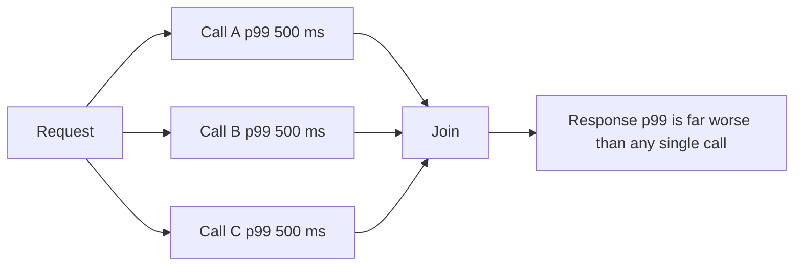

## 4.5 Latency, bandwidth, packet loss and retransmission

#### Concept

Four words describe how a network behaves, and they are often confused:

- **Latency** is how long one bit takes to get from A to B. Measured as **RTT** (round-trip time) in milliseconds. It is bounded by physics: light in fibre travels about 200 km per millisecond, so Mumbai to Frankfurt (about 6,500 km of cable) is at least 33 ms one way, 65 ms round trip, and in practice 110 to 140 ms.
- **Bandwidth** is how many bits per second the pipe can carry. Measured in Mbps or Gbps. Adding bandwidth does not reduce latency, in the same way that adding lanes to a motorway does not make one car go faster.
- **Packet loss** is the fraction of packets that never arrive. Even 1% loss devastates TCP throughput because every loss triggers retransmission and a congestion back-off.
- **Retransmission** is TCP resending a lost segment after a timeout or duplicate ACKs. It costs at least one extra RTT, and often much more because the retransmission timeout (RTO) has a floor of 200 ms on Linux.

And one more that senior engineers obsess over: **tail latency**. Your p50 might be 20 ms while your p99 is 900 ms. Users notice the p99. A page that fans out to 20 backend calls will hit the p99 of at least one of them on almost every load.

#### Why does it exist?

These are not design choices; they are facts about physical networks that your architecture must respect. The reason to name them is that each one calls for a different fix. Latency is fixed by fewer round trips, closer regions, and caching. Bandwidth is fixed by smaller payloads, compression and CDNs. Loss is fixed by retries, better paths and protocols like QUIC. Tail latency is fixed by timeouts, hedging, and removing variance (GC pauses, lock waits, cold caches). Applying the wrong fix is common: teams "add bandwidth" (a bigger instance) to fix a latency problem and see no change.

#### Mental model

Imagine a water pipe from a reservoir to your house. Latency is how long a drop takes to travel the pipe. Bandwidth is the pipe's diameter. A wider pipe delivers more water per second but the first drop still takes just as long to arrive. Packet loss is a leak: some water never arrives and the reservoir has to send it again. Tail latency is that one shower every morning when the pressure inexplicably drops for ten seconds.

#### How it works

**Where latency comes from.** RTT is propagation (distance), transmission (bytes divided by bandwidth), queueing (waiting in router buffers, which balloons under congestion; this is **bufferbloat**), and processing at each hop. On a good path, propagation dominates. On a congested mobile network, queueing dominates and RTT swings from 40 ms to 800 ms within seconds.

**Why a 5 MB JSON response is slow on mobile.** Take a product catalogue endpoint returning 5 MB of uncompressed JSON to a phone on 4G with 20 Mbps downlink and 60 ms RTT, and 0.5% packet loss.

1. Transmission alone: 5 MB is 40 Mbit; at 20 Mbps, that is 2 seconds minimum.
2. Slow start: TCP begins at about 14 KB per RTT and doubles; reaching a window that fills 20 Mbps at 60 ms (about 150 KB in flight) takes roughly 4 round trips, 240 ms, during which only about 200 KB moved.
3. Loss: 5 MB is about 3,500 packets; at 0.5% loss, about 17 packets are lost. Each loss halves the congestion window (or worse, triggers a 200 ms+ RTO if it is the last packet in flight). Realistic throughput drops to perhaps 8 Mbps. Now the transfer is 5 seconds.
4. Parsing: `JSON.parse` on 5 MB takes 30 to 80 ms on a mid-range phone and holds the main thread; the memory spike can crash a WebView.
5. The user saw a spinner for 5 to 6 seconds. With gzip (JSON compresses 5 to 10x) the same payload is about 600 KB, transferred in under a second; with pagination (50 products at a time, 40 KB) it is 150 ms.

The lesson: bytes on the wire are the lever. Latency and loss multiply the cost of every byte.

**Retransmission mechanics.** The sender keeps a timer per connection. RTO starts at 1 second for the first segment (SYN), then is computed from smoothed RTT plus four times the RTT variance, with a 200 ms floor on Linux. If three duplicate ACKs arrive first, **fast retransmit** resends without waiting for the timer. **Selective ACK (SACK)** lets the receiver say exactly which segments arrived so only the gaps are resent. On a lossy path, the effective throughput follows the Mathis formula: roughly `MSS / (RTT * sqrt(loss))`. With 1,460-byte segments, 100 ms RTT and 1% loss, that is about 1.2 Mbps regardless of link speed. Loss, not bandwidth, becomes the ceiling.

**Tail latency.** In a system where each backend call has a 1% chance of taking more than 500 ms, a request that makes 20 such calls has a `1 - 0.99^20` = 18% chance of being slow. Fan-out amplifies tail latency; this is why senior engineers ask "how many downstream calls does this endpoint make?" before asking "how fast is each call?". Sources of tail latency in a NestJS system: garbage collection pauses (10 to 200 ms on a large heap), event-loop lag from a synchronous `JSON.stringify` of a large object, pool exhaustion waits, Postgres lock waits, a cold Redis key, a DNS threadpool queue, a TLS handshake on a new connection, and slow start after idle.



#### Practical example

A ride-booking app's "nearby drivers" endpoint called location, pricing, ETA and driver-profile services in sequence: 4 calls at 15 ms p50 each, 60 ms total at p50. At p99 each call was 300 ms, and sequential fan-out meant the endpoint's p99 was over 700 ms. Two changes: run the four calls in parallel with `Promise.all` (p50 dropped to 18 ms), and set a 150 ms timeout on the driver-profile call with a fallback to a cached profile (p99 dropped to 320 ms). Neither change touched bandwidth; both attacked round trips and tail variance.

#### NestJS example

Three tools against latency and tails in one interceptor: a per-request deadline, parallel fan-out, and a size guard that refuses to send a response the client will choke on.

```ts
// timeout.interceptor.ts
import { CallHandler, ExecutionContext, Injectable, NestInterceptor, RequestTimeoutException } from '@nestjs/common';
import { Observable, throwError, TimeoutError } from 'rxjs';
import { catchError, timeout } from 'rxjs/operators';

@Injectable()
export class TimeoutInterceptor implements NestInterceptor {
  // A hard deadline below the ALB idle timeout so the client gets a clean 504
  // from us rather than a mystery timeout from the load balancer.
  constructor(private readonly ms = 10_000) {}

  intercept(_ctx: ExecutionContext, next: CallHandler): Observable<unknown> {
    return next.handle().pipe(
      timeout(this.ms),
      catchError((err) =>
        err instanceof TimeoutError ? throwError(() => new RequestTimeoutException()) : throwError(() => err),
      ),
    );
  }
}
```

```ts
// nearby.service.ts
import { Injectable } from '@nestjs/common';

@Injectable()
export class NearbyService {
  constructor(
    private readonly location: LocationClient,
    private readonly pricing: PricingClient,
    private readonly eta: EtaClient,
    private readonly profiles: ProfileClient,
  ) {}

  async nearby(riderId: string, lat: number, lng: number) {
    // Parallel fan-out: total latency is the max of the four, not the sum.
    const [drivers, surge, etas] = await Promise.all([
      this.location.nearbyDrivers(lat, lng, { timeoutMs: 400 }),
      this.pricing.surgeFor(lat, lng, { timeoutMs: 300 }),
      this.eta.estimate(lat, lng, { timeoutMs: 400 }),
    ]);

    // A soft dependency: use a short timeout and degrade instead of failing the request.
    const profiles = await this.profiles
      .batchGet(drivers.map((d) => d.id), { timeoutMs: 150 })
      .catch(() => this.profiles.cachedBatch(drivers.map((d) => d.id)));

    // Respond with only what the map needs; the full driver object is 4 KB each.
    return drivers.slice(0, 20).map((d) => ({
      id: d.id, lat: d.lat, lng: d.lng,
      etaSeconds: etas[d.id], surge, name: profiles[d.id]?.firstName,
    }));
  }
}
```

The `slice(0, 20)` and the trimmed shape are the bandwidth fix; `Promise.all` and the timeouts are the latency and tail fix.

#### PostgreSQL example

Latency between the application and the database is paid per round trip, so the number of queries per request matters more than the speed of any one query. The N+1 pattern turns a 2 ms page into a 400 ms page across 200 round trips, even inside one AZ at 0.3 ms RTT, once you add pool checkout and parse time per query.

```sql
-- N+1: one query per order to fetch its items (200 round trips)
-- SELECT * FROM order_items WHERE order_id = $1;  -- executed 200 times

-- One round trip: aggregate the items into JSON per order
SELECT o.id, o.status, o.total_cents,
       COALESCE(json_agg(json_build_object('sku', i.sku, 'qty', i.qty)) FILTER (WHERE i.id IS NOT NULL), '[]') AS items
FROM orders o
LEFT JOIN order_items i ON i.order_id = o.id
WHERE o.user_id = $1 AND o.created_at > now() - interval '30 days'
GROUP BY o.id
ORDER BY o.created_at DESC
LIMIT 50;

-- Verify it is one indexed pass, not a sequential scan of items
EXPLAIN (ANALYZE, BUFFERS)
SELECT ... ;
-- GroupAggregate  (cost=1.15..212.40 rows=50 width=96) (actual time=0.09..1.84 rows=50 loops=1)
--   ->  Nested Loop Left Join  (actual time=0.05..1.31 rows=214 loops=1)
--         ->  Index Scan using orders_user_created_idx on orders o (actual time=0.03..0.21 rows=50 loops=1)
--         ->  Index Scan using order_items_order_id_idx on order_items i (actual time=0.01..0.02 rows=4 loops=50)
--   Buffers: shared hit=312
-- Execution Time: 1.97 ms
```

Also watch the bandwidth side: `SELECT *` on a table with a 2 MB `jsonb` column ships 2 MB per row across the network. Select the columns you need.

#### TypeORM example

The same idea in TypeORM: batch loads and column selection, with a statement timeout so a slow query cannot become a tail-latency event for every caller.

```ts
// orders.repository.ts
import { Injectable } from '@nestjs/common';
import { InjectRepository } from '@nestjs/typeorm';
import { Repository } from 'typeorm';
import { Order } from './order.entity';

@Injectable()
export class OrdersRepository {
  constructor(@InjectRepository(Order) private readonly repo: Repository<Order>) {}

  async recentForUser(userId: string): Promise<Order[]> {
    return this.repo
      .createQueryBuilder('o')
      .leftJoinAndSelect('o.items', 'i')        // one round trip, not N+1
      .select(['o.id', 'o.status', 'o.totalCents', 'o.createdAt', 'i.sku', 'i.qty']) // trim bytes
      .where('o.userId = :userId', { userId })
      .andWhere("o.createdAt > now() - interval '30 days'")
      .orderBy('o.createdAt', 'DESC')
      .take(50)
      .setQueryRunner(undefined as never)         // default runner; shown to note statement_timeout lives in pool extra
      .getMany();
  }
}
```

The `setQueryRunner` line is only there to point out that TypeORM has no per-query timeout API; the pool-level `statement_timeout` in `extra` (see 4.4.3) is the real guard.

#### Sequelize example

```ts
// orders.service.ts (Sequelize)
import { Injectable } from '@nestjs/common';
import { InjectModel } from '@nestjs/sequelize';
import { Op } from 'sequelize';
import { Order } from './order.model';
import { OrderItem } from './order-item.model';

@Injectable()
export class OrdersService {
  constructor(@InjectModel(Order) private readonly orders: typeof Order) {}

  recentForUser(userId: string) {
    return this.orders.findAll({
      attributes: ['id', 'status', 'totalCents', 'createdAt'],      // trim bytes on the wire
      include: [{ model: OrderItem, attributes: ['sku', 'qty'], separate: false }], // single JOIN query
      where: { userId, createdAt: { [Op.gt]: new Date(Date.now() - 30 * 86_400_000) } },
      order: [['createdAt', 'DESC']],
      limit: 50,
    });
  }
}
```

#### Production scenario

Real numbers from an e-commerce API: p50 42 ms, p99 610 ms, p99.9 2.4 s. Breaking down the p99 with tracing showed 35% was Postgres lock waits on a hot `inventory` row, 25% was GC pauses on pods with a 1.5 GB heap, 20% was outbound calls to a tax service with no timeout, and the remainder was slow start on fresh connections from an ALB with a 60-second idle timeout during low traffic. Fixes over one quarter: an advisory lock with a 200 ms wait limit and a queue for the hot row, smaller pods (512 MB heap, more replicas) to shorten GC, a 300 ms timeout with cached fallback on tax, and HTTP/2 between the ALB and the pods. p99 went to 180 ms; p50 barely moved. Tail latency is where the work is.

#### Failure scenario

At 21:30 on a cricket final night, a mobile carrier's backbone degraded and packet loss on that carrier rose to 3%. The API's p50 was unchanged from the data centre's point of view, but users on that carrier saw the home feed (a 900 KB JSON response) take 20 seconds. Alerts did not fire because server-side latency was fine; the bytes were leaving the ALB quickly and dying in the carrier's network. Real-user monitoring from the app showed the problem. The team shipped a change that night: gzip on the feed endpoint (900 KB to 140 KB) and a page size of 20 instead of 100. Under the same loss, 140 KB transferred in about 2 seconds. Long term they added Brotli and a CDN edge that serves HTTP/3, which handles loss far better than TCP.

#### Edge cases & failure modes

- Bufferbloat: RTT to a mobile client swings from 40 ms to 1 s; timeouts tuned for the data centre fire spuriously.
- Loss on the last packet of a response triggers a full RTO (200 ms minimum) rather than fast retransmit, because there are no following packets to generate duplicate ACKs. Small responses suffer disproportionately.
- Asymmetric paths: the request takes 50 ms, the response 200 ms; `ping` shows the average and hides it.
- Coordinated omission: load testers that wait for a response before sending the next request under-report tail latency. Use open-loop load tools (k6 with arrival rate, wrk2).
- Large responses and `JSON.stringify`: serialising 5 MB blocks the event loop for tens of milliseconds, adding tail latency to every other request on the pod.
- Retry amplification: a client that retries on timeout doubles the load on a system that is slow because it is overloaded (see 4.15).
- The p99 of a dependency becomes your p50 if you call it 70 times per request.

#### How a Senior Backend Engineer thinks about this

They separate the levers: distance and round trips for latency, bytes for bandwidth, protocols and paths for loss, variance for tails. They measure at the client (real-user monitoring), not only at the server, because the server cannot see the carrier's loss. They put a budget on every endpoint: at most N downstream calls, at most M KB of response, a deadline that is propagated to every call. They refuse to add fields to a response "in case the client needs them". To a product manager: "Halving the response size did more for the app than doubling the server count would have. The users' network is the slowest part of our system and we do not own it."

#### Common mistakes

- Optimising a 3 ms query while the endpoint sends 2 MB.
- Reporting averages; the average hides the tail that users feel.
- Sequential `await` chains where calls are independent.
- No timeouts on outbound calls, so one slow dependency becomes everyone's tail.
- Load testing from inside the same AZ and calling the result "user latency".
- Assuming a bigger instance fixes latency.

#### Interview questions

1. **Explain the difference between latency and bandwidth with a backend example.** Latency is per-round-trip delay (why an N+1 query pattern is slow); bandwidth is bytes per second (why a 5 MB response is slow). More bandwidth does not fix N+1.
2. **Why is a 5 MB JSON response slow on mobile even on a fast 4G link?** Slow start, loss-triggered back-off, the Mathis limit, and client parse time; compression and pagination fix it, more server capacity does not.
3. **What is tail latency and why does fan-out make it worse?** The slow tail of the distribution; the probability that at least one of N calls is slow grows as `1 - (1-p)^N`.
4. **Give three sources of tail latency inside a Node service and how to reduce each.** GC pauses (smaller heaps, more pods), event-loop blocking (avoid sync serialisation of large objects, offload), pool waits (size pools, add timeouts).
5. **Why does loss on the last packet of a small response hurt more than loss in the middle?** No duplicate ACKs follow, so fast retransmit cannot fire and the sender waits for the full RTO.
6. **What is coordinated omission?** Load tools that wait for slow responses send fewer requests during slow periods, under-sampling exactly the moments that matter.

#### Practical exercise

Use `tc netem` on a Linux VM (or Docker with `--cap-add NET_ADMIN`) to add 80 ms delay and 1% loss to the interface, then measure the transfer time of a 5 MB JSON response from a NestJS endpoint with and without gzip, and with a paginated 50 KB version. Then instrument the endpoint with OpenTelemetry and produce a p50, p95, p99 table under a k6 open-loop test at 200 RPS. Acceptance criteria: a table of transfer times across the three variants and two network conditions, and one paragraph identifying which of latency, bandwidth or loss dominated each cell.
