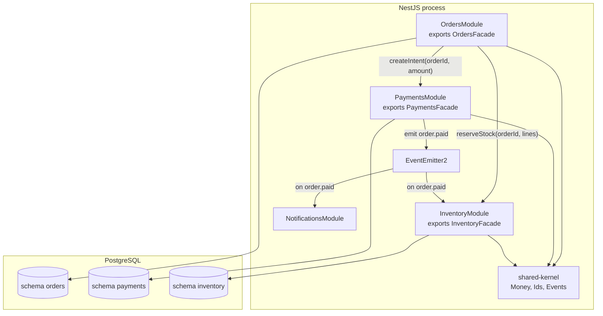

# Part 5 — Software Architecture

Architecture is the set of decisions that are expensive to change later. Which process runs which code, which database owns which table, which team can deploy without asking another team, how a request travels from the load balancer to the row on disk. Everything else (naming, formatting, which HTTP client library you use) is a detail you can refactor on a Tuesday afternoon. Architecture is what you live with for years.

This part walks through the architectural styles you will meet in real backend work, always with the same stack in mind: a NestJS application in front of PostgreSQL and Redis, with Kafka or RabbitMQ carrying events to background workers. For each style we look at the shape of the code, the shape of the deployment, and, most importantly, what breaks at 02:00 when it goes wrong.

A warning before we start. Every style below is a tool. None of them is a goal. The senior engineer's job is not to "do microservices" or "do clean architecture"; it is to pick the least amount of structure that lets the current team ship the current product safely, while leaving a door open for the next stage. Keep that in mind as you read.

## 5.1 The monolith

#### Concept

A monolith is a single deployable unit. One repository, one build, one process (or many identical copies of the same process behind a load balancer), one database. Every feature of the product lives inside it: user registration, product catalog, cart, checkout, payments, notifications, admin reports.

In NestJS terms: one `main.ts`, one `AppModule`, and every other module imported into it. `npm run build` produces one `dist/` folder, and `docker build` produces one image.

#### Why does it exist?

The monolith exists because it is the natural first shape of any system. You do not design a monolith; you get one by writing code. It solves the most important early problem: getting a working product in front of users with a team of one to ten people, without paying for infrastructure you do not need yet.

What breaks without it? Nothing; it is the baseline. The question is what breaks *with* it, and when. We will get there.

#### Mental model

Imagine a restaurant with one kitchen. Every dish, from starters to desserts, comes out of the same room. The chefs walk over and talk to each other; nobody sends a courier across town to ask if there are still tomatoes. Communication is fast and cheap. But if the kitchen catches fire, every dish stops. And when the restaurant grows to two hundred tables, one kitchen becomes crowded, chefs bump into each other, and one slow station (the grill) holds up every order.

A monolith is that single kitchen.

#### How it works

1. A request hits the load balancer and is forwarded to one of N identical Node.js processes.
2. The NestJS router matches the route to a controller inside the process.
3. The controller calls a service; the service calls other services and repositories by plain method calls, all in the same memory space. A "call" costs nanoseconds, never a network round trip.
4. All repositories talk to the same PostgreSQL database through one connection pool.
5. A single database transaction can span any tables you like, because they are all in the same database.
6. Deployment replaces the whole process. There is no such thing as "deploying only the payments part".

```text
                 +----------------------------------------+
   Client -----> |  NestJS process (one image, one build)  |
                 |                                          |
                 |  UsersModule  OrdersModule  PaymentsModule|
                 |  ProductsModule  NotificationsModule     |
                 |          \       |        /              |
                 |           +------+-------+               |
                 |                  |                       |
                 +------------------|-----------------------+
                                    v
                            PostgreSQL (one DB)
```

#### Practical example

An e-commerce startup with four engineers. The product has users, a catalog, a cart, checkout, and order emails. Traffic is 20 requests per second at peak. The entire system is one NestJS app with a PostgreSQL database on RDS and a Redis instance for sessions.

Checkout is a single method that, inside one transaction, decrements inventory, creates the order, records the payment intent, and enqueues an email. If any step fails, the transaction rolls back and nothing half-happens. That is the monolith's superpower: local transactions across the whole domain.

#### NestJS example

A typical early-stage layout. Note that nothing stops `OrdersService` from injecting `InventoryRepository` directly; there are no boundaries yet.

```text
src/
  main.ts
  app.module.ts
  users/
    users.controller.ts
    users.service.ts
    users.module.ts
    user.entity.ts
  products/
    products.controller.ts
    products.service.ts
    product.entity.ts
  orders/
    orders.controller.ts
    orders.service.ts
    order.entity.ts
  payments/
    payments.service.ts
  notifications/
    email.service.ts
```

```ts
// src/orders/orders.service.ts
import { Injectable, ConflictException } from '@nestjs/common';
import { InjectRepository } from '@nestjs/typeorm';
import { Repository, DataSource } from 'typeorm';
import { Order } from './order.entity';
import { Product } from '../products/product.entity';
import { PaymentsService } from '../payments/payments.service';
import { EmailService } from '../notifications/email.service';

@Injectable()
export class OrdersService {
  constructor(
    @InjectRepository(Order) private readonly orders: Repository<Order>,
    private readonly dataSource: DataSource,
    private readonly payments: PaymentsService,
    private readonly email: EmailService,
  ) {}

  async checkout(userId: string, productId: string, qty: number): Promise<Order> {
    // One local transaction spans inventory, orders and payment intent rows.
    return this.dataSource.transaction(async (manager) => {
      const product = await manager
        .getRepository(Product)
        .createQueryBuilder('p')
        .setLock('pessimistic_write') // SELECT ... FOR UPDATE on the hot row
        .where('p.id = :id', { id: productId })
        .getOne();

      if (!product || product.stock < qty) {
        throw new ConflictException('Insufficient stock');
      }
      product.stock -= qty;
      await manager.save(product);

      const order = manager.create(Order, { userId, productId, qty, status: 'CREATED' });
      await manager.save(order);

      await this.payments.createIntent(manager, order); // same transaction
      await this.email.queueOrderConfirmation(order.id); // Redis queue, fire-and-forget
      return order;
    });
  }
}
```

This is good code for a small team. It is honest, it is transactional, and a new engineer can read the whole checkout in one file.

#### PostgreSQL example

One database, one schema, foreign keys everywhere. That is fine; it is a feature at this stage.

```sql
CREATE TABLE products (
  id          uuid PRIMARY KEY DEFAULT gen_random_uuid(),
  name        text NOT NULL,
  stock       integer NOT NULL CHECK (stock >= 0),
  price_cents integer NOT NULL
);

CREATE TABLE orders (
  id          uuid PRIMARY KEY DEFAULT gen_random_uuid(),
  user_id     uuid NOT NULL REFERENCES users(id),
  product_id  uuid NOT NULL REFERENCES products(id),
  qty         integer NOT NULL CHECK (qty > 0),
  status      text NOT NULL DEFAULT 'CREATED',
  created_at  timestamptz NOT NULL DEFAULT now()
);

CREATE INDEX orders_user_created_idx ON orders (user_id, created_at DESC);
```

The `CHECK (stock >= 0)` constraint is the last line of defence against overselling; it will reject a bad decrement even if application code has a bug.

#### Production scenario

A well-built monolith carries a surprising amount of traffic. A single Node.js process handling mostly I/O-bound work comfortably does 1,000 to 3,000 requests per second if the database is not the bottleneck. Ten replicas behind an ALB give you 10,000 to 30,000 RPS. Many companies never need more than that. Shopify famously ran a modular Rails monolith at enormous scale for years, and Stack Overflow serves billions of page views a month from a small number of large servers.

The real limits of a monolith are organisational, not technical:

- **Build and test time.** At 400,000 lines of TypeScript, a full `tsc` plus Jest run creeps past 20 minutes. Every pull request waits.
- **Deployment coupling.** A one-line fix to the email template deploys the checkout code too. If a release is bad, everything rolls back.
- **Blast radius.** One unbounded query in the reports module can exhaust the connection pool and take checkout down with it.
- **Ownership blur.** With forty engineers, "who owns `OrdersService`?" has no answer, and it grows to 2,000 lines.

#### Failure scenario

At 14:20 on a Monday, the marketing team launches a campaign. Traffic triples. The admin dashboard's "sales by hour" report runs a query that does a sequential scan over 30 million `orders` rows and holds a connection for 40 seconds. Three admins refresh it repeatedly. Within two minutes, the shared PostgreSQL pool (max 20 connections per replica) is full of report queries. Checkout requests wait for a connection, time out at 30 seconds, and the load balancer starts marking replicas unhealthy. Revenue drops to zero for eleven minutes.

Nothing in the checkout code was wrong. The failure was architectural: a low-value, heavy workload shared a resource (the pool) with a high-value, light workload, and there was no boundary between them.

#### Edge cases & failure modes

- **Noisy neighbour inside the process.** A CPU-heavy task (PDF generation, image resize) blocks the event loop for everyone. Node.js has one main thread per process.
- **Memory leak in one module** kills the whole process; Kubernetes restarts it and the checkout is gone for 15 seconds each time (`OOMKilled` loops).
- **Migration lock.** One `ALTER TABLE` on a large table locks the table for the whole app, not just one feature.
- **Test suite coupling.** A flaky test in notifications blocks a payments hotfix.
- **Dependency upgrade friction.** Upgrading TypeORM affects every module at once.
- **Circular imports** creep in because nothing forbids `users` from importing `orders` and vice versa.

#### How a Senior Backend Engineer thinks about this

A senior engineer does not apologise for a monolith. They ask: *Is the team small? Is the domain still being discovered? Is the traffic within one database's capacity?* If yes to all three, the monolith is the correct answer, and adding services would be waste.

What they refuse to do is let the monolith become a **ball of mud**. From day one they enforce module boundaries inside the monolith, which is exactly the modular monolith we discuss next. They also refuse to run heavy analytical workloads on the same pool as transactional traffic; they route reports to a read replica with a separate pool.

To a product manager: "We are one application today. That lets us ship features fast and keep the bill low. We are building it in separate rooms so that when a room needs its own building, we can move it without knocking down the house."

#### Common mistakes

- **Treating "monolith" as a slur** and starting a new product with eight services and three engineers. This is the single most expensive mistake in modern backend engineering.
- **No boundaries at all.** Every service injects every repository. After two years, no change is safe.
- **One connection pool for everything.** Reports, cron jobs and checkout share 20 connections.
- **Running background jobs inside the web process.** A job that takes 5 minutes blocks graceful shutdown and gets killed mid-way on every deploy.
- **Skipping the read replica** because "it's just one database".

#### Interview questions

1. *When is a monolith the right architecture?* Expected: small team, evolving domain, traffic within one database's capacity, need for fast iteration. Follow-up: what signals would make you reconsider?
2. *What is the blast radius of a bug in a monolith and how do you reduce it?* Expected: the whole process; reduce with bulkheads (separate pools, separate worker processes), timeouts, circuit breakers on outbound calls.
3. *How do you scale a monolith horizontally?* Expected: stateless processes behind a load balancer, sessions in Redis, sticky sessions avoided, database read replicas, connection pooler like PgBouncer.
4. *Why can a monolith have simpler consistency guarantees than microservices?* Expected: single database, local ACID transactions span the whole domain; no sagas or outboxes needed.
5. *What is the difference between a monolith and a "big ball of mud"?* Expected: a monolith is a deployment shape; a ball of mud is a code shape with no boundaries. You can have a clean monolith or a muddy set of microservices.

#### Practical exercise

Take an existing NestJS monolith (or generate one with `nest new`). Add a `ReportsModule` with a deliberately slow query. Configure two TypeORM `DataSource`s: one for transactional modules with `max: 20`, and one for reports with `max: 3` pointing to a read replica (or the same database on a different pool for the exercise). Load-test checkout with `autocannon` while hammering the report endpoint.

Acceptance criteria: checkout p99 latency stays under 200 ms while the report endpoint is saturated; the report endpoint returns `503` or queues when its own pool is exhausted, never touching the transactional pool.

## 5.2 The modular monolith

#### Concept

A modular monolith is still one deployable unit and (usually) one database, but the code inside is divided into modules with **enforced** boundaries. A module exposes a small public interface and hides everything else. Modules talk through that interface or through in-process events, never by reaching into each other's tables or internal classes.

The word "enforced" is the whole point. Every monolith has folders. A modular monolith has walls.

#### Why does it exist?

It exists to get most of the organisational benefits of microservices (clear ownership, independent evolution, testability, a path to extraction) without paying the operational cost of a distributed system (network calls, partial failure, N pipelines, distributed tracing).

Without it, a growing monolith turns into a ball of mud: any class can call any class, tables are joined across domains in ad-hoc queries, and no one can change anything with confidence. The usual response is to "break it into microservices", which does not fix the problem; it distributes it.

#### Mental model

Imagine an office building. One address, one electricity bill, one front door. Inside, each team has its own room with a door and a reception desk. If Payments needs something from Inventory, they go to Inventory's reception and ask; they do not walk in and rummage through Inventory's filing cabinets. Because each room has a defined door, moving a team to a separate building later means re-routing the reception desk, not untangling desks that grew into each other.

#### How it works

The building blocks, in NestJS terms:

1. **One NestJS module per business capability**, not per technical layer. `OrdersModule`, `PaymentsModule`, `InventoryModule`, `NotificationsModule`. Not `ControllersModule` and `ServicesModule`.
2. **Encapsulation via `exports`.** A NestJS module can only inject providers that another module explicitly `exports`. If `InventoryModule` does not export `InventoryRepository`, then `OrdersService` cannot inject it. The DI container enforces this at startup, with a hard error.
3. **A public facade per module.** Each module exports one or two application services (for example `InventoryFacade`) with a deliberately small API. Everything else stays internal.
4. **Schema-per-module in PostgreSQL.** Each module owns a PostgreSQL schema (`orders.*`, `payments.*`, `inventory.*`). Cross-schema foreign keys are avoided; cross-module references are by id only. This is the single most important decision for later extraction.
5. **In-process events with `@nestjs/event-emitter`.** When an order is paid, `OrdersModule` emits `order.paid`. `InventoryModule` and `NotificationsModule` subscribe. Orders does not know they exist.
6. **A shared kernel** for truly shared, stable things: `Money`, `UserId`, base error classes, the event contract types. Kept tiny and versioned carefully.
7. **Contracts folder** holding the public DTOs and event payloads each module publishes, so consumers depend on contracts, not on internals.
8. **Lint-level enforcement** using `eslint-plugin-boundaries` or `dependency-cruiser`, so `import ... from '../inventory/internal/...'` fails CI.



#### Practical example

The same e-commerce company, now with twenty engineers in four squads: Orders, Payments, Inventory, Growth (notifications and marketing). Each squad owns one module and one schema. They still deploy one image, several times a day. When Payments needs to add Razorpay alongside Stripe, they change files only under `modules/payments/`; the Orders squad does not even review the PR.

Checkout now looks different from the naive monolith. `OrdersService` does not touch the `inventory.stock` table. It calls `InventoryFacade.reserve()`, which is the only door.

#### NestJS example

Folder layout designed for later extraction:

```text
src/
  main.ts
  app.module.ts
  shared-kernel/
    money.ts
    ids.ts
    domain-error.ts
  contracts/
    events/
      order-paid.event.ts
      stock-reserved.event.ts
    inventory/
      reserve-stock.dto.ts
  modules/
    orders/
      orders.module.ts
      public/
        orders.facade.ts          <- the ONLY exported provider
      application/
        checkout.use-case.ts
      domain/
        order.ts
        order-status.ts
      infrastructure/
        order.entity.ts           <- schema: orders
        order.typeorm-repository.ts
      presentation/
        orders.controller.ts
        dto/create-order.dto.ts
    inventory/
      inventory.module.ts
      public/
        inventory.facade.ts
      application/
        reserve-stock.use-case.ts
        on-order-paid.handler.ts
      infrastructure/
        stock.entity.ts           <- schema: inventory
    payments/
      payments.module.ts
      public/
        payments.facade.ts
      infrastructure/
        payment.entity.ts         <- schema: payments
```

The module definition enforces the boundary:

```ts
// src/modules/inventory/inventory.module.ts
import { Module } from '@nestjs/common';
import { TypeOrmModule } from '@nestjs/typeorm';
import { StockEntity } from './infrastructure/stock.entity';
import { StockTypeormRepository } from './infrastructure/stock.typeorm-repository';
import { ReserveStockUseCase } from './application/reserve-stock.use-case';
import { OnOrderPaidHandler } from './application/on-order-paid.handler';
import { InventoryFacade } from './public/inventory.facade';

export const STOCK_REPOSITORY = Symbol('STOCK_REPOSITORY');

@Module({
  imports: [TypeOrmModule.forFeature([StockEntity])],
  providers: [
    { provide: STOCK_REPOSITORY, useClass: StockTypeormRepository },
    ReserveStockUseCase,
    OnOrderPaidHandler,
    InventoryFacade,
  ],
  // Only the facade leaves the module. Repositories and use cases stay private.
  exports: [InventoryFacade],
})
export class InventoryModule {}
```

If a developer in `OrdersModule` writes `constructor(@Inject(STOCK_REPOSITORY) repo: StockRepository)`, NestJS fails at boot with `Nest can't resolve dependencies of OrdersService (?)`. The wall is real.

The facade is a thin, intention-revealing API:

```ts
// src/modules/inventory/public/inventory.facade.ts
import { Injectable } from '@nestjs/common';
import { ReserveStockUseCase } from '../application/reserve-stock.use-case';
import { ReserveStockDto } from '../../../contracts/inventory/reserve-stock.dto';

@Injectable()
export class InventoryFacade {
  constructor(private readonly reserveStock: ReserveStockUseCase) {}

  // Returns a reservation id; throws InsufficientStockError (from shared-kernel).
  reserve(dto: ReserveStockDto): Promise<{ reservationId: string }> {
    return this.reserveStock.execute(dto);
  }
}
```

Cross-module reactions go through in-process events:

```ts
// src/modules/payments/application/confirm-payment.use-case.ts
import { Injectable } from '@nestjs/common';
import { EventEmitter2 } from '@nestjs/event-emitter';
import { OrderPaidEvent } from '../../../contracts/events/order-paid.event';

@Injectable()
export class ConfirmPaymentUseCase {
  constructor(private readonly events: EventEmitter2) {}

  async execute(orderId: string, amountCents: number): Promise<void> {
    // ... persist payment row in schema payments ...
    // Emit AFTER commit. Emitting inside the transaction risks listeners
    // reading data that is later rolled back.
    await this.events.emitAsync(
      OrderPaidEvent.name,
      new OrderPaidEvent({ orderId, amountCents, paidAt: new Date().toISOString() }),
    );
  }
}

// src/modules/inventory/application/on-order-paid.handler.ts
import { Injectable, Logger } from '@nestjs/common';
import { OnEvent } from '@nestjs/event-emitter';
import { OrderPaidEvent } from '../../../contracts/events/order-paid.event';

@Injectable()
export class OnOrderPaidHandler {
  private readonly log = new Logger(OnOrderPaidHandler.name);

  @OnEvent(OrderPaidEvent.name, { async: true, promisify: true })
  async handle(event: OrderPaidEvent): Promise<void> {
    this.log.log(`Committing reservation for order ${event.orderId}`);
    // convert reservation into a hard decrement, idempotently by orderId
  }
}
```

`EventEmitter2` is in-memory. If the process dies between the payment commit and the listener finishing, the event is lost. That is acceptable for a modular monolith *only* if the listener's work is recoverable (a reconciliation job, or the outbox pattern from Part 5.6). Do not pretend in-process events are durable.

#### PostgreSQL example

Schema-per-module with search paths and no cross-schema foreign keys.

```sql
CREATE SCHEMA orders;
CREATE SCHEMA payments;
CREATE SCHEMA inventory;

CREATE TABLE inventory.stock (
  product_id  uuid PRIMARY KEY,           -- reference by id, NO FK to products schema
  available   integer NOT NULL CHECK (available >= 0),
  reserved    integer NOT NULL DEFAULT 0 CHECK (reserved >= 0),
  version     integer NOT NULL DEFAULT 0  -- optimistic locking
);

CREATE TABLE inventory.reservations (
  id          uuid PRIMARY KEY DEFAULT gen_random_uuid(),
  order_id    uuid NOT NULL,              -- id only, owned by orders schema
  product_id  uuid NOT NULL,
  qty         integer NOT NULL,
  status      text NOT NULL DEFAULT 'HELD',
  expires_at  timestamptz NOT NULL,
  UNIQUE (order_id, product_id)           -- idempotency: one reservation per line
);

-- Each module's DB role can only touch its own schema.
CREATE ROLE inventory_svc LOGIN PASSWORD '...';
GRANT USAGE ON SCHEMA inventory TO inventory_svc;
GRANT SELECT, INSERT, UPDATE, DELETE ON ALL TABLES IN SCHEMA inventory TO inventory_svc;
```

Giving up the cross-schema foreign key feels wrong at first. It is the price of extraction: the day `inventory` moves to its own database, there is no constraint to drop and no join to rewrite.

#### TypeORM example

TypeORM entities carry the schema name, so the module owns its tables explicitly:

```ts
// src/modules/inventory/infrastructure/stock.entity.ts
import { Entity, PrimaryColumn, Column, VersionColumn } from 'typeorm';

@Entity({ schema: 'inventory', name: 'stock' })
export class StockEntity {
  @PrimaryColumn('uuid') productId!: string;
  @Column('integer') available!: number;
  @Column('integer', { default: 0 }) reserved!: number;
  @VersionColumn() version!: number; // TypeORM bumps this on save; stale writes throw
}
```

For a per-module `DataSource` (a stepping stone to a separate database), register named connections with `TypeOrmModule.forRoot({ name: 'inventory', schema: 'inventory', ... })` and `TypeOrmModule.forFeature([StockEntity], 'inventory')`. Most teams start with one `DataSource` and a schema per module, and only split the `DataSource` when the extraction is real.

#### Sequelize example

The Sequelize equivalent uses the `schema` option on the model:

```ts
// src/modules/inventory/infrastructure/stock.model.ts
import { Table, Column, Model, PrimaryKey, DataType } from 'sequelize-typescript';

@Table({ tableName: 'stock', schema: 'inventory', timestamps: false, version: true })
export class StockModel extends Model {
  @PrimaryKey @Column(DataType.UUID) productId!: string;
  @Column(DataType.INTEGER) available!: number;
  @Column({ type: DataType.INTEGER, defaultValue: 0 }) reserved!: number;
}
```

`version: true` turns on Sequelize's optimistic locking; a stale `save()` throws `OptimisticLockError`.

#### Production scenario

A modular monolith with eight modules, twenty engineers, 2,500 RPS peak, one `db.r6g.2xlarge` PostgreSQL primary and two read replicas. Deploys happen 10 to 15 times a day from one pipeline that runs 12 minutes. Each module has its own Jest project, so a change under `modules/payments` runs only the payments tests plus a small contract suite in the pre-merge stage; the full suite runs on `main`.

Observability is easy: one process, one trace, one log stream. A checkout request that touches four modules shows up as one trace with four spans, no context propagation to worry about.

When the Payments squad grows to twelve people and needs to deploy hotfixes at a different cadence than everyone else, they extract `PaymentsModule` into its own service. Because the module only ever spoke through `PaymentsFacade` and `order.paid` events, the extraction is:

1. Move `modules/payments` to a new repository with its own `main.ts`.
2. Replace `PaymentsFacade` in the monolith with an HTTP or gRPC client with the same interface.
3. Replace `EventEmitter2` for `order.paid` with a Kafka topic, using the same contract type.
4. Point the new service's `DataSource` at a new database and migrate the `payments` schema with `pg_dump --schema=payments`.

That is a two-week project, not a six-month rewrite.

#### Failure scenario

At 09:40 on release day, a new engineer on the Growth squad needs the customer's email inside `NotificationsModule`. Instead of calling `UsersFacade.getContact(userId)`, they add a TypeORM relation from `NotificationPreference` to `UserEntity` and write a join across `users.users` and `growth.preferences`. It works. Six months later, the Users squad extracts their module to a separate service and drops the `users` schema from the shared database. The notifications join fails in production for 3 hours before anyone realises the cause; there was no compile error because TypeORM relations are strings and metadata, not imports.

The lesson: schema-per-module must be enforced by database roles and lint rules, not by convention. A convention is a suggestion; a `GRANT` is a wall.

#### Edge cases & failure modes

- **Lost in-process events** when the process crashes between commit and listener. Mitigate with an outbox table or make listeners idempotent and re-runnable from a reconciliation job.
- **Synchronous listener slowing the request.** A `@OnEvent` handler that calls a slow third-party API inline adds its latency to the emitter's request unless `async: true` is used.
- **Shared kernel bloat.** If `shared-kernel/` grows to 200 files, every module depends on everything again. Keep it tiny; treat every addition as a versioned public API.
- **Cross-module transactions.** `OrdersService` opening a transaction and passing the `EntityManager` into `InventoryFacade` couples the two modules at the storage level. Prefer reservations and compensation over shared transactions across module boundaries, so extraction remains possible.
- **Hidden coupling via database views or triggers** that read another schema.
- **Module import cycles** (`OrdersModule` imports `PaymentsModule` imports `OrdersModule`). NestJS supports `forwardRef`, but a cycle between business modules is a design smell; introduce events instead.
- **Test leakage.** Module tests that spin up the whole `AppModule` become slow and defeat the purpose. Each module's test should bootstrap only that module with fakes for other facades.

#### How a Senior Backend Engineer thinks about this

A senior engineer's default for a new product with more than three engineers is the modular monolith. They ask: *What are the natural capabilities of this business? Which of them will change most? Which ones have a different scaling profile?* Those questions define the modules.

They insist on three non-negotiables: facades as the only exports, schema-per-module with database roles, and a lint rule that fails the build on deep imports. Without enforcement, a modular monolith decays into a plain monolith within a year.

They also resist premature extraction. "We could split it" is not a reason to split it. They keep a written list of the signals that would trigger an extraction (see 5.13) and check it quarterly.

#### Common mistakes

- **Modules per technical layer** (`ControllersModule`, `ServicesModule`, `RepositoriesModule`). This gives you the ceremony of modules with none of the benefit.
- **Exporting repositories.** Once `OrdersRepository` is exported, every module queries orders directly and the boundary is gone.
- **Cross-schema foreign keys and joins** "because it's the same database anyway".
- **Fat shared kernel** that contains entities, services and half the business logic.
- **Treating `EventEmitter2` as a message broker.** It is not durable, not distributed, and not ordered across processes.
- **Global modules everywhere** (`@Global()`), which reintroduces "anything can inject anything".

#### Interview questions

1. *How do you enforce module boundaries in a NestJS monolith?* Expected: `exports` in module metadata, facade providers, lint rules against deep imports, separate PostgreSQL schemas and roles, per-module test bootstrapping.
2. *Why avoid foreign keys across module schemas even in one database?* Expected: they make extraction impossible without a rewrite and create hidden coupling. Follow-up: how do you maintain referential integrity without them? Answer: validate through the owning module's facade; accept eventual consistency; reconciliation jobs.
3. *What is a shared kernel and what belongs in it?* Expected: tiny set of stable, cross-cutting types (ids, money, base errors, event contracts). Not entities, not services.
4. *How do modules communicate in a modular monolith?* Expected: synchronous facade calls for queries and commands that need an immediate answer; in-process events for reactions; never direct repository access.
5. *What happens to in-process events if the process crashes?* Expected: they are lost; discuss outbox pattern, idempotent handlers, reconciliation.
6. *Describe how you would extract one module into a service.* Expected: facade becomes a client, events move to a broker, schema moves to its own database, contracts stay the same.

#### Practical exercise

Build a modular monolith with three NestJS modules: `orders`, `inventory`, `notifications`. Each module owns a PostgreSQL schema and exports exactly one facade. Implement checkout so that `orders` calls `InventoryFacade.reserve()` synchronously and emits `order.paid` through `EventEmitter2`; `inventory` and `notifications` react to the event. Add `dependency-cruiser` with a rule forbidding imports from any path containing `/application/`, `/domain/` or `/infrastructure/` of another module.

Acceptance criteria: a deep import causes the CI lint step to fail; removing `InventoryFacade` from `exports` makes the app fail to boot with a clear DI error; the `orders` module's tests run with a fake `InventoryFacade` and no database.
