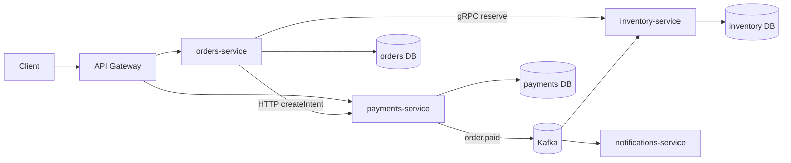

## 5.3 Microservices

#### Concept

Microservices split a system into multiple independently deployable processes, each owning one business capability and its own data. `orders-service`, `payments-service`, `inventory-service`, each with its own repository (or folder in a monorepo), its own pipeline, its own database, and its own on-call rotation.

Communication happens over the network: HTTP/REST, gRPC, or messages through Kafka or RabbitMQ. There is no shared memory and no shared transaction.

#### Why does it exist?

Microservices exist to let **many teams deploy independently** and to let **different parts of a system scale and fail independently**. When forty engineers share one deployment pipeline, every release becomes a negotiation. When the image-processing path needs 40 CPUs and the checkout path needs 2, one autoscaling group cannot serve both efficiently. Microservices solve organisational and scaling problems.

They are not a code-quality tool. A messy monolith split into services becomes a messy distributed system, which is strictly worse.

#### Mental model

Imagine a food court instead of one restaurant kitchen. Each stall has its own kitchen, staff, menu and cash register. A customer who wants a burger and a bubble tea walks to two stalls. Each stall can open, close, expand or change its menu without asking the others. But now there is no single bill, no single kitchen to walk over to, and if the bubble tea stall runs out of ice, the burger stall cannot help. Coordination happens by walking (network calls) or by shouting across the hall (events).

#### How it works

1. Each service is a separate NestJS application with its own `main.ts`, image and Helm chart.
2. An API gateway (or a BFF, "backend for frontend") is the single entry point for clients; it routes to services and handles auth, rate limits and TLS.
3. Services call each other synchronously (REST/gRPC) when they need an answer now, and publish events (Kafka/RabbitMQ) when they want others to react later.
4. **Service-per-database rule.** Each service owns its data. No other service reads its tables. Data needed by another service is obtained via API or by consuming events and keeping a local copy.
5. Distributed tracing (OpenTelemetry) propagates a trace id in headers and message metadata so one user request can be followed across five processes.
6. Service discovery (Kubernetes DNS, Consul) and client-side timeouts, retries and circuit breakers handle the fact that any call can fail.



Production-first questions:

- **How do I implement it?** One NestJS app per service, `@nestjs/microservices` for the transport layer or plain HTTP controllers, Kafka client for events.
- **What can go wrong?** Everything in a monolith, plus network partitions, partial failures, duplicated messages, inconsistent data between services, version skew between deployed services.
- **How do I monitor it?** Distributed tracing is mandatory, not optional. Per-service RED metrics (rate, errors, duration). Consumer lag per topic.
- **How do I scale it?** Per service, independently, by HPA on CPU/RPS/lag.
- **When should I NOT use it?** Fewer than about 15 to 20 engineers, or when the domain boundaries are still unclear.

#### Practical example

A marketplace with 120 engineers in 14 teams. `checkout-service` is deployed 30 times a day by a team of eight. `search-service` runs on memory-heavy nodes with Elasticsearch and deploys weekly. `payments-service` is PCI-scoped, runs in an isolated VPC, and only three people have production access. These three capabilities have different deploy cadence, different scaling profile and different compliance regime. That is exactly when microservices are justified.

#### NestJS example

`@nestjs/microservices` supports several transports: TCP, Redis, NATS, MQTT, gRPC, RabbitMQ (`Transport.RMQ`) and Kafka (`Transport.KAFKA`). A hybrid application exposes HTTP for the gateway and a Kafka consumer for events.

```ts
// apps/inventory/src/main.ts
import { NestFactory } from '@nestjs/core';
import { MicroserviceOptions, Transport } from '@nestjs/microservices';
import { InventoryModule } from './inventory.module';

async function bootstrap() {
  const app = await NestFactory.create(InventoryModule);

  // Kafka consumer for domain events from other services.
  app.connectMicroservice<MicroserviceOptions>({
    transport: Transport.KAFKA,
    options: {
      client: { clientId: 'inventory', brokers: process.env.KAFKA_BROKERS!.split(',') },
      consumer: { groupId: 'inventory-consumer', allowAutoTopicCreation: false },
      run: { autoCommit: false }, // commit offsets only after successful handling
    },
  });

  // gRPC server for synchronous reserve() calls from orders-service.
  app.connectMicroservice<MicroserviceOptions>({
    transport: Transport.GRPC,
    options: { package: 'inventory', protoPath: 'proto/inventory.proto', url: '0.0.0.0:50051' },
  });

  await app.startAllMicroservices();
  await app.listen(3002); // HTTP for health checks and admin endpoints
}
bootstrap();
```

A Kafka event handler:

```ts
// apps/inventory/src/presentation/order-events.controller.ts
import { Controller, Logger } from '@nestjs/common';
import { Ctx, EventPattern, KafkaContext, Payload } from '@nestjs/microservices';
import { CommitReservationUseCase } from '../application/commit-reservation.use-case';
import { OrderPaidEvent } from '@company/contracts'; // shared, versioned package

@Controller()
export class OrderEventsController {
  private readonly log = new Logger(OrderEventsController.name);
  constructor(private readonly commit: CommitReservationUseCase) {}

  @EventPattern('orders.order-paid.v1')
  async onOrderPaid(@Payload() event: OrderPaidEvent, @Ctx() ctx: KafkaContext) {
    // Idempotent: the use case checks a processed_events table keyed by event.id.
    await this.commit.execute({ orderId: event.orderId, eventId: event.id });

    // Manual offset commit after success so a crash mid-handler replays the message.
    const { offset } = ctx.getMessage();
    const partition = ctx.getPartition();
    const topic = ctx.getTopic();
    await ctx.getConsumer().commitOffsets([{ topic, partition, offset: (Number(offset) + 1).toString() }]);
  }
}
```

And a gRPC client in `orders-service` with a timeout, because every network call must have one:

```ts
// apps/orders/src/infrastructure/inventory.grpc-client.ts
import { Inject, Injectable, OnModuleInit, ServiceUnavailableException } from '@nestjs/common';
import { ClientGrpc } from '@nestjs/microservices';
import { firstValueFrom, timeout, catchError, throwError } from 'rxjs';
import { InventoryPort } from '../domain/ports/inventory.port';

interface InventoryGrpc {
  reserve(req: { orderId: string; lines: { productId: string; qty: number }[] }): import('rxjs').Observable<{ reservationId: string }>;
}

@Injectable()
export class InventoryGrpcClient implements InventoryPort, OnModuleInit {
  private svc!: InventoryGrpc;
  constructor(@Inject('INVENTORY_PACKAGE') private readonly client: ClientGrpc) {}

  onModuleInit() {
    this.svc = this.client.getService<InventoryGrpc>('InventoryService');
  }

  async reserve(orderId: string, lines: { productId: string; qty: number }[]) {
    return firstValueFrom(
      this.svc.reserve({ orderId, lines }).pipe(
        timeout(800), // p99 of inventory is 120 ms; 800 ms is a generous budget
        catchError((err) => throwError(() => new ServiceUnavailableException(`inventory: ${err.message}`))),
      ),
    );
  }
}
```

#### PostgreSQL example

Service-per-database means `orders-service` cannot join to `products`. It keeps the data it needs, denormalised, from events:

```sql
-- orders DB: a local, read-only projection of product data, fed by product.updated events
CREATE TABLE product_snapshot (
  product_id   uuid PRIMARY KEY,
  name         text NOT NULL,
  price_cents  integer NOT NULL,
  updated_at   timestamptz NOT NULL,
  source_event_id uuid NOT NULL      -- for idempotent upserts
);

-- Idempotent projection update
INSERT INTO product_snapshot (product_id, name, price_cents, updated_at, source_event_id)
VALUES ($1, $2, $3, $4, $5)
ON CONFLICT (product_id) DO UPDATE
  SET name = EXCLUDED.name, price_cents = EXCLUDED.price_cents, updated_at = EXCLUDED.updated_at
  WHERE product_snapshot.updated_at < EXCLUDED.updated_at;  -- ignore out-of-order events
```

The `WHERE updated_at < EXCLUDED.updated_at` guard is what protects you when Kafka delivers an older event after a newer one (different partitions, consumer restarts).

The other unavoidable table is the **outbox**, which makes "write to my DB and publish an event" atomic (detailed in Part 5.6 on event-driven architecture):

```sql
CREATE TABLE outbox (
  id            uuid PRIMARY KEY,
  aggregate_id  uuid NOT NULL,
  topic         text NOT NULL,
  payload       jsonb NOT NULL,
  created_at    timestamptz NOT NULL DEFAULT now(),
  published_at  timestamptz
);
CREATE INDEX outbox_unpublished_idx ON outbox (created_at) WHERE published_at IS NULL;
```

#### Production scenario

The honest operating cost of microservices, with numbers from a 25-service system:

| Cost | Monolith | 25 microservices |
| --- | --- | --- |
| CI/CD pipelines to maintain | 1 | 25 (plus shared templates) |
| Helm charts / deployment manifests | 1 | 25 |
| Dashboards and alert rules | ~10 | ~250 |
| Distributed tracing | optional | mandatory |
| p99 checkout latency (same hardware) | 90 ms | 240 ms (4 hops at 30 to 40 ms each) |
| Cross-domain consistency | one ACID transaction | saga + outbox + idempotent consumers |
| Local dev setup | `docker compose up` with 2 containers | 25 containers or a shared dev cluster |
| Engineers needed for platform work | 0 to 1 | 3 to 6 (a platform team) |
| Contract management | TypeScript compiler | versioned schemas, consumer-driven contract tests |

A senior engineer says this out loud in the planning meeting: "Adopting microservices means hiring a platform team." If the company cannot afford that, it cannot afford microservices.

**Distributed transactions** deserve their own paragraph. In a monolith, checkout is one `BEGIN ... COMMIT`. Across services, there is no `COMMIT` that spans `orders DB` and `inventory DB`. Two-phase commit (XA) exists but is slow, fragile, and unsupported by most cloud messaging. The practical answer is the **saga**: a sequence of local transactions with compensating actions (reserve stock, then charge card; if the charge fails, release the reservation). Sagas are eventually consistent, and every step must be idempotent because the coordinator will retry.

#### Failure scenario

At 02:14 the on-call gets paged: checkout error rate 35%. Traces show `orders-service` calling `pricing-service` calling `promotions-service` calling `users-service` to check loyalty tier. `users-service` is doing a deploy; two of its five pods are restarting. Calls to it time out after the default 30 seconds. `promotions-service` has no timeout of its own, so its threads pile up, and its own health check starts failing. Kubernetes restarts `promotions-service` pods. Now `pricing-service` is timing out. The cascade reaches the gateway. A routine deploy of a leaf service has taken down checkout because nobody set timeouts and nobody had a circuit breaker.

The fix is not "fewer services". The fix is the discipline that microservices demand: per-hop timeout budgets, circuit breakers, bulkheads, and default values (assume "no loyalty discount" when `users-service` is unavailable).

#### Edge cases & failure modes

- **Partial failure.** Payment succeeded, inventory decrement timed out. Was it applied? You do not know. Idempotency keys and reconciliation are mandatory.
- **Duplicate messages.** Kafka is at-least-once; consumers must dedupe by event id.
- **Out-of-order events** across partitions; projections must compare timestamps or versions.
- **Version skew.** `orders-service` v42 sends a field that `inventory-service` v17 does not know. Contracts must be backward-compatible; add fields, never rename or remove without a deprecation window.
- **Retry storms.** Every caller retries three times; a slow dependency now gets 27x the load from a 3-hop chain.
- **Chatty calls.** Loading an order page triggers 40 sequential HTTP calls. Use batch endpoints or a local projection.
- **Data ownership disputes.** Who owns `customer_email`? Users-service. Everyone else caches it and must handle staleness.
- **Consumer lag** after a burst; inventory falls minutes behind and oversells.
- **Rebalance storms** when consumers restart during deploy; long handlers get cut off. Use manual commits and idempotent handlers.
- **Clock skew** between services makes "latest event wins" unreliable; prefer version numbers over timestamps.

#### How a Senior Backend Engineer thinks about this

They ask three questions before splitting anything: *Do we have teams that need to deploy independently? Do we have workloads with different scaling profiles? Do we have a regulatory or security boundary that requires isolation?* If none applies, they do not split.

They refuse to let two services share a database. They refuse synchronous chains deeper than two hops on the critical path. They insist on tracing, timeouts and idempotency before the second service exists.

To a product manager: "Microservices let each team ship without waiting for others, but every feature that touches two teams now takes longer and needs more careful design. We are trading feature speed for team independence. Let's be sure we need the independence."

#### Common mistakes

- **Nano-services.** Fifty services for ten engineers. Each engineer owns five pipelines and nothing gets maintained.
- **Splitting by technical layer** ("the database service", "the auth service everyone calls synchronously on every request").
- **Shared database** between services; the distributed monolith.
- **No timeouts, no circuit breakers**, then blaming the network.
- **Synchronous request/response for everything**, turning a cheap in-process call into a 30 ms hop with failure modes.
- **Ignoring idempotency** until the first duplicate charge.
- **Skipping the contracts package.** Each service copies the DTO and they drift.

#### Interview questions

1. *What does "service per database" mean and why is it non-negotiable?* Expected: each service is the only writer and reader of its tables; shared DBs couple schemas and deploys and make independent scaling impossible. Follow-up: how do services get data they do not own? Projections from events, or API calls with caching.
2. *How do you handle a transaction spanning two services?* Expected: saga with compensations, outbox for reliable publishing, idempotent steps. Discuss orchestration vs choreography.
3. *A leaf service deploy caused a checkout outage. Walk through the cascade and the fixes.* Expected: missing timeouts, no circuit breaker, no fallback; fixes with numbers (timeout budgets per hop).
4. *What are the operational costs of microservices that people underestimate?* Expected: pipelines x N, tracing, contract management, local dev, platform team, cross-team feature latency.
5. *How do you version an event schema?* Expected: additive changes only, topic name with version suffix for breaking changes, consumers tolerant of unknown fields, schema registry.
6. *When would you choose gRPC over REST between services?* Expected: strict contracts via protobuf, lower latency and payload size, streaming; REST when browser clients or simplicity matter.

#### Practical exercise

Split the `inventory` module from your modular monolith into a separate NestJS service. Expose `reserve()` over gRPC with an 800 ms client timeout, consume `orders.order-paid.v1` from Kafka with manual offset commits, and keep a `processed_events` table for idempotency. Kill the inventory service during a load test.

Acceptance criteria: checkout returns a clear `503` within 1 second when inventory is down (no 30-second hangs); after inventory restarts, no `order-paid` event is processed twice (verify by row count in `processed_events` vs events sent); a replayed event with an older timestamp does not overwrite newer stock data.

## 5.4 Service-oriented architecture (SOA)

#### Concept

SOA is the older sibling of microservices. It also splits a system into services, but the classic SOA of the 2000s organised them around an **Enterprise Service Bus (ESB)**: a central middleware that routed messages, transformed formats, applied business rules and orchestrated multi-step processes. Services were typically large ("the Customer service", "the Billing service") and communicated through SOAP/XML over the bus.

#### Why does it exist?

SOA was born inside large enterprises that had dozens of legacy systems (mainframe billing, a CRM bought from a vendor, a home-grown ERP) that needed to talk to each other. Point-to-point integrations between 30 systems mean up to 435 adapters. The ESB reduced that to 30 adapters, one per system, with the bus in the middle.

#### Mental model

Imagine an airport hub. Instead of every small city having a direct flight to every other city, all flights go through the hub. Fewer routes to maintain, but the hub becomes the bottleneck, the single point of failure, and the place where every delay originates. That hub is the ESB.

#### How it works

1. Each system exposes a service interface (WSDL contract, SOAP endpoint).
2. The ESB receives messages, transforms them (XML from system A into the schema system B expects), routes them, and often contains orchestration logic (BPEL processes).
3. A registry lists available services.
4. Governance boards approve contract changes because a change on the bus affects everyone.

#### How it differs from microservices

| Aspect | Classic SOA | Microservices |
| --- | --- | --- |
| Service size | Large, coarse-grained | Small, single capability |
| Integration | Smart bus (ESB), dumb endpoints | Dumb pipes (Kafka, HTTP), smart endpoints |
| Data | Often shared enterprise databases | Service per database |
| Protocols | SOAP, XML, WS-* standards | REST, gRPC, JSON, protobuf |
| Ownership | Central integration team | Product teams own end-to-end |
| Deployment | Coordinated releases | Independent releases |
| Logic location | Business rules inside the ESB | Business rules inside the services |

The critical difference is where the intelligence lives. SOA put it in the middle. Microservices put it at the edges and keep the middle simple. The ESB became a monolith of its own: a giant, vendor-locked, hard-to-test blob of routing and transformation rules owned by a team that every product team had to queue for.

#### Production scenario

You still meet SOA in banks, insurers, telcos and government. A NestJS service you write may need to call a SOAP endpoint on an ESB to fetch a customer's policy. The senior approach is the **anti-corruption layer**: a NestJS adapter that speaks SOAP to the ESB and translates into your clean domain types, so the legacy schema never leaks into your code.

```ts
// src/modules/policies/infrastructure/esb-policy.adapter.ts
import { Injectable, Logger } from '@nestjs/common';
import { HttpService } from '@nestjs/axios';
import { firstValueFrom } from 'rxjs';
import { PolicyPort, Policy } from '../domain/ports/policy.port';

@Injectable()
export class EsbPolicyAdapter implements PolicyPort {
  private readonly log = new Logger(EsbPolicyAdapter.name);
  constructor(private readonly http: HttpService) {}

  async findByCustomer(customerId: string): Promise<Policy[]> {
    const envelope = `<soapenv:Envelope xmlns:soapenv="http://schemas.xmlsoap.org/soap/envelope/">
      <soapenv:Body><GetPolicies><CustomerId>${customerId}</CustomerId></GetPolicies></soapenv:Body>
    </soapenv:Envelope>`;
    const res = await firstValueFrom(
      this.http.post(process.env.ESB_URL!, envelope, {
        headers: { 'Content-Type': 'text/xml', SOAPAction: 'GetPolicies' },
        timeout: 5000, // the ESB is slow; budget accordingly and cache upstream
      }),
    );
    return this.parse(res.data); // XML into Policy[]; legacy field names stop here
  }

  private parse(xml: string): Policy[] {
    // use fast-xml-parser; map PolicyNbr -> policyNumber, EffDt -> effectiveFrom, etc.
    return [];
  }
}
```

#### Edge cases & failure modes

- **ESB as single point of failure**; when it is down, every integration is down.
- **Governance latency.** A contract change takes six weeks to approve.
- **Transformation logic drift.** Business rules hidden in bus mappings that no product team knows about.
- **XML payload bloat.** A 2 KB JSON becomes 40 KB SOAP; latency and cost follow.

#### How a Senior Backend Engineer thinks about this

They see SOA's core idea (services with contracts) as correct and the ESB as the mistake. When integrating with an ESB, they isolate it behind an adapter, cache aggressively, set tight timeouts, and never let SOAP types cross into the domain.

#### Interview questions

1. *How do SOA and microservices differ?* Expected: smart pipes vs smart endpoints; shared vs owned data; coarse vs fine services; central vs product-team ownership.
2. *What was wrong with the ESB?* Expected: it became a monolith of integration logic, a bottleneck and an organisational chokepoint.
3. *How do you integrate a modern service with a legacy SOAP system?* Expected: anti-corruption layer adapter, timeouts, caching, contract tests against a recorded WSDL.

## 5.5 Serverless

#### Concept

Serverless means you deploy functions, not processes. The cloud provider (AWS Lambda, Google Cloud Functions, Azure Functions) starts an execution environment when a request or event arrives, runs your handler, and freezes or destroys the environment afterwards. You pay per invocation and per millisecond of execution, not per hour of a running server.

#### Why does it exist?

It exists to remove server management and to make cost proportional to usage. A webhook handler that runs 200 times a day should not cost a 24/7 container. A batch job that runs once a night should not need a Kubernetes node. For spiky, event-driven, low-average-load workloads, serverless is dramatically cheaper and simpler to operate.

#### Mental model

Imagine a taxi versus owning a car. The taxi costs nothing while you sleep. It arrives when you call it, but there is a wait (the cold start). If you need a ride every three minutes all day, the taxi is more expensive and less convenient than a car you already own. Serverless is the taxi.

#### How it works

1. You package your NestJS app as a Lambda handler. The `@codegenie/serverless-express` package (formerly `@vendia/serverless-express`) wraps an Express-compatible app so API Gateway events become HTTP requests.
2. On the first invocation in a fresh environment, Lambda downloads the package, starts Node.js, runs your module-level code (this is where NestJS bootstraps and builds its DI graph), then calls the handler. This is the **cold start**: typically 800 ms to 3 seconds for a NestJS app with TypeORM, depending on bundle size and the number of providers.
3. The environment is kept warm for a while (minutes). Subsequent requests reuse it: **warm start**, a few milliseconds of overhead.
4. Concurrency scales by creating more environments. 500 concurrent requests means up to 500 environments, each with its own cold start and, critically, its own database connection.
5. The environment is frozen between invocations. Timers and background promises do not run. Anything not awaited before the handler returns may never complete.

#### NestJS example

```ts
// src/lambda.ts
import { NestFactory } from '@nestjs/core';
import { ExpressAdapter } from '@nestjs/platform-express';
import serverlessExpress from '@codegenie/serverless-express';
import { Handler, Context, Callback } from 'aws-lambda';
import express from 'express';
import { AppModule } from './app.module';

// Cache the server across warm invocations; this is the whole cold-start game.
let cachedHandler: Handler | undefined;

async function bootstrap(): Promise<Handler> {
  const expressApp = express();
  const app = await NestFactory.create(AppModule, new ExpressAdapter(expressApp), {
    logger: ['error', 'warn'], // less logging during bootstrap shaves cold start time
  });
  app.enableCors();
  await app.init(); // NOT app.listen(); Lambda owns the socket
  return serverlessExpress({ app: expressApp });
}

export const handler: Handler = async (event, context: Context, callback: Callback) => {
  // Let Lambda freeze the environment without waiting for open DB sockets.
  context.callbackWaitsForEmptyEventLoop = false;
  cachedHandler = cachedHandler ?? (await bootstrap());
  return cachedHandler(event, context, callback);
};
```

Cold start reductions that actually work: bundle with esbuild into one file (no `node_modules` scanning), lazy-load heavy modules with NestJS `LazyModuleLoader`, keep the DI graph small, use Provisioned Concurrency for latency-sensitive paths, and use Lambda SnapStart-style features where available for your runtime.

#### PostgreSQL example: the connection problem

PostgreSQL forks a process per connection; each costs about 5 to 10 MB of RAM and a few milliseconds to establish (more with TLS). A `db.t3.medium` RDS instance defaults to roughly 400 max connections. If 1,000 Lambda environments each open their own connection, the database refuses new connections (`FATAL: too many connections`) and the entire API fails, including the warm ones.

**RDS Proxy** solves this. It is a managed connection pooler that sits between Lambda and PostgreSQL. Lambdas open cheap connections to the proxy; the proxy multiplexes them onto a small pool of real database connections.

```text
 1,000 Lambda envs --(1,000 light conns)--> RDS Proxy --(50 real conns)--> PostgreSQL
```

Configure TypeORM for it:

```ts
// typeorm datasource for Lambda + RDS Proxy
import { DataSource } from 'typeorm';

export const dataSource = new DataSource({
  type: 'postgres',
  host: process.env.RDS_PROXY_ENDPOINT, // proxy endpoint, not the DB host
  port: 5432,
  username: process.env.DB_USER,
  password: process.env.DB_PASSWORD,
  database: 'shop',
  ssl: { rejectUnauthorized: true },
  extra: {
    max: 1,                      // ONE connection per environment; the proxy pools
    idleTimeoutMillis: 30_000,
    connectionTimeoutMillis: 3_000,
  },
  entities: [__dirname + '/**/*.entity.js'],
});
```

Two constraints to remember: RDS Proxy pins a session to a real connection when you use session-level features (`SET`, prepared statements, advisory locks, temporary tables), which reduces the multiplexing benefit; and it adds about 1 to 3 ms per query. Sequelize configuration is equivalent: `pool: { max: 1, min: 0, idle: 30000 }`.

#### Production scenario

Where serverless shines, with realistic numbers:

- **Webhook receivers** (Stripe, Razorpay, Shopify): 5,000 events a day, bursts of 200 per second when a batch settles. Cost: under a dollar a month. A container would cost 30 to 60 dollars a month and sit idle 99% of the time.
- **Image and file processing** triggered by S3 uploads: 40,000 images a day, 2 seconds each, needs 1 GB memory. Lambda scales to 300 concurrent without any capacity planning.
- **Scheduled jobs** (EventBridge cron): nightly reports, cleanup, invoice generation.
- **Internal tooling and low-traffic admin APIs.**

Where it hurts:

- **A core API at 500+ RPS sustained.** Costs exceed containers, and the p99 is dominated by cold starts unless you pay for Provisioned Concurrency, at which point you are paying for servers again.
- **Long-running work.** Lambda caps execution at 15 minutes.
- **WebSockets and long-lived connections.** Possible through API Gateway WebSocket APIs, but awkward.
- **Kafka consumers.** Possible with event source mappings, but the batching and error semantics are different from a long-running NestJS consumer.

Cost comparison for a 100 RPS API with 50 ms average execution at 512 MB: Lambda is roughly 130 to 180 dollars a month plus API Gateway (around 350 dollars a month at 260 million requests); two small Fargate tasks behind an ALB cost around 70 to 90 dollars a month. Serverless wins on low or spiky traffic, loses on steady traffic.

#### Failure scenario

Friday 18:00, flash sale. Traffic on the product API jumps from 20 RPS to 900 RPS in one minute. Lambda scales to 700 concurrent environments. Each opens a TypeORM pool of `max: 10` (the default someone copied from the container config). PostgreSQL hits its 400-connection limit within seconds. Every function, warm or cold, fails with `too many connections`. The team scales RDS vertically (a 10-minute reboot) which makes it worse. The fix that worked: set `max: 1`, put RDS Proxy in front, and add reserved concurrency on the function so it cannot exceed what the proxy can handle. Total outage: 42 minutes.

#### Edge cases & failure modes

- **Cold start p99 spikes** of 2 to 4 seconds; clients with 3-second timeouts see errors on every scale-out event.
- **Frozen background work.** A `setImmediate` log flush or a fire-and-forget email promise never runs; the environment is frozen at return. Await everything, or use SQS.
- **Connection exhaustion** without a proxy.
- **Duplicate invocations.** Lambda retries asynchronous invocations; handlers must be idempotent.
- **15-minute limit** and payload limits (6 MB synchronous request/response).
- **Vendor lock-in** of the deployment model; NestJS mitigates by keeping the app framework-portable.
- **Observability gaps.** Logs are per invocation in CloudWatch; you need structured logging and a trace id per request.
- **Local development** needs SAM or the Serverless Framework to emulate events.

#### How a Senior Backend Engineer thinks about this

They use serverless for the edges (webhooks, file processing, cron, glue) and containers for the core API, unless the whole product is low-traffic. They keep the NestJS app portable so the same code runs in a container tomorrow. They never deploy a Lambda that talks to PostgreSQL without a pooler, and they set reserved concurrency to protect the database.

To a product manager: "Serverless means we pay only when the code runs and we never manage a server. It is perfect for the webhook and the nightly reports. For the main API, it would cost more and be slower at peak, so that stays on containers."

#### Common mistakes

- Copying the container pool configuration (`max: 10`) into a Lambda.
- Calling `app.listen()` in a Lambda handler.
- Forgetting `callbackWaitsForEmptyEventLoop = false`, so every invocation waits for the idle DB socket to close and hits the timeout.
- Fire-and-forget promises that never complete.
- Putting a 300 MB `node_modules` in the deployment package and wondering about 6-second cold starts.
- Running a Kafka consumer loop inside a Lambda.

#### Interview questions

1. *What is a cold start and how do you reduce it for a NestJS app?* Expected: environment bootstrap plus DI graph construction; reduce with bundling, lazy modules, smaller graphs, provisioned concurrency.
2. *Why is PostgreSQL a problem for Lambda and what is the fix?* Expected: per-environment connections exhaust the server; RDS Proxy or PgBouncer, `max: 1`, reserved concurrency.
3. *When is serverless more expensive than containers?* Expected: steady high traffic; give a rough break-even.
4. *What happens to a promise you did not await in a Lambda handler?* Expected: the environment freezes; it may run later on the next invocation or never.
5. *How would you run a NestJS app both in Lambda and in a container?* Expected: separate entry points (`lambda.ts`, `main.ts`), same `AppModule`, config from environment.

#### Practical exercise

Deploy a NestJS webhook receiver to Lambda with `@codegenie/serverless-express`, writing to PostgreSQL through RDS Proxy (or PgBouncer in a container for a local exercise). Configure TypeORM with `max: 1`. Fire 500 concurrent webhook calls with a load tool.

Acceptance criteria: PostgreSQL `pg_stat_activity` never shows more than the proxy's configured pool size; no `too many connections` errors; duplicate webhook deliveries (same event id) produce exactly one row.
