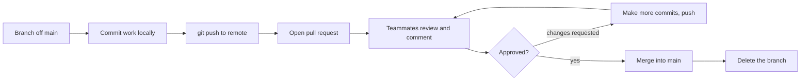

## 5.3 Remotes and pull requests

### 5.3.1 Sharing work through a remote repository

#### Concept

A **remote** is a copy of the repository hosted somewhere everyone can reach — on GitHub, GitLab or similar. Your local repository and everyone else's are copies; the remote is the shared central copy they synchronize through. You **push** your commits up to the remote and **pull** others' commits down. A **pull request** (PR) — called a merge request on GitLab — is a proposal to merge your branch into `main`, where teammates review it before it is accepted.

#### Why does it exist?

Git is distributed: every developer has the full history on their machine. But to collaborate, everyone needs a shared point to sync through, and teams need a checkpoint where changes are reviewed before entering the stable branch. The remote provides the shared copy; the pull request provides the review gate. Together they are how code goes from one engineer's laptop to the shared `main` safely, with at least one other person having looked at it.

#### Mental model

Imagine a shared document in the cloud that everyone has a local copy of. You make changes locally, then upload them (push) so others can download them (pull). But before your changes are accepted into the official version, you submit them for review — a colleague reads them, comments, requests tweaks, and approves. Only approved changes become part of the official document. The cloud document is the remote; the review-and-approve step is the pull request.

#### How it works

```bash
git clone <url>                       # get a copy of a remote repo (sets up 'origin')
git remote -v                         # show configured remotes (usually 'origin')
git push -u origin feat/add-coupons   # push your branch up the first time (-u links them)
git push                              # push subsequent commits
git pull                              # fetch others' commits and merge them into your branch
git fetch                             # download remote changes WITHOUT merging (safer to inspect first)
```

`origin` is the conventional name for the main remote (the one you cloned from). `git push -u origin <branch>` the first time links your local branch to a remote branch so later you can just type `git push` and `git pull`.

The pull request workflow:



1. You push your branch to the remote.
2. You open a pull request: "please merge `feat/add-coupons` into `main`", with a description of what and why.
3. Automated checks run (tests, linting — Part 47 on CI/CD).
4. Teammates review the code, leave comments, maybe request changes.
5. You address feedback with more commits and push again (the PR updates automatically).
6. Once approved and checks pass, the PR is merged into `main` and the branch is deleted.

#### The pull request description

A good PR description tells the reviewer what changed, why, and how to verify it. It links the ticket. It calls out anything risky. A reviewer who understands the intent reviews faster and better than one staring at a raw diff.

```text
Title: Add idempotency key to order creation (TSB-4422)

What: POST /orders now accepts an Idempotency-Key header and rejects
duplicate submissions within 24 hours.

Why: Clients retry failed requests, which was creating duplicate orders
(see incident INC-883).

How to test: POST the same order twice with the same key; the second
returns the first order, not a new one.

Risk: Low. New behavior is behind the header; requests without the
header are unchanged.
```

#### Practical example — from branch to merged

```bash
git switch main && git pull                  # start fresh and up to date
git switch -c fix/login-timeout              # branch
# ... fix the bug, commit ...
git commit -am "Increase login token timeout to 30 minutes"
git push -u origin fix/login-timeout         # push
# open the PR in the web UI, fill in the description, request a reviewer
# reviewer comments; you address them:
git commit -am "Address review: make timeout configurable via env"
git push                                      # PR updates automatically
# reviewer approves, checks pass, merge via the web UI, delete the branch
git switch main && git pull                   # bring the merged change into your local main
```

#### Edge cases & failure modes

- **Pushing to the wrong branch** or force-pushing over others' work (`git push --force`) can destroy commits; avoid force-push on shared branches (Part 48 covers the safe `--force-with-lease`).
- **A stale local `main`**: forgetting to `git pull` before branching means you build on old code and hit conflicts; always start from up-to-date `main`.
- **A huge PR** (thousands of lines) is nearly impossible to review well; reviewers rubber-stamp it and bugs slip through. Keep PRs small.
- **Merging your own PR without review** skips the quality gate that catches mistakes; follow the team's review requirement.
- **Secrets in a PR**: pushing a commit with a secret exposes it to everyone with repo access, even if later removed; prevent with `.gitignore` and pre-commit checks.

#### How a Senior Backend Engineer thinks about this

A senior keeps pull requests small and focused, because a PR a reviewer can actually read in ten minutes gets a real review, while a 2,000-line PR gets a rubber stamp. They write PR descriptions that explain intent and how to verify, treating the reviewer's time as valuable. They always branch from up-to-date `main` and pull frequently to keep divergence small. They never force-push shared branches. They see code review not as a gate to get past but as the main mechanism by which a team shares knowledge and catches defects early, and they both give and receive review thoughtfully (Part 48 — Git from Intermediate to Senior, 48.13, covers the pull request workflow and review).

#### Common mistakes

- Branching off a stale `main`, causing avoidable conflicts.
- Giant PRs that cannot be reviewed meaningfully.
- Force-pushing shared branches and destroying others' commits.
- Thin or missing PR descriptions that waste the reviewer's time.
- Merging without review when the team requires it.

#### Interview questions

1. **What is the difference between `git fetch` and `git pull`?** `fetch` downloads remote changes without merging (so you can inspect first); `pull` fetches and immediately merges into your branch.
2. **What is a pull request and what purpose does it serve?** A proposal to merge a branch into `main`, providing a review and automated-check gate before changes enter the stable branch.
3. **Why keep pull requests small?** Small PRs get genuine review and are easier to understand and revert; large ones get rubber-stamped and hide bugs.
4. **Why is force-pushing a shared branch dangerous?** It rewrites history others may have based work on, potentially destroying their commits; use it only on your own branches, and prefer `--force-with-lease`.

#### Practical exercise

Clone a repository (or use one you created), create a branch, make a commit, push it with `git push -u origin <branch>`, and open a pull request with a description covering what, why, how to test, and risk. Acceptance criteria: the PR has a meaningful description and links to the branch; you can explain what `origin` and the `-u` flag did.

#### Worked answer to the exercise

Using a practice repository on GitHub (GitLab prints the same Git lines with its own "merge request" link):

```bash
git clone git@github.com:shop-example/practice-api.git
cd practice-api
git switch -c feat/health-endpoint
# ... add src/health.ts ...
git add src/health.ts
git commit -m "Add GET /health endpoint for load balancer checks"
git push -u origin feat/health-endpoint
```

```text
Enumerating objects: 6, done.
Counting objects: 100% (6/6), done.
Delta compression using up to 8 threads
Compressing objects: 100% (3/3), done.
Writing objects: 100% (4/4), 431 bytes | 431.00 KiB/s, done.
Total 4 (delta 1), reused 0 (delta 0), pack-reused 0
remote: Resolving deltas: 100% (1/1), completed with 1 local object.
remote:
remote: Create a pull request for 'feat/health-endpoint' on GitHub by visiting:
remote:      https://github.com/shop-example/practice-api/pull/new/feat/health-endpoint
remote:
To github.com:shop-example/practice-api.git
 * [new branch]      feat/health-endpoint -> feat/health-endpoint
branch 'feat/health-endpoint' set up to track 'origin/feat/health-endpoint'.
```

Open the link Git printed, check that the base branch is `main` and that the "Files changed" tab shows only your change, then fill in the description:

```text
Title: Add GET /health endpoint for load balancer checks

What: GET /health returns {"status":"ok"} with 200.
Why: The load balancer needs a cheap endpoint to decide whether this
instance should receive traffic.
How to test: npm run start:dev, then curl http://localhost:3000/health
Risk: Low. New read-only route; no existing route changes.
```

The explanation the exercise asks for. **`origin`** is the short name `git clone` gave the remote it cloned from; `git remote -v` shows the URL behind it. **`-u`** (long form `--set-upstream`) links your local branch to `origin/feat/health-endpoint`, which is what the last output line confirms. From now on, plain `git push` and `git pull` know where to go, and `git status` reports how far ahead or behind you are:

```text
$ git branch -vv
* feat/health-endpoint 3e1a9f0 [origin/feat/health-endpoint] Add GET /health endpoint for load balancer checks
  main                 5779562 [origin/main] Add entry point that logs a greeting
```

**The trap.** Pushing the first time without `-u` and then typing `git push`, which fails with `fatal: The current branch feat/health-endpoint has no upstream branch.` Git prints the `git push --set-upstream origin feat/health-endpoint` command to fix it. The second trap is a pull request against the wrong base branch; if "Files changed" shows commits you did not write, stop and fix the base before asking for review.

## 5.4 Merging and resolving conflicts

### 5.4.1 Bringing branches together

#### Concept

**Merging** combines the commits from one branch into another — typically merging your feature branch into `main`. Most merges are automatic: Git figures out how to combine the changes. Sometimes two branches changed the same lines of the same file in different ways, and Git cannot decide which to keep. That is a **merge conflict**, and you resolve it by telling Git which change wins (or how to combine them).

#### Why does it exist?

When work happens in parallel on branches, those branches must eventually come back together. Merging is that reunion. Conflicts arise because Git is careful: rather than guess wrong and silently lose someone's change, it stops and asks you when two changes genuinely overlap. A conflict is not an error or a failure — it is Git correctly refusing to make a decision only a human can make.

#### Mental model

Imagine two editors marking up the same paragraph of a document separately. Most of the time they edit different paragraphs, and combining their work is trivial — Git does it for you. But if both rewrote the same sentence differently, no automated rule can know which rewrite is right. Git brackets both versions and hands them to you: "you decide." Resolving a conflict is reading both versions and writing the correct final one.

#### How it works

A typical merge:

```bash
git switch main
git pull                              # make sure main is current
git merge feat/add-coupons            # merge the feature branch into main
# If there are no conflicts, done. If there are, Git tells you which files conflict.
```

When a conflict happens, Git marks the conflicting sections inside the file with markers:

```text
<<<<<<< HEAD
const timeoutMs = 30000;        // the version currently on your branch (main)
=======
const timeoutMs = 60000;        // the version from the branch being merged
>>>>>>> feat/add-coupons
```

To resolve, you edit the file to the correct final version and remove all three markers (`<<<<<<<`, `=======`, `>>>>>>>`):

```text
const timeoutMs = 60000;        // you decided the incoming value is correct
```

Then:

```bash
git add src/config.ts                 # mark the conflict as resolved
git commit                            # complete the merge (Git pre-fills a message)
```

The commands for handling a conflict:

```bash
git status                            # lists the files with conflicts
# ... edit each conflicting file, remove markers, keep the correct content ...
git add <resolved-file>               # stage each resolved file
git commit                            # finish the merge
git merge --abort                     # OR: give up and go back to before the merge
```

#### Rebase: the other way (brief)

Besides `merge`, Git has `rebase`, which replays your branch's commits on top of the latest `main`, producing a straighter history. It is powerful and common, but it rewrites commits, so it has its own rules and risks. Part 48 covers rebase, when to use it versus merge, and the "golden rule of rebase" (never rebase commits others have based work on). As a beginner, understand merge first; reach for rebase once you are comfortable.

#### Practical example — resolving a real conflict

Two people both edited the shipping-cost function. You merge and hit a conflict:

```bash
git switch main && git pull
git merge feat/free-shipping
# CONFLICT (content): Merge conflict in src/shipping.ts
git status                            # shows src/shipping.ts as "both modified"
```

Opening `src/shipping.ts`:

```text
<<<<<<< HEAD
if (subtotalCents >= 5000) return 0;         // free over $50 (from main)
=======
if (subtotalCents >= 4000) return 0;         // free over $40 (from the branch)
>>>>>>> feat/free-shipping
```

You check the ticket, learn the business decided on $40, edit the file to keep that line, remove the markers, then:

```bash
git add src/shipping.ts
git commit                            # completes the merge
```

Crucially, you also re-run the tests (Part 41 — Testing Backend Systems) after resolving, because a conflict resolution can be syntactically valid but logically wrong — you might keep both lines, or the wrong one, and only tests catch that.

#### Edge cases & failure modes

- **Leaving a conflict marker** (`<<<<<<<`) in the file and committing it breaks the code; search for markers before committing, and tests/linting catch them.
- **Resolving wrong** — keeping the wrong side or an inconsistent mix — compiles but behaves incorrectly; always re-run tests after resolving.
- **Panicking and making it worse**: `git merge --abort` cleanly undoes an in-progress merge so you can start over calmly.
- **A huge conflict** from a long-diverged branch is painful; prevent it by keeping branches short and pulling `main` often.
- **Binary file conflicts** (images, compiled files) cannot be merged line-by-line; you pick one version wholesale, which is a reason not to commit binaries casually.

#### How a Senior Backend Engineer thinks about this

A senior sees a conflict as routine, not alarming — it is Git doing its job. They resolve it by understanding both changes and the intent behind them (often checking the ticket or asking the other author), not by blindly picking a side. They always re-run the tests after resolving, because a conflict resolution is a code change like any other and can be subtly wrong. They prevent most conflicts by keeping branches short-lived and frequently pulling the latest `main` into their branch, so divergence stays small. When a merge goes sideways, they know `git merge --abort` gives them a clean slate, so they never feel trapped.

#### Common mistakes

- Committing conflict markers left in the file.
- Resolving conflicts without understanding the other change, keeping the wrong version.
- Not re-running tests after resolving, shipping a logically broken resolution.
- Letting branches diverge for weeks, turning a routine merge into a nightmare.

#### Interview questions

1. **What causes a merge conflict?** Two branches changed the same lines of the same file differently, so Git cannot automatically decide which to keep and asks you.
2. **How do you resolve a conflict?** Edit the file to the correct final content, remove the conflict markers, `git add` the file, and `git commit`; then re-run tests.
3. **Why re-run tests after resolving a conflict?** A resolution is a code change that can be syntactically valid but logically wrong; tests catch an incorrect merge.
4. **How do you prevent painful conflicts?** Keep branches short-lived and merge/pull `main` frequently so branches do not diverge far.
5. **What does `git merge --abort` do?** Cancels an in-progress merge and returns to the state before it started, so you can retry calmly.

#### Practical exercise

Create a repository, make a branch, and on both `main` and the branch edit the same line of the same file differently. Merge the branch into `main`, resolve the resulting conflict by choosing the correct final line and removing the markers, and complete the merge. Then deliberately leave a marker in a second conflict and observe how tests or a linter catch it. Acceptance criteria: you resolve the first conflict cleanly, complete the merge, and can explain why leaving a marker is dangerous.

#### Worked answer to the exercise

Set up one file and change the same line on two branches:

```bash
mkdir conflict-practice && cd conflict-practice && git init
mkdir src
printf "export const timeoutMs = 30000;\nexport const retries = 3;\n" > src/config.ts
git add . && git commit -m "Add config with timeout and retries"

git switch -c feat/longer-timeout
# edit src/config.ts: timeoutMs = 60000
git commit -am "Raise timeout to 60 seconds for slow payment provider"

git switch main
# edit src/config.ts: timeoutMs = 45000
git commit -am "Raise timeout to 45 seconds"
git merge feat/longer-timeout
```

```text
Auto-merging src/config.ts
CONFLICT (content): Merge conflict in src/config.ts
Automatic merge failed; fix conflicts and then commit the result.
```

`git status` lists `both modified:   src/config.ts` under "Unmerged paths", and the file reads:

```text
<<<<<<< HEAD
export const timeoutMs = 45000;
=======
export const timeoutMs = 60000;
>>>>>>> feat/longer-timeout
export const retries = 3;
```

The branch's commit message gives the reason (the payment provider is slow), so 60 seconds wins. Edit the file to exactly `export const timeoutMs = 60000;` plus the untouched `retries` line, with no markers left, then:

```text
$ git add src/config.ts
$ git commit --no-edit
[main f5c91f4] Merge branch 'feat/longer-timeout'
$ git log --oneline --graph
*   f5c91f4 Merge branch 'feat/longer-timeout'
|\
| * 4cfe671 Raise timeout to 60 seconds for slow payment provider
* | c25193e Raise timeout to 45 seconds
|/
* 752cb70 Add config with timeout and retries
```

Now the second conflict, done badly on purpose: change `retries` to 5 on a branch and to 2 on `main`, merge, and `git add` the file **without** editing it. Git does not stop you:

```text
$ git diff --cached --check
src/config.ts:2: leftover conflict marker
src/config.ts:4: leftover conflict marker
src/config.ts:6: leftover conflict marker
$ git commit --no-edit
[main ea2409f] Merge branch 'feat/retries'
$ npx tsc --noEmit
src/config.ts(2,1): error TS1185: Merge conflict marker encountered.
src/config.ts(4,1): error TS1185: Merge conflict marker encountered.
src/config.ts(6,1): error TS1185: Merge conflict marker encountered.
```

**Why leaving a marker is dangerous.** For Git, `git add` means "resolved", whatever the file contains. It happily records the markers in a commit, and if that commit is pushed, everyone who pulls gets a file that does not compile. The TypeScript compiler catches it here, and so would the test run in CI (Part 47), but only if something runs. To fix it, edit the file to the correct value and make a new commit; before committing, `git merge --abort` would have thrown the whole merge away instead.

**How to verify every time.** Run `git diff --check` (or `git diff --cached --check` after `git add`) before you commit a merge, and run the tests after it.

## 5.5 The development workflow, end to end

### 5.5.1 Putting it together

#### Concept

The everyday professional Git workflow is a short, repeatable loop that ties together everything in this Part: start from up-to-date `main`, branch, commit focused changes with good messages, push, open a pull request, respond to review, merge, and clean up. Knowing the loop as a single rhythm is what makes Git second nature rather than a series of commands you look up.

#### How it works

```text
1. git switch main && git pull          start from the latest stable code
2. git switch -c feat/TSB-1234-thing    branch (named after the ticket)
3. edit, git add, git commit            make small focused commits with clear messages
4. git push -u origin feat/...          push your branch
5. open a pull request                   describe what, why, how to test, risk
6. automated checks run                   tests and lint (CI, Part 47)
7. address review feedback               more commits, git push; PR updates
8. merge into main                        once approved and green
9. git switch main && git pull           pull the merged change locally
10. git branch -d feat/...               delete the finished branch
```

This loop runs once per feature or fix, often several times a day. Everything else in Git (rebasing, cherry-picking, bisecting, reflog recovery) is a refinement or a rescue tool layered on top of this core loop, and Part 48 covers those.

#### A quick command reference

```bash
# Starting work
git clone <url>                  git switch main                  git pull
git switch -c feat/my-feature

# Saving work
git status                       git diff                         git add .
git commit -m "message"

# Sharing work
git push -u origin feat/my-feature    git push    git pull    git fetch

# Branches
git branch                       git switch <name>                git branch -d <name>

# History and inspection
git log --oneline                git show <commit>                git diff main..feat/x

# Undoing (basics; Part 48 goes deeper)
git restore <file>               # discard unstaged changes to a file
git restore --staged <file>      # unstage a file (keep the edits)
git revert <commit>              # make a new commit that undoes an old one (safe on shared history)
```

#### How a Senior Backend Engineer thinks about this

A senior has internalized this loop so thoroughly that it costs no thought, which frees their attention for the actual work. They know the small set of "undo" commands for the common mistakes (discard a change, unstage a file, revert a commit) and know that for anything scarier, `git reflog` (Part 48) can recover almost anything, so they are never afraid of Git. They favor the safe tools on shared history — `git revert` rather than rewriting published commits — because the history others depend on is not theirs to rewrite. Above all they keep the loop small and frequent: short branches, small commits, small PRs, frequent merges, which keeps the whole team moving smoothly.

#### Common mistakes

- Treating Git as scary and avoiding it, leading to lost work and bad habits; the reflog makes almost everything recoverable (Part 48).
- Rewriting shared history; use `git revert` on anything others have.
- Skipping `git pull` before branching, building on stale code.

#### Interview questions

1. **Walk me through your everyday Git workflow.** Pull latest `main`, branch, make focused commits, push, open a PR with a clear description, address review, merge once approved and green, pull `main`, delete the branch.
2. **How do you safely undo a change that is already on a shared branch?** `git revert` creates a new commit that undoes it, without rewriting history others depend on.
3. **What is the difference between `git restore <file>` and `git restore --staged <file>`?** The first discards unstaged edits to the file; the second unstages a staged file while keeping the edits.

#### Practical exercise

Run the full loop end to end on a practice repository: from up-to-date `main`, branch, make two focused commits, push, open a PR with a complete description, then (simulating approval) merge it, pull `main`, and delete the branch. Along the way, practice `git restore` to discard a change and `git restore --staged` to unstage one. Acceptance criteria: you complete the full loop without looking up commands, and can explain each step's purpose.

#### Worked answer to the exercise

The loop, with the two `restore` practices folded in where they naturally happen:

```bash
git switch main && git pull                      # 1. start from the latest main
git switch -c feat/health-check                  # 2. branch
# edit src/app.service.ts
git add src/app.service.ts
git commit -m "Add health status to AppService"  # 3. first focused commit
echo "console.log('debug');" >> src/app.controller.ts
```

That debug line was a mistake. Discard it with `restore` before it goes anywhere:

```text
$ git status --short
 M src/app.controller.ts
$ git restore src/app.controller.ts
$ git status --short
$
```

Now make the real controller change, and stage too much by accident:

```text
$ git add .
$ git status --short
M  src/app.controller.ts
A  notes.txt
$ git restore --staged notes.txt
$ git status --short
M  src/app.controller.ts
?? notes.txt
```

`notes.txt` is unstaged but still on disk (`??` means untracked). Commit the controller and share the branch:

```bash
git commit -m "Expose GET /health in AppController"   # 3. second focused commit
git push -u origin feat/health-check                  # 4. push
# 5. open the PR: what, why, how to test, risk (5.3)
# 6. CI runs; 7. answer review with more commits and git push
# 8. simulate approval: click "Merge pull request" (a merge commit)
git switch main && git pull                            # 9. bring the merged result down
git branch -d feat/health-check                        # 10. delete the finished branch
```

```text
Updating 5779562..8b2d4f1
Fast-forward
 src/app.controller.ts | 5 +++++
 src/app.service.ts    | 4 ++++
 2 files changed, 9 insertions(+)
Deleted branch feat/health-check (was 3e1a9f0).
```

**Checks that prove the loop worked.** `git log --oneline --graph -5` on `main` shows your two commits joined by a "Merge pull request" commit; `git branch` lists only `main`; `git status` says `Your branch is up to date with 'origin/main'`.

**Why `-d` worked here.** The merge commit brought your branch's own commits onto `main`, so Git can see the branch is fully merged. With squash merge, `-d` refuses and you need `-D`, as 5.10 explains.

**The trap.** Mixing up the two restores. `git restore <file>` throws away unstaged edits for good (they were never committed, so even the reflog cannot bring them back). `git restore --staged <file>` only takes the file out of the next commit and keeps your edits. When unsure, run `git status` first: it prints the right command for each state.
