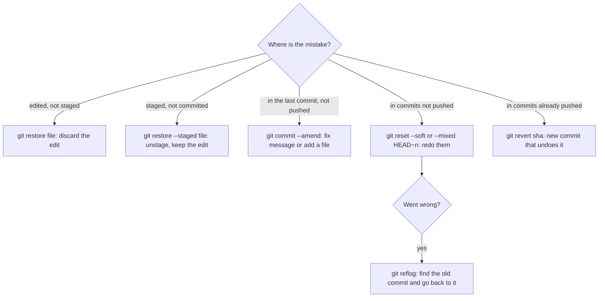

## 5.6 Setting up Git on a new machine

### 5.6.1 Identity, defaults and SSH access to GitHub or GitLab

#### Concept

Before your first commit on a new laptop, Git needs to know three things: **who you are** (name and email, stamped on every commit), a few **sensible defaults** (the default branch name, your editor), and **how to authenticate** to the remote server (GitHub, GitLab, Bitbucket), usually with an SSH key (4.7). This is a ten-minute job you do once per machine, and doing it right prevents a surprising number of problems later.

#### Why does it exist?

Because every commit records an author, and that author is how your team, your company's audit trail and your own `git log` know who made a change. A commit authored as `root@ip-10-0-3-17` or with a personal email on a work repository is confusing at best and a compliance problem at worst. And without working authentication, `git push` fails with errors that look scary to a beginner ("Permission denied (publickey)").

#### Mental model

Imagine joining a company. On day one you get a name badge (your identity), a desk set up the way the office does things (defaults), and a key card for the building (your SSH key). You could work without them for an hour, but every door would be a problem.

#### How it works

**Identity and defaults**, stored in `~/.gitconfig`:

```bash
git config --global user.name "Asha Rao"
git config --global user.email "asha.rao@shop.example"       # use the email your Git host knows
git config --global init.defaultBranch main                   # new repositories start on main
git config --global core.editor "nano"                         # the editor Git opens for messages (4.8)
git config --global pull.rebase false                          # git pull merges; see Part 48 before changing this
git config --list --show-origin                                # see every setting and which file it comes from
```

`--global` writes to your user's config, used by every repository on this machine. Without `--global`, the setting applies only to the current repository, which is how you use a different email for a work repository and a personal one:

```bash
cd ~/work/shop-api
git config user.email "asha.rao@shop.example"                  # only for this repository
```

**SSH access to the Git host.** You created a key pair in 4.7. Now give the public half to your Git host:

```bash
cat ~/.ssh/id_ed25519.pub              # copy this line (it starts with ssh-ed25519)
# GitHub: Settings -> SSH and GPG keys -> New SSH key -> paste
# GitLab: Preferences -> SSH Keys -> Add new key -> paste
ssh -T git@github.com                  # test: "Hi asha-rao! You've successfully authenticated..."
ssh -T git@gitlab.com                  # GitLab: "Welcome to GitLab, @asha-rao!"
```

Then use the SSH form of repository URLs:

```bash
git clone git@github.com:shop-example/shop-api.git            # SSH URL: uses your key
git clone https://github.com/shop-example/shop-api.git        # HTTPS URL: needs a personal access token instead
git remote -v                                                 # which URL does this repository use?
git remote set-url origin git@github.com:shop-example/shop-api.git   # switch an existing clone to SSH
```

With HTTPS, Git hosts no longer accept your account password for `git push`; they require a **personal access token** or a credential helper (such as Git Credential Manager) that signs you in through the browser.

#### Practical example — a new laptop, start to first push

```bash
git --version                                         # git version 2.4x: installed?
git config --global user.name "Asha Rao"
git config --global user.email "asha.rao@shop.example"
git config --global init.defaultBranch main
ssh-keygen -t ed25519 -C "asha.rao@shop.example"      # 4.7; accept the default path, set a passphrase
cat ~/.ssh/id_ed25519.pub                             # add to GitHub as above
ssh -T git@github.com                                 # authenticated
git clone git@github.com:shop-example/shop-api.git
cd shop-api
git log -1 --format='%an <%ae>'                       # someone else's last commit: the repository works
```

Then create a small commit on a branch (5.2) and `git push -u origin` it (5.3) to prove the whole path works.

#### Edge cases & failure modes

- **"Permission denied (publickey)"**: the key is not added to the host, the SSH agent does not have it loaded (`ssh-add ~/.ssh/id_ed25519`), or the repository URL is for a different host or user.
- **Wrong email on commits**: commits pushed with a personal email to a work repository; fix the config, then `git commit --amend --reset-author` on the last unpushed commit (5.7).
- **HTTPS password prompts that never accept your password**: you need a token or credential helper, not your account password.
- **Several Git hosts or accounts**: an `~/.ssh/config` file with a `Host` entry per account picks the right key.
- **Corporate proxies** that block SSH on port 22; GitHub and GitLab also offer SSH over port 443 (`ssh.github.com`, `altssh.gitlab.com`).

#### How a Senior Backend Engineer thinks about this

A senior sets up identity and SSH on day one and checks them with `git config --list --show-origin` and `ssh -T` before touching a real repository. They use a separate work identity per repository where needed, protect the SSH key with a passphrase (4.7), and many teams also sign commits (with an SSH or GPG key) so the host can show them as verified; Part 48 goes further.

#### Common mistakes

- Committing for weeks with a default or wrong identity.
- Mixing SSH and HTTPS remotes and fighting both kinds of authentication.
- Pasting the private key into the Git host instead of the `.pub` file.

#### Interview questions

1. **Where does Git get the author name and email for a commit?** From `user.name` and `user.email` in the repository config, else the global `~/.gitconfig`.
2. **What do you paste into GitHub or GitLab to use SSH?** The public key (`id_ed25519.pub`), never the private key.
3. **Why does `git push` over HTTPS reject your account password?** Hosts require personal access tokens or a credential helper for Git operations.

#### Practical exercise

On your machine, configure Git with your name, email, default branch `main` and `nano` as editor; add your SSH public key to a GitHub or GitLab account; and clone a repository with its SSH URL. Acceptance criteria: `git config --list --show-origin` shows your four settings from `~/.gitconfig`, `ssh -T` greets you by username, and `git remote -v` shows a `git@` URL.

#### Worked answer to the exercise

```bash
git config --global user.name "Asha Rao"
git config --global user.email "asha.rao@shop.example"
git config --global init.defaultBranch main
git config --global core.editor "nano"
git config --list --show-origin | grep -E 'user\.|init\.|core\.editor'
```

```text
file:/Users/asha/.gitconfig	user.name=Asha Rao
file:/Users/asha/.gitconfig	user.email=asha.rao@shop.example
file:/Users/asha/.gitconfig	init.defaultbranch=main
file:/Users/asha/.gitconfig	core.editor=nano
```

All four lines come from `~/.gitconfig`, which is the first acceptance check. (Git prints key names in lower case, so `defaultBranch` shows as `defaultbranch`; it is the same setting.)

Next, the key. If `ls ~/.ssh/id_ed25519.pub` finds nothing, create one as in 4.7 with `ssh-keygen -t ed25519 -C "asha.rao@shop.example"`. Copy the **public** half into GitHub (Settings, SSH and GPG keys, New SSH key) and test:

```text
$ cat ~/.ssh/id_ed25519.pub
ssh-ed25519 AAAAC3NzaC1lZDI1NTE5AAAAI...(one long line)... asha.rao@shop.example
$ ssh -T git@github.com
Hi asha-rao! You've successfully authenticated, but GitHub does not provide shell access.
```

The first time, SSH asks whether you trust `github.com` and shows a key fingerprint. Compare it with the fingerprints GitHub publishes in its documentation before you type `yes`. Note that `ssh -T` exits with status 1 even on success, because GitHub refuses the shell; the greeting is what counts.

Finally clone with the SSH URL and confirm:

```text
$ git clone git@github.com:shop-example/shop-api.git && cd shop-api
$ git remote -v
origin	git@github.com:shop-example/shop-api.git (fetch)
origin	git@github.com:shop-example/shop-api.git (push)
```

**Why this is right.** Identity is set once, globally, before the first commit, so every commit carries the right author. The SSH key authenticates every push without passwords or tokens, and the `git@` URL makes Git use it.

**The trap.** Two common ones. First, cloning with the HTTPS URL out of habit: `git remote -v` shows `https://...` and pushes ask for credentials. Fix it with `git remote set-url origin git@github.com:shop-example/shop-api.git`. Second, `Permission denied (publickey)` from `ssh -T`, which almost always means the public key was not saved on the host or the agent does not have the key loaded (`ssh-add ~/.ssh/id_ed25519`). Never "fix" it by pasting the private key anywhere.

## 5.7 Undoing things safely

### 5.7.1 restore, amend, revert and reset, and when to use each

#### Concept

Everyone makes mistakes in Git: staging the wrong file, a typo in a commit message, a commit that breaks something, a change you want to throw away. Git can undo all of them, but there are several undo commands, and they differ in one important way: **some rewrite history and some add to it**. Rewriting is fine for commits only you have seen. For commits already pushed and shared, you add a new commit that undoes the old one.

#### Why does it exist?

Because "undo" means different things at different stages. Undoing an edit you have not staged is different from removing a file from the staging area, which is different from fixing your last commit, which is different from undoing a commit your teammates already pulled. Using the wrong tool either does nothing or, worse, rewrites history that other people depend on.

#### Mental model

Imagine writing in a notebook that you share with your team. Before you show a page to anyone, you can tear it out and rewrite it; nobody will know. Once the team has copied the page into their own notebooks, tearing it out of yours does not remove it from theirs, and now the notebooks disagree. The polite way is to write a new entry: "the entry on page 12 was wrong; here is the correction".

#### How it works



The commands, with what each one changes:

```bash
# 1. Throw away edits in the working directory (not staged). The edit is gone.
git restore src/orders/orders.service.ts

# 2. Unstage a file but keep your edits.
git restore --staged .env                     # oops, staged the secrets file

# 3. Fix the last commit (only if not pushed): message, or a forgotten file.
git commit --amend -m "Add coupon validation to checkout"
git add src/coupons/coupon.dto.ts && git commit --amend --no-edit   # add a file, keep the message

# 4. Undo local commits (not pushed). HEAD~1 means "one commit before the current one".
git reset --soft HEAD~1                       # undo the commit, keep its changes staged
git reset HEAD~1                              # (--mixed, the default) undo it, keep changes unstaged
git reset --hard HEAD~1                       # undo it AND delete its changes: dangerous

# 5. Undo a pushed commit by adding a new one that reverses it. Safe on shared branches.
git revert a43fe07                            # opens the editor with "Revert ..." as the message
```

And the safety net. Git records every place `HEAD` has pointed in the **reflog**, for about 90 days by default:

```bash
git reflog
# 9c1e2f0 HEAD@{0}: reset: moving to HEAD~1
# 4d2a771 HEAD@{1}: commit: Add coupon validation      <- the commit you "lost"
git reset --hard 4d2a771                              # go back to it: the commit is back
```

The reflog is local to your machine and only knows about commits that existed on it. Changes you never committed, discarded with `git restore` or `reset --hard`, are not in it, which is why committing often is itself a safety measure.

Which command, when:

| I want to... | Not pushed yet | Already pushed |
|---|---|---|
| Discard edits I have not staged | `git restore <file>` | (not applicable) |
| Unstage a file | `git restore --staged <file>` | (not applicable) |
| Fix the last commit's message or contents | `git commit --amend` | New commit, or ask your team before rewriting |
| Remove the last few commits, keep the work | `git reset --soft HEAD~n` | `git revert` each commit |
| Undo a commit that broke `main` | (not applicable) | `git revert <sha>` |

#### Practical example — "I committed the `.env` file"

You ran `git add .` and `git commit -m "Add order endpoints"`, then noticed `.env` in the commit. It is **not pushed** yet:

```bash
git show --stat HEAD                       # confirm: .env is listed in the commit
git rm --cached .env                       # remove it from the repository, keep the file on disk
echo ".env" >> .gitignore                  # make sure it never comes back (5.1)
git add .gitignore
git commit --amend --no-edit               # rewrite the last commit without .env
git show --stat HEAD                       # .env is gone; .gitignore is there
```

If it **was pushed**, amending your local copy does not remove it from the remote or from anyone who pulled. Treat the values in it as leaked: rotate every secret (Part 40 — Security, 40.32), then remove the file with a normal commit. Rewriting the shared history to erase it is possible (Part 48) but needs the whole team's coordination and does not un-leak anything.

#### Practical example — a commit broke `main`

A teammate's merged commit `a43fe07` makes `POST /orders` return `500`. The fix will take an hour; users are affected now.

```bash
git switch main && git pull
git revert a43fe07                         # creates a new commit that reverses a43fe07's changes
git push                                   # (or via a pull request, if main is protected)
git log --oneline -3
# 7b1c9d2 Revert "Apply delivery fee before discount"
# a43fe07 Apply delivery fee before discount
# 5e0f311 Add coupon endpoint
```

History now shows what happened honestly: the change, and its reversal. When the fix is ready, the teammate can re-apply the change with the fix in a new pull request.

#### Edge cases & failure modes

- **`git reset --hard` and `git restore` delete uncommitted work permanently**; the reflog cannot bring back what was never committed.
- **Amending or resetting pushed commits** makes your branch disagree with the remote; `git push` is then rejected, and forcing it rewrites history for everyone (Part 48 covers `--force-with-lease` and when it is acceptable on your own branch).
- **Reverting a merge commit** needs `git revert -m 1 <sha>` to say which parent to keep; Part 48.8 explains it.
- **`HEAD~1` with uncommitted changes**: `reset --hard` throws those away too; run `git status` first.
- **The reflog is per machine** and expires; it is a rescue tool, not a backup.

#### How a Senior Backend Engineer thinks about this

A senior picks the undo by asking one question first: "has anyone else seen these commits?" If not, they rewrite freely (`amend`, `reset --soft`) to keep their history clean. If yes, they add to history (`revert`) and never rewrite it without the team. They commit early and often on their branch precisely because committed work is recoverable from the reflog, and they treat `--hard` as a command that deserves a `git status` and a second look.

#### Common mistakes

- Using `reset --hard` to "undo" and losing uncommitted work.
- Amending a commit that was already pushed, then force-pushing over a shared branch.
- Deleting a leaked secret with a new commit and not rotating it.
- Panicking and recloning the repository instead of checking the reflog.

#### Interview questions

1. **What is the difference between `git revert` and `git reset`?** Revert adds a new commit that undoes an earlier one, safe on shared history; reset moves the branch pointer back, rewriting history, safe only for unpushed commits.
2. **You committed to the wrong branch and have not pushed. How do you fix it?** Note the commit, `git reset --soft HEAD~1` (or `git reset HEAD~1`) on the wrong branch, switch to the right branch, and commit there; or cherry-pick the commit and reset the wrong branch.
3. **How do you recover a commit after a bad `reset --hard`?** Find it in `git reflog` and reset or branch to it.
4. **You pushed a commit containing an API key. What do you do?** Rotate the key immediately; then remove it from the code; rewriting history is secondary and needs coordination.

#### Practical exercise

In a practice repository, perform each undo once: discard an unstaged edit with `restore`; unstage a file with `restore --staged`; change the last commit's message with `--amend`; undo two local commits with `reset --soft HEAD~2` and recommit them as one; revert a commit; then do `reset --hard HEAD~1` and recover the commit with `reflog`. Acceptance criteria: `git log --oneline` after each step shows what you expected, and you can say for each command whether it rewrote history or added to it.

#### Worked answer to the exercise

Do this on a local practice repository with nothing pushed; steps 3, 4 and 6 rewrite history and must never be done on commits others have pulled. Start from one commit, `f751fd5 Add module a`.

**1 and 2. restore and restore --staged** (no history involved):

```text
$ echo "junk" >> src/a.ts
$ git status --short
 M src/a.ts
$ git restore src/a.ts                  # the edit is gone; status is clean again
$ echo "export const b = 2;" > src/b.ts && git add src/b.ts
$ git status --short
A  src/b.ts
$ git restore --staged src/b.ts         # unstaged, file kept
$ git status --short
?? src/b.ts
```

**3. Amend the last message** (rewrites the last commit; it gets a new hash):

```text
$ git add src/b.ts && git commit -m "add b modul"
$ git commit --amend -m "Add module b"
$ git log --oneline
ce73ecf (HEAD -> main) Add module b
f751fd5 Add module a
```

**4. Squash two local commits into one** (rewrites):

```text
$ git log --oneline -2
651e3d0 (HEAD -> main) Add module d
af7f24b Add module c
$ git reset --soft HEAD~2
$ git status --short
A  src/c.ts
A  src/d.ts
$ git commit -m "Add modules c and d"
$ git log --oneline
a1021d8 (HEAD -> main) Add modules c and d
ce73ecf Add module b
f751fd5 Add module a
```

**5. Revert** (adds a commit; history is untouched):

```text
$ git revert --no-edit HEAD
[main 1db84d0] Revert "Add modules c and d"
 2 files changed, 2 deletions(-)
 delete mode 100644 src/c.ts
 delete mode 100644 src/d.ts
```

**6. reset --hard, then rescue it from the reflog** (rewrites, then undoes the rewrite):

```text
$ git reset --hard HEAD~1
HEAD is now at a1021d8 Add modules c and d
$ git reflog -3
a1021d8 (HEAD -> main) HEAD@{0}: reset: moving to HEAD~1
1db84d0 HEAD@{1}: revert: Revert "Add modules c and d"
a1021d8 (HEAD -> main) HEAD@{2}: commit: Add modules c and d
$ git reset --hard 1db84d0
HEAD is now at 1db84d0 Revert "Add modules c and d"
```

`git log --oneline` now shows the revert again on top: the "lost" commit is back.

| Command | Rewrote history or added to it? |
|---|---|
| `restore`, `restore --staged` | Neither: only the working directory and staging area |
| `commit --amend` | Rewrote: the old commit is replaced by a new one |
| `reset --soft HEAD~2` + commit | Rewrote: two commits became one |
| `revert` | Added: a new commit that undoes an old one |
| `reset --hard` | Rewrote: moved the branch pointer back |

**The trap.** Using `reset --hard` with uncommitted edits in the working directory. The reflog rescued the *commit* above, but it has no record of edits that were never committed, so those are gone for good. Run `git status` first and make sure it says the working tree is clean.

## 5.8 Reading history: log, show, diff and blame

### 5.8.1 Answering "what changed, when, and why?"

#### Concept

Git's history is only useful if you can read it. A few commands answer almost every question about the past: `git log` (which commits, by whom, with filters), `git show` (what one commit changed), `git diff` between any two points (what differs between branches or commits), and `git blame` (which commit last changed each line of a file). Together they let you find when a bug was introduced and, from a good commit message (5.1), why.

#### Why does it exist?

Because most debugging starts with "this worked last week". If you can list what changed in the area since last week, you usually find the cause in minutes. And when code looks strange, the commit that introduced it often explains the reason ("Use string for amounts: JavaScript numbers lose precision above 2^53"), which stops you from "fixing" something that was deliberate.

#### Mental model

Imagine a building's maintenance log. `log` lists every visit. `show` opens one visit's report. `diff` compares the building's floor plans from two dates. `blame` puts a sticky note on every wall saying which visit last moved it.

#### How it works

```bash
git log --oneline --graph --decorate -15    # last 15 commits as a graph with branch names
git log --author="Asha" --since="2 weeks ago" --oneline
git log --oneline -- src/orders/            # only commits that touched this folder
git log -p -2 -- src/orders/orders.service.ts   # the last 2 commits to this file, with their diffs
git log -S "deliveryFee" --oneline          # commits that added or removed the text "deliveryFee"
git log --grep="TSB-4422" --oneline         # commits whose message mentions a ticket

git show 5e0f311                            # one commit: message plus the full diff
git show --stat 5e0f311                     # one commit: message plus the list of files changed
git show 5e0f311:src/orders/orders.service.ts   # the whole file as it was in that commit

git diff main..feat/add-coupons             # what is different between the two branch tips
git diff main...feat/add-coupons            # what the feature branch changed since it left main (three dots)
git diff HEAD~3 -- package.json             # how package.json changed over the last 3 commits

git blame -L 40,60 src/orders/orders.service.ts   # who last changed lines 40 to 60, and in which commit
```

The two-dot and three-dot forms of `diff` differ in a way that matters for reviews: three dots compares the feature branch with the point where it left `main`, which is exactly what a pull request shows; two dots compares the two tips, so changes that landed on `main` since then also appear.

#### Practical example — "discounts are wrong since yesterday"

Support reports that order totals with coupons are ₹40 too high since yesterday afternoon. The totals code lives in `src/checkout/`.

```bash
git switch main && git pull
git log --since="2 days ago" --oneline -- src/checkout/
# 3f9c1a2 Apply delivery fee after discount (TSB-4510)
# 8b77e01 Rename CartTotals fields

git show 3f9c1a2
# -  const total = subtotal - discount + deliveryFee;
# +  const total = subtotal + deliveryFee - discount;   <- same result... unless discount is capped later
# +  return capDiscount(total, coupon);                  <- the cap now includes the delivery fee
```

Two commands found the change, the line, the ticket and the author. The next step is a conversation with the author and a test that pins the expected total (Part 6 adds tests), not a guess.

#### Practical example — "why is this a string?"

```bash
git blame -L 18,18 src/orders/order.entity.ts
# 9a1d4e7 (Ravi K 2026-03-02) @Column({ type: 'bigint' }) totalMinor!: string;
git show 9a1d4e7 --stat
# Store money as integer minor units in a string
#
# JavaScript numbers lose precision above 2^53, and PostgreSQL bigint
# arrives in node-postgres as a string. Keep it a string end to end.
```

The "weird" string type is deliberate, and the commit message says why. Without it, someone would "fix" it to `number` and introduce rounding bugs.

#### Edge cases & failure modes

- **Blame shows the last change, not the original author**: a formatting commit (Prettier over the whole repo) makes every line look like it was written by one person; `git blame -w` ignores whitespace, and a `.git-blame-ignore-revs` file listing formatting commits (with `git blame --ignore-revs-file`) skips them.
- **Renamed or moved files** hide older history; `git log --follow -- path` follows a single file across renames.
- **Huge histories**: `git log -p` without a limit or path scrolls forever; always add `-n`, a path or a date.
- **Squash-merged pull requests** (5.10) turn a branch's many commits into one on `main`; the detail lives in the pull request on the Git host.
- **Blame is for understanding, not for blaming people**: the point is to find context.

#### How a Senior Backend Engineer thinks about this

A senior reads history before changing strange code, and before debugging a regression they list what changed in the area since it last worked. They search history by text (`-S`), by ticket (`--grep`) and by path, and they read the commit and the pull request behind a line before deciding it is a bug. For regressions with no obvious suspect, Part 48.9 shows `git bisect`, which finds the breaking commit by binary search. And they write commit messages with this future reader in mind.

#### Common mistakes

- Debugging a regression without first looking at what changed.
- Reading `git diff main..branch` (two dots) as the pull request's change.
- Treating `git blame` output as an accusation instead of a lead.
- Never using `git log -- path`, scrolling the whole history instead.

#### Interview questions

1. **How do you find which commits changed a given file in the last week?** `git log --since="1 week ago" --oneline -- path`.
2. **How do you find the commit that introduced a particular line or string?** `git blame` for the line, or `git log -S "text"` for when the text was added or removed.
3. **What is the difference between `main..feature` and `main...feature` in `git diff`?** Two dots compares the tips; three dots compares the feature tip with the merge base, which is what a pull request shows.
4. **Why does `git blame` sometimes point at a formatting commit?** It shows the last change to each line; ignore whitespace with `-w` or list formatting commits in an ignore-revs file.

#### Practical exercise

In any real repository you have cloned (an open-source NestJS project works well): list the last 10 commits as a graph; find the commits that touched one specific file; pick one and show its diff; find the commit that last changed one line with `blame`; and find when a specific function name first appeared with `log -S`. Acceptance criteria: for one line of code, you can state who changed it, when, in which commit, and quote the reason from the commit message or pull request.

#### Worked answer to the exercise

The commands are identical on any repository; the sample output below comes from the `shop-api` repository used in this section, so you can compare shapes rather than exact hashes.

```bash
git log --oneline --graph --decorate -10
git log --oneline -- src/orders/order.entity.ts
git show 9a1d4e7
git blame -L 18,18 src/orders/order.entity.ts
git log -S "capDiscount" --oneline --reverse
```

```text
*   7b1c9d2 (HEAD -> main, origin/main) Merge pull request #142 from feat/coupons
|\
| * 3f9c1a2 Apply delivery fee after discount (TSB-4510)
| * 8b77e01 Rename CartTotals fields
|/
* 5e0f311 Add coupon endpoint
* 6d2e8a1 Cap coupon discounts at the order subtotal (TSB-4301)
* 4c0e9b3 Add status column to orders
* 9a1d4e7 Store money as integer minor units in a string
* 2b8f6d0 Add checkout totals service
* 1f7a2c8 Add Order entity
```

The file's own history, then one commit opened:

```text
$ git log --oneline -- src/orders/order.entity.ts
4c0e9b3 Add status column to orders
9a1d4e7 Store money as integer minor units in a string
1f7a2c8 Add Order entity
$ git blame -L 18,18 src/orders/order.entity.ts
9a1d4e7d (Ravi K 2026-03-02 10:14:55 +0530 18)   @Column({ type: 'bigint' }) totalMinor!: string;
$ git show --stat 9a1d4e7
commit 9a1d4e7d3b52c8f0e6a14d97b2c5e8f1a0d63b4c
Author: Ravi K <ravi.k@shop.example>
Date:   Mon Mar 2 10:14:55 2026 +0530

    Store money as integer minor units in a string

    JavaScript numbers lose precision above 2^53, and PostgreSQL bigint
    arrives in node-postgres as a string. Keep it a string end to end.

 src/orders/order.entity.ts | 2 +-
 1 file changed, 1 insertion(+), 1 deletion(-)
```

And the first appearance of a function name: `-S` lists every commit that changed how many times the text occurs, and `--reverse` puts the oldest first, so the first line is the commit that introduced it:

```text
$ git log -S "capDiscount" --oneline --reverse
6d2e8a1 Cap coupon discounts at the order subtotal (TSB-4301)
3f9c1a2 Apply delivery fee after discount (TSB-4510)
```

**The statement the acceptance criteria ask for.** "Line 18 of `order.entity.ts` was last changed by Ravi K on 2 March 2026 in commit `9a1d4e7`, because JavaScript numbers lose precision above 2^53 and PostgreSQL `bigint` arrives as a string, so the total stays a string end to end." On an open-source project, a squash-merge message usually ends with a pull request number such as `(#1234)`; open that pull request for the discussion behind the change.

**The trap.** Blame pointing at a commit like "Run Prettier on the whole repo". That commit only reformatted the line. Use `git blame -w` (ignore whitespace) or `git blame --ignore-rev <sha>` to see the change before it, and `git log --follow -- <path>` when the file was renamed.
