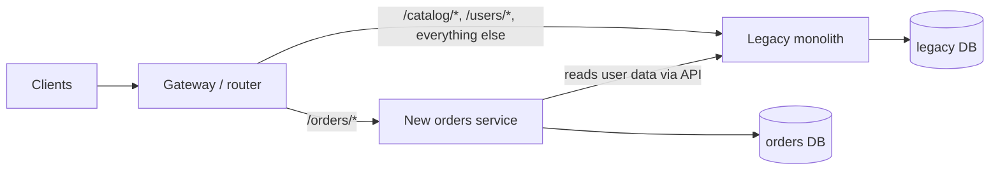

## 5.13 Edge cases & failure modes at the architecture level

Individual components fail in ways you can unit test. Architectures fail in ways you only see in production, usually at 02:00, usually because two reasonable local decisions combined into an unreasonable global one. This section catalogues the architecture-level failure modes a senior engineer must recognise on sight, with the mechanism, the detection signal, and the fix for each.

#### The distributed monolith

**Mechanism.** Services were split by code but not by data or by deployment. Service A writes to a table that service B reads. Deploys must happen in order. A DTO change in A breaks B at runtime.

**How you meet it.** A "simple" column rename in the `users` table breaks the orders service, the notifications service and a nightly report, none of which the users team knew about. Or: the release checklist says "deploy inventory before orders, wait five minutes, then deploy orders".

**Detection.** Query `pg_stat_statements` grouped by application name (`SET application_name` per service) and look for two services touching the same tables. Grep deploy runbooks for ordering instructions. Count how many repositories a single-feature PR touches.

**Fix.** Assign each table an owner. Other services get the data through the owner's API or by consuming events into a local projection. Re-merge services that cannot be separated at the data level; a modular monolith is better than a distributed one.

#### Shared database between services

**Mechanism.** A special case of the above and the most common. Two services with one PostgreSQL. It "works" until: a migration by one service locks a table the other needs; one service's runaway query exhausts the pool for both; one service's schema change silently breaks the other's ORM mapping; and neither service can be scaled or backed up independently.

**How you meet it.** At 09:00, the catalog team runs `ALTER TABLE products ADD COLUMN ... NOT NULL DEFAULT ...` on a 200-million-row table. It takes an `ACCESS EXCLUSIVE` lock for 40 seconds on older PostgreSQL versions. The orders service, which joins to `products` for pricing, stops serving checkout for 40 seconds. Nobody on the orders team was told.

**Detection.** More than one database role, or more than one `application_name`, writing to the same schema. Cross-schema foreign keys.

**Fix.** Schema-per-module now; database-per-service only when extracting. Move cross-domain reads to projections fed by events, with the timestamp guard shown in section 5.3.

```sql
-- Find tables touched by more than one application
SELECT relname, array_agg(DISTINCT application_name)
FROM pg_stat_activity a
JOIN pg_locks l ON l.pid = a.pid
JOIN pg_class c ON c.oid = l.relation
WHERE a.application_name <> ''
GROUP BY relname
HAVING count(DISTINCT application_name) > 1;
```

#### Chatty synchronous chains

**Mechanism.** Request enters the gateway, calls A, which calls B, which calls C, which calls D. Each hop adds latency (2 to 30 ms), and each hop multiplies failure probability. With four hops at 99.9% availability each, the chain is 99.6%: from 43 minutes of downtime a month to 2.9 hours. Retries at each hop multiply load on the leaf: three retries per hop over four hops can amplify one user request into 81 leaf calls in the worst case.

**How you meet it.** The "order details" page makes 14 sequential service calls; p99 is 2.1 seconds. Or: the gateway's thread pool fills up while every request waits on a chain that has a slow tail.

**Detection.** Trace depth histogram in your tracing backend; any critical-path trace deeper than 3 hops. Fan-out counts per request.

**Fix.** Limit the critical path to two synchronous hops. Aggregate with a BFF that fans out in parallel rather than serially. Replace chains with local projections (the orders service keeps the product name and price it needs). Set timeout budgets that shrink at each hop: gateway 2,000 ms, A 1,500 ms, B 800 ms, C 300 ms, so the innermost call cannot exceed the outer deadline.

```ts
// Propagate a shrinking deadline instead of a fixed per-hop timeout
import { Injectable } from '@nestjs/common';
import { HttpService } from '@nestjs/axios';
import { firstValueFrom } from 'rxjs';

@Injectable()
export class DeadlineHttpClient {
  constructor(private readonly http: HttpService) {}

  async get<T>(url: string, deadlineAtMs: number, minBudgetMs = 50): Promise<T> {
    const remaining = deadlineAtMs - Date.now();
    if (remaining < minBudgetMs) throw new Error(`deadline exceeded before calling ${url}`);
    const res = await firstValueFrom(
      this.http.get<T>(url, {
        timeout: remaining - 20, // leave a little for serialisation
        headers: { 'x-deadline-at': String(deadlineAtMs) }, // downstream reads this
      }),
    );
    return res.data;
  }
}
```

#### One slow service taking down the gateway

**Mechanism.** Node.js handles concurrency with an event loop and a finite number of in-flight sockets and memory. A slow downstream does not consume CPU; it consumes *waiting requests*. Each waiting request holds a socket, a buffer, a promise chain and often a database connection. When the slow service holds thousands of them, the gateway runs out of file descriptors, memory, or connection pool slots, and healthy routes fail too.

**How you meet it.** The recommendations service degrades to 8-second responses. The gateway has no per-route timeout. Within a minute, every gateway pod has 5,000 pending requests, the Kubernetes liveness probe times out, pods restart, and the restarts drop all in-flight requests including checkout.

**Detection.** In-flight request count per upstream on the gateway; event loop lag; pool wait time. All should be dashboards, and the first should have an alert.

**Fix.** Bulkheads: a per-upstream concurrency limit (for example, at most 50 in-flight calls to recommendations; the 51st fails fast). Circuit breakers: after N failures or timeouts in a window, open the circuit and return a fallback (empty recommendations) without calling. Per-route timeouts shorter than the liveness probe. Never let a non-critical dependency share limits with a critical one.

```ts
// Minimal bulkhead + circuit breaker as a NestJS provider (production: use opossum or cockatiel)
import { Injectable, Logger, ServiceUnavailableException } from '@nestjs/common';

@Injectable()
export class RecommendationsBulkhead {
  private inFlight = 0;
  private failures = 0;
  private openUntil = 0;
  private readonly log = new Logger(RecommendationsBulkhead.name);

  constructor(private readonly maxInFlight = 50, private readonly failureThreshold = 20, private readonly openMs = 10_000) {}

  async run<T>(call: () => Promise<T>, fallback: () => T): Promise<T> {
    if (Date.now() < this.openUntil) return fallback();            // circuit open: fail fast
    if (this.inFlight >= this.maxInFlight) return fallback();      // bulkhead full
    this.inFlight++;
    try {
      const result = await call();
      this.failures = 0;
      return result;
    } catch (err) {
      if (++this.failures >= this.failureThreshold) {
        this.openUntil = Date.now() + this.openMs;
        this.log.warn(`circuit opened for ${this.openMs} ms`);
      }
      return fallback();
    } finally {
      this.inFlight--;
    }
  }
}
```

#### Event storms

**Mechanism.** One action produces many events; each event produces more. A bulk import of 500,000 products emits 500,000 `ProductUpdated` events. Five consumers each recompute a projection per event, hitting the database 2.5 million times. Or a feedback loop: A emits on change, B reacts and updates A, A emits again.

**How you meet it.** Consumer lag climbs to millions; the database CPU pins at 100% from projection updates; unrelated consumers on the same broker are starved; the on-call cannot tell whether the storm is finishing or growing.

**Detection.** Produce rate per topic with alerts on 10x baseline; consumer lag per partition; a causation-id chain length metric (how many hops from the original trigger).

**Fix.** Batch: emit `ProductsBulkUpdated { ids: [...] }` or let consumers process in batches (`eachBatch` in KafkaJS). Coalesce: a projection updater that debounces per key. Rate-limit consumers to protect the database. Break loops with causation ids and a maximum depth. Separate broker clusters or topics for bulk versus interactive traffic.

#### Schema drift between services

**Mechanism.** The producer changes a field's meaning, type or name. Consumers deployed against the old shape either crash (strict parsing), silently ignore the field (lenient parsing), or worse, misinterpret it (`amount` changing from rupees to paise without a name change).

**How you meet it.** Payments starts sending `amount` in minor units. Notifications still formats it as major units. Customers receive "Your order of 1,250,000 INR has been confirmed" for a 12,500 INR order. Support is flooded; the error is invisible in dashboards because nothing failed.

**Detection.** A schema registry with compatibility checks in CI; consumer-driven contract tests (each consumer publishes the shape it depends on; the producer's CI runs them). Diffs on contract packages that require reviewers from consuming teams.

**Fix.** Rules: never change a field's meaning; add a new field with a new name (`amountMinor`), deprecate the old one, remove it only after all consumers have migrated (checked by usage metrics). Validate events at the consumer with `class-validator` or `zod` and send invalid ones to a dead-letter topic instead of guessing.

#### Versioning events

**Mechanism.** Events are stored for days (Kafka retention) or forever (event sourcing). A consumer today may read an event produced by a version of the producer from last week. Every consumer must be able to read every version that exists in the topic.

**Rules that work in practice.**

1. Put a `version` integer in the envelope and in the topic name for breaking changes: `orders.order-paid.v1`, `orders.order-paid.v2`.
2. Additive changes (new optional fields) stay in v1. Consumers ignore unknown fields.
3. For a breaking change, produce both v1 and v2 for a deprecation window (typically weeks), monitor v1 consumer group lag, and drop v1 when no group is reading it.
4. Upcasting: a consumer library that transforms v1 payloads into v2 shape at read time, so handler code only ever sees the latest shape.

```ts
// libs/contracts/src/events/orders/order-paid.ts
export interface OrderPaidV1 { version: 1; id: string; orderId: string; amount: number }           // amount in major units (legacy)
export interface OrderPaidV2 { version: 2; id: string; orderId: string; amountMinor: number; currency: string }

export type OrderPaid = OrderPaidV1 | OrderPaidV2;

// Upcaster: consumers always handle V2
export function upcastOrderPaid(e: OrderPaid): OrderPaidV2 {
  if (e.version === 2) return e;
  return { version: 2, id: e.id, orderId: e.orderId, amountMinor: Math.round(e.amount * 100), currency: 'INR' };
}
```

**Detection.** Consumer errors spiking after a producer deploy; a schema registry rejecting an incompatible schema in CI (the good kind of detection).

#### Big-bang rewrites

**Mechanism.** The team decides the legacy system is unfixable and builds a replacement from scratch, feature-freezing the old one. The rewrite takes twice as long as estimated because the old system encoded years of edge cases nobody documented. Meanwhile the business needs features, so the old system is changed anyway, and the rewrite chases a moving target. The most common end state: two half-systems in production forever.

**How you meet it.** "We will replace the monolith with microservices by Q3." In Q3 of the following year, 40% of traffic is on the new system, 60% on the old, and every feature must be built twice.

**Fix.** The **strangler fig** approach: put a routing layer (gateway) in front of the old system. Build one capability at a time in the new system. Route that capability's traffic to the new system, keep the rest on the old. Remove the old capability's code once the new one is proven. Repeat. Each step ships value and is reversible. The old system shrinks until it disappears. Combined with the extraction sequence from section 5.12, this is how large migrations actually succeed.



#### A compact reference table

| Failure mode | First signal | Root cause | Fix |
| --- | --- | --- | --- |
| Distributed monolith | Ordered deploys, multi-repo PRs | Split code, not data | Table ownership, projections, or re-merge |
| Shared database | Cross-service lock waits, surprise migration breakage | No data ownership | Schema per module, DB per service on extraction |
| Chatty chains | Trace depth > 3, p99 >> sum of p50s | Synchronous composition | BFF fan-out, projections, deadline propagation |
| Slow service kills gateway | In-flight count climbs, event loop lag | No bulkheads or breakers | Per-upstream limits, circuit breaker, fallbacks |
| Event storm | Produce rate 10x, lag in millions | Per-item events on bulk actions, loops | Batch events, coalesce, causation depth limit |
| Schema drift | Silent wrong values, consumer crashes after producer deploy | No contract enforcement | Registry, contract tests, additive changes only |
| Event versioning | Old consumers break on new payloads | Breaking change in place | Versioned topics, upcasters, deprecation windows |
| Big-bang rewrite | Rewrite past deadline, two systems in prod | Replacing instead of strangling | Strangler fig, one capability at a time |

#### How a Senior Backend Engineer thinks about this

They assume every one of these will be attempted by someone on the team, usually with good intentions and under deadline pressure. So they encode the defences in tooling: lint rules for boundaries, database roles for schemas, CI checks for contracts, default timeouts and bulkheads in the shared HTTP client, per-partition lag alerts in the standard dashboard template. A rule that lives only in a wiki is not a rule.

They also keep a short written list of "things we will not do": no shared tables across services, no synchronous chains deeper than two hops on the checkout path, no event without an id and a version, no rewrite without a strangler plan.

#### Interview questions

1. *How do you detect a distributed monolith in a system you have just joined?* Expected: shared tables across application names, ordered deploys, multi-repo feature PRs, fleet-wide integration tests.
2. *Explain how a slow non-critical dependency can take down a critical path, and the three defences.* Expected: in-flight resource exhaustion; bulkheads, circuit breakers, timeouts shorter than probes.
3. *How would you migrate a large monolith to services without a big-bang?* Expected: strangler fig with a gateway; one capability at a time; extraction sequence with database first.
4. *How do you version events safely?* Expected: version in envelope and topic, additive changes, dual-publish window, upcasters.
5. *Why do retries make an outage worse, and how do you retry safely?* Expected: amplification across hops; retry budgets, exponential backoff with jitter, only on idempotent operations, circuit breakers to stop retrying a dead service.

#### Practical exercise

Build a three-hop synchronous chain (gateway -> orders -> pricing -> promotions) in NestJS with no timeouts. Load-test it while making promotions sleep for 10 seconds. Observe the cascade. Then add deadline propagation, a bulkhead of 20 in-flight calls to promotions, and a circuit breaker with a fallback of "no discount".

Acceptance criteria: with promotions down, checkout p99 stays under 500 ms and returns full-price orders; the gateway's in-flight count never exceeds the bulkhead limit; promotions recovering closes the circuit within 15 seconds without a restart.

## Senior Checklist — Part 05

- [ ] I understand the concept
- [ ] I can explain it simply
- [ ] I can implement it
- [ ] I understand its failure modes
- [ ] I understand its scaling limitations
- [ ] I understand its security implications
- [ ] I understand its operational implications
- [ ] I can choose between alternatives
- [ ] I can explain the tradeoffs
- [ ] I can answer senior-level interview questions
- [ ] I can enforce module boundaries in a NestJS monolith with `exports`, facades, schema-per-module and a lint rule, and I can prove the boundary holds
- [ ] I can list at least seven concrete costs of microservices and name the signals that justify paying them
- [ ] I can extract a module into a service in reversible steps, moving the database before the process
- [ ] I can implement the transactional outbox and an idempotent consumer, and explain why in-process events are not durable
- [ ] I can structure a module as domain / application / infrastructure / presentation with no framework imports in the core, and I know when that ceremony is not worth it
- [ ] I can configure NestJS on Lambda correctly (`app.init()`, cached handler, `max: 1`, RDS Proxy, `callbackWaitsForEmptyEventLoop = false`)
- [ ] I can recognise a distributed monolith, a chatty chain, an event storm and schema drift from their first production signals
- [ ] I can design deadline propagation, bulkheads and circuit breakers so one slow dependency cannot take down the gateway
- [ ] I can plan a strangler-fig migration instead of a big-bang rewrite
- [ ] I can fill in the architecture decision matrix for a new product and defend the row I chose

## Part 05 — Key Takeaways

- Architecture is the set of decisions that are expensive to change: process boundaries, data ownership, deploy units. Pick the least structure that meets today's need with a door open for tomorrow's.
- A monolith is the right starting point for small teams; a modular monolith with enforced boundaries (facades, `exports`, schema-per-module, lint rules) is the right home for most products for most of their life.
- Microservices solve organisational and heterogeneous-scaling problems, not code-quality problems. They cost network latency, partial failure, sagas, tracing, N pipelines and a platform team. Adopt them per module, per named signal.
- The distributed monolith (split code, shared data, ordered deploys) is worse than either a monolith or real microservices. Data ownership is the boundary that matters.
- Service-per-database is non-negotiable in microservices; get needed data via APIs or event-fed projections with out-of-order guards.
- Serverless shines for spiky, event-driven edges (webhooks, file processing, cron) and needs a connection pooler in front of PostgreSQL; it is rarely the right choice for a steady, high-traffic core API.
- Events are facts in the past tense with an id and a version; commands are requests with one handler. Publish through a transactional outbox, consume idempotently, dead-letter poison messages, and alert on per-partition lag.
- Layered architecture is fine for CRUD; it breaks when business rules grow because the business layer depends on the ORM. Hexagonal, clean and onion fix this by inverting the dependency so the domain depends on nothing.
- Keep the DTO boundary at the API edge in every module, even the simplest; that is where data leaks come from, and it is what makes later refactoring cheap.
- Extract services in reversible steps: prove the boundary, move the schema to its own database while still in-process, move events to the broker, deploy the new app, swap the facade for a client, remove the module.
- Every synchronous cross-service call needs a deadline, a bulkhead and a fallback; every event needs an id, a version and an idempotent consumer.
- Never big-bang rewrite. Strangle: route one capability at a time to the new system behind a gateway.
