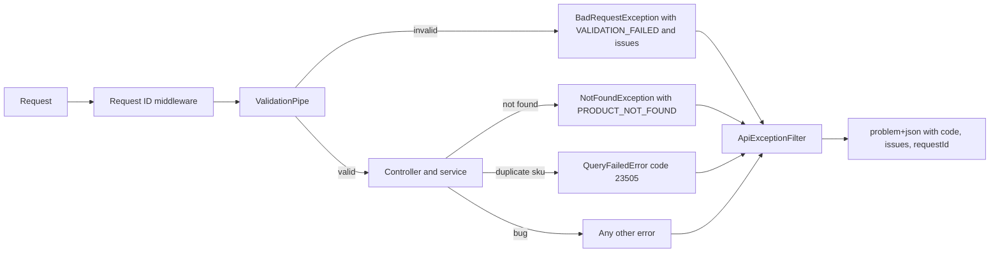

## 6.5 Step 1: Better validation, update and pagination

### 6.5.1 Validating every input: bodies, path parameters, query strings and configuration

#### Concept

So far only the request **body** of `POST /products` is validated. A real API has more inputs: the body of an update, path parameters (`/products/:id`), query strings (`?limit=20&cursor=...`) and the configuration the app reads at start-up. Each one is untrusted text until it is checked. In this step we add an update endpoint with a partial DTO, a validated query DTO for a paginated list, and a check of the configuration at boot.

#### Why does it exist?

Because every input an API does not validate is a place where bad data gets in. A query string `?limit=1000000` asks your database for a million rows. `?limit=abc` becomes `NaN` deep in your service. An update body with `{"priceCents": "free"}` must be rejected exactly like a create body would be. And a missing `DATABASE_PASSWORD` should stop the app at start-up with a clear message, not fail the first request at 3 a.m.

#### Mental model

Think of the DTO checkpoint from 6.2 as one door in a building with several entrances. The front door (the body) has a guard. The side door (query strings) and the loading bay (path parameters) need guards too, or people just walk in that way. And the building's own power supply (configuration) is checked before the doors open at all.

#### How it works

**Update with a partial DTO.** An update usually changes only some fields. `PartialType` (from `@nestjs/mapped-types`, installed by `nest generate resource`) creates a class where every field of `CreateProductDto` is optional but keeps all its validation rules:

```ts
// src/products/dto/update-product.dto.ts
import { PartialType } from '@nestjs/mapped-types';
import { CreateProductDto } from './create-product.dto';

// Every field optional; when present, the same rules as CreateProductDto apply.
export class UpdateProductDto extends PartialType(CreateProductDto) {}
```

**Query strings are text.** Everything in a URL arrives as a string, so `?limit=20` is `"20"`. With `transform: true` on the `ValidationPipe` (6.2), `@Type(() => Number)` from `class-transformer` converts it before the rules run:

```ts
// src/products/dto/list-products.query.ts
import { Type } from 'class-transformer';
import { IsInt, IsOptional, IsString, Max, Min } from 'class-validator';

export class ListProductsQuery {
  @IsOptional()
  @Type(() => Number)          // "20" -> 20 before validation
  @IsInt()
  @Min(1)
  @Max(100)                    // never more than 100 rows per page
  limit: number = 20;          // default when the client sends nothing

  @IsOptional()
  @IsString()
  cursor?: string;             // opaque: the client sends back what we gave it
}
```

**Cursor pagination.** Part 18.5 compares offset pagination (`?page=3`) with cursor pagination. A cursor says "continue after this item", so pages stay correct while new products are added, and the database does not have to skip thousands of rows. Our cursor is the last item's `createdAt` and `id`, encoded so the client treats it as an opaque token:

```ts
// src/products/cursor.ts
import { BadRequestException } from '@nestjs/common';
import { isUUID } from 'class-validator';

export type Cursor = { createdAt: string; id: string };

export const encodeCursor = (c: Cursor): string =>
  Buffer.from(`${c.createdAt}|${c.id}`).toString('base64url');

export function decodeCursor(raw: string): Cursor {
  const [createdAt, id] = Buffer.from(raw, 'base64url').toString('utf8').split('|');
  // A client can send back anything, so check both parts before they reach SQL.
  if (!createdAt || !id || !isUUID(id) || Number.isNaN(Date.parse(createdAt))) {
    throw new BadRequestException({ code: 'INVALID_CURSOR', message: 'The cursor is not valid' });
  }
  return { createdAt, id };
}
```

The service uses TypeORM's query builder for the "after this item" condition, and fetches one extra row to know whether there is a next page:

```ts
// src/products/products.service.ts (additions)
import { decodeCursor, encodeCursor } from './cursor';
import { ListProductsQuery } from './dto/list-products.query';
import { UpdateProductDto } from './dto/update-product.dto';

async list(q: ListProductsQuery): Promise<{ items: Product[]; nextCursor: string | null }> {
  const qb = this.repo.createQueryBuilder('p')
    .orderBy('p.createdAt', 'DESC')
    .addOrderBy('p.id', 'DESC')               // tie-breaker: two products can share a timestamp
    .take(q.limit + 1);                        // one extra row tells us if there is another page
  if (q.cursor) {
    const c = decodeCursor(q.cursor);
    qb.where('(p.createdAt, p.id) < (:createdAt, :id)', { createdAt: c.createdAt, id: c.id });
  }
  const rows = await qb.getMany();
  const items = rows.slice(0, q.limit);
  const last = items[items.length - 1];
  const nextCursor = rows.length > q.limit && last
    ? encodeCursor({ createdAt: last.createdAt.toISOString(), id: last.id })
    : null;
  return { items, nextCursor };
}

async update(id: string, dto: UpdateProductDto): Promise<Product> {
  const product = await this.findOne(id);      // 404 if it does not exist (6.3)
  Object.assign(product, dto);                 // only fields that passed validation are present (whitelist)
  return this.repo.save(product);              // UPDATE ... WHERE id = $n
}

async remove(id: string): Promise<void> {
  const result = await this.repo.delete({ id });
  if (result.affected === 0) throw new NotFoundException(`Product ${id} not found`);
}
```

The controller stays thin:

```ts
// src/products/products.controller.ts (additions)
import { Delete, HttpCode, Patch, Query } from '@nestjs/common';
import { ListProductsQuery } from './dto/list-products.query';
import { UpdateProductDto } from './dto/update-product.dto';

@Get()                                                    // replaces the earlier list()
list(@Query() q: ListProductsQuery) {
  return this.products.list(q);                           // { items, nextCursor }
}

@Patch(':id')                                             // PATCH: change some fields
update(@Param('id', ParseUUIDPipe) id: string, @Body() dto: UpdateProductDto) {
  return this.products.update(id, dto);
}

@Delete(':id')
@HttpCode(204)                                            // success with no body
remove(@Param('id', ParseUUIDPipe) id: string) {
  return this.products.remove(id);
}
```

**Configuration validated at boot.** 6.1 checked a list of names by hand. `ConfigModule.forRoot` accepts a `validate` function that receives the raw environment and returns the validated config, or throws. Using `class-validator`, the same tool as the DTOs:

```ts
// src/config/env.validation.ts
import { plainToInstance, Type } from 'class-transformer';
import { IsInt, IsString, Max, Min, MinLength, validateSync } from 'class-validator';

class Env {
  @IsString() DATABASE_HOST!: string;
  @Type(() => Number) @IsInt() @Min(1) @Max(65535) DATABASE_PORT: number = 5432;
  @IsString() DATABASE_USER!: string;
  @IsString() @MinLength(8) DATABASE_PASSWORD!: string;
  @IsString() DATABASE_NAME!: string;
  @Type(() => Number) @IsInt() PORT: number = 3000;
}

export function validateEnv(raw: Record<string, unknown>): Env {
  const env = plainToInstance(Env, raw);
  const errors = validateSync(env, { skipMissingProperties: false });
  if (errors.length) {
    const list = errors.map((e) => `${e.property}: ${Object.values(e.constraints ?? {}).join(', ')}`).join('\n');
    throw new Error(`Invalid configuration:\n${list}`);          // the app refuses to start, with the reason
  }
  return env;
}
```

```ts
// src/app.module.ts (change)
ConfigModule.forRoot({ isGlobal: true, validate: validateEnv }),
```

#### Practical example — trying every door

```bash
curl -s 'http://localhost:3000/products?limit=2' | jq
# { "items": [ {..."name":"Dental Probe"...}, {..."name":"Dental Mirror"...} ], "nextCursor": "MjAyNi0xMS0wNVQwOToz..." }

curl -s "http://localhost:3000/products?limit=2&cursor=MjAyNi0xMS0wNVQwOToz..." | jq '.items | length'
# 2  (the next page; nextCursor is null on the last page)

curl -s -i 'http://localhost:3000/products?limit=1000' | head -n 1
# HTTP/1.1 400 Bad Request          ("limit must not be greater than 100")

curl -s -i 'http://localhost:3000/products?limit=abc' | head -n 1
# HTTP/1.1 400 Bad Request          ("limit must be an integer number")

curl -s -X PATCH http://localhost:3000/products/<id> -H 'Content-Type: application/json' -d '{"priceCents":1499}' | jq .priceCents
# 1499

curl -s -i -X PATCH http://localhost:3000/products/<id> -H 'Content-Type: application/json' -d '{"priceCents":"free"}' | head -n 1
# HTTP/1.1 400 Bad Request

DATABASE_PASSWORD= npm run start:dev
# Error: Invalid configuration:
# DATABASE_PASSWORD: DATABASE_PASSWORD must be longer than or equal to 8 characters
```

Every door now has a guard, and every guard answers with `400` and a reason.

#### Edge cases & failure modes

- **Query values are strings**: without `@Type(() => Number)` and `transform: true`, `@IsInt()` rejects `"20"`, or worse, code compares `"20" > 100` as strings.
- **Unbounded limits**: no `@Max` means a client (or a bug) can ask for every row in the table.
- **Offset pagination drift**: with `?page=2`, a product added between page requests shifts items, so users see duplicates or miss items; cursors avoid it (Part 18.5).
- **Timestamp precision**: PostgreSQL stores microseconds, JavaScript `Date` keeps milliseconds; two products created in the same millisecond still sort correctly because of the `id` tie-breaker, but a cursor built from a rounded timestamp can skip a row created in that same millisecond. Many teams store `created_at` with millisecond precision (`timestamptz(3)`) to make cursors exact.
- **`PATCH` with an empty body** passes validation and changes nothing; decide whether that is fine or a `400`.
- **Configuration typos** like `DATABSE_HOST` leave the real variable missing; validation catches the missing one.

#### How a Senior Backend Engineer thinks about this

A senior lists every input of an endpoint (body, path, query, headers, configuration) and puts a validator on each, with bounds on anything that controls how much work the server does. They prefer cursor pagination for lists users scroll through, keep cursors opaque so the format can change later, and always add a tie-breaker to the sort. They make the app refuse to start with bad configuration, because a loud failure at deploy time is cheap and a quiet one in production is not.

#### Common mistakes

- Validating bodies but not query strings and path parameters.
- Pagination without an upper limit.
- Sorting only by `created_at` without a unique tie-breaker.
- Reading `process.env.X` all over the code instead of validated config.

#### Interview questions

1. **Why does `?limit=20` need `@Type(() => Number)`?** Query strings arrive as text; the transform converts it so numeric rules apply and the code receives a number.
2. **Why cursor pagination instead of page numbers for a product list?** Stable pages while data changes, and no large `OFFSET` scans; Part 18.5 compares both.
3. **Why add `id` to the `ORDER BY`?** Two rows can share a timestamp; a unique tie-breaker gives a total order, so cursors never skip or repeat rows.
4. **What should happen when a required environment variable is missing?** The app refuses to start with a clear message naming the variable.

#### Practical exercise

Add `PATCH /products/:id`, `DELETE /products/:id`, and the paginated `GET /products` with `limit` and `cursor`. Insert 45 products with a loop in a shell script (4.11) calling `curl`.

Acceptance criteria:

- Walking the list with `limit=20` returns 20, 20 and 5 items, then `nextCursor: null`, with no product repeated or missing.
- `limit=0`, `limit=101`, `limit=abc` and a corrupted cursor each return `400`.
- `PATCH` with `{"priceCents":-1}` returns `400`; `DELETE` of a missing id returns `404`; a successful `DELETE` returns `204` with no body.
- Starting the app with `DATABASE_PORT=abc` fails at boot with a message naming `DATABASE_PORT`.

#### Worked answer to the exercise

With the DTOs, `cursor.ts`, the service additions, the controller additions and `validateEnv` exactly as above, empty the table (`TRUNCATE products;` in `psql`) and seed it:

```bash
#!/usr/bin/env bash
# seed-products.sh: create 45 products and count the status codes that came back
set -euo pipefail
for i in $(seq 1 45); do
  curl -s -o /dev/null -w '%{http_code}\n' -X POST http://localhost:3000/products \
    -H 'Content-Type: application/json' \
    -d "{\"name\":\"Practice product $i\",\"priceCents\":$((i * 100))}"
done | sort | uniq -c
```

```text
$ bash seed-products.sh
     45 201
```

Then walk the list the way a client would, following `nextCursor` until it is `null`:

```bash
#!/usr/bin/env bash
# walk-products.sh: page through GET /products and check for repeats or gaps
set -euo pipefail
cursor=""; page=0; : > ids.txt
while :; do
  body=$(curl -s "http://localhost:3000/products?limit=20${cursor:+&cursor=$cursor}")
  page=$((page + 1))
  echo "page $page: $(jq '.items | length' <<< "$body") items"
  jq -r '.items[].id' <<< "$body" >> ids.txt
  cursor=$(jq -r '.nextCursor // empty' <<< "$body")   # empty string when nextCursor is null
  [ -z "$cursor" ] && break
done
echo "total $(wc -l < ids.txt | tr -d ' '), unique $(sort -u ids.txt | wc -l | tr -d ' ')"
```

```text
$ bash walk-products.sh
page 1: 20 items
page 2: 20 items
page 3: 5 items
total 45, unique 45
```

20, 20 and 5, and 45 unique ids out of 45: nothing repeated, nothing missing. The cursor is base64url, so it goes into the URL without extra encoding.

The rejections, and the update and delete rules:

```text
$ for q in 'limit=0' 'limit=101' 'limit=abc' 'cursor=not-a-real-cursor'; do
>   printf '%-26s %s\n' "$q" "$(curl -s -o /dev/null -w '%{http_code}' "http://localhost:3000/products?$q")"
> done
limit=0                    400
limit=101                  400
limit=abc                  400
cursor=not-a-real-cursor   400
$ id=$(curl -s 'http://localhost:3000/products?limit=1' | jq -r '.items[0].id')
$ curl -s -w '\n%{http_code}\n' -X PATCH "http://localhost:3000/products/$id" \
    -H 'Content-Type: application/json' -d '{"priceCents":-1}'
{"message":["priceCents must not be less than 0"],"error":"Bad Request","statusCode":400}
400
$ curl -s -o /dev/null -w '%{http_code}\n' -X DELETE http://localhost:3000/products/9b1d5f8e-0000-4000-8000-000000000000
404
$ curl -s -o /dev/null -w '%{http_code} %{size_download} bytes\n' -X DELETE "http://localhost:3000/products/$id"
204 0 bytes
$ DATABASE_PORT=abc npm run start:dev
Error: Invalid configuration:
DATABASE_PORT: DATABASE_PORT must not be greater than 65535, DATABASE_PORT must not be less than 1, DATABASE_PORT must be an integer number
```

The configuration line lists all three rules, because `"abc"` becomes `NaN`, which fails every numeric check; the order of the messages can differ. The shell variable wins over `.env`, which is why this one-off override works.

**Why it is right.** `PartialType` reuses every rule of `CreateProductDto`, so `PATCH` cannot accept what `POST` rejects. `@Type(() => Number)` turns the query text into a number before `@IsInt`, `@Min(1)` and `@Max(100)` judge it. The cursor's `id` tie-breaker gives a total order, so no row is skipped or repeated between pages.

**The trap.** Testing only a *random* cursor. A random string fails to decode into two parts, so even a check that ignores the id rejects it. A *tampered* cursor, a valid date with a broken id, is the real test, and it is why `decodeCursor` calls `isUUID`. Encode one and send it:

```text
$ bad=$(node -e "process.stdout.write(Buffer.from('2026-11-11T05:00:00.000Z|not-a-uuid').toString('base64url'))")
$ curl -s -w '\n%{http_code}\n' "http://localhost:3000/products?cursor=$bad"
{"code":"INVALID_CURSOR","message":"The cursor is not valid"}
400
```

Now delete `!isUUID(id) ||` from the condition and send the same cursor again:

```text
{"statusCode":500,"message":"Internal server error"}
500
```

Without the id check the request reaches PostgreSQL, which rejects `'not-a-uuid'` as a `uuid` value, and the client's mistake turns into a server error. Put the check back. Anything a client can send back to you, an "opaque" cursor included, is untrusted input.

## 6.6 Step 2: Consistent errors, a request ID and logs

### 6.6.1 One error shape for every failure

#### Concept

Right now our API's errors come in several shapes. A validation failure returns NestJS's default `{ "statusCode": 400, "message": [...], "error": "Bad Request" }`. A missing product returns `{ "statusCode": 404, "message": "Product ... not found" }`. A database error, such as a duplicate value in a unique column, returns a bare `500` with `"Internal server error"`. In this step we give every error **one shape**, with a stable machine-readable `code`, a list of `issues` for field problems, and a `requestId` that links the response to the server's log line.

The shape follows the **problem details** standard for HTTP APIs (RFC 9457, the successor of RFC 7807) that the rest of this book uses (Part 18.9, and Part 80.6 for how a frontend consumes it):

```json
{
  "type": "about:blank",
  "title": "Validation failed",
  "status": 400,
  "code": "VALIDATION_FAILED",
  "issues": [{ "path": "priceCents", "message": "priceCents must not be less than 0" }],
  "requestId": "7f3c9a1e-5b2d-4c8e-9f10-2a6b3c4d5e6f"
}
```

#### Why does it exist?

Because clients write code against errors, not only against successes. A frontend that wants to show "price must not be negative" under the price field needs the field name in a predictable place. A mobile app that wants to say "this product already exists" needs a code it can compare, not an English sentence that changes when someone edits the copy. Support staff need a request ID a customer can read out, so they can find the exact log line. Without one shape, every client grows a pile of special cases, and every special case is a bug waiting to happen.

#### Mental model

Imagine a hospital where every department writes test results on a different kind of paper, in a different layout. Doctors waste time finding the number they need, and sometimes read the wrong line. A standard form, the same boxes in the same places for every test, with a reference number at the top, makes every result quick to read and easy to trace. The error shape is that standard form.

#### How it works



1. **A request ID** is assigned by a small middleware to every request (or taken from an incoming `X-Request-Id` header if it looks safe), set on the response header, and included in every log line for that request.
2. **The `ValidationPipe`** is told how to build its error, with `exceptionFactory`, so validation failures carry `code` and `issues` with field paths.
3. **Services throw exceptions with codes**: `new NotFoundException({ code: 'PRODUCT_NOT_FOUND', message: ... })`.
4. **A global exception filter** catches everything, recognises known error types (NestJS `HttpException`s, PostgreSQL's unique-violation error), turns unknown errors into a generic `500` without leaking details, logs them with the request ID, and writes the one shape.

To make the duplicate case real, products get a **SKU** (stock keeping unit), a short unique product code, with a unique constraint in the database:

```ts
// src/products/product.entity.ts (addition)
@Column({ type: 'text', unique: true })      // creates a UNIQUE constraint: two products cannot share a SKU
sku!: string;
```

```ts
// src/products/dto/create-product.dto.ts (addition)
@IsString()
@Matches(/^[A-Z0-9-]{3,32}$/, { message: 'sku must be 3 to 32 capital letters, digits or hyphens' })
sku!: string;
```

#### Practical example — the code

The request ID middleware:

```ts
// src/common/request-id.middleware.ts
import { Injectable, NestMiddleware } from '@nestjs/common';
import type { NextFunction, Request, Response } from 'express';
import { randomUUID } from 'node:crypto';

@Injectable()
export class RequestIdMiddleware implements NestMiddleware {
  use(req: Request, res: Response, next: NextFunction) {
    const incoming = req.header('x-request-id');
    const id = incoming && /^[\w-]{8,64}$/.test(incoming) ? incoming : randomUUID(); // never trust arbitrary input
    req.headers['x-request-id'] = id;
    res.setHeader('X-Request-Id', id);
    next();
  }
}
```

```ts
// src/app.module.ts (addition): apply the middleware to every route
import { MiddlewareConsumer, Module, NestModule } from '@nestjs/common';
import { RequestIdMiddleware } from './common/request-id.middleware';

@Module({ /* imports as before */ })
export class AppModule implements NestModule {
  configure(consumer: MiddlewareConsumer) {
    consumer.apply(RequestIdMiddleware).forRoutes('*');
  }
}
```

Validation errors with field paths:

```ts
// src/common/validation.ts
import { BadRequestException, ValidationPipe, type ValidationError } from '@nestjs/common';

const toIssues = (errors: ValidationError[], parent = ''): { path: string; message: string }[] =>
  errors.flatMap((e) => {
    const path = parent ? `${parent}.${e.property}` : e.property;
    const own = Object.values(e.constraints ?? {}).map((message) => ({ path, message }));
    return [...own, ...toIssues(e.children ?? [], path)];          // nested objects keep a dotted path
  });

export const validationPipe = new ValidationPipe({
  whitelist: true,
  forbidNonWhitelisted: true,
  transform: true,
  exceptionFactory: (errors) =>
    new BadRequestException({ code: 'VALIDATION_FAILED', message: 'Validation failed', issues: toIssues(errors) }),
});
```

The filter that writes every error:

```ts
// src/common/api-exception.filter.ts
import { ArgumentsHost, Catch, ExceptionFilter, HttpException, HttpStatus, Logger } from '@nestjs/common';
import type { Request, Response } from 'express';
import { QueryFailedError } from 'typeorm';

type Issue = { path?: string; message: string };

@Catch()                                                  // no argument: catch everything
export class ApiExceptionFilter implements ExceptionFilter {
  private readonly log = new Logger('ApiExceptionFilter');

  catch(exception: unknown, host: ArgumentsHost) {
    const ctx = host.switchToHttp();
    const req = ctx.getRequest<Request>();
    const res = ctx.getResponse<Response>();
    const requestId = String(req.headers['x-request-id'] ?? '');

    let status = HttpStatus.INTERNAL_SERVER_ERROR;
    let code = 'INTERNAL_ERROR';
    let title = 'Something went wrong';
    let issues: Issue[] = [];

    if (exception instanceof HttpException) {
      status = exception.getStatus();
      const body = exception.getResponse() as string | { code?: string; message?: string | string[]; issues?: Issue[] };
      code = typeof body === 'object' && body.code ? body.code : HttpStatus[status] ?? 'HTTP_ERROR';   // e.g. NOT_FOUND
      title = typeof body === 'string' ? body : Array.isArray(body.message) ? 'Bad request' : body.message ?? title;
      issues = typeof body === 'object' && body.issues ? body.issues : [];
    } else if (exception instanceof QueryFailedError && (exception.driverError as { code?: string }).code === '23505') {
      status = HttpStatus.CONFLICT;                      // 23505: PostgreSQL unique_violation
      code = 'PRODUCT_SKU_TAKEN';
      title = 'A product with this SKU already exists';
      issues = [{ path: 'sku', message: title }];
    } else {
      // A bug or an outage: log everything, tell the client nothing internal.
      this.log.error({ msg: 'unhandled error', requestId, path: req.url, err: (exception as Error)?.stack ?? String(exception) });
    }

    if (status < 500) this.log.warn({ msg: 'request failed', requestId, status, code, path: req.url });
    res.status(status).type('application/problem+json').json({ type: 'about:blank', title, status, code, issues, requestId });
  }
}
```

Two things to notice. The duplicate check is done by the **database**, not by a `SELECT` before the `INSERT`: two requests at the same moment could both pass a `SELECT`, but only one can pass a unique constraint (Part 24 explains why). And the `500` branch logs the stack trace but returns only `INTERNAL_ERROR` and the request ID: stack traces and SQL in responses help attackers, not users.

Wiring it all in one place, so tests (6.7) can use exactly the same setup as `main.ts`:

```ts
// src/configure-app.ts
import type { INestApplication } from '@nestjs/common';
import { validationPipe } from './common/validation';
import { ApiExceptionFilter } from './common/api-exception.filter';

export function configureApp(app: INestApplication): INestApplication {
  app.useGlobalPipes(validationPipe);
  app.useGlobalFilters(new ApiExceptionFilter());
  app.enableShutdownHooks();                       // close the database pool cleanly on SIGTERM (4.3)
  return app;
}
```

```ts
// src/main.ts
import { NestFactory } from '@nestjs/core';
import { AppModule } from './app.module';
import { configureApp } from './configure-app';

async function bootstrap() {
  const app = configureApp(await NestFactory.create(AppModule));
  await app.listen(Number(process.env.PORT ?? 3000));
}
bootstrap();
```

And the service passes the new field through and gives its not-found error a code:

```ts
// src/products/products.service.ts (changes)
// in create():
const product = this.repo.create({ name: dto.name, priceCents: dto.priceCents, sku: dto.sku, currency: dto.currency ?? 'USD' });
// in findOne():
if (!product) throw new NotFoundException({ code: 'PRODUCT_NOT_FOUND', message: `Product ${id} not found` });
// in remove() (update() already goes through findOne):
if (result.affected === 0) throw new NotFoundException({ code: 'PRODUCT_NOT_FOUND', message: `Product ${id} not found` });
```

#### Practical example — what clients see now

```bash
curl -s -X POST http://localhost:3000/products -H 'Content-Type: application/json' \
  -d '{"name":"Dental Mirror","priceCents":-5,"sku":"dm 1"}' | jq
# { "type": "about:blank", "title": "Validation failed", "status": 400, "code": "VALIDATION_FAILED",
#   "issues": [ { "path": "priceCents", "message": "priceCents must not be less than 0" },
#               { "path": "sku", "message": "sku must be 3 to 32 capital letters, digits or hyphens" } ],
#   "requestId": "0b6f..." }

curl -s -X POST http://localhost:3000/products -H 'Content-Type: application/json' \
  -d '{"name":"Dental Mirror","priceCents":1299,"sku":"DM-001"}' -o /dev/null -w '%{http_code}\n'
# 201
curl -s -X POST http://localhost:3000/products -H 'Content-Type: application/json' \
  -d '{"name":"Another mirror","priceCents":999,"sku":"DM-001"}' | jq '{status, code, issues}'
# { "status": 409, "code": "PRODUCT_SKU_TAKEN", "issues": [ { "path": "sku", "message": "A product with this SKU already exists" } ] }

curl -s -i http://localhost:3000/products/9b1d5f8e-0000-4000-8000-000000000000 | grep -iE '^HTTP|x-request-id'
# HTTP/1.1 404 Not Found
# X-Request-Id: 5c2e...
```

And the server log for that 404 has the same request ID, so a support ticket that quotes `5c2e...` leads straight to it. In the terminal running `npm run start:dev` (or the file you send its output to), NestJS's built-in logger prints an object as `Object:` followed by indented JSON:

```text
[Nest] 4821  - 11/11/2026, 10:41:55 AM    WARN [ApiExceptionFilter] Object:
{
  "msg": "request failed",
  "requestId": "5c2e...",
  "status": 404,
  "code": "PRODUCT_NOT_FOUND",
  "path": "/products/9b1d..."
}
```

Because one entry spans several lines, `grep 5c2e` finds only the `requestId` line; `grep -B 3 -A 4 5c2e` shows the whole entry. Production setups switch to one JSON object per line, which log tools search and filter directly (Part 47.2).

#### Edge cases & failure modes

- **A `SELECT`-then-`INSERT` duplicate check** races: two requests both see "no such SKU" and both insert, or one fails with an unhandled `500`; rely on the unique constraint and map its error.
- **Leaking internals**: returning `exception.message` from unknown errors can expose SQL, table names or file paths.
- **Inconsistent codes**: `NOT_FOUND` here, `PRODUCT_NOT_FOUND` there; keep a list of codes in one file and review additions like API changes (Part 28).
- **Error text as an API**: clients that match on `title` break when the wording changes; they must use `code`.
- **Request IDs from clients** can be anything, including very long or malicious strings; validate the format or generate a new one.
- **Logging personal data** (emails, addresses, tokens) in error logs; log IDs and codes, not payloads (Part 44.31).

#### How a Senior Backend Engineer thinks about this

A senior designs errors as part of the API contract from the first endpoint: one shape, stable codes, field paths that match the request's field names, a request ID on every response, and no internals in any response. They let the database enforce uniqueness and translate its error into a clear `409`, because application-level checks race. They log every `5xx` with enough context to debug it and every `4xx` briefly, keyed by request ID, so a customer's complaint can be traced in seconds. And they write it once, in a filter and a pipe, so no individual endpoint can get it wrong.

#### Common mistakes

- Returning different error shapes from different endpoints.
- Checking for duplicates with a `SELECT` before inserting.
- Sending stack traces or SQL errors to clients.
- No request ID, so a user's error cannot be found in the logs.
- Clients parsing English error messages instead of codes.

#### Interview questions

1. **Why should every API error have the same shape?** Clients handle errors with one piece of code: codes to branch on, field paths to show messages in the right place, a request ID to trace the failure.
2. **How do you return `409` for a duplicate SKU without a race condition?** A unique constraint in the database, and map PostgreSQL's unique-violation error (`23505`) to `409` in the exception filter.
3. **What should a `500` response contain?** A generic code and the request ID; never stack traces or SQL. The details go to the server log under the same request ID.
4. **What is a request ID for?** Linking one request's response, log lines and (later) traces, so a reported error can be found quickly.

#### Practical exercise

Add the SKU column, the request ID middleware, the validation `exceptionFactory`, the exception filter and `configureApp`.

Acceptance criteria:

- Every error response from the API (validation, bad UUID, not found, duplicate SKU, an unexpected error) has `Content-Type: application/problem+json` and the fields `status`, `code`, `issues` and `requestId`.
- Creating two products with the same SKU at the same moment (two `curl` commands joined with `&` in one line) creates exactly one product and returns one `201` and one `409`.
- A deliberately thrown `new Error('boom')` in a test route returns `500` with `code: "INTERNAL_ERROR"`, no stack trace in the body, and the stack trace in the log under the same request ID.
- Sending `X-Request-Id: my-test-request-123` makes the response and the log use that ID.

#### Worked answer to the exercise

With the entity and DTO additions, `RequestIdMiddleware`, `validation.ts`, `ApiExceptionFilter`, `configureApp` and the new `main.ts` exactly as above, add one temporary route to produce an unexpected error:

```ts
// src/app.controller.ts (temporary: delete it after the check)
@Get('boom')
boom(): never {
  throw new Error('boom');
}
```

**Every error has the one shape.** One case in full:

```text
$ curl -s -i http://localhost:3000/products/not-a-uuid | grep -iE '^(HTTP|x-request-id|content-type)'
HTTP/1.1 400 Bad Request
X-Request-Id: 2f0d6c1a-8b3e-4f59-9c7d-1e2a3b4c5d6e
Content-Type: application/problem+json; charset=utf-8
$ curl -s http://localhost:3000/products/not-a-uuid | jq -c .
{"type":"about:blank","title":"Validation failed (uuid is expected)","status":400,"code":"BAD_REQUEST","issues":[],"requestId":"7a41c0de-3f2b-4e8a-b1c9-5d6e7f8a9b0c"}
```

Repeat for the other cases; all have the same content type and fields:

| Case | Request | `status` | `code` | `issues` |
|---|---|---|---|---|
| Validation | `POST` with `"priceCents":-5` | 400 | `VALIDATION_FAILED` | one entry per broken field |
| Bad UUID | `GET /products/not-a-uuid` | 400 | `BAD_REQUEST` | `[]` |
| Not found | `GET` an unused UUID | 404 | `PRODUCT_NOT_FOUND` | `[]` |
| Duplicate SKU | second `POST` with `DM-001` | 409 | `PRODUCT_SKU_TAKEN` | `[{ "path": "sku", ... }]` |
| Unexpected | `GET /boom` | 500 | `INTERNAL_ERROR` | `[]` |

The bad UUID gets the fallback `BAD_REQUEST` because `ParseUUIDPipe`'s exception carries no `code`, so the filter uses the status name. That meets the criteria; a stronger answer gives the pipe an `exceptionFactory` that throws `BadRequestException({ code: 'INVALID_ID', message: 'id must be a UUID', issues: [{ path: 'id', message: 'id must be a UUID' }] })`.

**Two creates at the same moment:**

```text
$ B='{"name":"Race Mirror","priceCents":1299,"sku":"RACE-1"}'
$ curl -s -o /dev/null -w '%{http_code}\n' -X POST http://localhost:3000/products -H 'Content-Type: application/json' -d "$B" & curl -s -o /dev/null -w '%{http_code}\n' -X POST http://localhost:3000/products -H 'Content-Type: application/json' -d "$B"; wait
201
409
$ docker exec -it shop-db psql -U shop -d shop -c "SELECT sku, count(*) FROM products WHERE sku = 'RACE-1' GROUP BY sku;"
  sku   | count
--------+-------
 RACE-1 |     1
(1 row)
```

The order of `201` and `409` can swap between runs; there is always exactly one of each, and one row.

**The unexpected error, with a client-supplied request ID** (this covers the last two criteria at once):

```text
$ curl -s -i -H 'X-Request-Id: my-test-request-123' http://localhost:3000/boom | grep -iE '^(HTTP|x-request-id)'
HTTP/1.1 500 Internal Server Error
X-Request-Id: my-test-request-123
$ curl -s -H 'X-Request-Id: my-test-request-123' http://localhost:3000/boom | jq -c .
{"type":"about:blank","title":"Something went wrong","status":500,"code":"INTERNAL_ERROR","issues":[],"requestId":"my-test-request-123"}
```

No stack, no file paths in the body. The terminal running the app has the details under the same ID (stack shortened here):

```text
[Nest] 4821  - 11/11/2026, 10:42:07 AM   ERROR [ApiExceptionFilter] Object:
{
  "msg": "unhandled error",
  "requestId": "my-test-request-123",
  "path": "/boom",
  "err": "Error: boom\n    at AppController.boom (/Users/asha/work/products-api/src/app.controller.ts:19:11)\n    at ..."
}
```

Send `X-Request-Id: bad id!` and the middleware ignores it (it fails `/^[\w-]{8,64}$/`) and generates a UUID instead. Delete the `boom` route when you are done.

**The trap.** A validation error that comes back with `code: "BAD_REQUEST"` and `issues: []`, instead of `VALIDATION_FAILED` with field paths. That means a `ValidationPipe` *without* the `exceptionFactory` is running, almost always the 6.2 `app.useGlobalPipes(new ValidationPipe(...))` still sitting in `main.ts`. `main.ts` must call only `configureApp`, so the app and the tests (6.7) share one setup.
