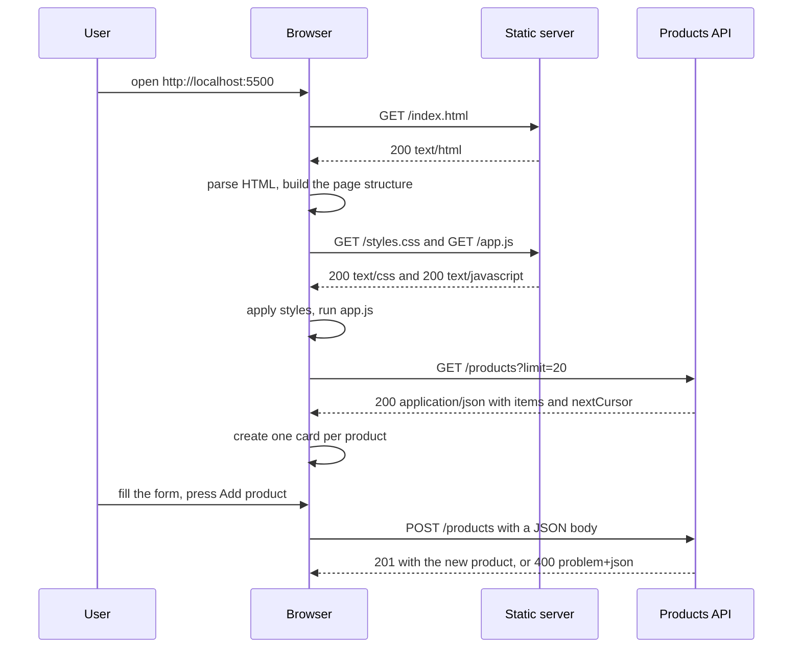
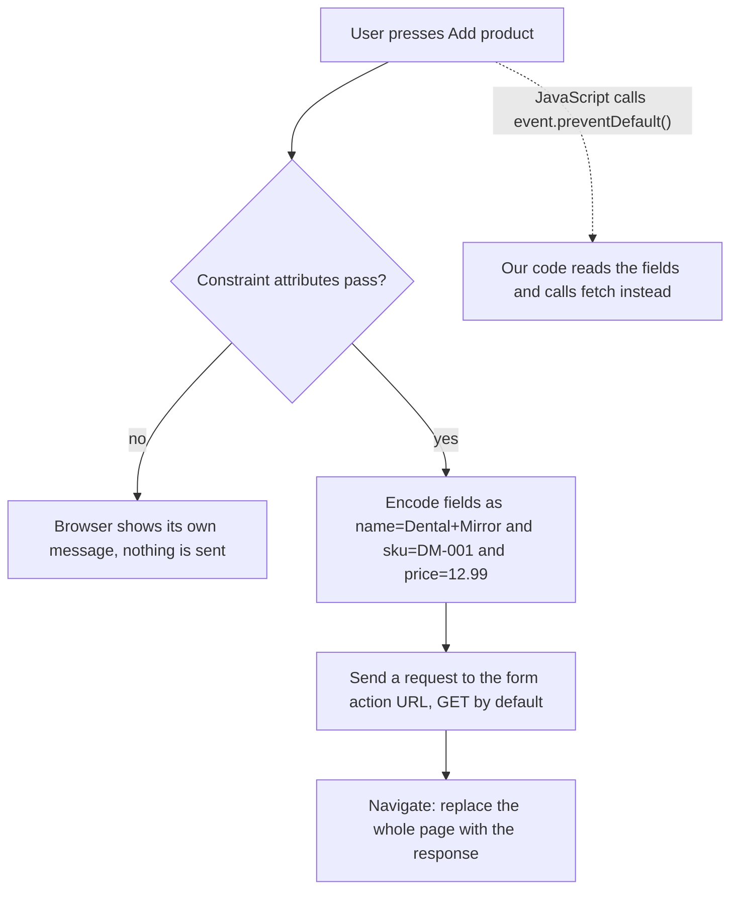

# Part 7 — Your First Frontend

In Part 6 you built a products API: NestJS, PostgreSQL, validated input, one error shape, tests and Docker. You talked to it with `curl`. Real users do not use `curl`. They open a browser, see a page, fill in a form and press a button. Somewhere between that button and your controller there is a frontend, and until you have built one yourself, half of every bug report will be a mystery to you: "the list is empty", "the form does nothing", "it says CORS".

This Part closes the loop with just enough HTML, CSS and browser JavaScript to build one honest screen for the Part 6 API: a Products page that lists products, creates one from a form, shows the API's validation errors next to the right fields, and deletes a product after asking first. Along the way you meet CORS for real and fix it properly in NestJS, learn to read DevTools the way you read `curl -v`, and decide where the frontend should be served from. We use no framework and no build step on purpose: React, Vite and Next.js (Volume 7, Parts 69 to 79) all produce HTML, CSS and JavaScript that call `fetch` in the end. Understand that layer and the frameworks are conveniences; skip it and they are magic, and magic is hard to debug at 2 a.m.

Everything here talks to the Part 6 API exactly as Part 6 left it: `http://localhost:3000`, `GET /products?limit=&cursor=` returning `{ items, nextCursor }`, `POST /products` with `name`, `priceCents`, `sku` and an optional `currency`, `DELETE /products/:id` returning `204`, and every error as `application/problem+json` with `status`, `code`, `issues` and `requestId` (6.6). Start it with `docker compose up` (6.8) or `npm run start:dev` (6.1) before you try the examples.

## 7.1 What a frontend is

### 7.1.1 The browser's half of the request-response loop

#### Concept

A **frontend** is the part of an application that runs on the user's device and that the user sees and touches. For a web application, the frontend is a set of files the browser downloads and runs: an **HTML** document (the structure and content: headings, forms, lists), **CSS** stylesheets (how it looks: colours, spacing, layout) and **JavaScript** (behaviour: what happens when you click, and calls to your API).

The **backend** is what you built in Part 6: code on a server that owns the data and the rules. The frontend asks; the backend decides. A frontend can make a form friendlier, but it can never be trusted to enforce a rule, because the user controls their own browser completely.

#### Why does it exist?

Because your API speaks JSON, and people do not read JSON. Someone has to turn `{"items":[{"name":"Dental Mirror","priceCents":1299}]}` into a card that says "Dental Mirror, $12.99" with a Delete button, and turn a typed price of `12.99` back into `{"priceCents":1299}`. That translation, in both directions, is the frontend's job. Without it, only engineers can use your product.

There is a second reason that matters to a backend engineer. The browser is the most demanding client your API will ever have. It enforces security rules (same-origin policy, CORS, mixed content) that `curl` and Postman ignore, it retries and caches in its own ways, and its users double-click. An API that has only ever been called from `curl` has not really been tested.

#### Mental model

Imagine a restaurant. The kitchen (the backend) owns the ingredients and the recipes; nothing leaves it without the chef's approval. The dining room (the frontend) is where guests sit: menus, tables, a waiter. The waiter takes an order in words the guest understands, translates it into a ticket the kitchen understands, and brings back the plate. The dining room can be beautiful or plain, but it never cooks. If a guest writes "free dessert" on their own ticket, the kitchen still decides.

#### How it works

You already know from Part 3 (3.6) that one page view is many request-response exchanges. Here is the same picture for the Products screen we will build, with the static files served from one place and the API from another:



Step by step:

1. **The HTML document arrives first.** It is the only file the user asked for directly. The browser reads it top to bottom and builds an in-memory tree of the page, called the **DOM** (Document Object Model; 7.4).
2. **The HTML names other files.** A `<link rel="stylesheet">` asks for CSS; a `<script>` asks for JavaScript. The browser fetches them, often in parallel.
3. **CSS is applied** to the tree, which decides where every box goes and what it looks like.
4. **JavaScript runs.** It can read and change the DOM, listen for clicks and submits, and call your API with `fetch` (7.5).
5. **The API answers with JSON**, not HTML. JavaScript turns that JSON into new elements in the page. The page itself never reloads.
6. **The loop continues** as the user interacts: every click that needs data is another request-response exchange with your API.

The important shift from Part 3: when the browser itself requests a page, it shows whatever comes back. When JavaScript requests data with `fetch`, nothing appears on screen unless your code puts it there. That is why "the API returned 200 but the page is empty" is such a common bug report (7.7 walks through it).

#### Practical example

Here is the smallest possible frontend that talks to the Part 6 API. Save it as `hello.html`. Do not open it yet; 7.6 and 7.8 explain why opening it straight from disk will fail, and that failure is a lesson in itself.

```html
<!doctype html>
<html lang="en">
<head>
  <meta charset="utf-8">
  <title>Products</title>
</head>
<body>
  <h1>Products</h1>
  <ul id="list"></ul>
  <script type="module">
    const res = await fetch('http://localhost:3000/products?limit=5');
    const page = await res.json();                       // { items: [...], nextCursor: ... }
    const list = document.querySelector('#list');
    for (const p of page.items) {
      const li = document.createElement('li');
      li.textContent = `${p.name}: ${p.priceCents} cents`; // textContent, never innerHTML (7.4)
      list.append(li);
    }
  </script>
</body>
</html>
```

Twenty-one lines, and every idea in this Part is already in it: a document, a place in the page to put things, a `fetch` to the API, JSON turned into elements. The rest of the Part makes each line robust: styled, accessible, safe against hostile data, honest about errors, and allowed by CORS.

#### How a Senior Backend Engineer thinks about this

A senior backend engineer does not need to be a designer, but they understand the browser as a client well enough to design APIs that serve it: response shapes that are easy to render, error bodies that point at fields, CORS configured on purpose, and no rule that lives only in the frontend. When a frontend colleague reports a bug, they can open DevTools, find the request, and say within a minute whether the API or the page is wrong. That one skill saves days of "works on my machine" ping-pong between teams.

#### Interview questions

1. **What does the browser download first when a user opens a web app, and what happens next?** The HTML document; it parses it into the DOM, fetches the CSS and JavaScript the HTML references, applies styles, runs the scripts, and the scripts call APIs for data.
2. **Why can't the frontend enforce business rules?** The user controls the browser completely: they can edit the page, change the JavaScript or call the API with `curl`. The backend must validate everything again.
3. **Your API returns `200` with correct data but the page shows nothing. Where do you look?** The browser's Console for script errors and the Network panel to compare the response shape with what the code expects; `fetch` puts nothing on screen by itself.

#### Practical exercise

Without writing any code yet, open any shopping site with DevTools open (F12, or Cmd+Option+I on a Mac), go to the Network panel, and reload. Put the requests into four groups: the HTML document, stylesheets, scripts, and API calls returning JSON. Acceptance criteria: you can name at least one request in each group and say which request came first and why.

#### Worked answer to the exercise

On a typical product page, the first row is the document itself (type `document`), because the browser only learns about everything else by reading it. Stylesheets and scripts named in the HTML come next, then images and fonts. API calls (type `fetch` or `xhr`, JSON in the Preview tab) appear later, because JavaScript had to download and run before it could start them. Our Products screen in 7.9 produces exactly this order: `index.html`, `styles.css`, `app.js`, `api.js`, then `GET /products?limit=20`.

## 7.2 HTML: the structure of the page

### 7.2.1 Document structure, semantic elements, links, lists and tables

#### Concept

**HTML** (HyperText Markup Language) describes what is on a page and what each part *is*: this is a heading, this is a list, this is a navigation area, this is a table of numbers. It is made of **elements**, written as tags: `<h1>Products</h1>` is an `h1` element containing the text "Products". Elements can have **attributes** that add information, like `<a href="/products">`, and they nest inside each other to form a tree.

**Semantic** HTML means choosing the element that matches the meaning: `<button>` for something you press, `<nav>` for navigation, `<table>` for tabular data, rather than a `<div>` styled to look like those things. The browser, search engines and screen readers all rely on that meaning.

#### Why does it exist?

Because a page has to work for many readers at once. A sighted user sees layout. A blind user hears the page through a **screen reader**, software that reads the page aloud and lets the user jump between headings, links and form fields; it can only do that if the HTML says which things are headings, links and fields. A keyboard user moves with Tab; a real `<button>` is focusable and activates with Enter and Space for free, while a `<div onclick>` is not. Semantic HTML is the cheapest accessibility you will ever get, and accessibility is not optional: in many countries it is a legal requirement for commercial sites.

#### Mental model

Imagine a well-run warehouse. Every shelf has a label: "fragile", "returns", "dental instruments". Any worker, a forklift robot, or an auditor can find things because the labels describe what is there, not what colour the shelf is painted. HTML elements are those labels. CSS paints the shelves; semantic HTML tells everyone what is on them.

#### How it works

Every HTML document has the same skeleton:

```html
<!doctype html>                         <!-- "this is modern HTML"; without it browsers use old quirks rules -->
<html lang="en">                        <!-- lang tells screen readers which language to speak -->
<head>                                  <!-- information ABOUT the page; not shown in the page body -->
  <meta charset="utf-8">                <!-- read the bytes as UTF-8, so names like "Søren" survive -->
  <meta name="viewport" content="width=device-width, initial-scale=1">  <!-- render at phone width on phones -->
  <title>Products - Shop Admin</title>  <!-- shown in the browser tab and bookmarks -->
  <link rel="stylesheet" href="styles.css">
</head>
<body>                                  <!-- everything the user sees -->
  <header>...</header>
  <main>...</main>
  <footer>...</footer>
</body>
</html>
```

The elements you will use most, grouped by job:

| Job | Elements | Notes |
|---|---|---|
| Page regions | `<header>`, `<nav>`, `<main>`, `<section>`, `<article>`, `<aside>`, `<footer>` | One `<main>` per page; screen readers offer "jump to main content" |
| Headings | `<h1>` to `<h6>` | One `<h1>` for the page, then nested levels without skipping; they form an outline |
| Text | `<p>`, `<strong>`, `<em>`, `<code>` | `<strong>` means important, not merely bold |
| Links | `<a href="...">` | Goes somewhere (a new URL); a button does something |
| Lists | `<ul>` (unordered), `<ol>` (ordered), `<li>` (item) | Screen readers announce "list, 12 items" |
| Tables | `<table>`, `<caption>`, `<thead>`, `<tbody>`, `<tr>`, `<th>`, `<td>` | For data with rows and columns, never for layout |
| Generic boxes | `<div>` (block), `<span>` (inline) | Only when no semantic element fits |

**Links versus buttons** is the distinction beginners blur most. A link (`<a href>`) navigates: it changes the URL, works with "open in new tab", and is announced as "link". A button performs an action on the current page: submit a form, delete a product, open a dialog. "Delete" must be a `<button>`, never a link: a link is a `GET`, and Part 3 (3.5) told the story of a crawler that followed `GET /product_delete?id=5` links and deleted products.

**Lists and tables.** Our product list could be either. A list of cards (`<ul>` of `<li>`) reflows nicely on a phone. A table is better when users compare columns, such as price and stock across 50 products:

```html
<table>
  <caption>Products, newest first</caption>      <!-- a title the screen reader announces with the table -->
  <thead>
    <tr><th scope="col">Name</th><th scope="col">SKU</th><th scope="col">Price</th></tr>
  </thead>
  <tbody>
    <tr><td>Dental Mirror</td><td>DM-001</td><td>$12.99</td></tr>
    <tr><td>Dental Probe</td><td>DP-002</td><td>$8.99</td></tr>
  </tbody>
</table>
```

`scope="col"` tells assistive technology that each `<th>` labels its column, so a screen reader reading a price cell can say "Price, $12.99".

#### Practical example

The Products page in 7.9 uses exactly these pieces: a `<header>` with the `<h1>` and a Refresh `<button>`, a `<main>` with two `<section>`s (the form and the list), and a `<ul>` for the product cards. Each section carries `aria-labelledby="..."` pointing at its heading's `id`, so a screen reader user listing the page's regions hears "New product, region". **ARIA** (Accessible Rich Internet Applications) attributes add meaning that HTML alone cannot express; the first rule of ARIA is to use a native element whenever one exists. The status line has `role="status"`, a polite live region: when JavaScript puts "No products yet" into it, the screen reader announces it without moving focus.

#### Edge cases & failure modes

- **Missing `<!doctype html>`** puts the browser in "quirks mode", where old layout rules apply and CSS behaves strangely.
- **Missing `<meta charset="utf-8">`** can turn "Søren" or "₹" into garbage characters, even though your API returned correct UTF-8 JSON.
- **Missing viewport meta tag** makes phones render the page as a tiny desktop page that users must pinch to read.

### 7.2.2 Forms, inputs and labels

#### Concept

A **form** collects input from the user and sends it somewhere. It is a `<form>` element containing **controls**: `<input>` (text, number, email, checkbox and more), `<select>` (a drop-down), `<textarea>` (multi-line text) and a `<button type="submit">`. Every control needs a **label**, a visible piece of text tied to it, so that everyone knows what to type and a screen reader can announce it.

#### Why does it exist?

Forms are how data enters your system. Before JavaScript was common, forms were the only way: the browser itself would package up the fields and send an HTTP request. That built-in behaviour still exists and still runs unless your code stops it, which is why you need to know exactly what it does.

#### How it works

The create form for products, with labels tied to inputs by `for` and `id`:

```html
<form id="create-form">
  <div class="field">
    <label for="name">Name</label>
    <input id="name" name="name" required maxlength="200" autocomplete="off"
           aria-describedby="name-error">
    <p class="error" id="name-error" data-error-for="name"></p>
  </div>
  <div class="field">
    <label for="sku">SKU</label>
    <input id="sku" name="sku" required pattern="[A-Z0-9\-]{3,32}"
           aria-describedby="sku-hint sku-error">
    <p class="hint" id="sku-hint">3 to 32 capital letters, digits or hyphens, for example DM-001</p>
    <p class="error" id="sku-error" data-error-for="sku"></p>
  </div>
  <div class="field">
    <label for="price">Price</label>
    <input id="price" name="price" type="number" min="0" step="0.01" required
           inputmode="decimal" aria-describedby="price-error">
    <p class="error" id="price-error" data-error-for="price"></p>
  </div>
  <div class="field">
    <label for="currency">Currency</label>
    <select id="currency" name="currency">
      <option value="USD">USD</option>
      <option value="EUR">EUR</option>
      <option value="INR">INR</option>
    </select>
  </div>
  <button type="submit">Add product</button>
</form>
```

What each piece does:

1. **`<label for="price">` with `<input id="price">`** ties the caption to the field. Clicking the label focuses the input, which makes small checkboxes and touch screens far easier to hit, and the screen reader says "Price, edit text, required" when the field gets focus. A placeholder is not a label: it disappears as soon as you type.
2. **`name="price"`** is the key under which the value is sent. `id` is for the page; `name` is for the data.
3. **Constraint attributes** (`required`, `maxlength`, `min`, `step`, `pattern`) make the browser check the field before submitting and show its own message. These mirror the Part 6 DTO rules (`@Length(1, 200)`, the SKU `@Matches`), so the user gets instant feedback. They are a courtesy, not a defence: the server validates again, always.
4. **`type="number"` with `inputmode="decimal"`** shows a numeric keypad on phones. The user types dollars (`12.99`); the API wants cents (`priceCents: 1299`). The translation happens in JavaScript (7.5), never in the user's head.
5. **`aria-describedby`** links the input to its hint and its error paragraph, so when an error appears, a screen reader reads it along with the field. The empty `<p data-error-for="price">` is where 7.5 will put the API's message for the `priceCents` field.

**What the browser does on submit, if you let it.** With no JavaScript involved, pressing "Add product" makes the browser:



1. Run the built-in constraint checks; if any fail, show a message and stop.
2. Collect every named control into a body. With `method="post"` the default encoding is `application/x-www-form-urlencoded`: `name=Dental+Mirror&sku=DM-001&price=12.99&currency=USD`. With the default `method="get"` the same string goes into the URL's query string instead.
3. Send that request to the URL in the form's `action` attribute (the current page's URL if there is none).
4. **Navigate**: throw away the current page and display whatever the server returned.

#### Practical example

Try it against the Part 6 API with `<form method="post" action="http://localhost:3000/products">` around the fields above. NestJS's Express adapter parses URL-encoded bodies as well as JSON, so the request reaches the `ValidationPipe`, and the page is replaced by raw JSON:

```json
{"type":"about:blank","title":"Validation failed","status":400,"code":"VALIDATION_FAILED",
 "issues":[{"path":"price","message":"property price should not exist"},
           {"path":"priceCents","message":"priceCents must be an integer number"}],
 "requestId":"3e1f..."}
```

(Messages abridged.) Three lessons in one response. The form sends field names, not DTO names: `price` is not in `CreateProductDto`, so `forbidNonWhitelisted` rejects it. A URL-encoded body has only strings, so even a field named `priceCents` would arrive as `"1299"` and fail `@IsInt()`. And the user has left your page for a wall of JSON. This is why a frontend for a JSON API intercepts the submit, converts the values, and sends JSON with `fetch` (7.5).

Notice also what did **not** happen: the browser did not block this cross-origin `POST`. A plain form submission is a navigation, not a script reading a response, so CORS (7.6) does not stop it. The server received the request and ran it. That is exactly the gap Cross-Site Request Forgery exploits once cookies are involved; Part 40 (40.22) and Part 75 (75.6) cover the defences.

#### Edge cases & failure modes

- **A `<button>` inside a form defaults to `type="submit"`.** A "Cancel" or "Refresh" button without `type="button"` submits the form.
- **Pressing Enter in a text field submits the form**, so your submit handler must handle keyboard submits, not only clicks; listening for the form's `submit` event (not the button's `click`) covers both.
- **`type="number"` accepts things like `1e3`** and its value is still a string in JavaScript; convert and validate it in code.

#### How a Senior Backend Engineer thinks about this

A senior sees the form and the DTO as two views of one contract. Field names, limits and patterns in the HTML should match the DTO so the user hears about problems before a round trip, and every server `issues[].path` should map to exactly one field on screen. They never rely on the HTML checks for safety, because anyone can remove them in DevTools in five seconds. And they label every field from day one, because adding accessibility later means touching every form twice.

#### Common mistakes

- Using `placeholder` instead of a `<label>`; the hint vanishes when typing starts and screen readers may not announce it.
- Letting the browser's default submit run and wondering why the page "refreshes" and loses everything.
- Sending form field names straight to the API without mapping them to the DTO, then hitting `property price should not exist`.
- Forgetting `type="button"` on non-submit buttons inside a form.

#### Interview questions

1. **What is the difference between a link and a button, and why does it matter for a delete action?** A link navigates with a `GET`; a button performs an action. Deletes must not be `GET`s, because crawlers, prefetchers and link previews follow links.
2. **Why should every input have a `<label>`?** It names the field for screen readers, makes the label clickable, and stays visible while typing; placeholders do none of that reliably.
3. **What does a browser send when a form is submitted with `method="post"` and no JavaScript?** A `POST` to the `action` URL with an `application/x-www-form-urlencoded` body of every named control, then it navigates to the response.
4. **Does CORS stop a cross-origin HTML form `POST` from reaching your API?** No. A form submission is a navigation, so the request is sent and executed; CORS only controls whether scripts can read responses. That is why CSRF defences exist.

#### Practical exercise

Write the HTML (no CSS, no JavaScript) for a product details page: a page title, a navigation link back to the list, the product name as the main heading, a short description, a table of the last three price changes (date, old price, new price), and a small form to change the price with a labelled input and a submit button. Acceptance criteria: one `<h1>`, a `<nav>`, a `<main>`, a table with `<caption>` and `scope` on its headers, every input labelled, and buttons with explicit `type`.

#### Worked answer to the exercise

```html
<!doctype html>
<html lang="en">
<head>
  <meta charset="utf-8">
  <meta name="viewport" content="width=device-width, initial-scale=1">
  <title>Dental Mirror - Shop Admin</title>
</head>
<body>
  <nav><a href="/app/">Back to all products</a></nav>
  <main>
    <h1>Dental Mirror</h1>
    <p>Front-surface mirror, size 4, autoclavable.</p>
    <table>
      <caption>Last three price changes</caption>
      <thead>
        <tr><th scope="col">Date</th><th scope="col">Old price</th><th scope="col">New price</th></tr>
      </thead>
      <tbody>
        <tr><td>2026-10-02</td><td>$11.99</td><td>$12.49</td></tr>
        <tr><td>2026-10-20</td><td>$12.49</td><td>$12.99</td></tr>
        <tr><td>2026-11-05</td><td>$12.99</td><td>$13.49</td></tr>
      </tbody>
    </table>
    <form id="price-form">
      <label for="new-price">New price</label>
      <input id="new-price" name="price" type="number" min="0" step="0.01" required inputmode="decimal">
      <button type="submit">Change price</button>
    </form>
  </main>
</body>
</html>
```

The link navigates; "Change price" acts, so it is a submit button. The caption and `scope="col"` let a screen reader announce "New price, $13.49" for any cell. Later, JavaScript would send `PATCH /products/:id` with `{"priceCents": 1349}` (6.5).
