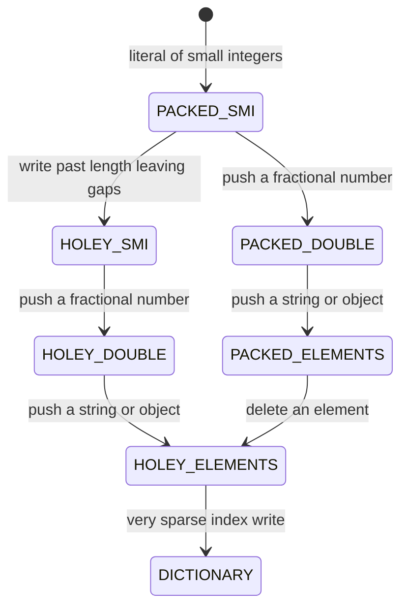

# Part 7 — Computer Science Fundamentals: Data Structures

## 7.1 Why a backend engineer must care about data structures

A data structure is a way of arranging data in memory so that certain operations are cheap. That is the whole idea. An array makes "give me item number 4,096" cheap. A hash map makes "give me the record for key `order:8813`" cheap. A heap makes "give me the most urgent job" cheap. Every structure buys some cheap operations by making other operations expensive, and a senior engineer's job is to know which operations the system will actually perform millions of times, and to pick accordingly.

You may think you rarely choose data structures. You do it all day; you just do it through libraries and databases:

- **Request handling.** Every HTTP request arrives as a byte array (`Buffer`). Headers are parsed into a hash map. The JSON body becomes a tree of JavaScript objects. The router walks a trie (Fastify) or a list of regular expressions (Express) to find your controller.
- **Caching.** An in-memory cache is a hash map plus an eviction policy (LRU, LFU). Redis is a hash map of hash maps, lists, sets, sorted sets and streams that you talk to over TCP.
- **Queues.** BullMQ, RabbitMQ and Kafka are queues with different guarantees. A Kafka partition is an append-only array on disk. A RabbitMQ queue is a linked list in memory that spills to disk under pressure.
- **Indexes.** A PostgreSQL B-tree index is a balanced tree of 8 KB pages. A GIN index is an inverted index: a map from a token to a sorted array of row pointers. A hash index is a hash map on disk.
- **Rate limiting.** A token bucket is a counter plus a timestamp in a hash map keyed by client id. A sliding-window log is a sorted set of timestamps.
- **Feeds and rankings.** Merging the 50 most recent posts from 300 followed accounts is a k-way merge with a heap. De-duplicating "already seen" items is a set, or at billions of items, a Bloom filter.

The reason this matters more for backend engineers than for almost anyone else is the **multiplier**. A frontend function that takes 30 ms runs once, for one user, on their machine. A backend function that takes 30 ms runs for every request, on your machine, and in Node.js it runs on the single thread that every other in-flight request is waiting for. At 500 requests per second, 30 ms of CPU per request means 15 CPU-seconds of work per wall-clock second. You would need 15 cores to keep up, and a Node.js process has one.

### 7.1.1 How the wrong structure becomes an incident

Imagine an e-commerce notifications service. Marketing triggers a campaign to 80,000 customers. The code de-duplicates the recipient list like this:

```ts
const unique: string[] = [];
for (const email of recipients) {
  if (!unique.includes(email)) unique.push(email); // O(n) scan for every item
}
```

`Array.prototype.includes` scans the array from the start. For 80,000 recipients the loop performs roughly 80,000 x 40,000 = 3.2 billion string comparisons. On a fast core that is 3 to 6 seconds during which the event loop does nothing else: no health checks answered, no other requests served. Kubernetes marks the pod unready, traffic shifts to the remaining pods, each receives more campaign traffic, and each freezes in turn. The fix is a `Set`, which does the same job in about 8 milliseconds. The bug was invisible at 500 recipients in staging.

That is the pattern to remember: **data-structure mistakes are silent until n gets large, and n gets large in production, at night.**

### 7.1.2 Big-O in one table

Big-O notation describes how the cost of an operation grows with the number of items, n. We ignore constant factors and care about the shape of the curve. Read the table as "roughly how many steps for n = 1,000 versus n = 1,000,000":

| Growth | Name | n = 1,000 | n = 1,000,000 | Typical backend example |
|---|---|---|---|---|
| O(1) | constant | 1 | 1 | hash map lookup, array index, heap peek |
| O(log n) | logarithmic | 10 | 20 | binary search, B-tree index lookup, heap push and pop |
| O(n) | linear | 1,000 | 1,000,000 | array scan, `includes`, `indexOf`, linked-list search |
| O(n log n) | linearithmic | 10,000 | 20,000,000 | sorting, building a heap by repeated pushes |
| O(n^2) | quadratic | 1,000,000 | 10^12 | nested loops, `includes` inside a loop, `splice` inside a loop |

Three words you will meet throughout this Part:

- **Amortized** means "averaged over many operations". An array `push` is usually O(1), but occasionally the array must grow and copy everything, which is O(n). Averaged over all pushes it is still O(1).
- **Contiguous** means "stored side by side in memory". CPUs love contiguous data because they fetch memory in 64-byte cache lines and prefetch the next lines. Scattered data (linked lists, objects pointing at objects) defeats that and costs a cache miss of roughly 100 ns per hop.
- **In-memory** means the data lives in the process heap and dies with the process. Everything in this Part is in-memory. Each concept ends by telling you what replaces it when data must survive a restart or be shared between pods: Redis, PostgreSQL or Kafka.

A note on V8. Node.js runs on Google's V8 engine, and V8 makes many decisions on your behalf: how arrays are stored, when an object silently turns into a hash table, when a string is really a tree of string pieces. Those decisions change the constants hidden inside your Big-O, and at scale the constants are the difference between 2 ms and 200 ms. We point them out where they matter.

## 7.2 Arrays

#### Concept

An array is a contiguous block of memory holding items in order, addressed by an integer index starting at 0. Because the items sit side by side and each slot has the same size, the address of item `i` is `start + i * slotSize`, which is one multiplication and one addition. That is why reading `arr[i]` costs the same whether the array has 10 items or 10 million.

In JavaScript, `Array` is the everyday array, and it hides a lot: it can grow, it can hold mixed types, and V8 changes its internal representation depending on what you put in it. Typed arrays (`Uint8Array`, `Float64Array`, `Buffer`) are the "real" fixed-size arrays of raw numbers.

#### Why does it exist?

Without arrays there is no "a list of things" in memory. Every request body, every result set from PostgreSQL, every batch of messages from Kafka arrives as an array. The alternative, a chain of individually allocated objects (a linked list, Section 7.4), costs a pointer per item and a cache miss per hop. Arrays exist because the CPU is fastest when data is packed and sequential, and because index arithmetic is the cheapest lookup there is.

#### Mental model

Imagine a street of identical houses, numbered from 0. To find house 4,096 you do not knock on 4,095 doors; you compute the position and walk straight there. Adding a house at the end of the street is easy if there is empty land; if not, the city buys a bigger plot and moves every house (the resize). Inserting a house in the *middle* means shifting every house after it by one lot, which is the expensive operation arrays are bad at.

#### How it works

1. **Allocation.** V8 allocates a `JSArray` object with a `length` and a pointer to a backing store (a `FixedArray` or `FixedDoubleArray`). The backing store has a *capacity* that is usually larger than `length`.
2. **Growth.** When you `push` past capacity, V8 allocates a new backing store of size `old + old/2 + 16`, copies the elements, and frees the old one. Copying is O(n), but it happens rarely, so `push` is O(1) amortized.
3. **Elements kinds.** V8 tracks *what kind* of elements the array holds so it can pick the fastest storage. Small integers (Smis) are stored unboxed. Doubles are stored unboxed in a `FixedDoubleArray`. Anything else (strings, objects) is stored as tagged pointers. The kind only ever gets *more general*, never more specific.
4. **Packed vs holey.** `[1, 2, 3]` is packed. `new Array(1000)` or `arr[50] = x` on a 10-element array creates holes. Holey arrays make every read check for a hole and, if found, walk the prototype chain, which is slower and defeats some optimizations.
5. **Dictionary mode.** If an array becomes very sparse (`arr[1_000_000] = 1` on an empty array), V8 gives up on contiguous storage and turns the elements into a hash table. Index access is then a hash lookup, not pointer arithmetic.



**Time complexity**

| Operation | Best | Average | Worst | Notes |
|---|---|---|---|---|
| Read `arr[i]` | O(1) | O(1) | O(1) | O(1) hash lookup in dictionary mode, but with a much larger constant |
| Write `arr[i] = x` (in bounds) | O(1) | O(1) | O(1) | may trigger an elements-kind transition once |
| `push` | O(1) | O(1) amortized | O(n) | worst case is the resize copy |
| `pop` | O(1) | O(1) | O(1) | |
| `shift` / `unshift` | O(n) | O(n) | O(n) | V8 sometimes "left-trims" the backing store to make `shift` cheap; never rely on it |
| `splice` insert or delete in the middle | O(n) | O(n) | O(n) | shifts everything after the index |
| `indexOf` / `includes` / `find` | O(1) | O(n) | O(n) | best case is a hit at index 0 |
| Binary search on a sorted array | O(1) | O(log n) | O(log n) | you must keep it sorted |
| `sort` | O(n) | O(n log n) | O(n log n) | TimSort, stable; best case is already-sorted input |
| `slice(a, b)` / spread | O(k) | O(k) | O(k) | k = number of copied elements |
| `concat` | O(n + m) | O(n + m) | O(n + m) | allocates a new array every time |

**Memory implications (V8, Node.js)**

- Node.js does not enable V8 pointer compression, so each element in a `PACKED_ELEMENTS` array is an 8-byte tagged pointer. One million objects in an array cost 8 MB for the pointers *plus* the objects themselves (a small object with 5 properties is roughly 60 to 80 bytes), so about 90 MB total.
- `PACKED_SMI_ELEMENTS` stores each integer in the 8-byte slot directly with no heap object. `PACKED_DOUBLE_ELEMENTS` stores raw 64-bit doubles. Mixing one string into a million-integer array converts every slot to a tagged pointer and boxes every double into a `HeapNumber`, which can more than double the memory.
- Typed arrays (`Float64Array`, `Uint32Array`, `Buffer`) store raw bytes in an `ArrayBuffer` that lives *outside* the V8-managed JavaScript heap (it counts toward `process.memoryUsage().arrayBuffers`). They cannot hold holes or mixed types, and they are the right tool for counters, bitmaps and binary protocols.
- Backing stores over-allocate by roughly 50 percent, so a 1-million-element array may hold capacity for 1.5 million. `arr.length = 0` keeps the backing store; assigning a fresh `[]` releases it.
- The maximum array length is 2^32 - 1. Long before that, a 100-million-element array of objects will exhaust the default old-space heap limit (about 2 GB to 4 GB depending on Node.js version and machine memory).

#### Practical example

Bulk operations are where arrays meet the database. PostgreSQL limits a single statement to 65,535 bind parameters, and a very large `INSERT` also holds a transaction open longer, so you chunk. Here is a generic chunker and a fixed-size **ring buffer**, the one array structure every backend engineer should be able to write from memory: it keeps the last N values in a fixed amount of memory by overwriting the oldest slot.

```ts
// utils/chunk.ts
export function chunk<T>(items: readonly T[], size: number): T[][] {
  if (size <= 0) throw new RangeError('chunk size must be positive');
  const out: T[][] = [];
  for (let i = 0; i < items.length; i += size) {
    out.push(items.slice(i, i + size)); // slice is O(size); total O(n)
  }
  return out;
}

// metrics/ring-buffer.ts
export class RingBuffer {
  private readonly buf: Float64Array; // contiguous unboxed doubles, off the JS heap
  private head = 0;                   // index of the next write
  private filled = 0;                 // number of slots holding real data

  constructor(private readonly capacity: number) {
    if (!Number.isInteger(capacity) || capacity <= 0) {
      throw new RangeError('capacity must be a positive integer');
    }
    this.buf = new Float64Array(capacity); // 8 bytes per slot, allocated once
  }

  push(value: number): void {
    this.buf[this.head] = value;                 // O(1): overwrite the oldest slot
    this.head = (this.head + 1) % this.capacity; // wrap around
    if (this.filled < this.capacity) this.filled++;
  }

  percentile(p: number): number {
    if (this.filled === 0) return 0;
    // Typed-array sort is numeric, so 10 sorts after 9 (unlike Array.prototype.sort).
    const sorted = this.buf.slice(0, this.filled).sort();
    const idx = Math.min(sorted.length - 1, Math.floor((p / 100) * sorted.length));
    return sorted[idx];
  }

  get size(): number {
    return this.filled;
  }
}
```

A 10,000-slot ring buffer is 80 KB, allocated once, forever. Compare that with `latencies.push(ms)` on a plain array in a long-running process, which is a memory leak with a delay.

#### NestJS example

A latency interceptor that records every request's duration into the ring buffer, and an internal endpoint that exposes p50, p95 and p99. The store is a default-scoped provider, which in NestJS means a single instance per application, shared across all requests in the process.

```ts
// metrics/latency.store.ts
import { Injectable } from '@nestjs/common';
import { RingBuffer } from './ring-buffer';

@Injectable()
export class LatencyStore {
  private readonly window = new RingBuffer(10_000); // last 10k requests, 80 KB fixed

  record(ms: number): void {
    this.window.push(ms);
  }

  snapshot() {
    return {
      samples: this.window.size,
      p50: this.window.percentile(50),
      p95: this.window.percentile(95),
      p99: this.window.percentile(99),
    };
  }
}

// metrics/latency.interceptor.ts
import { CallHandler, ExecutionContext, Injectable, NestInterceptor } from '@nestjs/common';
import { Observable, finalize } from 'rxjs';
import { LatencyStore } from './latency.store';

@Injectable()
export class LatencyInterceptor implements NestInterceptor {
  constructor(private readonly store: LatencyStore) {}

  intercept(_ctx: ExecutionContext, next: CallHandler): Observable<unknown> {
    const started = process.hrtime.bigint();
    return next.handle().pipe(
      finalize(() => {
        const elapsedMs = Number(process.hrtime.bigint() - started) / 1_000_000;
        this.store.record(elapsedMs); // runs on success and on error
      }),
    );
  }
}

// metrics/metrics.controller.ts
import { Controller, Get } from '@nestjs/common';
import { LatencyStore } from './latency.store';

@Controller('internal/metrics')
export class MetricsController {
  constructor(private readonly store: LatencyStore) {}

  @Get('latency')
  latency() {
    return this.store.snapshot(); // per-pod numbers; cluster-wide aggregation is Prometheus' job
  }
}
```

Register the interceptor globally with `APP_INTERCEPTOR` in a module's providers, and remember this is a per-process view. Aggregating across 12 pods is what Prometheus histograms are for (see the Observability part).

#### PostgreSQL example

PostgreSQL has first-class array columns. They are a good fit for small, unordered tag lists that are always read together with the row, and a bad fit for anything you need to join, count or enforce foreign keys on.

```sql
CREATE TABLE products (
  id          bigint GENERATED ALWAYS AS IDENTITY PRIMARY KEY,
  name        text    NOT NULL,
  tags        text[]  NOT NULL DEFAULT '{}',
  price_cents integer NOT NULL CHECK (price_cents >= 0)
);

-- GIN indexes each array element, so "contains" and "overlaps" use the index.
CREATE INDEX products_tags_gin ON products USING gin (tags);

-- products carrying ALL of these tags
SELECT id, name FROM products WHERE tags @> ARRAY['dental', 'consumable'];

-- products carrying ANY of these tags
SELECT id, name FROM products WHERE tags && ARRAY['gloves', 'masks'];

-- pass a JS array as ONE bind parameter instead of building "IN ($1,$2,...)"
SELECT id, name, price_cents FROM products WHERE id = ANY($1::bigint[]);
```

```text
Bitmap Heap Scan on products  (cost=24.31..1893.02 rows=612 width=41) (actual time=0.412..3.870 rows=588 loops=1)
  Recheck Cond: (tags @> '{dental,consumable}'::text[])
  Heap Blocks: exact=402
  Buffers: shared hit=419
  ->  Bitmap Index Scan on products_tags_gin  (cost=0.00..24.16 rows=612 width=0) (actual time=0.301..0.301 rows=588 loops=1)
        Index Cond: (tags @> '{dental,consumable}'::text[])
        Buffers: shared hit=17
Planning Time: 0.190 ms
Execution Time: 3.951 ms
```

The `= ANY($1)` form matters in Node.js: it keeps one prepared statement regardless of how many ids you pass, so the planner cache stays warm and you never hit the parameter limit.

#### TypeORM example

```ts
// products/product.entity.ts
import { Column, Entity, PrimaryGeneratedColumn } from 'typeorm';

@Entity({ name: 'products' })
export class Product {
  @PrimaryGeneratedColumn('increment', { type: 'bigint' })
  id!: string; // bigint comes back as a string from the pg driver

  @Column({ type: 'text' })
  name!: string;

  @Column({ type: 'text', array: true, default: '{}' })
  tags!: string[];
}

// products/product.repository.ts
import { ArrayContains, In, Repository } from 'typeorm';

export class ProductQueries {
  constructor(private readonly repo: Repository<Product>) {}

  withAllTags(tags: string[]) {
    return this.repo.findBy({ tags: ArrayContains(tags) }); // tags @> $1
  }

  byIds(ids: string[]) {
    return this.repo.findBy({ id: In(ids) }); // id IN ($1, $2, ...) -- chunk large lists
  }
}
```

TypeORM's `@Index` decorator cannot express `USING gin`, so create that index in a migration with `queryRunner.query('CREATE INDEX ... USING gin (tags)')`.

#### Sequelize example

```ts
import { DataTypes, Model, Op, Sequelize } from 'sequelize';

export class Product extends Model {
  declare id: number;
  declare name: string;
  declare tags: string[];
}

export function initProduct(sequelize: Sequelize) {
  Product.init(
    {
      id: { type: DataTypes.BIGINT, autoIncrement: true, primaryKey: true },
      name: { type: DataTypes.TEXT, allowNull: false },
      tags: { type: DataTypes.ARRAY(DataTypes.TEXT), allowNull: false, defaultValue: [] },
    },
    { sequelize, tableName: 'products', timestamps: false },
  );
}

// tags @> ARRAY['dental','consumable']
await Product.findAll({ where: { tags: { [Op.contains]: ['dental', 'consumable'] } } });
// tags && ARRAY['gloves','masks']
await Product.findAll({ where: { tags: { [Op.overlap]: ['gloves', 'masks'] } } });
```

`DataTypes.ARRAY` is PostgreSQL-only in Sequelize; MySQL users get an error at model definition time.

#### Production scenario

A product-listing endpoint serves 1,500 RPS with 48 products per page. The PostgreSQL driver returns each page as an array of 48 row objects (roughly 12 KB of JavaScript objects); mapping it to DTOs is 48 iterations, well under 0.1 ms. That is the healthy case: small arrays on the request path are essentially free.

The unhealthy case is a large array on the request path. The same service personalizes results by hiding products the user has blocked. The block list for a power user has 50,000 entries, and the code does `page.filter(p => !blocked.includes(p.id))`. That is 48 x 50,000 = 2.4 million comparisons, about 3 to 5 ms of CPU per request. At 1,500 RPS that is 4.5 to 7.5 CPU-seconds per second: the process is saturated by a single feature. Converting `blocked` to a `Set` once per request (50,000 inserts, about 3 ms) is not the fix either; caching the `Set` per user in Redis-backed memory, or asking PostgreSQL to exclude blocked ids in the query (`AND id <> ALL($2)` with an index), is.

Bulk writes are the other place arrays matter. An inventory sync receives 100,000 stock updates every 15 minutes. Chunking into 1,000-row `INSERT ... ON CONFLICT DO UPDATE` statements (8 columns, so 8,000 parameters each) keeps every statement under the 65,535-parameter limit and each transaction under 50 ms, so the sync finishes in about 6 seconds without blocking anyone.

#### Failure scenario

At 02:14 the on-call engineer is paged: `orders-worker` is in `CrashLoopBackOff`. The last log line before each crash is:

```text
FATAL ERROR: Reached heap limit Allocation failed - JavaScript heap out of memory
```

The nightly reconciliation job runs `orderRepository.find({ where: { status: 'delivered' } })` and then loops over the result. It has run for two years. Tonight the `orders` table crossed 2.4 million delivered rows. Each row becomes a JavaScript object of about 220 bytes, the array itself is 19 MB of pointers, and the driver's intermediate row buffers roughly double the peak. The process needs about 1.1 GB and the container's `--max-old-space-size` is 768 MB. Every restart repeats the same query and dies at the same point; the job never completes and the pod never becomes healthy.

The fix is to never hold the whole result in one array: keyset pagination in chunks of 5,000 rows (`WHERE id > $lastId ORDER BY id LIMIT 5000`), or a streaming cursor (`pg-query-stream`) processed with backpressure. Peak memory drops to under 20 MB regardless of table size. The lesson: an array whose size is controlled by the database, not by your code, is an incident waiting for a growth curve.

#### Edge cases & failure modes

- **Default `sort` is lexicographic.** `[10, 9, 1].sort()` returns `[1, 10, 9]`. Sorting prices or ids without a comparator silently corrupts order. Always pass `(a, b) => a - b`.
- **`sort` and `splice` mutate in place.** Sorting a cached array reorders it for every other caller. Copy first (`[...arr].sort(...)`) or use `toSorted()` on Node.js 20+.
- **Spread argument limit.** `Math.max(...latencies)` with a few hundred thousand elements throws `RangeError: Maximum call stack size exceeded` because every element becomes a function argument. Use a loop or `reduce`.
- **`delete arr[i]` leaves a hole**; it does not shrink the array. Use `splice` or `filter`.
- **`new Array(n)` is holey**; `Array.from({ length: n }, fn)` or `new Array(n).fill(0)` makes it packed.
- **Mixed types de-optimize.** One `null` pushed into an array of Smis converts the whole array to tagged pointers permanently.
- **Huge `JSON.parse` blocks the loop.** Parsing a 50 MB request body array takes hundreds of milliseconds on the main thread. Limit body size at the gateway and in `bodyParser`.
- **Arrays are shared by reference.** Returning an internal array from a service lets callers mutate your state. Return copies or `readonly` types.
- **`indexOf` uses strict equality.** Searching for objects by value never matches; searching for `NaN` never matches (`includes` handles `NaN`).
- **`shift()` in a loop is O(n^2).** Draining a queue with `while (arr.length) arr.shift()` copies the array each time. Use an index pointer or a real queue (Section 7.6).

#### How a Senior Backend Engineer thinks about this

The first question is never "array or not". It is "**who controls n?**" If n is bounded by the code (a page of 48, a batch of 1,000), an array is always fine and anything cleverer is over-engineering. If n is controlled by the database, the user or the upstream system, the senior engineer either bounds it (pagination, `LIMIT`, body size limits) or refuses to hold it in one array (streaming).

The second question is "**which operation runs in the hot loop?**" Index reads and appends are what arrays are for. Membership tests belong to a `Set`. Removing from the front belongs to a queue. Keeping things sorted while inserting belongs to a heap or a B-tree. When a senior sees `includes`, `indexOf`, `shift` or `splice` inside a loop, they read the surrounding code for n before approving the pull request.

The third question is "**does this data need to be a JavaScript object at all?**" Counters, bitmaps, latency samples and binary payloads belong in typed arrays and `Buffer`s: fixed memory, no GC pressure, no boxing.

Explaining it to a product manager: "The feature works, but its cost grows with the square of the user's block list. A user with 50,000 blocks will make the page 100 times slower than a user with 5,000. We need one day to move the filtering into the database query."

#### Common mistakes

- **Treating `Array` as a queue** with `shift()`. Works in tests, degrades quadratically in production.
- **`find` inside `map`** to join two arrays (`orders.map(o => users.find(u => u.id === o.userId))`). Build a `Map` from `users` first; it turns O(n x m) into O(n + m).
- **Loading unbounded result sets** into arrays because "the table is small". Tables grow.
- **Concatenating in a loop** (`result = result.concat(chunk)`) which reallocates every iteration. Use `push(...chunk)` for small chunks or collect and flatten once.
- **Storing ids as strings in one array and numbers in another**, then wondering why `includes` never matches after a bigint column returns `"42"`.
- **Using array columns in PostgreSQL as a substitute for a join table**, then needing a foreign key, a count per tag or an update across all rows.

#### Interview questions

1. **Why is `push` O(1) amortized and not O(1)?** Expected: the backing store is over-allocated; occasional resizes copy all elements (O(n)) but happen geometrically less often, so the average per push is constant. Follow-up: what growth factor does V8 use, and why not double? (Roughly 1.5x plus 16; smaller factor wastes less memory and reuses freed blocks better.)
2. **What is a holey array and why does it matter?** Expected: an array with gaps; V8 must check for holes and consult the prototype chain on reads, which disables the fastest access paths. Follow-up: how does `new Array(1000)` differ from `Array.from({ length: 1000 })`?
3. **You need to check whether each of 20,000 candidate products is in a 5,000-item "already seen" list. What do you do and what is the complexity?** Expected: build a `Set` from the seen list (O(m)), then test each candidate (O(1) each), O(n + m) total versus O(n x m) with `includes`. Why it matters: this exact bug shows up in feed and recommendation code constantly.
4. **When would you choose a typed array over a normal array?** Expected: fixed-size numeric data, counters, bitmaps, binary protocols; benefits are no boxing, no GC pressure, off-heap storage, numeric sort. Follow-up: what happens to `process.memoryUsage()` fields?
5. **A worker crashes with "JavaScript heap out of memory" while processing a table. Diagnose.** Expected: unbounded `find()` into an array; fix with keyset pagination or streaming with backpressure; discuss why offset pagination is also wrong at that size.
6. **Why does PostgreSQL's `= ANY($1::bigint[])` beat a generated `IN (...)` list from Node.js?** Expected: single bind parameter, stable prepared statement, avoids the 65,535 parameter limit, and the plan is cached.
7. **What does `[10, 9, 1].sort()` return and why?** Expected: `[1, 10, 9]`; default comparison converts to strings. Follow-up: is `Array.prototype.sort` stable in V8? (Yes, since V8 7.0 / Node.js 11.)

#### Practical exercise

Build a `SlidingWindowStats` provider in NestJS that records per-route latency using a ring buffer per route.

Acceptance criteria:

- Memory is bounded: each route keeps at most 5,000 samples in a `Float64Array`, and a `Map<string, RingBuffer>` holds at most 200 routes (evict the least recently written route when full).
- `GET /internal/metrics/latency?route=/orders` returns `{ samples, p50, p95, p99 }` in under 2 ms for a full buffer (hint: sort a copy, never the live buffer).
- A load test with `autocannon -c 100 -d 30 http://localhost:3000/orders` shows no growth in `process.memoryUsage().arrayBuffers` after the first 10 seconds.
- Unit tests prove `[10, 9, 1]`-style ordering bugs cannot happen: percentile of samples `[10, 9, 1, 100]` at p50 is 9 or 10, never 100.
