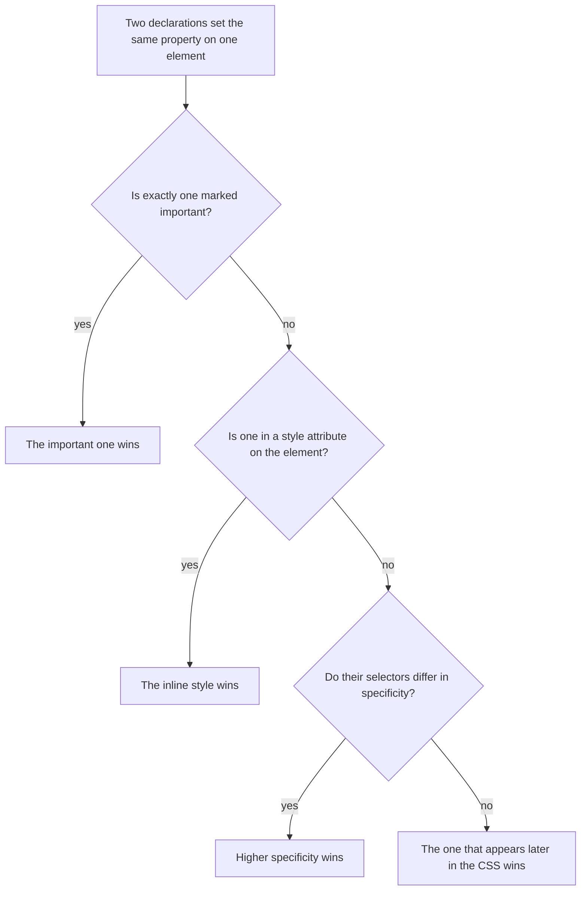
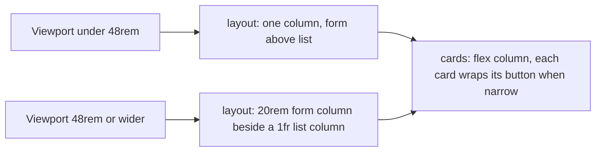
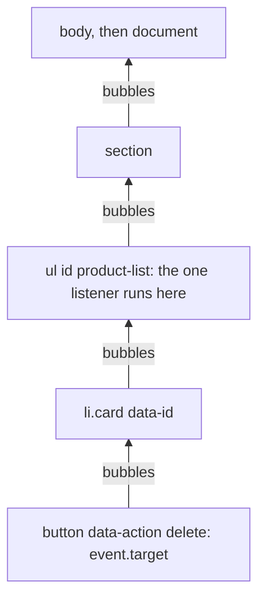
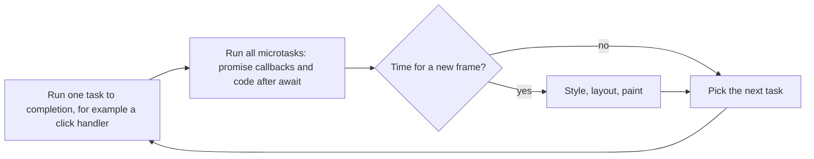

## 7.3 CSS: how the page looks

### 7.3.1 Selectors, the cascade, specificity and the box model

#### Concept

**CSS** (Cascading Style Sheets) decides how HTML looks: colours, fonts, spacing, borders and, most importantly, layout. A stylesheet is a list of **rules**. Each rule has a **selector** that picks elements and a block of **declarations** that say what to do with them:

```css
/* selector        { property: value; } */
.card h3           { margin: 0; font-size: 1rem; }
```

When several rules target the same element and disagree, the **cascade** decides which declaration wins. Every element is drawn as a rectangle, and the **box model** describes the layers of that rectangle: content, padding, border and margin.

#### Why does it exist?

Because structure and appearance change for different reasons and at different speeds. The HTML for a product card should not change when the brand colour does. Keeping looks in CSS means one stylesheet can restyle every page, the same HTML can look right on a phone and a 27-inch monitor, and a user who needs larger text or high contrast can override your styles without breaking the page.

#### Mental model

Imagine a dress code. The company says "business casual", your department says "no ties", your manager says "Alex, wear a tie today". The more specific rule wins, and between equally specific rules the one posted last wins: that is the cascade. The box model is packaging: the item (content), bubble wrap (padding), the box (border) and the space left around it on the shelf (margin).

#### How it works

**Selectors** you will actually use:

| Selector | Matches | Example |
|---|---|---|
| Type | every element of that kind | `button` |
| Class | elements with `class="card"` | `.card` |
| ID | the one element with `id="status"` | `#status` |
| Attribute | elements with an attribute or value | `[aria-invalid="true"]` |
| Descendant | `h3` anywhere inside `.card` | `.card h3` |
| Child | `li` directly inside `.cards` | `.cards > li` |
| Pseudo-class | elements in a state | `button:disabled`, `input:focus-visible`, `li:first-child` |

Prefer classes for styling. IDs are for JavaScript and for `label for`; styling with them makes rules hard to override, as specificity will show.

**The cascade** decides between conflicting declarations in this order:



(The full algorithm also weighs browser default styles, user styles and cascade layers; for your own stylesheet, this is the part that matters.)

**Specificity** is a score with three columns, compared left to right like version numbers: IDs, then classes/attributes/pseudo-classes, then element types.

```text
h3                          (0, 0, 1)
.card h3                    (0, 1, 1)
.cards > .card h3           (0, 2, 1)
[aria-invalid="true"]       (0, 1, 0)
#product-list .card h3      (1, 1, 1)   <- one ID beats any number of classes
```

So `#product-list .card h3 { color: red }` beats `.card h3 { color: blue }` no matter where each rule appears. This is why ID selectors cause trouble: to override them later you need another ID or `!important`, and each escalation makes the next override harder. Keep selectors short and class-based, and specificity fights rarely happen.

**Inheritance** is separate from the cascade. Some properties, mostly text ones like `color`, `font-family` and `line-height`, pass from parent to child automatically. Box properties like `border`, `padding` and `margin` do not. Set the font once on `body` and every element below inherits it.

**The box model.** Every element is a box with four layers:

```text
+------------------------------------------+
|                 margin                    |   space outside, between this box and others
|   +----------------------------------+   |
|   |             border               |   |   the visible edge
|   |   +--------------------------+   |   |
|   |   |         padding          |   |   |   space inside the border, around the content
|   |   |   +------------------+   |   |   |
|   |   |   |     content      |   |   |   |   the text or children
|   |   |   +------------------+   |   |   |
|   |   +--------------------------+   |   |
|   +----------------------------------+   |
+------------------------------------------+
```

By default, `width: 300px` sets only the **content** width, so adding `padding: 16px` and a `1px` border makes the box 334 pixels wide, and layouts overflow. Nearly every modern stylesheet starts with one rule that makes width include padding and border:

```css
*, *::before, *::after { box-sizing: border-box; }   /* width now means the visible box */
```

#### Practical example

The base styles for our Products screen. **Custom properties** (CSS variables, written `--name` and read with `var(--name)`) keep colours and spacing in one place:

```css
:root {                          /* :root is the <html> element; variables here are global */
  --gap: 1rem;                   /* 1rem = the root font size, usually 16px */
  --border: #d0d5dd;
  --text: #1d2939;
  --muted: #667085;
  --danger: #b42318;
}
*, *::before, *::after { box-sizing: border-box; }
body { margin: 0; font-family: system-ui, sans-serif; color: var(--text); line-height: 1.5; }
input, select, button { font: inherit; padding: 0.5rem 0.75rem; }   /* form controls do not inherit fonts by default */
.error { color: var(--danger); margin: 0; }
.error:empty { display: none; }                                      /* hide error slots until they have text */
input[aria-invalid="true"] { border: 2px solid var(--danger); }      /* the same attribute the screen reader uses */
button:disabled { opacity: 0.6; cursor: not-allowed; }
:focus-visible { outline: 3px solid #2e90fa; outline-offset: 2px; } /* a clear focus ring for keyboard users */
```

Two details worth copying. Styling `input[aria-invalid="true"]` means the visual error state and the accessible error state come from one attribute, so they can never disagree. And the `:focus-visible` rule keeps a strong outline for keyboard users; removing focus outlines with `outline: none` is one of the most common accessibility bugs on the web.

#### Edge cases & failure modes

- **A rule "does nothing"**: usually a more specific selector elsewhere wins. DevTools' Styles pane (7.7) shows the losing declaration crossed out and which rule beat it.
- **Colour-only errors**: red text alone fails users with colour blindness; the error message text and the thicker border carry the meaning too.
- **Low contrast**: grey `#999` text on white is hard to read; aim for a contrast ratio of at least 4.5:1 for body text (WCAG, the Web Content Accessibility Guidelines).

### 7.3.2 Layout: flexbox, a simple grid and one media query

#### Concept

**Flexbox** lays out children in one direction, a row or a column, and handles spacing and alignment along it: perfect for a toolbar or a stack of cards. **Grid** lays out children in two dimensions, rows and columns at once: perfect for a page with a form panel beside a list. A **media query** applies rules only when a condition holds, such as "the screen is at least 48rem wide". **Mobile-first** means writing the small-screen layout as the default and adding wider layouts inside media queries.

#### Why does it exist?

Because the same page must work on a 360-pixel phone and a 1,920-pixel monitor, and more than half of web traffic is from phones. Before flexbox and grid, layouts were built with floats and hacks that broke easily. Today, a dozen lines of CSS give you a layout that adapts to any width.

#### How it works

**Flexbox for the toolbar.** The title goes left and the Refresh button right, vertically centred:

```css
.toolbar {
  display: flex;                    /* children become flex items in a row */
  align-items: center;              /* centre them vertically (the cross axis) */
  justify-content: space-between;   /* push them to opposite ends (the main axis) */
  gap: var(--gap);                  /* space between items, no margin tricks */
  padding: 0.75rem 1rem;
  border-bottom: 1px solid var(--border);
}
.toolbar h1 { margin: 0; font-size: 1.25rem; }
```

**Flexbox for the card list**, as a column with gaps, and inside each card a row that wraps on narrow screens:

```css
.cards { list-style: none; margin: 0; padding: 0; display: flex; flex-direction: column; gap: 0.75rem; }
.card {
  display: flex;
  flex-wrap: wrap;                  /* on a narrow phone the button drops to the next line */
  align-items: center;
  gap: 0.5rem 1rem;                 /* row gap, column gap */
  padding: 0.75rem 1rem;
  border: 1px solid var(--border);
  border-radius: 8px;
}
.card h3 { margin: 0; font-size: 1rem; flex: 1 1 12rem; }   /* grow and shrink, ideally 12rem wide */
.card .meta { margin: 0; color: var(--muted); }
```

`flex: 1 1 12rem` is shorthand for "grow to fill spare space, shrink if needed, start from 12rem". It makes the product name take all the room the price and button do not need.

**Grid plus one media query, mobile-first.** On a phone, the form panel and the list stack vertically. On a screen at least 48rem (768px at the default font size) wide, they sit side by side with the form in a fixed 20rem column:

```css
.layout { display: grid; gap: var(--gap); padding: var(--gap); }   /* default: one column, stacked */
.panel  { border: 1px solid var(--border); border-radius: 8px; padding: var(--gap); }

@media (min-width: 48rem) {                                          /* only on wider screens */
  .layout { grid-template-columns: 20rem 1fr; align-items: start; }  /* form column, then the rest */
}
```

`1fr` means "one fraction of the remaining space". Writing the single-column layout first and adding the two-column version with `min-width` is mobile-first: phones download and apply the simplest rules, and the media query is the only thing that differs. The viewport meta tag from 7.2.1 is what makes this work; without it, phones pretend to be 980 pixels wide and the media query matches the wrong layout.



#### Edge cases & failure modes

- **`display: flex` on an element with the `hidden` attribute** shows it anyway, because your rule overrides the browser's `[hidden] { display: none }`. Add `[hidden] { display: none !important; }` once, or do not set `display` on elements you hide.
- **Long unbroken text** (a 60-character SKU, a URL) can overflow a card; `overflow-wrap: anywhere` lets it break.
- **Fixed pixel widths** inside a flexible layout cause sideways scrolling on small screens; prefer `rem`, percentages, `fr` and `minmax()`.
- **Too many breakpoints** make every change a puzzle; one or two media queries cover most admin screens.

#### How a Senior Backend Engineer thinks about this

A backend engineer writing an internal tool does not need pixel-perfect design; they need a layout that never hides a button, works on a phone, keeps a visible focus ring, and is easy for the next person to change. They keep CSS small, class-based and mobile-first, use flexbox for one-dimensional rows and columns and grid for page structure, and stop there. When a screen becomes a product, they hand design to people who do it for a living, with Part 71 (71.4) as the shared vocabulary.

#### Interview questions

1. **How does the browser decide which of two conflicting CSS declarations applies?** Importance, then inline styles, then specificity (IDs, then classes/attributes/pseudo-classes, then types), then source order: the later rule wins a tie.
2. **Why is `box-sizing: border-box` almost always set?** So `width` includes padding and border, making sizes predictable and stopping overflow.
3. **When would you use flexbox and when grid?** Flexbox for one-dimensional rows or columns such as toolbars and lists; grid for two-dimensional page layouts with rows and columns.
4. **What does mobile-first mean in CSS?** Write the small-screen styles as the default and add wider layouts inside `min-width` media queries.

#### Practical exercise

Two parts. First, predict the colour of the product name in `<ul id="product-list" class="cards"><li class="card"><h3 class="title">Mirror</h3></li></ul>` given these rules, in this order: `.card .title { color: green }`, `h3 { color: black }`, `#product-list h3 { color: red }`, `.cards .card .title { color: blue }`. Second, write CSS for a header with a logo on the left and three nav links on the right that wraps neatly on a phone. Acceptance criteria: the colour is justified with specificity scores, and the header uses flexbox with `gap`, no fixed widths.

#### Worked answer to the exercise

The scores: `.card .title` is (0,2,0); `h3` is (0,0,1); `#product-list h3` is (1,0,1); `.cards .card .title` is (0,3,0). The ID rule wins: **red**. Three classes never beat one ID, because the first column is compared first, and source order only matters between equal scores.

```css
.site-header {
  display: flex;
  flex-wrap: wrap;                 /* on a phone the nav drops below the logo */
  align-items: center;
  justify-content: space-between;
  gap: 0.5rem 1.5rem;
  padding: 0.75rem 1rem;
}
.site-header nav { display: flex; flex-wrap: wrap; gap: 1rem; }
.site-header nav a { padding: 0.5rem 0; }   /* a taller touch target without changing the layout */
```

## 7.4 JavaScript in the browser

### 7.4.1 The DOM, creating elements safely, and XSS

#### Concept

When the browser parses HTML, it builds the **DOM**: a tree of objects, one per element, that JavaScript can read and change. Changing the DOM changes the page immediately. `document` is the root of that tree. `document.querySelector('#product-list')` finds the first element matching a CSS selector (or returns `null`), and `document.querySelectorAll('.card')` finds all of them. To add content, you create elements and put text into them.

The rule that matters most: **put user data into the page with `textContent`, never with `innerHTML`.** `textContent` treats a string as text. `innerHTML` parses a string as HTML, which means a product name can become a script.

#### Why does it exist?

The DOM exists so that pages can change without reloading: a new product appears in the list, an error appears under a field. The safety rule exists because the data you render is not yours. A product name typed by one staff member, an order note typed by a customer, a review: all of it passes through your API and lands in someone else's browser. If that browser parses it as HTML, the author of the data can run code in the reader's session.

#### Mental model

Imagine a printing press that prints whatever is on the order form. With `textContent`, the press prints the words exactly as written, even if someone wrote "and also unlock the back door". With `innerHTML`, the press reads the form as instructions, and it will unlock the back door. Same text, completely different result.

#### How it works

Building a product card with DOM methods:

```js
function productCard(p) {
  const li = document.createElement('li');   // a new element, not yet in the page
  li.className = 'card';
  li.dataset.id = p.id;                      // becomes data-id="..." for later lookups

  const title = document.createElement('h3');
  title.textContent = p.name;                // TEXT: "<b>" shows as the three characters < b >

  const meta = document.createElement('p');
  meta.className = 'meta';
  meta.textContent = `${p.sku} - ${formatPrice(p.priceCents, p.currency)}`;

  const del = document.createElement('button');
  del.type = 'button';
  del.dataset.action = 'delete';
  del.textContent = 'Delete';
  del.setAttribute('aria-label', `Delete ${p.name}`);   // attributes set this way are not parsed as HTML

  li.append(title, meta, del);               // assemble the card off-screen
  return li;                                 // the caller puts it in the page in one step
}

document.querySelector('#product-list').append(productCard(product));
```

The everyday DOM toolkit:

| Task | Method |
|---|---|
| Find one / many | `querySelector(sel)`, `querySelectorAll(sel)` |
| Create | `document.createElement('li')` |
| Set text | `el.textContent = value` |
| Add to the page | `parent.append(a, b)`, `parent.prepend(a)` |
| Replace all children | `parent.replaceChildren(...nodes)` (no arguments empties it) |
| Remove | `el.remove()` |
| Data attributes | `el.dataset.id` reads and writes `data-id` |
| Classes | `el.classList.add('is-error')`, `.remove()`, `.toggle()` |
| Show and hide | `el.hidden = true` |

**XSS in one paragraph.** **Cross-site scripting (XSS)** is an attacker's script running inside your page, in your user's browser, with your user's session. The Part 6 DTO accepts any name of 1 to 200 characters, so `` is a valid product. With `title.textContent = p.name`, staff see that odd string and nothing happens. With `li.innerHTML = '<h3>' + p.name + '</h3>'`, the browser creates an image, it fails to load, and the `onerror` code runs for every admin who opens the page, able to read what the page reads and call your API as that admin. Stored in your database and served to others, this is **stored XSS**, the most damaging kind. The fix is boring and total: build elements and use `textContent` for every piece of data. Part 40 (40.21) covers XSS and Content Security Policy from the server side; Part 77 (77.7) covers the frontend side, including React's escaping and what `dangerouslySetInnerHTML` undoes.

#### Failure scenario

At 10:40 on a Monday, support reports that the admin product page "flickers and then logs everyone out". In DevTools the on-call engineer sees requests to an unknown domain in the Network panel and an `` element in one product card that should not exist. A product imported on Friday has an HTML payload as its name, and the card was built with `innerHTML` and a template string. The API did nothing wrong: it stored a string. The team rotates sessions, rewrites the card with `createElement` and `textContent`, adds a Content Security Policy (Part 40, 40.33), and adds a test that creates a product named `` and asserts the page shows it as text. Escaping belongs where data meets HTML, in every client.

#### Edge cases & failure modes

- **`querySelector` returns `null`** when the selector matches nothing (a typo, or the script ran before the element existed); the next line fails with "Cannot read properties of null".
- **Building HTML strings with `+` or template literals** is `innerHTML` in disguise; so are `insertAdjacentHTML` and `outerHTML`.
- **Attributes built into strings**: `'<a href="' + url + '">'` can be broken out of with a quote; use `a.href = url` and only allow `https:` URLs, because `javascript:` URLs run code.
- **Thousands of nodes** appended one by one, each forcing layout, can be slow; build off-screen and append once, or paginate (the Part 6 API already caps pages at 100).

#### How a Senior Backend Engineer thinks about this

A senior does not try to "clean" HTML out of product names in the API. Data can legitimately contain `<` and `&` (a product called "Scaler & Tips <Large>"), and the same string is rendered into HTML, CSV, emails and mobile apps, each needing different escaping. So the API validates shape and length, stores the string as given, and **every client encodes at output**. In code review, any `innerHTML` with a variable in it is a blocking comment.

### 7.4.2 Events, delegation and the browser event loop

#### Concept

The page tells your code what the user did through **events**: `click`, `submit`, `input`, `keydown` and many more. You subscribe with `element.addEventListener('click', handler)`, and the browser calls `handler(event)` each time. Most events **bubble**: after firing on the element that was clicked, they fire on its parent, then its parent's parent, all the way to `document`. **Event delegation** uses this: instead of a listener on every Delete button, put one listener on the list and work out which button was clicked.

All of this runs on the browser's **main thread**, which, like Node's thread (Part 2, 2.1.1), runs one piece of JavaScript at a time, driven by an **event loop**.

#### Why does it exist?

Events exist because a page waits for people, just as a server waits for requests. Delegation exists because lists change: products are added after the page loads, and a listener attached to buttons at start-up never sees the new ones. One listener on a stable parent handles today's buttons and tomorrow's.

#### How it works

```js
const list = document.querySelector('#product-list');

list.addEventListener('click', (event) => {
  // event.target is the innermost element clicked; it may be the button or something inside it
  const button = event.target.closest('button[data-action="delete"]');
  if (!button || !list.contains(button)) return;   // a click elsewhere in the list: ignore
  const card = button.closest('li');
  console.log('delete product', card.dataset.id);
});
```



`event.target` is what was clicked; `event.currentTarget` is the element whose listener is running (the list). `closest(selector)` walks up from the target to the nearest ancestor matching the selector, so a click on an icon inside the button still finds the button. `event.preventDefault()` cancels the browser's default action, such as a form's navigation (7.2.2); `event.stopPropagation()` stops bubbling and is rarely what you want, because it breaks delegation further up.

**The browser event loop, compared with Node.** The browser runs a loop that is close to the one you met in Part 2: take one **task** (a click handler, a timer callback, a network response), run it to completion, then run every queued **microtask** (promise continuations, the code after an `await`), then repeat. The big addition is **rendering**: between tasks, roughly 60 times a second, the browser may recalculate styles and layout and paint the screen.



| | Node.js (Part 2, Part 10) | Browser main thread |
|---|---|---|
| One thread runs your JavaScript | yes | yes |
| Tasks come from | timers, I/O, sockets (libuv phases) | user input, timers, network responses, messages |
| Microtasks drained after each task | yes | yes |
| Rendering | none | between tasks, about every 16.7 ms at 60 Hz |
| What blocking costs you | every other request waits | the page freezes: no clicks, no scrolling, no paint |

The consequence is the same lesson as Node, with a more visible symptom. If a click handler spends 800 ms sorting 200,000 products, nothing else happens for 800 ms: the button does not show its pressed state, the spinner does not spin, typing is lost. `fetch` does not block (the network wait happens outside your JavaScript, like I/O in Node), but heavy synchronous work does. Keep handlers short, let the server sort and paginate, and see Part 71 (71.7) for long tasks and Part 10 (10.16, 10.17) for the Node side in depth.

#### Edge cases & failure modes

- **Listeners added before elements exist** do nothing; delegation or running the script after parsing (a module script, 7.8) avoids this.
- **Adding the same listener in a function that runs on every refresh** attaches it again each time; one click then runs the handler five times. Attach listeners once at start-up.
- **`event.target` is not always the element you styled**: clicking the text inside a button gives the button, but clicking an `<svg>` icon inside it gives the icon. Use `closest`.

#### Interview questions

1. **Why must user data be rendered with `textContent` rather than `innerHTML`?** `innerHTML` parses the string as HTML, so data containing markup can run script (XSS); `textContent` always treats it as text.
2. **What is event delegation and when is it useful?** One listener on a parent that uses bubbling and `event.target.closest()` to handle events from many children, including ones added later.
3. **How does the browser's event loop differ from Node's?** Both run one task at a time and drain microtasks after each; the browser also renders between tasks, so blocking JavaScript freezes the page visibly.
4. **A spinner you show before a heavy loop never appears. Why?** The browser can only paint between tasks; the loop runs in the same task, so the screen updates after it finishes.

#### Practical exercise

Given `const orders = [{ id: 'o1', customer: 'Asha <VIP>', totalCents: 4599, status: 'paid' }, { id: 'o2', customer: 'Ravi', totalCents: 1250, status: 'pending' }]`, render each order into a `<ul id="orders">` as a card showing the customer and total, with a Cancel button only for `pending` orders. Handle all Cancel clicks with one delegated listener that logs the order id. Acceptance criteria: "Asha <VIP>" appears literally on screen, no `innerHTML` is used, and a card added later also responds to its Cancel button.

#### Worked answer to the exercise

```js
const ordersEl = document.querySelector('#orders');

function orderCard(o) {
  const li = document.createElement('li');
  li.dataset.id = o.id;
  const who = document.createElement('strong');
  who.textContent = o.customer;                         // "<VIP>" stays text
  const total = document.createElement('span');
  total.textContent = ` ${(o.totalCents / 100).toFixed(2)}`;
  li.append(who, total);
  if (o.status === 'pending') {
    const cancel = document.createElement('button');
    cancel.type = 'button';
    cancel.dataset.action = 'cancel';
    cancel.textContent = 'Cancel';
    li.append(cancel);
  }
  return li;
}

ordersEl.replaceChildren(...orders.map(orderCard));

ordersEl.addEventListener('click', (event) => {          // attached once, works for future cards
  const btn = event.target.closest('button[data-action="cancel"]');
  if (!btn) return;
  console.log('cancel order', btn.closest('li').dataset.id);
});

ordersEl.append(orderCard({ id: 'o3', customer: 'Meera', totalCents: 999, status: 'pending' }));
```

Clicking Cancel on the third card logs `cancel order o3` even though that card did not exist when the listener was attached, because the click bubbles up to `#orders`.
