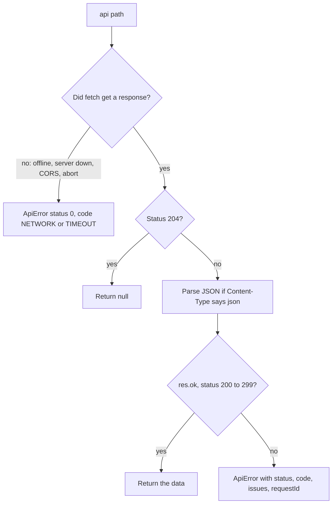
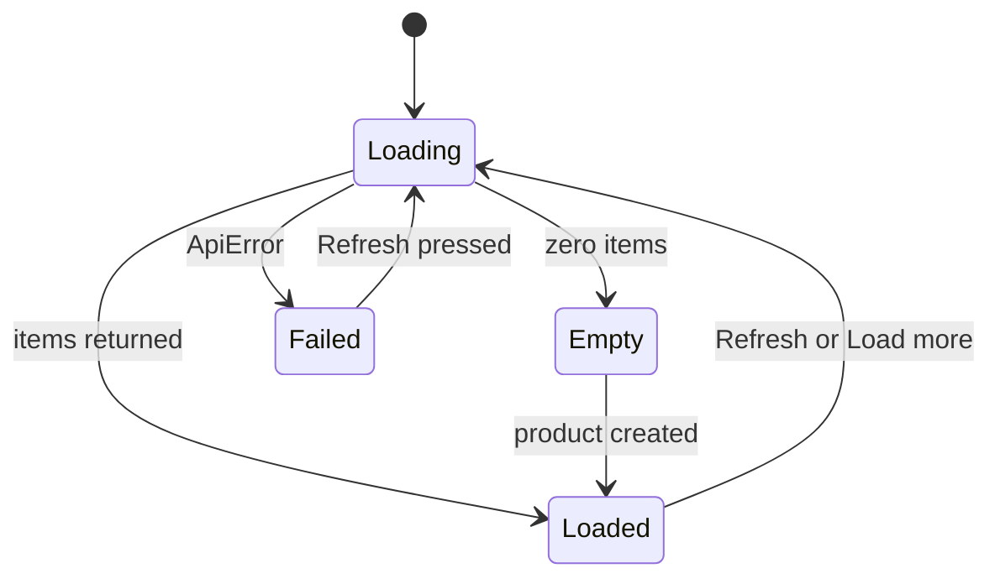

## 7.5 Calling the Part 6 API with fetch

### 7.5.1 Reading the product list: status codes and the three states

#### Concept

`fetch(url, options)` is the browser's built-in function for making HTTP requests from JavaScript. It returns a promise (Part 2, 2.3) that resolves to a **`Response`** object as soon as the response headers arrive. The `Response` tells you the status (`res.status`, `res.ok`) and headers; reading the body is a second asynchronous step, such as `await res.json()`.

The single most important fact about `fetch`: **it resolves for every HTTP response, including `404` and `500`.** It rejects only when no response was received at all: the server is down, the network dropped, the request was aborted, or CORS blocked it. Checking the status is your job.

#### Why does it exist?

Because a page needs data after it has loaded, without navigating away. Older code used `XMLHttpRequest`; `fetch` replaced it with a promise-based design that fits `async`/`await`. Node 18 and newer ship the same `fetch`, so if you used it in Part 2 or Part 3, the browser version will feel identical. The browser adds rules Node does not have: CORS (7.6), cookies and a shared HTTP cache.

#### Mental model

Imagine sending a courier to a warehouse. `fetch` resolving means the courier came back with a parcel. It does not mean the parcel contains what you ordered: inside might be a note saying "out of stock" (`404`) or "our system is down" (`500`). `fetch` rejecting means the courier never reached the warehouse, or you called them back. You must open the parcel (check the status) before you celebrate.

#### How it works

The Products screen sends every request through one small helper, so status handling, JSON parsing, the error shape and the timeout are written once. It lives in its own module, `api.js` (7.8 explains modules):

```js
// api.js -- one place that knows how to talk to the Part 6 API
const API_BASE = document.querySelector('meta[name="api-base"]')?.content ?? '';
const TIMEOUT_MS = 8000;

export class ApiError extends Error {
  constructor(status, problem) {
    super(problem?.title ?? `Request failed with status ${status}`);
    this.status = status;                        // 0 means no HTTP response at all
    this.code = problem?.code ?? 'HTTP_ERROR';   // stable code from the Part 6 filter (6.6)
    this.issues = problem?.issues ?? [];         // [{ path, message }] for field errors
    this.requestId = problem?.requestId ?? null; // quote this when reporting a bug
  }
}

export async function api(path, { method = 'GET', body } = {}) {
  const controller = new AbortController();
  const timer = setTimeout(() => controller.abort(), TIMEOUT_MS);   // never wait forever
  try {
    const res = await fetch(API_BASE + path, {
      method,
      headers: body === undefined ? {} : { 'Content-Type': 'application/json' },
      body: body === undefined ? undefined : JSON.stringify(body),
      signal: controller.signal,
    });
    if (res.status === 204) return null;                            // DELETE: success, no body
    const type = res.headers.get('content-type') ?? '';
    const data = type.includes('json') ? await res.json() : null;   // json and problem+json
    if (!res.ok) throw new ApiError(res.status, data);              // 4xx and 5xx become errors
    return data;
  } catch (err) {
    if (err instanceof ApiError) throw err;
    if (err instanceof SyntaxError) {                               // a body that claimed to be JSON but was not
      throw new ApiError(0, { code: 'BAD_RESPONSE', title: 'The server sent a response that could not be read' });
    }
    if (err.name === 'AbortError') {
      throw new ApiError(0, { code: 'TIMEOUT', title: 'The server took too long to answer' });
    }
    throw new ApiError(0, { code: 'NETWORK', title: 'Could not reach the server' });   // down, offline or CORS
  } finally {
    clearTimeout(timer);
  }
}
```

What happens for each kind of outcome:



And what the screen does with each status the Part 6 API can return:

| Status | When the Part 6 API sends it | What the UI does |
|---|---|---|
| `200` | list or get succeeded | render the data |
| `201` | product created | add the card, reset the form |
| `204` | product deleted | remove the card |
| `400` `VALIDATION_FAILED` | DTO rules failed (6.6) | put each `issues[].message` under its field |
| `404` `PRODUCT_NOT_FOUND` | the product is gone | remove it from the screen, say so |
| `409` `PRODUCT_SKU_TAKEN` | unique SKU violated (6.6) | message under the SKU field (the API already sets `path: "sku"`) |
| `5xx` `INTERNAL_ERROR` | a bug or an outage | generic message plus the `requestId` |
| none (status `0` here) | offline, server down, CORS, timeout | "Could not reach the server", offer a retry |

**The three states.** Any screen that loads data is in one of a few states, and each needs something visible. A list that shows nothing while loading, nothing when empty, and nothing on error leaves the user unable to tell the three apart.



#### Practical example

Loading the list, with the cursor pagination from 6.5 behind a "Load more" button:

```js
// app.js (part)
import { api } from './api.js';

const list = document.querySelector('#product-list');
const statusEl = document.querySelector('#status');
const loadMoreBtn = document.querySelector('#load-more');
let nextCursor = null;

function setStatus(text, isError = false) {
  statusEl.textContent = text;
  statusEl.classList.toggle('is-error', isError);
}

async function loadProducts({ append = false } = {}) {
  setStatus('Loading products...');                         // state: loading
  loadMoreBtn.disabled = true;
  try {
    const params = new URLSearchParams({ limit: '20' });    // never glue query strings by hand (3.2)
    if (append && nextCursor) params.set('cursor', nextCursor);
    const page = await api(`/products?${params}`);          // { items, nextCursor } since 6.5
    if (!append) list.replaceChildren();
    list.append(...page.items.map(productCard));
    nextCursor = page.nextCursor;
    loadMoreBtn.hidden = nextCursor === null;
    setStatus(list.children.length === 0 ? 'No products yet. Add the first one with the form.' : '');  // empty or loaded
  } catch (err) {
    const ref = err.requestId ? ` (reference ${err.requestId})` : '';
    setStatus(`Could not load products: ${err.message}${ref}`, true);          // state: failed
  } finally {
    loadMoreBtn.disabled = false;
  }
}
```

Note `page.items`, not `page`. In 6.2 the list endpoint returned a plain array; in 6.5 it became `{ items, nextCursor }`. A frontend written against the old shape is the most common cause of "the list is empty but the API works", and 7.7 debugs exactly that.

#### Edge cases & failure modes

- **Treating every resolved `fetch` as success**: a `500` body gets rendered as if it were products, or `page.items` is `undefined` and the page breaks.
- **An HTML error page from a proxy** (a load balancer's `502`) is not JSON; checking `Content-Type` before parsing avoids a confusing `SyntaxError: Unexpected token '<'`.
- **Responses that arrive out of order**: press Refresh twice quickly and the older, slower response can land last. Cancelling the previous request with its `AbortController` fixes it; Part 78 (78.10) covers this pattern.

### 7.5.2 Creating a product: errors next to fields, timeouts and double submits

#### Concept

Creating a product joins everything so far: intercept the form's submit, read and convert the values, `POST` JSON, and then either show the new product or put each validation message next to the field it belongs to. Two extra protections make it production-shaped: a **timeout**, so a hung request does not leave the user waiting forever, and **double-submit protection**, so an impatient double click does not send two requests.

#### Why does it exist?

Because forms are where users meet your validation rules, and a vague "Something went wrong" at the top of a form makes them guess which of five fields was wrong. Part 6 went to the trouble of returning `issues` with a `path` for every problem (6.6) precisely so a client could do better. Timeouts and double-submit guards exist because networks are slow and people click twice; Part 6's senior mantra applies in the browser too: *can it time out, can it duplicate, can it partially succeed?*

#### How it works

```js
// app.js (part)
import { api } from './api.js';

const form = document.querySelector('#create-form');
const formError = document.querySelector('#form-error');
const FIELD_FOR_PATH = { name: 'name', sku: 'sku', priceCents: 'price', currency: 'currency' };  // API path -> form field
let submitting = false;

form.addEventListener('submit', async (event) => {
  event.preventDefault();                          // stop the browser's own submit and navigation (7.2.2)
  if (submitting) return;                          // a second Enter or click while the first is in flight
  clearErrors();

  const data = new FormData(form);                 // reads every named control
  const priceText = String(data.get('price') ?? '').trim();
  const body = {
    name: String(data.get('name') ?? '').trim(),
    sku: String(data.get('sku') ?? '').trim().toUpperCase(),
    priceCents: priceText === '' ? null : Math.round(Number(priceText) * 100),  // 12.99 -> 1299
    currency: String(data.get('currency') ?? 'USD'),
  };

  const button = form.querySelector('button[type="submit"]');
  submitting = true;
  button.disabled = true;
  button.textContent = 'Saving...';
  try {
    const created = await api('/products', { method: 'POST', body });
    list.prepend(productCard(created));            // newest first, like the API's order
    form.reset();
    setStatus('');
    form.querySelector('#name').focus();           // ready for the next product
  } catch (err) {
    showErrors(err);
  } finally {
    submitting = false;
    button.disabled = false;
    button.textContent = 'Add product';
  }
});

function clearErrors() {
  formError.textContent = '';
  for (const slot of form.querySelectorAll('[data-error-for]')) slot.textContent = '';
  for (const input of form.querySelectorAll('[aria-invalid]')) input.removeAttribute('aria-invalid');
}

function showErrors(err) {
  let placed = 0;
  for (const issue of err.issues) {
    const field = FIELD_FOR_PATH[issue.path];      // only known fields; never build selectors from raw input
    const slot = field ? form.querySelector(`[data-error-for="${field}"]`) : null;
    if (!slot) continue;
    slot.textContent = slot.textContent ? `${slot.textContent} ${issue.message}` : issue.message;
    form.elements.namedItem(field)?.setAttribute('aria-invalid', 'true');
    placed += 1;
  }
  if (placed === 0 || placed < err.issues.length) {  // nothing field-shaped: show it at the form level
    formError.textContent = err.requestId ? `${err.message} (reference ${err.requestId})` : err.message;
  }
  form.querySelector('[aria-invalid="true"]')?.focus();   // take keyboard and screen reader users to the first problem
}
```

Step by step:

1. **`event.preventDefault()`** cancels the navigation from 7.2.2; your code now owns the request.
2. **`FormData`** reads the form by `name`, and every value is a string, so the code converts. `Math.round` matters: `19.99 * 100` is `1998.9999999999998` in JavaScript (binary floating point, Part 1), which `@IsInt()` rejects. An empty price becomes `null`, so the server reports it instead of the client silently sending `0`.
3. **The body holds only DTO fields.** Sending the form's raw `price` key would make `forbidNonWhitelisted` reject the whole request (6.2).
4. **Errors land next to fields.** `FIELD_FOR_PATH` maps the DTO path (`priceCents`) to the form field (`price`). A duplicate SKU needs no special case: the Part 6 filter already returns `issues: [{ path: "sku" }]` with the `409`. Anything unmapped (a `500`, a timeout) appears at the form level with the request ID.
5. **Accessibility comes along.** `aria-invalid` turns the field red (7.3) and makes the screen reader say "invalid entry"; `aria-describedby` (7.2.2) reads the message with the field when focus moves there.

**The timeout.** `api()` creates an `AbortController`, passes its `signal` to `fetch`, and calls `controller.abort()` after 8 seconds. Aborting makes the pending `fetch` (or a body read in progress) reject with an `AbortError`, which `api()` turns into `code: 'TIMEOUT'`. Modern browsers also offer `AbortSignal.timeout(8000)` as a one-line version; it rejects with a `TimeoutError` instead. The explicit controller is shown because the same object also lets you cancel a request on purpose, such as when the user presses Refresh again.

A timeout on a `POST` carries a catch that Part 2 (2.5) and Part 3 (3.1) warned about: **the request may have succeeded on the server.** The browser stopped waiting; PostgreSQL may have committed the row a moment later. Retrying blindly could create a duplicate. Here the unique SKU protects us: a retry of the same product gets a `409 PRODUCT_SKU_TAKEN`, and the user can press Refresh and see that it exists. Resources without a natural unique key need an idempotency key sent by the client; Part 18 (18.12) designs that on the server and Part 78 (78.6) sends it from the browser.

**Double-submit protection.** The `submitting` flag and the disabled button work together. The flag stops a second submit that starts before the first `await`, such as a fast double press of Enter. The disabled button tells the user something is happening and stops a second click. Both are reset in `finally`, so an error cannot leave the form stuck. Part 77 (77.8) shows the same idea in React.

#### Edge cases & failure modes

- **Server messages use DTO names**: "priceCents must not be less than 0" sits under a field labelled "Price". Mapping `code`s and paths to friendly text is a contract question Part 80 (80.6) handles; for an internal tool the raw message is acceptable.
- **A `400` with an issue path the form does not have** (a nested path, a field added on the server later): it falls through to the form-level message, so it is never silently lost.
- **Prices in currencies without cents** (the Japanese yen has no minor unit): dividing by 100 is wrong; the Part 6 model assumes two decimal places, which is a product decision to make explicit.

#### How a Senior Backend Engineer thinks about this

A senior reads this code and checks the contract at each seam: every DTO field has a form field, every `issues[].path` maps to exactly one place on screen, every status has a visible outcome, and nothing is retried that could duplicate a write without a unique key or idempotency key behind it. They notice that the backend's error design is what made the frontend simple: one shape, a `path` per issue, a stable `code`, a `requestId`. That is the argument they make to a team that wants to return free-text errors: the cost lands in every client.

#### Common mistakes

- Showing "Something went wrong" for every error, throwing away the `issues` the API provides.
- No timeout, so a dropped connection shows "Saving..." forever.
- Retrying a timed-out `POST` automatically with no unique or idempotency key.

#### Interview questions

1. **Does `fetch` reject on a `404` or `500`?** No. It resolves with a `Response`; check `res.ok` or `res.status`. It rejects only when there is no response: network failure, CORS block or abort.
2. **How would you show server validation errors next to the right form fields?** Return a list of issues with a field `path` from the API, map each path to a form control, put the message in that control's error element and set `aria-invalid`; show unmapped errors at the form level.
3. **A create request times out in the browser. Is it safe to retry?** Not automatically; the server may have committed it. Retry is safe only with a natural unique key (a `409` reveals the duplicate) or an idempotency key the server deduplicates on.
4. **Why both a flag and a disabled button for double-submit protection?** The flag covers submits that arrive before the UI updates or come from the keyboard; the disabled button gives feedback and blocks clicks; `finally` resets both.

#### Practical exercise

Add inline price editing to each card: an "Edit price" button that swaps the price text for a small form with a labelled number input and Save/Cancel buttons, sends `PATCH /products/:id` with `{ "priceCents": ... }` (6.5), and shows a `400` message next to the input. Acceptance criteria: one delegated listener handles Edit, Save and Cancel for all cards; a negative price shows the API's message under the input; a successful save updates the card's price text; a `404` removes the card with a status message; Save is disabled while the request is in flight.

#### Worked answer to the exercise

A `<template>` in `index.html` holds the editor's static markup; cloning it is safe because it contains no user data:

```html
<template id="price-editor">
  <form class="price-edit" novalidate>
    <label>New price <input name="price" type="number" min="0" step="0.01" required></label>
    <button type="submit">Save</button>
    <button type="button" data-action="cancel-edit">Cancel</button>
    <p class="error"></p>
  </form>
</template>
```

```js
// app.js (addition). productCard gains a button with data-action="edit-price".
const editorTpl = document.querySelector('#price-editor');

list.addEventListener('click', (event) => {
  const btn = event.target.closest('button[data-action]');
  if (!btn) return;
  const card = btn.closest('li');
  if (btn.dataset.action === 'cancel-edit') card.querySelector('.price-edit').remove();
  if (btn.dataset.action === 'edit-price' && !card.querySelector('.price-edit')) {
    card.append(editorTpl.content.cloneNode(true));
    card.querySelector('.price-edit input').focus();
  }
});

list.addEventListener('submit', async (event) => {    // submit events bubble too: one listener for every editor
  const f = event.target.closest('.price-edit');
  if (!f) return;
  event.preventDefault();
  const card = f.closest('li');
  const save = f.querySelector('button[type="submit"]');
  const msg = f.querySelector('.error');
  save.disabled = true;
  msg.textContent = '';
  try {
    const updated = await api(`/products/${encodeURIComponent(card.dataset.id)}`, {
      method: 'PATCH',
      body: { priceCents: Math.round(Number(f.elements.price.value) * 100) },
    });
    card.replaceWith(productCard(updated));           // show what the database stored, not what was typed
  } catch (err) {
    if (err.status === 404) { card.remove(); setStatus('That product no longer exists.'); return; }
    msg.textContent = err.issues[0]?.message ?? err.message;
    f.elements.price.setAttribute('aria-invalid', 'true');
    save.disabled = false;
  }
});
```

`novalidate` switches off the browser's own checks on this small form, so a negative price reaches the API and its message appears under the input, as the acceptance criteria ask; the server rules are the ones that count (7.9.2 shows the same idea with the main form). Wrapping the input in its `<label>` labels it without needing a unique `id` per card. Both listeners sit on the list, so editors opened on cards added later work too, and nothing accumulates when an editor is closed.
