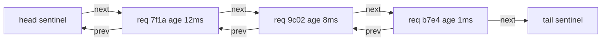

## 7.4 Linked Lists

#### Concept

A linked list is a chain of nodes. Each node holds a value and a pointer to the next node (a **singly** linked list), or pointers to both the next and the previous node (a **doubly** linked list). Nodes are allocated one at a time anywhere in memory; nothing is contiguous. You keep a pointer to the first node (the head) and usually the last one (the tail).

The defining property is the opposite of the array's: reaching the i-th node costs O(n) because you must follow i pointers, but once you *hold* a node, inserting after it or unlinking it costs O(1) and never moves any other node.

#### Why does it exist?

Arrays are bad at two things: inserting or removing in the middle (everything after the slot shifts), and giving you a stable handle to an element (indexes change as the array changes). Linked lists fix both. That is why they sit inside almost every structure that needs "remove this exact item quickly, regardless of where it is": LRU caches (Section 7.17), in-flight request registries, connection-pool idle lists, OS schedulers, Node.js stream buffers (`Readable` keeps its pending chunks in a linked `BufferList`), and Redis lists (a `quicklist`, which is a doubly linked list of packed nodes).

Without linked lists you would implement an LRU cache by finding an element in an array (O(n)) and splicing it out (O(n)) on every cache hit. At 50,000 cache hits per second that is not a cache; it is a CPU heater.

#### Mental model

Imagine a scavenger hunt. Each clue tells you where the next clue is hidden. To read clue 500 you must visit the first 499. But to insert a new clue between clue 3 and clue 4 you only rewrite clue 3, and nobody else in the hunt notices. In a doubly linked version each clue also says where the previous clue was, so you can walk backwards and you can remove any clue you are standing on by telling its neighbours about each other.

#### How it works

1. **Node.** An object `{ value, prev, next }`. In V8 a small object with three fields costs roughly 24 bytes of header plus 8 bytes per field, so about 48 bytes per node, versus 8 bytes per slot in a packed array.
2. **Insert at tail.** Create a node, set `node.prev = tail`, `tail.next = node`, `tail = node`. Four pointer writes, O(1).
3. **Unlink a node you hold.** `node.prev.next = node.next; node.next.prev = node.prev`. Two pointer writes, O(1), regardless of list length. In a singly linked list you cannot do this without first finding the previous node, O(n).
4. **Traverse.** Follow `next` from the head. Each hop is a dependent memory load: the CPU cannot fetch node 2 until it has read node 1's pointer. Cache misses to main memory cost roughly 100 ns, so a 1-million-node traversal can take 50 to 100 ms, while a packed array of 1 million integers scans in about 1 ms.
5. **Sentinels.** Production implementations use two dummy nodes (head and tail sentinels) so that "insert at front" and "remove the last real node" need no special cases for an empty list. Fewer branches, fewer bugs.
6. **Garbage collection.** V8's mark-and-sweep collector handles cycles (`prev` and `next` pointing at each other) without trouble. What it cannot handle is *your* stale references: a node you "removed" but still hold in a closure keeps its neighbours reachable through its pointers. Null out `prev` and `next` when unlinking.



**Time complexity**

| Operation | Best | Average | Worst | Notes |
|---|---|---|---|---|
| Access by index | O(1) | O(n) | O(n) | best is index 0 or the tail |
| Search by value | O(1) | O(n) | O(n) | |
| Insert at head or tail | O(1) | O(1) | O(1) | tail requires a tail pointer |
| Insert after a node you hold | O(1) | O(1) | O(1) | |
| Delete a node you hold (doubly) | O(1) | O(1) | O(1) | |
| Delete a node you hold (singly) | O(1) | O(n) | O(n) | must find the previous node |
| Delete head | O(1) | O(1) | O(1) | |
| Delete tail (doubly) | O(1) | O(1) | O(1) | O(n) for singly linked |
| Length | O(1) | O(1) | O(1) | if you maintain a counter |

**Memory implications (V8, Node.js)**

- About 48 bytes per node plus the value. A list of 1 million small integers costs roughly 48 MB versus 8 MB for a packed array.
- Nodes are allocated individually and often survive long enough to be promoted to old space, which makes them more expensive for the garbage collector than a single array backing store.
- Keep node objects *monomorphic*: always create them with the same property order (`value`, `prev`, `next`) so every node shares one hidden class and V8 inlines the field offsets.
- Data locality is poor. For n below roughly 10,000, an array with `splice` is often *faster* than a linked list in practice because copying a few kilobytes contiguously is cheaper than chasing pointers.

#### Practical example

A production-grade doubly linked list with sentinels and O(1) unlink. This is the same class that the LRU cache in Section 7.17 will reuse.

```ts
// common/doubly-linked-list.ts
export class ListNode<T> {
  prev: ListNode<T> | null = null;
  next: ListNode<T> | null = null;
  constructor(public value: T) {}
}

export class DoublyLinkedList<T> implements Iterable<T> {
  private readonly head = new ListNode<T>(undefined as T); // sentinel, never exposed
  private readonly tail = new ListNode<T>(undefined as T); // sentinel, never exposed
  private count = 0;

  constructor() {
    this.head.next = this.tail;
    this.tail.prev = this.head;
  }

  get size(): number {
    return this.count;
  }

  pushBack(value: T): ListNode<T> {
    const node = new ListNode(value);
    this.insertBetween(node, this.tail.prev!, this.tail);
    return node; // caller keeps this handle for O(1) removal
  }

  pushFront(value: T): ListNode<T> {
    const node = new ListNode(value);
    this.insertBetween(node, this.head, this.head.next!);
    return node;
  }

  moveToFront(node: ListNode<T>): void {
    this.unlink(node);
    this.insertBetween(node, this.head, this.head.next!);
  }

  remove(node: ListNode<T>): T {
    this.unlink(node);
    return node.value;
  }

  peekFront(): T | undefined {
    return this.count === 0 ? undefined : this.head.next!.value;
  }

  popBack(): T | undefined {
    if (this.count === 0) return undefined;
    return this.remove(this.tail.prev!);
  }

  *[Symbol.iterator](): Iterator<T> {
    for (let n = this.head.next; n !== this.tail; n = n!.next) yield n!.value;
  }

  private insertBetween(node: ListNode<T>, before: ListNode<T>, after: ListNode<T>): void {
    node.prev = before;
    node.next = after;
    before.next = node;
    after.prev = node;
    this.count++;
  }

  private unlink(node: ListNode<T>): void {
    if (node.prev === null || node.next === null) throw new Error('node is not linked');
    node.prev.next = node.next;
    node.next.prev = node.prev;
    node.prev = node.next = null; // drop references so a stale handle retains nothing
    this.count--;
  }
}
```

#### NestJS example

An **in-flight request registry**. Every request is added to the list when it starts and unlinked when it finishes. Requests finish in arbitrary order, so the O(1) unlink by node handle is exactly what we need. The registry powers two things: a health indicator that reports the age of the oldest in-flight request (a stuck request shows up as a growing number), and graceful shutdown that waits for the list to drain before the process exits.

```ts
// runtime/inflight.registry.ts
import { Injectable, Logger, OnApplicationShutdown } from '@nestjs/common';
import { DoublyLinkedList, ListNode } from '../common/doubly-linked-list';

interface InFlight { id: string; route: string; startedAt: number }

@Injectable()
export class InFlightRegistry implements OnApplicationShutdown {
  private readonly logger = new Logger(InFlightRegistry.name);
  private readonly list = new DoublyLinkedList<InFlight>();

  start(id: string, route: string): ListNode<InFlight> {
    return this.list.pushBack({ id, route, startedAt: Date.now() }); // newest at the back
  }

  finish(node: ListNode<InFlight>): void {
    this.list.remove(node); // O(1) no matter how many requests are in flight
  }

  oldestAgeMs(): number {
    const oldest = this.list.peekFront(); // oldest is always at the front
    return oldest ? Date.now() - oldest.startedAt : 0;
  }

  get count(): number {
    return this.list.size;
  }

  async onApplicationShutdown(signal?: string): Promise<void> {
    const deadline = Date.now() + 25_000; // stay under Kubernetes' 30s terminationGracePeriod
    while (this.list.size > 0 && Date.now() < deadline) {
      this.logger.log(`${signal}: waiting for ${this.list.size} in-flight requests`);
      await new Promise((r) => setTimeout(r, 250));
    }
  }
}

// runtime/inflight.interceptor.ts
import { CallHandler, ExecutionContext, Injectable, NestInterceptor } from '@nestjs/common';
import { Observable, finalize } from 'rxjs';
import { randomUUID } from 'node:crypto';
import { InFlightRegistry } from './inflight.registry';

@Injectable()
export class InFlightInterceptor implements NestInterceptor {
  constructor(private readonly registry: InFlightRegistry) {}

  intercept(ctx: ExecutionContext, next: CallHandler): Observable<unknown> {
    const req = ctx.switchToHttp().getRequest<{ method: string; url: string }>();
    const node = this.registry.start(randomUUID(), `${req.method} ${req.url}`);
    return next.handle().pipe(finalize(() => this.registry.finish(node)));
  }
}
```

Enable shutdown hooks with `app.enableShutdownHooks()` in `main.ts` so `onApplicationShutdown` runs on `SIGTERM`. A `@nestjs/terminus` health indicator can then report `oldestAgeMs()` and fail readiness when it exceeds, say, 30 seconds.

#### PostgreSQL example

Two linked lists live inside PostgreSQL whether you want them or not, and one you should never build yourself.

**HOT chains.** Every `UPDATE` in PostgreSQL writes a new row version; the old version's `t_ctid` header field points to the new one, forming a chain inside the page. A row updated 200 times between vacuums has a 200-link chain, and each read of that row walks it. This is the mechanism behind "hot row" slowdowns on counters and inventory quantities, and why `autovacuum` tuning matters (see the Database Internals part).

**The self-referencing "next_id" table**, a linked list modeled in SQL, is an anti-pattern for ordered items. It looks natural for playlists, checklist steps or pipeline stages, but every read needs a recursive query and every reorder needs two or three row updates that race under concurrency.

```sql
-- Anti-pattern: a linked list of checklist steps
CREATE TABLE steps (
  id           bigint PRIMARY KEY,
  checklist_id bigint NOT NULL,
  title        text   NOT NULL,
  next_id      bigint REFERENCES steps(id)
);

-- Reading in order requires walking the chain one hop per iteration.
WITH RECURSIVE ordered AS (
  SELECT s.*, 1 AS position FROM steps s
  WHERE s.checklist_id = 42 AND NOT EXISTS (SELECT 1 FROM steps p WHERE p.next_id = s.id)
  UNION ALL
  SELECT s.*, o.position + 1 FROM steps s JOIN ordered o ON s.id = o.next_id
)
SELECT id, title FROM ordered ORDER BY position;

-- Better: an explicit position that can be indexed and read in one range scan.
CREATE TABLE steps_v2 (
  id           bigint PRIMARY KEY,
  checklist_id bigint  NOT NULL,
  title        text    NOT NULL,
  position     numeric NOT NULL,
  UNIQUE (checklist_id, position)
);
SELECT id, title FROM steps_v2 WHERE checklist_id = 42 ORDER BY position;
```

```text
Index Scan using steps_v2_checklist_id_position_key on steps_v2  (cost=0.29..8.60 rows=18 width=45) (actual time=0.019..0.027 rows=18 loops=1)
  Index Cond: (checklist_id = 42)
  Buffers: shared hit=3
Planning Time: 0.098 ms
Execution Time: 0.041 ms
```

Using `numeric` for `position` lets you insert between 3 and 4 as 3.5 without renumbering (fractional indexing); renumber lazily when gaps get too small.

#### TypeORM example

TypeORM can model both shapes. The self-referencing relation is shown only so you recognize it; the `position` column is what you should ship.

```ts
import { Column, Entity, Index, ManyToOne, PrimaryColumn } from 'typeorm';

@Entity({ name: 'steps_v2' })
@Index(['checklistId', 'position'], { unique: true })
export class Step {
  @PrimaryColumn({ type: 'bigint' })
  id!: string;

  @Column({ name: 'checklist_id', type: 'bigint' })
  checklistId!: string;

  @Column({ type: 'text' })
  title!: string;

  @Column({ type: 'numeric', precision: 20, scale: 10 })
  position!: string; // numeric arrives as a string from pg; compare with a decimal library
}

// ordered read: one index range scan, no recursion
const steps = await repo.find({ where: { checklistId }, order: { position: 'ASC' } });

// insert between two neighbours without touching any other row
const between = (a: string, b: string) => ((Number(a) + Number(b)) / 2).toString();
await repo.insert({ id, checklistId, title, position: between(prev.position, next.position) });
```

#### Sequelize example

```ts
import { DataTypes, Model, Sequelize } from 'sequelize';

export class Step extends Model {
  declare id: number;
  declare checklistId: number;
  declare title: string;
  declare position: string;
}

export function initStep(sequelize: Sequelize) {
  Step.init(
    {
      id: { type: DataTypes.BIGINT, primaryKey: true },
      checklistId: { type: DataTypes.BIGINT, allowNull: false, field: 'checklist_id' },
      title: { type: DataTypes.TEXT, allowNull: false },
      position: { type: DataTypes.DECIMAL(20, 10), allowNull: false },
    },
    {
      sequelize,
      tableName: 'steps_v2',
      timestamps: false,
      indexes: [{ unique: true, fields: ['checklist_id', 'position'] }],
    },
  );
}

const ordered = await Step.findAll({ where: { checklistId }, order: [['position', 'ASC']] });
```

#### Production scenario

Redis lists are the linked list you will meet most often. BullMQ keeps each queue's waiting jobs in a Redis list and moves them to an `active` list with an atomic Lua script. `LPUSH` and `RPOP` are O(1), so a queue with 4 million pending jobs accepts and hands out jobs at 30,000 operations per second on one Redis core. The trap is any command that walks the list. `LRANGE queue 0 -1` on those 4 million entries is O(n), takes about 500 ms, and because Redis executes commands on a single thread, every other client in the company stalls for that half second. `LINDEX` and `LINSERT` in the middle are O(n) for the same reason. Senior engineers treat Redis lists as deques: touch the ends, never the middle, and paginate with `LRANGE 0 99` if a dashboard really must peek.

Node.js streams are the other everyday linked list. A `Readable` stores chunks it has read but not yet delivered in a `BufferList`. When a consumer stops reading (a slow client, a paused pipe), that list grows until `highWaterMark` (16 KB for byte streams) makes `push()` return `false`. Producers that ignore that return value are building an unbounded linked list of chunks, which is the memory leak behind many "the upload service slowly grows to 4 GB" incidents.

#### Failure scenario

At 02:14 the on-call engineer is paged: `GET /checklists/:id` for a subset of customers is timing out after 30 seconds and PostgreSQL CPU is pinned. The checklist steps use the `next_id` linked-list model. Two support agents reordered the same checklist simultaneously. Each transaction read the chain, computed new pointers, and wrote them; the second write did not conflict at the row level (different rows), so both committed. The resulting chain contained a cycle: step 7 points to step 9, step 9 points to step 7. The recursive CTE that reads the checklist never terminates; it grows a result set until `statement_timeout` (30 s) kills it, on every request for that checklist, from every pod, while customer retries pile more of them on.

Mitigation at 02:30: add `CYCLE id SET is_cycle USING path` to the CTE (PostgreSQL 14+) so the query stops instead of looping. Fix by morning: migrate to the `position` column, where the worst concurrent outcome is two rows with a swapped order, never an unreadable checklist. The lesson: a linked list is only safe when one owner mutates it under a lock. A database table with concurrent writers is the opposite of that.

#### Edge cases & failure modes

- **Lost head or tail pointer.** Overwriting `head` without relinking orphans the whole list; the garbage collector reclaims it silently and the data is gone.
- **Removing a node twice.** Without the "is it linked" check, the second unlink corrupts neighbours. Null the pointers on unlink and throw on re-removal.
- **Iterating while mutating.** Removing the current node during a `for...of` is fine if you saved `next` before unlinking; otherwise the loop jumps to `null`.
- **Recursion over long lists.** Recursive traversal of 100,000 nodes overflows the default Node.js stack (about 10,000 frames). Traverse iteratively.
- **Cycles.** In memory they hang loops; in SQL they hang recursive queries. Detect with a visited `Set` or PostgreSQL's `CYCLE` clause.
- **Polymorphic nodes.** Creating nodes with different property orders or sometimes adding extra fields turns the hot loop megamorphic and 5 to 10 times slower.
- **Redis list commands in the middle.** `LRANGE 0 -1`, `LINDEX`, `LINSERT`, `LREM` on big lists block the Redis server.
- **Stream buffer growth.** Ignoring `push()` and `write()` return values lets internal chunk lists grow without bound.

#### How a Senior Backend Engineer thinks about this

The question is "**will I hold a reference to the element I need to remove?**" If yes, and removals are frequent, a doubly linked list is the right tool (LRU cache, in-flight registry, timer wheels, idle-connection lists). If removal is by *value* or by *index*, the list gives nothing over an array and costs six times the memory; a `Map` or an array wins.

Second, "**how big is n, really?**" Under 10,000 elements the senior often keeps an array; the constant factors of pointer chasing beat the Big-O of `splice`. They only reach for a linked list when both n and the removal rate are large, and then they prefer a tested library (`lru-cache`, `denque`) over a hand-written one, unless the structure is the product.

Third, "**where does this list live?**" An in-memory list is per-process and dies on restart. A shared, durable list is a Redis list or a database table, with ordering enforced by a `position` column and a unique index, never by pointers between rows.

To a product manager: "Reordering steps by linking each step to the next is how it works on paper, but two people editing at once can tie a knot the system cannot read. Storing a sort position per step is one day of work and cannot knot."

#### Common mistakes

- Modeling order in the database with `next_id` pointers.
- Implementing a queue with a linked list and then calling `find` on it by id on every message; the O(1) benefit vanishes.
- Recursive `toArray()` or `print()` helpers that overflow the stack in production.
- Keeping "removed" nodes in a closure (a log line, a promise) and wondering why heap snapshots show a chain of old requests.
- Using `LRANGE 0 -1` on a Redis job queue "just to count"; use `LLEN`.
- Assuming linked lists are faster than arrays because a textbook said insertion is O(1).

#### Interview questions

1. **When is a doubly linked list strictly better than an array?** Expected: when you hold node handles and need O(1) unlink or move regardless of position, and n is large; canonical example is an LRU cache. Follow-up: why not an array plus `indexOf`? (O(n) per hit.)
2. **Why can a singly linked list not remove a node in O(1) given only that node?** Expected: no pointer to the predecessor; the trick of copying the next node's value into it fails for the tail and breaks external handles.
3. **How would you order items in a PostgreSQL table, and why not with a `next_id` column?** Expected: `position` with a unique index and fractional insertion; `next_id` needs recursive reads and races under concurrent reorders (cycles).
4. **What is a HOT chain and how does it relate to linked lists?** Expected: row versions chained inside a page by `t_ctid`; long chains from frequent updates slow reads until vacuum.
5. **Explain why `LRANGE key 0 -1` on a large Redis list is a production hazard.** Expected: O(n) on a single-threaded server; stalls all clients; use `LLEN`, paginate, or keep lists small.
6. **How does a Node.js `Readable` stream buffer data, and how does that become a memory leak?** Expected: a linked `BufferList` of chunks bounded by `highWaterMark` only if producers honour `push()` return values.
7. **Given a list of 100,000 nodes, why might your recursive traversal crash and how do you fix it?** Expected: default stack depth about 10,000 frames; iterate with a loop or an explicit stack.

#### Practical exercise

Implement `IdleConnectionList`, the idle list of a tiny connection pool, on top of `DoublyLinkedList`.

Acceptance criteria:

- `acquire()` returns the most recently released connection (front of the list) in O(1); `release(conn)` pushes to the front in O(1).
- A reaper running every 5 seconds via `@Interval(5000)` from `@nestjs/schedule` closes connections idle for more than 30 seconds by walking from the *back* (oldest) and stopping at the first fresh one, so the reaper cost is proportional to the number of stale connections, not the pool size.
- The list stores node handles in a `Map<Connection, ListNode>` so a connection that errors while idle can be unlinked in O(1).
- Unit tests cover: release then acquire returns the same connection; the reaper closes exactly the stale ones; unlinking a node twice throws; iteration order is newest to oldest.
- A benchmark with 100,000 release/acquire pairs finishes in under 50 ms and shows no growth in `heapUsed` between two forced GCs (`node --expose-gc`).
