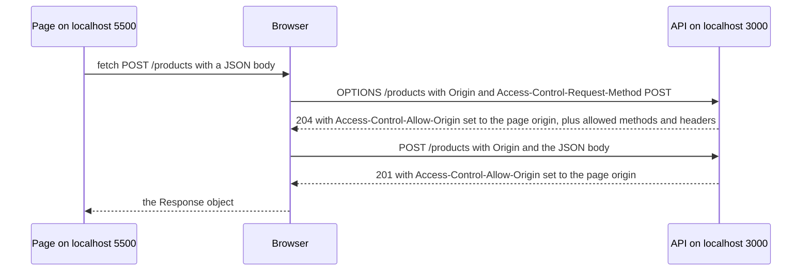
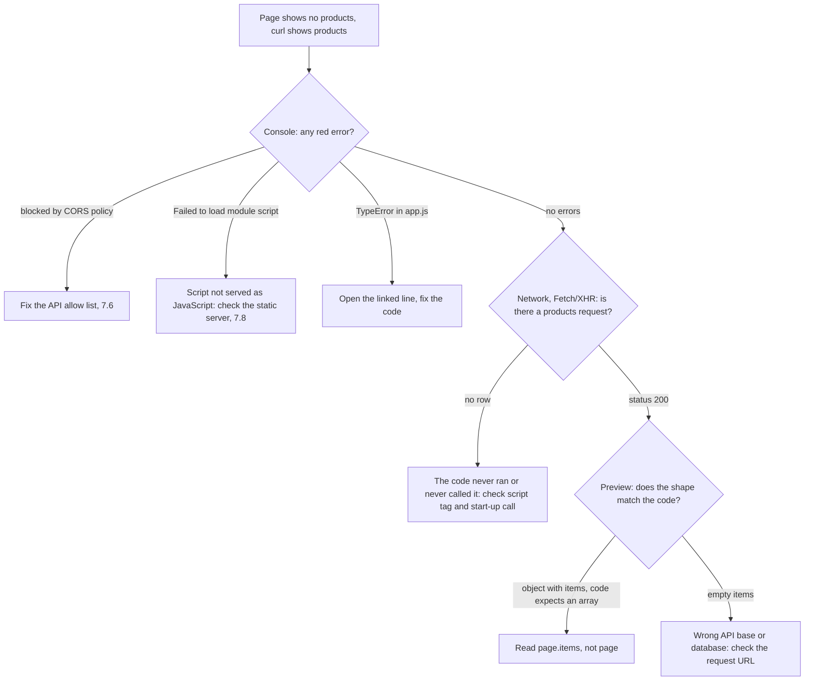

## 7.6 Meeting CORS for real

### 7.6.1 The error, the preflight and the NestJS fix

#### Concept

An **origin** is the triple of scheme, host and port: `http://localhost:5500` and `http://localhost:3000` are different origins because the ports differ. The browser's **same-origin policy** stops JavaScript loaded from one origin from reading responses from another. **CORS** (Cross-Origin Resource Sharing) is how a server tells the browser "scripts from these origins may read my responses", using `Access-Control-Allow-*` headers. Part 3 (3.6) introduced the idea with `curl`; now you will hit it with a real page.

#### Why does it exist?

Imagine you are logged in to your bank in one tab and open a malicious site in another. Without the same-origin policy, that site's JavaScript could call the bank's API, the browser would attach your bank cookies, and the script could read your balance. The policy stops the reading. CORS exists because legitimate apps do need cross-origin calls, like a frontend on `admin.shop.example` calling an API on `api.shop.example`, and the server must be able to approve exactly those.

#### Mental model

The browser is a careful personal assistant who fetches letters for whatever website you are looking at. Before handing a reply from `api.shop.example` to the website `admin.shop.example`, the assistant checks the reply for a line saying "admin.shop.example may read this". No line, no handover, even though the letter was delivered. For anything unusual (a `DELETE`, a JSON body), the assistant phones ahead first to ask whether such a letter is welcome: that phone call is the **preflight**.

#### How it works

Serve the Products screen from a static server on port 5500 (7.8) while the API runs on port 3000, with no CORS configuration. Open the page and DevTools:

```text
Console:
Access to fetch at 'http://localhost:3000/products?limit=20' from origin 'http://localhost:5500'
has been blocked by CORS policy: No 'Access-Control-Allow-Origin' header is present on the
requested resource.
```

The list shows "Could not load products: Could not reach the server", because `fetch` rejected with a `TypeError` and `api()` mapped it to `NETWORK`. The Network panel shows the `GET` with **CORS error** in the Status column. Yet the request did reach the API and was answered with `200`. The Part 6 API logs only failures, so its terminal stays quiet, but you can replay the browser's request by hand: `curl -i -H 'Origin: http://localhost:5500' 'http://localhost:3000/products?limit=20'` prints `200` and the products, and no `Access-Control-Allow-Origin` header. **The server did the work; the browser refused to hand over the result.** That is why `curl` "works": `curl` is not a browser and enforces nothing.

Submit the form and the Console shows a different message:

```text
Access to fetch at 'http://localhost:3000/products' from origin 'http://localhost:5500' has been
blocked by CORS policy: Response to preflight request doesn't pass access control check:
No 'Access-Control-Allow-Origin' header is present on the requested resource.
```

This time the `POST` never reached your controller. A `POST` with `Content-Type: application/json` is not a "simple" request, so the browser first asked permission with an `OPTIONS` request and got no approval:



Which of our requests are preflighted:

| Request | Preflight? | Why |
|---|---|---|
| `GET /products` | no | `GET` with no custom headers is a "simple" request; it is sent, and only the reading is checked |
| `POST /products` with JSON | yes | `application/json` is not one of the three simple content types (form, multipart, plain text) |
| `PATCH` and `DELETE /products/:id` | yes | only `GET`, `HEAD` and `POST` can be simple |
| anything with an `X-Request-Id` or `Authorization` header | yes | custom headers need approval |

Notice the first row. A simple cross-origin request **is sent and executed**; CORS only decides whether the script may read the answer. So CORS is never protection for your data or your writes. Authentication and authorization protect your API (Part 44); CORS protects your users' browsers from other websites.

#### NestJS example

The fix is on the server. NestJS's `app.enableCors()` registers the widely used `cors` middleware. We read the allowed origins from configuration, validated at start-up like every other setting (6.5), and refuse wildcards.

```ts
// src/config/env.validation.ts (addition to the Env class from 6.5)
@IsOptional() @IsString() CORS_ORIGINS: string = '';   // comma-separated exact origins; empty = no browser origins
```

```ts
// src/config/cors.ts
export function parseOrigins(raw: string): string[] {
  const origins = raw.split(',').map((s) => s.trim()).filter(Boolean);
  for (const o of origins) {
    let exact = false;
    try {
      exact = new URL(o).origin === o;     // rejects "*", paths and trailing slashes
    } catch {
      exact = false;
    }
    if (!exact) throw new Error(`CORS_ORIGINS: "${o}" must be an exact origin such as https://admin.shop.example`);
  }
  return origins;
}
```

```ts
// src/configure-app.ts (6.6, now with CORS)
import type { INestApplication } from '@nestjs/common';
import { ConfigService } from '@nestjs/config';
import { validationPipe } from './common/validation';
import { ApiExceptionFilter } from './common/api-exception.filter';
import { parseOrigins } from './config/cors';

export function configureApp(app: INestApplication): INestApplication {
  const config = app.get(ConfigService);
  app.enableCors({
    origin: parseOrigins(config.get<string>('CORS_ORIGINS', '')),  // exact list, never '*' or true
    methods: ['GET', 'POST', 'PATCH', 'DELETE'],
    allowedHeaders: ['Content-Type', 'X-Request-Id'],
    exposedHeaders: ['X-Request-Id'],     // lets browser code read our request ID header (6.6)
    credentials: false,                   // this API uses no cookies; see Part 81 before turning this on
    maxAge: 600,                          // browsers may cache a preflight answer for 10 minutes
  });
  app.useGlobalPipes(validationPipe);
  app.useGlobalFilters(new ApiExceptionFilter());
  app.enableShutdownHooks();
  return app;
}
```

```text
# .env
CORS_ORIGINS=http://localhost:5500
```

With an array, the middleware compares the request's `Origin` header with each entry. On a match it echoes that origin back in `Access-Control-Allow-Origin` and adds `Vary: Origin`, so caches do not serve one origin's answer to another. On no match it simply leaves the header out, and the browser blocks the page. Because the middleware runs before routing, error responses from the exception filter carry the header too, so the page can read a `400`'s `issues`. And because `configureApp` is shared with the tests (6.7), the e2e suite exercises the same CORS setup as production:

```ts
// test/setup-env.ts (addition)
process.env.CORS_ORIGINS = 'http://localhost:5500';
```

```ts
// test/products.e2e-spec.ts (addition)
it('approves the preflight for an allowed origin only', async () => {
  const ok = await request(app.getHttpServer())
    .options('/products')
    .set('Origin', 'http://localhost:5500')
    .set('Access-Control-Request-Method', 'POST')
    .set('Access-Control-Request-Headers', 'content-type')
    .expect(204);
  expect(ok.headers['access-control-allow-origin']).toBe('http://localhost:5500');

  const evil = await request(app.getHttpServer())
    .options('/products')
    .set('Origin', 'https://evil.example')
    .set('Access-Control-Request-Method', 'POST');
  expect(evil.headers['access-control-allow-origin']).toBeUndefined();
});
```

Reload the page: the list appears, and the form works. The `curl -X OPTIONS` command from Part 3 (3.6), pointed at port 3000 with `Origin: http://localhost:5500`, shows the same headers by hand, including `Access-Control-Allow-Origin: http://localhost:5500` and `Vary: Origin`.

#### Failure scenario

At 09:05 on the morning after the admin site moved from `https://shop-admin.example` to `https://admin.shop.example`, every staff member saw "Could not load products". The API's dashboards were green: `GET /products` was answering `200` at the usual rate, and `curl` returned products. The on-call engineer opened DevTools on the admin page, read "No 'Access-Control-Allow-Origin' header is present", and found the cause in two minutes: the API's `CORS_ORIGINS` still listed the old domain. A teammate proposed `origin: true` "to make it go away"; that setting reflects **any** origin, which would let every website's scripts read the API's responses with the user's browser. Instead, the team added the new origin to the configuration, redeployed, and added a step to the release checklist: a post-deploy smoke test that sends a preflight with the production frontend's origin and fails the pipeline if the allow header is missing.

#### Edge cases & failure modes

- **`localhost` and `127.0.0.1` are different origins.** A page opened at `http://127.0.0.1:5500` is blocked when only `http://localhost:5500` is allowed.
- **A trailing slash never matches.** The `Origin` header has no path, so `http://localhost:5500/` in the allow list matches nothing; `parseOrigins` rejects it at start-up for this reason.
- **`*` cannot be combined with credentials.** Browsers reject `Access-Control-Allow-Origin: *` on requests that send cookies; teams then reach for `origin: true`, which is worse.
- **A CORS error can hide a `502` or `504`.** If a load balancer or proxy answers with its own error page, that page has no CORS headers, and the browser reports CORS instead of the real failure. Check the API's and the proxy's logs before editing CORS settings.
- **Pages opened from disk send `Origin: null`.** Never add `null` to the allow list; sandboxed iframes and other odd contexts also send it. Serve the page over HTTP instead (7.8).
- **Custom response headers are hidden by default.** Without `exposedHeaders`, `res.headers.get('x-request-id')` returns `null` in the browser even though DevTools shows the header.

#### How a Senior Backend Engineer thinks about this

A senior treats CORS as configuration with an owner, not as an error to silence. The allow list is explicit, per environment, validated at start-up and covered by a test. They never ship `*` for an API that uses cookies, never ship `origin: true`, and never confuse CORS with access control: an attacker with `curl` ignores CORS entirely, so every endpoint still needs authentication and authorization. And they prefer architectures where the question disappears: serving the frontend and API from one origin (7.8) or behind one domain with a reverse proxy removes preflights and CORS configuration altogether. Part 14 (14.13) covers CORS in depth and Part 81 covers cookies, credentials and CSRF.

#### Common mistakes

- "Fixing" CORS in the frontend (adding `mode: 'no-cors'`, which makes the response unreadable, or adding `Access-Control-Allow-Origin` as a *request* header, which does nothing).
- Using `app.enableCors()` with no options in production, which allows every origin.
- Forgetting that the preflight is a separate request that must succeed before the real one.
- Assuming CORS stops other servers or `curl` from calling the API.

#### Interview questions

1. **Why does a request work in `curl` but fail in the browser with a CORS error?** CORS is enforced by browsers for scripts; the server did not send an `Access-Control-Allow-Origin` that matches the page's origin. Fix the server's allow list.
2. **What is a preflight request and what triggers it?** An `OPTIONS` request the browser sends first to ask whether a method and headers are allowed; triggered by methods other than `GET`, `HEAD` and `POST`, non-simple content types like JSON, or custom headers.
3. **Does CORS protect your API from unwanted callers?** No. It only controls whether browser scripts can read responses; simple requests still reach and execute on the server. Authentication and authorization protect the API.
4. **The browser shows a CORS error, but the API logs show no request at all. What might be happening?** A failed preflight (the real request was never sent), a proxy error page without CORS headers, or a request to the wrong host; check the Network panel for the `OPTIONS` row and the proxy logs.

#### Practical exercise

Configure CORS for three environments: development allows `http://localhost:5500` and `http://127.0.0.1:5500`; staging allows `https://admin.staging.shop.example`; production allows `https://admin.shop.example`. Make a misconfigured value stop the app at start-up. Acceptance criteria: `CORS_ORIGINS=*` and `CORS_ORIGINS=https://admin.shop.example/` both fail at boot with a clear message; the e2e test above passes; a preflight from an unlisted origin gets no `Access-Control-Allow-Origin`; and the browser page can read `X-Request-Id` from a response.

#### Worked answer to the exercise

The code above already does most of it; the work is in configuration and checks.

```text
# development .env
CORS_ORIGINS=http://localhost:5500,http://127.0.0.1:5500
# staging (set by the deployment, not committed)
CORS_ORIGINS=https://admin.staging.shop.example
# production (set by the deployment, not committed)
CORS_ORIGINS=https://admin.shop.example
```

```bash
CORS_ORIGINS='*' npm run start:dev
# Error: CORS_ORIGINS: "*" must be an exact origin such as https://admin.shop.example
CORS_ORIGINS='https://admin.shop.example/' npm run start:dev
# Error: CORS_ORIGINS: "https://admin.shop.example/" must be an exact origin such as https://admin.shop.example
```

`new URL('*')` throws, and `new URL('https://admin.shop.example/').origin` drops the trailing slash and no longer equals the configured string, so both fail at boot. Remove `exposedHeaders` and `res.headers.get('x-request-id')` returns `null` in the page while DevTools still shows the header: a quick way to prove the option does something.

## 7.7 Browser DevTools for beginners

### 7.7.1 Elements, Console, Network and Application, and one debugging walkthrough

#### Concept

**DevTools** are the debugging tools built into every major browser. Open them with F12 (Cmd+Option+I on a Mac) or right-click on the page and choose Inspect. Four panels cover almost everything a backend engineer needs: **Elements** (the live DOM and its styles), **Console** (errors, logs, and a place to run JavaScript in the page), **Network** (every request the page made, with headers, bodies and timing) and **Application** (cookies and browser storage). The examples use Chrome's names; Firefox and Safari have the same panels with slightly different labels.

#### Why does it exist?

Because the browser hides most of what it does. A failed `fetch`, a script that threw on line 12, a CSS rule that lost the cascade, a request that never left: none of these appear on the page. DevTools is to the browser what `curl -v` (Part 3) and your server logs are to the backend. Without it, frontend debugging is guessing.

#### How it works

| Panel | What you use it for | Details worth knowing |
|---|---|---|
| Elements | See the **current** DOM, not the HTML file; check styles | The Styles pane shows every matching rule, with losing declarations crossed out (7.3); the box diagram shows margin, border and padding; the selected element is available in the Console as `$0` |
| Console | Read errors and logs; try code | Each error links to the file and line; red messages about CORS, failed module loads and uncaught exceptions appear here first |
| Network | See every request and response | Filter by **Fetch/XHR** for API calls; tick **Preserve log** to keep requests across reloads and **Disable cache** while debugging; click a row for **Headers**, **Payload** (the request body), **Preview** (parsed JSON), **Response** (raw) and **Timing** |
| Application | Inspect cookies, Local Storage, Session Storage, IndexedDB | Anything stored here is readable by any script on the page, which is why tokens in `localStorage` are an XSS risk (Part 81, 81.1) |

Three Network features you will use weekly. **Timing** splits a request into phases: queueing, connection setup, "Waiting for server response" (time to first byte, mostly your API) and content download; a 900 ms wait with a 2 ms download is a backend problem, not a frontend one. **Copy as cURL** (right-click a request, then Copy) gives you the exact request, headers and body included, to replay in a terminal or attach to a bug ticket. **Throttling** (a drop-down in the Network toolbar) simulates a slow phone network or going offline, which is how you see your "Saving..." state and your timeout (7.5) actually work. The **device toolbar** (the phone icon, or Cmd+Shift+M) resizes the page to phone widths for checking the media query from 7.3.

#### Practical example — "the list is empty but the API works in curl"

A teammate reports: the Products page says "No products yet", but `curl http://localhost:3000/products` returns products. Walk it the same way every time: Console, then Network, then the code.



In this case the Console is clean. The Network panel, filtered to Fetch/XHR, shows `products?limit=20` with status `200`. Preview shows `{ items: [ {...}, {...} ], nextCursor: null }`. The teammate's code, written against the 6.2 version of the API, is:

```js
const products = await api('/products?limit=20');
if (!products.length) setStatus('No products yet.');   // an object has no length: undefined, so !undefined is true
```

The API changed shape in 6.5, from an array to a page object. An object has no `length`, so the "empty" branch runs without any error. The fix is `page.items`, and the lasting fix is a contract that would have caught the change: Part 80 (80.2 and 80.10) generates typed clients and runs contract tests so a shape change fails CI instead of a user's screen.

The same walkthrough catches the other usual suspects:

| What DevTools shows | Likely cause | Fix |
|---|---|---|
| Console: "blocked by CORS policy"; Network: CORS error | page origin missing from `CORS_ORIGINS` | add the exact origin (7.6) |
| Network shows `app.js` from "(disk cache)", old code runs | browser cached an old script | Disable cache while debugging; versioned file names in production (Part 84, 84.3) |
| No request at all, Console says module failed to load | page opened from disk or served with the wrong MIME type | serve over HTTP (7.8) |

#### Edge cases & failure modes

- **Opening DevTools after the page loaded** misses the first requests; reload with the Network panel open.
- **Red "Failed to load resource: ... status of 409" lines** appear in Chrome's Console for every `4xx` and `5xx` response, even ones your code handles correctly, and for a missing `favicon.ico`; they are network logs, not script errors.
- **A CORS-blocked response hides its body** from the page and largely from DevTools; check the server log for what actually happened.
- **Production code is minified**: line 1, column 48,213 tells you nothing without source maps (Part 76, 76.7, and Part 84, 84.6).

#### How a Senior Backend Engineer thinks about this

A senior uses DevTools to decide in one minute which side of the wire is wrong. Status and Preview right, page wrong: frontend. Status or body wrong: API, and Copy as cURL turns it into a backend reproduction. They connect the two worlds with the request ID: the `requestId` in a problem body (or the `X-Request-Id` header, once exposed) is the key to the exact server log line from 6.6, and Part 84 (84.7) extends that to full traces from a click to a database write.

#### Interview questions

1. **A page shows stale data after a deploy. What do you check in DevTools?** Whether scripts and API responses came from cache (Size column, Disable cache), and the response headers (`Cache-Control`) of the API and the static files.
2. **How do you tell whether slowness is in the frontend or the API?** Network Timing: a long "Waiting for server response" is server time; a fast response followed by a slow page is frontend work, which Part 75 (75.10) and Part 82 dig into.
3. **How do you turn a browser bug into a backend reproduction?** Copy the failing request as cURL, strip secrets, replay it, and use the request ID to find the server log line.

#### Practical exercise

With the Products screen running, use only DevTools to answer: what is the request ID of a duplicate-SKU error, how many milliseconds did the server spend on `GET /products`, which CSS rule makes an invalid input's border red, and what happens in the UI when you set throttling to Offline and press Refresh. Acceptance criteria: a value or observation for each, and the panel you found it in.

#### Worked answer to the exercise

Create SKU `DM-001` twice. **Network**: the failing `products` row has status `409`; Preview shows `code: "PRODUCT_SKU_TAKEN"` and the `requestId`, also in the `X-Request-Id` header. **Timing** on a `GET /products` row: "Waiting for server response", a few milliseconds locally. **Elements**: select the SKU input after the error; Styles shows `input[aria-invalid="true"]` winning over the base `input` rule. **Offline** throttling plus Refresh: `fetch` rejects, the status line reads "Could not load products: Could not reach the server", and the Network row shows a failure with no status code, the "no response at all" case from 3.1.
