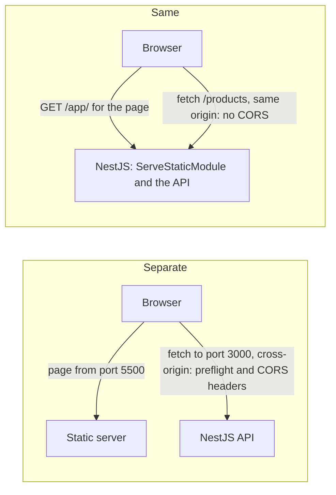
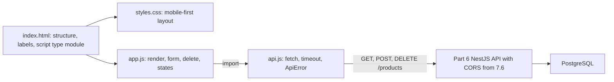

## 7.8 Serving the frontend

### 7.8.1 A file on disk, a static server, or NestJS, and ES modules

#### Concept

A frontend is a handful of static files: `index.html`, `styles.css`, `app.js`, `api.js`. "Static" means the server sends them exactly as they are on disk, with no code running per request. Something still has to send them, and **where they are served from decides their origin**, which decides whether CORS is involved at all. There are three choices for local work: open the file straight from disk, run a tiny static server, or let NestJS serve the files next to the API.

#### Why does it exist?

Because browsers treat pages differently depending on where they came from. A page opened from disk has the strange origin `null` and is denied things a page served over HTTP is allowed. A page served from the API's own origin needs no CORS at all. Choosing on purpose saves an afternoon of confusing errors.

#### How it works

**Option 1: open the file from disk** (`file:///Users/you/products-web/index.html`). Our page fails at once:

```text
Access to script at 'file:///Users/you/products-web/app.js' from origin 'null' has been blocked
by CORS policy: Cross origin requests are only supported for protocol schemes: http, ...
```

Module scripts (`<script type="module">`) are fetched with CORS rules, and `file://` pages have the opaque origin `null`, so the browser refuses. Even a classic script that did load would send `Origin: null` to the API, which you must never allow (7.6). Opening from disk is fine for a plain HTML mock-up and nothing else.

**Option 2: a tiny static server on its own port.** Either of these serves the current folder over HTTP:

```bash
cd products-web
python3 -m http.server 5500 --bind 127.0.0.1    # ships with Python 3; serves on http://127.0.0.1:5500
# or
npx http-server . -p 5500 -c-1                   # the http-server npm package; -c-1 turns off caching
```

The page's origin is now `http://localhost:5500` (or `http://127.0.0.1:5500`, a different origin; use the one in your `CORS_ORIGINS`), and the API on port 3000 is cross-origin, so you need the NestJS CORS setup from 7.6. This is how most frontend development works: a frontend dev server on one port, the API on another. Avoid `npx serve` here without a port flag: it defaults to port 3000, which the API already uses.

**Option 3: serve the files from NestJS.** The official `@nestjs/serve-static` package serves a folder from the same Nest application, so the page and the API share one origin:

```bash
npm install @nestjs/serve-static
```

```ts
// src/app.module.ts (addition to imports)
import { join } from 'node:path';
import { ServeStaticModule } from '@nestjs/serve-static';

ServeStaticModule.forRoot({
  rootPath: join(__dirname, '..', 'public'),   // products-api/public holds index.html, styles.css, app.js, api.js
  serveRoot: '/app',                            // the page is at /app/; API routes such as /products are untouched
}),
```

Open `http://localhost:3000/app/`. In `index.html`, set `<meta name="api-base" content="">`, so `api()` calls relative URLs like `/products`. Same scheme, host and port: no preflight, no CORS headers needed, and `CORS_ORIGINS` can stay empty. Serving under `/app` keeps the static handler away from the API's routes, so a typo in a URL never returns `index.html` where JSON was expected. In the Docker image (6.8), add `COPY --from=build /app/public ./public` to the final stage.



**ES modules in the browser.** `<script type="module" src="app.js">` loads `app.js` as an **ES module**, the same `import`/`export` system you know from TypeScript and Node (Part 1). Four browser-specific facts:

1. **Modules are deferred.** They run after the HTML is parsed, so `document.querySelector('#product-list')` finds the element even though the script tag is in `<head>`.
2. **Each module has its own scope.** A top-level `const list` in `app.js` is not a global, so you cannot call `loadProducts()` from the Console; that is a feature, not a bug.
3. **Import paths are URLs.** Write `import { api } from './api.js'` with the `./` and the `.js` extension. Bare names like `import x from 'lodash'` fail without a bundler or an import map, because the browser has no `node_modules` lookup.
4. **The server must send JavaScript's MIME type** (`text/javascript`). A server that returns an HTML 404 page for a mistyped path produces "Failed to load module script: Expected a JavaScript module script but the server responded with a MIME type of text/html".

Each module is one HTTP request. Two or three files are nothing; three hundred are why bundlers exist (Part 76, 76.1 and 76.3).

#### Edge cases & failure modes

- **Stale files after an edit**: the browser cached the old `app.js`; tick Disable cache in DevTools while developing, and use versioned file names in production (Part 84, 84.3).
- **ServeStatic without `serveRoot`** puts a catch-all next to the API, and an unknown API path can return `index.html` with status `200`.
- **Releasing the frontend with the API** couples their deploys: a CSS fix needs an API release. Fine for an internal tool, a real cost for a busy product.
- **Security headers** such as Content Security Policy now apply to the page too; Part 44 (44.33) and Part 84 (84.9) cover what to send.

#### How a Senior Backend Engineer thinks about this

A senior picks the topology first and lets CORS follow from it. For a small internal tool, serving from NestJS (or putting the frontend and API behind one domain with a reverse proxy) removes a whole class of problems. For a public product with its own frontend team and release cadence, a separate static host or CDN plus an API on its own subdomain is normal, and CORS is configured as a deliberate, tested allow list. Either way, they write the decision down, because the next person will ask why.

| Option | Page origin | CORS needed? | Good for | Watch out for |
|---|---|---|---|---|
| File from disk | `null` | breaks module scripts | a static mock-up | nothing that calls an API works properly |
| Static server on its own port | `http://localhost:5500` | yes | frontend development, this Part's CORS lesson | allow list per environment |
| NestJS `ServeStaticModule` | same as the API | no | internal tools, one deployable | coupled releases, static caching headers |
| CDN or static host, API on a subdomain | `https://admin.shop.example` | yes | public products, independent deploys | CORS and cookie settings (Part 81, Part 84, 84.1) |
| One domain, reverse proxy routes `/api` and `/` | same | no | a common production default | proxy configuration and path prefixes |

#### Interview questions

1. **Why does a page that uses `<script type="module">` fail when opened from disk?** Module scripts are fetched under CORS rules and a `file://` page has the opaque origin `null`, so the browser blocks them.
2. **How does serving the frontend from the API's origin remove CORS?** CORS only applies to cross-origin requests; same scheme, host and port means no preflight and no allow headers are needed.
3. **What are the costs of serving the frontend from NestJS?** Coupled releases, the API process serving static files, and caching and security headers to manage in one place.

#### Practical exercise

Serve the Products screen from NestJS under `/app`, with `CORS_ORIGINS` empty, and prove it works without CORS. Acceptance criteria: `http://localhost:3000/app/` loads and creates products; the `POST` in the Network panel has no preceding `OPTIONS` row; the page served from port 5500 at the same time is blocked by CORS.

#### Worked answer to the exercise

Copy the four files into `products-api/public/`, set `<meta name="api-base" content="">`, add the `ServeStaticModule` block and restart. At `http://localhost:3000/app/` the Network panel shows `POST /products` with `201` and no `OPTIONS` row before it. The copy on port 5500, pointing at port 3000, now fails with the preflight error from 7.6, because the empty `CORS_ORIGINS` allows no cross-origin pages. CORS is a property of the relationship between two origins, not of the API alone.

## 7.9 Worked example: the Products screen

### 7.9.1 The four files

#### Concept

Here is the whole screen in one place: a single page that lists products with "Load more", creates a product from a form, shows validation errors next to the right fields, and deletes a product after confirmation, talking to the unmodified Part 6 API plus the CORS setup from 7.6. It is plain HTML, CSS and JavaScript with no build step.

**Why plain JavaScript and not TypeScript?** Browsers run JavaScript, not TypeScript. TypeScript would need `tsc` (or a bundler) to compile `app.ts` to `app.js` before every reload, which is one more moving part between your edit and what the browser runs, and for 150 lines the safety it buys is small. If you want type checking without a build, put `// @ts-check` at the top of a `.js` file: editors that use the TypeScript language service (VS Code, for example) then check it as you type. Part 76 sets up TypeScript for the browser properly, with Vite.



#### Practical example

`index.html`:

```html
<!doctype html>
<html lang="en">
<head>
  <meta charset="utf-8">
  <meta name="viewport" content="width=device-width, initial-scale=1">
  <meta name="api-base" content="http://localhost:3000">   <!-- "" when served by NestJS (7.8) -->
  <title>Products - Shop Admin</title>
  <link rel="stylesheet" href="styles.css">
  <script type="module" src="app.js"></script>
</head>
<body>
  <header class="toolbar">
    <h1>Products</h1>
    <button type="button" id="refresh">Refresh</button>
  </header>
  <main class="layout">
    <section class="panel" aria-labelledby="new-heading">
      <h2 id="new-heading">New product</h2>
      <form id="create-form">
        <!-- the four .field blocks from 7.2.2 (name, sku, price, currency), unchanged -->
        <p class="error" id="form-error" role="alert"></p>
        <button type="submit">Add product</button>
      </form>
    </section>
    <section class="panel" aria-labelledby="list-heading">
      <h2 id="list-heading">All products</h2>
      <p id="status" role="status"></p>
      <ul id="product-list" class="cards"></ul>
      <button type="button" id="load-more" hidden>Load more</button>
    </section>
  </main>
</body>
</html>
```

`styles.css` is the rules from 7.3.1 and 7.3.2 (variables, `box-sizing`, the toolbar, the cards, the grid and its media query, error and focus styles), plus:

```css
[hidden] { display: none !important; }            /* hidden always wins, even over display rules (7.3.2) */
.field { display: flex; flex-direction: column; gap: 0.25rem; margin-bottom: 0.75rem; }
.hint { margin: 0; color: var(--muted); font-size: 0.875rem; }
#status { margin: 0 0 0.75rem; color: var(--muted); }
#status.is-error { color: var(--danger); }
#status:empty { display: none; }
```

`api.js` is exactly the module from 7.5.1. `app.js` assembles the functions from 7.4 and 7.5 and adds delete:

```js
// app.js -- the Products screen
import { api } from './api.js';

const form = document.querySelector('#create-form');
const formError = document.querySelector('#form-error');
const list = document.querySelector('#product-list');
const statusEl = document.querySelector('#status');
const loadMoreBtn = document.querySelector('#load-more');
const FIELD_FOR_PATH = { name: 'name', sku: 'sku', priceCents: 'price', currency: 'currency' };
const EMPTY_TEXT = 'No products yet. Add the first one with the form.';
let nextCursor = null;
let submitting = false;

function formatPrice(cents, currency) {
  try {
    return new Intl.NumberFormat(undefined, { style: 'currency', currency }).format(cents / 100);
  } catch {
    return `${(cents / 100).toFixed(2)} ${currency}`;   // an unknown currency code must not break the list
  }
}

// Paste these functions here unchanged (the functions only, not the const lines above them):
//   productCard(p)                                           from 7.4.1
//   setStatus() and loadProducts(), using EMPTY_TEXT          from 7.5.1
//   the form's submit listener, clearErrors(), showErrors()  from 7.5.2

list.addEventListener('click', async (event) => {        // one delegated listener for every Delete button
  const button = event.target.closest('button[data-action="delete"]');
  if (!button) return;
  const card = button.closest('li');
  const name = card.querySelector('h3').textContent;
  if (!window.confirm(`Delete "${name}"? This cannot be undone.`)) return;
  button.disabled = true;
  try {
    await api(`/products/${encodeURIComponent(card.dataset.id)}`, { method: 'DELETE' });   // 204, no body
    card.remove();
    if (list.children.length === 0) setStatus(EMPTY_TEXT);
  } catch (err) {
    if (err.status === 404) {                             // someone else deleted it first: the screen was stale
      card.remove();
      setStatus('That product had already been deleted.');
    } else {
      button.disabled = false;
      setStatus(`Could not delete "${name}": ${err.message}`, true);
    }
  }
});

document.querySelector('#refresh').addEventListener('click', () => loadProducts());
loadMoreBtn.addEventListener('click', () => loadProducts({ append: true }));
loadProducts();                                           // module scripts run after parsing, so the elements exist
```

The `confirm()` dialog is the simplest honest confirmation: blocking, accessible and built in. The exercise below replaces it with a styled `<dialog>`. The delete is also safe against a stale screen: a `404` means the product is already gone, which is the outcome the user wanted, so the card disappears with a note instead of an error.

### 7.9.2 Running it end to end, and where to go next

#### How it works

```bash
# terminal 1: the Part 6 API with the CORS setup from 7.6.
# With npm run start:dev, put CORS_ORIGINS=http://localhost:5500 in .env. With Compose, add
# CORS_ORIGINS: "http://localhost:5500" under the api service's environment (the image has no .env).
cd products-api && docker compose up --build      # or: npm run start:dev with the database running
# terminal 2: the frontend
cd products-web && python3 -m http.server 5500 --bind 127.0.0.1
# open http://localhost:5500 (the origin in CORS_ORIGINS; 127.0.0.1 would be a different origin)
```

#### Try it yourself

Predict what the screen shows, then try it.

1. Create "Dental Mirror", SKU `DM-001`, price `12.99`. Then create another product with SKU `DM-001`.
2. Remove `required` and `min="0"` from the price input in the Elements panel, type `-5` and submit.
3. Stop the API (`docker compose stop api`) and press Refresh.
4. Set Network throttling to a slow preset and add a product, pressing Enter twice quickly.

**Answers.**

1. The first appears at the top of the list as "DM-001 - $12.99" (formatting follows your browser's locale). The second gets `409 PRODUCT_SKU_TAKEN`, and "A product with this SKU already exists" appears under the SKU field, because the Part 6 filter sends `issues: [{ path: "sku" }]`.
2. The browser's own checks are gone, so the request is sent; the API answers `400 VALIDATION_FAILED` and "priceCents must not be less than 0" appears under Price. The server, not the HTML, is the authority.
3. "Could not load products: Could not reach the server". `fetch` rejected, there is no status code, and the list does not pretend to be empty.
4. The button shows "Saving..." and is disabled; one `POST` appears in the Network panel, not two.

#### How a Senior Backend Engineer thinks about this

The decision that matters is not "which framework" but "what does this screen need". For one admin screen maintained by backend engineers, plain HTML, CSS and a 150-line module is the simplest thing that works, has no dependencies to update, and runs for years. When the tool grows to a dozen screens with shared components, routing and cached server data, a framework starts paying for itself.

| Question | Plain HTML, CSS and JavaScript | A framework (React with Vite, or Next.js) |
|---|---|---|
| How many screens? | one or a few | many, sharing components and layout |
| How much UI state? | a list, a form, a status line | many pieces of state that depend on each other |
| Build step | none: the browser runs your files | required (Part 76) |
| Escaping user data | your job, every time (`textContent`) | done by default in JSX (Part 77, Part 81, 81.7) |
| Data fetching and caching | a hand-written `api()` | libraries such as TanStack Query (Part 78) |
| Who maintains it | backend engineers, occasionally | a team that works on it every week |
| Verdict for this Products screen | the right size | worth it once the tool grows |

**Where to go next.** Volume 7 picks up exactly where this Part stops:

- **Part 75 — How the Browser Builds a Page**: from bytes to pixels, with deeper forms (75.2), CSS (75.4), script loading (75.6), the main thread (75.7), storage (75.8), accessibility (75.9) and DevTools (75.10).
- **Part 76 — Frontend Tooling and TypeScript in the Browser**: the build step, Vite and TypeScript, sharing contracts with NestJS.
- **Part 77 — React Fundamentals for Backend Engineers** and **Part 78 — Client State, Data Fetching and Caching**: this screen as components, forms (77.7), double-submit protection (77.8), cancellation (78.10) and loading, empty and error states (78.11).
- **Part 79 — Next.js and Rendering Strategies**, **Part 80 — Frontend–Backend Contracts** (generated clients and error contracts, 80.6) and **Part 81 — Auth and Security in the Browser**.
- **Parts 82–85**: performance, testing (Playwright, 83.7; axe, 83.10), shipping frontends, and a full-stack worked project; then **Part 87 — Frontend and Full-Stack Interview Preparation**.

#### Interview questions

1. **When would you choose plain JavaScript over a framework for a frontend?** For small, stable screens with little state and no dedicated frontend team: fewer dependencies, no build, easy to maintain. Choose a framework when screens, shared components and state grow.
2. **Walk through what happens, end to end, when a user adds a product on this screen.** Submit event, `preventDefault`, values read and converted, JSON `POST` (preflight first if cross-origin), `ValidationPipe`, service, unique constraint, `201` or problem+json, card added or errors placed under fields.
3. **How does this screen stay correct when two people use it at once?** It re-renders from server responses, treats `404` on delete as "already gone", relies on the unique SKU to reject duplicates, and offers Refresh; it never assumes its list is the truth.

#### Practical exercise

Two improvements. First, replace `window.confirm()` with a styled `<dialog>` that has Cancel and Delete buttons and can be dismissed with Escape. Second, remember the last chosen currency in `localStorage` so the form starts with it next time. Acceptance criteria: Escape cancels the delete; keyboard focus moves into the dialog and returns afterwards; the saved currency survives a reload and a successful submit (`form.reset()` must not wipe it); and the page still works if `localStorage` throws (some browsers block it in private modes).

#### Worked answer to the exercise

```html
<dialog id="confirm-delete" aria-labelledby="confirm-text">
  <form method="dialog">                          <!-- a button press closes the dialog and sets returnValue -->
    <p id="confirm-text"></p>
    <button value="cancel">Cancel</button>
    <button value="delete">Delete</button>
  </form>
</dialog>
```

```js
const dialog = document.querySelector('#confirm-delete');

function confirmDelete(name) {
  document.querySelector('#confirm-text').textContent = `Delete "${name}"? This cannot be undone.`;
  dialog.returnValue = '';                         // Escape does not change returnValue, so clear the last answer
  dialog.showModal();                              // modal: focus moves inside, the page behind is inert
  return new Promise((resolve) => {
    dialog.addEventListener('close', () => resolve(dialog.returnValue === 'delete'), { once: true });
  });
}
// in the delete listener, replace window.confirm(...) with:
//   if (!(await confirmDelete(name))) return;

const CURRENCY_KEY = 'products.currency';
function restoreCurrency() {
  try {
    const saved = localStorage.getItem(CURRENCY_KEY);
    if (saved) form.elements.namedItem('currency').value = saved;
  } catch { /* storage blocked: keep the default */ }
}
form.elements.namedItem('currency').addEventListener('change', (e) => {
  try { localStorage.setItem(CURRENCY_KEY, e.target.value); } catch { /* not fatal */ }
});
restoreCurrency();
// in the submit handler, call restoreCurrency() right after form.reset()
```

`showModal()` moves focus into the dialog, makes the rest of the page inert and closes on Escape; when the dialog closes, the browser returns focus to the element that opened it, the Delete button. Resetting `returnValue` matters: without it, cancelling with Escape after an earlier "delete" answer would still read `"delete"` and delete the wrong product. In the Application panel (7.7) you can watch `products.currency` change under Local Storage. A currency preference is harmless to store there; a token is not (Part 81, 81.1).

## Senior Checklist — Part 7

- [ ] I understand the concept
- [ ] I can explain it simply
- [ ] I can implement it
- [ ] I understand its failure modes
- [ ] I understand its scaling limitations
- [ ] I understand its security implications
- [ ] I understand its operational implications
- [ ] I can choose between alternatives
- [ ] I can explain the tradeoffs
- [ ] I can answer senior-level interview questions
- [ ] I can explain how a page loads: HTML first, then the CSS and JavaScript it names, then API calls from scripts
- [ ] I write semantic HTML with one `h1`, real buttons and links, and a `<label>` for every input
- [ ] I know what a browser does with a native form submit and why a JSON API frontend intercepts it
- [ ] I can predict which CSS rule wins using specificity and source order, and I set `box-sizing: border-box`
- [ ] I can build a mobile-first layout with flexbox, a simple grid and one `min-width` media query
- [ ] I render user data with `createElement` and `textContent`, never `innerHTML`, and can explain stored XSS
- [ ] I use event delegation and know that blocking the browser's main thread freezes the page
- [ ] I check `res.ok` after `fetch` and give every request loading, empty and error states
- [ ] I map API `issues[].path` values to form fields and set `aria-invalid`
- [ ] I add a timeout with `AbortController`, guard against double submits, and know a timed-out `POST` may have succeeded
- [ ] I can read a CORS error, explain the preflight, and configure `app.enableCors` with an exact origin list from validated config
- [ ] I can debug "empty list, API works in curl" with the Console, Network and Elements panels
- [ ] I can choose where to serve a frontend and explain why same-origin removes CORS

## Part 7 — Key Takeaways

- A frontend is files the browser downloads and runs: HTML for structure, CSS for looks, JavaScript for behaviour and API calls; it never enforces rules, the backend does.
- Semantic HTML with labels is the cheapest accessibility you will ever get; a delete action is a `<button>`, never a link.
- A native form submit sends URL-encoded strings and navigates away; a JSON API frontend calls `preventDefault`, converts values and sends JSON with `fetch`.
- In CSS, keep selectors short and class-based, start with `box-sizing: border-box`, use flexbox for rows and columns, grid for page structure, and write mobile-first.
- `textContent` for every piece of user data; `innerHTML` with data is stored XSS waiting for a victim.
- `fetch` resolves on `404` and `500`; check the status, and design for loading, empty, failed and loaded states.
- Good API error design (one shape, field paths, stable codes, request IDs) is what makes a good form possible.
- Every request needs a timeout, every write needs double-submit protection, and a timed-out `POST` may already have happened.
- CORS is enforced by browsers for scripts; fix it on the server with an exact, validated, tested origin list, and remember it never protects the API from `curl`.
- DevTools is the browser's `curl -v`: Console for errors, Network for status, shape and timing, Elements for the real DOM and styles.
- Where you serve the frontend decides its origin; same-origin serving removes CORS entirely.
- Plain HTML, CSS and JavaScript are the right size for one small screen; frameworks pay off as screens and state grow, and Volume 7 takes you there.
