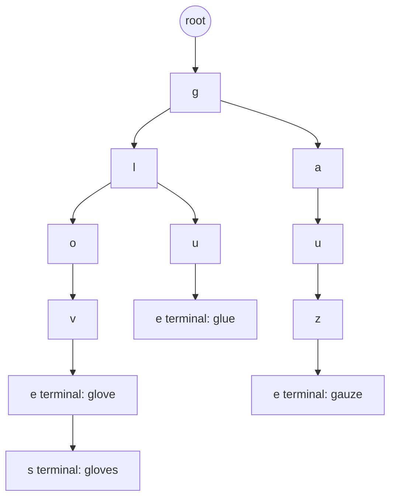

## 7.14 Trie

#### Concept

A trie (pronounced "try", from re*trie*val) is a tree where each edge carries one character and each path from the root spells a prefix. Every key that shares a prefix shares the nodes for that prefix. A node is marked *terminal* when the path to it spells a complete key. Searching for a key, or for "everything that starts with `glo`", walks one edge per character, so the cost depends on the length of the query, not on how many keys are stored.

A **radix tree** (also called a Patricia trie or compressed trie) merges chains of single-child nodes into one edge labelled with a whole substring, which cuts memory by five to ten times. HTTP routers such as `find-my-way` (the router behind Fastify, and therefore behind NestJS with the Fastify adapter) are radix trees over URL paths; Redis Streams and RediSearch are built on a radix tree called `rax`; IP routing tables are tries over address bits.

#### Why does it exist?

Hash maps cannot answer prefix questions: "all keys starting with X" requires scanning every key. Sorted arrays and B-trees can (binary search to the first match, then walk), and a PostgreSQL index does exactly that; but in memory, at thousands of requests per second, a trie with precomputed top results per node answers "top 10 completions for `glo`" in a few hundred nanoseconds with no comparison of whole strings at all. Autocomplete for product search, command palettes, typeahead for customer names, longest-prefix matching for routes and phone-number normalization are trie problems.

#### Mental model

Imagine the tabs on a paper dictionary. The first tab takes you to G, the next to GL, then GLO. At each tab you can see every word below it without reading the rest of the dictionary. A trie is a dictionary with a tab for every prefix, and, in the version we build here, each tab also has a sticky note listing the ten most popular words under it, so you never need to flip through.

#### How it works

1. **Insert.** Normalize the key (lowercase, NFC, trim). Starting at the root, for each character follow the child edge, creating it if absent. Mark the final node terminal. O(L) for a key of length L.
2. **Search.** Follow the edges for each character; if any is missing, the key is absent. Terminal check at the end. O(L).
3. **Prefix query.** Follow the edges for the prefix; every terminal node in the subtree below is a completion. Collecting them is O(size of subtree), which for the prefix `a` in a 100,000-term index is tens of thousands of nodes: too slow for a request path.
4. **Top-k per node.** Store, at every node, the k best completions (by popularity) among all keys below it. Inserting a key with score s updates the top-k list of each node along its path: O(L x k). Querying becomes O(L) plus returning k items. This trades memory for guaranteed latency.
5. **Deletion.** Unmark the terminal flag; optionally prune childless, non-terminal nodes upward. Top-k lists need a rebuild or a lazy filter for removed keys.
6. **Radix compression.** Chains of single-child nodes (`g-a-u-z-e`) become one edge `gauze`; lookups compare substrings instead of characters, and node count drops dramatically for natural-language keys.



**Time complexity (L = key or prefix length, k = results, N = keys, S = subtree size)**

| Operation | Best | Average | Worst | Notes |
|---|---|---|---|---|
| Insert | O(L) | O(L) | O(L x k) | with per-node top-k maintenance |
| Exact search | O(1) | O(L) | O(L) | best case is a missing first character |
| Prefix exists | O(1) | O(L) | O(L) | |
| Collect all completions | O(L) | O(L + S) | O(L + N) | unbounded; never on a request path |
| Top-k completions with per-node cache | O(L) | O(L + k) | O(L + k) | |
| Delete | O(L) | O(L) | O(L x k) | plus top-k repair |
| Sorted array with binary search (alternative) | O(log N) | O(log N + k) | O(log N + S) | k results after the first match |

**Memory implications (V8, Node.js)**

- A node with a `Map` of children costs about 40 bytes for the node object plus roughly 100 bytes for a small `Map`, plus the top-k array (10 slots, 80 bytes, with suggestion objects shared across nodes). Budget about 250 bytes per node.
- Node count is what matters. 120,000 product names of about 30 characters is 3.6 million characters, but shared prefixes typically cut that to 1 to 1.5 million nodes: about 300 MB, too much for a pod. Index *words* (tokens) instead of whole names and cap depth at 12 to 16 characters, and the same catalog becomes about 350,000 nodes, or 80 MB. Radix compression brings it under 20 MB.
- Children as a plain object with computed keys fall into dictionary mode (Section 7.8); use `Map`, or for a known small alphabet, an array indexed by character code.
- Build the trie off the request path and swap the reference atomically; a half-built trie must never be visible to requests.

#### Practical example

An autocomplete trie with per-node top-k, indexing each word of a product name so `gloves` matches "Nitrile Examination Gloves".

```ts
// search/autocomplete-trie.ts
export interface Suggestion { term: string; score: number }

class TrieNode {
  readonly children = new Map<string, TrieNode>();
  terminal = false;
  readonly top: Suggestion[] = [];              // best k under this node, sorted by score desc
}

export const normalizeTerm = (s: string) => s.normalize('NFC').toLowerCase().trim();

export class AutocompleteTrie {
  private readonly root = new TrieNode();
  private nodeCount = 1;

  constructor(private readonly k = 10, private readonly maxDepth = 16) {}

  get size(): number { return this.nodeCount; }

  /** Index `term` under each of its words so mid-name words are reachable. */
  insert(term: string, score: number): void {
    const key = normalizeTerm(term);
    const suggestion: Suggestion = { term, score };
    for (const word of new Set(key.split(/\s+/).filter(Boolean))) {
      let node = this.root;
      let depth = 0;
      for (const ch of word) {                    // code points, so emoji do not split
        if (depth++ >= this.maxDepth) break;
        let next = node.children.get(ch);
        if (!next) { next = new TrieNode(); node.children.set(ch, next); this.nodeCount++; }
        node = next;
        this.offerTop(node, suggestion);          // O(k) insertion into a tiny sorted array
      }
      node.terminal = true;
    }
  }

  /** O(prefix length): returns the cached top-k, never walks the subtree. */
  suggest(prefix: string): readonly Suggestion[] {
    let node = this.root;
    for (const ch of normalizeTerm(prefix)) {
      const next = node.children.get(ch);
      if (!next) return [];
      node = next;
    }
    return node.top;
  }

  private offerTop(node: TrieNode, s: Suggestion): void {
    const top = node.top;
    const dup = top.findIndex((x) => x.term === s.term);
    if (dup >= 0) top.splice(dup, 1);             // same product reached via another word
    let i = top.length;
    while (i > 0 && top[i - 1].score < s.score) i--;
    if (i < this.k) {
      top.splice(i, 0, s);
      if (top.length > this.k) top.pop();
    }
  }
}
```

#### NestJS example

The trie is built at startup from PostgreSQL, rebuilt every 10 minutes off the request path, and swapped atomically. The DTO enforces a minimum prefix length so the root node's top-k is never a substitute for search.

```ts
// search/suggest-query.dto.ts
import { IsString, MaxLength, MinLength } from 'class-validator';

export class SuggestQueryDto {
  @IsString()
  @MinLength(2)
  @MaxLength(40)
  q!: string;
}

// search/suggest.service.ts
import { Injectable, Logger, OnModuleInit } from '@nestjs/common';
import { Cron } from '@nestjs/schedule';
import { DataSource } from 'typeorm';
import { AutocompleteTrie, Suggestion } from './autocomplete-trie';

@Injectable()
export class SuggestService implements OnModuleInit {
  private readonly logger = new Logger(SuggestService.name);
  private trie = new AutocompleteTrie(10);
  private builtAt = 0;

  constructor(private readonly dataSource: DataSource) {}

  async onModuleInit(): Promise<void> {
    await this.rebuild();                       // readiness should wait for this
  }

  @Cron('0 */10 * * * *')
  async rebuild(): Promise<void> {
    const started = Date.now();
    const rows: { name: string; popularity: number }[] = await this.dataSource.query(
      `SELECT name, popularity FROM products WHERE is_active ORDER BY popularity DESC LIMIT 200000`,
    );
    const fresh = new AutocompleteTrie(10);
    for (const r of rows) fresh.insert(r.name, r.popularity);
    this.trie = fresh;                          // atomic reference swap; old trie is garbage collected
    this.builtAt = Date.now();
    this.logger.log(`rebuilt trie: ${rows.length} products, ${fresh.size} nodes, ${Date.now() - started} ms`);
  }

  suggest(prefix: string): readonly Suggestion[] {
    return this.trie.suggest(prefix);          // ~1 microsecond
  }

  get ageMs(): number { return Date.now() - this.builtAt; }
}

// search/suggest.controller.ts
import { Controller, Get, Query, ValidationPipe } from '@nestjs/common';
import { SuggestQueryDto } from './suggest-query.dto';
import { SuggestService } from './suggest.service';

@Controller('search')
export class SuggestController {
  constructor(private readonly suggest: SuggestService) {}

  @Get('suggest')
  get(@Query(new ValidationPipe({ transform: true, whitelist: true })) query: SuggestQueryDto) {
    return { suggestions: this.suggest.suggest(query.q) };
  }
}
```

Twelve pods each rebuild from the same query every 10 minutes; stagger the cron with a random delay or an advisory lock so they do not all hit PostgreSQL in the same second after a deploy.

#### PostgreSQL example

PostgreSQL answers prefix queries with a B-tree, which is a sorted structure and therefore trie-like for prefixes, as long as the index uses byte-wise ordering. Infix and fuzzy queries need `pg_trgm`. SP-GiST's text operator class is literally a radix tree on disk.

```sql
-- Prefix search under a non-C collation needs text_pattern_ops (or COLLATE "C").
CREATE INDEX products_name_lower_prefix ON products (lower(name) text_pattern_ops);

EXPLAIN (ANALYZE, BUFFERS)
SELECT id, name FROM products
WHERE lower(name) LIKE 'glo%'
ORDER BY popularity DESC LIMIT 10;
```

```text
Limit  (cost=812.14..812.16 rows=10 width=41) (actual time=1.402..1.404 rows=10 loops=1)
  Buffers: shared hit=634
  ->  Sort  (cost=812.14..813.71 rows=628 width=41) (actual time=1.401..1.402 rows=10 loops=1)
        Sort Key: popularity DESC
        Sort Method: top-N heapsort  Memory: 26kB
        ->  Index Scan using products_name_lower_prefix on products  (cost=0.42..798.57 rows=628 width=41) (actual time=0.038..1.211 rows=611 loops=1)
              Index Cond: ((lower(name) ~>=~ 'glo'::text) AND (lower(name) ~<~ 'glp'::text))
              Filter: (lower(name) ~~ 'glo%'::text)
Execution Time: 1.431 ms
```

The planner rewrote `LIKE 'glo%'` as the range `>= 'glo' AND < 'glp'`, which is how a sorted structure does prefixes. Then the heap from Section 7.12 picked the top 10.

```sql
-- Infix and typo-tolerant search: trigram GIN index.
CREATE EXTENSION IF NOT EXISTS pg_trgm;
CREATE INDEX products_name_trgm ON products USING gin (lower(name) gin_trgm_ops);
SELECT id, name FROM products WHERE lower(name) LIKE '%glov%';                 -- index-assisted infix
SELECT id, name, similarity(name, 'glvoes') AS s FROM products
WHERE name % 'glvoes' ORDER BY s DESC LIMIT 5;                                  -- fuzzy

-- A radix tree on disk: SP-GiST with the starts-with operator.
CREATE INDEX products_name_spgist ON products USING spgist (name);
SELECT id, name FROM products WHERE name ^@ 'Glo';
```

#### TypeORM example

Always escape `%` and `_` in user input before it reaches `LIKE`, or a query for `%` becomes a full scan.

```ts
import { Raw, Repository } from 'typeorm';

const escapeLike = (s: string) => s.replace(/[\\%_]/g, '\\$&');

export class ProductSearch {
  constructor(private readonly repo: Repository<Product>) {}

  byPrefix(prefix: string, limit = 10) {
    const p = escapeLike(prefix.normalize('NFC').toLowerCase());
    return this.repo.find({
      where: { name: Raw((alias) => `lower(${alias}) LIKE :p ESCAPE '\\'`, { p: `${p}%` }) },
      order: { popularity: 'DESC' },
      take: limit,
    });
  }
}
```

#### Sequelize example

```ts
const p = escapeLike(prefix.normalize('NFC').toLowerCase());
const rows = await Product.findAll({
  where: sequelize.where(sequelize.fn('lower', sequelize.col('name')), { [Op.like]: `${p}%` }),
  order: [['popularity', 'DESC']],
  limit: 10,
});
```

`Op.startsWith` exists in Sequelize and builds `LIKE 'value%'`, but it does not escape wildcards inside the value; escape first.

#### Production scenario

A storefront's search box fires a suggestion request on every keystroke: 3,000 RPS at peak, prefixes of 2 to 12 characters. With the in-memory trie each request costs about 1 microsecond of CPU and returns in under 1 ms end to end; the whole feature uses less than 1 percent of a pod. The same feature backed by the PostgreSQL prefix query costs about 1.5 ms of database time per request plus a pooled connection, which at 3,000 RPS is 4.5 database-seconds per second: a third of a large instance for typeahead. The trie is per pod (80 MB times 12 pods) and 10 minutes stale, which for suggestions is fine.

Beyond a few million terms, or when suggestions must be personalized and fresh, the structure moves out of the pod: Redis `ZRANGEBYLEX` over a sorted set of lowercase terms gives lexical prefix ranges in O(log n); RediSearch's `FT.SUGADD`/`FT.SUGGET` is a server-side trie with scores; Elasticsearch's completion suggester is a finite-state transducer, a trie relative, built for tens of millions of terms.

#### Failure scenario

At 02:14 the on-call engineer is paged: `search-api` CPU is at 100 percent on all pods and p99 for every endpoint, not just suggestions, is above 2 seconds. A change two days earlier replaced the per-node top-k with "collect all completions under the prefix, then sort by popularity" because the top-k lists were "hard to keep in sync with deletions". At normal traffic, prefixes were 3 or more characters and subtrees were small. Tonight a marketing e-mail linked to the search page with a pre-filled query of `a`. Each request now walked a subtree of about 38,000 nodes, built an array of 9,000 suggestions and sorted it: about 12 ms of CPU. At 3,000 RPS the pods needed 36 cores.

The fix restored per-node top-k (deletions handled by a lazy `isActive` check at query time and a full rebuild every 10 minutes) and added `@MinLength(2)` at the edge. The lesson: **any operation whose cost is proportional to the size of a subtree is unbounded from the request's point of view**; cache the answer at the node or bound the walk.

#### Edge cases & failure modes

- **Normalization.** `Glove`, `glove` and `glové` must be normalized consistently at insert and query time or prefixes silently miss.
- **Wildcards in `LIKE`.** Unescaped `%` or `_` from users turn a prefix scan into a full scan.
- **Empty or one-character prefixes** return the root's subtree; reject them.
- **Memory growth** with whole-name keys; index tokens and cap depth.
- **Deletions and score changes** invalidate cached top-k lists; rebuild periodically or filter lazily.
- **Rebuild storms** when every pod rebuilds at once after a deploy; stagger or gate with a lock.
- **Half-built structures** visible to requests if you mutate in place; build fresh and swap.
- **Very long keys** (a 10 KB "name") create 10,000 nodes; cap key length at validation.
- **Locale-dependent lowercasing** (Turkish `I`) makes the same product unreachable from one locale; use plain `toLowerCase` for indexing.

#### How a Senior Backend Engineer thinks about this

The senior sees autocomplete as a read-heavy, staleness-tolerant, latency-critical feature and designs for the request path first: O(prefix length) with precomputed results, a minimum prefix length, an atomic swap on rebuild, and a memory budget stated in megabytes per pod. They keep PostgreSQL for the durable search (with `text_pattern_ops` and `pg_trgm`) and treat the trie as a derived index that can be rebuilt from scratch at any time. When the term count or freshness requirement outgrows a pod, they move to Redis or a search engine rather than making the in-process trie cleverer.

To a product manager: "Suggestions will be at most ten minutes behind catalog changes and will need two characters before they appear. In exchange, they respond in under a millisecond and cost almost nothing at peak."

#### Common mistakes

- Walking the subtree per request instead of caching top-k per node.
- Building the trie inside the request handler or on first request without readiness gating.
- Using a plain object as the children map.
- Forgetting to escape `LIKE` wildcards.
- Indexing whole names with no depth limit and running out of memory at the first big catalog import.

#### Interview questions

1. **Why is a trie better than a hash map for autocomplete, and when is it worse?** Expected: O(L) prefix queries versus O(N) scans; worse in memory for large key sets and useless for exact-match-only workloads.
2. **How do you make "top 10 completions" O(prefix length)?** Expected: cache top-k per node, maintained on insert in O(L x k).
3. **How does PostgreSQL execute `LIKE 'glo%'` with an index, and why did your index not get used?** Expected: rewritten as a range on a byte-ordered index; requires `text_pattern_ops` or `C` collation; expression must match.
4. **What is a radix tree and where have you used one without knowing?** Expected: compressed trie; Fastify's router, Redis `rax`, IP routing.
5. **A prefix of one character takes 12 ms. Why, and what are two fixes?** Expected: subtree walk; per-node top-k and a minimum prefix length.

#### Practical exercise

Build `SuggestModule` end to end. Acceptance criteria: the trie for a seeded catalog of 150,000 products indexes tokens with a depth cap of 16 and uses under 120 MB (assert with `process.memoryUsage().heapUsed` deltas around the build); `GET /search/suggest?q=gl` returns in under 2 ms at p99 under `autocannon -c 50`; a one-character query returns 400; a query containing `%` never reaches PostgreSQL unescaped (assert the SQL via a query logger); the rebuild is triggered by a cron and by a `product.changed` event, and a concurrent test confirms requests during a rebuild always see either the old or the new trie, never an empty one.
