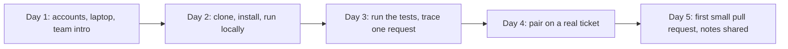
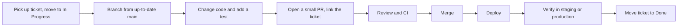
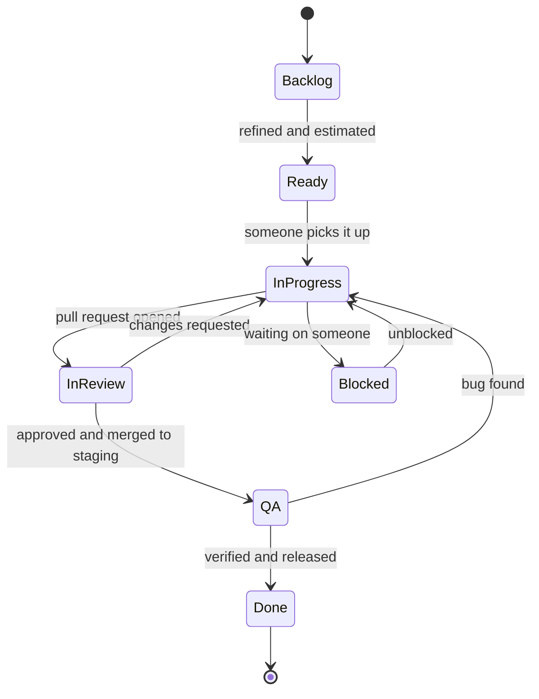
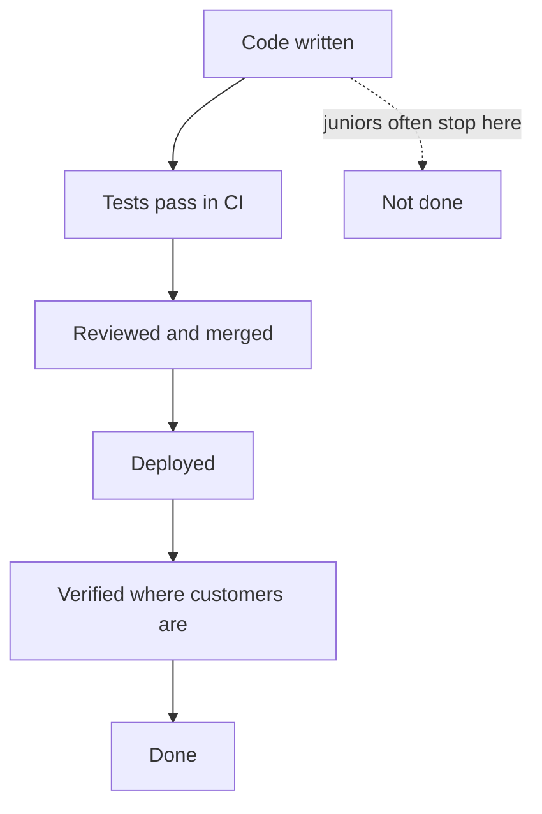

# Part 8 — Your First Developer Job

Parts 1 to 7 taught you to build things: a typed program, an async request, a NestJS API on PostgreSQL, a Git branch, a screen that calls it. This Part is about the thing nobody teaches in a tutorial: doing that work inside a team, for a business, with other people's code, other people's deadlines and real customers on the other end.

What decides how your first year goes is not how many algorithms you know. It is a set of working habits: how you read a ticket, how honestly you estimate, when you ask for help, how your pull requests read, how you write a status update, and how you behave the first time something you shipped breaks in production. None of those habits needs talent. All of them can be learned on purpose, and this Part teaches them the way the rest of the book teaches a database index: concept, mechanism, example, failure, and a worked exercise.

Part 62 — The Senior Engineering Mindset and Part 63 — Junior to Principal: What Is Expected at Each Level describe the top of the ladder. This Part is the bottom rung. In Part 63's table, a junior's scope is "a task", their time horizon is "days to a sprint", and their influence is "learns from others". That is not an insult; it is a job description. Your aim this year is to do task-sized work reliably, learn fast, and become someone the team trusts with a whole feature, which is what "mid-level" means.

The examples follow one fictional junior, Aisha, in her first months at a mid-sized online shop. The backend is NestJS on PostgreSQL with Redis and a message queue, the tracker is Jira-like, code lives on GitHub, and CI runs on GitHub Actions. Her tech lead is Priya, the product manager is Lena, the QA engineer is Marco and the designer is Sam. Your company's tools will have different names; the habits transfer.

## 8.1 The first week

### 8.1.1 Access, setup and the shape of the codebase

#### Concept

Your first week has three jobs: get **access** to everything you need, get the system **running on your machine**, and build a **rough map** of the codebase and the team. You are not expected to ship much. You are expected to make steady, visible progress and to write down what confused you, because that list is valuable to the team.

#### Why does it exist?

Every team's setup has rotted a little since the last person joined. The README says Node 18 and the project needs Node 22. The seed script needs an environment variable nobody documented. A new person is the only one who can see those gaps, because everyone else has a working machine and has forgotten how they got it. A first week spent carefully, with notes, both onboards you and repairs the path for the next person.

#### Mental model

Imagine moving to a new city. In the first week you do not try to know every street. You get your keys and your transit card, find the supermarket and the pharmacy, walk one route to work until it feels familiar, and keep a list of questions for your neighbour. A codebase is the same: access first, one route through it, a list of questions.

#### How it works

A realistic first week, day by day:



**Access checklist.** Ask your manager or buddy for the team's onboarding list; if there is none, this is the usual set, and writing it down is your first contribution:

- [ ] Email, chat (Slack, Teams) and the team's channels, including the incident channel
- [ ] Code host (GitHub or GitLab) with the right organisation and team membership
- [ ] SSH key or token configured (5.6)
- [ ] Ticket tracker (Jira, Linear, GitHub Issues) and the team's board
- [ ] Documentation space (Confluence, Notion, a `docs/` folder) and the architecture overview, if one exists
- [ ] CI dashboard and the logs and metrics tools (Grafana, Datadog, CloudWatch), read-only to start
- [ ] A local or shared development database; never production write access in week one
- [ ] Password manager or secrets tool, and the rule for where secrets live (never in Git, never in chat)
- [ ] The on-call schedule and paging tool, even though you are not on it yet

**Local setup.** Follow the README exactly, and keep a running log as you go: every command you ran, every error, every fix. When something fails, spend a bounded amount of time on it (8.5 gives the rule), then ask. When you finally get the app running, turn the log into a pull request that fixes the README. Teams remember the new joiner who did that.

```bash
# Aisha's setup log, day 2 (kept in a scratch file, later turned into a README fix)
git clone git@github.com:shop/orders-service.git && cd orders-service
nvm use                      # .nvmrc says 22; README said 18 -> README fix #1
npm ci                       # installs exactly what package-lock.json lists
cp .env.example .env         # DATABASE_URL, REDIS_URL, PAYMENTS_API_KEY=test-key
docker compose up -d postgres redis
npm run migration:run        # failed: "relation customers does not exist"
                             # -> needed `npm run seed:base` first; not documented -> README fix #2
npm run start:dev            # Nest application successfully started
curl -s localhost:3000/health   # {"status":"ok"}
npm test                     # 412 passed, 3 skipped
```

**The map.** Part 0 — How to Understand Any Technology (0.4.3) gives the reading order for an unfamiliar codebase: dependency file and CI config, entry points, one real request traced end to end, the tests, then `git log` and `git blame` for the odd parts. In a job, add three questions that only people can answer:

1. **What does this service do for the business, and who calls it?** ("Orders. The web shop and the mobile app call it; the warehouse system consumes its events.")
2. **What breaks most often, and what is scary to touch?** Every team has a module everyone tiptoes around. Know where it is.
3. **How does code reach production?** Who approves, what CI checks, how deploys happen, how a rollback happens.

#### Practical example — tracing one request

On day 3 Aisha traces `POST /orders` and writes the path down in her notes. She does not understand every line; she understands the route.

```text
POST /orders
  OrdersController.create (src/orders/orders.controller.ts)
    -> CreateOrderDto validated by the global ValidationPipe
  OrdersService.create (src/orders/orders.service.ts)
    -> InventoryService.reserve        (Redis lock, then UPDATE inventory)
    -> PaymentsClient.authorize         (HTTP to the payment provider, 5 s timeout)
    -> OrdersRepository.save            (INSERT orders + order_items in one transaction)
    -> outbox row "order.created"       (picked up by a worker, published to the queue)
Questions for Priya:
  - why is the inventory reserved before payment and not after?
  - what happens if the outbox worker is down?
```

Those two questions show she read the code and thought about failure, which is precisely the habit the rest of this book builds. Priya's answers ("we reserve first so we never charge for something out of stock; the outbox catches up when the worker returns, see Part 33") teach her more than an hour of reading would.

#### Common mistakes

- Struggling silently with setup for two days to avoid "bothering" anyone. Your setup problem is usually a documentation bug the team wants to know about.
- Trying to read the whole codebase before touching anything. Trace one route, then learn by changing things.
- Criticising the code in week one ("why don't you use X?"). There is usually a history you have not heard. Ask why first; suggest later.
- Not writing anything down. You will ask the same question twice, and your fresh-eyes observations disappear by week three.

### 8.1.2 Your first small ticket

#### Concept

Most teams give a new joiner a **starter ticket**: a small, well-understood change, often labelled `good-first-issue` or `onboarding`. Its real purpose is not the change. It is to walk you through the whole path once: pick up a ticket, branch, change code, write a test, open a pull request, get a review, merge, deploy, and verify. After that path has worked once, every later ticket is "the same, but harder".

#### How it works



#### Practical example — Aisha's starter ticket

```text
SHOP-1423  Order history returns orders in random order
Type: Bug   Priority: Low   Labels: good-first-issue
Customers see their order history in a different order on each refresh.
Expected: newest first.
Endpoint: GET /customers/:id/orders
```

She reproduces it first, which takes five minutes and proves she is looking at the right thing:

```bash
curl -s localhost:3000/customers/cus_demo/orders | jq '.items[].createdAt'
# "2026-10-02T09:14:00Z"
# "2026-11-01T18:40:00Z"
# "2026-10-15T12:03:00Z"    <- not sorted
```

Then she finds the cause. PostgreSQL makes no promise about row order without `ORDER BY` (Part 21 — SQL Mastery for Backend Engineers), and the repository query has none. The fix is two lines, and the test is the important part:

```ts
// src/orders/orders.repository.ts
async findByCustomer(customerId: string, limit: number): Promise<Order[]> {
  return this.repo.find({
    where: { customerId },
    order: { createdAt: 'DESC', id: 'DESC' },  // id breaks ties when two orders share a timestamp
    take: limit,
  });
}
```

```ts
// test/orders-history.e2e-spec.ts (the shape the team's other e2e tests already use)
it('returns a customer order history newest first', async () => {
  await seedOrders('cus_demo', ['2026-10-02', '2026-11-01', '2026-10-15']); // the suite's own seeding helper
  const res = await request(app.getHttpServer()).get('/customers/cus_demo/orders').expect(200);
  const dates = res.body.items.map((o: { createdAt: string }) => o.createdAt.slice(0, 10));
  expect(dates).toEqual(['2026-11-01', '2026-10-15', '2026-10-02']);
});
```

Before opening the pull request she asks one more question in the team channel: "Is there an index on `orders (customer_id, created_at)`? Sorting without one could be slow for customers with many orders." There is (Part 23 — Database Indexing). Asking showed she knows sorting has a cost, and it took ten seconds.

#### How a Senior Backend Engineer thinks about this

A senior watching a new joiner's first ticket is not grading the two-line fix. They are watching whether the person reproduced the bug before changing code, wrote a test that would have caught it, kept the pull request small, linked the ticket, and checked that the fix worked after deploy. Those habits predict everything else. A perfect fix with no test and no verification is a worse first ticket than a clumsy fix with both.

#### Common mistakes

- Fixing the bug without first reproducing it, and so "fixing" something adjacent.
- Bundling "while I was there" refactors into the starter pull request. Keep it to the ticket.
- Considering the ticket done at merge. It is done when it works where customers are.

## 8.2 How work is organised

### 8.2.1 Tickets, the backlog, sprints and kanban

#### Concept

Teams track work as **tickets** (also called issues, stories or tasks): one unit of work with a title, a description, an owner and a status. All the tickets not yet started form the **backlog**, kept roughly in priority order by the product manager or tech lead. Teams then pull work from the backlog in one of two broad styles: **sprints** (fixed time boxes) or **kanban** (continuous flow).

#### Why does it exist?

Without a shared list, work lives in people's heads and chat threads. Two people fix the same bug, nobody fixes the important one, and nobody can answer "when will it be ready?". A tracker makes the work visible: what is planned, who is doing what, what is blocked, and what has shipped.

#### Mental model

Imagine a restaurant kitchen. Orders arrive on tickets. Tickets wait on a rail (the backlog), get picked up by a cook (In Progress), checked by the head chef (review), and go out to the table (Done). The rail makes it obvious when the kitchen is overloaded and which table has waited longest.

#### How it works

The common ticket types:

| Type | What it is | Example |
|---|---|---|
| Story or feature | New behaviour a user can notice | "Customers can download an invoice PDF" |
| Bug | Existing behaviour that is wrong | "Order history is unsorted" |
| Task or chore | Work with no user-visible change | "Upgrade NestJS to the next major version" |
| Spike | Time-boxed research that ends in an answer, not code | "Find out whether the provider supports partial refunds (half a day)" |
| Epic | A large goal made of many tickets | "Self-service returns" |

A typical lifecycle. Your team's column names will differ, but the shape is nearly universal:



**Sprints (Scrum).** The team works in fixed time boxes, commonly two weeks. At **sprint planning** it picks the tickets it believes it can finish. A short **daily standup** (8.7) keeps everyone in sync. At the end, a **sprint review** shows what was built and a **retrospective** asks what to improve in how the team works. Tickets are often estimated in **story points**, a relative size ("this is about twice the size of that"), not hours.

**Kanban.** There are no time boxes. Work flows continuously across the board, and the key rule is a **work-in-progress (WIP) limit**: at most, say, three tickets in "In Review" at once. When a column is full, people stop starting new work and help finish what is stuck. Kanban teams track **cycle time**, how long a ticket takes from start to done.

| | Sprints | Kanban |
|---|---|---|
| Rhythm | Fixed time boxes with planning and review | Continuous flow |
| Commitment | "We plan to finish these this sprint" | "We finish what we start before starting more" |
| Change mid-cycle | Discouraged; new work waits for next sprint | Normal; reprioritise the top of the backlog any time |
| Common in | Product teams with a roadmap | Platform, support and operations teams with unpredictable work |

Most real teams are a mix ("we do two-week sprints but keep a kanban lane for bugs"). Ask how yours works; do not assume from the book.

### 8.2.2 The definition of done

#### Concept

The **definition of done** (DoD) is the team's shared checklist for when a ticket may be called finished. It removes the most common argument in software: "I'm done" meaning "the code is written" to one person and "customers can use it" to another.

#### How it works

A realistic backend definition of done:

- [ ] Acceptance criteria in the ticket are met
- [ ] Code reviewed and approved by at least one teammate
- [ ] Automated tests added or updated; CI is green
- [ ] Database migration is backward-compatible with the running version (Part 27 — Database Migrations and Zero-Downtime Schema Changes)
- [ ] Logs, metrics or alerts added for new failure paths
- [ ] API documentation updated if the contract changed
- [ ] Deployed and verified in production, or behind a feature flag with a plan to enable it
- [ ] Ticket updated with what shipped and anything left over



#### Failure scenario

A junior marks a ticket "Done" when the pull request merges. The feature, a new discount field on orders, needs a configuration value in production that was only set locally. The deploy goes out on Thursday evening; no one checks. On Friday morning the support team reports that discounts silently stopped applying for 14 hours, because the code read a missing setting as "0 percent". Nobody did anything outrageous. The team simply had no shared rule that "done" includes verifying in production. They added it to the definition of done the following week, along with failing fast on missing configuration at startup (6.5.1).

#### How a Senior Backend Engineer thinks about this

Seniors treat "done" as an outcome. They ask "how will we know it worked?" before starting, and leave a short note on the ticket when it ships: "Released in v2.41 at 14:10; error rate unchanged; first 30 invoices generated correctly." That one line saves a dozen follow-up questions.

#### Common mistakes

- Moving a ticket to Done when it is merged, not when it works.
- Silently splitting the work ("I did the API, the email part can be later") without telling anyone or creating a follow-up ticket.
- Leaving tickets in the wrong column, so the board lies about the state of the work.

#### Interview questions

1. **What does "done" mean to you on a ticket?** Expected answer: acceptance criteria met, reviewed, tested in CI, deployed and verified where customers use it, ticket updated. Follow-up: what do you do if you cannot verify in production?
2. **Have you worked in sprints or kanban? What did you like and dislike?** Expected answer: an honest description of the rhythm and one real trade-off, for example that sprints made planning visible but encouraged rushing at the end.

#### Practical exercise

You join a team and find your first ticket in the "Ready" column:

```text
SHOP-1502  Add "estimated delivery date" to the order confirmation API
```

Using the lifecycle and definition of done above, write the list of things that must be true before you move this ticket to Done. Acceptance criteria: at least six items, each one checkable by someone other than you, and at least one item about production.

#### Worked answer to the exercise

```text
Before SHOP-1502 is Done:
1. GET /orders/:id/confirmation returns estimatedDeliveryDate (ISO date) for every
   shippable order, and null for digital-only orders. (Agreed with Lena in the ticket.)
2. The rule for computing the date is written in the ticket and covered by unit tests:
   weekends skipped, warehouse cut-off 14:00 local time.
3. An e2e test checks the field appears in the response and its format.
4. The OpenAPI description and the mobile team's contract notes are updated.
5. PR reviewed and approved; CI green.
6. Deployed to production; I called the endpoint for one real test order and the
   date was correct; the response-time dashboard shows no change.
7. Ticket comment says what shipped, in which release, and links the PR.
```

Why it is right: every item can be checked by another person without asking you, which is the point of a shared definition. Item 1 settles the unclear cases (digital orders) before coding, item 2 turns a business rule into tests, item 4 remembers the API's other users, and item 6 is the one juniors skip: proof that it works in production, not just on your laptop.

The trap most learners fall into is writing items that only describe activity ("write the code", "test it"). "Test it" cannot be checked; "an e2e test checks the field and its format" can. The second trap is forgetting the clients: a new response field is harmless, but if the mobile app is generated from the API description and nobody updated it, the feature does not reach users.
