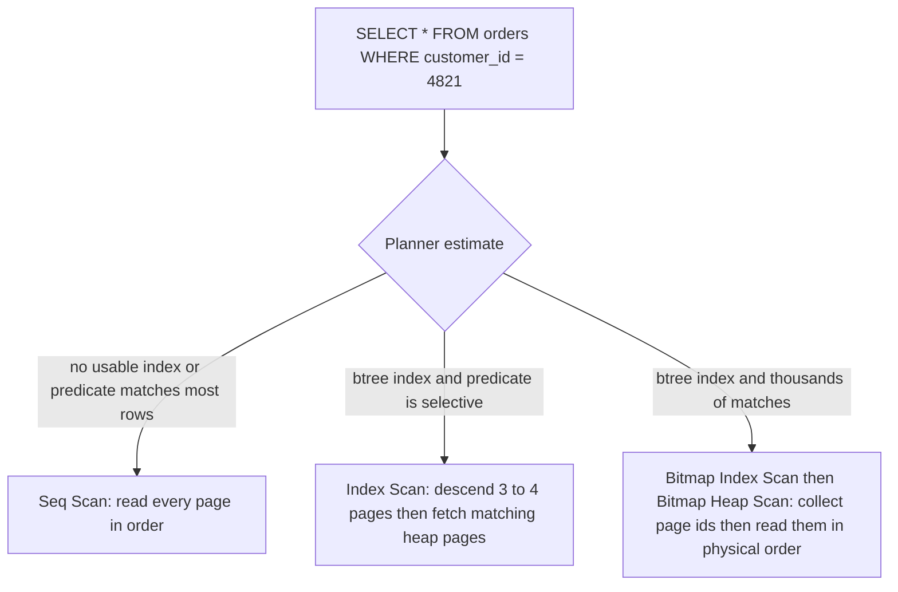
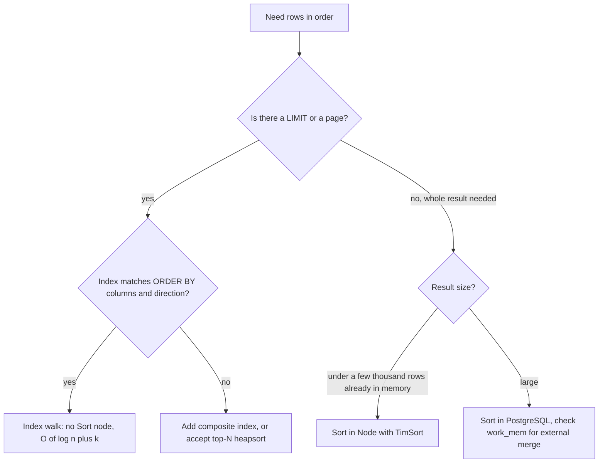

## 8.4 Searching: linear, binary and hash

#### Concept

Searching is finding the item you want inside a collection. There are only three fundamental strategies, and every search you will ever run in a backend is one of them, possibly in disguise:

- **Linear search** looks at every item until it finds a match. `O(n)`. Works on anything, needs no preparation.
- **Binary search** works on a *sorted* collection: look at the middle, decide which half the target is in, repeat. `O(log n)`. Needs sorted data.
- **Hash search** computes a number from the key, uses it to jump straight to the bucket where the item lives. `O(1)` on average. Needs a hash table built in advance, and only supports exact-match lookups.

PostgreSQL uses the same three: a sequential scan is linear search, a B-tree index scan is (a disk-shaped) binary search, and hash joins and hash indexes are hash search.

#### Why does it exist?

Because a linear scan of a large collection is too slow to do per request. A 10-million-row `orders` table is about 1.5 GB on disk; scanning it takes seconds even from cache. The other two strategies exist to trade preparation (sorting, building a hash table, maintaining an index) for fast lookups. The whole discipline of database indexing is the question "which searches will we run often enough to pay for preparing them?"

#### Mental model

Imagine finding a name in a phone book. Linear search: start at page one and read every name. Binary search: open in the middle, see "M", you want "Patel", so ignore the first half; open the middle of the rest, repeat; you find any name in a million-name book in about twenty page flips. Hash search: a magic index card that says "Patel is on page 4,218" because someone precomputed a card for every name. The card is fastest, but it only works for the exact name; it cannot answer "everyone between Patel and Peterson". The sorted book can.

#### How it works

**Linear search** is a loop. In JavaScript: `array.find`, `array.includes`, `array.indexOf`, `array.some`. Cost is proportional to the position of the match (or the whole length if there is no match). Fine for tens of items; a problem inside other loops.

**Binary search** on a sorted array of `n` items:

1. Set `lo = 0`, `hi = n - 1`.
2. Compute `mid = lo + ((hi - lo) >> 1)` (avoids overflow and floating point).
3. If `array[mid]` equals the target, done. If it is less than the target, set `lo = mid + 1`; otherwise `hi = mid - 1`.
4. Repeat while `lo <= hi`. Each step halves the range: `log2(n)` steps. A million items: 20 steps. A billion: 30.

**Hash search** in JavaScript is `Map` and `Set`. V8 hashes the key (for strings, a cached hash of the characters; for objects, an identity hash), locates a bucket, and compares. Insert, lookup and delete are `O(1)` on average, with occasional rehashing when the table grows.

How this maps to PostgreSQL:

| Your search | PostgreSQL plan node | Complexity | When it is chosen |
|---|---|---|---|
| Linear | `Seq Scan` | O(n pages) | No usable index, or the predicate matches a large fraction of rows, or the table is tiny |
| Binary | `Index Scan` (B-tree) | O(log n) descent + O(k) matches, each a random heap read | Selective predicate on an indexed column |
| Binary, no heap visit | `Index Only Scan` | O(log n) + O(k) | All requested columns are in the index and the visibility map says the pages are all-visible |
| Binary, many matches | `Bitmap Index Scan` then `Bitmap Heap Scan` | O(log n) + O(k) sorted by page | Medium selectivity (roughly 1–20% of rows); reads heap pages in physical order |
| Hash | `Hash Join` / `Hash` node | O(n + m) | Equality join between two sets; hash table built in `work_mem` |
| Hash | `Index Scan` on a hash index | O(1) average | Equality only; rarely worth it over a B-tree |



The planner's decision is driven by *selectivity*: what fraction of the table the predicate matches. Below roughly 1% of rows an index scan wins clearly; above roughly 20% the sequential scan usually wins, because reading the whole table sequentially is cheaper than thousands of random reads; in between, the bitmap scan is the compromise.

#### Practical example

A support tool looks up orders by external reference (the payment provider's transaction id). Without an index:

```sql
EXPLAIN (ANALYZE, BUFFERS)
SELECT id, status FROM orders WHERE external_ref = 'ch_3P8xk2LzQ4';
```

```text
Seq Scan on orders  (cost=0.00..248901.00 rows=1 width=24) (actual time=1892.114..2410.552 rows=1 loops=1)
  Filter: (external_ref = 'ch_3P8xk2LzQ4'::text)
  Rows Removed by Filter: 9999999
  Buffers: shared hit=12000 read=111500
Execution Time: 2410.601 ms
```

Linear search over ten million rows: 2.4 seconds, 123,500 pages touched. With `CREATE INDEX CONCURRENTLY orders_external_ref_idx ON orders (external_ref);`:

```text
Index Scan using orders_external_ref_idx on orders  (cost=0.56..8.58 rows=1 width=24) (actual time=0.041..0.043 rows=1 loops=1)
  Index Cond: (external_ref = 'ch_3P8xk2LzQ4'::text)
  Buffers: shared hit=5
Execution Time: 0.071 ms
```

Five pages instead of 123,500. Thirty-four thousand times faster. That is the difference between `O(n)` and `O(log n)` at `n = 10⁷`, with the disk constant included.

#### NestJS example

Application-level searching is where hash lookups belong. Here a fulfilment service matches incoming carrier scan events (thousands per batch) to shipments loaded from the database, using a `Map` instead of repeated `find`:

```ts
// shipments/scan-matcher.service.ts
import { Injectable } from '@nestjs/common';
import { InjectRepository } from '@nestjs/typeorm';
import { In, Repository } from 'typeorm';
import { Shipment } from './shipment.entity';

interface ScanEvent { trackingNumber: string; status: string; at: Date; }

@Injectable()
export class ScanMatcherService {
  constructor(@InjectRepository(Shipment) private readonly shipments: Repository<Shipment>) {}

  async match(events: ScanEvent[]): Promise<Array<{ shipment: Shipment; event: ScanEvent }>> {
    const trackingNumbers = [...new Set(events.map((e) => e.trackingNumber))];

    // Binary search inside PostgreSQL: index on shipments(tracking_number), one round trip
    const found = await this.shipments.find({ where: { trackingNumber: In(trackingNumbers) } });

    // Hash search in memory: O(1) per event instead of O(shipments) with array.find
    const byTracking = new Map(found.map((s) => [s.trackingNumber, s]));

    const matched: Array<{ shipment: Shipment; event: ScanEvent }> = [];
    for (const event of events) {
      const shipment = byTracking.get(event.trackingNumber);
      if (shipment) matched.push({ shipment, event });
    }
    return matched;
  }
}
```

#### PostgreSQL example

Choosing the index type is choosing the search algorithm. B-tree is the default and supports equality, ranges, prefix `LIKE 'abc%'` (with the right operator class or `C` collation) and ordering. Hash indexes support equality only and are slightly smaller and faster for that single case; since PostgreSQL 10 they are crash-safe, but B-tree is almost always the right choice because it also serves `ORDER BY` and range queries.

```sql
-- B-tree: equality, range, ordering, prefix
CREATE INDEX CONCURRENTLY orders_customer_created_idx ON orders (customer_id, created_at DESC);

-- Serves all of these with an index scan:
SELECT * FROM orders WHERE customer_id = 4821;
SELECT * FROM orders WHERE customer_id = 4821 AND created_at > now() - interval '30 days';
SELECT * FROM orders WHERE customer_id = 4821 ORDER BY created_at DESC LIMIT 20;

-- Hash: equality only; consider for very long keys looked up only by equality
CREATE INDEX CONCURRENTLY sessions_token_hash_idx ON sessions USING hash (token);
SELECT user_id FROM sessions WHERE token = $1;
```

Check whether a query actually uses the index with `EXPLAIN`, and check whether an index is ever used with `pg_stat_user_indexes.idx_scan`. Unused indexes cost write throughput: every `INSERT` and `UPDATE` on an indexed column updates the index, an `O(log n)` write per index per row.

#### TypeORM example

Declare the index in the entity so it is part of the migration, and use `findOne` for point lookups so the query has a `LIMIT 1`:

```ts
// shipments/shipment.entity.ts
import { Entity, PrimaryGeneratedColumn, Column, Index, CreateDateColumn } from 'typeorm';

@Entity('shipments')
@Index(['carrierCode', 'createdAt'])
export class Shipment {
  @PrimaryGeneratedColumn('uuid')
  id!: string;

  @Index({ unique: true })             // B-tree, unique: equality lookups are O(log n)
  @Column({ name: 'tracking_number', type: 'text' })
  trackingNumber!: string;

  @Column({ name: 'carrier_code', type: 'text' })
  carrierCode!: string;

  @CreateDateColumn({ name: 'created_at', type: 'timestamptz' })
  createdAt!: Date;
}

// Point lookup: index scan + LIMIT 1
const shipment = await this.shipments.findOne({ where: { trackingNumber } });
```

#### Sequelize example

```ts
import { DataTypes, Model, Sequelize } from 'sequelize';

export class Shipment extends Model {
  declare id: string;
  declare trackingNumber: string;
}

export function initShipment(sequelize: Sequelize): void {
  Shipment.init(
    {
      id: { type: DataTypes.UUID, defaultValue: DataTypes.UUIDV4, primaryKey: true },
      trackingNumber: { type: DataTypes.TEXT, allowNull: false, field: 'tracking_number' },
      carrierCode: { type: DataTypes.TEXT, allowNull: false, field: 'carrier_code' },
    },
    {
      sequelize,
      tableName: 'shipments',
      underscored: true,
      indexes: [
        { unique: true, fields: ['tracking_number'] },
        { fields: ['carrier_code', 'created_at'] },
      ],
    },
  );
}

// Equality lookup through the unique index
const shipment = await Shipment.findOne({ where: { trackingNumber } });
```

#### Production scenario

A marketplace has 40 million `product_listings` rows. The search-by-seller page runs `WHERE seller_id = $1 ORDER BY updated_at DESC LIMIT 50`. With an index on `(seller_id)` only, the plan is an index scan on `seller_id` followed by a sort of every listing the seller has (a large seller has 300,000 listings: ~150 ms). With an index on `(seller_id, updated_at DESC)`, the plan walks the index in order and stops after 50 rows: ~0.4 ms. Same search strategy (binary search into a B-tree), but the second index also answers the *order*, which is the topic of the next section.

#### Failure scenario

At 17:40 a "find order by phone number" support feature starts timing out. The `orders` table has a B-tree index on `customer_phone`. The query is `WHERE customer_phone LIKE '%' || $1 || '%'`, added last week so agents could search by the last four digits. A leading wildcard cannot use a B-tree (the tree is sorted by the beginning of the string, and the search does not know the beginning), so the planner falls back to a sequential scan: linear search over 60 million rows, 9 seconds, on the primary, forty times a minute. The fix is a trigram index (`pg_trgm`, covered in the search worked example later in this part) or storing the last four digits in a separate indexed column.

#### Edge cases & failure modes

- **Index exists but is not used.** Function on the column (`lower(email)`), type mismatch (`text` column compared with `varchar` parameter is fine, but `bigint` compared with `text` is not), leading wildcard, or the planner deciding the predicate is not selective enough.
- **Stale statistics.** After a bulk load, the planner may think the table is small and choose a sequential scan. Run `ANALYZE`.
- **Hash lookups on mutable keys.** Using an object as a `Map` key uses identity, not content; two equal-looking objects are different keys.
- **Hash collisions and adversarial keys.** V8 randomizes string hashes per process, so hash flooding through JSON keys is mitigated; a custom hash function in your code might not be.
- **Unsorted data given to binary search.** Returns wrong answers silently; there is no error. Always know who guarantees the order.
- **Index bloat.** Heavily updated indexes accumulate dead entries; the `O(log n)` descent touches more pages than it should until `REINDEX CONCURRENTLY`.
- **Index-only scan that is not.** If the visibility map is not up to date (recent writes, no vacuum), the "index only" scan still fetches heap pages: check `Heap Fetches` in `EXPLAIN ANALYZE`.

#### How a Senior Backend Engineer thinks about this

The senior sees every `WHERE` clause as a search algorithm request and asks: which index will satisfy it, and is that index worth its write cost? They do not add an index per query; they design a small set of composite indexes that serve the important access paths, and they verify with `EXPLAIN` on production-sized data.

In application code, the rule is: two collections that must be matched get a `Map` built from the smaller one, never nested `find`. And the more important rule: if both collections came from the database, the matching probably belongs in the database as a join.

To a product manager: "Searching by the end of a phone number is like finding a word in a dictionary by its last letters: the dictionary is sorted by the first letters, so we would have to read the whole thing. We need a different kind of index for that search, which takes a day to add."

#### Common mistakes

- Filtering in JavaScript what should be filtered in SQL, so the database does a full scan and ships millions of rows over the wire.
- Nested `find` over two database result sets.
- Assuming any index makes any query fast. Column order in composite indexes, wildcards and functions all matter.
- Adding an index for every query without measuring the write overhead; a table with 15 indexes writes 15 B-tree entries per insert.
- Using `LIKE '%term%'` on an indexed column and being surprised.

#### Interview questions

1. **"Explain how PostgreSQL chooses between a sequential scan, an index scan and a bitmap scan."** Expected: cost model driven by selectivity and page cost constants; bitmap scan for medium selectivity to read heap pages in physical order. Follow-up: why can a sequential scan be faster than an index scan for a predicate matching 30% of rows?
2. **"Why can't a B-tree index serve `LIKE '%abc'`?"** Expected: the tree is ordered by string prefix; a suffix search has no starting point. Follow-up: what index type can? (Trigram GIN.)
3. **"When would you choose a hash index over a B-tree in PostgreSQL?"** Expected: almost never; equality-only lookups on long keys where the smaller index matters; B-tree also supports ranges and ordering.
4. **"You have two arrays of 50,000 items each from two systems and need the intersection. Complexity of the naive approach and yours?"** Expected: `O(n * m)` = 2.5 billion versus `O(n + m)` with a `Set`.
5. **"What does `Heap Fetches` in an index-only scan mean and how do you reduce it?"** Expected: visibility map not set for those pages; `VACUUM` marks pages all-visible.
6. **"What is the write cost of an index and how do you decide an index is not worth it?"** Expected: `O(log n)` per row per index on writes, plus space and vacuum work; check `pg_stat_user_indexes.idx_scan` for unused indexes.

#### Practical exercise

Create a 5-million-row `orders` table with a random `external_ref`. Run the point lookup three ways: no index, B-tree index, hash index. Capture `EXPLAIN (ANALYZE, BUFFERS)` for each. Then write a `LIKE 'ch_3P%'` prefix query and a `LIKE '%LzQ4'` suffix query and explain which one uses the B-tree and why.

Acceptance criteria:

- Timings and buffer counts for all three point lookups in a table.
- A one-paragraph explanation of the plan chosen for each `LIKE` query.
- The B-tree index is created with `CONCURRENTLY` and you can explain what would happen to writers without it.

## 8.5 Sorting

#### Concept

Sorting arranges items in order by a key. Every "latest orders", "top sellers", "cheapest first" and every paginated list depends on a sort somewhere: in the database, in the application, or (best of all) in an index that was sorted when it was built.

Comparison sorts (merge sort, quicksort, heapsort, TimSort) cannot do better than `O(n log n)` in general; that is a proven lower bound. Non-comparison sorts (counting sort, radix sort) can be `O(n)` for integer keys with a bounded range, which is why databases and Node internally sometimes use them for small integers, but you will rarely write one.

#### Why does it exist?

Sorting turns a pile into a structure. Sorted data enables binary search, merge joins, deduplication with a single pass, range queries, and "top N" without examining everything. The cost is `O(n log n)` once; the benefit is `O(log n)` lookups forever after, which is exactly the deal a B-tree index offers.

Without controlled sorting: pagination returns duplicate or missing rows between pages, "top 10" endpoints sort a million rows to return ten, and application servers burn CPU sorting what the database could have handed over in order.

#### Mental model

Imagine a mail room. Sorting letters by postcode once (`O(n log n)`) lets every carrier grab their bundle instantly (`O(log n)` to find the bundle, `O(k)` to take it). Re-sorting the whole room every time a carrier arrives is what happens when a query sorts a table on every request. Keeping the shelves sorted as letters arrive (`O(log n)` per letter) is what an index does.

Stability is this: two letters to the same postcode stay in the order they arrived. An unstable sort may swap them. If you then say "the first letter on the shelf is the oldest", an unstable sort makes that claim false.

#### How it works

The comparison sorts you will actually encounter:

| Algorithm | Time | Space | Stable | Where you meet it |
|---|---|---|---|---|
| Quicksort | O(n log n) average, O(n²) worst | O(log n) | No | PostgreSQL in-memory sorts (`Sort Method: quicksort`) |
| Merge sort | O(n log n) | O(n) | Yes | PostgreSQL external sorts (`external merge`), k-way merge of feeds |
| Heapsort | O(n log n) | O(1) | No | PostgreSQL `top-N heapsort` for `ORDER BY ... LIMIT` |
| TimSort | O(n log n), O(n) on nearly-sorted input | O(n) | Yes | V8's `Array.prototype.sort` since Node 11 |
| Insertion sort | O(n²), O(n) on sorted input | O(1) | Yes | Inside TimSort for small runs; maintaining a tiny sorted list |

**Stability** means equal keys keep their input order. Node's `Array.prototype.sort` is stable (guaranteed by the ECMAScript spec since 2019; V8 implements TimSort). PostgreSQL's `ORDER BY` has no such guarantee: rows with equal sort keys come back in whatever order the plan produced them, which can change between executions. This is why every paginated `ORDER BY` needs a unique tiebreaker column, typically the primary key.

**Sorting in the database** happens in one of three ways:

1. **Index order.** If an index exists whose column order matches the `ORDER BY` (including direction), the planner walks the index and no sort node appears. Cost: `O(log n + k)` for `k` returned rows. This is the goal for every hot paginated query.
2. **In-memory sort.** The sort node collects rows and sorts them in `work_mem` with quicksort. `EXPLAIN ANALYZE` shows `Sort Method: quicksort  Memory: 2048kB`. With a `LIMIT`, PostgreSQL uses `top-N heapsort`, keeping only the best `N` rows in a heap: `O(n log N)` time and `O(N)` memory.
3. **External sort.** If the rows do not fit in `work_mem`, the sort spills to temporary files and does a merge sort across them. `EXPLAIN ANALYZE` shows `Sort Method: external merge  Disk: 45632kB`. This is typically 5–20x slower than in-memory and adds disk I/O on the database server.

PostgreSQL 13 added **Incremental Sort**: if an index provides order on a prefix of the `ORDER BY` columns (say `customer_id`), it sorts only within each group for the remaining columns, in small batches.

**Sorting in Node** uses TimSort. Practical facts: sorting a million numbers takes roughly 100–200 ms; sorting a million objects by a string property with a plain comparator takes 500 ms–1 s; using `localeCompare` in the comparator multiplies that by 5–10x because each comparison goes through ICU. For locale-aware sorting of large arrays, create one `Intl.Collator` and reuse `collator.compare`, or precompute sort keys once (`O(n)`) and sort those.



#### Practical example

The order-history page: `GET /customers/:id/orders?page=...`. Version one sorts in the application:

```ts
// Loads every order for the customer, sorts in Node, slices a page: O(n log n) per request
const all = await this.orders.find({ where: { customerId } });
all.sort((a, b) => b.createdAt.getTime() - a.createdAt.getTime());
return all.slice(offset, offset + 50);
```

For a customer with 30,000 orders this transfers 30,000 rows (~10 MB) and sorts them for every page view. Version two asks the database for the page in index order with a tiebreaker:

```sql
CREATE INDEX CONCURRENTLY orders_customer_created_id_idx
  ON orders (customer_id, created_at DESC, id DESC);

SELECT id, total_cents, status, created_at
FROM orders
WHERE customer_id = $1
ORDER BY created_at DESC, id DESC
LIMIT 50;
```

```text
Limit  (cost=0.56..24.31 rows=50 width=48) (actual time=0.029..0.088 rows=50 loops=1)
  ->  Index Scan using orders_customer_created_id_idx on orders  (cost=0.56..14260.10 rows=30012 width=48) (actual time=0.028..0.081 rows=50 loops=1)
        Index Cond: (customer_id = 4821)
Execution Time: 0.112 ms
```

No `Sort` node. The index is already in the requested order, so PostgreSQL reads 50 entries and stops. 0.1 ms instead of 80 ms plus 10 MB of transfer.

#### NestJS example

Sort parameters from clients are a classic source of both injection bugs and unindexed sorts. Whitelist them, and always append the tiebreaker:

```ts
// orders/dto/list-orders.dto.ts
import { IsIn, IsInt, IsOptional, Max, Min } from 'class-validator';
import { Type } from 'class-transformer';

export const ORDER_SORT_FIELDS = ['createdAt', 'totalCents'] as const;
export type OrderSortField = (typeof ORDER_SORT_FIELDS)[number];

export class ListOrdersDto {
  @IsOptional() @IsIn(ORDER_SORT_FIELDS)
  sortBy: OrderSortField = 'createdAt';

  @IsOptional() @IsIn(['ASC', 'DESC'])
  direction: 'ASC' | 'DESC' = 'DESC';

  @IsOptional() @Type(() => Number) @IsInt() @Min(1) @Max(100)
  limit = 50;
}
```

```ts
// orders/orders.service.ts
async list(customerId: string, dto: ListOrdersDto): Promise<Order[]> {
  // Only whitelisted, indexed columns reach orderBy; the id tiebreaker makes pagination deterministic
  return this.orders
    .createQueryBuilder('o')
    .where('o.customer_id = :customerId', { customerId })
    .orderBy(`o.${dto.sortBy}`, dto.direction)
    .addOrderBy('o.id', dto.direction)
    .take(dto.limit)
    .getMany();
}
```

Each whitelisted `sortBy` must have a matching composite index `(customer_id, <field>, id)`; otherwise a large customer triggers a top-N heapsort over all their rows on every page.

#### PostgreSQL example

Seeing an external sort and fixing it:

```sql
EXPLAIN (ANALYZE, BUFFERS)
SELECT * FROM order_events WHERE order_id = ANY($1) ORDER BY occurred_at;
```

```text
Sort  (cost=98120.44..99370.44 rows=500000 width=96) (actual time=1210.3..1398.8 rows=498877 loops=1)
  Sort Key: occurred_at
  Sort Method: external merge  Disk: 51240kB
  Buffers: shared hit=21044, temp read=6405 written=6410
  ->  Bitmap Heap Scan on order_events  (cost=1893.2..40120.9 rows=500000 width=96) ...
Execution Time: 1452.7 ms
```

Half a million rows, 51 MB of temp files. Options, in the order a senior would consider them:

1. Do you need all 500,000 rows sorted? Usually the caller wants a page or a per-order timeline; add `LIMIT` and get `top-N heapsort`, or query per order with an index on `(order_id, occurred_at)`.
2. If the full sorted set is required (a batch export), raise `work_mem` for that session only: `SET LOCAL work_mem = '128MB';` inside the transaction. Never globally.
3. Add an index that provides the order so the sort disappears.

```sql
CREATE INDEX CONCURRENTLY order_events_order_occurred_idx ON order_events (order_id, occurred_at);
-- Per-order timeline: index walk, no Sort node, sub-millisecond
SELECT * FROM order_events WHERE order_id = $1 ORDER BY occurred_at;
```

#### TypeORM example

Index declaration with direction, and a query that lets the index provide the order:

```ts
@Entity('orders')
@Index('orders_customer_created_id_idx', ['customerId', 'createdAt', 'id'])
export class Order {
  @PrimaryGeneratedColumn('uuid') id!: string;
  @Column({ name: 'customer_id', type: 'uuid' }) customerId!: string;
  @CreateDateColumn({ name: 'created_at', type: 'timestamptz' }) createdAt!: Date;
  @Column({ name: 'total_cents', type: 'bigint' }) totalCents!: string;
}

// Backward index walk: PostgreSQL can scan an ascending index in reverse for DESC, DESC
const page = await this.orders.find({
  where: { customerId },
  order: { createdAt: 'DESC', id: 'DESC' },
  take: 50,
});
```

TypeORM's decorator does not express per-column direction; a mixed-direction index (`created_at DESC, id ASC`) needs a migration with raw SQL. For same-direction sorts, PostgreSQL walks the ascending index backward at no extra cost.

#### Sequelize example

```ts
const page = await Order.findAll({
  where: { customerId },
  order: [['createdAt', 'DESC'], ['id', 'DESC']],   // tiebreaker for deterministic pages
  limit: 50,
  raw: true,
});
```

And when the data is already in memory and small, sort in Node with a reusable collator:

```ts
const collator = new Intl.Collator('en', { sensitivity: 'base' });
// Stable TimSort: products with equal names keep their existing order (e.g. by relevance)
products.sort((a, b) => collator.compare(a.name, b.name));
```

#### Production scenario

A "top 10 products by revenue this week" widget is called 200 times per second from the home page. The query is `SELECT product_id, sum(total_cents) FROM order_lines WHERE created_at > $1 GROUP BY product_id ORDER BY 2 DESC LIMIT 10`. The aggregate touches 4 million rows; the sort over ~50,000 product groups with `LIMIT 10` is a `top-N heapsort` (cheap, `O(n log 10)`); the expensive part is the aggregate. At 200 RPS the primary is at 80% CPU on this query alone. The fix is not a better sort: it is a materialized rollup refreshed every minute, so the request reads 10 pre-sorted rows from a 50,000-row table with an index on `(week, revenue DESC)`. Sorting once per minute instead of 200 times per second.

#### Failure scenario

At 08:05 a customer reports "the same order shows on page 2 and page 3". The endpoint sorts by `created_at DESC` with no tiebreaker. A bulk import created 400 orders with identical timestamps (second precision, from a CSV). PostgreSQL returns those 400 in plan-dependent order, and between page 2 and page 3 an autovacuum changed the physical layout, so the order of equal keys changed. Some orders appeared twice, some never. The fix is `ORDER BY created_at DESC, id DESC` and the matching index; the deeper fix is keyset pagination (next section), which does not depend on stable offsets at all.

#### Edge cases & failure modes

- **Ties without a tiebreaker.** Nondeterministic order across executions; broken pagination.
- **Sorting a `LIMIT` query without a supporting index.** Top-N heapsort still scans all matching rows; fine at 10,000, slow at 10 million.
- **`work_mem` spills.** External merge sorts on the primary compete for disk I/O with everything else.
- **`ORDER BY` on a computed expression** (`ORDER BY lower(name)`, `ORDER BY total_cents * fx_rate`). No plain index helps; use an expression index or sort in the application for small sets.
- **Collation cost.** Sorting `text` under a non-C collation is 2–5x slower than `C` collation; `localeCompare` in Node without a cached collator is far worse.
- **Sorting inside a loop.** `O(n² log n)`; the classic "find the latest per group" mistake. Group first, then sort once, or use `DISTINCT ON` in SQL.
- **Comparator bugs.** A comparator that returns `true/false` instead of negative/zero/positive, or one that is inconsistent (`a < b` and `b < a` both true), produces garbage order with no error.
- **Sorting mutable keys.** If the key changes during the sort (e.g. `Date.now()` in the comparator), the result is undefined.

#### How a Senior Backend Engineer thinks about this

The senior's hierarchy: index order first, database sort with `LIMIT` second, application sort only for small in-memory sets or keys the database cannot index. They treat a `Sort` node in a hot query's plan as a bug to be explained. They always add the tiebreaker. They know that sorting a million rows is a batch job, not a request.

They also know when to *not* push sorting into the database: a saturated primary with spare application CPU, or a sort key that depends on per-request context (the user's location, a personalization score). In those cases they bound the input size first, then sort in Node.

To a product manager: "Sorting by 'relevance to this user' cannot be pre-sorted by the database because it is different for every user. We can do it for the first 1,000 candidates instantly, but not for all 4 million products."

#### Common mistakes

- Sorting in the application and paginating with `slice`, transferring the whole set on every page.
- Omitting the tiebreaker column.
- `ORDER BY` on a column with no supporting composite index for the common `WHERE`.
- Raising `work_mem` globally to fix one report.
- `localeCompare` in a comparator over large arrays without a cached `Intl.Collator`.
- Calling `.sort()` on an array you did not intend to mutate (it sorts in place; use `toSorted()` on Node 20+ or copy first).

#### Interview questions

1. **"Why does a paginated `ORDER BY created_at` need a tiebreaker, and what happens without one?"** Expected: PostgreSQL does not guarantee stable order for equal keys; pages can repeat or skip rows. Follow-up: what index makes `ORDER BY created_at DESC, id DESC` free?
2. **"What is `top-N heapsort` and when does the planner use it?"** Expected: `ORDER BY ... LIMIT N` keeps a heap of the best `N`, `O(n log N)` time, `O(N)` memory.
3. **"Explain what `Sort Method: external merge Disk: 51240kB` tells you and three ways to respond."** Expected: spill beyond `work_mem`; add index, add `LIMIT`, `SET LOCAL work_mem`.
4. **"Is `Array.prototype.sort` stable in Node? Why does it matter?"** Expected: yes, TimSort since V8 7.0; multi-key sorting by sorting twice relies on it.
5. **"When would you sort in the application instead of the database?"** Expected: small bounded set, per-request computed key, offloading a saturated primary.
6. **"A comparator uses `localeCompare` and sorting 200,000 rows takes 3 seconds. What do you change?"** Expected: cache an `Intl.Collator`, or precompute sort keys; or push the sort to the database with an appropriate collation.

#### Practical exercise

Take a paginated list endpoint in your project. Run `EXPLAIN (ANALYZE, BUFFERS)` on its query for the customer with the most rows. If you see a `Sort` node, add the composite index that removes it and re-measure. Add the tiebreaker if it is missing. Then in Node, benchmark sorting 200,000 product names with a naive `localeCompare` comparator versus a cached `Intl.Collator`.

Acceptance criteria:

- Before and after plans, with the `Sort` node gone and execution time recorded.
- The endpoint's sort fields are whitelisted in a DTO and every whitelisted field has a supporting index.
- Node benchmark shows the collator version at least 3x faster, and you can explain why.
