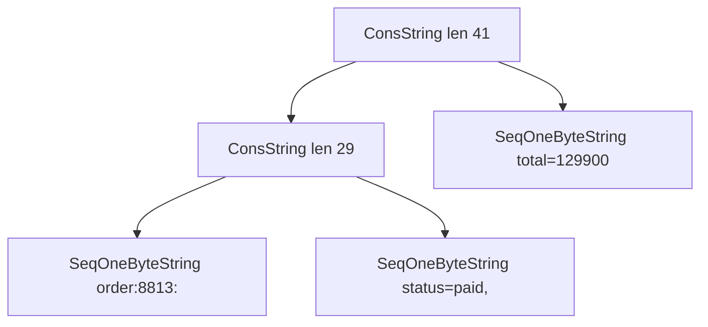

## 8.3 Strings

#### Concept

A string is an ordered sequence of characters. In JavaScript a string is a sequence of 16-bit **code units** (UTF-16), it is **immutable** (you can never change a character in place; every "modification" creates a new string), and V8 stores it in one of several internal shapes that you cannot see but will feel in memory and CPU. On the wire (HTTP, PostgreSQL, Redis, Kafka) text is almost always **UTF-8 bytes**, and Node.js converts between the two worlds every time you read a request body or write a response. Those conversions, and the difference between "characters" and "bytes", are where backend string bugs live.

#### Why does it exist?

Backends are text machines. Request bodies, JSON, SQL statements, cache keys, log lines, tokens, e-mail addresses, product names, error messages: all strings. The design choices behind JavaScript strings exist for good reasons: immutability lets V8 share strings freely between objects, cache their hash for use as map keys, and hand them across threads without copying. UTF-16 was chosen in 1995 when 16 bits looked like enough for every character; it was not, which is why emoji and many scripts need two code units and why `'😀'.length` is 2. `Buffer` exists because the network and the file system speak bytes, and you need a mutable, fixed-size, off-heap byte array to talk to them efficiently.

#### Mental model

Imagine a laminated card versus a whiteboard. A JavaScript string is a laminated card: you can read it, copy it, and hand out copies, but to change one letter you print a whole new card. A `Buffer` is a whiteboard of fixed size: you can write bytes in place, wipe a region, and hand a pointer to someone else who sees the same board. Concatenating strings in a loop is printing a new, slightly longer card each time; V8 cheats by stapling cards together (a "rope") and only printing the final card when someone needs to read it end to end.

#### How it works

1. **Code units, not characters.** `str.length` counts UTF-16 code units. Characters outside the Basic Multilingual Plane (emoji, many CJK ideographs, mathematical symbols) are stored as a *surrogate pair* of two code units. `'😀'.length === 2`, `[...'😀'].length === 1`, `'😀'.codePointAt(0) === 0x1F600`. `str.slice(0, 1)` on that string returns a lone surrogate, which is invalid text.
2. **One byte or two.** V8 stores a string whose characters are all below 256 as a `SeqOneByteString` (1 byte per character, Latin-1). If a single character is above 255, the whole string becomes a `SeqTwoByteString` (2 bytes per character). Adding one emoji to a 10 MB ASCII string doubles its memory.
3. **Ropes.** `a + b` where the result is at least 13 characters does not copy; V8 creates a `ConsString` node with two pointers. Repeated `+=` builds a tree. The first operation that needs contiguous characters (indexing, regex, comparison, writing to a socket) *flattens* the tree into a sequential string in one O(n) pass.
4. **Slices.** `str.substring(i, j)` of a string 13 characters or longer creates a `SlicedString` that points at the parent with an offset, O(1). The parent stays alive as long as the slice does.
5. **Internalized strings and cached hashes.** String literals and property names are interned in a table so equal strings share one object and compare by pointer. Every string caches its hash after the first computation, which is why using strings as `Map` keys is cheap.
6. **UTF-8 conversion.** `Buffer.from(str, 'utf8')` and `buf.toString('utf8')` walk every character. ASCII is 1 byte, `é` is 2, `₹` is 3, `😀` is 4. `Buffer.byteLength(str)` tells you the encoded size without allocating; `str.length` does not.
7. **Limits.** `buffer.constants.MAX_STRING_LENGTH` is about 536 million characters on 64-bit Node.js. `JSON.stringify` of a response bigger than that throws `RangeError: Invalid string length`, and you will run out of heap well before you get there.



**Time complexity**

| Operation | Best | Average | Worst | Notes |
|---|---|---|---|---|
| `length` | O(1) | O(1) | O(1) | code units, not bytes or characters |
| `str[i]` / `charCodeAt(i)` | O(1) | O(1) | O(n) | worst case flattens a rope first |
| `a + b` | O(1) | O(1) | O(n + m) | rope for length >= 13, copy for short strings |
| `substring` / `slice` | O(1) | O(1) | O(k) | O(1) creates a sliced view that retains the parent |
| `===` comparison | O(1) | O(n) | O(n) | O(1) when pointers match or lengths differ |
| `indexOf` / `includes` | O(1) | O(n) | O(n x m) | V8 uses Boyer-Moore-Horspool for longer needles |
| `split` / `replace` / `toLowerCase` | O(n) | O(n) | O(n) | each allocates new strings |
| Regex `test` / `match` | O(n) | O(n) | O(2^n) | catastrophic backtracking with nested quantifiers |
| `Buffer.from(str)` / `toString()` | O(n) | O(n) | O(n) | full encode or decode pass |
| `Buffer.byteLength(str)` | O(n) | O(n) | O(n) | no allocation |
| `JSON.stringify` / `JSON.parse` | O(n) | O(n) | O(n) | n = total size; single-threaded, blocks the loop |

**Memory implications (V8, Node.js)**

- A sequential one-byte string costs about 16 bytes of header plus 1 byte per character; two-byte costs 16 plus 2 per character. A `ConsString` node is 32 bytes, so a rope built from 100,000 tiny appends carries 3.2 MB of nodes until it is flattened.
- A `SlicedString` retains its parent. Extracting a 40-character token from a 10 MB request body and caching the token keeps the 10 MB alive. Force a copy with `Buffer.from(token, 'utf8').toString('utf8')` before storing long-lived substrings of large strings.
- `Buffer` memory lives outside the V8 heap (visible in `process.memoryUsage().arrayBuffers` and `external`). Buffers under 4 KiB are carved from a shared 8 KiB pool; larger ones get their own allocation. `Buffer.allocUnsafe` skips zero-filling and may expose old memory, so never send it to a client without fully overwriting it.
- `buf.subarray()` shares memory with the parent; `Buffer.concat(chunks, totalLength)` copies exactly once and is the right way to assemble a body from chunks.

#### Practical example

Three everyday tasks: build a cache key, measure a string in bytes for a size limit, and truncate text without cutting an emoji in half.

```ts
// common/text.ts
export const cacheKey = (...parts: (string | number)[]) => parts.join(':'); // 'order:8813:items'

/** Validate by BYTES because Redis, headers and index entries have byte limits. */
export function assertMaxBytes(value: string, maxBytes: number, field: string): void {
  const bytes = Buffer.byteLength(value, 'utf8');
  if (bytes > maxBytes) {
    throw new RangeError(`${field} is ${bytes} bytes; limit is ${maxBytes}`);
  }
}

/** Truncate by code points so a surrogate pair is never split. */
export function truncateSafe(value: string, maxCodePoints: number): string {
  let out = '';
  let count = 0;
  for (const ch of value) {          // iterates code points, not code units
    if (count === maxCodePoints) break;
    out += ch;
    count++;
  }
  return out;
}

/** Normalize user-entered identifiers so 'é' (1 code point) and 'e' + combining accent match. */
export const normalizeIdentifier = (s: string) => s.normalize('NFC').trim().toLowerCase();
```

`for...of` over a string yields code points, so `truncateSafe('héllo😀!', 6)` returns `'héllo😀'` intact, where `slice(0, 6)` would return `'héllo\uD83D'`, a broken half of the emoji.

#### NestJS example

A CSV export that never materializes the whole file as one string. An async generator yields rows as PostgreSQL streams them, `Readable.from` turns that into a Node.js stream with backpressure, and `StreamableFile` (a real `@nestjs/common` class) pipes it to the client.

```ts
// exports/orders-export.controller.ts
import { Controller, Get, Header, Query, StreamableFile } from '@nestjs/common';
import { Readable } from 'node:stream';
import { OrdersExportService } from './orders-export.service';

@Controller('exports')
export class OrdersExportController {
  constructor(private readonly exportService: OrdersExportService) {}

  @Get('orders.csv')
  @Header('Content-Type', 'text/csv; charset=utf-8')
  @Header('Content-Disposition', 'attachment; filename="orders.csv"')
  exportOrders(@Query('merchantId') merchantId: string): StreamableFile {
    const stream = Readable.from(this.exportService.rows(merchantId)); // backpressure-aware
    return new StreamableFile(stream);
  }
}

// exports/orders-export.service.ts
import { Injectable } from '@nestjs/common';
import { DataSource } from 'typeorm';

@Injectable()
export class OrdersExportService {
  constructor(private readonly dataSource: DataSource) {}

  async *rows(merchantId: string): AsyncGenerator<string> {
    yield 'order_id,status,total_cents,created_at\n';
    let lastId = '0';
    for (;;) {
      // Keyset pagination: bounded memory no matter how many orders exist.
      const page: { id: string; status: string; total_cents: number; created_at: Date }[] =
        await this.dataSource.query(
          `SELECT id, status, total_cents, created_at FROM orders
           WHERE merchant_id = $1 AND id > $2 ORDER BY id LIMIT 5000`,
          [merchantId, lastId],
        );
      if (page.length === 0) return;
      for (const r of page) {
        yield `${r.id},${csvEscape(r.status)},${r.total_cents},${r.created_at.toISOString()}\n`;
      }
      lastId = page[page.length - 1].id;
    }
  }
}

function csvEscape(v: string): string {
  return /[",\n]/.test(v) ? `"${v.replace(/"/g, '""')}"` : v;
}
```

Peak memory is one page of 5,000 rows plus whatever the socket has not drained yet, whether the merchant has 300 orders or 30 million.

#### PostgreSQL example

PostgreSQL stores text as UTF-8 bytes and counts *characters* for `varchar(n)`. It has three details every backend engineer eventually hits: `length()` versus `octet_length()`, the B-tree index entry limit, and the null byte.

```sql
CREATE TABLE users (
  id            bigint GENERATED ALWAYS AS IDENTITY PRIMARY KEY,
  email         varchar(320) NOT NULL,          -- max valid e-mail length; counts characters
  display_name  text NOT NULL,
  bio           text,
  avatar_bytes  bytea                            -- raw bytes, no encoding validation
);

-- Case-insensitive uniqueness without a citext extension: index the expression.
CREATE UNIQUE INDEX users_email_lower_uq ON users (lower(email));

SELECT length('naïve😀') AS chars, octet_length('naïve😀') AS bytes;  -- 6 | 11

-- Prefix search that can use a B-tree needs text_pattern_ops under non-C collations.
CREATE INDEX products_name_prefix ON products (name text_pattern_ops);
SELECT id, name FROM products WHERE name LIKE 'Gutta%';

-- Values that will never fit a B-tree entry (limit is 2704 bytes) must be hashed for uniqueness.
CREATE UNIQUE INDEX documents_body_sha_uq ON documents (sha256(convert_to(body, 'UTF8')));
```

```text
Index Scan using users_email_lower_uq on users  (cost=0.43..8.45 rows=1 width=57) (actual time=0.031..0.032 rows=1 loops=1)
  Index Cond: (lower((email)::text) = 'praveen@example.com'::text)
  Buffers: shared hit=4
Planning Time: 0.121 ms
Execution Time: 0.052 ms
```

The query must use the *same expression* (`WHERE lower(email) = $1`) or the planner ignores the index. Values larger than about 2 KB are moved to TOAST storage (compressed, out-of-line), which is transparent but means reading a wide `bio` column costs extra page reads; select only the columns you need.

#### TypeORM example

```ts
// users/user.entity.ts
import { Column, Entity, PrimaryGeneratedColumn } from 'typeorm';

const nfcLower = {
  to: (v: string) => v.normalize('NFC').trim().toLowerCase(), // on write
  from: (v: string) => v,                                       // on read
};

@Entity({ name: 'users' })
export class User {
  @PrimaryGeneratedColumn('increment', { type: 'bigint' })
  id!: string;

  @Column({ type: 'varchar', length: 320, transformer: nfcLower })
  email!: string;

  @Column({ type: 'text' })
  displayName!: string;

  @Column({ type: 'bytea', nullable: true })
  avatarBytes?: Buffer; // pg driver maps bytea to Buffer
}

// find by normalized email so the expression index is used
const user = await repo
  .createQueryBuilder('u')
  .where('lower(u.email) = :email', { email: input.normalize('NFC').trim().toLowerCase() })
  .getOne();
```

The unique expression index itself goes in a migration (`queryRunner.query(...)`), because `@Index` cannot express `lower(email)`.

#### Sequelize example

```ts
import { DataTypes, Model, Sequelize } from 'sequelize';

export class User extends Model {
  declare id: number;
  declare email: string;
  declare displayName: string;
}

export function initUser(sequelize: Sequelize) {
  User.init(
    {
      id: { type: DataTypes.BIGINT, autoIncrement: true, primaryKey: true },
      email: {
        type: DataTypes.STRING(320),
        allowNull: false,
        set(value: string) {
          this.setDataValue('email', value.normalize('NFC').trim().toLowerCase());
        },
        validate: { isEmail: true, len: [3, 320] },
      },
      displayName: { type: DataTypes.TEXT, allowNull: false, field: 'display_name' },
    },
    { sequelize, tableName: 'users', timestamps: false },
  );
}

const found = await User.findOne({
  where: sequelize.where(sequelize.fn('lower', sequelize.col('email')), email.toLowerCase()),
});
```

`DataTypes.CITEXT` is also available for PostgreSQL if the `citext` extension is installed, which removes the need for the expression index.

#### Production scenario

A catalog service exposes `GET /products/all` for a partner integration. The response is 2,400 products, about 6 MB of JSON. Per request the process performs `JSON.stringify` (6 MB string, one-byte because the catalog is ASCII), then Node.js encodes it to UTF-8 into socket buffers (another 6 MB), so roughly 12 MB of transient memory and about 25 ms of CPU. At 5 requests per second that is 60 MB per second of garbage and 12.5 percent of a core. At 40 requests per second, when the partner launches a polling loop, the endpoint alone eats a full core and every other endpoint's p99 climbs from 12 ms to 180 ms. The fix is a cache (serialize once per catalog change, keep the `Buffer`, send it with `Content-Length`), plus ETag handling so most polls return `304 Not Modified` with zero serialization.

Logging is the other silent string cost. A service writing 10,000 structured log lines per second at 15 microseconds each spends 150 ms of every second serializing logs, which is 15 percent of its capacity. That is why `pino` (schema-based fast serialization, off-thread transport) beats `console.log(JSON.stringify(...))`, and why senior engineers sample debug logs in production.

#### Failure scenario

At 02:14 the on-call engineer is paged: `reports-api` p99 is 30 seconds and two of four pods are `OOMKilled`. A merchant with 3.1 million orders clicked "Export all orders". The handler ran `rows.map(toCsvLine).join('\n')`. The array of 3.1 million row objects took 700 MB; `map` produced 3.1 million small strings; `join` produced a 410 MB one-byte string; `res.send` converted it to a 410 MB UTF-8 `Buffer`. The pod's 1 GB limit was crossed during `join`. The pod died, the load balancer retried the request on the next pod, which also died, and the merchant's browser retried on timeout, which started a third attempt. Three pods went down in four minutes for one click.

The fix was the streaming export above (bounded at one 5,000-row page in memory), a hard cap of one concurrent export per merchant enforced with a Redis `SET NX EX` lock, and a `Content-Disposition` with a job id so retries reattach to the running export instead of starting another.

#### Edge cases & failure modes

- **Byte limits versus character limits.** HTTP headers are capped by bytes (Node.js defaults to 16 KB total via `--max-http-header-size`), Redis keys and PostgreSQL index entries are bytes, `varchar(n)` is characters, `str.length` is code units. Validate at the right unit.
- **Splitting surrogate pairs.** `slice`, `substring` and `split('')` cut inside emoji. Node.js encodes a lone surrogate as U+FFFD, so the customer sees a question-mark diamond in their name.
- **Unicode normalization.** `'é'` can be one code point or two. Two users can register visually identical usernames that bypass a unique constraint unless you `normalize('NFC')` before writing.
- **Null bytes.** PostgreSQL `text` rejects `` with `invalid byte sequence for encoding "UTF8": 0x00`. JSON allows it. Strip or reject at validation.
- **Catastrophic regex backtracking (ReDoS).** `/^(\w+\s?)+$/` on a 40-character non-matching string can take seconds. Never run user-controlled regexes; prefer linear-time checks; hoist compiled regexes out of hot functions.
- **Sliced-string retention.** Substrings of large bodies stored in caches keep the whole body alive. Copy before caching.
- **Chunk boundaries.** A multi-byte character can be split across two TCP chunks. Decoding each chunk with `toString()` corrupts it; use `string_decoder.StringDecoder` or concatenate buffers first.
- **Timing attacks.** Comparing secrets with `===` returns early on the first mismatch. Compare tokens with `crypto.timingSafeEqual` on equal-length `Buffer`s.
- **Log injection.** A user-supplied string containing `\n` can forge log lines. Structured JSON logging escapes it; string-concatenated logs do not.
- **Locale case mapping.** `'I'.toLowerCase()` is `'i'`, but `toLocaleLowerCase('tr')` gives a dotless `ı`. Use plain `toLowerCase` for identifiers and normalize before comparing.
- **Base64 inflation.** Encoding a 3 MB image in a JSON body makes it 4 MB and forces a full parse into a string before you can even validate its size. Use multipart uploads or presigned URLs.

#### How a Senior Backend Engineer thinks about this

The first instinct is to **refuse to build a large string when a stream will do**. Response bodies, exports, log files and bulk payloads are streamed with backpressure; the memory of a request handler should be independent of the size of the data it moves. When the whole payload really is needed at once (a cached catalog), it is serialized once and stored as a `Buffer`, never re-serialized per request.

The second instinct is to **name the unit**. When a spec says "limit names to 100", the senior asks: 100 bytes, code units, code points or grapheme clusters? Then they enforce it at the edge in the unit that matches the storage constraint (bytes for Redis and index entries, characters for `varchar`).

The third is to **treat serialization as CPU you pay per request**. They profile with `node --cpu-prof` and are rarely surprised to find `JSON.stringify` and logging near the top. They fix that with caching, sampling and ETags before they reach for more pods.

To a product manager: "Exporting three million rows in one click is fine, but the export must stream to the browser instead of being assembled in memory first. Same feature, no outage, one day of work."

#### Common mistakes

- Using `str.length` for `Content-Length` or a byte-limit check. Off by a factor of up to four for non-ASCII text.
- Building large responses with `+=` or `join` when a stream was available.
- Storing substrings of large bodies (tokens, ids parsed from a webhook payload) in long-lived caches.
- Truncating with `slice` and shipping broken emoji to customers.
- Forgetting normalization on identifiers, then debugging "duplicate" users that look identical.
- Compiling a regex inside a request handler (`new RegExp(pattern)` per call) instead of once at module load.
- Comparing API keys with `===`.
- Choosing `char(n)` in PostgreSQL, which pads with spaces and makes equality comparisons surprising.

#### Interview questions

1. **Why is `'😀'.length` 2, and where does that break in a backend?** Expected: UTF-16 surrogate pairs; breaks in truncation, `varchar` limits, `Content-Length`, cursor offsets. Follow-up: how do you iterate by code point? (`for...of`, `Array.from`, `codePointAt`.)
2. **How does V8 make `s += x` in a loop not O(n^2)?** Expected: `ConsString` ropes with O(1) concatenation, flattened lazily on first character access. Follow-up: what is the memory cost of a deep rope, and what forces a flatten?
3. **A 40-byte token extracted from a 10 MB payload is cached for an hour. What is the memory impact?** Expected: `SlicedString` retains the parent; the 10 MB stays alive; fix by copying via `Buffer` round-trip.
4. **Design an endpoint that exports millions of rows as CSV.** Expected: keyset pagination or cursor stream, async generator, `Readable.from`, `StreamableFile`, concurrency cap per user, resumable job id. Why it matters: it tests memory discipline, backpressure and idempotent retries together.
5. **What is the difference between `length(col)` and `octet_length(col)` in PostgreSQL, and when does the B-tree entry limit bite?** Expected: characters versus bytes; index rows above 2704 bytes fail; hash the value for uniqueness.
6. **What is ReDoS and how do you defend against it on a Node.js service?** Expected: exponential backtracking in the single-threaded loop; avoid nested quantifiers, limit input length, use linear-time validators, never accept user regexes.
7. **Why does `JSON.stringify` of a large object hurt more in Node.js than in a Java service?** Expected: it runs on the single event loop thread, so every concurrent request waits; mitigations are caching serialized `Buffer`s, streaming JSON, worker threads for offline reports.

#### Practical exercise

Implement `TextLimitsPipe`, a NestJS `PipeTransform` used on a `CreateProductDto`, and a streaming `GET /products/export.csv`.

Acceptance criteria:

- `name` is rejected if it exceeds 120 *code points* or 480 *bytes*; error messages state both measured values.
- `name` is normalized to NFC and trimmed before validation, and a test proves that `'é'` and `'é'` produce the same stored value.
- `description` containing `` is rejected with a 400, not a PostgreSQL 500.
- The export endpoint keeps `process.memoryUsage().heapUsed` under 150 MB while exporting a seeded table of 2 million rows (verify with a test that samples memory every second).
- A unit test proves `truncateSafe('ab😀cd', 3)` returns `'ab😀'` and never a lone surrogate.
