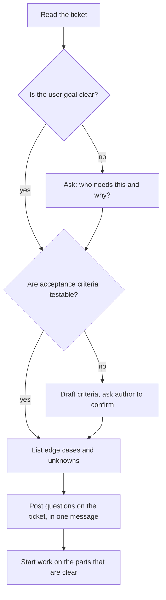
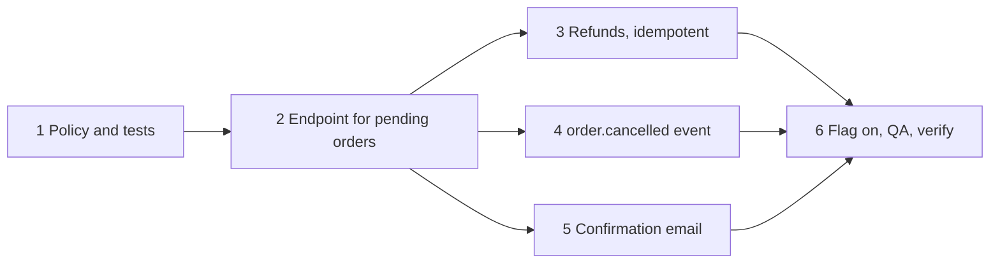
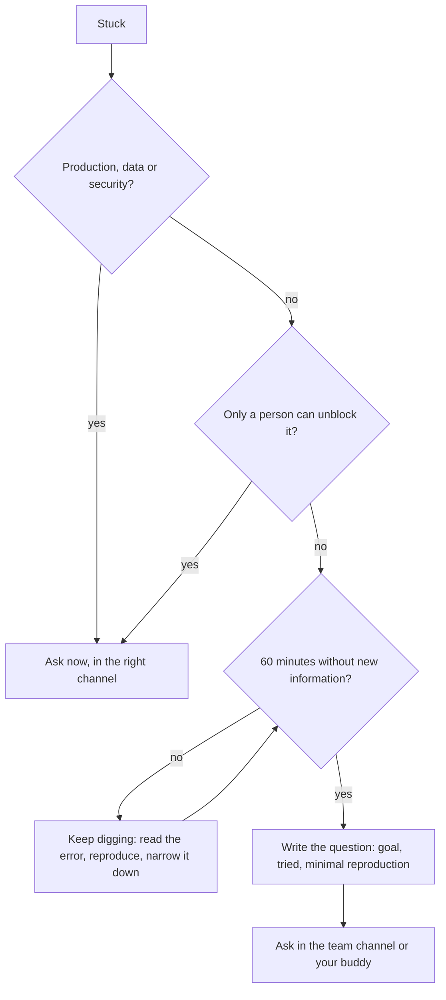

## 8.3 Reading and clarifying a ticket

### 8.3.1 What the ticket says, what it means, and what it forgot

#### Concept

A ticket is a compressed message from someone who understands a problem to someone who will solve it. It always loses information on the way. Reading a ticket well means recovering three things: **what problem** it solves for whom, **what done looks like** (the acceptance criteria), and **what it does not say** (edge cases, constraints, unknowns). Clarifying means asking about the third group **before** you write code.

#### Why does it exist?

The most expensive bug is building the wrong thing correctly. A developer who spends three days on a feature, then hears "that's not what I meant", has lost three days and some trust. Ten minutes of questions on day one usually prevents it. Product managers are not careless; they simply cannot imagine every question an engineer will have, and the engineer is the one who discovers the gaps.

#### Mental model

Imagine a builder handed a note: "Put a window in the kitchen." A good builder asks: which wall, how big, opening or fixed, and is that wall load-bearing? None of these questions is difficult. Not asking them means knocking a hole in the wrong wall.

#### How it works

Read every ticket in four passes:

1. **The why.** Who is the user, what are they trying to do, and why now? If the ticket does not say, ask. Knowing the goal lets you suggest a cheaper way to reach it.
2. **The acceptance criteria.** Concrete, testable statements of done. If they are missing, write a draft yourself and ask the author to confirm it. People find it much easier to correct a draft than to write from nothing.
3. **The gaps.** Run the senior mantra from this book over it: Can it time out? Can it fail? Can it duplicate? Can it partially succeed? Who is allowed to do this? What happens to existing data?
4. **The size.** Does this fit in a few days? If not, it probably needs splitting (8.4).



Notice the last step: while you wait for answers, start on the parts that are not in doubt. Clarifying does not mean stopping.

#### Practical example — a vague ticket, clarified

```text
SHOP-1561  Let customers cancel orders
Reporter: Lena (Product)
Customers keep emailing support to cancel orders. Add a cancel button in the app
and an API endpoint for it.
```

Aisha reads it in four passes and posts one comment on the ticket:

```text
Hi Lena, a few questions before I start on SHOP-1561 so I build the right thing:

1. Until when can a customer cancel? My assumption: only while status is
   'pending' or 'paid', not once it is 'packed' or 'shipped'. Is that right?
2. Refunds: if the order is paid, should cancelling also refund automatically,
   or does support refund manually? (Automatic means we call the payment provider.)
3. Partial cancellation (one item of three): in scope or a later ticket?
4. Should the customer get an email confirmation?
5. Should the warehouse be told? They read our order events, so cancelling must
   publish an "order.cancelled" event or they may pack it anyway.

Draft acceptance criteria (please correct):
- POST /orders/:id/cancel by the order's owner succeeds for pending/paid orders.
- Returns 409 with a clear message for packed/shipped/cancelled orders.
- Paid orders are refunded in full; the refund is idempotent (a retry never refunds twice).
- An "order.cancelled" event is published.
- Another customer's order returns 404 (we do not reveal that it exists).

I will start on the status rules and the endpoint now; they do not depend on 2-4.
```

This message is short, numbered, states assumptions so they can be confirmed with "yes", and keeps work moving. Questions 2 and 5 found real work that was not in the ticket at all: a payment provider call and an event the warehouse depends on. The last acceptance criterion is a security decision (Part 44 — Security covers why returning 404 rather than 403 avoids leaking that an order exists), and raising it now is much cheaper than in review.

#### How a Senior Backend Engineer thinks about this

Seniors read a ticket looking for hidden system boundaries: "cancel" touches payments, the warehouse, notifications and authorisation, even though the ticket says "add a button". They ask in writing, on the ticket, so the answers outlive the chat thread. They also notice when a ticket treats a symptom ("customers email support") and ask whether the cause deserves its own ticket.

#### Common mistakes

- Starting to code immediately and asking questions only when stuck.
- Asking questions one at a time across a day of chat messages instead of one numbered list.
- Asking open questions ("how should cancellation work?") instead of stating an assumption to confirm.
- Treating the ticket as a contract and building exactly what it says, even when you can see it misses something important.

## 8.4 Breaking work down and estimating honestly

### 8.4.1 Splitting a ticket into steps you can finish

#### Concept

**Breaking down** means turning one ticket into a sequence of small steps, each of which can be finished, tested and ideally merged on its own. **Estimating** means predicting how long the work will take, honestly, including what you do not know yet.

#### Why does it exist?

Big, vague work hides its problems until late: a ticket that is "about a week" is often 80 percent done for two weeks. Small steps expose problems early and let you say with evidence "three of five steps are merged". Honest estimates let the team plan; optimistic ones make it plan around a fiction.

#### Mental model

Imagine planning a road trip. "Delhi to Jaipur, about five hours" is fine if you have driven it. If you have never driven it, the honest answer is "four to seven hours, depending on traffic at the toll plazas and whether we stop for lunch". The range is not weakness; it is information.

#### How it works — breaking down

Slice **vertically** where you can: each step delivers a thin piece that works end to end, rather than "all the database work, then all the API work". A good breakdown for SHOP-1561:

```text
SHOP-1561 Cancel orders, broken into mergeable steps
1. decideCancellation() policy + unit tests                         (no I/O, safe to merge)
2. POST /orders/:id/cancel for 'pending' orders only: owner check,
   status update in a transaction, 404/409 responses, e2e tests       (feature-flagged off)
3. Refund for 'paid' orders: payment client call with an idempotency
   key, refund recorded in the same transaction as the status change  (still flagged off)
4. Publish "order.cancelled" via the existing outbox                  (warehouse team reviews)
5. Confirmation email via the existing notifications queue
6. Enable the flag in staging, QA pass with Marco, enable in production, verify
```

Each line is a pull request a reviewer can read in fifteen minutes. The risky step (3, money) is isolated so it gets a careful review, and a feature flag lets half-finished work merge safely.



The diagram also shows that steps 3, 4 and 5 do not depend on each other, so in a hurry two people could share the work.

#### How it works — estimating

Three habits make an estimate honest:

1. **Estimate the steps, not the ticket.** Small things are easier to guess. Add them up.
2. **Give a range and name what makes it wide.** "Three to five days; the width is the refund step, because I have not used the payment provider's refund API yet."
3. **Say when you will know more, and come back.** "After I read the provider docs this afternoon I can narrow it."

Part 62 — The Senior Engineering Mindset (62.11.4) has the senior version of this advice. The junior version adds one sentence you must be comfortable saying: **"I don't know yet. I will find out by this afternoon and give you a number."** Every experienced engineer respects that sentence. Nobody respects a confident "two days" that becomes eight.

| Step | Known? | Estimate |
|---|---|---|
| 1 Policy and tests | Yes, similar code exists | 0.5 day |
| 2 Endpoint, pending only | Mostly; first e2e test in this module | 1 day |
| 3 Refunds | No; new API for me | 1 to 2.5 days |
| 4 Event via outbox | Yes; copy an existing event | 0.5 day |
| 5 Email | Yes | 0.5 day |
| 6 QA and release | Depends on Marco's queue | 0.5 to 1 day |
| **Total** | | **4 to 6 days** |

#### Failure scenario

A junior is asked in sprint planning, in front of eight people, how long a CSV export will take. Wanting to seem capable, they say "a day". It is not a day: the export must handle 2 million rows without loading them into memory (Part 13 covers streams), it needs to run as a background job because it takes minutes, and finance wants it emailed. On day four they are still working on it, embarrassed, and have not told anyone because they hope to finish "tomorrow". On day six the tech lead finds out at standup that a dependent feature cannot start. The damage was not the wrong estimate. It was the silence. Had they said on day two "this is bigger than I thought, here is why, my new range is five to seven days", the team would simply have re-planned.

#### How a Senior Backend Engineer thinks about this

Seniors know the error bars are the useful part of an estimate. When a junior's estimate is wrong, a good senior asks "what did we not know?" rather than "why were you slow?". What they will not accept is a surprise on the due date; updating early is a skill they actively look for.

#### Common mistakes

- Estimating only the coding, not testing, review, QA, deploy and verification. For small tickets those can be half the time.
- Giving a single number under social pressure.
- Not re-estimating when you learn the work is bigger.
- Breaking down "horizontally" (all migrations, then all services), so nothing works until everything is done.

#### Practical exercise

Break down and estimate this ticket. You have used the codebase for a month but never the PDF library.

```text
SHOP-1610  Customers can download an invoice PDF for a delivered order
GET /orders/:id/invoice.pdf returns a PDF with the shop's address, the customer's
billing address, line items, tax and total. Only the order's owner may download it.
```

Acceptance criteria: at least four steps, each independently mergeable; a range for each step; the total as a range; and one sentence naming the biggest unknown and how you will reduce it.

#### Worked answer to the exercise

```text
SHOP-1610 breakdown
1. InvoiceData builder: pure function from order + customer to the numbers and
   lines on the invoice (tax, totals in integer cents), with unit tests.        0.5-1 day
2. Spike, time-boxed to 2 hours: render a hard-coded InvoiceData to PDF with
   the chosen library; check fonts, the rupee and euro symbols, page breaks
   for 50+ lines.                                                                0.25 day
3. PDF renderer from InvoiceData, with a snapshot test of the text content.     1-2 days
4. Endpoint: owner check (404 for others), delivered-only (409 otherwise),
   Content-Type application/pdf, Content-Disposition with a safe filename,
   e2e tests.                                                                    0.5-1 day
5. QA with Marco on real-looking orders; deploy; verify one real download.      0.5 day
Total: 2.75 to 4.75 days, so "three to five days".
Biggest unknown: the PDF library (non-Latin symbols and long orders).
I reduce it with the 2-hour spike in step 2 before committing to the rest.
```

Why it is right: step 1 separates the money arithmetic (easy to test, easy to get wrong) from rendering (hard to test), so the important numbers are tested without a PDF. The spike is placed early and time-boxed, so the widest uncertainty is reduced first and the estimate can be narrowed by the end of day one. The endpoint has its own step because authorisation and content headers are where security bugs hide. The total is a range with a stated reason.

The trap most learners fall into is one step called "build invoice PDF, 2 days", which hides the unknown library inside a confident number. The second trap is forgetting step 5: verification and QA are part of the work, not something that happens to it afterwards.

## 8.5 Asking for help well

### 8.5.1 When to ask, and how

#### Concept

Asking for help is a core engineering skill, not an admission of failure. Doing it well has two parts: **timing** (not so early that you learn nothing, not so late that you waste a day) and **form** (a question that someone can answer in two minutes without a meeting).

#### Why does it exist?

A junior stuck for a day on something a teammate could answer in five minutes has cost the team a day. A junior who asks about every error before reading it never learns to debug. Teams want the middle: people who try first, then ask early with a well-formed question.

#### How it works — the 30/60-minute rule

A widely used rule of thumb: **work on a problem alone for about 30 minutes; if you have made no progress by about 60, ask.** "Progress" means you learned something new about the cause, not that you tried another random change. Adjust it for the situation:

| Situation | When to ask |
|---|---|
| Production is down or customers are affected | Immediately; say what you see in the incident channel |
| You might have leaked a secret or exposed data | Immediately; tell your lead or security, do not try to hide or quietly fix it |
| You are blocked by access, permissions or missing information only a person has | Immediately; there is nothing to debug |
| A setup or tooling problem others have certainly solved | After 15 to 30 minutes |
| A bug in code you are learning | After 30 to 60 minutes without progress |
| A design choice ("should this be a queue or a cron job?") | After you have written down two options and their trade-offs |
| You are making steady progress, just slowly | Keep going; mention it at standup |



#### How it works — the shape of a good help request

Part 0 (0.4.5) teaches the minimal reproduction and the five parts of a good question. At work, a help request in chat has the same parts, compressed:

1. **Goal**: what you are trying to do and why.
2. **Problem**: what you expected and what happened, with the exact error as text.
3. **What you tried**, and what each attempt told you.
4. **A minimal reproduction** or the exact command, plus the branch or commit.
5. **Your current guess**, even if it is wrong. It shows your reasoning and is often nearly right.

#### Practical example — a help request, before and after

Before:

```text
hey, the tests are failing on my branch, can anyone help?
```

Nobody can answer this without starting a conversation, so it waits until someone has time for a conversation.

After:

```text
Help please (not urgent, I'm blocked on SHOP-1561 step 2):

Goal: e2e test for POST /orders/:id/cancel.
Problem: the test fails with
  QueryFailedError: duplicate key value violates unique constraint "orders_pkey"
only when I run the whole suite (npm run test:e2e). Alone it passes.

Tried:
- Running my test alone: passes. So the code is probably fine.
- Running it after orders-history.e2e-spec.ts: fails. So it's about test order.
- Looked at the seed helper: both tests seed an order with id 'ord_test_1'.

Guess: the e2e suite does not reset the database between files, and I'm reusing
an id. Should I generate unique ids in my test, or is there a reset helper I missed?

Branch: feat/SHOP-1561-cancel, commit 8c41e2a.
```

Priya answers in a minute: "There's `resetDb()` in `test/utils.ts`; call it in `beforeEach`. Your guess was right." The question was nearly self-answering, which is normal: writing a good help request is a debugging technique in itself.

#### How a Senior Backend Engineer thinks about this

Seniors judge a junior by the quality of their questions, not their number. A junior who asks five well-formed questions a day is learning fast and is easy to help. A junior who asks none is either a prodigy or stuck, and it is usually the second. Seniors also ask for help themselves, often and publicly, which is the best signal that asking is normal on the team.

#### Common mistakes

- Waiting a whole day out of pride or fear of looking slow.
- Asking without trying anything, so the helper does the debugging for you and you learn nothing.
- Pasting a screenshot of an error instead of the text. Text can be searched and copied.
- Sending sensitive data (customer emails, tokens, production rows) in a public channel while asking.

#### Interview questions

1. **Tell me about a time you were stuck. What did you do?** Expected answer: a concrete story showing time-boxed independent effort, then a well-formed request for help, and what you learned. Why it matters: interviewers for junior roles are testing exactly this habit.
2. **How do you decide when to ask for help?** A time box adjusted by impact: immediately for production, security or access; otherwise after a bounded effort with no new information.

#### Practical exercise

Rewrite this message so a busy teammate can answer it in two minutes. Invent reasonable details where needed.

```text
the payment webhook isnt working locally, i think something with the signature?
```

Acceptance criteria: goal, exact error, at least two things tried with what each showed, a guess, and the branch or command.

#### Worked answer to the exercise

```text
Help please (not urgent, blocking SHOP-1561 step 3):

Goal: test the refund webhook locally with the provider's CLI forwarder.
Problem: every forwarded event gets 400 from POST /webhooks/payments:
  {"code":"invalid_signature","message":"Webhook signature verification failed"}

Tried:
- Sent the same event with curl: also 400, so it's not the forwarder.
- Logged the secret our app loads: it's the value from .env.example,
  but the forwarder printed a different signing secret when it started.
- Updated PAYMENTS_WEBHOOK_SECRET to the forwarder's secret and restarted: still 400.

Guess: signature verification needs the raw request body, and our global JSON
body parser gives the controller the parsed object, so the bytes differ. Is
there a raw-body setting for this route I should use?

Branch: feat/SHOP-1561-refunds, run with: npm run start:dev, then the forwarder.
```

Why it is right: the goal and the exact error are at the top, each attempt says what it ruled out (the forwarder, then the secret), and the guess is specific enough for a colleague to answer "yes, see `rawBody: true` in `main.ts`" in one line. NestJS does support this: creating the app with `NestFactory.create(AppModule, { rawBody: true })` makes the raw body available on the request for signature checks.

The trap most learners fall into is listing attempts without what each one taught you ("I tried restarting, I tried changing the secret"). The lesson of each attempt is what lets the helper skip straight to the remaining possibilities. The second trap is pasting the real webhook secret into the message; describe it, never paste it.
