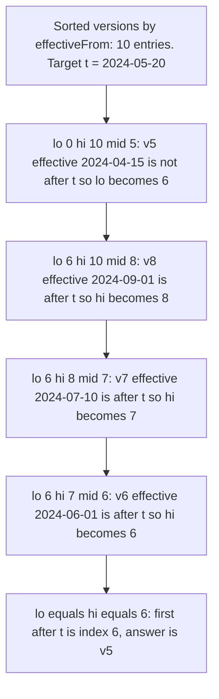
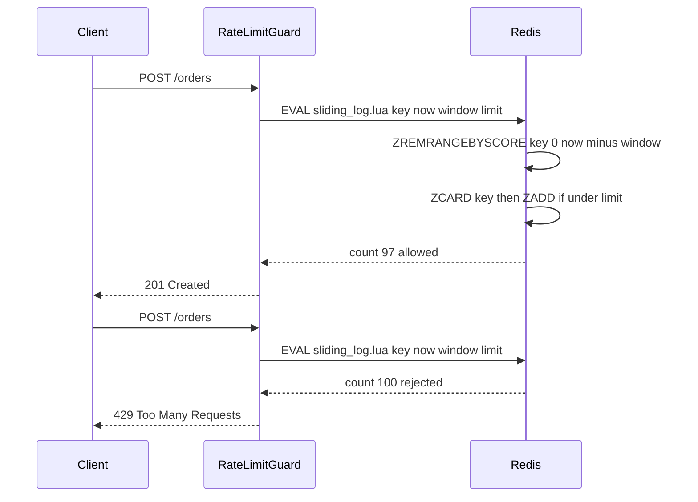

## 8.6 Binary search

#### Concept

Binary search finds a value in a sorted collection by repeatedly halving the search range. Look at the middle element; if it is what you want, stop; if it is smaller than the target, the target must be in the right half; otherwise, the left half. Each step discards half the remaining candidates, so a million elements take at most 20 steps and a billion take 30.

The exact-match version is the one from textbooks. The versions you actually use in backends are the *boundary* versions: "the last version whose `effectiveFrom` is at or before this timestamp", "the first sample at or after this time", "where does the next page start". These are called lower bound and upper bound searches, and they are the same algorithm with a different stopping rule.

#### Why does it exist?

Because sorted data is everywhere in a backend and scanning it linearly is wasteful. Config versions are sorted by effective date. Price history is sorted by time. Metrics samples are sorted by timestamp. Every B-tree index is sorted by key. Binary search is how you exploit that order: `O(log n)` instead of `O(n)`, with no extra data structure and no extra memory.

Without it, a lookup into a sorted array of 100,000 price points is 100,000 comparisons per call. With it, 17.

#### Mental model

Imagine guessing a number between 1 and 1,000 where the only feedback is "higher" or "lower". Guessing 1, 2, 3 in turn takes up to 1,000 guesses. Guessing 500, then 250 or 750, and so on takes at most 10. The B-tree index in PostgreSQL is the same game played on disk pages: each page tells you which child page holds the range you want, and after three or four pages you are at the leaf.

#### How it works

The lower-bound form, which finds the first index whose value is `>= target` (returns `n` if none):

```ts
// Returns the index of the first element for which `isAtOrAfter(element)` is true.
// The predicate must be monotonic: false, false, ..., false, true, true, ..., true.
export function lowerBound<T>(items: readonly T[], isAtOrAfter: (item: T) => boolean): number {
  let lo = 0;
  let hi = items.length;              // half-open range [lo, hi)
  while (lo < hi) {
    const mid = lo + ((hi - lo) >> 1); // no overflow, no floating point
    if (isAtOrAfter(items[mid])) hi = mid;   // answer is at mid or to the left
    else lo = mid + 1;                       // answer is strictly to the right
  }
  return lo;
}

// "Latest item at or before t": one past the first item that is after t, minus one.
export function latestAtOrBefore<T>(items: readonly T[], at: (item: T) => number, t: number): T | undefined {
  const firstAfter = lowerBound(items, (item) => at(item) > t);
  return firstAfter === 0 ? undefined : items[firstAfter - 1];
}
```

The predicate form is worth learning because it generalizes: any question of the shape "find the boundary where a monotonic condition flips" is a binary search. That includes "the largest batch size that still finishes under 100 ms" and "the earliest deploy after which the error rate exceeded 1%".



Three backend uses:

1. **Versioned config lookup.** Pricing rules, tax rates, feature flag schedules and commission tiers all have an `effective_from`. "Which version applied at the time this order was placed?" is `latestAtOrBefore`. Keep versions sorted in memory (they change rarely, there are hundreds, not millions) and answer in `O(log n)` with no I/O.
2. **Time-series lookup.** "What was the exchange rate at 14:32:07?", "what was the inventory level when this order was created?" Samples are sorted by time; the answer is the latest sample at or before the instant.
3. **Cursor pagination boundaries.** Keyset pagination says "give me 50 rows after `(created_at, id) = (X, Y)`". Inside PostgreSQL, the B-tree descent to `(X, Y)` is a binary search over the index pages, and then a sequential walk of 50 leaf entries. That is why keyset pagination is `O(log n + 50)` regardless of how deep the page is, while `OFFSET 1000000` is `O(1,000,050)`.

#### Practical example

A commission engine applies the merchant's commission tier that was in effect when an order was placed, not the current one (the finance team reprocesses old orders during disputes). The tiers table has about 30 versions per merchant. Loading them once per merchant into a sorted array and binary searching per order is `O(log 30)` = 5 comparisons, versus a database round trip per order during a 2-million-order reprocessing job.

#### NestJS example

```ts
// commissions/commission-tiers.service.ts
import { Injectable } from '@nestjs/common';
import { InjectRepository } from '@nestjs/typeorm';
import { Repository } from 'typeorm';
import { CommissionTier } from './commission-tier.entity';
import { latestAtOrBefore } from '../common/binary-search';

@Injectable()
export class CommissionTiersService {
  // merchantId -> tiers sorted ascending by effectiveFrom (ms since epoch)
  private readonly cache = new Map<string, CommissionTier[]>();

  constructor(@InjectRepository(CommissionTier) private readonly tiers: Repository<CommissionTier>) {}

  async tierAt(merchantId: string, placedAt: Date): Promise<CommissionTier> {
    let versions = this.cache.get(merchantId);
    if (!versions) {
      // One query per merchant per process lifetime; the DB sorts using the index
      versions = await this.tiers.find({ where: { merchantId }, order: { effectiveFrom: 'ASC' } });
      this.cache.set(merchantId, versions);
    }
    const tier = latestAtOrBefore(versions, (v) => v.effectiveFrom.getTime(), placedAt.getTime());
    if (!tier) {
      throw new Error(`No commission tier for merchant ${merchantId} at ${placedAt.toISOString()}`);
    }
    return tier;
  }

  invalidate(merchantId: string): void {
    this.cache.delete(merchantId); // call from the tier-updated event handler
  }
}
```

The cache is bounded by the number of merchants times ~30 rows; for 50,000 merchants that is about 1.5 million small objects, roughly 150 MB, which is worth a bounded LRU rather than a plain `Map` in a long-lived process (see the cache eviction worked example later in this part).

#### PostgreSQL example

The same lookup in SQL, with the index that makes the B-tree do the binary search:

```sql
CREATE INDEX CONCURRENTLY commission_tiers_merchant_effective_idx
  ON commission_tiers (merchant_id, effective_from DESC);

-- "Latest version at or before placed_at": descend to the boundary, read one row
SELECT rate_bps
FROM commission_tiers
WHERE merchant_id = $1 AND effective_from <= $2
ORDER BY effective_from DESC
LIMIT 1;
```

```text
Limit  (cost=0.42..3.44 rows=1 width=4) (actual time=0.019..0.020 rows=1 loops=1)
  ->  Index Scan using commission_tiers_merchant_effective_idx on commission_tiers
        (cost=0.42..48.10 rows=16 width=4) (actual time=0.018..0.018 rows=1 loops=1)
        Index Cond: ((merchant_id = $1) AND (effective_from <= $2))
```

Keyset pagination is the other everyday binary search. The row-value comparison lets PostgreSQL seek directly to the boundary in a composite index:

```sql
-- Page after the cursor (created_at = $1, id = $2), newest first
SELECT id, total_cents, created_at
FROM orders
WHERE customer_id = $3
  AND (created_at, id) < ($1, $2)
ORDER BY created_at DESC, id DESC
LIMIT 50;
```

With the index `(customer_id, created_at DESC, id DESC)`, this is an index descent (`O(log n)`) plus 50 sequential leaf reads, whether it is page 2 or page 20,000. Compare `OFFSET 1000000`, which reads and discards a million index entries first.

#### TypeORM example

```ts
async pageAfter(customerId: string, cursor?: { createdAt: Date; id: string }): Promise<Order[]> {
  const qb = this.orders
    .createQueryBuilder('o')
    .where('o.customer_id = :customerId', { customerId })
    .orderBy('o.created_at', 'DESC')
    .addOrderBy('o.id', 'DESC')
    .take(50);

  if (cursor) {
    // Row-value comparison: PostgreSQL seeks straight to the boundary in the composite index
    qb.andWhere('(o.created_at, o.id) < (:createdAt, :id)', cursor);
  }
  return qb.getMany();
}
```

#### Sequelize example

Sequelize has no row-value operator, so express the same boundary with `Op.or`:

```ts
import { Op } from 'sequelize';

const where: Record<string, unknown> = { customerId };
if (cursor) {
  where[Op.or as unknown as string] = [
    { createdAt: { [Op.lt]: cursor.createdAt } },
    { createdAt: cursor.createdAt, id: { [Op.lt]: cursor.id } },
  ];
}
const page = await Order.findAll({
  where,
  order: [['createdAt', 'DESC'], ['id', 'DESC']],
  limit: 50,
  raw: true,
});
```

The planner handles the `OR` form well when the composite index exists, but check the plan; on some versions it produces a `BitmapOr` rather than a single seek.

#### Production scenario

A metrics service stores 1-second samples per host in memory for the last hour (3,600 samples per series, 20,000 series). A dashboard asks "value at time t" for 500 series per refresh, 10 refreshes per second. Linear scan: 500 × 3,600 × 10 = 18 million comparisons per second, about 20% of a core. Binary search: 500 × 12 × 10 = 60,000. The difference does not show up as an incident; it shows up as a smaller instance type.

#### Failure scenario

At 03:30 a settlement job starts charging merchants the wrong commission. The tiers array was sorted by `effective_from` in the database with `ORDER BY effective_from` on a `timestamptz` column, and binary-searched in Node by comparing `Date` values. A new tier was inserted with `effective_from` of `'2025-03-30 02:30'` in a local-time session during the DST transition, which stored a UTC instant *earlier* than the previous tier's. The array was no longer sorted at that point, the binary search's invariant broke, and for some `placedAt` values it returned the tier one position off. Nobody saw an error; the wrong rate was applied to 14,000 orders. The fix: store and compare in UTC only, and assert sortedness when loading the array (an `O(n)` check that is cheap for hundreds of entries).

#### Edge cases & failure modes

- **Unsorted or partially sorted input.** Binary search returns a wrong answer, not an error. Validate the invariant at load time.
- **Off-by-one at the boundaries.** Use the half-open `[lo, hi)` form consistently; test with an empty array, one element, target before first, target after last, target equal to an element.
- **Duplicates.** Lower bound returns the first of the equal run; upper bound returns one past the last. Decide which you need.
- **Precision mismatch.** Millisecond timestamps in Node versus microsecond `timestamptz` in PostgreSQL; a version effective at `12:00:00.000500` is "after" the Node value `12:00:00.000`.
- **Cursor tampering.** A client can forge a keyset cursor. Sign or encrypt cursors, or accept that they are just a `(timestamp, id)` pair with no security value.
- **Cursor on a mutable sort key.** If `updated_at` is the cursor column and rows are updated between pages, rows move across the boundary. Use immutable keys (`created_at`, `id`) for cursors.

#### How a Senior Backend Engineer thinks about this

The senior asks: "Is this data sorted, who guarantees it, and are we exploiting it?" A lookup into a sorted in-memory structure with `find` is a review comment. A paginated endpoint using `OFFSET` on a large table is a design change request, because the `O(offset)` cost is a latency cliff waiting for a deep page.

They also see binary search as a debugging tool: bisecting deploys to find which one introduced a regression (`git bisect` is binary search over commits), bisecting a batch to find the one poison record, bisecting a time range to find when a metric changed.

To a product manager: "Jumping to page 5,000 in the admin list would make the database read and throw away 250,000 rows every time. Infinite scroll with a 'next' cursor is instant at any depth. We can support 'jump to date' too, which is the same trick."

#### Common mistakes

- `OFFSET`-based pagination on tables that grow.
- Linear scanning sorted arrays because binary search "seems risky".
- Writing the exact-match version and then hacking it for boundary queries; write `lowerBound` once and derive.
- `Math.floor((lo + hi) / 2)` in languages with fixed-width integers (overflow); in JavaScript it is fine numerically but the shift form is a good habit.
- Forgetting the equal-key tiebreaker in a keyset cursor, so two rows with the same timestamp cannot both be on the boundary.

#### Interview questions

1. **"Implement 'latest config version effective at time t' and state its complexity."** Expected: lower bound on `effectiveFrom > t`, minus one; `O(log n)`. Follow-up: what happens if the array is not sorted, and how do you defend?
2. **"Why is keyset pagination O(log n) while OFFSET is O(offset)? Relate it to the index structure."** Expected: B-tree descent is a binary search over pages; offset must walk entries.
3. **"What is the difference between lower bound and upper bound, and give a backend case for each."** Expected: first `>=` versus first `>`; "samples since t" versus "samples up to and including t".
4. **"Give an example of binary searching on a predicate that is not a lookup."** Expected: largest batch size under a latency budget; `git bisect`.
5. **"How would you paginate by `updated_at`, given rows change between pages?"** Expected: you generally should not; use an immutable key, or snapshot the id list.

#### Practical exercise

Implement `lowerBound`, `upperBound` and `latestAtOrBefore` with unit tests covering empty input, single element, target below/above all, duplicates and exact hits. Then convert one `OFFSET`-paginated endpoint to keyset pagination with a `(created_at, id)` cursor and compare `EXPLAIN ANALYZE` for page 1 and page 10,000.

Acceptance criteria:

- All boundary tests pass; a property test with random sorted arrays agrees with a linear scan.
- Page 10,000 with keyset has the same execution time as page 1 (within noise); the `OFFSET` version shows the difference.
- The endpoint rejects malformed cursors with a 400.

## 8.7 Two pointers

#### Concept

The two-pointer technique walks through one or two *sorted* sequences with two indices that only ever move forward. Because neither pointer goes back, the total work is the sum of the lengths: `O(n + m)`. It is how you merge two sorted lists, remove duplicates from a sorted list in one pass, find pairs with a given property, and, most usefully in a backend, reconcile two sorted ledgers.

#### Why does it exist?

Matching two collections naively is `O(n * m)`. Building a hash map from one is `O(n + m)` but costs `O(n)` memory and only supports equality. When both inputs are sorted by the same key, two pointers gets `O(n + m)` time with `O(1)` extra memory, preserves order in the output, and handles "what is in A but not in B" just as naturally as "what is in both". PostgreSQL's merge join is this exact algorithm.

#### Mental model

Imagine two clerks each holding a sorted stack of invoices, comparing the top invoice of each stack. If the numbers match, they staple the two together and both take the next one. If one clerk's number is smaller, that invoice has no partner: it goes into the "unmatched" pile and only that clerk advances. Nobody ever looks back into a stack. When both stacks are empty, every invoice has been classified, and each was looked at exactly once.

#### How it works

Merge two sorted sequences into one sorted sequence:

1. Start pointers `i = 0` on A and `j = 0` on B.
2. Compare `A[i]` and `B[j]`. Emit the smaller one and advance its pointer.
3. When one sequence is exhausted, emit the rest of the other.

Reconcile two sorted sequences by key:

1. Same setup. Compare keys.
2. Equal keys: a match; compare the payloads (amounts, statuses) and record a discrepancy if they differ; advance both.
3. `A` key smaller: `A[i]` has no counterpart in B; record "missing in B"; advance `i`.
4. `B` key smaller: record "missing in A"; advance `j`.
5. Drain whichever remains as "missing in the other".

Dedup a sorted array in place: a write pointer `w` and a read pointer `r`; copy `A[r]` to `A[w]` only when it differs from `A[w - 1]`.

Merging `k` sorted feeds (a social timeline from `k` followed accounts) generalizes two pointers with a min-heap of the current head of each feed: `O(N log k)` for `N` total items. The heap is in the Dijkstra section of this part.

#### Practical example

Daily payment reconciliation. The internal ledger has 1.2 million captured payments for the day; the payment gateway's settlement file has 1.2 million rows. Both are sorted by the gateway's transaction id. The job must produce three lists: amount mismatches, payments we recorded that the gateway did not settle, and settlements we have no record of. Two pointers does this in one pass of about 2.4 million comparisons, well under a second, with memory for only the discrepancies.

#### NestJS example

```ts
// reconciliation/reconciliation.service.ts
import { Injectable, Logger } from '@nestjs/common';

export interface LedgerRow { txnId: string; amountCents: number; }
export interface SettlementRow { txnId: string; amountCents: number; }

export interface ReconciliationReport {
  matched: number;
  amountMismatch: Array<{ txnId: string; ledger: number; settled: number }>;
  missingInSettlement: string[];
  missingInLedger: string[];
}

@Injectable()
export class ReconciliationService {
  private readonly logger = new Logger(ReconciliationService.name);

  // Both inputs MUST be sorted ascending by txnId using the same comparison (plain UTF-16 order).
  reconcile(ledger: readonly LedgerRow[], settlement: readonly SettlementRow[]): ReconciliationReport {
    const report: ReconciliationReport = { matched: 0, amountMismatch: [], missingInSettlement: [], missingInLedger: [] };
    let i = 0;
    let j = 0;
    while (i < ledger.length && j < settlement.length) {
      const a = ledger[i];
      const b = settlement[j];
      if (a.txnId === b.txnId) {
        if (a.amountCents !== b.amountCents) {
          report.amountMismatch.push({ txnId: a.txnId, ledger: a.amountCents, settled: b.amountCents });
        } else {
          report.matched += 1;
        }
        i += 1; j += 1;
      } else if (a.txnId < b.txnId) {
        report.missingInSettlement.push(a.txnId); i += 1;   // ledger has it, gateway does not
      } else {
        report.missingInLedger.push(b.txnId); j += 1;       // gateway has it, we do not
      }
    }
    for (; i < ledger.length; i += 1) report.missingInSettlement.push(ledger[i].txnId);
    for (; j < settlement.length; j += 1) report.missingInLedger.push(settlement[j].txnId);
    this.logger.log(`reconciled: ${report.matched} ok, ${report.amountMismatch.length} mismatches`);
    return report;
  }
}
```

The comment about the comparison is not decoration. If the ledger was sorted by PostgreSQL under a locale collation and the settlement file was sorted by the gateway using byte order, `'a-1' < 'a1'` may be true in one and false in the other, and the pointers will desynchronize silently. Sort both sides yourself in Node, or sort in PostgreSQL with `COLLATE "C"`, and assert sortedness before the walk.

#### PostgreSQL example

If both sides are in the database, the reconciliation is a `FULL OUTER JOIN`, and when both inputs are sorted (by an index or an explicit sort) the planner uses a **Merge Join**, which is two pointers:

```sql
EXPLAIN (ANALYZE, BUFFERS)
SELECT
  coalesce(l.txn_id, s.txn_id) AS txn_id,
  l.amount_cents AS ledger_cents,
  s.amount_cents AS settled_cents,
  CASE
    WHEN l.txn_id IS NULL THEN 'missing_in_ledger'
    WHEN s.txn_id IS NULL THEN 'missing_in_settlement'
    WHEN l.amount_cents <> s.amount_cents THEN 'amount_mismatch'
    ELSE 'ok'
  END AS outcome
FROM ledger_payments l
FULL OUTER JOIN settlement_rows s ON s.txn_id = l.txn_id
WHERE l.settled_on = '2025-06-01' OR s.settled_on = '2025-06-01';
```

```text
Merge Full Join  (cost=0.85..98210.30 rows=1200000 width=52) (actual time=0.040..1610.221 rows=1200418 loops=1)
  Merge Cond: (l.txn_id = s.txn_id)
  ->  Index Scan using ledger_payments_txn_id_idx on ledger_payments l  (actual time=0.018..520.114 rows=1200103 loops=1)
  ->  Index Scan using settlement_rows_txn_id_idx on settlement_rows s  (actual time=0.015..498.902 rows=1200315 loops=1)
Execution Time: 1702.556 ms
```

Two index scans, each in key order, walked in lockstep. No hash table, no `work_mem` spill, `O(n + m)`. If one side lacked an index, you would see a `Sort` node above it: PostgreSQL sorts that side first, then merges.

#### Production scenario

A social feed service merges posts from followed accounts. Each account's posts are already sorted by `created_at DESC` in a per-account Redis list. For a user following 300 accounts, the service fetches the first 20 posts from each (300 pipelined `LRANGE` calls, one round trip, ~2 ms) and does a k-way merge with a heap of size 300 to produce the top 50: `O(50 log 300)` ≈ 400 comparisons. The alternative (concatenate 6,000 posts and sort) is `O(6000 log 6000)` ≈ 75,000 comparisons, still cheap, but at 3,000 followed accounts and 2,000 RPS the heap version is the one that keeps the CPU flat.

#### Failure scenario

At 06:10 the reconciliation job reports 340,000 "missing in settlement" and 340,000 "missing in ledger", a wall of false positives. The gateway changed its export to sort transaction ids case-insensitively. The ledger side was still byte-sorted. From the first uppercase id onward, the two pointers walked past each other: every ledger row looked "smaller" than the settlement head, and vice versa, so both were dumped into the unmatched piles. The job "succeeded". Finance opened 340,000 disputes before someone noticed. The fix: sort both inputs in the job itself with the same comparator, and fail fast if either input is not sorted under that comparator.

#### Edge cases & failure modes

- **Different sort orders on the two sides.** Collation, case, locale, numeric-versus-lexical (`'10' < '9'`). The most common two-pointer bug in practice.
- **Duplicates on one side.** Two ledger rows with the same `txnId` (a retry that was recorded twice) will match one settlement row and leave the other as "missing". Decide whether duplicates are an error before the walk, or group them first.
- **Null or missing keys.** Sort them to one end explicitly and handle them before the walk.
- **Streaming inputs.** Both sides can be streams (a file and a cursor); two pointers works on iterators, which keeps memory `O(1)`.
- **Off-by-one in the drain loops.** Forgetting to drain the remainder of one side after the other runs out silently loses rows.

#### How a Senior Backend Engineer thinks about this

When two sorted inputs must be compared, the senior reaches for two pointers or a merge join, not for a hash map, because the output is ordered and memory is constant. When the inputs are not sorted and both come from the database, the senior lets PostgreSQL sort and merge them. When one side is a file from an external party, the senior never trusts its order and sorts it locally, because the cost of `O(n log n)` is far below the cost of a silent desynchronization.

To a product manager: "Reconciliation is like two people walking down two sorted lists at the same time. It is fast, but it only works if both lists are sorted the same way. When the bank changes how they sort, we have to re-sort their file ourselves first."

#### Common mistakes

- Assuming external files are sorted because they were last month.
- Comparing keys with `localeCompare` on one side and `<` on the other.
- Building a hash map when a sorted merge would keep memory flat and output ordered.
- Not handling duplicate keys.
- Concatenating and sorting `k` sorted feeds instead of merging.

#### Interview questions

1. **"Reconcile two sorted lists of a million payments each. Complexity, memory, and what can go wrong?"** Expected: `O(n + m)`, `O(discrepancies)` memory; failure when sort orders differ or keys duplicate.
2. **"How does PostgreSQL's merge join relate to the two-pointer technique, and when does the planner choose it?"** Expected: same algorithm; chosen when both inputs are sorted or cheaply sortable, typically via indexes.
3. **"Merge 300 sorted feeds into a top-50 timeline. Which approach and why?"** Expected: k-way merge with a heap, `O(50 log 300)`.
4. **"Dedupe a sorted array in place in one pass."** Expected: read/write pointers.
5. **"You receive a 'sorted' CSV from a partner. Do you trust it?"** Expected: no; sort it yourself or verify in `O(n)`.

#### Practical exercise

Implement `reconcile` over two async iterators (a CSV stream and a PostgreSQL cursor) so memory stays constant. Feed it a 500,000-row settlement file with 200 deliberate mismatches, 50 missing rows on each side and 10 duplicate ids.

Acceptance criteria:

- The report identifies every planted discrepancy and nothing else.
- Memory stays flat regardless of file size (verify with `process.memoryUsage()`).
- The job aborts with a clear error when an input is not sorted under the job's comparator.

## 8.8 Sliding window

#### Concept

A sliding window is a fixed-size range that moves over a sequence, one step at a time, while you maintain some summary of what is inside it: a count, a sum, a maximum, an average. The trick is that as the window slides, you *update* the summary incrementally (add the element entering, remove the element leaving) instead of recomputing it from scratch. That turns `O(n * w)` for a window of size `w` into `O(n)`.

In backends the "sequence" is usually time: requests in the last minute, latency samples in the last 60 seconds, orders in the last hour. Three families of problems use it: rate limiting, moving averages for metrics, and anomaly detection.

#### Why does it exist?

Because "how many requests did this client make in the last 60 seconds?" is asked on every request, and counting all of them each time is `O(requests)`. Because "average latency over the last minute" is computed every second by every service, and re-summing 60,000 samples each second is a waste. And because fixed windows have edge problems: a limit of 100 per minute with fixed minute buckets allows 200 requests in the two seconds spanning a minute boundary. Sliding windows fix that.

#### Mental model

Imagine a doorman who allows at most 100 entries per rolling hour. A fixed-window doorman resets his count at the top of each hour, so 100 people at 09:59 and 100 more at 10:01 both get in: 200 in two minutes. A sliding-window doorman keeps a list of entry times and, for each new arrival, crosses out every entry older than an hour, then checks whether fewer than 100 remain. He never recounts from the beginning; he only removes the old and adds the new.

#### How it works

**Sliding window log.** Keep the timestamps of every event in the window. On each new event: remove timestamps older than `now - windowSize`, then count. Exact, but memory is `O(events in window)` per key. For 100 per minute that is at most 100 timestamps per client; for 10,000 per minute it is 10,000.

**Sliding window counter.** Keep only two counters: the current fixed window and the previous one. Estimate the rolling count as `previousCount * (fraction of the previous window still inside the sliding window) + currentCount`. `O(1)` memory per key, an approximation that assumes events were evenly spread in the previous window. This is what large edge networks use; the error is small in practice and always conservative enough for abuse prevention.

**Moving average with a running sum.** Keep a ring buffer of the last `w` values and a running `sum`. On each new value: `sum += value - buffer[oldestIndex]`, overwrite the slot, advance the index. Average is `sum / w`. `O(1)` per update.

**Sliding maximum / minimum** (for "p100 latency in the last minute" or "peak queue depth") uses a monotonic deque: `O(1)` amortized per update.

**Anomaly detection.** Maintain a moving average and a moving standard deviation (or an exponentially weighted moving average, EWMA, which needs no buffer at all: `ewma = alpha * value + (1 - alpha) * ewma`). Flag a sample when it is more than `k` standard deviations from the moving mean. This is how a simple "error rate is 4x its normal level" alert works.



The full rate-limiter implementations (token bucket, leaky bucket, sliding window in Redis Lua, and wiring into `@nestjs/throttler`) are in the worked example later in this part. Here is the in-process algorithmic core of the two sliding variants:

```ts
// rate-limit/sliding-window.ts

// Exact: keeps every timestamp in the window. Memory O(limit) per key.
export class SlidingWindowLog {
  private readonly hits = new Map<string, number[]>();
  constructor(private readonly limit: number, private readonly windowMs: number) {}

  allow(key: string, now = Date.now()): boolean {
    const list = this.hits.get(key) ?? [];
    const cutoff = now - this.windowMs;
    let drop = 0;
    while (drop < list.length && list[drop] <= cutoff) drop += 1; // timestamps are appended in order
    if (drop > 0) list.splice(0, drop);
    if (list.length >= this.limit) { this.hits.set(key, list); return false; }
    list.push(now);
    this.hits.set(key, list);
    return true;
  }
}

// Approximate: two counters per key. Memory O(1) per key.
export class SlidingWindowCounter {
  private readonly buckets = new Map<string, { windowStart: number; current: number; previous: number }>();
  constructor(private readonly limit: number, private readonly windowMs: number) {}

  allow(key: string, now = Date.now()): boolean {
    const windowStart = now - (now % this.windowMs);
    let b = this.buckets.get(key);
    if (!b || b.windowStart !== windowStart) {
      const previous = b && b.windowStart === windowStart - this.windowMs ? b.current : 0;
      b = { windowStart, current: 0, previous };
    }
    const elapsedFraction = (now - windowStart) / this.windowMs;
    const estimate = b.previous * (1 - elapsedFraction) + b.current;
    if (estimate >= this.limit) { this.buckets.set(key, b); return false; }
    b.current += 1;
    this.buckets.set(key, b);
    return true;
  }
}
```

#### Practical example

A checkout API allows 20 order submissions per minute per customer to stop scripted bulk-buying during flash sales. A fixed-minute counter lets a script submit 20 at 11:59:59 and 20 more at 12:00:00. The sliding window counter estimates the rolling count and refuses the second burst. Memory per customer is two integers and a window start, so 2 million active customers fit in a few hundred megabytes of Redis.

#### NestJS example

Moving averages belong in observability code. This interceptor keeps a 60-second moving average and a running standard deviation of latency per route, and flags anomalies to a logger (in a real system you would export to Prometheus and alert there; the point here is the algorithm on the hot path):

```ts
// observability/latency-window.interceptor.ts
import { CallHandler, ExecutionContext, Injectable, Logger, NestInterceptor } from '@nestjs/common';
import { Observable, tap } from 'rxjs';

class RingWindow {
  private readonly values: number[];
  private readonly squares: number[];
  private index = 0;
  private filled = 0;
  private sum = 0;
  private sumSquares = 0;
  constructor(size: number) { this.values = new Array(size).fill(0); this.squares = new Array(size).fill(0); }

  push(v: number): void {                       // O(1): subtract the leaving value, add the entering one
    this.sum += v - this.values[this.index];
    this.sumSquares += v * v - this.squares[this.index];
    this.values[this.index] = v; this.squares[this.index] = v * v;
    this.index = (this.index + 1) % this.values.length;
    this.filled = Math.min(this.filled + 1, this.values.length);
  }
  get mean(): number { return this.filled ? this.sum / this.filled : 0; }
  get stddev(): number {
    if (this.filled < 2) return 0;
    const m = this.mean;
    return Math.sqrt(Math.max(0, this.sumSquares / this.filled - m * m));
  }
}

@Injectable()
export class LatencyWindowInterceptor implements NestInterceptor {
  private readonly logger = new Logger(LatencyWindowInterceptor.name);
  private readonly windows = new Map<string, RingWindow>();

  intercept(ctx: ExecutionContext, next: CallHandler): Observable<unknown> {
    const route = `${ctx.getClass().name}.${ctx.getHandler().name}`;
    const started = performance.now();
    return next.handle().pipe(tap(() => {
      const ms = performance.now() - started;
      const w = this.windows.get(route) ?? new RingWindow(1000);
      const isAnomaly = w.stddev > 0 && ms > w.mean + 4 * w.stddev; // compare before pushing
      w.push(ms);
      this.windows.set(route, w);
      if (isAnomaly) this.logger.warn(`${route} latency ${ms.toFixed(1)}ms vs mean ${w.mean.toFixed(1)}ms`);
    }));
  }
}
```

#### PostgreSQL example

Sliding windows over stored data are what SQL window functions are for. A 7-day moving average of daily revenue and a z-score anomaly flag:

```sql
WITH daily AS (
  SELECT date_trunc('day', created_at)::date AS day, sum(total_cents) AS revenue
  FROM orders
  WHERE created_at >= now() - interval '90 days'
  GROUP BY 1
)
SELECT
  day,
  revenue,
  avg(revenue)    OVER w AS moving_avg_7d,
  stddev(revenue) OVER w AS moving_sd_7d,
  (revenue - avg(revenue) OVER w) / nullif(stddev(revenue) OVER w, 0) AS z_score
FROM daily
WINDOW w AS (ORDER BY day ROWS BETWEEN 6 PRECEDING AND CURRENT ROW)
ORDER BY day;
```

`ROWS BETWEEN 6 PRECEDING AND CURRENT ROW` is the sliding window; PostgreSQL computes each row's aggregate incrementally where it can. For a rate-limit-style question over stored events ("clients with more than 1,000 requests in any 60-second window today"), a `RANGE BETWEEN interval '60 seconds' PRECEDING AND CURRENT ROW` window over `request_log ORDER BY ts` does the same thing without a self-join.

#### Production scenario

An API gateway enforces 1,000 requests per minute per API key across 12 gateway pods. In-process windows would give each pod its own count, so the real limit becomes 12,000. The counters live in Redis instead: a sliding window counter needs two `INCR`-able keys per API key (`rl:{key}:{windowStart}`), each with a 2-minute TTL, and one Lua script to read both and increment atomically. At 40,000 RPS that is 40,000 Redis script calls per second, about 0.3 ms each on the gateway's critical path, and roughly 4 MB of Redis memory for 20,000 active keys. The sliding log variant would store up to 1,000 timestamps per key (a 16 MB sorted set footprint per 1,000 keys at that limit) and cost `O(log n)` per `ZADD`: fine at 100 per minute, wasteful at 1,000, unreasonable at 100,000.

#### Failure scenario

At 12:00:00 sharp on Black Friday, the checkout service sees a spike of 2x its rate limit for one second and the database connection pool saturates. The rate limiter was a fixed-window counter keyed by minute. Every client that had been throttled at 11:59 retried at exactly 12:00:00 when the window reset, and every one of them had a fresh allowance of 100. Two minutes' worth of allowance landed in one second. Switching to a sliding window counter spread the same allowance over the boundary and the spike disappeared; adding jitter to the client's `Retry-After` handling removed the synchronization entirely.

#### Edge cases & failure modes

- **Fixed-window boundary burst.** Up to 2x the limit at the boundary. Sliding windows exist for this.
- **Clock skew across pods.** Sliding windows keyed by wall-clock time on different machines disagree. Use Redis server time (`TIME` inside the Lua script) or a single time source.
- **Memory growth of window logs.** `O(limit)` per key per window; with many keys and high limits, prefer the counter.
- **Approximation error of the counter.** It assumes uniform distribution in the previous window; a burst at the end of the previous window is under-counted for part of the next. Acceptable for abuse control, not for billing.
- **Cold start of moving averages.** The first `w` samples are not a full window; anomaly detection must wait until the window is filled or use a warm-up rule.
- **Anomaly detection on bimodal data.** Cache hits and misses produce two latency clusters; the "mean" sits between them and everything looks anomalous. Track them separately.
- **Stale keys.** Every per-key window in Redis needs a TTL, or the key space grows forever.
- **Hot keys.** One API key at 100,000 RPM concentrates all its Redis traffic on one shard; consider local pre-limiting per pod.

#### How a Senior Backend Engineer thinks about this

The senior first asks what the window is *for*. Abuse prevention tolerates approximation, so a sliding counter in Redis wins on memory and speed. Billing or contractual quotas need exactness and an audit trail, which is a different system (an events table, not a rate limiter). Metrics windows need to be cheap on the hot path, so `O(1)` ring buffers or EWMA, never re-summing arrays.

They also ask where the window lives. Per-process windows are fast but multiply the limit by the pod count; centralized windows are correct but add a network hop to every request. The usual answer is both: a generous local limit as a circuit breaker, and the real limit in Redis.

To a product manager: "A limit of 100 per minute with a hard reset at each minute lets a bot do 200 in two seconds around the boundary. A rolling window fixes that, and it costs us a few bytes per user."

#### Common mistakes

- Fixed windows for rate limiting and then wondering about boundary bursts.
- Recomputing averages by summing an array on every request.
- Per-pod rate limits in a horizontally scaled service.
- Storing window state in Redis without a TTL.
- Using the mean of latency for alerting (use percentiles from a histogram) while using the sliding window for something it is good at: rates and counts.
- Sliding log with `ZADD` for very high limits, where memory and `O(log n)` per call matter.

#### Interview questions

1. **"Compare fixed window, sliding log and sliding counter rate limiters on accuracy, memory and cost per request."** Expected: fixed is `O(1)` but allows 2x bursts; log is exact but `O(limit)` memory; counter is `O(1)` and approximately accurate. Follow-up: which would you use for a 10,000 RPM limit and why?
2. **"How do you compute a moving average in O(1) per sample?"** Expected: ring buffer plus running sum; or EWMA with no buffer.
3. **"Why does a distributed rate limiter need a single time source?"** Expected: clock skew moves windows differently on each node; use Redis `TIME` in the script.
4. **"Design anomaly detection for error rate with a sliding window. What false positives do you expect?"** Expected: moving mean and stddev or EWMA with k-sigma; cold start, bimodal data, low-traffic noise.
5. **"Write the SQL for 'API keys that exceeded 1,000 requests in any 60-second window' over a request log."** Expected: window function with `RANGE ... PRECEDING`.

#### Practical exercise

Implement both `SlidingWindowLog` and `SlidingWindowCounter`, then write a simulation that sends bursts at window boundaries and reports how many requests each variant admitted over each 60-second rolling period. Then implement the moving-average ring buffer and feed it synthetic latency data with an injected spike.

Acceptance criteria:

- The log variant never admits more than `limit` in any rolling window; the counter variant's overshoot is measured and reported.
- The ring buffer's mean matches a brute-force recomputation to within floating-point error at every step.
- The anomaly detector flags the injected spike and no more than one false positive per 10,000 samples on the synthetic data.
