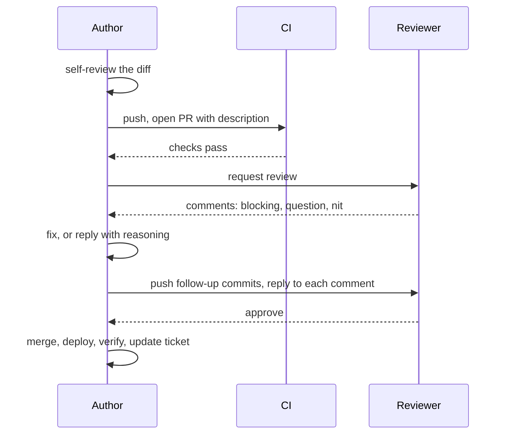
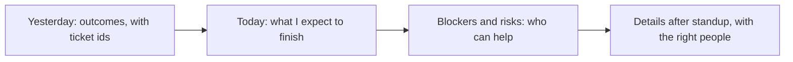
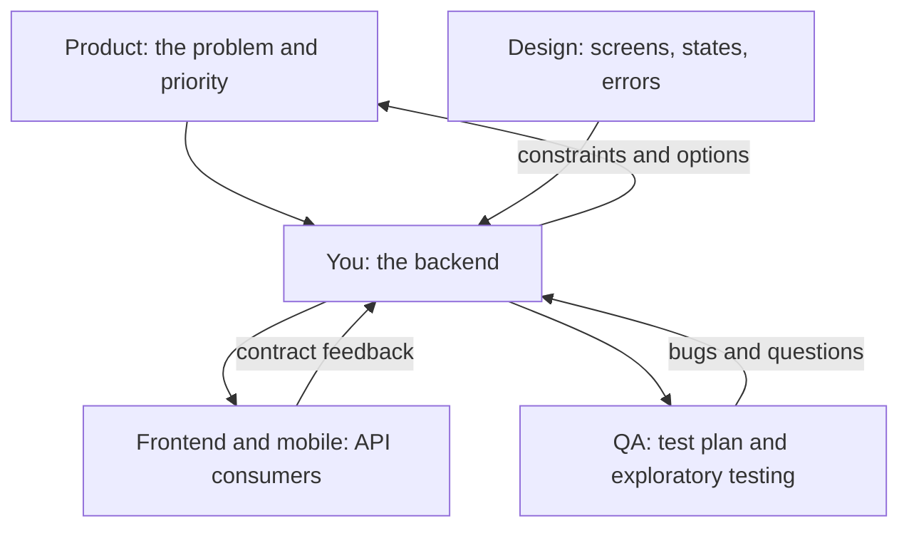

## 8.6 The pull request as a conversation

### 8.6.1 Small, described, self-reviewed

#### Concept

Part 5 — Git Basics and the Development Workflow taught the mechanics of a pull request (5.3) and of answering review feedback (5.10). This section is about the human side. A pull request is a **conversation** with your teammates about a proposed change. Your job as the author is to make that conversation short and useful: a small change, a description that explains it, and a self-review that catches the obvious problems before anyone else has to.

#### Why does it exist?

Reviewers are busy engineers with their own tickets. A pull request that is easy to understand gets reviewed quickly and carefully. One that is large, undescribed and full of leftover debug lines gets reviewed late, superficially, or with a long list of small comments that make everyone tired. Part 52 — Git from Intermediate to Senior (52.13) explains why review quality drops sharply as a diff grows; for a junior the practical rule is simple: **aim for pull requests a reviewer can read in 15 minutes**, usually under about 300 changed lines excluding generated files.

#### How it works — the review loop



**Self-review first.** Before requesting review, open your own pull request in the browser and read the diff as if a stranger wrote it. You will find things you never see in your editor. A short self-review checklist:

- [ ] Every changed file belongs to this ticket; no stray formatting or "while I was here" edits
- [ ] No debug output (`console.log('here')`), commented-out code or leftover `TODO`s without a ticket
- [ ] No secrets, tokens or real customer data in code, tests or fixtures
- [ ] Tests cover the acceptance criteria and at least one failure path
- [ ] Names say what things are; a reader understands each function without the ticket open
- [ ] New failure paths are logged with enough context to debug them (Part 47 — Observability: Logs, Metrics and Traces)
- [ ] The migration, if any, is safe to run while the old code is still serving (Part 27)
- [ ] CI is green before you ask anyone to look

**Describe it.** A good description answers what changed, why, how you tested it, and what is risky. Many teams have a template; fill every section honestly.

#### Practical example — a pull request description

```markdown
## SHOP-1561 step 2: cancel endpoint for pending orders (behind flag)

### What and why
Adds POST /orders/:id/cancel so customers can cancel orders that are still
'pending'. Paid-order refunds come in the next PR (step 3). The route is behind
the `order-cancellation` flag, off everywhere, so this is safe to merge.

### How it works
- `decideCancellation()` (merged in step 1) decides whether the status allows it.
- The status update runs in a transaction with `SELECT ... FOR UPDATE` on the
  order row, so a cancel and a concurrent "mark as packed" cannot both win.
- Not the owner -> 404 (we do not reveal that the order exists).
  Status not cancellable -> 409 with `code: "order_not_cancellable"`.

### How I tested it
- Unit tests for the controller's error mapping.
- e2e: owner cancels pending order (200), other customer (404), packed order (409),
  cancelling twice (409 the second time).
- Manually with curl against local Docker, flag on.

### Risk
Low: flag off. The row lock is held only for one UPDATE (a few ms).

### Out of scope
Refunds (step 3), event (step 4), email (step 5).
```

The reviewer knows what to look at (the lock and the error mapping), what not to worry about (refunds), and why it is safe to merge. That description took ten minutes and will probably save the reviewer twenty.

### 8.6.2 Responding to review without defensiveness

#### Concept

Review comments are about the code, not about you. Responding well means: understand each comment, fix what is right, discuss what you disagree with using reasons, answer every comment, and never take it personally. That last part is the hardest at first and becomes easy with practice.

#### Why does it exist?

Review is the main way a team shares knowledge and catches defects before customers do. A junior who argues with every comment, or silently ignores some, makes review expensive, and people start reviewing their work less carefully. A junior who responds well becomes someone everyone is happy to review, and learns at twice the speed.

#### How it works

Sort each comment into one of four kinds and respond accordingly:

| Comment kind | Example | Good response |
|---|---|---|
| Correct and blocking | "This reads the order before taking the lock; two cancels can race." | Fix it, push, reply "Good catch, fixed in a41c9e2, added a test for two concurrent cancels." |
| A question | "Why 404 rather than 403 here?" | Answer it, and if the answer is not obvious from the code, add a comment in the code too. |
| A preference or nit | "nit: I'd call this `cancellable` rather than `canCancel`." | Apply it if it is cheap; otherwise "Happy either way, I'll leave it unless you feel strongly." |
| You disagree | "Put this logic in the controller." | Explain once, with a reason: "I kept it in the service so the queue consumer can reuse it. Happy to move it if you see a problem with that." |

If a discussion goes back and forth more than twice in comments, stop typing and suggest a five-minute call. Then write the outcome in the pull request so the reasoning is recorded.

#### Failure scenario

A new developer receives twelve comments on their first real feature. Feeling criticised, they reply to the three they agree with, push fixes for those, and re-request review without mentioning the other nine. The reviewer has to re-read everything to find what changed and what was ignored, finds that a blocking comment about a missing transaction was skipped, and writes a terse "please address all comments". Now both sides are irritated, and the pull request takes four more days. The same twelve comments, answered one by one ("done", "done", "question: do you mean X?", "I disagree because Y"), would have merged the next morning.

#### How a Senior Backend Engineer thinks about this

Seniors get many review comments too; they simply do not experience them as judgement. They thank reviewers for catches, change their mind easily when shown a good reason, and hold their ground politely when they have one. When they review a junior's code they label severity (`blocking:`, `nit:`, `question:`), explain the why, and praise what is good, because they remember their own first reviews. If your reviewers do not label severity, ask: "Which of these are blocking for you?" That is a perfectly normal question.

#### Common mistakes

- Opening a 1,500-line pull request "because it's all one feature". Split it (8.4).
- Replying "fixed" without pushing the fix, or pushing without replying.
- Force-pushing a rewritten branch during review, so the reviewer loses track of what changed (5.10).
- Merging over an unresolved blocking comment because "it's approved".

#### Interview questions

1. **A reviewer leaves a comment you think is wrong. What do you do?** Make sure you understood it, then reply once with your reasoning and an offer to change it; if it continues, talk in person and record the outcome. Follow-up: and if the reviewer is senior to you? The same, respectfully; seniority does not make a comment correct, but it should make you check your reasoning twice.
2. **How big should a pull request be?** Small enough to review carefully in about 15 minutes; split large changes into a sequence, using feature flags so incomplete work can merge safely.

#### Practical exercise

You receive these three comments on your invoice PDF pull request (SHOP-1610). Write your reply to each.

```text
1. Priya (blocking): The filename comes from the customer's name. A name with
   quotes or newlines will break the Content-Disposition header.
2. Omar: Why not generate PDFs in a background job and email them?
3. Priya (nit): `buildInvoiceData` could be `toInvoiceData`.
```

Acceptance criteria: each reply matches the comment's kind, the blocking one is fixed with evidence, and the design question gets a reasoned answer rather than a "no".

#### Worked answer to the exercise

```text
1. Good catch, thank you. The filename is now built only from the order number
   (`invoice-ORD-000123.pdf`), which matches ^[A-Za-z0-9-]+$, so no customer input
   reaches the header. Added a test with a name containing quotes and a newline.
   Fixed in 7d2e0b1.

2. Good question. I considered it. Rendering takes about 80 ms for a typical
   order and the largest test order (60 lines) took about 300 ms, so doing it in
   the request is fine for now and gives customers the file immediately. If
   invoices get much bigger, or we add bulk download for finance, a job plus
   email would be the right move; I've noted it on the ticket. Does that
   reasoning work for you?

3. Agreed, renamed in 7d2e0b1.
```

Why it is right: the blocking comment is fixed at the root (no customer input in the header at all, rather than trying to escape it) and backed by a test and a commit reference, so Priya can verify in seconds. The design question is answered with numbers, an acknowledgement of when the other option becomes better, and an open question back, which turns a possible argument into a shared decision. The nit costs nothing, so it is simply applied.

The trap most learners fall into is answering the design question defensively ("the ticket didn't ask for a background job"), which is true and unhelpful. The second trap is fixing the header bug by escaping quotes only: newlines and other control characters remain, and a hand-written escaper is easy to get wrong. Removing user input from the header is the stronger fix.

## 8.7 Standups and written updates

### 8.7.1 Saying where you are, briefly and honestly

#### Concept

A **standup** is a short daily meeting, often 15 minutes, where each person says what they did, what they will do, and what is blocking them. Many teams also do it in writing, in a chat channel. A **written update** is the same idea for longer work: a few lines on a ticket or in a channel that let people know the state of things without asking you.

#### Why does it exist?

Its purpose is coordination, not reporting to a manager. It lets the team notice blockers early, avoid two people doing the same thing, and see who needs help. The most valuable part is the blocker: a blocker said at 10:00 can be cleared by 10:15; the same blocker kept quiet costs a day.

#### How it works

Three lines, each concrete, each tied to a ticket:

1. **Yesterday**: what moved, as outcomes ("step 2 PR is in review"), not activity ("worked on cancellation").
2. **Today**: what you expect to finish.
3. **Blockers or risks**: anything that is slowing you down, including "this is bigger than I estimated".



Keep it under a minute when spoken. Long technical discussions belong after the standup with the two or three people who need them ("Priya, can we take five minutes after this about the refund API?").

#### Practical example — a weak update and a strong one

Weak:

```text
Yesterday I worked on the cancel stuff. Today more cancel stuff. No blockers.
```

Strong:

```text
SHOP-1561 cancel orders
- Done: step 2 (cancel endpoint, pending orders) is in review, CI green.
- Today: step 3, refunds. Reading the provider's refund API docs this morning.
- Risk: my estimate for step 3 was 1 to 2.5 days; I'll know which end by noon
  and update the ticket. Priya, could you review step 2 today so it doesn't
  conflict with step 3?
```

The strong version takes 25 seconds to say, gives the tech lead everything she needs for planning, raises the estimate risk early, and makes a specific request of a specific person.

#### Written updates for longer work

For anything that runs longer than a couple of days, leave a short written update on the ticket every day or two. It means nobody has to interrupt you to ask, and if you are ill tomorrow, someone can pick it up.

```text
Update on SHOP-1561 (Thu)
Status: steps 1-2 merged, step 3 (refunds) in progress, on track for Tuesday.
Learned: the provider's refund call is asynchronous; the final result arrives by
webhook. Step 3 now includes handling the refund webhook. Estimate unchanged
because step 4 turned out smaller than planned.
Next: refund webhook handler with idempotency, then step 4.
```

#### Common mistakes

- Reporting activity ("I was in meetings, looked at some code") instead of outcomes.
- Saying "no blockers" every day while quietly stuck.
- Turning standup into a debugging session that keeps eight people waiting.
- Only giving updates when asked.

## 8.8 Working with QA, product and design

### 8.8.1 The people around the code

#### Concept

A backend developer rarely works only with other backend developers. **Product managers** decide what to build and why. **Designers** decide how it looks and behaves for the user. **QA engineers** (quality assurance, sometimes called testers or SDETs) check that it works, especially in the cases nobody thought of. Frontend and mobile developers consume your API. Learning to work well with each of them is as important as learning PostgreSQL.

#### Why does it exist?

Each role holds information you do not have. Product knows the customer and the business; design knows how users actually behave on a screen; QA knows how the system breaks; frontend knows what the API is like to use. A backend built without their input is technically correct and practically wrong.

#### How it works



**With product.** Ask about the problem and the user, not just the feature. Offer options with costs: "Automatic refunds are about three extra days; a 'request cancellation' button that support handles is half a day. Which do you want first?" Product managers love an engineer who gives choices instead of a flat "yes" or "no". Part 62 (62.11.2) shows how seniors explain trade-offs to a product manager; start practising now.

**With design.** Look at designs early and ask about states the screen will need from you: loading, empty, error, partial results, very long names. If the design shows "Cancelled on 3 Nov by Aisha", the API must return who cancelled and when. Finding that in the design review costs a sentence; finding it after the endpoint ships costs a migration.

**With QA.** Tell QA what changed, how to turn it on, and what you are worried about. Share test data and the exact flag. When QA reports a bug, treat it as a gift: thank them, reproduce it, and fix it, or explain clearly if it is expected behaviour, then update the ticket so the expectation is written down. Never argue "works on my machine"; their environment is closer to production than your laptop.

**With frontend and mobile.** Agree on the API contract before building it: the request and response shapes, the error format and codes (6.6), pagination. Part 80 — Frontend–Backend Contracts covers this in depth. A mobile app cannot be updated instantly on every phone, so a response field you rename can break users for months (Part 28 — Backward Compatibility: APIs, Schemas, Events and Clients).

#### Practical example — handing a feature to QA

```text
@Marco SHOP-1561 is ready for QA on staging (flag `order-cancellation` is ON there).

What changed: customers can cancel pending and paid orders; paid orders are
refunded automatically (provider sandbox).
How to test: test customers cus_qa_1 to cus_qa_5 each have one pending and one
paid order. Cancel from the app's order screen or POST /orders/:id/cancel.
Expected: cancelled orders show status "cancelled"; paid ones show a refund
within about a minute (refund webhook).
What I'm most unsure about:
  1. Double-tapping Cancel quickly (should refund once).
  2. Cancelling at the moment the warehouse marks the order packed.
Known limitation: partial cancellation is out of scope (SHOP-1588).
```

Pointing QA at the risky areas is not asking them to do your job. It is using their skill where it matters most. Marco will test those two cases and many you did not think of.

#### Failure scenario

A backend developer changes an error response from `{ "error": "Out of stock" }` to the team's new standard `{ "code": "out_of_stock", "message": "..." }`. It is cleaner, it passes the backend tests, and it ships. The mobile app, which showed `error` to the user, now shows an empty red box on every out-of-stock checkout. Older app versions on customers' phones cannot be fixed by a deploy; the backend has to add the old field back alongside the new one for months. A two-minute message to the mobile team ("I'm changing the error shape on /checkout, does anything read `error`?") would have prevented it.

#### Common mistakes

- Treating QA as an opponent and bugs as accusations.
- Changing an API response without telling its consumers.
- Saying "that's not in the ticket" instead of "that's a good point; should it be in this ticket or a new one?"
- Accepting a deadline you know is unrealistic, instead of offering a smaller scope that fits.

#### Interview questions

1. **QA reports a bug you cannot reproduce. What do you do?** Ask for exact steps, data, environment and time; check logs for that request (a request id helps, 6.6); compare their environment to yours; never close it as "works for me" without finding the difference.
2. **A product manager asks for a feature by Friday that you think needs two weeks. How do you respond?** Explain what drives the estimate, then offer options: a smaller version by Friday, the full version in two weeks, or what could be dropped. Let them choose with the trade-off visible.
