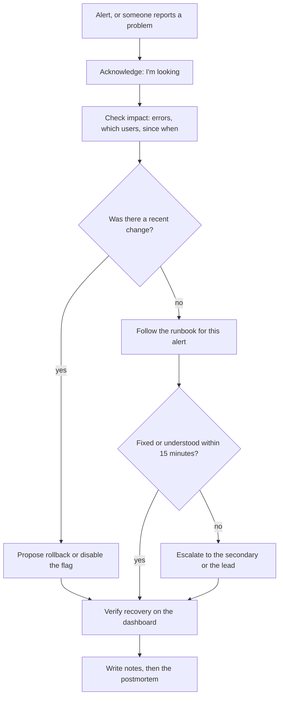
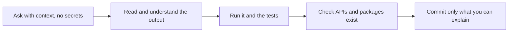
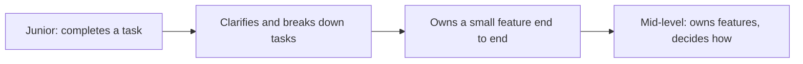

## 8.9 Your first production bug and your first on-call shift

### 8.9.1 When something you shipped breaks

#### Concept

Sooner or later something you shipped will break in production. This is not a sign you are bad at the job; it happens to everyone who ships. What matters is the response: **say so quickly, help stop the damage, fix it properly, and help the team learn** so the same class of bug cannot happen again. **On-call** is the rota of engineers who respond to production alerts outside normal hours. Most teams add juniors to it gradually, first as a shadow alongside an experienced engineer.

#### Why does it exist?

Production problems get worse with time: more failed orders, more angry customers, more data to repair. The engineer who says "I think my deploy at 14:10 caused this" within minutes saves the team an hour of searching. The one who stays quiet hoping to fix it alone turns a 10-minute incident into a 2-hour one.

#### Mental model

Imagine a kitchen fire. You do not first work out who left the pan on. You shout "fire", turn off the gas and use the extinguisher. Only when it is out do you ask why the pan was left on, and the useful answer is usually "the timer was broken", not "Aisha is careless".

#### How it works — the first response



1. **Acknowledge** the alert so others know someone is on it, and post in the incident channel.
2. **Assess impact** from the dashboards: error rate, latency, which endpoints, since when.
3. **Mitigate first, diagnose later.** If a recent deploy or flag change lines up with the start of the problem, rolling it back is usually the fastest fix. Understanding can wait until customers are safe. Part 62 (62.10.1) calls this "mitigate first".
4. **Follow the runbook.** A **runbook** is a written guide for a specific alert: what it means, what to check, what to do. Part 53 — Site Reliability Engineering (53.9) shows a complete one.
5. **Escalate early.** Escalation means paging the next person on the list. A junior should escalate after about 15 minutes without clear progress, or immediately if money, data or security is involved. Escalating is not failing; it is the system working as designed.
6. **Keep a timeline** as you go: times, what you saw, what you did. It becomes the backbone of the postmortem.

#### Practical example — Aisha's first production bug

At 14:10 Aisha's refund step (SHOP-1561 step 3) is enabled in production. At 14:32 Marco notices in the support channel that two customers say their cancelled orders were refunded twice. Aisha's message, at 14:34:

```text
I think this is my change. Order cancellation with refunds went live at 14:10
(flag order-cancellation). Two reports of double refunds. I'm turning the flag
OFF now, then checking how many orders are affected. @Priya can you join?
```

By 14:36 the flag is off and new cancellations stop. Priya and Aisha find the cause in the logs: the mobile app retries a cancel request after 3 seconds if it has no response, and the refund call to the provider sometimes takes 4. Each retry started a new refund because the idempotency key was generated per request instead of per order cancellation. Eleven orders were refunded twice; finance recovers them with the provider's help. The fix (an idempotency key derived from the order id, plus a unique constraint on `refunds (order_id)` so the database itself refuses a second refund) ships the next day, with a test that sends two concurrent cancels. Part 33 explains idempotency keys in depth.

#### How it works — the blameless postmortem

A **postmortem** is a short document written after an incident: what happened, the impact, the timeline, the causes, and the actions that will prevent it from happening again. **Blameless** means it asks why the system allowed the mistake and why the action seemed reasonable at the time, not who to blame. Part 53 (53.10) gives the full template and a worked example; for your first one, know the shape:

```text
Postmortem: double refunds on order cancellation (2026-11-20)
Impact: 11 orders refunded twice, all recovered with the provider; 26 minutes.
Timeline: 14:10 flag on; 14:32 first report; 14:34 owner identified it; 14:36 flag off.
What happened: client retries after 3 s; refund call can take 4 s; each request
  generated its own idempotency key, so the provider treated retries as new refunds.
Why it was possible: no database constraint on one refund per order; no test for
  concurrent cancels; no alert on refunds per order > 1.
Actions: idempotency key per order (done); unique constraint (done); concurrent
  test (done); alert on duplicate refunds (SHOP-1640, owner Aisha).
```

Notice what is not in it: "Aisha should have been more careful". Being careful is not a fix. A unique constraint is.

#### Common mistakes

- Hiding or delaying "I think it was my change".
- Debugging the root cause while customers are still failing, instead of rolling back first.
- Running ad-hoc write queries in production to "fix data" without a second person checking them.
- Treating the postmortem as punishment and making it vague.

#### Interview questions

1. **Tell me about a production issue you caused or helped fix.** Expected answer: a specific story told in order: what you noticed, how you communicated, how it was mitigated, the root cause, and the systemic fix. Why it matters: it shows ownership without defensiveness.
2. **What is a blameless postmortem, and why do teams use them?** A written analysis that focuses on what in the system allowed the failure; blame makes people hide information, which leads to more incidents.
3. **During an incident, why roll back before understanding the cause?** Customers are harmed while you investigate; rollback is usually fast and reversible, and you can debug safely afterwards.

#### Practical exercise

You are shadowing on-call. At 10:05 an alert fires: "orders-service 5xx rate 8 percent (normal under 0.5 percent) for 5 minutes". The deploy log shows a release of orders-service at 09:58 that included your teammate's change to the order search query. Write your first message in the incident channel and list your next three actions in order.

Acceptance criteria: the message states what you see, the possible link to a change, what you are doing, and who you are pulling in; the actions put mitigation before diagnosis.

#### Worked answer to the exercise

```text
Looking at the orders-service 5xx alert (8%, started ~10:00).
Possible link: release at 09:58 included the order search query change (PR #2214).
I'm checking which endpoints are failing now. @primary-oncall @Omar (PR author)
can you join? Proposal: if the errors are on /orders/search, roll back to the
previous release.
```

```text
Next actions:
1. Dashboard: confirm which endpoints return 5xx and that the start time matches
   the 09:58 release. (2 minutes)
2. If it matches: with the primary's OK, roll back to the previous release,
   then watch the error rate return to normal. (mitigation)
3. Collect evidence for diagnosis without touching production: the error message
   and stack trace from the logs for one failing request id, and the query plan
   if it is a timeout. Add everything to the incident timeline.
```

Why it is right: the message is short, factual and hedged ("possible link"), so nobody chases a guess as a certainty, and it pulls in exactly the two people who can help: the primary on-call, who has authority to roll back, and the author, who knows the change. The actions confirm the correlation first, then mitigate, then gather evidence. Diagnosis waits until customers are no longer failing.

The trap most learners fall into is starting with "let me read PR #2214 to understand the bug" while 8 percent of requests fail. The second trap is rolling back alone as a shadow without telling anyone; in most teams the primary on-call or incident lead makes that call, and two people acting independently during an incident make it worse.

## 8.10 Learning on the job

### 8.10.1 Notes, a brag document and deliberate learning

#### Concept

You will learn more in your first year at work than in any course, but only if you capture it. Two simple tools do most of the work: **working notes** (what you learned, how things work here, commands you needed) and a **brag document** (a running list of what you shipped and what impact it had). The brag document idea was popularised by Julia Evans' essay on the subject.

#### Why does it exist?

Memory is unreliable and busy weeks blur together. Notes stop you asking the same question twice and become a personal manual for the codebase. The brag document solves a different problem: at review time, nobody, including you, remembers what you did in March. A list written as you go makes your progress visible to your manager and to you, which matters most on the weeks you feel slow.

#### How it works

**Working notes**, in any tool you like, organised by topic, not by date:

```text
orders-service / how things work
- Refunds are asynchronous: result arrives by webhook (/webhooks/payments).
- Never call PaymentsClient directly from a controller; go through RefundsService
  (it adds the idempotency key).
- e2e tests: call resetDb() in beforeEach; ids are reused across files.
- Feature flags: config/flags.ts; staging toggles in the admin UI; prod needs Priya.
commands
- psql against the staging read replica: see the 1Password entry "staging-replica"
- npm run test:e2e -- orders-history   # one file only
```

**Brag document**, a short entry per month or per meaningful piece of work:

```text
November
- Shipped order cancellation (SHOP-1561, 6 PRs). Support tickets about
  cancellations dropped from about 40/week to about 5/week in the first fortnight.
- Caused and helped fix the double-refund incident; wrote the postmortem;
  added the unique constraint and the duplicate-refund alert.
- Fixed two setup steps in the README; Jonas (joined 12 Nov) set up in half a day.
Learned: transactions with SELECT FOR UPDATE, idempotency keys, the outbox pattern.
```

Note that the incident is in the brag document. Owning and fixing a failure well is an achievement worth recording.

**Deliberate learning.** Pick one area per month that your work touches, and go one level deeper than the ticket needed. The refund work touched transactions, so read Part 24 — Database Transactions and Concurrency Control. The PDF ticket touched streams, so read the streams chapter of Part 13. Learning what your work already touches sticks, because you use it the next day.

## 8.11 Using AI tools responsibly at work

### 8.11.1 Helpful, plausible, and your responsibility

#### Concept

AI coding assistants are now normal at work: completion in the editor, chat for explanations, and agents that edit files and run commands. They can make a junior much faster. They can also produce confident, plausible, wrong code. Part 57 — AI-Assisted Engineering covers them in depth; this section gives the rules that matter in your first job.

#### How it works — five rules

1. **Follow your company's AI policy.** Use only approved tools. Ask if you are not sure; many companies restrict which tools may see their code.
2. **Never paste secrets, customer data or production logs with personal data** into a prompt (57.2.2). A pasted `.env` file means rotating every secret in it.
3. **You own every line you commit**, whoever or whatever wrote it. "The AI wrote it" is not an answer in review or in a postmortem.
4. **Understand before you commit.** If you cannot explain a line to your reviewer, you cannot ship it. Ask the assistant to explain it, then check the explanation against the documentation.
5. **Verify by running.** Run the code, run the tests, and check that every package and API it uses actually exists (57.7 tells the story of a hallucinated package).



#### How a Senior Backend Engineer thinks about this

Seniors use AI tools heavily for work they understand well, and carefully for work they do not. Their worry about juniors is skipped learning: if an assistant writes all your transaction code, you never learn transactions, and at 2 a.m. in an incident you cannot fix them. Use it as a tutor and a pair (57.2.1): ask it to explain, to review your attempt, to suggest test cases. Write the core logic yourself while you are learning it.

## 8.12 Growing towards mid-level

### 8.12.1 From "a task" to "a feature"

#### Concept

Part 63 — Junior to Principal: What Is Expected at Each Level defines the jump from junior to mid-level mostly as a change in **scope** and **ambiguity**: a junior completes well-defined tasks, often told how; a mid-level engineer owns a feature, is told what to build, and decides how. The growth happens through behaviours you can practise from your first month.

#### How it works

| You are growing when you... | Instead of... |
|---|---|
| Clarify the ticket and suggest a better approach | Building exactly what was written |
| Break your own work into steps and estimate it in ranges | Waiting to be given sub-tasks |
| Ask fewer but better questions, and answer newer joiners' | Asking the same type of question repeatedly |
| Find and fix the class of bug (constraint, test, alert) | Fixing only the instance |
| Review teammates' pull requests with real comments | Only receiving reviews |
| Notice operational concerns: logs, metrics, migrations, rollbacks | Stopping at "the tests pass" |
| Deliver a multi-step feature end to end, with updates | Delivering single tickets |



Ask your manager directly: "What would I need to show to be considered mid-level here?" Write the answer down and review it with them every few months. Part 63 (63.3) describes the next jump, mid to senior; read it now to see where the road leads.

## 8.13 Common junior mistakes

Every item below has appeared earlier in this Part; here they are in one list to re-read after your first month, and again after your third.

- **Staying silent when stuck** for hours or days, instead of asking with a well-formed question after a time box (8.5).
- **Coding before clarifying**, then building the wrong thing (8.3).
- **Single-number estimates** given under pressure, and no update when the work grows (8.4).
- **Huge pull requests** that cannot be reviewed well (8.6).
- **Taking review personally**, or leaving comments unanswered (8.6.2).
- **"Done" at merge** instead of verified in production (8.2.2).
- **Hiding a mistake**, especially in production; saying "I think it was my change" early is always right (8.9).
- **Changing API responses without telling their consumers** (8.8).
- **Committing code you cannot explain**, from an AI tool or from a copied answer (8.11).
- **Pasting secrets or customer data** into chat, tickets or prompts.
- **Rewriting code you do not yet understand** because it looks wrong; ask why first (8.1).
- **Not writing anything down**, so learning leaks away (8.10).

## Senior Checklist — Part 8

- [ ] I understand the concept
- [ ] I can explain it simply
- [ ] I can implement it
- [ ] I understand its failure modes
- [ ] I understand its scaling limitations
- [ ] I understand its security implications
- [ ] I understand its operational implications
- [ ] I can choose between alternatives
- [ ] I can explain the tradeoffs
- [ ] I can answer senior-level interview questions
- [ ] I can set up an unfamiliar service locally, trace one request through it, and fix the README on the way
- [ ] I read a ticket for the goal, acceptance criteria and gaps, and ask my questions in one numbered message
- [ ] I break work into mergeable steps and estimate in ranges, naming the biggest unknown
- [ ] I know when to ask for help, and my help requests include the goal, the exact error, what I tried and a guess
- [ ] I self-review, describe my pull requests, and answer every review comment without defensiveness
- [ ] My standup updates are outcomes, plans and blockers, tied to tickets
- [ ] I tell QA, product, design and API consumers what changes and what I am unsure about
- [ ] In an incident I communicate early, mitigate before diagnosing, escalate on time and write blameless postmortems
- [ ] I keep working notes and a brag document, and I use AI tools within policy and only for code I can explain

## Part 8 — Key Takeaways

- Your first week's job is access, a running local setup and a rough map; your setup notes are a gift to the next joiner.
- "Done" means verified where customers are, not merged.
- Ten minutes of written questions before coding beats three days building the wrong thing.
- Estimates are ranges with a named reason; "I don't know yet, I'll find out by this afternoon" is a professional answer.
- Try for about 30 minutes, ask by about 60, and ask immediately for production, security or access problems.
- A good help request (goal, exact error, what you tried, a guess) often answers itself.
- Small, described, self-reviewed pull requests get fast, careful reviews; every comment deserves a reply.
- Standups are for blockers and coordination; say the risk early, not on the due date.
- QA, product, design and API consumers hold information you lack; involve them early.
- In production, say "I think it was my change" fast, roll back first, and fix the class of bug, not just the instance.
- You own every line you commit, including the ones an AI tool wrote.
- Mid-level is a change of scope, from a task to a feature, and you can practise its behaviours from month one.
