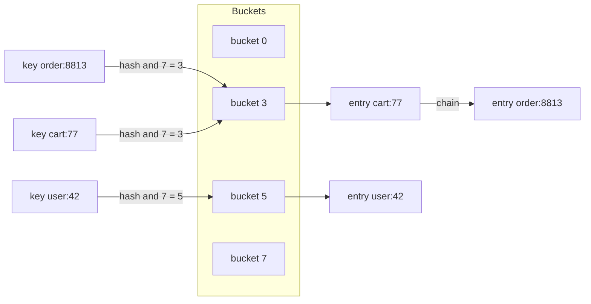

## 8.8 Hash Map

#### Concept

A hash map (hash table, dictionary) stores key-value pairs and finds a value by its key in O(1) on average. It does this by running the key through a **hash function** that produces a number, using that number to pick a **bucket** in an array, and storing the pair there. Two keys that land in the same bucket are a **collision**, handled by chaining entries or probing for a free slot.

In JavaScript you have three hash maps: `Map` (any key type, insertion order, `size` in O(1)), the plain object (string and symbol keys, fast when its shape is fixed, surprising when used as a dictionary), and `WeakMap` (object keys held weakly, for metadata that must not keep its key alive). Redis is a hash map you reach over the network; a PostgreSQL hash join is a hash map built for one query.

#### Why does it exist?

Almost every "find X by its id" in a backend is a hash lookup: sessions by token, users by id, feature flags by name, routes by path, in-flight requests by idempotency key, DI providers by token, HTTP headers by name. Without hashing you scan, and scanning at 10,000 lookups per second over 100,000 entries is a billion comparisons per second. The hash map turns lookup cost from "proportional to the data" into "proportional to the key".

#### Mental model

Imagine a coat check with 1,000 numbered hooks. The attendant does not search for your coat; she computes a hook number from your ticket (say, the last three digits) and walks straight to it. If two tickets map to the same hook, both coats hang there and she checks the tags on that hook only (chaining). When coats outnumber hooks so much that every hook holds a pile, she opens a bigger room and re-hangs everything by the new numbering (resizing). The **load factor** is coats per hook.

#### How it works

1. **Hashing the key.** V8 computes a 32-bit hash for a string once and caches it in the string's header, so repeated lookups with the same key skip the hashing. Small integers hash by value. Objects used as keys get a random identity hash on first use, which is why `Map` keyed by objects compares by identity, never by content.
2. **Choosing the bucket.** `index = hash & (bucketCount - 1)` with a power-of-two bucket count. The bits are cheap; the quality of the hash decides how evenly keys spread.
3. **Collisions.** V8's `Map` and `Set` use an *ordered hash table*: entries live in a flat data array in insertion order, each bucket points at the newest entry that hashed into it, and each entry stores a chain pointer to the previous entry in the same bucket. Lookup walks the chain comparing keys. Average chain length is the load factor.
4. **Load factor and resizing.** V8 keeps roughly two entries per bucket. When the entry array fills, it allocates a table of double the capacity and reinserts every live entry, an O(n) pause. Deleted entries leave holes that are compacted during the next resize, so a `Map` with heavy churn is periodically rebuilt.
5. **Insertion order.** Because entries sit in a flat array in insertion order, iteration is ordered and cheap. This is also why a `Map` alone can implement an LRU cache: delete and re-insert moves a key to the end.
6. **Plain objects and hidden classes.** V8 does not store `{ id, name, price }` as a hash table. It assigns the object a *hidden class* (V8 calls it a Map, confusingly) describing where each property lives, and property access compiles to a fixed offset read. Objects created with the same properties in the same order share the class, and call sites that always see one class become monomorphic inline caches, about 1 nanosecond per access.
7. **Dictionary mode.** If you `delete` a property, add properties in varying orders, or add more than about 128 out-of-object properties dynamically, V8 abandons the hidden class and converts the object into a real hash table ("slow properties"). Access is then 5 to 10 times slower and inline caches go megamorphic. An object used as a dictionary with thousands of computed keys is always in this mode; use `Map` instead.
8. **Hash flooding.** An attacker who can predict the hash function sends thousands of keys that collide, degrading every lookup to O(n). V8 randomizes its hash seed per process, and body parsers cap the number of parameters (`qs` defaults to 1,000) for the same reason.



**Time complexity**

| Operation | Best | Average | Worst | Notes |
|---|---|---|---|---|
| `get` / `has` | O(1) | O(1) | O(n) | worst case is every key in one bucket |
| `set` | O(1) | O(1) amortized | O(n) | worst case is the resize |
| `delete` | O(1) | O(1) | O(n) | leaves a hole compacted at next resize |
| `size` (Map) | O(1) | O(1) | O(1) | `Object.keys(obj).length` is O(n) |
| Iteration | O(n) | O(n) | O(n) | insertion order for `Map` |
| Resize | O(n) | O(n) | O(n) | happens at powers of two |

**Memory implications (V8, Node.js)**

- A `Map` entry costs three slots (key, value, chain) of 8 bytes plus its share of the bucket array and over-allocation, roughly 40 to 60 bytes per entry *on top of* the key and value objects. A `Map<string, number>` with 1 million 12-character keys is about 90 MB.
- A plain object with a fixed shape stores property values inline or in a small properties array with no per-property hashing overhead; that is why DTOs and rows should be objects and dictionaries should be `Map`s.
- Resizing a 4-million-entry `Map` allocates a new table of about 100 MB and reinserts everything in one synchronous step, a pause of 50 to 150 ms on the event loop. Pre-size by inserting into a `Map` you keep, or shard into several maps if the pause matters.
- A `Map` never shrinks its bucket array unless a resize happens; a map that once held 5 million keys and now holds 50 still owns the large table.
- `WeakMap` entries disappear when the key object becomes unreachable, which makes it the correct structure for per-request metadata keyed by the request object.

#### Practical example

**Single-flight request coalescing.** When 400 concurrent requests miss the cache for the same product, only the first should query PostgreSQL; the other 399 should await the same promise. A `Map<string, Promise<T>>` of in-flight lookups does this in-process.

```ts
// common/single-flight.ts
export class SingleFlight<T> {
  private readonly inFlight = new Map<string, Promise<T>>();

  async run(key: string, loader: () => Promise<T>): Promise<T> {
    const existing = this.inFlight.get(key);      // O(1): someone is already loading this key
    if (existing) return existing;

    const p = loader().finally(() => this.inFlight.delete(key)); // release the slot on settle
    this.inFlight.set(key, p);
    return p;
  }

  get pending(): number {
    return this.inFlight.size;
  }
}
```

The `finally` is the important line: without it, a rejected promise stays in the map and every later caller receives the same stale rejection forever.

#### NestJS example

A product read service that combines single-flight with `@nestjs/cache-manager`. Cache hits skip everything; cache misses are coalesced per key; the loader talks to PostgreSQL once.

```ts
// products/product-read.service.ts
import { Inject, Injectable, NotFoundException } from '@nestjs/common';
import { CACHE_MANAGER } from '@nestjs/cache-manager';
import { Cache } from 'cache-manager';
import { InjectRepository } from '@nestjs/typeorm';
import { Repository } from 'typeorm';
import { Product } from './product.entity';
import { SingleFlight } from '../common/single-flight';

@Injectable()
export class ProductReadService {
  private readonly flight = new SingleFlight<Product>();

  constructor(
    @Inject(CACHE_MANAGER) private readonly cache: Cache,
    @InjectRepository(Product) private readonly repo: Repository<Product>,
  ) {}

  async byId(id: string): Promise<Product> {
    const key = `product:${id}`;
    const cached = await this.cache.get<Product>(key);
    if (cached) return cached;

    return this.flight.run(key, async () => {
      const product = await this.repo.findOne({ where: { id } });
      if (!product) throw new NotFoundException(`product ${id} not found`);
      await this.cache.set(key, product, 60_000); // ttl in ms for cache-manager v5
      return product;
    });
  }
}
```

Register with `CacheModule.register({ ttl: 60_000, max: 10_000 })` in the module; `max` bounds the in-memory store, which is the LRU cache of Section 8.17. Note that coalescing is per pod; twelve pods still send up to twelve queries for one hot key, which is why hot keys also get a Redis lock or a short "negative cache" entry.

#### PostgreSQL example

PostgreSQL uses hash tables in three places you will see: hash indexes, hash joins and hash aggregates.

```sql
-- Equality-only lookups on long random tokens: a hash index is smaller than a B-tree
-- because it stores a 4-byte hash per entry instead of the whole 64-character key.
CREATE INDEX sessions_token_hash ON sessions USING hash (token);
SELECT user_id, expires_at FROM sessions WHERE token = $1;

-- A hash join builds an in-memory hash table from the smaller input, then probes it.
EXPLAIN (ANALYZE, BUFFERS)
SELECT o.id, u.email
FROM orders o JOIN users u ON u.id = o.user_id
WHERE o.created_at >= now() - interval '1 day';
```

```text
Hash Join  (cost=3462.00..18211.44 rows=48210 width=40) (actual time=21.3..96.8 rows=47955 loops=1)
  Hash Cond: (o.user_id = u.id)
  Buffers: shared hit=6104
  ->  Index Scan using orders_created_at_idx on orders o  (cost=0.56..13640.90 rows=48210 width=16) (actual time=0.04..41.2 rows=47955 loops=1)
        Index Cond: (created_at >= (now() - '1 day'::interval))
  ->  Hash  (cost=2211.00..2211.00 rows=100080 width=32) (actual time=20.9..20.9 rows=100080 loops=1)
        Buckets: 131072  Batches: 1  Memory Usage: 7281kB
        ->  Seq Scan on users u  (cost=0.00..2211.00 rows=100080 width=32) (actual time=0.01..9.8 rows=100080 loops=1)
Planning Time: 0.41 ms
Execution Time: 99.1 ms
```

`Buckets: 131072  Batches: 1` tells you the whole hash table fit in `work_mem`. When you see `Batches: 8`, PostgreSQL ran out of memory and split the join into batches spilled to temp files; raising `work_mem` for that session, or shrinking the build side with a better filter, fixes it. Hash indexes are equality-only (no ranges, no sorting, no uniqueness constraint) and have been crash-safe only since PostgreSQL 10; B-tree remains the default for good reasons (see Part 20 — Database Indexing).

#### TypeORM example

The most common hash-map win in ORM code is turning an N+1 pattern into one query plus an O(1) in-memory join.

```ts
// orders/order-enricher.ts
import { In, Repository } from 'typeorm';
import { Order } from './order.entity';
import { User } from '../users/user.entity';

export class OrderEnricher {
  constructor(private readonly users: Repository<User>) {}

  async attachUsers(orders: Order[]): Promise<(Order & { user?: User })[]> {
    const ids = [...new Set(orders.map((o) => o.userId))];        // unique ids only
    const rows = await this.users.findBy({ id: In(ids) });        // ONE query, not orders.length
    const byId = new Map(rows.map((u) => [u.id, u]));             // O(n) build
    return orders.map((o) => ({ ...o, user: byId.get(o.userId) })); // O(1) per order
  }
}
```

#### Sequelize example

```ts
const ids = [...new Set(orders.map((o) => o.userId))];
const users = await User.findAll({ where: { id: { [Op.in]: ids } }, raw: true });
const byId = new Map<number, typeof users[number]>(users.map((u) => [u.id, u]));
const enriched = orders.map((o) => ({ ...o.get({ plain: true }), user: byId.get(o.userId) }));
```

Both examples are the DataLoader pattern by hand: batch the ids, one round trip, hash join in memory.

#### Production scenario

At 2,000 RPS an API gateway keeps a `Map<string, ApiKeyRecord>` of 40,000 API keys in memory, refreshed from PostgreSQL every 30 seconds. A lookup costs about 50 nanoseconds; the map costs about 8 MB. Redis is not consulted per request at all. That is the healthy shape: a bounded, read-mostly map whose size is controlled by *you*.

The unhealthy shape is a map whose keys come from the outside world. A per-IP rate limiter keyed by client address accepts 300,000 distinct IPs per day from a mobile fleet behind carrier NAT. Without expiry, the map grows by about 30 MB per day and the pod is restarted "for no reason" every ten days. Bound it (an LRU with a maximum of 100,000 keys), expire it (a sweep every minute), or move it to Redis with `EXPIRE`, where memory is shared and eviction is a configuration line.

Redis itself is the hash map at scale. A Redis hash (`HSET user:42 name "Ana" plan "pro"`) with fewer than 128 fields is stored as a compact listpack; above that it becomes a real hash table. `HGET` is O(1) and about 0.2 ms from the same zone. `HGETALL` on a 2-million-field hash is O(n) and blocks the server; use `HSCAN`.

#### Failure scenario

At 02:14 the on-call engineer is paged: `auth-api` p99 is 1.8 seconds and rising, GC logs show 400 ms major collections every few seconds, and memory has climbed from 300 MB to 3.1 GB over six days. A heap snapshot shows one `Map` with 9.4 million entries: `sessionsByToken`. A "small optimization" three weeks earlier cached every validated session in memory to skip Redis. Sessions expired in Redis after 24 hours; the map never expired anything. Each entry held the token (a 64-character string, about 80 bytes), the session object (about 200 bytes) and map overhead, roughly 340 bytes, times 9.4 million entries.

The immediate fix was a rolling restart. The real fix was replacing the `Map` with an LRU of 50,000 entries and a 60-second TTL, which kept the Redis hit rate benefit for hot sessions while capping memory at 17 MB. The lesson: **a map keyed by external data without an eviction policy is a memory leak with a delay measured in days.**

#### Edge cases & failure modes

- **Key equality is SameValueZero.** `map.get(1)` and `map.get('1')` are different keys; `NaN` matches `NaN`; two equal-looking objects are different keys unless they are the same reference. Serialize composite keys to a canonical string (`${merchantId}:${sku}`).
- **Plain objects coerce keys to strings.** `obj[1]` and `obj['1']` collide; `obj[{}]` becomes `obj['[object Object]']`.
- **Prototype pollution.** `body['__proto__']` or `body['constructor']['prototype']` written into a plain object via a naive deep merge changes every object in the process. Use `Map`, `Object.create(null)`, or validate keys.
- **Integer-like keys iterate first in ascending order** on plain objects, regardless of insertion order; `Map` preserves insertion order.
- **`JSON.stringify(new Map())` is `{}`.** Convert with `Object.fromEntries(map)` or serialize entries explicitly.
- **Hash flooding** via query strings, JSON keys or headers; cap counts at the edge.
- **Resize pauses** on very large maps block the event loop; shard or pre-warm.
- **Map shared across requests** is mutable global state; one handler's `clear()` empties everyone's cache.
- **Stale entries** when the source changes; a map without a refresh or TTL is a cache that lies.
- **Redis as the map at scale**: a hot key (one product id read 50,000 times per second) pins one Redis shard; replicate hot keys into process memory with a short TTL.

#### How a Senior Backend Engineer thinks about this

The first question is "**what controls the number of keys?**" If the code does (a fixed set of routes, feature flags, API keys refreshed from the database), a `Map` is free and there is nothing to discuss. If users, IPs or upstream data do, the senior insists on a bound (LRU, TTL, sweep) *before* the first deploy, because they have seen the six-day memory graph.

The second is "**objects for records, `Map` for dictionaries.**" DTOs, rows and config objects keep a fixed shape and stay fast. Anything indexed by a computed key goes in a `Map`; anything keyed by an object goes in a `WeakMap`.

The third is "**per pod or shared?**" An in-process map is a per-pod cache, never a source of truth. If two pods must agree (rate limits, sessions, idempotency), the map lives in Redis, and the in-process map is at most a short-TTL front for it.

To a product manager: "Caching sessions in memory made login 2 ms faster and took the service down every six days. Capping the cache keeps the speed and removes the outage; it is a two-line change and a test."

#### Common mistakes

- Using a plain object as a dictionary with thousands of dynamic keys (dictionary mode, prototype keys, O(n) `Object.keys`).
- Unbounded `Map` keyed by user or client data.
- Forgetting `finally` cleanup in single-flight maps, so a rejection is served forever.
- `JSON.stringify` on a `Map` and shipping `{}` to the client.
- Rebuilding a `Map` from a large array inside every request instead of once per refresh.
- Trusting a per-pod map for cluster-wide decisions such as rate limits or idempotency.

#### Interview questions

1. **How does V8's `Map` handle collisions and why does it preserve insertion order?** Expected: ordered hash table with a flat entry array and per-bucket chains; order comes from the entry array. Follow-up: what happens on `delete`? (A hole, compacted at the next rehash.)
2. **When does a plain object fall into dictionary mode and why does it matter?** Expected: `delete`, too many dynamic properties, inconsistent shapes; access becomes a hash lookup and inline caches go megamorphic.
3. **Design an in-memory cache of validated sessions.** Expected: bounded LRU with TTL, per-pod, Redis remains the source of truth; discuss the memory per entry and the eviction policy. Why it matters: it is the most common self-inflicted memory leak.
4. **What is hash flooding and how do Node.js and PostgreSQL defend against it?** Expected: adversarial collisions; randomized hash seeds, parameter-count limits; PostgreSQL uses batches and `work_mem` bounds for hash joins.
5. **Explain `Buckets: 131072 Batches: 8` in an `EXPLAIN` plan.** Expected: the hash join did not fit in `work_mem` and spilled; fix by filtering the build side or raising `work_mem`.
6. **When would you choose a hash index over a B-tree in PostgreSQL?** Expected: equality-only lookups on long keys where size matters; never when you need ranges, ordering or a unique constraint.
7. **Why does `map.get(userId)` fail when `userId` came from a `bigint` column?** Expected: pg returns `bigint` as a string; `1` and `'1'` are different keys.

#### Practical exercise

Implement `BoundedTtlMap<K, V>` and use it for API-key validation in a NestJS guard. Acceptance criteria: entries expire after a configurable TTL and the map never exceeds a configured capacity (evict the oldest on overflow, using `Map` insertion order); a sweep removes expired entries every 30 seconds with `@Interval` and is O(expired), not O(size); a load test with 500,000 distinct keys shows heap growth bounded by capacity; prototype-pollution keys (`__proto__`, `constructor`, `prototype`) are rejected by a validation pipe with a test; and `pending` single-flight promises are cleaned on both resolve and reject, proven by a test that fails the loader once and succeeds on the next call.

## 8.9 Set

#### Concept

A set stores unique values and answers "is X in here?" in O(1) on average. JavaScript's `Set` is the same ordered hash table as `Map` without the value slot. Sets also give you the classic operations: union, intersection and difference, which Node.js 22 exposes directly (`a.union(b)`, `a.intersection(b)`, `a.difference(b)`, `a.isSubsetOf(b)`).

#### Why does it exist?

Membership questions are everywhere: is this user in the beta group, is this product id already in the response, has this message id been processed, is this role allowed, has this node been visited. Answering with `array.includes` costs O(n) per question and turns loops quadratic. The set is the structure that makes "have I seen this before?" free.

#### Mental model

Imagine a guest list at a door. The bouncer does not read the list top to bottom for every guest; the list is sorted into alphabet tabs (the hash) and each name appears once. Adding a name that is already there changes nothing.

#### How it works

Identical to the hash map: hash the value, pick a bucket, walk the chain to check for an equal value, insert if absent. Equality is SameValueZero, so objects are members by identity and `'42'` is not `42`. Insertion order is preserved and the entry array is compacted on resize.

**Time complexity**

| Operation | Best | Average | Worst | Notes |
|---|---|---|---|---|
| `add` / `has` / `delete` | O(1) | O(1) | O(n) | worst case is adversarial collisions |
| `size` | O(1) | O(1) | O(1) | |
| Union / intersection / difference | O(n + m) | O(n + m) | O(n + m) | iterate the smaller set and probe the other |
| Iteration | O(n) | O(n) | O(n) | insertion order |
| Build from array | O(n) | O(n) | O(n) | `new Set(array)` de-duplicates as it goes |

**Memory implications**

Two slots per entry (value and chain) plus the bucket share, roughly 30 to 40 bytes per entry on top of the value. A `Set` of 1 million 36-character UUID strings is about 110 MB, because each UUID string costs about 56 bytes on its own. When membership sets reach tens of millions of items you move to Redis sets (about 60 to 90 bytes per member server-side), or, when a small false-positive rate is acceptable, to a Bloom filter at about 10 bits per member (Section 8.16).

#### Practical example

The de-duplication from Section 8.1, done right, plus the role check every API needs.

```ts
// notifications/recipients.ts
export function uniqueRecipients(emails: readonly string[]): string[] {
  const seen = new Set<string>();
  const out: string[] = [];
  for (const raw of emails) {
    const email = raw.trim().toLowerCase();  // canonical form, or duplicates slip through
    if (seen.has(email)) continue;           // O(1)
    seen.add(email);
    out.push(email);
  }
  return out;                                 // 80,000 recipients in about 8 ms
}

// auth/roles.ts
export function hasAnyRole(userRoles: readonly string[], required: ReadonlySet<string>): boolean {
  for (const r of userRoles) if (required.has(r)) return true; // O(user roles), not O(u x r)
  return false;
}
```

#### NestJS example

A `RolesGuard` that reads required roles from metadata into a `Set` once per handler and checks the user's roles against it, and a consumer-side de-duplication service that uses a Redis set operation for cluster-wide "have we processed this message?".

```ts
// auth/roles.guard.ts
import { CanActivate, ExecutionContext, Injectable, SetMetadata } from '@nestjs/common';
import { Reflector } from '@nestjs/core';

export const ROLES_KEY = 'roles';
export const Roles = (...roles: string[]) => SetMetadata(ROLES_KEY, roles);

@Injectable()
export class RolesGuard implements CanActivate {
  private readonly cache = new WeakMap<object, ReadonlySet<string>>(); // per handler, GC-safe

  constructor(private readonly reflector: Reflector) {}

  canActivate(ctx: ExecutionContext): boolean {
    const handler = ctx.getHandler();
    let required = this.cache.get(handler);
    if (!required) {
      required = new Set(this.reflector.getAllAndOverride<string[]>(ROLES_KEY, [handler, ctx.getClass()]) ?? []);
      this.cache.set(handler, required);
    }
    if (required.size === 0) return true;
    const user = ctx.switchToHttp().getRequest<{ user?: { roles: string[] } }>().user;
    return !!user && user.roles.some((r) => required!.has(r));
  }
}

// messaging/processed-messages.service.ts
import { Injectable } from '@nestjs/common';
import Redis from 'ioredis';

@Injectable()
export class ProcessedMessagesService {
  constructor(private readonly redis: Redis) {}

  /** Returns true the first time a message id is seen in the last 24h, false afterwards. */
  async claim(messageId: string): Promise<boolean> {
    // SET NX EX is an atomic "add to a set with expiry" that all pods share.
    const result = await this.redis.set(`msg:seen:${messageId}`, '1', 'EX', 86_400, 'NX');
    return result === 'OK';
  }
}
```

#### PostgreSQL example

The database is the set that matters. A unique index *is* a set with the membership check enforced under concurrency, which no application-level `Set` can do across pods.

```sql
-- "Add to set if absent" that is safe with 50 concurrent workers.
INSERT INTO processed_events (event_id, processed_at)
VALUES ($1, now())
ON CONFLICT (event_id) DO NOTHING
RETURNING event_id;   -- returns a row only for the first insert

-- Set operations in SQL
SELECT product_id FROM wishlist_items WHERE user_id = 42
INTERSECT
SELECT product_id FROM products WHERE in_stock;

-- DISTINCT is a set build; the planner picks HashAggregate when it fits in work_mem
EXPLAIN (ANALYZE, BUFFERS) SELECT DISTINCT user_id FROM orders WHERE created_at >= now() - interval '7 days';
```

```text
HashAggregate  (cost=9021.17..9203.51 rows=18234 width=8) (actual time=48.9..52.3 rows=17902 loops=1)
  Group Key: user_id
  Batches: 1  Memory Usage: 1809kB
  Buffers: shared hit=3882
  ->  Index Scan using orders_created_at_idx on orders  (cost=0.56..8206.55 rows=325848 width=8) (actual time=0.03..29.1 rows=325112 loops=1)
        Index Cond: (created_at >= (now() - '7 days'::interval))
Execution Time: 53.4 ms
```

#### TypeORM example

```ts
// "add to set" with ON CONFLICT DO NOTHING; affected rows tells you whether it was new
const result = await dataSource
  .createQueryBuilder()
  .insert()
  .into(ProcessedEvent)
  .values({ eventId, processedAt: new Date() })
  .orIgnore()                 // ON CONFLICT DO NOTHING
  .execute();
const isFirstTime = result.identifiers.length > 0;
```

#### Sequelize example

```ts
const [row, created] = await ProcessedEvent.findOrCreate({
  where: { eventId },
  defaults: { processedAt: new Date() },
  transaction: t,
});
// Or for bulk: ProcessedEvent.bulkCreate(rows, { ignoreDuplicates: true })
```

`findOrCreate` in Sequelize uses a transaction and catches the unique violation internally, so it needs the unique index to exist; without it, two concurrent calls both create.

#### Production scenario

A campaign service sends 80,000 e-mails in under a second of CPU thanks to `Set` de-duplication. The same service must also answer "has this user already received this campaign?" across 12 pods and 30 days of history for 50 million users. An in-process `Set` cannot do that (it is per pod and would cost 5 GB). A Redis set `SADD campaign:2024-09:sent 8813` works to about 50 million members at roughly 4 GB of Redis memory; `SISMEMBER` is O(1) at 0.2 ms. Beyond that, or when memory is the constraint, a Bloom filter answers the same question in 60 MB with a 1 percent false-positive rate, and a false positive here only means one user misses one marketing e-mail, which the business happily accepts.

#### Failure scenario

A webhook receiver de-duplicated payment events with an in-memory `Set<string>` of event ids. It worked for a year on one pod. The team scaled to three pods; the load balancer sent Stripe's retry of the same event to a different pod, whose set had never seen it, and 214 customers were charged twice in one afternoon. The fix was the `ON CONFLICT DO NOTHING` insert above, inside the same transaction as the charge, so "seen" and "charged" commit or roll back together. A per-pod set is not a set; it is a guess.

#### Edge cases & failure modes

- **Canonical form.** `'Ana@Example.com'` and `'ana@example.com'` are different members unless you normalize first.
- **Objects by identity.** `new Set([{ id: 1 }, { id: 1 }])` has two members. Use ids or canonical strings.
- **Per-pod sets** cannot enforce uniqueness across a cluster; only a unique index or a Redis atomic operation can.
- **Unbounded growth** of "seen" sets; expire (Redis `EXPIRE`) or move to a time-partitioned table.
- **Set difference on huge sets** is O(n + m) and allocates a third set; stream from the database with `EXCEPT` instead.
- **`Set` methods on Node.js below 22** do not exist; polyfill or spread into a new set.

#### How a Senior Backend Engineer thinks about this

An in-process `Set` is for de-duplicating within one request or one batch. Uniqueness that must hold across time, pods or retries is a database unique constraint or a Redis atomic operation, and the senior never ships the in-memory version for money-moving code, no matter how well it worked on one pod. When the set is large and approximate answers are acceptable, they reach for a Bloom filter; when they only need the *count* of unique items, they reach for Redis HyperLogLog, which counts 100 million distinct ids in 12 KB with 0.8 percent error.

#### Common mistakes

- `array.includes` in a loop instead of a `Set`.
- Building a `Set` from the same array on every request instead of once per refresh.
- Trusting an application-level uniqueness check without a unique index ("we check before insert").
- Using `Set` for objects and expecting value equality.

#### Interview questions

1. **You need to de-duplicate 80,000 e-mails. Compare `includes` and `Set` with numbers.** Expected: O(n^2), billions of comparisons, seconds; O(n), milliseconds.
2. **How do you guarantee an event is processed exactly once across many pods?** Expected: you cannot in general; you get effectively-once with a unique index (`ON CONFLICT DO NOTHING`) or Redis `SET NX` plus idempotent handlers.
3. **When would you replace a Redis set with a Bloom filter or a HyperLogLog?** Expected: membership at huge scale with tolerable false positives; distinct counting without storing members.
4. **Why does `findOrCreate` still need a unique index?** Expected: without the constraint two concurrent calls both insert; the constraint is the only atomic membership check.

#### Practical exercise

Build an idempotent webhook receiver. Acceptance criteria: the same event id delivered 50 times concurrently (use `Promise.all` in a test against a real PostgreSQL) results in exactly one `charges` row and 49 responses of `200 OK` with `{ duplicate: true }`; the uniqueness is enforced by a unique index, verified by a test that deletes the index and shows the duplicate; a `Set`-based per-request de-duplication handles batched deliveries of up to 1,000 events in one request in under 5 ms; and the receiver expires `processed_events` rows older than 30 days with a partition drop, not a `DELETE`.
