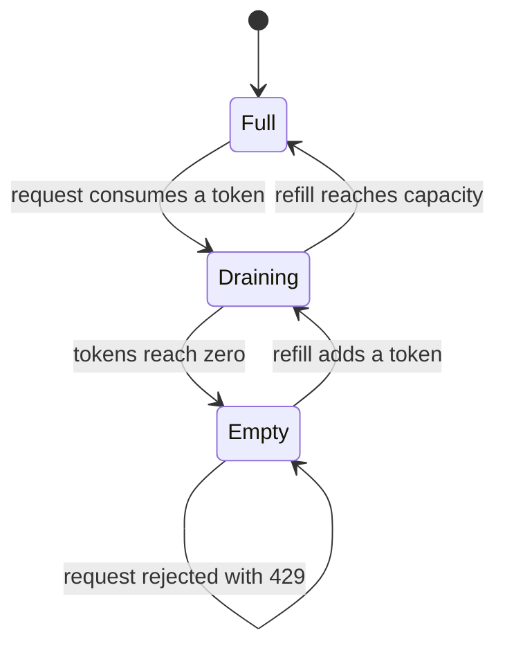
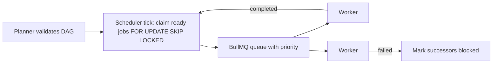
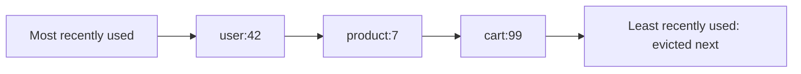

## 8.17 Worked example: rate limiter

#### Concept

A rate limiter decides, for each incoming request, whether the caller has exceeded an allowed rate, and rejects it (usually with HTTP 429) if so. It is the single most common place where a backend engineer implements an algorithm from scratch rather than calling a library, and it combines three things from this part: a sliding window or bucket algorithm, an `O(1)` per-request cost budget, and a data structure that must live in Redis because the service runs on many pods.

There are three algorithm families: **token bucket** (allows bursts up to a capacity, refills at a steady rate), **leaky bucket** (smooths output to a steady rate, queues or drops the excess) and **window counters** (fixed, sliding log, sliding counter, covered in the sliding window section). NestJS ships `@nestjs/throttler`, which implements a window counter and lets you plug in Redis storage.

#### Why does it exist?

Because a backend has finite capacity and callers do not coordinate. Without limits, one misbehaving integration, one retry storm, or one scraper takes the capacity that every other customer paid for. Rate limiting also protects downstream systems (the database connection pool, a partner API with its own limits) and turns a would-be outage into a polite 429 for one caller.

#### Mental model

Imagine a bucket with a small hole at the bottom and a tap dripping into it at a steady rate. Each request takes a cup of water out of the bucket. If the bucket is empty, the request waits or leaves. The tap's rate is the sustained limit; the bucket's size is the burst you tolerate. A caller who has been quiet for a while has a full bucket and can make a burst of requests; a caller hammering continuously gets exactly the drip rate. That is a token bucket. A leaky bucket is the same picture viewed from the hole: water (requests) pours in at any rate, but leaves through the hole at a fixed rate, and if the bucket overflows the excess is lost.

#### How it works

**Token bucket.** State per key: `tokens` (a number, possibly fractional) and `lastRefillAt`. On each request with cost `c`:

1. `elapsed = now - lastRefillAt`; `tokens = min(capacity, tokens + elapsed * refillPerMs)`.
2. If `tokens >= c`: `tokens -= c`, allow. Else reject, and report `retryAfter = (c - tokens) / refillPerMs`.
3. Store `tokens` and `now`.

`O(1)` per request, two numbers per key. Bursts up to `capacity`, sustained rate `refillPerMs`. This is what you want for public APIs: a client that batches 50 calls once a minute should be allowed to, as long as its average stays under the limit.

**Leaky bucket as a meter** is mathematically the token bucket with a different view (the "generic cell rate algorithm", GCRA, used in telecom). **Leaky bucket as a queue** is different: requests are enqueued and a worker drains the queue at a fixed rate. Use it when you must *shape* outbound traffic to a strict rate (calling a partner API that allows exactly 10 requests per second) rather than *police* inbound traffic.

**Sliding window counter** (from the sliding window section): two integers per key, `O(1)`, approximate. **Sliding window log**: a sorted set of timestamps per key, exact, `O(log n)` per request, `O(limit)` memory per key.

| Algorithm | Allows bursts | Exact | Memory per key | Cost per request | Use for |
|---|---|---|---|---|---|
| Fixed window | 2x at boundary | No | 1 counter | O(1) | Cheap abuse protection where boundary bursts are acceptable |
| Sliding window counter | Smooth | Approximate | 2 counters | O(1) | General API limits at scale |
| Sliding window log | Smooth | Yes | O(limit) timestamps | O(log limit) | Low limits that must be exact (login attempts, OTP sends) |
| Token bucket | Yes, up to capacity | Yes | 2 numbers | O(1) | Public APIs, per-customer quotas with burst allowance |
| Leaky bucket (queue) | No, shapes to a rate | Yes | Queue | O(1) enqueue | Outbound calls to rate-limited partners |



The multi-pod problem: any in-process limiter multiplies the effective limit by the number of pods and resets on deploy. The state must live in Redis, and the read-modify-write must be atomic, which is what Lua scripts are for. A script runs to completion on the Redis server with no other command interleaved, so "read tokens, compute, write tokens" cannot race with another pod doing the same for the same key.

Token bucket as a Redis Lua script, registered with ioredis's `defineCommand`:

```ts
// rate-limit/redis-token-bucket.ts
import Redis from 'ioredis';

const TOKEN_BUCKET_LUA = `
-- KEYS[1] = bucket key. ARGV: capacity, refill_per_ms, cost
local capacity = tonumber(ARGV[1])
local refill   = tonumber(ARGV[2])
local cost     = tonumber(ARGV[3])
local t = redis.call('TIME')                                  -- Redis server clock: one time source for all pods
local now = t[1] * 1000 + math.floor(t[2] / 1000)
local data = redis.call('HMGET', KEYS[1], 'tokens', 'ts')
local tokens = tonumber(data[1])
local ts = tonumber(data[2])
if tokens == nil then tokens = capacity; ts = now end
tokens = math.min(capacity, tokens + math.max(0, now - ts) * refill)
local allowed = 0
local retry_ms = 0
if tokens >= cost then
  tokens = tokens - cost
  allowed = 1
else
  retry_ms = math.ceil((cost - tokens) / refill)
end
redis.call('HSET', KEYS[1], 'tokens', tokens, 'ts', now)
redis.call('PEXPIRE', KEYS[1], math.ceil(capacity / refill) + 1000)  -- idle keys disappear once full again
return { allowed, math.floor(tokens), retry_ms }
`;

export interface BucketDecision { allowed: boolean; remaining: number; retryAfterMs: number; }

export class RedisTokenBucket {
  constructor(private readonly redis: Redis, private readonly capacity: number, private readonly refillPerSecond: number) {
    // ioredis caches the script SHA and falls back to EVAL if Redis lost it (restart, SCRIPT FLUSH)
    redis.defineCommand('takeTokens', { numberOfKeys: 1, lua: TOKEN_BUCKET_LUA });
  }

  async take(key: string, cost = 1): Promise<BucketDecision> {
    const client = this.redis as Redis & { takeTokens: (k: string, ...args: (string | number)[]) => Promise<number[]> };
    const [allowed, remaining, retryAfterMs] = await client.takeTokens(
      `rl:tb:{${key}}`, this.capacity, this.refillPerSecond / 1000, cost);   // hash tag keeps the key on one cluster slot
    return { allowed: allowed === 1, remaining, retryAfterMs };
  }
}
```

Sliding window log as a script, for exact low limits:

```ts
// rate-limit/redis-sliding-log.ts
export const SLIDING_LOG_LUA = `
-- KEYS[1] = window key. ARGV: window_ms, limit, member (unique per request)
local t = redis.call('TIME')
local now = t[1] * 1000 + math.floor(t[2] / 1000)
local window = tonumber(ARGV[1])
redis.call('ZREMRANGEBYSCORE', KEYS[1], 0, now - window)     -- drop timestamps that slid out
local count = redis.call('ZCARD', KEYS[1])
if count < tonumber(ARGV[2]) then
  redis.call('ZADD', KEYS[1], now, ARGV[3])
  redis.call('PEXPIRE', KEYS[1], window)
  return { 1, count + 1 }
end
return { 0, count }
`;
```

Use a unique member (request id or `now` plus a random suffix), because a sorted set cannot hold two identical members; two requests in the same millisecond with member `now` would count as one.

#### Practical example

A payments API exposes `POST /charges` to merchants. The limit is 100 requests per second sustained with a burst of 300 per merchant, keyed by API key. A merchant's nightly batch sends 300 charges in one second, then 100 per second: all accepted. A misconfigured merchant client retrying in a tight loop at 2,000 per second gets 300 through, then 100 per second, with a `Retry-After` header telling it when to try again. The database behind the API sees at most the sum of every merchant's sustained rate, which is what it was sized for.

#### NestJS example

`@nestjs/throttler` provides the guard, decorators and a pluggable storage. Its built-in behavior is a window counter: the first hit for a key starts a window of `ttl` milliseconds, `limit` hits are allowed inside it, and an optional `blockDuration` can extend the rejection. The community package `@nest-lab/throttler-storage-redis` provides the Redis-backed storage so all pods share state.

```ts
// app.module.ts
import { Module } from '@nestjs/common';
import { APP_GUARD } from '@nestjs/core';
import { ThrottlerModule, ThrottlerGuard } from '@nestjs/throttler';
import { ThrottlerStorageRedisService } from '@nest-lab/throttler-storage-redis';
import { ConfigModule, ConfigService } from '@nestjs/config';
import Redis from 'ioredis';

@Module({
  imports: [
    ConfigModule.forRoot(),
    ThrottlerModule.forRootAsync({
      imports: [ConfigModule],
      inject: [ConfigService],
      useFactory: (config: ConfigService) => ({
        throttlers: [
          { name: 'default', ttl: 60_000, limit: 600 },      // 600 per minute per tracker
          { name: 'burst', ttl: 1_000, limit: 30 },          // and at most 30 in any one second
        ],
        storage: new ThrottlerStorageRedisService(new Redis(config.getOrThrow<string>('REDIS_URL'))),
      }),
    }),
  ],
  providers: [{ provide: APP_GUARD, useClass: ThrottlerGuard }],   // global: every route unless @SkipThrottle
})
export class AppModule {}
```

By default the guard tracks by client IP. Behind a load balancer every request has the balancer's IP, so override the tracker to use the API key (and enable `trust proxy` if you fall back to IP):

```ts
// rate-limit/api-key-throttler.guard.ts
import { Injectable } from '@nestjs/common';
import { ThrottlerGuard } from '@nestjs/throttler';
import { Request } from 'express';

@Injectable()
export class ApiKeyThrottlerGuard extends ThrottlerGuard {
  protected async getTracker(req: Request): Promise<string> {
    const apiKey = req.header('x-api-key');
    return apiKey ? `key:${apiKey}` : `ip:${req.ip}`;   // per-merchant limits; anonymous traffic by IP
  }
}
```

Per-route overrides with the real decorators:

```ts
// auth/auth.controller.ts
import { Controller, Post, Get } from '@nestjs/common';
import { Throttle, SkipThrottle } from '@nestjs/throttler';

@Controller()
export class AuthController {
  @Post('auth/login')
  @Throttle({ default: { limit: 5, ttl: 60_000 }, burst: { limit: 2, ttl: 1_000 } })  // brute-force protection
  login(): string { return 'ok'; }

  @Get('health')
  @SkipThrottle()                                       // Kubernetes probes must never be throttled
  health(): string { return 'ok'; }
}
```

The guard sets `X-RateLimit-Limit`, `X-RateLimit-Remaining` and `X-RateLimit-Reset` headers on allowed responses and `Retry-After` on 429s, and throws `ThrottlerException` (HTTP 429), which your global exception filter can shape into your API's error format. For endpoints that need token-bucket burst semantics rather than a window, write a small guard around `RedisTokenBucket` that throws `HttpException` with status 429 and sets `Retry-After` from `retryAfterMs`.

#### PostgreSQL example

Per-second limits do not belong in PostgreSQL: a hot row per API key with an `UPDATE` per request is 1–5 ms and a lock queue. But *hard quotas* (monthly call allowances that bill when exceeded) do, because they need durability and an audit trail:

```sql
CREATE TABLE api_quotas (
  api_key_id uuid NOT NULL,
  period date NOT NULL,                 -- first day of the month
  used bigint NOT NULL DEFAULT 0,
  allowance bigint NOT NULL,
  PRIMARY KEY (api_key_id, period)
);

-- Atomic consume: returns a row only if the quota had room. No SELECT-then-UPDATE race.
UPDATE api_quotas
SET used = used + $3
WHERE api_key_id = $1 AND period = $2 AND used + $3 <= allowance
RETURNING used, allowance;
```

Batch the writes: consume 100 units at a time from PostgreSQL into a Redis token bucket, and let Redis serve the per-request decisions. The database row is touched once per 100 requests instead of once per request.

#### Production scenario

An API gateway layer of 12 pods handles 40,000 RPS across 25,000 active API keys. Each request runs one Lua script call (about 0.3 ms round trip on the same availability zone, about 15 microseconds of Redis CPU). Redis handles roughly 100,000 such scripts per second per core, so one primary is at 40% for rate limiting alone; the team pins rate limiting to its own Redis instance so cache traffic cannot starve it. Memory: 25,000 keys times two hash fields is under 5 MB. p99 added latency: 0.8 ms. When the limits are also enforced by a local token bucket per pod at 5x the global rate as a circuit breaker, a Redis slowdown degrades to "slightly generous limits" rather than "every request waits on Redis".

#### Failure scenario

At 13:20 Redis fails over. For 8 seconds every rate-limit script call throws `ECONNREFUSED`. The guard's error handling was `catch (e) { throw new ServiceUnavailableException() }`: fail closed. 40,000 RPS of legitimate traffic received 503 for 8 seconds, and every client retried at once when Redis returned, creating a 3x spike that the token buckets, now empty of state, let through as a fresh burst. Two lessons became policy: rate limiting fails **open** (log, count a metric, allow the request) because its job is protection, not correctness, and the local per-pod bucket stays in place so "open" still has a ceiling.

#### Edge cases & failure modes

- **Redis unavailable.** Decide fail-open or fail-closed per endpoint: open for general APIs, closed for login and OTP.
- **Clock skew.** Use Redis `TIME` inside the script; never pass pod clocks.
- **Cluster slots.** A script touching one key is fine; keys must use hash tags `{...}` if a script touches several.
- **Hot keys.** One key at 100,000 RPS concentrates on one Redis shard; add a per-pod local pre-limiter.
- **Identical members in the log.** Use unique members in the sorted set.
- **Cost greater than capacity.** A request that costs 500 tokens in a 300-token bucket can never succeed; validate at configuration time.
- **Retry storms.** Clients that retry on 429 without honoring `Retry-After` amplify load; add jitter guidance to API docs and consider a `blockDuration`.
- **Health checks throttled.** A throttled readiness probe takes the pod out of rotation; always `@SkipThrottle()`.
- **Key cardinality.** Keying by full URL including query strings creates unbounded keys; key by principal and route pattern.
- **Deploys reset in-memory state.** Another reason state lives in Redis.

#### How a Senior Backend Engineer thinks about this

The senior decides four things before writing any code: the key (who is limited), the shape (burst allowed or not), the failure mode (open or closed) and the placement (edge, gateway, service). They put coarse limits at the edge (CDN or gateway, by IP), business limits at the service (by API key or user, token bucket) and strict exact limits on the few endpoints where a single extra request matters (login, OTP, password reset: sliding log). They budget the Redis call as part of the request's latency and isolate the rate-limit Redis from the cache Redis.

To a product manager: "Each merchant gets a bucket of 300 requests that refills at 100 per second. A quiet merchant can burst; a noisy one is slowed to the sustained rate and told exactly when to retry. If our limiter itself has a problem, we let traffic through rather than blocking everyone."

#### Common mistakes

- In-memory rate limits on a multi-pod service.
- Read-modify-write in application code instead of an atomic script.
- Keying by IP behind a load balancer.
- Failing closed on Redis errors for non-sensitive endpoints.
- Fixed windows for limits that matter.
- No `Retry-After` header, so clients guess.
- Storing state in PostgreSQL for per-second limits.

#### Interview questions

1. **"Design a rate limiter for a multi-pod API with per-customer burst allowance."** Expected: token bucket in Redis via Lua, keyed by principal, `TIME` from Redis, fail-open, local circuit breaker. Follow-up: how do you make it survive a Redis failover?
2. **"Compare token bucket and sliding window counter."** Expected: burst allowance versus smooth; both `O(1)` and two numbers per key; exactness differences.
3. **"Why must the check-and-decrement be atomic, and how do you achieve it in Redis?"** Expected: two pods racing past the limit; Lua script or `MULTI` with `WATCH`.
4. **"How does `@nestjs/throttler` track callers, and what do you change behind a load balancer?"** Expected: IP by default; override `getTracker`; trust proxy.
5. **"Should a rate limiter fail open or closed?"** Expected: depends on the endpoint; protection endpoints open, security endpoints closed.
6. **"A merchant at 100,000 RPS makes one Redis shard hot. What do you do?"** Expected: per-pod local pre-limit, key sharding with aggregation, or dedicated infrastructure for that tenant.

#### Practical exercise

Implement `RedisTokenBucket` and a guard around it, wire `@nestjs/throttler` with Redis storage and the API-key tracker, and load-test with 3 app instances behind a local proxy at 2,000 RPS for one API key with a 500 RPS limit.

Acceptance criteria:

- Across all instances, admitted requests over any 10-second window are within 2% of the limit, with the configured burst visible at the start.
- Stopping Redis mid-test causes zero 5xx responses (fail-open) and a metric increment; restarting it resumes limiting within one second.
- 429 responses carry a correct `Retry-After`.

## 8.18 Worked example: job scheduler with priorities and dependencies

#### Concept

A job scheduler runs units of work in an order that respects two things: dependencies (B needs A's output) and priorities (when several jobs are ready, the important one goes first). It is topological sorting with a priority heap as the ready set, made durable and distributed: the graph lives in PostgreSQL, the ready jobs go into a queue (BullMQ on Redis), workers pull from the queue, and completion events feed the next round of readiness.

#### Why does it exist?

Because "run these scripts in this order with cron at 01:00, 01:30, 02:00" breaks the first night one script runs long, and because a queue without dependency tracking either runs jobs too early or serializes everything. The scheduler makes the DAG explicit, runs independent branches in parallel, blocks successors of failures instead of running them on missing data, and lets you re-run from the failed node.

#### Mental model

Imagine a kitchen where each dish has prerequisites (the sauce before the pasta is plated) and a priority (the table that has waited longest). The expediter keeps a board of dishes whose prerequisites are done, hands the highest-priority ready dish to the next free cook, and when a dish comes back done, checks which other dishes just became ready. Cooks never decide order; the board does.

#### How it works

1. **Definition.** A pipeline run creates rows in `run_jobs` with `depends_on` arrays, priorities and state `pending`. The planner validates the DAG (Kahn's algorithm; reject cycles) before creating the run.
2. **Readiness.** A job is ready when every job in `depends_on` is `succeeded`. A scheduler tick finds ready jobs, claims them with `FOR UPDATE SKIP LOCKED` so several scheduler instances do not double-dispatch, marks them `queued` and adds them to BullMQ with the job's priority.
3. **Execution.** Workers process queue jobs, write results, and mark `succeeded` or `failed`.
4. **Propagation.** On success, trigger a scheduler tick (or run one every few seconds). On failure, mark every transitive successor `blocked`; other branches continue.
5. **Complexity.** Per run, each job is dispatched once and each edge is examined a constant number of times: `O(V + E)` database work spread across ticks. The ready query is an index scan on `(run_id, state)`.



#### Practical example

A nightly analytics pipeline: `extract_customers` and `extract_orders` (no dependencies, priority 1), `build_customer_orders` (needs both), `revenue_report` (priority 1, needs the join) and `churn_model` (priority 5, needs the join). With 4 workers, the two extracts run in parallel; the join runs when both finish; then `revenue_report` is dispatched before `churn_model` because its priority number is lower, so the finance dashboard is fresh first.

#### NestJS example

```ts
// scheduling/run-scheduler.service.ts
import { Injectable, Logger } from '@nestjs/common';
import { InjectQueue } from '@nestjs/bullmq';
import { Queue } from 'bullmq';
import { InjectDataSource } from '@nestjs/typeorm';
import { DataSource } from 'typeorm';

interface ReadyJob { id: string; run_id: string; name: string; priority: number; payload: Record<string, unknown>; }

@Injectable()
export class RunSchedulerService {
  private readonly logger = new Logger(RunSchedulerService.name);
  constructor(
    @InjectQueue('pipeline') private readonly queue: Queue,
    @InjectDataSource() private readonly db: DataSource,
  ) {}

  // One tick: claim ready jobs atomically, enqueue by priority. Safe to run from several instances.
  async tick(runId: string): Promise<number> {
    const claimed: ReadyJob[] = await this.db.transaction(async (tx) => {
      const ready: ReadyJob[] = await tx.query(
        `SELECT j.id, j.run_id, j.name, j.priority, j.payload
         FROM run_jobs j
         WHERE j.run_id = $1 AND j.state = 'pending'
           AND NOT EXISTS (
             SELECT 1 FROM run_jobs d
             WHERE d.run_id = j.run_id AND d.id = ANY(j.depends_on) AND d.state <> 'succeeded')
         ORDER BY j.priority, j.id
         FOR UPDATE OF j SKIP LOCKED
         LIMIT 50`, [runId]);
      if (ready.length > 0) {
        await tx.query(`UPDATE run_jobs SET state = 'queued', queued_at = now() WHERE id = ANY($1::uuid[])`,
          [ready.map((r) => r.id)]);
      }
      return ready;
    });

    for (const job of claimed) {
      await this.queue.add(job.name, { runJobId: job.id, payload: job.payload }, {
        jobId: job.id,                          // idempotent: re-adding the same id is a no-op
        priority: job.priority,                 // BullMQ: lower number is processed first
        attempts: 3,
        backoff: { type: 'exponential', delay: 5_000 },
        removeOnComplete: 1000,
      });
    }
    if (claimed.length > 0) this.logger.log(`run ${runId}: dispatched ${claimed.length} jobs`);
    return claimed.length;
  }

  async onJobFailed(runJobId: string): Promise<void> {
    // Block every transitive successor in one statement: recursive CTE over depends_on
    await this.db.query(
      `WITH RECURSIVE down AS (
         SELECT id FROM run_jobs WHERE $1 = ANY(depends_on)
         UNION
         SELECT j.id FROM run_jobs j JOIN down ON down.id = ANY(j.depends_on)
       )
       UPDATE run_jobs SET state = 'blocked' WHERE id IN (SELECT id FROM down) AND state = 'pending'`, [runJobId]);
  }
}
```

```ts
// scheduling/pipeline.processor.ts
import { Processor, WorkerHost, OnWorkerEvent } from '@nestjs/bullmq';
import { Job } from 'bullmq';
import { Injectable } from '@nestjs/common';

@Processor('pipeline', { concurrency: 4 })
@Injectable()
export class PipelineProcessor extends WorkerHost {
  constructor(
    private readonly steps: StepRegistry,
    private readonly scheduler: RunSchedulerService,
    private readonly jobs: RunJobsRepository,
  ) { super(); }

  async process(job: Job<{ runJobId: string; payload: Record<string, unknown> }>): Promise<void> {
    await this.jobs.markRunning(job.data.runJobId);
    await this.steps.run(job.name, job.data.payload);         // the actual work, idempotent per runJobId
    await this.jobs.markSucceeded(job.data.runJobId);
  }

  @OnWorkerEvent('completed')
  async onCompleted(job: Job<{ runJobId: string }>): Promise<void> {
    const runId = await this.jobs.runIdOf(job.data.runJobId);
    await this.scheduler.tick(runId);                         // successors may be ready now
  }

  @OnWorkerEvent('failed')
  async onFailed(job: Job<{ runJobId: string }>): Promise<void> {
    if (job.attemptsMade >= (job.opts.attempts ?? 1)) {
      await this.jobs.markFailed(job.data.runJobId);
      await this.scheduler.onJobFailed(job.data.runJobId);
    }
  }
}
```

`StepRegistry` and `RunJobsRepository` are ordinary providers (a map from step name to handler, and a repository over `run_jobs`). BullMQ also offers `FlowProducer` for parent-child job trees, which `@nestjs/bullmq` exposes via `BullModule.registerFlowProducer`; it is a good fit when the dependency shape is a tree. For a general DAG with shared dependencies, the database-driven readiness above is simpler to reason about.

#### PostgreSQL example

The schema and the index that keep the ready query cheap:

```sql
CREATE TABLE run_jobs (
  id uuid PRIMARY KEY DEFAULT gen_random_uuid(),
  run_id uuid NOT NULL,
  name text NOT NULL,
  priority int NOT NULL DEFAULT 10,
  depends_on uuid[] NOT NULL DEFAULT '{}',
  state text NOT NULL DEFAULT 'pending'
    CHECK (state IN ('pending', 'queued', 'running', 'succeeded', 'failed', 'blocked')),
  payload jsonb NOT NULL DEFAULT '{}',
  queued_at timestamptz, started_at timestamptz, finished_at timestamptz
);
CREATE INDEX run_jobs_run_state_idx ON run_jobs (run_id, state);
CREATE INDEX run_jobs_depends_on_idx ON run_jobs USING gin (depends_on);   -- for the successor lookups
```

`FOR UPDATE SKIP LOCKED` is the line that makes multiple scheduler instances safe: each claims a disjoint set of ready rows without waiting on the others.

#### Production scenario

A platform runs 400 pipelines per day with a median of 30 jobs each and 16 workers. Scheduler ticks are event-driven (on every completion) plus a 10-second sweep for safety. Each tick is a 1–3 ms query. Worker utilization sits at 70%, and the nightly critical path is 42 minutes, dominated by one 25-minute join step, which is the only step worth optimizing.

#### Failure scenario

At 02:15 the pipeline stalls with 12 jobs stuck in `queued`. Redis had been restarted with a persistence gap; the BullMQ jobs were lost but the PostgreSQL rows still said `queued`. Nothing re-dispatched them because the ready query only looks at `pending`. The fix: the sweep tick re-enqueues jobs `queued` for more than 5 minutes (idempotent thanks to `jobId`), and a metric counts them.

#### Edge cases & failure modes

- **Lost queue entries.** Re-enqueue stale `queued` rows; `jobId` makes it safe.
- **Double execution.** A worker crash after doing the work but before marking `succeeded` leads to a retry; steps must be idempotent per `runJobId`.
- **Priority starvation.** Low-priority jobs may wait forever under constant high-priority load; add aging.
- **Cycle sneaks past the planner.** The scheduler must alert when unfinished jobs remain with an empty ready set.
- **Fan-out explosion.** One job with 10,000 successors makes the propagation query heavy; batch it.
- **Blocked versus failed semantics.** Re-running a failed job should unblock successors automatically.

#### How a Senior Backend Engineer thinks about this

The senior keeps the graph in the database (durable, queryable, auditable) and uses the queue only as the dispatch mechanism. They make every step idempotent, every dispatch idempotent, and every tick safe to run concurrently. They measure the critical path and worker utilization separately, because adding workers does not shorten the critical path.

#### Common mistakes

- Encoding the DAG in cron times.
- Dispatching from a `SELECT` without `SKIP LOCKED`.
- Non-idempotent steps with retries enabled.
- Running successors of a failed job.
- Assuming the queue is durable.

#### Interview questions

1. **"Design a scheduler for a DAG of jobs with priorities across many workers."** Expected: DB-held graph, ready query, `SKIP LOCKED`, priority queue, event-driven propagation, blocked successors.
2. **"How do you make dispatch safe with three scheduler replicas?"** Expected: `FOR UPDATE SKIP LOCKED` plus idempotent `jobId`.
3. **"A job finished but its successors never ran. Where do you look?"** Expected: state rows, tick trigger, lost queue entries, sweep.
4. **"How would BullMQ flows differ from this design?"** Expected: parent-child trees; not general DAGs with shared dependencies.

#### Practical exercise

Build the schema, planner, scheduler and processor. Run a 12-job DAG with 3 workers, kill Redis mid-run, and confirm the sweep recovers. Then fail one job deliberately and verify that only its successors are blocked.

Acceptance criteria:

- Every job runs exactly once per run (assert with a counter table).
- The run completes after the Redis restart without manual intervention.
- Blocked jobs are exactly the transitive successors of the failed job.

## 8.19 Worked example: cache eviction (LRU and LFU)

#### Concept

A cache with a size limit must choose what to throw away when it is full. **LRU** (least recently used) evicts the entry that has gone longest without being accessed. **LFU** (least frequently used) evicts the entry accessed the fewest times. Both can be implemented with `O(1)` operations, both are what Redis does when `maxmemory` is reached (approximately), and both are what you need the moment you add an in-process `Map` cache to a NestJS provider, because an unbounded `Map` is a memory leak.

#### Why does it exist?

Memory is finite and access patterns are skewed: a small fraction of keys gets most of the reads. Eviction keeps the hot fraction in memory and lets the rest fall out. Without it, the cache grows until the process dies (in Node) or Redis refuses writes (`OOM command not allowed when used memory > 'maxmemory'` under `noeviction`).

#### Mental model

Imagine a desk with room for ten documents. LRU: whenever you use a document, you put it on top of the pile; when you need space, you take the one at the bottom, which nobody has touched for the longest time. LFU: each document has a tally of how often you used it; you discard the one with the smallest tally. LRU adapts quickly to new work (yesterday's hot document sinks fast). LFU resists being fooled by a one-time scan through many documents (a single touch does not displace something you use hourly), but it also clings to formerly-hot documents unless the tallies decay.

#### How it works

**LRU in `O(1)`.** Classic: a hash map for lookup plus a doubly linked list ordered by recency; on access, unlink the node and move it to the head; on eviction, remove the tail. In JavaScript, `Map` preserves insertion order and supports `O(1)` delete and re-insert, which gives you LRU with no linked list:

```ts
// cache/lru-cache.ts
export class LruCache<K, V> {
  private readonly map = new Map<K, V>();
  constructor(private readonly capacity: number) { if (capacity <= 0) throw new Error('capacity must be positive'); }

  get(key: K): V | undefined {
    const value = this.map.get(key);
    if (value === undefined) return undefined;
    this.map.delete(key);          // O(1): move to the most-recent end by re-inserting
    this.map.set(key, value);
    return value;
  }

  set(key: K, value: V): void {
    if (this.map.has(key)) this.map.delete(key);
    this.map.set(key, value);
    if (this.map.size > this.capacity) {
      const oldest = this.map.keys().next().value as K;   // first key in insertion order = least recently used
      this.map.delete(oldest);
    }
  }

  get size(): number { return this.map.size; }
}
```



**LFU in `O(1)`.** Keep, per key, its frequency; keep, per frequency, an ordered set of keys (a `Map<number, Set<K>>`, insertion-ordered so ties break by recency); track the minimum frequency. On access, move the key from bucket `f` to bucket `f + 1`; on eviction, remove the first key from the minimum bucket. Production LFUs also decay counts over time so old popularity fades.

**Redis.** `maxmemory` sets the ceiling; `maxmemory-policy` picks the algorithm:

| Policy | Evicts from | Algorithm |
|---|---|---|
| `noeviction` | nothing; writes fail | Default; right for Redis used as a database or queue |
| `allkeys-lru` | any key | Approximate LRU |
| `allkeys-lfu` | any key | Approximate LFU with decay |
| `volatile-lru` / `volatile-lfu` | only keys with a TTL | Same, restricted |
| `volatile-ttl` | keys with a TTL, shortest TTL first | |
| `allkeys-random` / `volatile-random` | | Cheap, rarely right |

Redis does not keep a global linked list. Each key carries a 24-bit clock (LRU) or an 8-bit logarithmic counter plus a 16-bit decay timestamp (LFU). On eviction it samples `maxmemory-samples` keys (default 5) and evicts the best candidate among them. At 10 samples the result is close to exact LRU at a fraction of the cost. LFU tuning: `lfu-log-factor` (default 10; how many hits it takes to saturate the counter) and `lfu-decay-time` (default 1 minute per halving). `OBJECT FREQ key` shows a key's counter; `INFO stats` exposes `evicted_keys`, `keyspace_hits` and `keyspace_misses`.

PostgreSQL's `shared_buffers` uses a related approximation: a clock-sweep over buffer pages with a small usage counter per page, which is LFU-flavored LRU; the `pg_buffercache` extension lets you inspect it.

#### Practical example

A product service caches product detail JSON in process for 30 seconds to survive a Redis blip. Bounded by an `LruCache` of 20,000 entries at about 3 KB each, the cache costs 60 MB and holds the hot catalog; the long tail falls out. The same service uses a Redis instance with `maxmemory 8gb` and `allkeys-lru` for the shared cache, and a separate Redis with `noeviction` for BullMQ queues, because evicting a queue entry is data loss.

#### NestJS example

`@nestjs/cache-manager` wraps `cache-manager`, whose in-memory store accepts a `max` and evicts LRU:

```ts
// products/products.module.ts
import { Module } from '@nestjs/common';
import { CacheModule } from '@nestjs/cache-manager';

@Module({
  imports: [CacheModule.register({ ttl: 30_000, max: 20_000 })],   // bounded in-process LRU, 30 s TTL
})
export class ProductsModule {}
```

```ts
// products/products.service.ts
import { Inject, Injectable } from '@nestjs/common';
import { CACHE_MANAGER } from '@nestjs/cache-manager';
import { Cache } from 'cache-manager';

@Injectable()
export class ProductsService {
  constructor(@Inject(CACHE_MANAGER) private readonly cache: Cache, private readonly repo: ProductsRepository) {}

  async detail(id: string): Promise<ProductDetail> {
    const key = `product:${id}`;
    const hit = await this.cache.get<ProductDetail>(key);
    if (hit) return hit;
    const fresh = await this.repo.loadDetail(id);          // ~3 ms
    await this.cache.set(key, fresh);                       // LRU keeps the newest 20,000 keys
    return fresh;
  }
}
```

For the shared layer, use the Redis store package for cache-manager with the Redis instance configured for `allkeys-lru`.

#### PostgreSQL example

Eviction policy also decides *what* is cacheable. A query that runs 400 times per second for 50,000 distinct keys with a Zipf-like distribution gets a 95% hit rate from an LRU holding 10% of the keys; you can measure the distribution before committing memory:

```sql
-- How concentrated are reads? Share of requests covered by the top 10% of products (from an access log table)
WITH ranked AS (
  SELECT product_id, count(*) AS hits,
         row_number() OVER (ORDER BY count(*) DESC) AS rn,
         count(*) OVER () AS total_keys
  FROM product_views WHERE viewed_at > now() - interval '1 day'
  GROUP BY product_id
)
SELECT sum(hits) FILTER (WHERE rn <= total_keys / 10)::numeric / sum(hits) AS top_decile_share FROM ranked;
```

A `top_decile_share` of 0.9 says LRU with 10% of keys will hit about 90% of the time; a flat distribution says caching will not help much at any size.

#### Production scenario

A Redis cache at 16 GB with `allkeys-lru` serves 120,000 reads per second at a 97% hit rate. A nightly reindex job reads every product once (2 million keys) through the same Redis, evicting the hot set; the morning hit rate drops to 60% and database load doubles for 20 minutes. Switching to `allkeys-lfu` keeps the hot keys (their counters are high; the scan's keys are touched once) and the morning dip disappears. Alternatively, the job bypasses the cache.

#### Failure scenario

At 09:40 writes to Redis start failing with `OOM command not allowed`. The policy was `volatile-lru`, chosen so session keys (no TTL) would never be evicted. A refactor removed the TTL from cached product keys "to reduce misses". With no TTL-bearing keys left, `volatile-lru` had nothing it was allowed to evict, memory reached `maxmemory`, and every `SET` failed; the application's cache-set path did not catch the error, so product pages returned 500. Fix: `allkeys-lru` on the cache instance, sessions moved to their own instance with `noeviction`, and cache writes wrapped so a cache failure is a miss, not an error.

#### Edge cases & failure modes

- **Unbounded `Map` caches.** A leak with a business justification; always bound.
- **`volatile-*` with no TTL keys.** Writes fail.
- **Mixed workloads in one Redis.** Queue or session data evicted by cache pressure; separate instances.
- **Scan pollution under LRU.** One-time sweeps evict the hot set; LFU or bypass.
- **LFU inertia.** Formerly hot keys linger; tune `lfu-decay-time`.
- **Big values.** One 50 MB value evicts thousands of small ones; cap value sizes.
- **Eviction cost.** Deleting a huge key (a set with millions of members) blocks Redis; `lazyfree-lazy-eviction yes`.
- **Thundering herd on eviction.** A hot key evicted causes a stampede of rebuilds; single-flight or stale-while-revalidate.

#### How a Senior Backend Engineer thinks about this

The senior sizes caches from measured key distributions, not guesses, separates Redis instances by eviction policy (cache: `allkeys-lru` or `-lfu`; queues and sessions: `noeviction`), bounds every in-process cache, and watches `evicted_keys` and hit rate as first-class metrics. They treat a cache error as a miss.

#### Common mistakes

- `volatile-lru` on a cache with unexpiring keys.
- One Redis for cache and queues.
- No `max` on `CacheModule.register`.
- Ignoring `evicted_keys` until the hit rate collapses.
- Treating cache-set failures as request failures.

#### Interview questions

1. **"Implement an O(1) LRU in JavaScript."** Expected: `Map` insertion order with delete-and-reinsert on access.
2. **"How does Redis implement LRU, and why is it approximate?"** Expected: per-key clock, sampled eviction, `maxmemory-samples`.
3. **"When would you pick LFU over LRU?"** Expected: scan-heavy workloads polluting the hot set; stable hot sets.
4. **"What happens under `volatile-lru` when no keys have TTLs?"** Expected: writes fail with OOM.
5. **"How do you size a cache?"** Expected: measure key access distribution; hit rate versus memory curve.

#### Practical exercise

Implement `LruCache` and an `O(1)` LFU with tests. Run a Redis at `maxmemory 64mb` with `allkeys-lru`, replay a Zipf-distributed access log of 500,000 keys, record the hit rate, then simulate a full scan and compare LRU versus LFU recovery.

Acceptance criteria:

- Both caches pass property tests against a brute-force reference.
- Measured hit rates before and after the scan are reported for both policies.
- The application treats Redis `SET` failures as misses (verify by filling Redis under `noeviction`).
