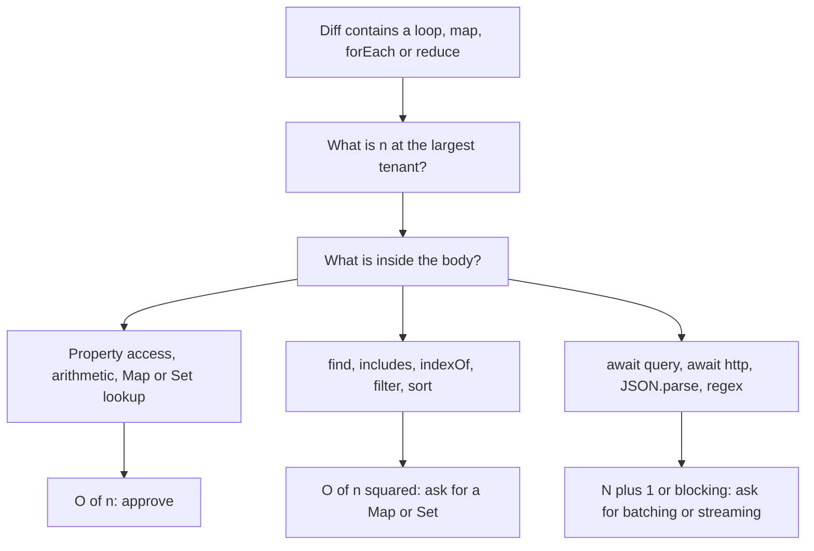
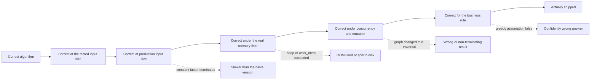

## 8.23 Algorithmic thinking in code review

#### Concept

Most complexity bugs are not found by a profiler. They are found by a reviewer who reads a pull request, sees a loop, asks "what is inside it?", and does the multiplication in their head. A profiler tells you where time went *after* the incident; a reviewer stops the incident from shipping. This section is the reading technique: the eight shapes that turn a linear function into a quadratic or exponential one, the realistic input size where each starts to hurt, and the rewrite.

#### Why does it exist?

Because quadratic code passes every test. Tests run with 10 rows, staging has 200, and the largest customer in production has 40,000. `O(n²)` at n=10 is 100 operations: invisible. At n=40,000 it is 1.6 billion: a 30-second request, a blocked event loop, a fleet-wide timeout. The defect was present on day one and only the input grew. Reviewers who read for complexity catch it in the two minutes it takes to read the diff; nobody catches it later without an outage.

#### Mental model

Imagine reading a recipe. "For each guest, walk to the shop and buy one egg." With 4 guests it is a strange recipe. With 400 guests it is a week of walking. The reviewer's job is not to time the cook: it is to notice the shop trip inside the guest loop and ask how many guests we will ever have. Every complexity smell in this section is a shop trip inside a loop; the only question is how expensive the trip is and how many guests turn up.

#### How it works

Read every loop with three questions, in this order:

1. **What does `n` actually become in production?** Not in the test. The biggest tenant, the biggest order, the biggest CSV, in twelve months.
2. **What is inside the loop body, and what is *its* cost?** A property read is `O(1)`. A `find`, `includes`, `indexOf`, `filter`, `sort`, `JSON.parse`, a query, an HTTP call or a regex is not.
3. **Multiply.** `n` times the body cost is the complexity. If the answer contains `n²`, `n² log n`, or `2ⁿ`, ask for the rewrite before approving.



The eight shapes, each with the smell, the complexity, the size where it stops being free, and the rewrite.

**1. Nested loops over database results.** Two result sets joined in JavaScript.

```ts
// Smell: an in-memory nested-loop join
for (const order of orders) {                         // 5,000 orders
  for (const item of items) {                         // 20,000 items
    if (item.orderId === order.id) order.items.push(item);
  }
}
```

`O(n × m)` = 100 million comparisons, about 400–900 ms of blocked event loop. It is invisible at 50 orders and 200 items (10,000 comparisons, under a millisecond). Rewrite: group the child rows into a `Map` once, then one lookup per parent: `O(n + m)`, about 6 ms. Or push the join into PostgreSQL, which has hash joins and does this for a living.

**2. `find` / `includes` / `indexOf` inside a `map`.** The most common `O(n²)` in a TypeScript codebase, because it reads like a one-liner.

```ts
// Smell: linear scan inside a linear loop
const enriched = orders.map((o) => ({
  ...o,
  customer: customers.find((c) => c.id === o.customerId),   // O(n) inside O(n)
  isVip: vipIds.includes(o.customerId),                      // another O(n)
}));
```

At n = 500 this is 250,000 comparisons: under a millisecond, ships happily. At **n = 5,000** it is 25 million comparisons across the two scans and measures **about 70–90 ms** of blocked event loop on a modern container: every other request in that process waits. At n = 50,000 it is roughly 7 seconds, which is not a slow endpoint, it is an outage. Rewrite:

```ts
const byId = new Map(customers.map((c) => [c.id, c]));   // O(m), built once
const vip = new Set(vipIds);                             // O(k), built once
const enriched = orders.map((o) => ({ ...o, customer: byId.get(o.customerId), isVip: vip.has(o.customerId) }));
```

`O(n + m + k)`, about 2 ms at n = 5,000. The rule for review: **any linear search inside a linear loop is a `Map` or a `Set` that has not been built yet.**

**3. N+1 queries.** This is an algorithmic problem that happens to be expressed in an ORM. The loop is `O(n)`; the body is a network round trip.

```ts
for (const order of orders) {                                   // 500 orders
  order.customer = await this.customers.findOneBy({ id: order.customerId });   // 1.2 ms each
}
```

`O(n)` queries × 1.2 ms = **600 ms**, of which almost none is database work; it is 500 round trips. Rewrite as two queries and a `Map`: `WHERE id = ANY($1)` with the distinct ids, then join in memory: about 8 ms. In TypeORM that is `relations: { customer: true }` or a `DataLoader`; in Sequelize, `include`. The reviewer's tell is `await` inside `for`. Not every `await` in a loop is wrong (bounded, deliberately serialized work is fine), but every one must be justified in the PR.

**4. Sorting inside a loop.** `sort` is `O(k log k)` and mutates.

```ts
for (const group of groups) {                     // 2,000 groups
  const recent = allEvents.sort((a, b) => b.at - a.at).filter((e) => e.groupId === group.id).slice(0, 5);
}
```

`O(n × m log m)` = 2,000 × 10,000 × 13 ≈ 260 million comparisons, several seconds. It also mutates `allEvents` under everyone else. Rewrite: sort **once** outside the loop, group into a `Map<groupId, Event[]>` in one pass, then take the first five per group: `O(m log m + m + n)`. Better still, let PostgreSQL do it with `row_number() OVER (PARTITION BY group_id ORDER BY at DESC)`.

**5. Building a giant array before responding instead of streaming.** The complexity is linear; the memory is not.

```ts
const all = await this.repo.find({ where: { tenantId } });   // 800,000 rows
return all.map(toCsvLine).join('\n');                        // one 400 MB string
```

Node's default old-space is around 1.5–2 GB in a typical container; a 400 MB string plus the 800,000 hydrated entities behind it (each entity is several hundred bytes of object headers and hidden classes, so 600 MB or more) is an `OOMKilled` pod, and `join` on a huge array is a single allocation that can fail on its own. Rewrite: a server-side cursor (`QueryRunner.stream()` in TypeORM, `pg-query-stream`) piped through a transform into the response, so peak memory is one batch. Memory is a complexity dimension; `O(n)` space with a large `n` and a hard heap limit is a crash, not a slowdown.

**6. `JSON.parse` on multi-megabyte payloads.** `JSON.parse` is linear and native, so it looks free. It is also **synchronous**: it blocks the event loop for its entire duration and allocates several times the input size.

A 10 MB JSON body parses in roughly 80–120 ms and produces 40–60 MB of heap. At 20 requests per second of 10 MB uploads, the event loop is blocked more than it is free, p99 across every unrelated endpoint on that pod collapses, and the liveness probe starts failing (see Part 9 — Operating Systems and the Node.js Runtime for the event loop, and Part 30 — Reliability Engineering: Timeouts, Retries, Circuit Breakers and Backpressure for what that does to probes). Rewrite: cap `body-parser` `limit` to what the API actually needs (`'256kb'` for JSON APIs), take large payloads as an upload to object storage plus a job, and stream-parse when you must parse in-process.

**7. Regex with catastrophic backtracking.** The only shape in this list that is exponential.

```ts
const RE = /^(\w+\s?)+$/;            // nested quantifier: the classic ReDoS shape
if (RE.test(input)) { /* ... */ }
```

On a 22-character string that fails to match at the end, the engine explores on the order of 2²² paths: a few hundred milliseconds. At 30 characters it is minutes, on the single thread that serves every other request. One crafted 40-character string in a `name` field takes a pod down, and the attacker needs no volume. Rewrite: remove the nested quantifier (`/^\w+(\s\w+)*$/`), cap input length before matching, prefer explicit parsing or `class-validator` decorators over hand-written regexes, and run `eslint-plugin-security` or a ReDoS linter in CI.

**8. Recomputing the same aggregate per row.** A constant hoisted into a loop by accident.

```ts
for (const item of cart.items) {                                     // 40 items
  const total = await this.orders.sum('totalCents', { customerId }); // same answer 40 times
  applyDiscountTier(item, total);
}
```

`O(n)` identical queries, or `O(n × m)` if the aggregate is computed in memory over another collection. The value does not depend on `item`. Rewrite: compute once above the loop. The reviewer's tell is that no loop variable appears in the expression.

Before and after, with realistic numbers measured on one 2 vCPU container:

| Smell | Complexity | Realistic n | Cost before | Rewrite | Cost after |
|---|---|---|---|---|---|
| In-memory nested-loop join | O(n × m) | 5,000 × 20,000 | 400–900 ms blocked | Group children into a `Map`, or join in SQL | 6 ms |
| `find`/`includes` inside `map` | O(n²) | 5,000 | 70–90 ms blocked | Build `Map`/`Set` once | 2 ms |
| N+1 queries | O(n) round trips | 500 | 600 ms, mostly latency | `WHERE id = ANY($1)` plus `Map` | 8 ms |
| `sort` inside a loop | O(n × m log m) | 2,000 × 10,000 | 3–6 s, plus mutation bug | Sort once and group, or window function | 40 ms |
| Materialize then respond | O(n) space | 800,000 rows | 600 MB+, OOMKilled | Cursor plus streaming response | 30 MB steady |
| `JSON.parse` of a large body | O(n), synchronous | 10 MB | 80–120 ms loop block | Body size limit plus upload-and-job | Rejected at 256 KB |
| Nested-quantifier regex | O(2ⁿ) | 30 chars | Minutes, one core | Rewrite pattern, cap length | Microseconds |
| Aggregate recomputed per row | O(n) queries | 40 | 50 ms | Hoist above the loop | 1.2 ms |

#### Practical example

A `GET /admin/orders/report` endpoint was written against a seeded database of 300 orders and reviewed by three people. In production the largest merchant had 48,000 orders in the reporting window. The handler did an in-memory join (shape 1), a `find` per row for the customer (shape 2), and a `sort` inside the grouping loop (shape 4). Each is defensible in isolation; multiplied, the endpoint took 41 seconds and blocked the event loop for most of it, so every other request served by that pod timed out. Three `Map` builds and one hoisted `sort` brought it to 380 ms.

#### NestJS example

The rewrite pattern, as it appears in a real service, with the batching helper that removes the N+1 and the `Map` that removes the quadratic:

```ts
// orders/orders-report.service.ts
import { Injectable } from '@nestjs/common';
import { InjectRepository } from '@nestjs/typeorm';
import { Between, In, Repository } from 'typeorm';
import { Order } from './order.entity';
import { Customer } from '../customers/customer.entity';

@Injectable()
export class OrdersReportService {
  constructor(
    @InjectRepository(Order) private readonly orders: Repository<Order>,
    @InjectRepository(Customer) private readonly customers: Repository<Customer>,
  ) {}

  async build(tenantId: string, from: Date, to: Date) {
    const orders = await this.orders.find({ where: { tenantId, createdAt: Between(from, to) } });

    // One query for every customer referenced, not one per order: O(1) round trips
    const customerIds = [...new Set(orders.map((o) => o.customerId))];
    const customers = await this.customers.find({ where: { id: In(customerIds) } });
    const byId = new Map(customers.map((c) => [c.id, c]));            // O(m) once

    // O(n) with O(1) lookups inside; nothing linear lives in this loop
    return orders.map((o) => ({
      id: o.id,
      total: o.totalCents,
      customerName: byId.get(o.customerId)?.name ?? 'unknown',
    }));
  }
}
```

`In(customerIds)` becomes `WHERE id IN (...)`, which has a parameter-count ceiling; above a few thousand ids, chunk the array or use `= ANY($1::uuid[])` with a single array parameter. That ceiling is itself a review item.

#### PostgreSQL example

The reviewer's question "is this loop really a join?" usually has a SQL answer. The three-shape endpoint above collapses into one query whose plan you can read:

```sql
EXPLAIN (ANALYZE, BUFFERS)
SELECT o.id, o.total_cents, c.name,
       row_number() OVER (PARTITION BY o.customer_id ORDER BY o.created_at DESC) AS rn
FROM orders o
JOIN customers c ON c.id = o.customer_id
WHERE o.tenant_id = $1 AND o.created_at >= $2 AND o.created_at < $3;
```

```text
WindowAgg  (actual time=182.4..268.9 rows=48012 loops=1)
  ->  Sort  (actual time=182.3..196.1 rows=48012 loops=1)
        Sort Key: o.customer_id, o.created_at DESC
        Sort Method: quicksort  Memory: 9114kB
        ->  Hash Join  (actual time=12.8..108.2 rows=48012 loops=1)
              Hash Cond: (o.customer_id = c.id)
              ->  Index Scan using orders_tenant_created_idx on orders o (actual time=0.04..61.2 rows=48012 loops=1)
              ->  Hash  (actual time=12.6..12.6 rows=9200 loops=1)
Execution Time: 274.1 ms
```

The `Hash Join` is exactly the `Map` you would have built in JavaScript, built by code that has been optimized for thirty years. When you see `loops=48012` on an inner node in a plan, that is the database doing shape 2 for you: usually a missing index, occasionally a genuinely correct nested loop.

#### Production scenario

A team added an algorithmic pass to their review template: for every PR touching a request path, the description must state the largest realistic `n` and the complexity of any new loop. In six months it caught eleven quadratic paths before release, two ReDoS patterns and four N+1s. Cost: about ninety seconds per review. Compare with one Sev-2 incident, which costs a day of engineering time plus the customer conversation.

#### Failure scenario

At 09:40 a Monday the checkout API's p99 went from 120 ms to 9 s, only for one merchant. No deploy that morning; the deploy had been eleven days earlier. The `find` inside `map` in the promotions engine had been fine at 900 active promotions; over the weekend a bulk import took that merchant to 6,400. Nothing changed in the code; `n` changed. The graph that identified it was event-loop lag per pod, not CPU (CPU looked normal because one core at 100% on a 4-core pod is 25%). The fix was a two-line `Map`. The prevention was an assertion in the promotions loader that logs a warning above 2,000 promotions, and a load test seeded with the largest tenant's data instead of the seed fixture.

#### Edge cases & failure modes

- **`n` is small today.** The reviewer must ask what it is at the largest tenant in a year, not what the fixture has.
- **Quadratic hidden behind a helper.** `enrich(orders, customers)` looks `O(n)` at the call site; the reviewer must open it.
- **`Array.prototype.sort` mutates.** A sort inside a loop is both slow and a correctness bug for anyone holding the same array.
- **`Set`/`Map` keys are compared by reference for objects.** A `Set` of objects does not deduplicate by value; use a primitive key.
- **Spread inside a loop.** `acc = [...acc, x]` inside a `reduce` copies the accumulator every iteration: a hidden `O(n²)` that looks functional and elegant.
- **`Object.keys` inside a loop over the same object.** Rebuilds the key array each time.

#### How a Senior Backend Engineer thinks about this

They read diffs for shape before they read them for style. They know that the three questions (what is `n`, what is in the body, multiply) take fifteen seconds and catch most performance incidents. They ask authors to state `n` in the PR description, because the author knows the domain and the reviewer often does not. They do not accept "we can optimize later" for a quadratic in a request path, because "later" is an incident. They also refuse the opposite mistake: rewriting a clear `O(n²)` over ten elements into an unreadable `O(n)`, because a loop over a fixed, small, bounded collection is not a bug.

To a product manager: "This page works fine for our average customer and will take forty seconds for our biggest one. The change is small and I want it in this release, not the next."

#### Common mistakes

- Approving a PR because the tests pass and the fixture is small.
- Treating N+1 as an ORM configuration issue rather than an algorithm.
- Optimizing the loop body's constant factor instead of removing the linear scan inside it.
- Assuming native methods (`find`, `includes`, `JSON.parse`) are free because they are implemented in C++.
- Measuring CPU percentage on a multi-core pod instead of event-loop lag.

#### Interview questions

1. *You see `items.find(...)` inside `orders.map(...)` in a pull request. What do you say, and what numbers do you use to justify it?* Expected: `O(n²)`; state `n` at the largest tenant; ~25 million comparisons and ~80 ms of blocked loop at n = 5,000; rewrite with a `Map` built once.
2. *Why is an N+1 query an algorithmic problem and not just an ORM problem?* Expected: the loop makes `n` round trips; the cost is latency × n regardless of ORM; the fix is batching, which changes the complexity of round trips from `O(n)` to `O(1)`.
3. *Which of these is worst at n = 30 and why: `O(n²)`, `O(n log n)`, `O(2ⁿ)`?* Expected: `2³⁰` is a billion; constants and small `n` matter, but exponential shapes are a different category and are usually a regex or a naive recursion.
4. *How do you spot a memory complexity problem in review?* Expected: anything that materializes a whole result set; look for `find()` without pagination, `join` on a large array, buffering before responding; ask for cursors and streaming.
5. *A page got slow with no deploy. Where do you look first?* Expected: input size growth; a quadratic that crossed its threshold; per-tenant metrics; event-loop lag.

#### Practical exercise

Take a real endpoint in your codebase that fans out over a collection. Seed a database with the largest realistic tenant (not the fixture). Measure p99 and event-loop p99 with `perf_hooks.monitorEventLoopDelay`, at 1x, 10x and 100x the seed size. Then apply the rewrites in this section.

Acceptance criteria:

- You can plot latency against `n` and state whether the curve is linear or quadratic from the shape.
- Event-loop p99 during the 100x run is under 50 ms after the rewrite and you can name the specific line that caused it before.
- The PR template in your repo now asks for `n` and the complexity of new loops.

## 8.24 Choosing the right algorithm for a backend problem

The hard part of applied algorithms is rarely implementing them. It is deciding **where the algorithm should live**: in your Node process, inside PostgreSQL, inside Redis, or in a background job. The wrong location is the more expensive mistake, because it is the one you cannot fix with a `Map`.

Three rules decide the location:

1. **Move the algorithm to the data when the data is large.** Filtering, joining, sorting and aggregating a million rows belongs in PostgreSQL, which has indexes, hash joins, and a query planner. Pulling a million rows into Node to filter them is transferring megabytes to do work the database already did better.
2. **Move the algorithm to memory when the data is small, hot and shared.** Rate-limit counters, top-k autocompletion, session state and leaderboards belong in Redis or in-process, because a round trip to PostgreSQL costs more than the whole computation.
3. **Move the algorithm off the request path when it is `O(n log n)` or worse over a large `n`.** Reports, exports, recomputed recommendations and graph traversals over the whole dataset belong in a job with a queue, a progress record and a result the user polls for or receives by email.

| Problem | Approach | Complexity | Where it lives |
|---|---|---|---|
| Find one entity by id | B-tree index lookup | O(log n) | PostgreSQL |
| Membership test on a hot, bounded set | Hash set | O(1) | In-process `Set`, or Redis `SISMEMBER` |
| Membership test on a huge set, false positives acceptable | Bloom filter | O(k) | Redis (`BF.EXISTS`) or in-process |
| Deduplicate ids from a request | Hash set | O(n) | Application code |
| Join two result sets | Hash join | O(n + m) | PostgreSQL; `Map` in the app only for small, already-fetched sets |
| Top N by score | Partial sort / heap, or sorted set | O(n log k) | PostgreSQL `ORDER BY ... LIMIT`; Redis `ZREVRANGE` for hot leaderboards |
| Paginate a large list | Keyset pagination over an index | O(log n + k) | PostgreSQL |
| Autocomplete over a bounded vocabulary | Trie with precomputed top-k | O(L + k) | In-process, rebuilt on a schedule |
| Typo-tolerant search | Trigram index | Proportional to posting lists | PostgreSQL `pg_trgm` |
| Fixed-window or sliding-window rate limit | Counter / sorted set with atomic script | O(1) or O(log n) | Redis, one round trip via Lua |
| Token bucket per user | Counter plus timestamp, atomic | O(1) | Redis |
| Schedule the next job to run | Min-heap or indexed `ORDER BY run_at LIMIT` | O(log n) | PostgreSQL with `FOR UPDATE SKIP LOCKED`, or a queue |
| Evict the least recently used entry | Hash map plus doubly linked list | O(1) | In-process cache, or Redis `maxmemory-policy allkeys-lru` |
| Shortest or cheapest path | Dijkstra with a binary heap | O((V + E) log V) | Background job; cache the result |
| Order tasks by dependency | Kahn's topological sort | O(V + E) | Application code at startup, or a job |
| Detect a cycle | DFS with colours, or Kahn's leftover check | O(V + E) | CI check, or application code |
| Reachability, "who can see this" | BFS with a visited set and a depth cap | O(V + E) | Application code with bounds; materialize for hot reads |
| Fewest coins / interval scheduling | Greedy, when the exchange argument holds | O(n log n) | Application code, with the proof written down |
| Optimal split with dependencies between choices | Dynamic programming | O(n × W) or O(n × m) | Background job if the table is large |
| Fuzzy string distance for re-ranking | Levenshtein DP over the top 100 candidates | O(a × b) per pair | Application code, over a bounded shortlist |
| Count distinct over billions of events | HyperLogLog | O(1) space per key | Redis `PFCOUNT`, or PostgreSQL extension |
| Recompute an expensive aggregate | Incremental update, or materialized view | Amortized O(1) per write | PostgreSQL materialized view refreshed by a job |

The column that matters most in a design review is the last one. "We will do the graph traversal in the service" and "we will do the graph traversal in a nightly job and cache the result" are the same algorithm with completely different operational consequences.

## 8.25 The complexity cheat sheet

Everything from Part 7 — Computer Science Fundamentals: Data Structures and Part 8, consolidated. Time complexities are for the standard implementation; `n` is the number of elements.

**Data structures**

| Structure | Access | Search | Insert | Delete | Space | Use it when |
|---|---|---|---|---|---|---|
| Array (fixed) | O(1) | O(n) | n/a | n/a | O(n) | You index by position and the size is known |
| Dynamic array (JS `Array`) | O(1) | O(n) | O(1) amortized at the end, O(n) at the front | O(n) | O(n) | Default list; never `shift()` in a hot loop |
| String (immutable) | O(1) char | O(n + m) substring | O(n) concat | n/a | O(n) | Build with an array plus `join`, not `+=` in a loop |
| Singly linked list | O(n) | O(n) | O(1) at a known node | O(1) at a known node | O(n) | You splice constantly and never index; rare in application code |
| Doubly linked list | O(n) | O(n) | O(1) at a node | O(1) at a node | O(n) | The recency list inside an LRU cache |
| Stack | O(1) top | O(n) | O(1) | O(1) | O(n) | Undo, DFS, parser, call-stack simulation |
| Queue | O(1) front | O(n) | O(1) | O(1) | O(n) | BFS, job buffering; use a ring buffer or two stacks, not `shift()` |
| Deque | O(1) ends | O(n) | O(1) ends | O(1) ends | O(n) | Sliding-window maximum, work stealing |
| Hash map (`Map`) | n/a | O(1) average, O(n) worst | O(1) average | O(1) average | O(n) | Lookup by key; the answer to most `O(n²)` review findings |
| Hash set (`Set`) | n/a | O(1) average | O(1) average | O(1) average | O(n) | Membership and deduplication |
| Binary search tree (unbalanced) | O(h) | O(h) | O(h) | O(h) | O(n) | Only as a teaching device; degenerates to a list |
| Balanced BST / B-tree | O(log n) | O(log n) | O(log n) | O(log n) | O(n) | Ordered data, range scans; this is a database index |
| Binary heap | O(1) min/max | O(n) | O(log n) | O(log n) | O(n) | Priority queue, scheduler, top-k, Dijkstra frontier |
| Trie | n/a | O(L) | O(L) | O(L) | O(total chars) | Prefix search over a bounded vocabulary |
| Graph (adjacency list) | n/a | O(V + E) traverse | O(1) edge | O(deg) | O(V + E) | Any "depends on", "follows", "connects to" relation |
| Bloom filter | n/a | O(k), false positives | O(k) | not supported | ~10 bits per item at 1% FP | "Definitely not present" checks in front of an expensive lookup |
| LRU cache (map + list) | O(1) | O(1) | O(1) | O(1) | O(capacity) | Bounded in-process cache with eviction |

**Algorithms**

| Algorithm | Best | Average | Worst | Space | Use it when |
|---|---|---|---|---|---|
| Linear search | O(1) | O(n) | O(n) | O(1) | Small or unsorted collections only |
| Binary search | O(1) | O(log n) | O(log n) | O(1) | Sorted array, or searching an answer space (capacity, threshold) |
| Insertion sort | O(n) | O(n²) | O(n²) | O(1) | Tiny or nearly-sorted arrays; what `sort` uses under ~10 elements |
| Merge sort | O(n log n) | O(n log n) | O(n log n) | O(n) | Stable sort needed; external sorting of data larger than memory |
| Quicksort | O(n log n) | O(n log n) | O(n²) | O(log n) | General in-memory sorting; V8's `sort` is a hybrid (TimSort) |
| Heapsort | O(n log n) | O(n log n) | O(n log n) | O(1) | Worst-case guarantee with no extra memory |
| Counting / radix sort | O(n + k) | O(n + k) | O(n + k) | O(n + k) | Small integer key range (status codes, ages, buckets) |
| Two pointers | O(n) | O(n) | O(n) | O(1) | Sorted input, pair sums, merging, deduplicating in place |
| Sliding window | O(n) | O(n) | O(n) | O(k) | Contiguous subarray or time-window aggregates |
| BFS | O(V + E) | O(V + E) | O(V + E) | O(V) | Shortest path in hops, level-by-level expansion |
| DFS | O(V + E) | O(V + E) | O(V + E) | O(V) recursion depth | Cycle detection, connected components, topological order |
| Topological sort (Kahn) | O(V + E) | O(V + E) | O(V + E) | O(V) | Dependency order; leftover nodes prove a cycle |
| Dijkstra (binary heap) | O((V + E) log V) | same | same | O(V) | Cheapest path with non-negative weights |
| Bellman-Ford | O(V × E) | O(V × E) | O(V × E) | O(V) | Negative weights, or detecting negative cycles |
| Union-Find (path compression) | ~O(1) | ~O(α(n)) | ~O(α(n)) | O(n) | Connected components, grouping, deduplication by equivalence |
| Greedy | O(n log n) typically | same | same | O(1)–O(n) | The exchange argument holds and you can state it |
| DP (1-D, e.g. coin change) | O(n × W) | same | same | O(W) | Overlapping subproblems, optimal substructure |
| DP (2-D, e.g. edit distance) | O(a × b) | same | same | O(min(a, b)) rolling | Sequence comparison over bounded inputs |
| Memoized recursion | O(states) | same | same | O(states) | The recurrence is clear and the state space is bounded |
| Trigram / inverted index search | proportional to posting lists | same | same | 2–3x text | Substring, typo and full-text search at database scale |

## 8.26 Edge cases and failure modes

An algorithm can be correct, well-chosen and still wrong in production. These are the ways.



- **Unbounded recursion hitting the call stack.** Node's default stack holds roughly 10,000–12,000 frames. A recursive DFS over a category tree is fine at depth 12 and throws `RangeError: Maximum call stack size exceeded` on a 20,000-node linked chain built by a bad import, or on a cycle nobody detected. Fix: convert hot traversals to an explicit stack with a `visited` set and a depth cap, and treat "depth exceeded" as a data-quality alert, not a 500.

- **An `O(n log n)` sort that spills to disk in PostgreSQL.** The plan is optimal; `work_mem` is 4 MB and the sort needs 300 MB. `Sort Method: external merge  Disk: 312400kB` turns a 1.4 s in-memory sort into 9 s of I/O, and `log_temp_files = 0` is how you see it. Fix: `SET LOCAL work_mem` inside the specific transaction, an index that provides the order, or fewer rows to sort. Raising `work_mem` globally trades this incident for an out-of-memory one (see Part 18 — PostgreSQL Internals).

- **A hash map degrading when keys collide.** `O(1)` is average, not worst. Adversarial or pathological keys (all hashing to the same bucket) make a `Map` behave like a list, and JavaScript objects used as maps with hundreds of thousands of dynamic keys also fall out of V8's fast paths and grow a megamorphic shape. Fix: use `Map`, not `{}`, for dynamic keys; never build a map keyed directly by unbounded user input without a size cap; and remember that a `Set` of 10 million strings is real memory, not free.

- **Dijkstra on a graph that changes while you traverse it.** The algorithm assumes a static graph. If your edges are database rows and another transaction updates a weight mid-traversal, the "shortest path" you return satisfies no consistent snapshot of the data. Fix: read the graph inside one repeatable-read transaction or one snapshot, or accept the staleness explicitly and say so in the response. The same applies to BFS over a follower graph that is being written to.

- **A greedy algorithm that is provably wrong for the business rule.** Greedy coin change works for {1, 5, 10, 25} and fails for {1, 3, 4} (greedy gives 6 = 4+1+1, optimal is 3+3). Greedy shipment packing works until the finance rule "always fill the cheapest carrier first" is added, at which point locally optimal is globally expensive. Fix: write the exchange argument down next to the code. If you cannot write it, you do not have a greedy problem, you have a DP problem or an approximation you must label as one.

- **A DP table that does not fit in the heap.** Edit distance over two 200,000-character documents is a 40-billion-cell table. Even the rolling one-row optimization is fine; the naive 2-D table is not. Knapsack with `W` in cents rather than rupees is 100x the table. Fix: rolling arrays, coarser units, a bounded shortlist (Levenshtein over the top 100 trigram candidates, never over the catalog), or a different algorithm entirely.

- **Constant factors dominating at real input sizes.** A "better" `O(n log n)` implementation with allocations per element loses to an `O(n²)` scan of 50 elements every time. Binary search over an array of 8 items is slower than a linear scan because of branch prediction and cache locality. Fix: benchmark at the actual `n` before optimizing; keep the simple version when `n` is bounded and small, and comment the bound so the next reader knows why.

- **Amortized guarantees that fail at the worst moment.** A dynamic array's `O(1)` append is amortized: one append in `n` copies the whole array. At 5 million elements that single append is a 40 MB copy and a garbage-collection pause, and it happens under peak load. Fix: pre-size when you know the size, or stream instead of accumulating.

- **Cache-friendly versus cache-hostile.** Two `O(n)` loops are not equal: iterating a flat array of numbers is an order of magnitude faster than chasing pointers through a linked list of objects, because of memory locality. This is why `Array` beats a linked list in practice for almost everything an application does.

- **Complexity measured in the wrong unit.** `O(n)` HTTP calls is not the same as `O(n)` array reads even though both are linear; the constant is 200,000x. Always ask what the unit of work is: a CPU cycle, a heap allocation, a page read, or a network round trip.

- **Correct algorithm, wrong data structure feeding it.** A perfect Dijkstra implementation fed by `orders.find(...)` per neighbour is `O(V × E)`. The algorithm's complexity assumes `O(1)` adjacency lookups.

- **Non-determinism from an unstable sort.** V8's `sort` is stable, but a comparator that returns inconsistent results (comparing floats with tolerance, or comparing objects by a mutable field) produces different orders on different runs, which shows up as flaky pagination and duplicated or missing rows across pages. Fix: total order with a unique tiebreaker, always.

## Senior Checklist — Part 8

- [ ] I understand the concept
- [ ] I can explain it simply
- [ ] I can implement it
- [ ] I understand its failure modes
- [ ] I understand its scaling limitations
- [ ] I understand its security implications
- [ ] I understand its operational implications
- [ ] I can choose between alternatives
- [ ] I can explain the tradeoffs
- [ ] I can answer senior-level interview questions
- [ ] I can state the time and space complexity of any function I write, and I know the difference between best, average, worst and amortized
- [ ] I can analyse nested loops, recursive calls and library methods, and I know the real cost of `find`, `includes`, `sort`, `spread` and `JSON.parse`
- [ ] I know when a sort is worth it, which sort PostgreSQL is using, and when `ORDER BY ... LIMIT` beats sorting in the application
- [ ] I can write binary search without an off-by-one error, and I can apply it to an answer space, not just an array
- [ ] I can recognise a two-pointer or sliding-window problem and write the O(n) version instead of the O(n²) one
- [ ] I convert deep recursion to an explicit stack, and I bound depth and detect cycles in every traversal
- [ ] I choose BFS or DFS on purpose, with a `visited` set and a depth cap, and I can explain the memory profile of each
- [ ] I can model a real backend problem as a graph and implement topological sort with cycle reporting
- [ ] I can implement Dijkstra with a heap and say when Bellman-Ford or a precomputed cache is the right answer instead
- [ ] I only use a greedy algorithm when I can write down the exchange argument, and I recognise when the business rule breaks it
- [ ] I can identify overlapping subproblems, write the recurrence, memoize it, and convert to a bottom-up table with rolling state
- [ ] I can design a rate limiter, a job scheduler and a cache eviction policy from first principles and state the complexity of each operation
- [ ] I can explain why a B-tree lookup is O(log n) in page reads and what `Buffers: shared hit/read` means
- [ ] I know which search problem needs a trie, a prefix B-tree, a trigram index or a full-text index, and the cost of each
- [ ] I read pull requests for complexity: I ask what `n` is at the largest tenant and multiply it by the loop body
- [ ] I can spot an N+1, a quadratic scan, a sort in a loop and a catastrophic regex in a diff without running anything
- [ ] I know where each algorithm should live: application code, PostgreSQL, Redis, or a background job

## Part 8 — Key Takeaways

- Complexity is about growth, not speed. `O(n²)` at n=10 is invisible and at n=40,000 is an outage; the code never changed, `n` did.
- Every linear search inside a linear loop is a `Map` or a `Set` that has not been built yet. That single rewrite fixes most quadratic code in a TypeScript backend.
- N+1 is an algorithm, not an ORM setting: `n` round trips at 1.2 ms each is 600 ms of pure latency. Batch to `O(1)` queries and join with a `Map`.
- Space is a complexity dimension with a hard limit. Materializing 800,000 rows is not slow, it is `OOMKilled`; use cursors and streams.
- Native and synchronous is not free. `JSON.parse` of 10 MB blocks the event loop for 100 ms, and a nested-quantifier regex is exponential on one crafted 30-character string.
- Move the algorithm to the data when the data is large, to memory when it is small and hot, and off the request path when it is `O(n log n)` or worse over a big `n`.
- `O(1)` average is not `O(1)` worst. Hash maps degrade on collisions, dynamic arrays copy on growth, and amortized guarantees fail at peak.
- Constant factors and memory locality decide real performance at small `n`. Benchmark at the actual input size before replacing a simple loop.
- Recursion has a hard ceiling around 10,000 frames in Node. Every traversal needs an explicit stack option, a `visited` set and a depth cap.
- A greedy algorithm you cannot prove is a wrong answer waiting for a business rule change. Write the exchange argument or use DP.
- Algorithms assume a static, consistent input. A graph that changes under a traversal, or a comparator without a unique tiebreaker, produces confidently wrong output.
- The plan is the algorithm. `Hash Join`, `Sort Method: external merge`, `loops=48012` and `Rows Removed by Index Recheck` are complexity facts printed by PostgreSQL for free.
- Reading a diff for complexity takes fifteen seconds: what is `n`, what is in the loop body, multiply. It is the cheapest performance work you will ever do.
