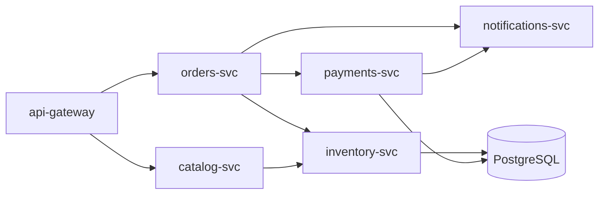

## 8.15 Graph

#### Concept

A graph is a set of **vertices** (nodes) connected by **edges**. Edges may be **directed** (A follows B does not mean B follows A) or undirected (A and B are friends), **weighted** (the road from A to B takes 7 minutes) or unweighted. A graph with no directed cycles is a **DAG** (directed acyclic graph), the shape of every dependency system. A tree is a graph with exactly one path between any two nodes; the moment a node can be reached two ways, you have left Section 8.10 and entered this one.

Backends are full of graphs: the NestJS dependency-injection container resolves a graph of providers and modules at bootstrap and throws on a cycle; a distributed trace is a graph of service calls; the order status machine (`pending -> paid -> shipped -> delivered`, with `cancelled` reachable from several states) is a directed graph; followers, friends, "customers also bought", fraud rings of accounts sharing a device, delivery routes over a road network, and workflow steps with dependencies are all graphs.

#### Why does it exist?

Hierarchies and lists cannot express "many-to-many with structure". A user can follow 500 accounts and be followed by 5,000; a build step can depend on three others; a city block connects to four neighbours. The questions people ask of such data (shortest path, reachability, ordering that respects dependencies, communities, influence) have no answer without the graph abstraction and its algorithms: breadth-first search, depth-first search, topological sort, Dijkstra, union-find.

#### Mental model

Imagine a metro map. Stations are vertices, lines between them are edges. "How do I get from A to B with the fewest stops?" is breadth-first search. "With the least travel time?" is Dijkstra, because edges have weights. "Can I reach B from A at all?" is reachability. "Which stations form one connected system?" is connected components. Nobody stores the map as a giant table of every station pair; each station lists its neighbours. That list-per-station is the adjacency list.

#### How it works

1. **Adjacency list.** A map from each vertex to its neighbours: `Map<string, Set<string>>` (or an array of neighbour ids). Memory is O(V + E). Iterating a vertex's neighbours costs O(degree). This is the representation for almost every real graph, because real graphs are sparse: a social graph with 10 million users and an average of 200 follows has 2 billion edges, not 100 trillion.
2. **Adjacency matrix.** A V x V table where cell (i, j) holds the edge weight or a boolean. Edge lookup is O(1) and the representation is dense and cache-friendly, but memory is O(V^2): a 100,000-vertex matrix is 10 billion cells. Use it only for small, dense graphs (state machines with 12 states, a distance table between 50 warehouses).
3. **Breadth-first search (BFS).** Start at a vertex, visit all neighbours, then their neighbours, using a queue and a visited set. Finds shortest paths by hop count and "everything within 2 hops" (friends of friends). O(V + E).
4. **Depth-first search (DFS).** Follow one path as deep as possible before backtracking, using a stack. Detects cycles: while exploring, a vertex that is "in progress" and reached again means a cycle. O(V + E).
5. **Topological sort (Kahn's algorithm).** Count incoming edges per vertex; repeatedly take a vertex with zero incoming edges, emit it, and decrement its neighbours. If vertices remain with non-zero counts, there is a cycle. This is how dependency resolution, build systems and workflow engines decide order and how they reject circular definitions.
6. **Dijkstra.** Shortest path with non-negative weights: a priority queue (Section 8.13) of vertices by tentative distance; pop the closest, relax its edges. O((V + E) log V).
7. **Union-find.** Merge sets of vertices as edges arrive; ask "are A and B in the same group?" in near O(1). The tool for connected components on streams of edges, such as accounts linked by shared payment instruments.



```text
adjacency list of the same graph (directed):
  api-gateway       -> [orders-svc, catalog-svc]
  orders-svc        -> [payments-svc, inventory-svc, notifications-svc]
  catalog-svc       -> [inventory-svc]
  payments-svc      -> [notifications-svc, PostgreSQL]
  inventory-svc     -> [PostgreSQL]
  notifications-svc -> []
  PostgreSQL        -> []
reverse index ("who depends on me") is a second adjacency list.
```

**Time complexity (V vertices, E edges, d = degree of a vertex)**

| Operation | Adjacency list | Adjacency matrix | Notes |
|---|---|---|---|
| Add vertex | O(1) | O(V^2) resize | |
| Add or remove edge | O(1) | O(1) | list with `Set` neighbours |
| Has edge (u, v) | O(1) with `Set`, O(d) with array | O(1) | |
| Iterate neighbours of u | O(d) | O(V) | matrix scans a whole row |
| BFS / DFS | O(V + E) | O(V^2) | |
| Topological sort | O(V + E) | O(V^2) | |
| Dijkstra with binary heap | O((V + E) log V) | O(V^2) | matrix version without a heap is O(V^2) |
| Memory | O(V + E) | O(V^2) | |

**Memory implications (V8, Node.js)**

- `Map<string, Set<string>>` costs about 150 bytes per vertex (map entry plus an empty `Set`) and about 40 bytes per edge, plus the id strings. A service graph of 100 vertices is nothing; a follow graph of 10 million vertices and 2 billion edges is about 100 GB and does not belong in a process.
- For static, large graphs in memory (road networks for a routing worker), use the compressed sparse row layout: two typed arrays, `offsets: Uint32Array(V + 1)` and `neighbours: Uint32Array(E)`, 4 bytes per edge, contiguous, and immune to GC pressure.
- Recursive DFS overflows the stack on long paths (Section 8.5); use an explicit stack for graphs whose size users control.

#### Practical example

A small graph library with BFS shortest path, Kahn's topological sort with cycle detection, and Dijkstra using the `BinaryHeap` from Section 8.12.

```ts
// common/graph.ts
import { BinaryHeap } from './binary-heap';

export class DirectedGraph {
  private readonly out = new Map<string, Map<string, number>>(); // vertex -> (neighbour -> weight)

  addVertex(v: string): void {
    if (!this.out.has(v)) this.out.set(v, new Map());
  }

  addEdge(from: string, to: string, weight = 1): void {
    this.addVertex(from);
    this.addVertex(to);
    this.out.get(from)!.set(to, weight);
  }

  neighbours(v: string): ReadonlyMap<string, number> {
    return this.out.get(v) ?? new Map();
  }

  /** Fewest hops from `start` to `goal`, or null. O(V + E). */
  shortestHops(start: string, goal: string, maxDepth = 6): string[] | null {
    const prev = new Map<string, string | null>([[start, null]]);
    const queue: [string, number][] = [[start, 0]];
    for (let i = 0; i < queue.length; i++) {              // index pointer: no shift()
      const [v, depth] = queue[i];
      if (v === goal) return this.pathTo(prev, goal);
      if (depth >= maxDepth) continue;                    // bound the search radius
      for (const n of this.neighbours(v).keys()) {
        if (!prev.has(n)) { prev.set(n, v); queue.push([n, depth + 1]); }
      }
    }
    return null;
  }

  /** Kahn's algorithm. Throws with the offending vertices if a cycle exists. O(V + E). */
  topologicalOrder(): string[] {
    const indegree = new Map<string, number>();
    for (const v of this.out.keys()) indegree.set(v, 0);
    for (const edges of this.out.values()) for (const n of edges.keys()) indegree.set(n, indegree.get(n)! + 1);

    const ready: string[] = [...indegree].filter(([, d]) => d === 0).map(([v]) => v);
    const order: string[] = [];
    for (let i = 0; i < ready.length; i++) {
      const v = ready[i];
      order.push(v);
      for (const n of this.neighbours(v).keys()) {
        const d = indegree.get(n)! - 1;
        indegree.set(n, d);
        if (d === 0) ready.push(n);
      }
    }
    if (order.length !== this.out.size) {
      const stuck = [...indegree].filter(([, d]) => d > 0).map(([v]) => v);
      throw new Error(`cycle detected among: ${stuck.join(', ')}`);
    }
    return order;
  }

  /** Cheapest path by weight. O((V + E) log V). */
  dijkstra(start: string, goal: string): { cost: number; path: string[] } | null {
    const dist = new Map<string, number>([[start, 0]]);
    const prev = new Map<string, string | null>([[start, null]]);
    const heap = new BinaryHeap<[number, string]>((a, b) => a[0] < b[0]);
    heap.push([0, start]);
    while (heap.size) {
      const [d, v] = heap.pop()!;
      if (d > (dist.get(v) ?? Infinity)) continue;        // stale heap entry
      if (v === goal) return { cost: d, path: this.pathTo(prev, goal) };
      for (const [n, w] of this.neighbours(v)) {
        const nd = d + w;
        if (nd < (dist.get(n) ?? Infinity)) { dist.set(n, nd); prev.set(n, v); heap.push([nd, n]); }
      }
    }
    return null;
  }

  private pathTo(prev: Map<string, string | null>, goal: string): string[] {
    const path: string[] = [];
    for (let v: string | null = goal; v !== null; v = prev.get(v) ?? null) path.push(v);
    return path.reverse();
  }
}
```

#### NestJS example

A fulfilment workflow defined as a DAG of steps. The service validates the graph at startup (fail fast on cycles, exactly as NestJS does for its own providers) and runs steps level by level, in parallel where dependencies allow.

```ts
// fulfilment/fulfilment-workflow.service.ts
import { Injectable, Logger, OnModuleInit } from '@nestjs/common';
import { DirectedGraph } from '../common/graph';

type StepFn = (orderId: string) => Promise<void>;

interface StepDef { name: string; dependsOn: string[]; run: StepFn }

@Injectable()
export class FulfilmentWorkflowService implements OnModuleInit {
  private readonly logger = new Logger(FulfilmentWorkflowService.name);
  private readonly graph = new DirectedGraph();
  private readonly steps = new Map<string, StepDef>();
  private levels: string[][] = [];

  constructor() {
    this.define({ name: 'reserveInventory', dependsOn: [], run: async () => { /* ... */ } });
    this.define({ name: 'chargePayment', dependsOn: ['reserveInventory'], run: async () => { /* ... */ } });
    this.define({ name: 'createShipment', dependsOn: ['chargePayment'], run: async () => { /* ... */ } });
    this.define({ name: 'sendConfirmation', dependsOn: ['chargePayment'], run: async () => { /* ... */ } });
    this.define({ name: 'notifyWarehouse', dependsOn: ['createShipment'], run: async () => { /* ... */ } });
  }

  onModuleInit(): void {
    const order = this.graph.topologicalOrder();          // throws on a cycle: the app refuses to start
    // Group into levels: a step's level is 1 + max level of its dependencies.
    const level = new Map<string, number>();
    for (const name of order) {
      const deps = this.steps.get(name)!.dependsOn;
      level.set(name, deps.length ? Math.max(...deps.map((d) => level.get(d)!)) + 1 : 0);
    }
    this.levels = [];
    for (const [name, l] of level) (this.levels[l] ??= []).push(name);
    this.logger.log(`workflow levels: ${JSON.stringify(this.levels)}`);
  }

  async run(orderId: string): Promise<void> {
    for (const names of this.levels) {
      // Steps in one level are independent: run them concurrently, all idempotent by orderId.
      await Promise.all(names.map((n) => this.steps.get(n)!.run(orderId)));
    }
  }

  private define(step: StepDef): void {
    this.steps.set(step.name, step);
    this.graph.addVertex(step.name);
    for (const dep of step.dependsOn) this.graph.addEdge(dep, step.name);
  }
}
```

NestJS itself does the same at bootstrap: modules and providers form a graph, and a cycle produces the familiar "A circular dependency between modules" error, solved by breaking the edge or with `forwardRef()`.

#### PostgreSQL example

Most production graphs live in PostgreSQL as an edges table with indexes in both directions. Two-hop queries are joins; deeper traversal is a bounded recursive CTE; anything beyond that is a job for a graph database or precomputation.

```sql
CREATE TABLE follows (
  follower_id bigint NOT NULL REFERENCES users(id),
  followee_id bigint NOT NULL REFERENCES users(id),
  created_at  timestamptz NOT NULL DEFAULT now(),
  PRIMARY KEY (follower_id, followee_id)                 -- "who do I follow" in one index
);
CREATE INDEX follows_followee_idx ON follows (followee_id, follower_id); -- "who follows me"

-- Friends of friends, excluding people already followed and self, most common first.
EXPLAIN (ANALYZE, BUFFERS)
SELECT f2.followee_id AS suggested, count(*) AS mutuals
FROM follows f1
JOIN follows f2 ON f2.follower_id = f1.followee_id
WHERE f1.follower_id = 42
  AND f2.followee_id <> 42
  AND NOT EXISTS (SELECT 1 FROM follows f3 WHERE f3.follower_id = 42 AND f3.followee_id = f2.followee_id)
GROUP BY f2.followee_id
ORDER BY mutuals DESC
LIMIT 20;
```

```text
Limit  (cost=2931.10..2931.15 rows=20 width=16) (actual time=18.24..18.26 rows=20 loops=1)
  ->  Sort  (cost=2931.10..2958.47 rows=10948 width=16) (actual time=18.23..18.24 rows=20 loops=1)
        Sort Key: (count(*)) DESC
        Sort Method: top-N heapsort  Memory: 26kB
        ->  HashAggregate  (cost=2529.37..2639.85 rows=10948 width=16) (actual time=14.91..16.88 rows=11302 loops=1)
              Group Key: f2.followee_id
              ->  Nested Loop Anti Join  (cost=0.99..2461.62 rows=13550 width=8) (actual time=0.06..11.02 rows=13791 loops=1)
                    ->  Nested Loop  (cost=0.57..1811.20 rows=14120 width=8) (actual time=0.04..6.31 rows=14210 loops=1)
                          ->  Index Only Scan using follows_pkey on follows f1  (actual time=0.02..0.09 rows=312 loops=1)
                                Index Cond: (follower_id = 42)
                          ->  Index Only Scan using follows_pkey on follows f2  (actual time=0.01..0.02 rows=46 loops=312)
                                Index Cond: (follower_id = f1.followee_id)
                    ->  Index Only Scan using follows_pkey on follows f3  (actual time=0.00..0.00 rows=0 loops=14210)
Execution Time: 18.41 ms
```

A user following 312 accounts with 46 follows each produced 14,210 candidate rows in 18 ms. The same query for a user following 5,000 accounts that each follow 5,000 produces 25 million rows; that is the supernode problem, and no index fixes it.

```sql
-- Bounded reachability with cycle protection (PostgreSQL 14+): who can I reach within 3 hops?
WITH RECURSIVE reach AS (
  SELECT followee_id AS id, 1 AS depth FROM follows WHERE follower_id = 42
  UNION ALL
  SELECT f.followee_id, r.depth + 1 FROM follows f JOIN reach r ON f.follower_id = r.id
  WHERE r.depth < 3
) CYCLE id SET is_cycle USING path
SELECT DISTINCT id FROM reach WHERE NOT is_cycle;
```

#### TypeORM example

```ts
@Entity({ name: 'users' })
export class User {
  @PrimaryGeneratedColumn('increment', { type: 'bigint' }) id!: string;

  @ManyToMany(() => User, (u) => u.followers)
  @JoinTable({
    name: 'follows',
    joinColumn: { name: 'follower_id' },
    inverseJoinColumn: { name: 'followee_id' },
  })
  following!: User[];

  @ManyToMany(() => User, (u) => u.following)
  followers!: User[];
}

// Never load `following` relations for traversal; query the edge table directly.
const suggestions = await dataSource.query(
  `SELECT f2.followee_id AS id, count(*) AS mutuals FROM follows f1
   JOIN follows f2 ON f2.follower_id = f1.followee_id
   WHERE f1.follower_id = $1 AND f2.followee_id <> $1
   GROUP BY f2.followee_id ORDER BY mutuals DESC LIMIT 20`,
  [userId],
);
```

#### Sequelize example

```ts
User.belongsToMany(User, { as: 'following', through: 'follows', foreignKey: 'follower_id', otherKey: 'followee_id' });
User.belongsToMany(User, { as: 'followers', through: 'follows', foreignKey: 'followee_id', otherKey: 'follower_id' });

// Direct neighbours only; deeper traversal goes through sequelize.query with a bounded CTE.
const following = await user.getFollowing({ attributes: ['id'], joinTableAttributes: [], limit: 500 });
```

#### Production scenario

**Service graph.** OpenTelemetry traces from 80 services produce an edge list of about 300 call relationships, rebuilt every minute. A DFS from `payments-svc` over the reverse graph answers "which user-facing endpoints break if payments is down" in microseconds; the graph fits in one Map. That is the sweet spot for in-process graphs: small, derived, rebuilt often.

**Social graph.** 20 million users and 1.5 billion follow edges live in the `follows` table (about 90 GB with indexes), partitioned by `follower_id`. Feeds are computed by fan-out on write for ordinary users (each post is pushed to followers' Redis lists, Section 8.7) and by fan-out on read for accounts with more than 100,000 followers, precisely because the degree of a supernode makes push cost unbounded. This decision is a data-structure decision about degree, and it is covered again in the System Design part.

**Routing.** A delivery-routing worker loads a city's road network (600,000 vertices, 1.4 million edges) into compressed sparse row arrays (about 12 MB) and runs Dijkstra with a binary heap in about 40 ms per query, restricted to a bounding box so most queries touch a few thousand vertices.

#### Failure scenario

At 02:14 the on-call engineer is paged: PostgreSQL CPU is at 100 percent, connection pool wait time is 4 seconds, and the slow-query log is full of the friends-of-friends query for `user_id = 771204`. That user is a brand account following 48,000 people, most of whom are other brands following tens of thousands. The two-hop join produced 900 million intermediate rows, spilled `HashAggregate` batches to disk, and held a connection for 190 seconds. The mobile app retried on timeout every 30 seconds, and the user was on a train tapping the "suggestions" tab repeatedly. Four concurrent copies of the query saturated the primary.

The fix in the first ten minutes: `statement_timeout = 5s` for that query's role. The fix that week: degree caps in the query (`LIMIT 500` on the first hop, sampled), a precomputed suggestions table refreshed nightly for accounts above 5,000 follows, and a per-user single-flight lock in Redis so retries wait instead of piling up. The lesson: **traversal cost is the product of degrees along the path; bound the degrees or precompute.**

#### Edge cases & failure modes

- **Supernodes** (celebrities, brand accounts, the "all" tag) make any neighbour-based query explode; cap, sample or precompute.
- **Cycles** hang naive traversals; use visited sets in code and `CYCLE` or depth bounds in SQL.
- **Direction mistakes.** "Follows" is directed; treating it as undirected doubles the graph and breaks semantics.
- **Missing reverse index** makes "who follows me" a sequential scan.
- **Self-loops and duplicate edges** need a primary key on `(from, to)` and a check constraint `from <> to`.
- **Unbounded depth** in recursive CTEs; always set a depth stop.
- **Recursion** in DFS over user data overflows the stack.
- **Consistency**: removing a vertex must remove its edges (foreign keys with `ON DELETE CASCADE`), or the graph accumulates dangling references.
- **Stale in-process graphs** after the source changes; rebuild on a schedule and expose the build age.

#### How a Senior Backend Engineer thinks about this

The senior keeps the graph in PostgreSQL as an edges table with both indexes until multi-hop traversals dominate the workload, because a relational edge table gives them transactions, constraints, backups and one operational surface. They bound every traversal by depth and degree, precompute for supernodes, and treat any in-process graph as a small, derived, rebuildable index. They reach for a graph database (Neo4j, or the Apache AGE extension inside PostgreSQL) only when queries of four or more hops are the product, and they know that decision adds a system to operate. For dependency graphs (workflows, module wiring, build steps) they validate acyclicity at definition time, not at run time.

To a product manager: "Suggestions for normal users are instant. For accounts following tens of thousands of people, we compute suggestions overnight instead of live; the feature looks identical, and it stops one user from taking the database down."

#### Common mistakes

- Loading `user.following` relations through the ORM to traverse; use the edge table.
- Forgetting the reverse index.
- Unbounded recursive CTEs over data that can contain cycles.
- Modelling a DAG of steps as a list and discovering the ordering bug in production.
- Choosing an adjacency matrix for a sparse graph "for O(1) edge checks" and running out of memory at 50,000 vertices.

#### Interview questions

1. **Adjacency list versus matrix: when does each win?** Expected: list for sparse graphs (almost all real ones), O(V + E) memory; matrix for small dense graphs and O(1) edge checks.
2. **How does NestJS detect circular dependencies, in data-structure terms?** Expected: the providers and modules form a directed graph; resolution is a topological order; a cycle leaves unresolved vertices; `forwardRef` defers one edge.
3. **Design "people you may know" for 20 million users.** Expected: two-hop join with degree caps for normal users, precomputation for supernodes, indexes in both directions, single-flight for retries.
4. **Explain Kahn's algorithm and what it returns when there is a cycle.** Expected: in-degree counting with a queue of zero-in-degree vertices; leftover vertices with positive in-degree identify the cycle.
5. **Why would you run Dijkstra with a binary heap, and what breaks it?** Expected: O((V + E) log V); negative edge weights break it (use Bellman-Ford).
6. **When is a graph database justified?** Expected: when deep, variable-length traversals are the core workload; otherwise the operational cost outweighs the query convenience.

#### Practical exercise

Build `SuggestionsModule` over a `follows` table seeded with 1 million users following a power-law distribution (most users 50 to 300 follows, 100 users above 20,000). Acceptance criteria: `GET /users/:id/suggestions` answers in under 50 ms at p99 for ordinary users; for users above 5,000 follows it serves a precomputed table refreshed by a nightly job and the response includes `computedAt`; the live query has `statement_timeout` of 5 seconds and returns 503 with `Retry-After` on timeout instead of 500; a workflow DAG test defines a cycle and asserts the application fails to start with an error naming the cycle; and Dijkstra over a 10,000-vertex generated grid returns paths equal to a brute-force BFS on unit weights.
