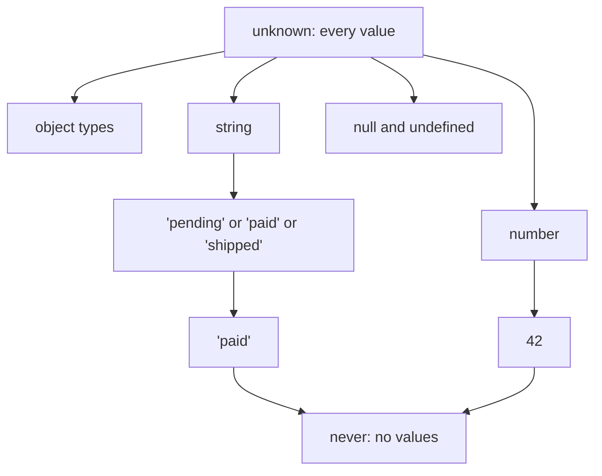
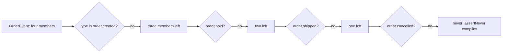

# Part 9 — Advanced TypeScript

Part 1 taught enough TypeScript to build a backend: annotations and inference (1.2), typed functions (1.4.3), interfaces, unions, discriminated unions and a first look at generics (1.7). That is the TypeScript most code needs. This Part is the TypeScript that the *libraries* you use are written in, and the TypeScript that separates a codebase where the compiler catches real bugs from one where it mostly complains.

The goal is not cleverness. Every technique here is shown against a real backend problem: an order id passed where a customer id was expected, a webhook event the code forgot to handle, a refund amount in rupees added to one in euros, a DTO that drifted away from its validator, a config value that is `undefined` in production. The Part ends with the most important skill of all: knowing when a simple type is better than a smart one.

We assume Part 1. We do not re-teach `interface`, `type`, union syntax or a basic generic; we build on them. Versions matter a little in this Part: features are labelled with the TypeScript version that introduced them where it matters, and everything shown works on TypeScript 5.5 and later.

## 9.1 The type system mental model

### 9.1.1 Types are sets of values

#### Concept

The single most useful idea in TypeScript is this: **a type is a set of values**. `boolean` is the set `{true, false}`. The literal type `'paid'` is the set containing exactly one string. `string` is the infinite set of all strings. A union `'pending' | 'paid'` is the union of two sets. Once you see types as sets, most of the rules that seem arbitrary become obvious.

#### Why does it exist?

Without a mental model, TypeScript errors feel like special cases to memorise: why is `'paid'` assignable to `string` but not the reverse, why does `never` vanish from unions, why does an intersection of object types have *more* fields? With the set model, each is one line of reasoning.

#### Mental model

Imagine a nightclub with a guest list. A type is a guest list, and **assignability** is the door check: a value of type `A` may go where type `B` is expected if everyone on list `A` is also on list `B`. `'paid'` gets into a `string` club because every `'paid'` is a string. A `string` does not get into a `'paid'` club, because most strings are not `'paid'`.

#### How it works

Read `A` is assignable to `B` as "the set `A` is a subset of the set `B`".

```ts
type OrderStatus = 'pending' | 'paid' | 'shipped';

const s1: string = 'paid' as OrderStatus;   // OK: every OrderStatus is a string (subset)
// const s2: OrderStatus = 'refunded';      // error: the set OrderStatus does not contain 'refunded'

// Two special sets sit at the ends of the scale.
let anything: unknown = 42;                 // unknown: the set of ALL values (the top type)
anything = 'paid';                          // anything can go into unknown
// const n: number = anything;              // error: unknown is not a subset of number

function fail(message: string): never {     // never: the EMPTY set (the bottom type)
  throw new Error(message);                 // a function returning never cannot return at all
}
const status: OrderStatus = Math.random() > 2 ? fail('impossible') : 'paid'; // never fits anywhere
```



Arrows point from a bigger set to a smaller set inside it. A value can always move **up** the diagram (from `'paid'` to `string` to `unknown`) without a check, and must be **narrowed** (9.2) to move down.

Set operations give the rest:

| Type operation | Set operation | Backend example | Result |
|---|---|---|---|
| `A \| B` | Union: values in A or B | `'card' \| 'upi'` | Either payment method |
| `A & B` | Intersection: values in both | `Order & { refundedAt: Date }` | An object with all fields of both |
| `X \| never` | Union with the empty set | `OrderStatus \| never` | Just `OrderStatus` |
| `string & number` | Nothing is both | (a bug) | `never` |

The intersection row surprises people: `Order & Timestamped` has **more** fields than either, yet it is a **smaller** set of values, because fewer objects satisfy both shapes at once. More requirements, fewer members.

`any` is the odd one out. It is not a set; it is an instruction to switch the checker off. It behaves as both top and bottom at once, which is why it silently poisons everything it touches (1.2.1). `unknown` is the honest top type.

### 9.1.2 Structural typing

#### Concept

TypeScript is **structurally typed**: a value fits a type if it has the right shape, regardless of what it was called or which class created it. Java and C# are mostly **nominally typed**: a value fits only if it was declared as that type or a subtype. In TypeScript, names are labels for shapes, not identities.

#### How it works

```ts
interface Customer { id: string; email: string }
interface Supplier { id: string; email: string }

function sendInvoice(to: Customer): void { /* ... */ }

const supplier: Supplier = { id: 'sup_1', email: 'billing@supplier.test' };
sendInvoice(supplier); // compiles: Supplier has the same shape as Customer

// An object with MORE properties also fits (it is a subset of the set of objects
// that have at least id and email).
const withExtra = { id: 'cus_1', email: 'a@shop.test', loyaltyTier: 'gold' };
sendInvoice(withExtra); // compiles

// Except for one safety net: a fresh object literal with unknown properties.
// sendInvoice({ id: 'cus_2', email: 'b@shop.test', loyaltyTier: 'gold' });
// error: Object literal may only specify known properties, and 'loyaltyTier' does not exist in type 'Customer'.
```

The last case is an **excess property check**. It only applies to object literals written directly where a type is expected, because there a misspelt or unexpected property is almost certainly a typo. It is a lint-like extra, not part of assignability, which is why assigning the same object through a variable first passes.

#### Production scenario

Structural typing is usually a gift: test fakes do not need to extend the real class, and a plain object from a query fits an interface without a conversion. Its cost shows up with **identifiers**. In an orders service with these signatures:

```ts
declare function refundOrder(orderId: string, customerId: string, amountCents: number): Promise<void>;
```

the call `refundOrder(customer.id, order.id, 4999)` compiles, because both are `string`. A team found exactly this after a refactor reordered two parameters: refunds silently failed with "order not found" for a day, and only because the ids had different prefixes did the logs make it obvious. Section 9.10 fixes this class of bug with branded types, which add a nominal flavour to TypeScript where you want one.

#### How a Senior Backend Engineer thinks about this

A senior reads every type error as a set question: "which values are in the source type that are not in the target type?" The answer is usually one specific value, such as `undefined` or `'refunded'`, and naming it is the fix. They also know where structural typing helps (fakes, adapters, plain query results) and where it hurts (interchangeable `string` ids, `number` amounts in different currencies), and they add structure only where it pays.

#### Common mistakes

- Treating `any` as "a type that accepts everything". Use `unknown` for that; `any` disables checking in both directions.
- Expecting an object with extra fields to be rejected everywhere because the literal case is rejected.
- Assuming two interfaces with different names are incompatible. Only their shapes matter.

#### Interview questions

1. **Explain `unknown` and `never` using sets.** `unknown` is the set of all values, so anything is assignable to it and it is assignable only to itself and `any`; `never` is the empty set, so it is assignable to everything and nothing is assignable to it. Follow-up: why does `string | never` simplify to `string`?
2. **What is structural typing, and when does it cause bugs?** Compatibility by shape, not by name; it causes bugs when distinct concepts share a primitive shape, such as different kinds of `string` ids.
3. **Why does assigning an object literal with an extra field fail, but the same object through a variable passes?** Excess property checking applies only to fresh object literals, as a typo check; it is not part of assignability.

#### Practical exercise

Without running the compiler, predict which assignments compile, then check with `npx tsc --noEmit`. Explain each answer in set terms.

```ts
type Method = 'card' | 'upi' | 'wallet';
declare const m: Method;
declare const s: string;
declare const u: unknown;

const a: string = m;
const b: Method = s;
const c: unknown = m;
const d: Method = u;
const e: Method | never = m;
const f: { id: string } = { id: 'pay_1', method: 'card' };
const raw = { id: 'pay_1', method: 'card' };
const g: { id: string } = raw;
```

Acceptance criteria: a correct prediction for all seven, each with a one-line set explanation.

#### Worked answer to the exercise

```text
a  compiles: Method is a subset of string.
b  error: string contains values (for example 'cash') that are not in Method.
c  compiles: unknown is the set of all values.
d  error: unknown contains every value; it must be narrowed first.
e  compiles: Method | never is just Method (union with the empty set).
f  error: excess property check on a fresh object literal ('method' is unknown).
g  compiles: raw is not fresh; { id: string; method: string } is a subset of { id: string }.
```

Why it is right: every line is the subset question. Lines `b` and `d` fail because the source set is bigger than the target. Line `f` versus `g` is the one non-set rule: the excess property check fires only on the fresh literal. `g` is legal, which is also a warning: if `raw` came from a request body, the extra `method` field is silently carried along. That is why a validator that strips unknown fields (6.5, and 9.12 in this Part) is still needed at the boundary.

The trap most learners fall into is answering `g` as an error "because `f` was". The second is thinking `e` errors because `never` looks scary; union with the empty set changes nothing.

## 9.2 Narrowing in depth

### 9.2.1 Control-flow narrowing

#### Concept

**Narrowing** is how TypeScript moves a value down the set diagram: from a wide type such as `string | null` or `unknown` to a narrower one, based on a check the code has done. The compiler follows the **control flow** of your function (every `if`, `return`, `throw` and assignment) and knows, at each line, which members of a union are still possible.

#### Why does it exist?

Real values arrive wide: a database column that may be `null`, a request field that may be missing, a payment result that is one of four shapes, a `catch` variable that may be anything. Narrowing lets you write ordinary JavaScript checks and get precise types after them, with no casts. A cast (`as`) says "trust me"; a narrowing check proves it.

#### How it works

TypeScript understands these checks:

```ts
type PaymentMethod =
  | { kind: 'card'; last4: string }
  | { kind: 'upi'; vpa: string }
  | { kind: 'wallet'; walletId: string };

class ProviderError extends Error {
  constructor(message: string, readonly retryable: boolean) { super(message); }
}

function describe(value: string | number | null | undefined): string {
  if (value == null) return 'missing';           // == null removes both null and undefined
  if (typeof value === 'number') return `${value} cents`; // typeof narrows primitives
  return value.toUpperCase();                    // only string is left
}

function label(method: PaymentMethod): string {
  if ('last4' in method) return `card ending ${method.last4}`; // 'in' narrows object unions
  if (method.kind === 'upi') return `UPI ${method.vpa}`;       // equality on a literal field
  return `wallet ${method.walletId}`;                          // only wallet is left
}

function shouldRetry(err: unknown): boolean {
  if (err instanceof ProviderError) return err.retryable;      // instanceof narrows to a class
  return false;
}

function firstPaidAt(paidAt: Date | null): string {
  if (!paidAt) return 'unpaid';                  // truthiness removes null (and other falsy values)
  return paidAt.toISOString();
}
```

The compiler also narrows by **assignment** and by **early exit**:

```ts
function normaliseCurrency(input: string | undefined): 'INR' | 'USD' {
  let currency = input ?? 'INR';                 // string after ??, never undefined
  currency = currency.toUpperCase();
  if (currency !== 'INR' && currency !== 'USD') {
    throw new Error(`unsupported currency ${currency}`); // throw ends this path
  }
  return currency;                               // narrowed to 'INR' | 'USD' by the checks above
}
```

#### Edge cases & failure modes

- **Truthiness narrowing removes valid values.** `if (!amountCents)` treats `0` as missing, which in a refund means "refund nothing" turns into "amount not provided". Compare with `== null` or `=== undefined` when `0`, `''` or `false` are legal (1.1.3).
- **Narrowing may not survive a callback.** Inside `orders.forEach(() => ...)`, a `let` variable narrowed outside could be reassigned before the callback runs, so TypeScript widens it again whenever the variable is assigned after the callback is created (since 5.4 it keeps the narrowing if there is no later assignment). Copy it to a `const` first and the question disappears.
- **Narrowing a property, then calling a function, is trusted.** After `if (order.paidAt)`, a call to `markUnpaid(order)` might set `paidAt` to `null`, and TypeScript still believes it is a `Date`. The checker assumes functions do not mutate what you narrowed; keep narrowed values in local `const`s around side effects.

### 9.2.2 Discriminated unions and exhaustiveness

#### Concept

Part 1 (1.7.2) introduced the discriminated union and the `never` check. In depth, the rule is: a union of object types narrows on a **discriminant**, a property whose type is a different literal in each member. **Exhaustiveness checking** turns "I forgot a case" from a production bug into a compile error, by proving that nothing is left in the union after the handled cases.

#### How it works

```ts
type OrderEvent =
  | { type: 'order.created'; orderId: string; totalCents: number }
  | { type: 'order.paid'; orderId: string; paymentId: string }
  | { type: 'order.shipped'; orderId: string; trackingNo: string }
  | { type: 'order.cancelled'; orderId: string; reason: string };

function assertNever(value: never, context: string): never {
  // Runs only if a value the types said was impossible arrives at runtime.
  throw new Error(`unhandled ${context}: ${JSON.stringify(value)}`);
}

function toAuditLine(event: OrderEvent): string {
  switch (event.type) {
    case 'order.created':   return `${event.orderId} created, ${event.totalCents} cents`;
    case 'order.paid':      return `${event.orderId} paid by ${event.paymentId}`;
    case 'order.shipped':   return `${event.orderId} shipped, tracking ${event.trackingNo}`;
    case 'order.cancelled': return `${event.orderId} cancelled: ${event.reason}`;
    default:                return assertNever(event, 'order event');
  }
}
```

Add `| { type: 'order.refunded'; orderId: string; amountCents: number }` to the union and the build fails at the `assertNever` call: `Argument of type '{ type: "order.refunded"; ... }' is not assignable to parameter of type 'never'`. The error names the missing case.

Two variations are worth knowing:

```ts
// 1. Exhaustive lookup tables: Record over the discriminant forces an entry per case.
const retentionDays: Record<OrderEvent['type'], number> = {
  'order.created': 365,
  'order.paid': 2555,        // payment records kept longer (example policy)
  'order.shipped': 365,
  'order.cancelled': 365,
};                           // a new event type makes this object a compile error until filled in

// 2. The "satisfies never" form, for when a function should not throw.
function isTerminal(event: OrderEvent): boolean {
  switch (event.type) {
    case 'order.shipped':
    case 'order.cancelled':
      return true;
    case 'order.created':
    case 'order.paid':
      return false;
    default:
      event satisfies never; // compile-time check only, no runtime code
      return false;
  }
}
```



#### Failure scenario

A food-delivery backend handled courier status webhooks with a `switch` and a `default: return;` "just in case". The courier partner added a `'returned_to_restaurant'` status. Nothing failed to compile or threw, and for nine days those orders sat in "out for delivery". A typed union plus `assertNever` would have failed the build when the partner's types were updated, and at runtime the `throw` would have reached the error tracker on the first occurrence.

#### Edge cases & failure modes

- **External data is not your union.** The compiler trusts the type; a webhook can send anything. Validate at the boundary (9.12) and decide deliberately what unknown values do: log and park them, or reject. `assertNever` at runtime is the alarm, not the plan.
- **Optional discriminants break narrowing.** `type?: 'card'` makes `undefined` a member and every check weaker. Make the discriminant required.
- **`string` discriminants do not narrow.** If any member has `type: string`, there is nothing to discriminate on.

### 9.2.3 Type guards and assertion functions

#### Concept

When the check is more complex than `typeof` or a literal comparison, you can write your own narrowing function. A **user-defined type guard** returns `value is T`: if it returns `true`, the caller's value is narrowed to `T`. An **assertion function** declares `asserts value is T` (or `asserts condition`): if it returns at all, the value is narrowed; otherwise it throws.

#### How it works

```ts
interface RefundRequest { orderId: string; amountCents: number; reason: string }

// Type guard: true means "value is a RefundRequest".
function isRefundRequest(value: unknown): value is RefundRequest {
  if (typeof value !== 'object' || value === null) return false;
  const v = value as Record<string, unknown>;
  return typeof v.orderId === 'string'
    && typeof v.amountCents === 'number' && Number.isInteger(v.amountCents) && v.amountCents > 0
    && typeof v.reason === 'string';
}

// Assertion function: returns only if the condition holds.
function assertDefined<T>(value: T, name: string): asserts value is NonNullable<T> {
  if (value === null || value === undefined) throw new Error(`${name} is required`);
}

function handle(body: unknown, paymentId: string | undefined): void {
  if (!isRefundRequest(body)) throw new Error('invalid refund request');
  body.amountCents;                  // RefundRequest from here on

  assertDefined(paymentId, 'paymentId');
  paymentId.toUpperCase();           // string, no longer string | undefined
}
```

Since TypeScript 5.5 the compiler also **infers** simple type predicates. `orders.map(findPayment).filter((p) => p !== undefined)` now produces `Payment[]` rather than `(Payment | undefined)[]`, because the arrow function is inferred as `(p) => p is Payment`.

#### Failure scenario — the guard that lies

A type guard is a promise the compiler cannot check. This one compiles and is wrong:

```ts
interface PaidOrder { status: 'paid'; paidAt: Date; paymentId: string }

function isPaidOrder(o: { status: string }): o is PaidOrder {
  return o.status === 'paid'; // never checks paidAt or paymentId
}
```

A legacy import created rows with `status = 'paid'` and `payment_id = NULL`. Every caller of `isPaidOrder` trusted `order.paymentId`, and the refund job crashed on `Cannot read properties of null` for 3,000 imported orders. The guard's name and type said one thing; its body checked another. Rule: a type guard must check **everything** its type claims, or it should be replaced by a validator (9.12) that does.

#### How a Senior Backend Engineer thinks about this

Seniors use built-in narrowing first, then discriminated unions, and write custom guards rarely and carefully, because each one is a small hole where the compiler stops checking and starts trusting. For anything that comes from outside the process (requests, queues, files, third-party APIs) they prefer a schema validator that produces the type, rather than a hand-written guard that can drift from it. Assertion functions earn their keep for invariants inside the domain: `assertDefined(config.apiKey)` at startup turns a vague `undefined` crash at 3 a.m. into a clear message at deploy time.

#### Common mistakes

- `as` casts where a narrowing check would prove the type.
- Type guards that check fewer fields than the type claims.
- A `default` case that silently ignores unknown variants instead of failing loudly.
- Arrow-function assertion functions: `asserts` requires an explicitly typed function declaration or a declared function type, so `const check = (x: unknown): asserts x is string => {}` used through inference fails with "Assertions require every name in the call target to be declared with an explicit type annotation".

#### Interview questions

1. **What is the difference between a type guard and an assertion function?** A guard returns a boolean and narrows in the `true` branch; an assertion returns `void` and narrows everything after the call, throwing otherwise.
2. **How do you get exhaustiveness checking over a union?** Narrow with a `switch` on the discriminant and pass the remainder to a function taking `never`, or use `satisfies never`; a `Record<Union, ...>` lookup also forces completeness.
3. **Why is a type guard dangerous?** The compiler trusts its return type without verifying the body; a wrong guard creates a lie that every caller believes.
4. **Why should a `catch` variable be `unknown`?** Anything can be thrown, including strings and plain objects; `useUnknownInCatchVariables` (part of `strict`) forces you to narrow, usually with `instanceof Error`.

#### Practical exercise

A payment provider sends webhooks as JSON. Model these three events as a discriminated union, write a function `parseProviderEvent(raw: unknown)` that returns the typed event or throws, and a handler that is exhaustive.

```text
{ "event": "payment.succeeded", "paymentId": "pay_1", "amount": 4999 }
{ "event": "payment.failed",    "paymentId": "pay_2", "code": "card_declined" }
{ "event": "refund.succeeded",  "refundId": "re_1",  "paymentId": "pay_1", "amount": 4999 }
```

Acceptance criteria: no `any` and no `as ProviderEvent` cast; an unknown `event` value throws a clear error; adding a fourth event type to the union breaks the build until the handler covers it.

#### Worked answer to the exercise

```ts
type ProviderEvent =
  | { event: 'payment.succeeded'; paymentId: string; amount: number }
  | { event: 'payment.failed'; paymentId: string; code: string }
  | { event: 'refund.succeeded'; refundId: string; paymentId: string; amount: number };

function str(o: Record<string, unknown>, key: string): string {
  const v = o[key];
  if (typeof v !== 'string' || v.length === 0) throw new Error(`${key} must be a non-empty string`);
  return v;
}
function cents(o: Record<string, unknown>, key: string): number {
  const v = o[key];
  if (typeof v !== 'number' || !Number.isInteger(v) || v < 0) throw new Error(`${key} must be integer cents`);
  return v;
}

function parseProviderEvent(raw: unknown): ProviderEvent {
  if (typeof raw !== 'object' || raw === null) throw new Error('event must be an object');
  const o = raw as Record<string, unknown>;     // only widening to a dictionary, not to the result type
  switch (o.event) {
    case 'payment.succeeded':
      return { event: 'payment.succeeded', paymentId: str(o, 'paymentId'), amount: cents(o, 'amount') };
    case 'payment.failed':
      return { event: 'payment.failed', paymentId: str(o, 'paymentId'), code: str(o, 'code') };
    case 'refund.succeeded':
      return { event: 'refund.succeeded', refundId: str(o, 'refundId'),
               paymentId: str(o, 'paymentId'), amount: cents(o, 'amount') };
    default:
      throw new Error(`unknown provider event: ${JSON.stringify(o.event)}`);
  }
}

function assertNever(value: never): never {
  throw new Error(`unhandled event ${JSON.stringify(value)}`);
}

function handle(e: ProviderEvent): string {
  switch (e.event) {
    case 'payment.succeeded': return `mark ${e.paymentId} paid (${e.amount})`;
    case 'payment.failed':    return `mark ${e.paymentId} failed (${e.code})`;
    case 'refund.succeeded':  return `record refund ${e.refundId} for ${e.paymentId}`;
    default:                  return assertNever(e);
  }
}

for (const body of [
  { event: 'payment.succeeded', paymentId: 'pay_1', amount: 4999 },
  { event: 'refund.succeeded', refundId: 're_1', paymentId: 'pay_1', amount: 4999 },
  { event: 'payment.disputed', paymentId: 'pay_3' },
  { event: 'payment.failed', paymentId: 'pay_2' },
]) {
  try { console.log(handle(parseProviderEvent(body))); }
  catch (err) { console.log('rejected:', (err as Error).message); }
}
```

```text
mark pay_1 paid (4999)
record refund re_1 for pay_1
rejected: unknown provider event: "payment.disputed"
rejected: code must be a non-empty string
```

Why it is right: `parseProviderEvent` builds each result field by field from checked values, so the object it returns really is a `ProviderEvent`; there is no cast to the union anywhere. The `switch` on `o.event` doubles as the discriminant check, and the `default` rejects unknown events loudly. `handle` is exhaustive through `assertNever`, so a fourth union member is a compile error there. The `as Record<string, unknown>` is the one honest cast: it only says "an object with unknown values", which the `typeof` check just proved.

The trap most learners fall into is `return raw as ProviderEvent` after checking only `event`: the compiler is happy and the missing `code` arrives as `undefined` in the database. The second trap is writing this by hand for twenty event types; 9.12 shows how a schema library generates both the check and the type from one definition.
