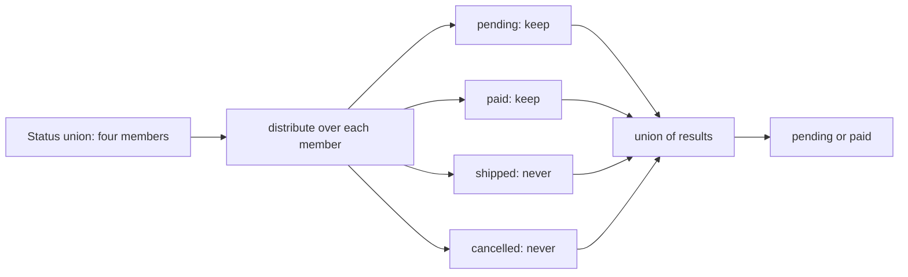

## 9.3 Generics in depth

### 9.3.1 Constraints, defaults and inference

#### Concept

Part 1 (1.7.3) showed a generic as a type with a blank to fill in, and a constraint as `T extends { id: string }`. In depth, a generic function is a **relationship between types**: "whatever comes in, this is what goes out". The constraint limits what may come in, a default says what to assume when nobody says, and **inference** is the compiler working out the blanks from the arguments so the caller never writes them.

#### Why does it exist?

Without generics, a helper either loses information (`(rows: object[], key: string) => unknown[]`) or must be written once per entity. With them, `pluck(orders, 'totalCents')` returns `number[]` and `pluck(orders, 'totl')` is a compile error. The type flows from the arguments to the result.

#### Mental model

Imagine a vending machine that returns exactly what you put in, gift-wrapped. You do not tell it "I am inserting a pen"; it looks. A constraint is the slot size: only things that fit go in. A default is what it assumes when the slot is empty.

#### How it works

```ts
interface Order { id: string; customerId: string; status: 'pending' | 'paid'; totalCents: number }

// K is constrained to the keys of T, and the result is "the type of that key" for each row.
function pluck<T, K extends keyof T>(rows: readonly T[], key: K): T[K][] {
  return rows.map((row) => row[key]);
}

declare const orders: Order[];
const totals = pluck(orders, 'totalCents');   // number[]  (T = Order, K = 'totalCents', inferred)
const statuses = pluck(orders, 'status');     // ('pending' | 'paid')[]
// pluck(orders, 'totl');                     // error: '"totl"' is not assignable to 'keyof Order'

// Defaults: the second parameter is optional for callers.
interface Page<T, TCursor = string> {
  items: T[];
  nextCursor: TCursor | null;
}
type OrderPage = Page<Order>;                 // cursor is a string
type AuditPage = Page<{ at: Date }, number>;  // cursor is a numeric offset
```

Inference has three tools worth knowing by name:

```ts
// 1. const type parameters (TypeScript 5.0): infer literal types without `as const` at the call site.
function defineStatuses<const T extends readonly string[]>(statuses: T): T {
  return statuses;
}
const STATUSES = defineStatuses(['pending', 'paid', 'shipped']); // readonly ['pending', 'paid', 'shipped']

// 2. NoInfer (TypeScript 5.4): "do not infer S from this argument, only check it".
function defineMachine<S extends string>(states: S[], initial: NoInfer<S>) {
  return { states, initial };
}
defineMachine(['pending', 'paid'], 'pending');     // OK
// defineMachine(['pending', 'paid'], 'shipped');  // error: '"shipped"' is not assignable to '"paid" | "pending"'
// Without NoInfer, S would be inferred from BOTH arguments as 'pending' | 'paid' | 'shipped' and it would compile.

// 3. Explicit type arguments, when there is nothing to infer from.
const ids = new Set<string>();                     // an empty Set would otherwise be Set<unknown>
```

#### Failure scenario — the generic that is really a cast

This signature looks type-safe and is not:

```ts
interface CacheClient { get(key: string): Promise<string | null> }

// T appears ONLY in the return type. The caller picks it; nothing checks it.
async function getCached<T>(redis: CacheClient, key: string): Promise<T | null> {
  const raw = await redis.get(key);
  return raw === null ? null : (JSON.parse(raw) as T);
}
```

`getCached<CartSummary>(redis, 'cart:cus_1')` compiles whatever is actually stored under that key. After a deploy changed the cached shape from `{ totalCents }` to `{ total: { cents, currency } }`, old entries stayed in Redis for their 24-hour lifetime, the checkout read `summary.totalCents` from new-shaped entries, got `undefined`, and displayed "NaN" for an evening. A type parameter that appears only in the return position is a disguised `as` cast. The rule: **a generic must appear in at least one parameter**, or the function must validate before returning. The exercise below fixes this design.

### 9.3.2 Generic functions versus generic types

#### Concept

Where the type parameter is declared decides **who chooses it and when**. On a generic *type* (`Repository<T>`, `Handler<T>`) the user of the type chooses `T` once, when they name the type. On a generic *function* (`<T>(x: T) => T`) `T` is chosen fresh at every call.

#### How it works

```ts
interface OrderPaid { type: 'order.paid'; orderId: string }

// Generic TYPE: T fixed when the type is used. A Handler<OrderPaid> handles only OrderPaid.
type Handler<T> = (event: T) => Promise<void>;
const onPaid: Handler<OrderPaid> = async (e) => { console.log(e.orderId); };

// Generic FUNCTION type: T chosen per call. Anything implementing it must work for EVERY T.
type Identity = <T>(value: T) => T;
const passThrough: Identity = (value) => value;
// const broken: Identity = (value) => 'x';   // error: string is not assignable to T

// In a class, both can appear: T per instance, R per call.
class Repo<T extends { id: string }> {
  constructor(private readonly rows: T[]) {}
  map<R>(fn: (row: T) => R): R[] { return this.rows.map(fn); }
}
```

The practical rule: put the parameter on the **type** when it is a fixed property of the thing (a repository of orders), and on the **function** when each call may differ (mapping rows to whatever shape a caller needs).

### 9.3.3 Variance in plain words

#### Concept

**Variance** answers: if a `PaidOrder` is a kind of `Order`, is a "box of `PaidOrder`" a kind of "box of `Order`"? It depends on what the box does with its contents.

- **Covariant** (producers, read-only): yes. A `readonly PaidOrder[]` can be used as a `readonly Order[]`; anyone reading from it gets orders.
- **Contravariant** (consumers, write-only): the other way round. A function that **accepts** any `Order` can be used where a function accepting `PaidOrder` is needed, but not vice versa.
- **Invariant** (read and write): neither, in a fully sound system.

#### Mental model

Imagine a fruit basket. A basket of apples can be handed to someone who wants "a basket of fruit to eat from" (covariant). But a person who can only peel apples cannot be hired as "someone who peels any fruit" (contravariant): hand them a pineapple and they fail. Someone who can peel any fruit, however, can do the apple job.

#### How it works

```ts
interface DomainEvent { type: string; occurredAt: Date }
interface OrderPaid extends DomainEvent { type: 'order.paid'; paymentId: string }

// Contravariance of parameters, checked under strictFunctionTypes (part of strict):
interface EventHandler { handle: (e: DomainEvent) => void }   // property syntax
const paidOnly = { handle: (e: OrderPaid) => console.log(e.paymentId.toUpperCase()) };
// const h: EventHandler = paidOnly;
// error: Type '(e: OrderPaid) => void' is not assignable to type '(e: DomainEvent) => void'.
// Right: a bus would call it with ANY event, and e.paymentId would be undefined.

// The method-syntax loophole: methods are checked bivariantly, so this compiles.
interface LooseHandler { handle(e: DomainEvent): void }       // method syntax
const loose: LooseHandler = paidOnly;                         // compiles, and is unsound

// Arrays are treated as covariant even though they are mutable: a known hole.
const paidEvents: OrderPaid[] = [];
const all: DomainEvent[] = paidEvents;                        // allowed
all.push({ type: 'order.cancelled', occurredAt: new Date() }); // now paidEvents holds a non-OrderPaid
```

Those last two examples are deliberate trade-offs in TypeScript's design: making method parameters and mutable arrays strictly checked would reject a lot of everyday code. You do not need to memorise the rules; you need two habits. Declare callback-shaped members with **property syntax** (`handle: (e: T) => void`) in interfaces you own, so the compiler checks them strictly. And prefer **`readonly` arrays** in parameters, so the covariance you rely on is also safe.

#### How a Senior Backend Engineer thinks about this

Seniors design generics so the types do the work at the call site: callers should almost never write `<Order>`. When they see a type parameter only in a return type, they treat it as a cast and ask where the validation is. They know where TypeScript is deliberately unsound (method bivariance, mutable array covariance, `any`, casts, lying guards) and keep those holes away from money, permissions and data integrity.

#### Common mistakes

- Return-type-only generics (`get<T>(key)`) presented as type safety.
- Adding a type parameter that is used once and could be a plain type.
- Method syntax for event-handler interfaces, silently accepting handlers for the wrong event.

#### Interview questions

1. **When does TypeScript infer a generic, and when must you write it?** It infers from arguments; you write it when no argument mentions the parameter, such as `new Set<string>()`. Follow-up: what does `NoInfer` change?
2. **Why is `function parse<T>(json: string): T` a smell?** `T` appears only in the return type, so the caller chooses it and nothing verifies it; it is an unchecked cast.
3. **Explain covariance and contravariance with a backend example.** A read-only list of paid orders can be used as a list of orders (covariant); a handler for any event can be used where an order-paid handler is wanted, but not vice versa (contravariant).
4. **Why can method syntax in an interface hide bugs?** Method parameters are checked bivariantly even under `strictFunctionTypes`, so a handler that accepts a narrower type is wrongly accepted.

#### Practical exercise

Replace `getCached<T>` with a typed cache whose keys and value types are declared once:

```ts
interface CacheSchema {
  'cart-summary': { totalCents: number; itemCount: number };
  'feature-flags': Record<string, boolean>;
}
```

Write `class TypedCache<Schema>` with `get<K extends keyof Schema & string>(key: K, id: string)` and `set(key, id, value, ttlSeconds)`. Acceptance criteria: callers never write a type argument; a wrong value type in `set` or an unknown key is a compile error; values stored under an old shape are not trusted blindly.

#### Worked answer to the exercise

```ts
interface CacheClient {
  get(key: string): Promise<string | null>;
  set(key: string, value: string, mode: 'EX', seconds: number): Promise<unknown>;
}

type Validators<Schema> = { [K in keyof Schema]: (value: unknown) => value is Schema[K] };

class TypedCache<Schema> {
  constructor(
    private readonly redis: CacheClient,
    private readonly validators: Validators<Schema>,
    private readonly version = 'v2',               // bump when a shape changes
  ) {}

  private fullKey(key: string, id: string): string {
    return `${this.version}:${key}:${id}`;          // old-shape entries live under old keys
  }

  async get<K extends keyof Schema & string>(key: K, id: string): Promise<Schema[K] | null> {
    const raw = await this.redis.get(this.fullKey(key, id));
    if (raw === null) return null;
    const value: unknown = JSON.parse(raw);
    return this.validators[key](value) ? value : null; // a bad entry is a cache miss, not a crash
  }

  async set<K extends keyof Schema & string>(key: K, id: string, value: Schema[K], ttlSeconds: number) {
    await this.redis.set(this.fullKey(key, id), JSON.stringify(value), 'EX', ttlSeconds);
  }
}

interface CacheSchema {
  'cart-summary': { totalCents: number; itemCount: number };
  'feature-flags': Record<string, boolean>;
}

const isRecord = (v: unknown): v is Record<string, unknown> => typeof v === 'object' && v !== null;

const cache = new TypedCache<CacheSchema>(
  { get: async () => '{"totalCents":4999,"itemCount":2}', set: async () => 'OK' }, // stand-in for ioredis
  {
    'cart-summary': (v): v is CacheSchema['cart-summary'] =>
      isRecord(v) && Number.isInteger(v.totalCents) && Number.isInteger(v.itemCount),
    'feature-flags': (v): v is CacheSchema['feature-flags'] =>
      isRecord(v) && Object.values(v).every((x) => typeof x === 'boolean'),
  },
);

async function demo(): Promise<void> {
  const summary = await cache.get('cart-summary', 'cus_1'); // { totalCents; itemCount } | null
  console.log(summary?.totalCents);
  await cache.set('cart-summary', 'cus_1', { totalCents: 4999, itemCount: 2 }, 3600);
  // await cache.set('cart-summary', 'cus_1', { total: 4999 }, 3600); // error: 'total' does not exist
  // await cache.get('cart-sumary', 'cus_1');                        // error: not a key of CacheSchema
}
void demo();
```

```text
4999
```

Why it is right: the key `K` is inferred from the string literal the caller passes, and `Schema[K]` (an indexed access type, 9.4) gives the value type for that key, so `get` returns the right shape and `set` rejects the wrong one, with no `<T>` at any call site. The `Validators<Schema>` mapped type (9.6) forces one validator per key, so adding a key to the schema without a validator is a compile error. A stale or corrupted entry becomes a cache miss instead of `undefined` deep in checkout. The version prefix means a shape change can be deployed by bumping one string; old entries are simply never read and expire.

The trap most learners fall into is keeping `JSON.parse(raw) as Schema[K]`. The key-to-type mapping is now correct, but the data in Redis was written by a different version of the code and is still unchecked. The type system describes your code; it cannot describe bytes written by last week's deploy.

## 9.4 `keyof`, indexed access and `typeof`

### 9.4.1 Deriving types from other types and from values

#### Concept

Three operators let you **derive** a type instead of writing it again:

- `keyof T` is the union of `T`'s property names.
- `T[K]` (an **indexed access type**) is the type of property `K` of `T`.
- `typeof value`, in a type position, is the type of a runtime value.

Derived types cannot drift from their source. When the source changes, everything derived from it changes with it.

#### Why does it exist?

Duplicated types rot. If `OrderStatus` is written once in the entity, again in the DTO, and again in a `switch`, sooner or later one copy gains `'refunded'` and the others do not. Deriving makes one definition the source of truth.

#### How it works

```ts
interface Order { id: string; status: 'pending' | 'paid' | 'shipped'; totalCents: number; createdAt: Date }

type OrderKey = keyof Order;                  // 'id' | 'status' | 'totalCents' | 'createdAt'
type OrderStatus = Order['status'];           // 'pending' | 'paid' | 'shipped'
type MoneyOrDate = Order['totalCents' | 'createdAt']; // number | Date

// typeof: types from values. The value is the source of truth; the type follows it.
const SORTABLE_COLUMNS = {
  newest: 'created_at',
  total: 'total_cents',
} as const;
type SortKey = keyof typeof SORTABLE_COLUMNS;              // 'newest' | 'total'
type SortColumn = (typeof SORTABLE_COLUMNS)[SortKey];      // 'created_at' | 'total_cents'

// Element type of an array value: index with number.
const CURRENCIES = ['INR', 'USD', 'EUR'] as const;
type Currency = (typeof CURRENCIES)[number];               // 'INR' | 'USD' | 'EUR'

// Picking one member out of a discriminated union.
type OrderEvent =
  | { type: 'order.created'; orderId: string; totalCents: number }
  | { type: 'order.paid'; orderId: string; paymentId: string };
type PaidEvent = Extract<OrderEvent, { type: 'order.paid' }>; // { type: 'order.paid'; ... }
```

#### Practical example — a safe `ORDER BY`

Column names cannot be bound as SQL parameters, so a sort option from a query string is a classic SQL injection risk (Part 44 — Security). A derived type plus a lookup makes the safe path the only path:

```ts
import { DataSource } from 'typeorm';

const ORDER_SORTS = {
  newest: 'created_at DESC, id DESC',
  oldest: 'created_at ASC, id ASC',
  largest: 'total_cents DESC, id DESC',
} as const;
type OrderSort = keyof typeof ORDER_SORTS;

function isOrderSort(value: string): value is OrderSort {
  return Object.hasOwn(ORDER_SORTS, value);   // hasOwn: 'toString' is not a valid sort
}

async function listOrders(db: DataSource, customerId: string, sort: OrderSort) {
  // Only strings from ORDER_SORTS can reach the SQL text; values still use parameters.
  return db.query(
    `SELECT id, status, total_cents FROM orders WHERE customer_id = $1 ORDER BY ${ORDER_SORTS[sort]} LIMIT 50`,
    [customerId],
  );
}
```

The controller validates `?sort=` with `isOrderSort` (or an enum validator in the DTO) and returns `400` otherwise. Adding a sort option means adding one line to `ORDER_SORTS`; the type, the guard and the query all follow.

#### Common mistakes

- Using `obj[key]` with `key: string` and silencing the error with `as any`. Constrain `key` to `keyof typeof obj`.
- Checking membership with `key in obj`, which also accepts inherited names such as `'toString'`. Use `Object.hasOwn`.
- Forgetting `as const`, so `typeof` yields `string` instead of the literal values.

#### Interview questions

1. **What is the difference between `typeof x` in an expression and in a type?** In an expression it is JavaScript's runtime operator returning a string; in a type position it gives the static type of `x`.
2. **How do you get the element type of a `const` array?** `(typeof ARR)[number]`.
3. **Why derive a union from a value rather than write it twice?** One source of truth: the runtime list (used for validation) and the compile-time type cannot drift.

## 9.5 Conditional types and `infer`

### 9.5.1 Types that make decisions

#### Concept

A **conditional type** chooses between two types based on a test: `T extends U ? X : Y`, read "if `T` is assignable to `U`, then `X`, else `Y`". The `infer` keyword, used inside the test, captures a part of `T` into a new type variable, like a regular-expression capture group for types.

#### Why does it exist?

It lets one generic type adapt to its input. Most built-in utility types are conditional types: `ReturnType`, `Awaited`, `NonNullable`, `Exclude`, `Extract`. You will read them in library declarations far more often than you write them, and reading them is impossible without this section.

#### How it works

```ts
// Basic: a type-level if.
type IsMoneyField<T> = T extends number ? 'maybe' : 'no';
type A = IsMoneyField<4999>;          // 'maybe'
type B = IsMoneyField<string>;        // 'no'

// infer: capture a part of the matched type.
type ElementOf<T> = T extends readonly (infer E)[] ? E : never;
type Unwrap<T> = T extends Promise<infer R> ? R : T;
type MyReturnType<F> = F extends (...args: any[]) => infer R ? R : never;

type E1 = ElementOf<string[]>;                       // string
type U1 = Unwrap<Promise<{ id: string }>>;           // { id: string }

// A real use: the resolved result of an async service method, without writing it twice.
class PaymentsService {
  async capture(paymentId: string): Promise<{ paymentId: string; capturedAt: Date }> {
    return { paymentId, capturedAt: new Date() };
  }
}
type CaptureResult = Awaited<ReturnType<PaymentsService['capture']>>; // { paymentId; capturedAt }
```

**Distribution.** When the checked type is a bare type parameter and you pass a union, the conditional is applied to **each member separately** and the results are unioned. That is how `Exclude` works:

```ts
type MyExclude<T, U> = T extends U ? never : T;
type Status = 'pending' | 'paid' | 'shipped' | 'cancelled';
type OpenStatus = MyExclude<Status, 'shipped' | 'cancelled'>; // 'pending' | 'paid'
// Evaluated as: ('pending' extends ... ? never : 'pending') | ('paid' ...) | ...

// To test the union as a whole, wrap both sides in a tuple to switch distribution off.
type IsSingle<T> = [T] extends [Status] ? ([Status] extends [T] ? 'all statuses' : 'subset') : 'other';
type S1 = IsSingle<Status>;      // 'all statuses'
type S2 = IsSingle<'paid'>;      // 'subset'
```



#### Practical example — event payloads by name

An event bus where the payload type follows from the event name:

```ts
type DomainEvent =
  | { type: 'order.created'; orderId: string; totalCents: number }
  | { type: 'order.paid'; orderId: string; paymentId: string }
  | { type: 'refund.issued'; refundId: string; orderId: string; amountCents: number };

type EventName = DomainEvent['type'];
// Pick the member whose `type` is N. Extract<DomainEvent, { type: N }> is the built-in form.
type EventOf<N extends EventName> = DomainEvent extends infer E
  ? E extends { type: N } ? E : never
  : never;

type Paid = EventOf<'order.paid'>;     // { type: 'order.paid'; orderId: string; paymentId: string }
```

The hand-written version is there to show the mechanism; in real code write `Extract<DomainEvent, { type: N }>`, which every reader recognises.

#### Edge cases & failure modes

- **`never` distributes to `never`.** `MyExclude<never, X>` is `never`, and a conditional on a bare `T` given `never` produces `never` without evaluating either branch, which surprises people writing "is it never?" checks. Use `[T] extends [never]`.
- **`any` takes both branches.** `IsMoneyField<any>` is `'maybe' | 'no'`.
- **Deep recursion is slow and has limits.** Recursive conditional types (for example a deep `DeepPartial`) can hit "Type instantiation is excessively deep and possibly infinite" and slow down the editor (9.16).

#### How a Senior Backend Engineer thinks about this

Seniors use conditional types mostly through the built-ins (`ReturnType`, `Awaited`, `Extract`, `Parameters`) to avoid writing the same shape twice, and write their own only in shared infrastructure where many call sites benefit, such as an event bus or a typed cache. In feature code they prefer a plain interface a junior can read. If a type needs a comment longer than itself to explain, it is probably too clever for application code.

#### Common mistakes

- Writing a custom conditional type when a built-in already exists.
- Forgetting distribution and getting a union back where a single answer was expected.
- Using conditional types to "compute" domain types that would be clearer written out.

#### Interview questions

1. **What does `infer` do?** Declares a type variable inside the `extends` clause of a conditional type, capturing the matched part, for example the resolved type of a `Promise`.
2. **What is a distributive conditional type?** A conditional whose checked type is a bare type parameter; given a union, it is applied to each member separately and the results are unioned.
3. **How would you implement `ReturnType`?** `type R<F> = F extends (...args: any[]) => infer X ? X : never`.
4. **How do you get the resolved type of an async method without repeating it?** `Awaited<ReturnType<Service['method']>>`.

#### Practical exercise

Write a type-safe `on` and `emit` for the `DomainEvent` union above, so that `on('order.paid', (e) => e.paymentId)` compiles, `on('order.paid', (e) => e.amountCents)` does not, and `emit` rejects a payload that does not match its event name. Acceptance criteria: no type arguments at call sites, no `any` in the public signatures.

#### Worked answer to the exercise

```ts
type DomainEvent =
  | { type: 'order.created'; orderId: string; totalCents: number }
  | { type: 'order.paid'; orderId: string; paymentId: string }
  | { type: 'refund.issued'; refundId: string; orderId: string; amountCents: number };

type EventName = DomainEvent['type'];
type EventOf<N extends EventName> = Extract<DomainEvent, { type: N }>;
type Listener<N extends EventName> = (event: EventOf<N>) => void | Promise<void>;

class EventBus {
  private listeners: { [N in EventName]?: Listener<N>[] } = {};

  on<N extends EventName>(name: N, listener: Listener<N>): void {
    const list = (this.listeners[name] ??= []) as Listener<N>[];
    list.push(listener);
  }

  async emit<N extends EventName>(event: EventOf<N> & { type: N }): Promise<void> {
    const list = (this.listeners[event.type] ?? []) as Listener<N>[];
    for (const listener of list) await listener(event);
  }
}

const bus = new EventBus();
bus.on('order.paid', (e) => console.log('paid', e.orderId, e.paymentId));
bus.on('refund.issued', (e) => console.log('refund', e.refundId, e.amountCents));
// bus.on('order.paid', (e) => e.amountCents);  // error: 'amountCents' does not exist on the order.paid event

void bus.emit({ type: 'order.paid', orderId: 'ord_1', paymentId: 'pay_9' });
void bus.emit({ type: 'refund.issued', refundId: 're_1', orderId: 'ord_1', amountCents: 1500 });
// bus.emit({ type: 'order.paid', orderId: 'ord_1' }); // error: 'paymentId' is missing
```

```text
paid ord_1 pay_9
refund re_1 1500
```

Why it is right: `N` is inferred from the string literal passed as the event name, and `EventOf<N>` (`Extract` over the union) turns that name into exactly one payload type, so the listener's `e` is the right member and `emit` checks the payload against its own `type`. The listeners object is a mapped type (9.6) keyed by event name, so each list holds listeners of the matching kind. The two internal `as Listener<N>[]` casts are the honest cost: TypeScript cannot prove that indexing a mapped type with a generic `N` gives the list for that same `N`, so the class contains the cast once and the public API stays fully checked.

The trap most learners fall into is typing listeners as `(event: DomainEvent) => void`, which compiles and forces every listener to narrow again. The second trap is putting the cast in the public signature (`emit(event: any)`), which throws away the checking for every caller instead of containing it in one place.
