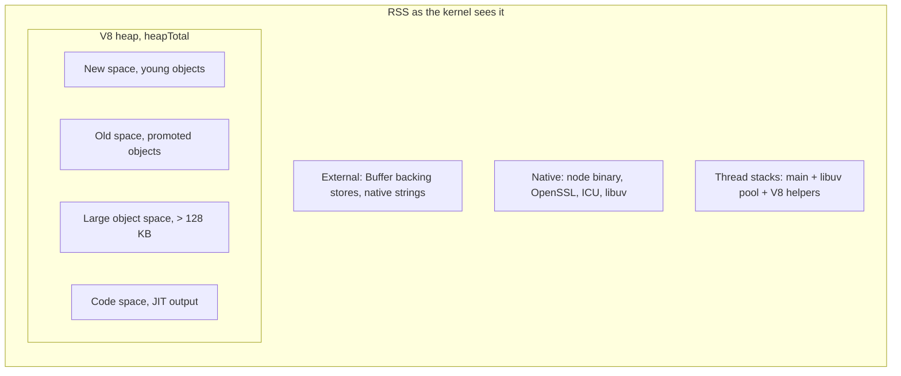
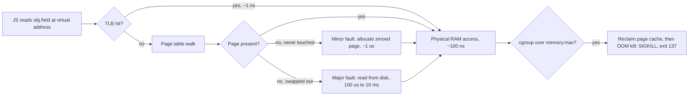

## 9.3 Memory: RSS, heap, stack and `process.memoryUsage()`

#### Concept

A process's memory is not one blob. It is a set of regions with different rules:

- **Text**: the machine code of the binary and shared libraries, read-only, shared between processes running the same binary.
- **Stack**: one per thread. A last-in-first-out region that holds each function call's local variables and return address. Grows when a function is called, shrinks when it returns. Fixed maximum size.
- **Heap**: the region for data whose lifetime is not tied to a single function call: objects, arrays, strings, closures, Buffers. Managed in Node by V8's garbage collector (for JavaScript objects) and by the C allocator (for native memory such as Buffer backing stores and OpenSSL structures).
- **Mapped regions**: shared libraries, memory-mapped files, and large allocations the allocator got directly from the kernel with `mmap`.

**RSS** (resident set size) is the number of physical RAM pages currently mapped into the process, across all these regions, including the shared-library pages that are also counted in every other process using them. It is what `top`, `ps`, `docker stats` and the Kubernetes memory limit look at. **VSZ** (virtual size) is the total address space reserved, most of which may never be touched; it is almost never useful.

In Node, `process.memoryUsage()` returns five numbers:

```json
{
  "rss": 187563008,
  "heapTotal": 98304000,
  "heapUsed": 71219200,
  "external": 21930000,
  "arrayBuffers": 18900000
}
```

- `heapUsed`: bytes of live-or-not-yet-collected JavaScript objects in V8's heap.
- `heapTotal`: bytes V8 has reserved for the heap (used plus free space it keeps for upcoming allocations).
- `external`: memory allocated by C++ objects bound to JavaScript objects, mostly Buffer backing stores and strings created from native code.
- `arrayBuffers`: the subset of `external` that belongs to `ArrayBuffer` and `Buffer` instances.
- `rss`: everything, including the V8 heap, external memory, native code, thread stacks, and libuv/OpenSSL/ICU allocations.

A useful mental equation: `rss ≈ heapTotal + external + native code and libraries (~40–60 MB) + thread stacks + allocator overhead`.

#### Why does it exist?

Two regions exist because two allocation patterns exist. Function-local data has a perfectly predictable lifetime (dies when the function returns), so a stack can allocate it by moving a pointer, a handful of nanoseconds, and free it for free. Everything else has an unpredictable lifetime, so it goes to the heap and someone must find space for it and later reclaim it. That someone, in Node, is V8's garbage collector, and it is the reason `heapUsed` looks like a sawtooth on your Grafana dashboard.

You need to understand RSS because that is the number the kernel enforces. V8 knows nothing about your container's 512 MiB limit; it will happily grow its heap past it, and the kernel will kill the process without a JavaScript error.

#### Mental model

Imagine a cafeteria. The stack is the pile of trays at the entrance: you take one from the top, you return it to the top, and nobody ever has to search for a free tray. The heap is the warehouse behind the kitchen: shelves everywhere, a warehouse manager (the allocator) who must find a free spot for each new delivery, and a cleaner (the garbage collector) who periodically walks the shelves throwing away food nobody has a ticket for. RSS is the floor space the building currently occupies in the mall; the mall owner (the kernel) does not care how you use it, only that you do not exceed your lease (the cgroup limit).

#### How it works

1. On startup, V8 reserves a large virtual range for the heap but commits physical pages lazily. `heapTotal` starts around 5–10 MB and grows as objects are allocated.
2. New objects are allocated in the **new space** (young generation) by bumping a pointer. When it fills (16 MB semi-space by default on 64-bit; varies by version), a scavenge copies the live objects out and resets the pointer. Objects that survive two scavenges are promoted to the **old space**.
3. Objects larger than about 128 KB skip the new space and go directly into the **large object space**, which is part of the old generation. A 5 MB `JSON.parse` result or a 1 million element array lives there from birth.
4. Buffer data does not live in the V8 heap. `Buffer.alloc(10 * 1024 * 1024)` allocates 10 MB with the C allocator and records it as `external` / `arrayBuffers`. The small JavaScript `Buffer` object on the V8 heap holds a pointer to it. When the Buffer object is collected, V8 frees the backing store.
5. RSS grows when V8 or the C allocator touches new pages. It does not necessarily shrink after a garbage collection: V8 releases freed pages back to the kernel only gradually, and glibc's `malloc` may keep freed memory in its arenas. A process that once peaked at 900 MB can sit at 700 MB RSS with 200 MB of live heap.
6. Each thread's stack is 8 MB of *virtual* space on Linux, but only the pages actually written count towards RSS, typically 50–200 KB per thread. V8 additionally enforces its own JavaScript stack limit of about 984 KB (`--stack-size`), which is why deep recursion throws a `RangeError` long before the OS stack is exhausted.



For finer detail than `process.memoryUsage()`, the `v8` module exposes the limit and the per-space breakdown:

```ts
import * as v8 from 'node:v8';

const stats = v8.getHeapStatistics();
// heap_size_limit is the ceiling set by --max-old-space-size (plus young generation)
console.log((stats.heap_size_limit / 1024 / 1024).toFixed(0), 'MB limit');
console.log((stats.used_heap_size / 1024 / 1024).toFixed(0), 'MB used');

for (const space of v8.getHeapSpaceStatistics()) {
  // new_space, old_space, code_space, large_object_space, ...
  console.log(space.space_name, (space.space_used_size / 1024 / 1024).toFixed(1), 'MB');
}
```

#### Practical example

A file-upload service in an e-commerce backend accepts product images, resizes them, and pushes them to S3. The dashboard shows RSS at 900 MB while `heapUsed` is a calm 120 MB. Engineers look for a "JavaScript memory leak" and find nothing. The memory is in `arrayBuffers`: each upload is held in a Buffer while `sharp` resizes it, ten concurrent 30 MB uploads plus their resized variants are 600 MB of external memory, invisible to heap snapshots. The fix is not GC tuning; it is streaming uploads to disk or S3 with `pipeline` and bounding concurrency.

#### NestJS example

Every service should expose memory in two places: a Prometheus metric for trends, and a health check for self-defence. The health check below uses `@nestjs/terminus`. Wiring it into the **liveness** probe makes Kubernetes restart a pod that has leaked past a threshold, which is a deliberate choice: an automatic restart at 03:00 beats a page at 03:00. Keep the threshold well below the container limit so the restart is graceful rather than an OOM kill.

```ts
// health/health.controller.ts
import { Controller, Get } from '@nestjs/common';
import {
  HealthCheck,
  HealthCheckService,
  MemoryHealthIndicator,
  TypeOrmHealthIndicator,
} from '@nestjs/terminus';

const MB = 1024 * 1024;

@Controller('health')
export class HealthController {
  constructor(
    private readonly health: HealthCheckService,
    private readonly memory: MemoryHealthIndicator,
    private readonly db: TypeOrmHealthIndicator,
  ) {}

  // liveness: "is this process still sane?" - restart it if not
  @Get('live')
  @HealthCheck()
  live() {
    return this.health.check([
      () => this.memory.checkHeap('heap', 700 * MB),   // container limit 1 GiB, heap limit 768 MB
      () => this.memory.checkRSS('rss', 900 * MB),     // leaves ~120 MB before the kernel kills us
    ]);
  }

  // readiness: "can this process serve traffic right now?" - pull it from the Service if not
  @Get('ready')
  @HealthCheck()
  ready() {
    return this.health.check([() => this.db.pingCheck('postgres', { timeout: 1500 })]);
  }
}
```

For metrics, `prom-client`'s `collectDefaultMetrics()` already exports `process_resident_memory_bytes`, `nodejs_heap_size_used_bytes`, `nodejs_heap_size_total_bytes`, `nodejs_external_memory_bytes` and per-space gauges. Graph RSS against the container limit, not against the heap.

#### PostgreSQL example

PostgreSQL has the same split, and its `EXPLAIN ANALYZE` output tells you when a query has fallen off the "stack" into disk. `work_mem` is the per-operation, per-backend budget for sorts and hashes; exceed it and PostgreSQL spills to temporary files.

```sql
SHOW work_mem;                 -- 4MB by default; per sort/hash node, per backend
SHOW shared_buffers;           -- shared memory for the buffer cache, typically 25% of RAM

EXPLAIN (ANALYZE, BUFFERS)
SELECT customer_id, sum(total_cents)
FROM orders
WHERE created_at >= '2026-01-01'
GROUP BY customer_id
ORDER BY 2 DESC;
--  Sort  (cost=... rows=412000) (actual time=2410.3..2498.7 rows=412000 loops=1)
--    Sort Key: (sum(total_cents)) DESC
--    Sort Method: external merge  Disk: 18456kB          <- spilled: work_mem too small
--    ->  HashAggregate  (actual time=1980.1..2105.2 rows=412000 loops=1)
--          Batches: 5  Memory Usage: 4121kB  Disk Usage: 32768kB   <- hash spilled too
--          Buffers: shared hit=120433 read=88210, temp read=6400 written=6400

SET work_mem = '64MB';         -- for this session only, e.g. a reporting connection
-- rerun: Sort Method: quicksort  Memory: 41210kB ; Batches: 1 Memory Usage: 49153kB
```

The senior caution: `work_mem` is multiplied by every concurrent sort or hash across every backend. `64MB × 200 connections × 3 operations` is 38 GB of *potential* memory. Raise it per session for reporting connections, not globally.

#### TypeORM example

The most common way a NestJS process blows its heap is hydrating too many entities. A TypeORM entity instance costs roughly 0.5–2 KB on the heap (object, hidden-class link, column values, relation placeholders). `find()` over 1 million orders is 1–2 GB before the response is even serialised.

```ts
// orders/orders-report.service.ts
import { Injectable } from '@nestjs/common';
import { InjectRepository } from '@nestjs/typeorm';
import { Repository } from 'typeorm';
import { Order } from './order.entity';

@Injectable()
export class OrdersReportService {
  constructor(@InjectRepository(Order) private readonly orders: Repository<Order>) {}

  // BAD: loads every row as an entity; heap grows with the table
  async totalsNaive(): Promise<number> {
    const all = await this.orders.find({ where: { status: 'PAID' } });
    return all.reduce((sum, o) => sum + o.totalCents, 0);
  }

  // GOOD 1: push the work to PostgreSQL; the heap holds one row
  async totalsAggregated(): Promise<number> {
    const row = await this.orders
      .createQueryBuilder('o')
      .select('coalesce(sum(o.total_cents), 0)', 'total')
      .where('o.status = :status', { status: 'PAID' })
      .getRawOne<{ total: string }>();
    return Number(row?.total ?? 0);
  }

  // GOOD 2: when you must touch every row, page with a keyset so memory is bounded
  async *iteratePaid(batch = 1000): AsyncGenerator<Order[]> {
    let lastId = 0;
    while (true) {
      const rows = await this.orders
        .createQueryBuilder('o')
        .where('o.status = :status AND o.id > :lastId', { status: 'PAID', lastId })
        .orderBy('o.id', 'ASC')
        .take(batch)
        .getMany();
      if (rows.length === 0) return;
      lastId = rows[rows.length - 1].id;
      yield rows;                 // caller processes 1000 entities, then they become garbage
    }
  }
}
```

#### Sequelize example

Sequelize model instances are heavier than TypeORM entities (each carries `dataValues`, `_previousDataValues`, `_changed`, options). For read-only bulk work, always pass `raw: true`.

```ts
const rows = await this.orderModel.findAll({
  where: { status: 'PAID', id: { [Op.gt]: lastId } },
  order: [['id', 'ASC']],
  limit: 1000,
  raw: true,          // plain objects, ~5x smaller than model instances
  attributes: ['id', 'totalCents', 'customerId'],   // do not hydrate 40 columns you will not read
});
```

#### Production scenario

A typical NestJS API with TypeORM and ~150 entities idles at 90–130 MB RSS: 45 MB of that is the Node binary and libraries, 30–50 MB is the heap after startup (decorator metadata, TypeORM entity metadata, route maps), the rest is external and stacks. Under 800 requests per second it allocates around 100–300 MB per second of short-lived objects (request objects, DTOs, query results, JSON strings), so `heapUsed` sawtooths between 80 and 160 MB with a scavenge every 50–100 ms, and RSS settles around 250–320 MB. Sensible container settings for that profile: `limits.memory: 512Mi` with `--max-old-space-size=384`.

#### Failure scenario

At 11:20 a product manager exported "all orders for 2025" from an admin screen. The endpoint did `repository.find()` with no limit: 2.1 million rows. `heapUsed` climbed from 140 MB to 1.4 GB in 25 seconds. Two things could have happened next, and which one tells you the cause:

- If the container had `--max-old-space-size=384`, V8 would have run increasingly desperate full GCs (each pausing the loop for 200–600 ms), then aborted with `FATAL ERROR: Reached heap limit Allocation failed - JavaScript heap out of memory`, exit code 134. Every in-flight request on that pod died, but the log said exactly why.
- Without the flag, V8's default limit was 4 GB (computed from the *host's* 16 GB of RAM, not the container's 512 MiB), so RSS crossed 512 MiB with no warning and the kernel sent SIGKILL. Exit code 137, `Reason: OOMKilled`, no JavaScript log line at all.

This team had the second case, and it took them an hour to connect a silent 137 to a single admin click. The fixes were a mandatory `take` limit on list endpoints, a streamed CSV export (see 9.23), and `--max-old-space-size` so that heap exhaustion produces a diagnosable error.

#### Edge cases & failure modes

- RSS counts shared-library pages in every process that maps them; summing RSS across 40 pods on a node overstates real usage.
- RSS rarely returns to baseline after a spike; a "leak" that plateaus is often just allocator retention. Confirm with `heapUsed` trend and heap snapshots.
- `Buffer.allocUnsafe` and `Buffer.from` for small sizes carve slices from an 8 KB shared pool; keeping one 20-byte slice alive keeps the whole 8 KB slab alive.
- Objects over ~128 KB go straight to the large object space; creating many of them makes full GCs frequent without the young generation ever helping.
- V8 has a maximum string length (about 512 MB to 1 GB of characters depending on version). `JSON.stringify` of a huge response throws `RangeError: Invalid string length` rather than OOM.
- glibc `malloc` creates a memory arena per thread; with libuv's pool and V8's helpers, RSS can bloat from fragmentation. `MALLOC_ARENA_MAX=2` is a well-known mitigation for native-heavy workloads.
- `heapTotal` can exceed `--max-old-space-size` briefly because the flag bounds the old generation only; the young generation and code space are separate.

#### How a Senior Backend Engineer thinks about this

They graph three lines together: RSS, heapUsed, and the container limit. The gap between RSS and heap tells them whether the problem is JavaScript objects (heap growth) or Buffers and native memory (external growth). They set `--max-old-space-size` on every container, both to force a diagnosable failure and to make V8 collect earlier. They bound every collection in memory: pagination on list endpoints, streaming on exports, batch sizes on consumers. And they explain memory to a product manager by saying: "The process has a room with a fixed floor plan. If the export tries to bring every order into the room at once, the building's manager evicts us without a conversation."

#### Common mistakes

- Reading `heapUsed` and ignoring `external`, then hunting for a leak that is actually Buffers.
- Running containers without `--max-old-space-size`, so failures are silent 137s instead of logged 134s.
- Loading entire tables with `find()` for aggregation that PostgreSQL could do in one `SUM`.
- Treating the RSS plateau after a spike as a leak and restarting pods on a schedule instead of fixing the spike.
- Sizing `work_mem` globally to make one report fast, then discovering the database can allocate 30 GB under load.

#### Interview questions

1. *What is the difference between RSS and heapUsed in a Node process, and which one does Kubernetes enforce?* Expected: heapUsed is live JS objects in V8; RSS is all resident memory including Buffers, native code, and stacks; Kubernetes enforces RSS via the cgroup.
2. *A pod exits with code 137 and no error log. Another exits with 134 and a "heap out of memory" message. What is the difference?* Expected: 137 is SIGKILL from the cgroup OOM killer (RSS over the limit); 134 is V8 aborting when its own heap limit was reached. Follow-up: how do you make the first look like the second? (`--max-old-space-size` below the container limit.)
3. *Why does a `Buffer` of 100 MB not show up in `heapUsed`?* Expected: backing stores are allocated outside V8's heap and reported as `external`/`arrayBuffers`.
4. *Where does a 5 MB parsed JSON object live in the V8 heap and why does it matter?* Expected: large object space, old generation; it bypasses the cheap scavenger and increases full-GC pressure.
5. *How would you compute the memory cost of `work_mem = 128MB` on a database with 300 connections?* Expected: it is per operation, per backend: worst case is 128 MB × operations per query × active backends.
6. *Why might RSS stay high after the heap has been collected?* Expected: V8 and the C allocator retain freed pages; fragmentation; arenas.

#### Practical exercise

Write a script that allocates 200 MB of Buffers, then 200 MB of JavaScript objects, calling `process.memoryUsage()` and `v8.getHeapSpaceStatistics()` after each step and after `global.gc()` (run with `--expose-gc`). Then run a NestJS list endpoint with and without `take: 100` against a table of 1 million rows.

Acceptance criteria: you can explain each of the five `memoryUsage()` numbers from your own output, show which V8 space the objects landed in, and demonstrate the endpoint's heap stays under 200 MB with pagination and exceeds 1 GB without it.

## 9.4 Virtual memory, paging, swap and the OOM killer

#### Concept

**Virtual memory** means every process sees its own private, contiguous address space (128 TB on 64-bit Linux) that the kernel maps onto physical RAM one 4 KB **page** at a time through **page tables**. Addresses in your program are virtual; the CPU's memory management unit translates them, with a small cache called the **TLB** remembering recent translations.

**Paging** is the kernel's ability to have a virtual page not currently backed by RAM. Touching such a page raises a **page fault**: a minor fault if the kernel just needs to allocate a zeroed page (cheap, ~1 µs), a major fault if it must read the contents from disk (expensive, 100 µs on NVMe, 10 ms on spinning disk).

**Swap** is disk space where the kernel can park pages of anonymous memory (heap, stack) when RAM is short. The **page cache** is the opposite direction: RAM used to cache file contents, which is where most of PostgreSQL's data lives when it is not in `shared_buffers`.

The **OOM killer** is what runs when there is no page left to give: the kernel picks a process (the one with the highest `oom_score`, roughly the largest memory consumer adjusted by `oom_score_adj`) and sends it SIGKILL. Inside a cgroup (a container), the same logic runs against the cgroup's `memory.max` limit: exceed it and the kernel kills a process *inside that container*. That is `OOMKilled`, exit code 137.

#### Why does it exist?

Virtual memory gives isolation (your pointer cannot reach another process's page), lazy allocation (`malloc(1 GB)` costs nothing until pages are touched), overcommit (the kernel can promise more than physical RAM because most promises are never fully used), and the ability to run programs larger than RAM. Swap extends that last ability. The OOM killer exists because overcommit means promises can be broken, and the kernel would rather kill one process than freeze the machine.

#### Mental model

Imagine a library with a small reading room (RAM) and a vast basement archive (disk). Books you are actively reading are on your desk (resident pages). When the desk is full and you need another book, the librarian moves the one you have not touched in longest down to the basement (swap out). If your work keeps needing books from the basement, every page turn becomes a trip downstairs (thrashing), and a task that took a minute takes an hour. When even the basement is full, the librarian asks the person with the most books to leave immediately (OOM kill).

#### How it works

1. The CPU executes a load from a virtual address. The TLB is checked; on a hit, the physical address is known in a nanosecond. On a miss, the CPU walks the page tables (a few memory reads).
2. If the page table says "not present", the CPU raises a page fault and the kernel takes over. For a never-touched heap page, it allocates a zeroed frame and returns: a minor fault. For a page that was swapped out, it reads from swap: a major fault, and the thread is blocked while the disk works.
3. Under memory pressure, the kernel scans its LRU lists. It prefers to drop clean page-cache pages (they can be re-read from the file) over swapping anonymous pages; `vm.swappiness` (0–100, default 60) tilts that preference.
4. In a cgroup, memory accounting includes anonymous memory *and* the page cache the container created (logs it wrote, files it read). When usage approaches `memory.max`, the kernel first reclaims the container's page cache, then, if swap is enabled for the cgroup, swaps, then invokes the OOM killer restricted to that cgroup.
5. Kubernetes disables swap on nodes by default (kubelet historically refuses to start with swap enabled; swap support for burstable pods arrived as a beta feature much later). So in a typical cluster there is no gentle slowdown before death: a pod that exceeds its limit goes straight to SIGKILL. `kubectl describe pod` shows `Last State: Terminated, Reason: OOMKilled, Exit Code: 137`.
6. The kubelet sets `oom_score_adj` by QoS class: Guaranteed pods (requests equal limits) get -997 and are killed last during node-level pressure; BestEffort pods get 1000 and die first; Burstable pods are in between, scaled by how much of the node they request.



Why swapping kills a database server: PostgreSQL's whole performance model assumes that `shared_buffers` and the OS page cache are in RAM. A buffer hit is ~100 nanoseconds of memory access. If the kernel swaps out part of `shared_buffers` or a backend's `work_mem`, that hit becomes a 100 µs to 10 ms disk read, a 1,000× to 100,000× slowdown. Queries that took 2 ms take seconds; connections pile up waiting; more backends use more memory; more memory swaps; the spiral ends with the OOM killer shooting a backend. When that happens, the postmaster treats it as a crash of a child, terminates *every* other backend (`terminating connection because of crash of another server process`), and restarts in crash recovery. Every application pool reconnects at once. One report query can do this.

That is why the PostgreSQL documentation recommends `vm.overcommit_memory = 2` (strict accounting, so `malloc` fails and PostgreSQL returns a clean `out of memory` error for that query instead of the whole cluster restarting) and a low `vm.swappiness`.

#### Practical example

Reading an OOM kill from the node:

```bash
kubectl describe pod orders-api-7d9f8c5b6-x2k4p
#    Last State:     Terminated
#      Reason:       OOMKilled
#      Exit Code:    137
#      Started:      Sat, 06 Sep 2026 10:12:41 +0000
#      Finished:     Sat, 06 Sep 2026 11:04:07 +0000
#    Restart Count:  3

# on the node (or via a node-problem-detector), dmesg shows who and why
dmesg -T | grep -i "killed process"
# [Sat Sep  6 11:04:07 2026] Memory cgroup out of memory: Killed process 4021 (node)
#   total-vm:1187204kB, anon-rss:519844kB, file-rss:14320kB, shmem-rss:0kB
```

`anon-rss` of 519 MB against a 512 MiB limit. The heap flag was missing, and the default V8 limit was computed from the node's 32 GB of RAM.

#### NestJS example

A memory-aware guard for expensive endpoints implements **load shedding**: when the heap is close to its limit, refuse new export jobs with a 503 and a `Retry-After` instead of letting the next request be the one that kills the pod. This protects the cheap endpoints (which are most of your traffic) from the expensive ones.

```ts
// common/guards/memory-pressure.guard.ts
import { CanActivate, ExecutionContext, Injectable, ServiceUnavailableException } from '@nestjs/common';
import * as v8 from 'node:v8';

@Injectable()
export class MemoryPressureGuard implements CanActivate {
  private readonly limit = v8.getHeapStatistics().heap_size_limit; // from --max-old-space-size
  private readonly threshold = 0.85;                                // shed above 85% of the heap limit

  canActivate(_context: ExecutionContext): boolean {
    const used = process.memoryUsage().heapUsed;
    if (used / this.limit > this.threshold) {
      // 503 is correct: the failure is ours and temporary; clients and load balancers may retry elsewhere
      throw new ServiceUnavailableException({
        message: 'Server under memory pressure, retry shortly',
        retryAfterSeconds: 5,
      });
    }
    return true;
  }
}

// orders/orders-export.controller.ts
@UseGuards(MemoryPressureGuard)
@Get('export')
exportOrders() { /* streaming export, see 3.23 */ }
```

Pair it with a horizontal pod autoscaler on memory or on request rate, so shedding is a brief safety valve rather than a steady state.

#### PostgreSQL example

The memory-related settings a senior checks on every PostgreSQL host, with the reasoning:

```sql
SHOW shared_buffers;          -- 25% of RAM on a dedicated host, e.g. 8GB on 32GB
SHOW effective_cache_size;    -- 50-75% of RAM; a planner *hint* about page cache size, allocates nothing
SHOW work_mem;                -- per operation per backend; keep the global value small
SHOW maintenance_work_mem;    -- VACUUM, CREATE INDEX; can be large, few run at once
SHOW huge_pages;              -- 'try' or 'on': 2 MB pages for shared_buffers = far fewer TLB misses

-- PG 14+: see which memory contexts a backend is using right now
SELECT name, used_bytes, total_bytes FROM pg_backend_memory_contexts ORDER BY total_bytes DESC LIMIT 5;
```

And the kernel side, which is not SQL but is part of the same decision:

```bash
sysctl vm.overcommit_memory     # 2 for PostgreSQL: fail malloc rather than invoke the OOM killer
sysctl vm.overcommit_ratio      # 80-90 with mode 2, so the DB can still use most of RAM
sysctl vm.swappiness            # 1-10: keep shared_buffers in RAM at all costs
cat /sys/kernel/mm/transparent_hugepage/enabled   # 'madvise' or 'never' for databases and Redis
```

Note the last line: transparent huge pages cause latency spikes for Redis (fork for `BGSAVE` must copy 2 MB pages instead of 4 KB pages on write) and for PostgreSQL. `huge_pages = on` in PostgreSQL uses *explicit* huge pages, which is the good kind.

#### Production scenario

A Redis instance serving session data uses 6 GB on an 8 GB VM. `BGSAVE` forks the process for the snapshot; the child shares pages copy-on-write with the parent, but every write during the snapshot copies a page. On a busy afternoon, 1.5 GB of pages are copied during a snapshot, the VM starts swapping, Redis latency goes from 0.3 ms to 40 ms, and every NestJS request that touches a session inherits that 40 ms. The fix was `vm.overcommit_memory = 1` (so the fork does not fail), `maxmemory` at 4 GB with an eviction policy, and moving the snapshot to a replica. Redis logs this warning on startup for exactly this reason.

#### Failure scenario

At 02:14 the on-call was paged: database p99 went from 4 ms to 9 seconds in ninety seconds. `pg_stat_activity` showed 180 active backends, most waiting on `IO:DataFileRead`. `free -m` on the host showed 3.8 GB of swap in use on a machine with 64 GB of RAM. Cause: a new analytics job ran twelve concurrent report queries, each with `SET work_mem = '512MB'` and four hash joins, on top of the normal load. 12 × 4 × 512 MB was 24 GB of hash tables on top of 16 GB of `shared_buffers`. The kernel swapped out part of the buffer cache to make room, and every ordinary query then paid disk latency for what used to be a memory hit. Ten minutes later the OOM killer shot one backend, the postmaster restarted, and every service reconnected at once. Resolution: `vm.overcommit_memory = 2` so the reports fail cleanly next time, a `work_mem` cap on the reporting role (`ALTER ROLE reports SET work_mem = '64MB'`), and a concurrency limit of three on the job.

#### Edge cases & failure modes

- `Buffers: shared read=...` in `EXPLAIN` means "not in shared_buffers"; the page may still have come from the OS page cache, which is why `track_io_timing` and the I/O timing lines matter for the real answer.
- Container memory usage includes the page cache created by the container. The kubelet's eviction decision uses `container_memory_working_set_bytes`, which includes active file cache; a pod writing large log files locally can look far heavier than its RSS.
- Swap on Kubernetes nodes is usually off; a workload tuned on a swapping laptop will behave differently in production.
- A Guaranteed QoS pod is killed last during *node* pressure, but its own limit is enforced just as strictly.
- Node's V8 default heap limit is derived from host RAM, not the cgroup. Always set `--max-old-space-size` in containers.
- Memory-mapped files (`mmap`) count towards RSS only for the pages touched; a 2 GB SQLite or index file may show as 50 MB.
- Fork-based snapshots (Redis `BGSAVE`, PostgreSQL basebackups are not fork-based, but `pg_dump` from a big backend is fine) can transiently double memory through copy-on-write.

#### How a Senior Backend Engineer thinks about this

They never let a database host swap: they would rather a query fail with `out of memory` than the whole cluster crawl. They configure the kernel *and* the database *and* the container as one system, because a limit in any layer that the other layers do not know about produces silent kills. In Kubernetes they assume no swap, set memory limits equal to requests for stateful things, and give Node an explicit heap limit at about 75% of the container limit. When asked by a product manager why a bigger box does not fix an OOM, they explain that the failure was a *pattern* (loading everything at once), and patterns scale with data, not with hardware.

#### Common mistakes

- Enabling swap on a database server "as a safety net" and getting a ten-minute brownout instead of a one-second error.
- Setting `work_mem` globally to a large value because one report was slow.
- Leaving `vm.overcommit_memory = 0` on a PostgreSQL host, so the OOM killer, not PostgreSQL, decides which query dies.
- Diagnosing a 137 exit as "the app crashed" and adding a `try/catch`.
- Ignoring `oom_score_adj` and running a critical API as BestEffort (no requests or limits), which makes it the first victim during node pressure.

#### Interview questions

1. *What happens, step by step, when a container exceeds its memory limit in Kubernetes?* Expected: cgroup reclaims page cache, swap is usually disabled, the kernel's OOM killer picks a process in the cgroup, SIGKILL, exit 137, kubelet restarts with backoff.
2. *Why is swapping so much worse for a database than for a web server?* Expected: databases rely on cached pages for nanosecond hits; swapped pages turn those into disk reads, and the resulting slowdown compounds through connection pileup.
3. *What does `vm.overcommit_memory = 2` change for PostgreSQL?* Expected: `malloc` fails instead of the OOM killer firing; PostgreSQL returns an error for one query instead of restarting all backends.
4. *What is the difference between a minor and a major page fault, and which one shows up as latency?* Expected: minor is allocating a zeroed page (~1 µs); major reads from disk (100 µs to 10 ms) and blocks the thread.
5. *Why should Redis have `vm.overcommit_memory = 1`?* Expected: `BGSAVE` forks; the fork would fail under strict accounting even though copy-on-write means the child rarely needs the full copy.
6. *Why do you set `--max-old-space-size` to about 75% of the container limit?* Expected: RSS includes external memory, native code, and stacks; the heap must leave room for them, and the flag makes V8 fail loudly before the kernel fails silently.

#### Practical exercise

Run a NestJS service in Docker with `--memory=256m` and an endpoint that allocates 300 MB of objects, first without any heap flag and then with `--max-old-space-size=192`. Capture the exit code and logs in both cases, read `docker inspect` for `OOMKilled: true`, and add `MemoryPressureGuard` to the endpoint.

Acceptance criteria: you can show one run ending in 137 with no application log, one ending in 134 with the V8 heap-limit message, and a third where the guard returns 503 before either happens.
