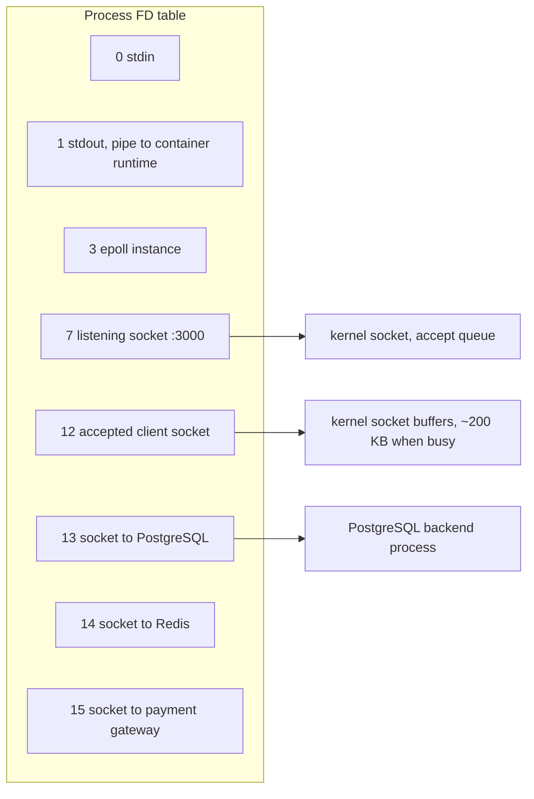
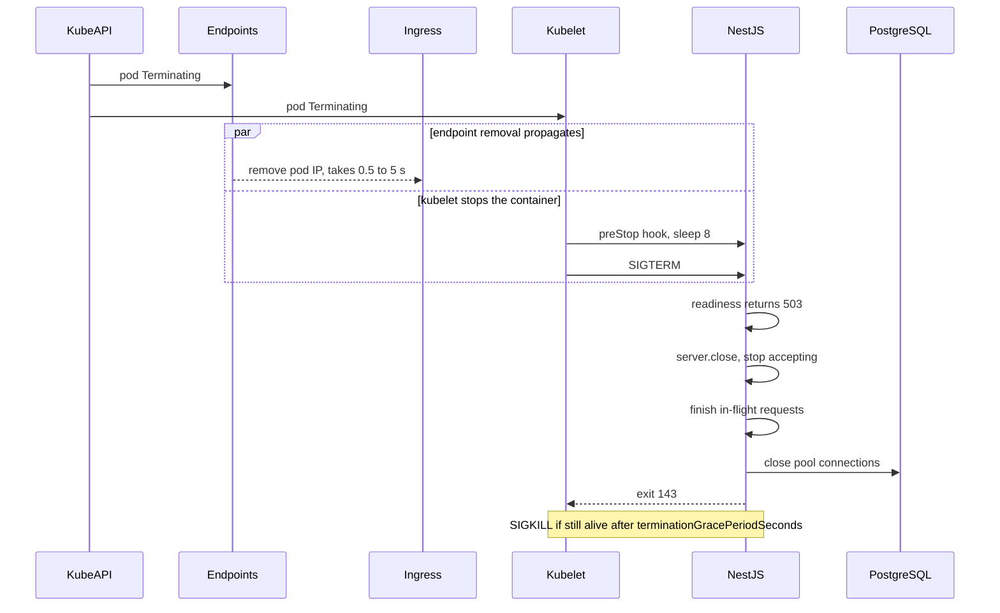

## 9.5 File descriptors

#### Concept

A **file descriptor** (FD) is a small non-negative integer that a process uses to refer to an open kernel resource. "File" is a historical word; on Linux, almost everything you can read from or write to is an FD: regular files, the listening TCP socket, every accepted client connection, every outbound connection to PostgreSQL, Redis, or a payment gateway, pipes, the epoll instance libuv uses to wait on sockets, timer and event objects, and `/dev/null`. Descriptors 0, 1 and 2 are stdin, stdout and stderr.

Each process has a limit on how many FDs it may hold open at once: the soft limit shown by `ulimit -n` (commonly 1024 on a bare VM, often 1,048,576 in containers), which can be raised up to the hard limit (`ulimit -Hn`). There is also a system-wide ceiling, `fs.file-max`. When a process hits its limit, system calls that would create a new FD fail with `EMFILE` ("too many open files"); when the whole system is out, they fail with `ENFILE`.

In a Node service this matters because **sockets are FDs**. A leaked database client, a leaked outbound HTTP connection or a leaked file handle is an FD that never comes back. When the pool of numbers runs dry, the server cannot even `accept()` new connections.

#### Why does it exist?

The FD is the kernel's uniform handle: one small integer, one set of system calls (`read`, `write`, `close`, `poll`), whether the thing behind it is a disk file or a TCP stream. Uniformity is what lets libuv treat a socket and a pipe the same way in the event loop. The per-process limit exists because every open descriptor consumes kernel memory (a socket with buffers can be hundreds of KB) and because a runaway process must not be able to exhaust the whole machine.

#### Mental model

Imagine a coat check at a theatre. Each coat you hand over gets a numbered ticket; the ticket is the file descriptor, the coat room is the kernel's open-file table. You can only hold a limited number of tickets. If you keep checking coats and never collect them, eventually the attendant refuses: "no more tickets". In our world, the coat you forgot is a `pg.Client` you created and never called `end()` on, and the refusal is `EMFILE`.

#### How it works

1. `open()`, `socket()`, `accept()`, `pipe()`, `epoll_create()` each ask the kernel for a new descriptor. The kernel picks the **lowest unused number** and points it at an open-file description (offset, flags) which points at the underlying inode or socket.
2. `close(fd)` releases the number. Because numbers are reused immediately, a stale reference to a closed FD can silently point at a *different* resource later; Node's handle abstraction (`net.Socket`, `fs.FileHandle`) exists partly to prevent that class of bug.
3. libuv wraps each socket in a handle (`uv_tcp_t`) and registers the FD with epoll. The handle keeps the event loop alive until it is closed. A `net.Socket` you stop referencing is **not** closed by garbage collection; the FD stays open until `destroy()` or `end()` is called or the peer closes.
4. When `accept()` fails with `EMFILE`, libuv uses a trick: it keeps one spare FD open at startup; on `EMFILE` it closes the spare, accepts the pending connection, immediately closes it (the client sees a reset instead of hanging in the backlog), and reopens the spare. Your server still cannot serve anyone, but at least the listen queue does not fill up with connections that will time out.
5. Inspecting a live process:

```bash
ulimit -n                          # soft limit for the current shell
cat /proc/1/limits | grep "open files"   # inside the container, for PID 1
ls -l /proc/1/fd | wc -l           # how many are open right now
ls -l /proc/1/fd | awk '{print $NF}' | sed 's/:.*//' | sort | uniq -c | sort -rn | head
#    212 socket
#      5 anon_inode
#      3 /dev/null
#      2 pipe
```

```ts
// Node 17+: what is keeping the event loop alive, by type
console.log(process.getActiveResourcesInfo());
// [ 'TCPServerWrap', 'TCPSocketWrap', 'TCPSocketWrap', 'Timeout', 'FSReqCallback' ]
```



#### Practical example

Count the FDs an order service holds at 500 requests per second behind an AWS ALB:

| Category | Typical count | Why |
|---|---|---|
| stdin/stdout/stderr, epoll, eventfd, signal pipe | 6–8 | runtime plumbing |
| listening socket | 1 | `server.listen(3000)` |
| accepted client sockets | 50–300 | ALB keeps several keep-alive connections per ALB node |
| PostgreSQL pool | 10 | one FD per pooled connection |
| Redis (ioredis default + subscriber) | 2–4 | |
| outbound HTTP keep-alive (payment, geocoding) | 0–50 | bounded by `maxSockets` or the undici pool size |
| log file (if writing to disk) | 1 | |

About 100–400 in steady state. A `ulimit -n 1024` on a VM leaves little headroom for a burst; a leak of even five FDs per minute ends the process in a few hours.

#### NestJS example

Two things belong in every service: an FD gauge, and pool usage that cannot leak. `prom-client`'s default metrics already export `process_open_fds` and `process_max_fds` on Linux; alert when the ratio passes 70%. For the pool, the rule is `try/finally`, no exceptions:

```ts
// database/pg-raw.service.ts
import { Injectable, OnApplicationShutdown } from '@nestjs/common';
import { Pool, PoolClient } from 'pg';

@Injectable()
export class PgRawService implements OnApplicationShutdown {
  private readonly pool = new Pool({
    connectionString: process.env.DATABASE_URL,
    max: 10,
    connectionTimeoutMillis: 5_000,   // do not wait forever for a leaked-out pool
    idleTimeoutMillis: 30_000,
  });

  // The pool itself is bounded: at most 10 sockets, however busy we get.
  // What leaks is a checked-out client that is never released.
  async withClient<T>(work: (client: PoolClient) => Promise<T>): Promise<T> {
    const client = await this.pool.connect();
    try {
      return await work(client);
    } finally {
      client.release();               // ALWAYS, even when work() throws
    }
  }

  async onApplicationShutdown() {
    await this.pool.end();            // close the 10 sockets on SIGTERM
  }
}
```

The dangerous alternative, which caused the incident in 9.30, is `new Client()` per request without `client.end()`. Each `Client` is its own socket, unbounded by any pool.

For outbound HTTP, never use the default agent with unlimited sockets in a service that talks to a slow dependency:

```ts
// payments/payment-http.provider.ts
import { Agent } from 'undici';

export const paymentAgent = new Agent({
  connections: 32,            // hard cap on sockets to the gateway: a slowdown cannot become an FD storm
  keepAliveTimeout: 30_000,
  connect: { timeout: 3_000 },
  headersTimeout: 5_000,
  bodyTimeout: 10_000,
});
```

#### PostgreSQL example

Each leaked application socket is a live backend process on the database. PostgreSQL can defend itself from clients that hold sessions open and forget them:

```sql
-- kill sessions that have been idle inside a transaction for more than 60 s (holding locks, blocking VACUUM)
ALTER SYSTEM SET idle_in_transaction_session_timeout = '60s';
-- PG 14+: kill sessions that are idle (outside a transaction) for an hour; leaked clients die server-side
ALTER SYSTEM SET idle_session_timeout = '1h';
SELECT pg_reload_conf();

-- who is holding what right now
SELECT pid, application_name, state, now() - state_change AS in_state_for
FROM pg_stat_activity
WHERE backend_type = 'client backend'
ORDER BY in_state_for DESC;

-- PostgreSQL has its own per-backend FD budget for table and index files
SHOW max_files_per_process;   -- default 1000; heavily partitioned schemas can hit it
```

#### TypeORM example

The classic TypeORM leak is a `QueryRunner` that is created for a transaction and not released on the error path. The connection stays checked out; after `max` such errors the pool is empty and every request waits `connectionTimeoutMillis` and fails.

```ts
// orders/orders.service.ts
import { Injectable } from '@nestjs/common';
import { DataSource } from 'typeorm';
import { Order } from './order.entity';
import { InventoryItem } from '../inventory/inventory-item.entity';

@Injectable()
export class OrdersService {
  constructor(private readonly dataSource: DataSource) {}

  // Explicit QueryRunner: full control, full responsibility
  async placeOrderExplicit(input: { sku: string; qty: number; customerId: number }): Promise<Order> {
    const qr = this.dataSource.createQueryRunner();
    await qr.connect();
    await qr.startTransaction();
    try {
      const affected = await qr.manager
        .createQueryBuilder()
        .update(InventoryItem)
        .set({ stock: () => 'stock - :qty' })
        .where('sku = :sku AND stock >= :qty', { sku: input.sku, qty: input.qty })
        .execute();
      if (affected.affected !== 1) throw new Error('OUT_OF_STOCK');

      const order = await qr.manager.save(Order, { ...input, status: 'PLACED' });
      await qr.commitTransaction();
      return order;
    } catch (err) {
      await qr.rollbackTransaction();
      throw err;
    } finally {
      await qr.release();            // the line whose absence empties the pool
    }
  }

  // Managed transaction: TypeORM releases the runner for you on both paths
  placeOrderManaged(input: { sku: string; qty: number; customerId: number }): Promise<Order> {
    return this.dataSource.transaction(async (manager) => {
      const affected = await manager
        .createQueryBuilder()
        .update(InventoryItem)
        .set({ stock: () => 'stock - :qty' })
        .where('sku = :sku AND stock >= :qty', { sku: input.sku, qty: input.qty })
        .execute();
      if (affected.affected !== 1) throw new Error('OUT_OF_STOCK');
      return manager.save(Order, { ...input, status: 'PLACED' });
    });
  }
}
```

Prefer the managed form. Use the explicit form only when you need `SAVEPOINT`s or a runner that outlives one callback.

#### Sequelize example

Sequelize has the same split: an **unmanaged** transaction (`await sequelize.transaction()`) must be committed or rolled back by you on every path, or the connection leaks; a **managed** transaction (callback form) is released automatically.

```ts
// managed: connection is returned on commit and on rollback
await this.sequelize.transaction(async (t) => {
  const [affected] = await this.inventoryModel.update(
    { stock: this.sequelize.literal('stock - 1') },
    { where: { sku, stock: { [Op.gte]: 1 } }, transaction: t },
  );
  if (affected !== 1) throw new Error('OUT_OF_STOCK');
  await this.orderModel.create({ sku, customerId, status: 'PLACED' }, { transaction: t });
});
```

#### Production scenario

A notification service calls a third-party email API with the default Node `http.Agent` (`maxSockets: Infinity`, no keep-alive). Normally it opens and closes 50 connections per second, ~30 FDs live at any moment. One afternoon the email provider slows to 8 seconds per request. At 50 requests per second with 8 seconds in flight, 400 sockets are open, then 800 as retries kick in. Each socket is an FD and an ephemeral port; RSS climbs with the buffered request bodies; `EMFILE` appears in the logs at 1,024; the readiness probe (also an HTTP request into the same process) fails and the pod is restarted, every few minutes, for an hour. A bounded `Agent` (`connections: 32`) plus a 5-second timeout and a circuit breaker turns that into a clean stream of fast failures.

#### Failure scenario

At 02:14 the on-call was paged for 5xx on checkout. Logs on three pods were full of `Error: connect EMFILE 10.0.5.12:5432 - Local (undefined:undefined)` and `Error: accept EMFILE: too many open files`. `ls /proc/1/fd | wc -l` on a surviving pod returned 1019 and climbing at about 4 per minute. `ss -tnp` showed 900 established sockets to PostgreSQL from one pod whose pool was configured for 10. A recent change had introduced a "quick" analytics helper that did `const client = new Client(config); await client.connect(); await client.query(...)` and returned without `client.end()`. Every analytics call leaked one socket and one PostgreSQL backend. Rollback took two minutes; the postmortem added `process_open_fds` to the standard dashboard, an alert at 70% of the limit, and `idle_session_timeout` on the database so a future leak dies server-side within an hour instead of living until the process is killed. The full story with the timeline is in 9.30.

#### Edge cases & failure modes

- `EMFILE` on `accept` means clients see connection timeouts or resets, not HTTP errors; your error dashboard may look clean while availability is zero.
- The shell's `ulimit -n` does not apply to systemd services; set `LimitNOFILE=65536` in the unit file. In Docker use `--ulimit nofile=65536:65536`; in Kubernetes the container runtime's default applies (usually large), and you cannot set it per pod without privileged tricks.
- Node cannot raise its own soft limit without a native module; the limit must be right before the process starts.
- Outbound sockets closed by you enter `TIME_WAIT` for 60 s. That is not an FD, but each holds an ephemeral port; ~28,000 ports means at most ~470 new connections per second to one destination without keep-alive. The symptom is `EADDRNOTAVAIL`, the cousin of `EMFILE`.
- `fs.watch` uses inotify watches (`fs.inotify.max_user_watches`), a separate limit that bites in development with large `node_modules`.
- A streaming response abandoned by the client (user closes the tab during a CSV export) can leave the source stream paused and its database connection checked out forever unless you destroy the source on `res.on('close')` (see 9.23).
- `graceful-fs` retries `EMFILE` for file operations only; it does nothing for sockets.

#### How a Senior Backend Engineer thinks about this

They treat every resource that is *acquired* as something that must be *released on every path*, and they structure code so the release is impossible to forget: a `withClient` helper, managed transactions, `pipeline` for streams, `using`-style wrappers. They bound every pool: database, Redis, outbound HTTP, worker threads. They know that a leak's symptom is time-delayed and appears somewhere else (on the database, on the load balancer), so they watch `process_open_fds` as a first-class SLI. They explain it to a product manager as coat-check tickets: "we forgot to collect one coat per analytics click; at the thousandth click the theatre stopped letting anyone in."

#### Common mistakes

- Creating `new Client()` or `new Pool()` inside a request handler or a service method instead of once per process.
- Forgetting `release()` on the error path of an explicit transaction.
- Using the default unlimited HTTP agent to call a dependency that can slow down.
- Assuming garbage collection closes sockets and file handles.
- Alerting only on HTTP 5xx, so an `accept EMFILE` outage (connections never reach the app) is invisible until customers call.

#### Interview questions

1. *Why is a TCP connection a file descriptor, and what does that imply for a Node server?* Expected: the kernel exposes sockets through the same handle table as files; every connection, inbound or outbound, consumes one of a limited set of descriptors.
2. *A pod logs `EMFILE` but the pool size is 10. What are the likely causes?* Expected: clients created outside the pool, leaked outbound HTTP sockets, abandoned streams holding connections, file handles not closed.
3. *What is the difference between `EMFILE` and `ENFILE`?* Expected: per-process versus system-wide limit.
4. *How does libuv behave when `accept()` fails with `EMFILE`?* Expected: it uses a reserved spare FD to accept and immediately close the connection so the backlog does not fill with clients that will hang.
5. *How would you make a leaked database session die even if the application never fixes the bug?* Expected: `idle_session_timeout` and `idle_in_transaction_session_timeout` on PostgreSQL.
6. *Explain ephemeral port exhaustion and how it differs from FD exhaustion.* Expected: closed outbound sockets sit in TIME_WAIT for 60 s and hold a local port, not an FD; keep-alive fixes it.

#### Practical exercise

Write a NestJS endpoint that deliberately leaks one `pg.Client` per call. Run the container with `--ulimit nofile=256:256`, hit the endpoint 250 times, and observe: the FD count via `/proc/1/fd`, the backend count in `pg_stat_activity`, the exact error the next request gets, and what happens to the health endpoint. Then fix it with `withClient` and add an FD gauge.

Acceptance criteria: you can show the error message for `EMFILE` on accept, prove from `pg_stat_activity` that each leaked client is a database process, and demonstrate that after the fix the FD count is flat under load.

## 9.6 Signals and graceful shutdown

#### Concept

A **signal** is a one-word asynchronous message the kernel (or another process) delivers to a process: "terminate", "interrupt", "hang up", "you touched invalid memory". Each signal has a default action, and most can be caught by installing a handler. The ones a backend engineer meets daily:

| Signal | Number | Sent by | Default | Catchable | Meaning in practice |
|---|---|---|---|---|---|
| `SIGINT` | 2 | Ctrl+C in a terminal | terminate | yes | local dev stop |
| `SIGTERM` | 15 | `kill`, Docker, Kubernetes, PM2, systemd | terminate | yes | "please shut down cleanly" |
| `SIGKILL` | 9 | `kill -9`, OOM killer, Kubernetes after the grace period | terminate | **no** | immediate death, no cleanup |
| `SIGHUP` | 1 | terminal closed, config reload conventions | terminate | yes | often "reload config" |
| `SIGUSR1` | 10 | you | terminate | yes | Node uses it to start the inspector |
| `SIGUSR2` | 12 | you, nodemon | terminate | yes | free for the application; good for `--heapsnapshot-signal` |
| `SIGPIPE` | 13 | kernel, writing to a closed pipe | terminate | yes | Node ignores it by default |

When a process dies from a signal, its exit code is 128 plus the signal number: 130 for SIGINT, 143 for SIGTERM, 137 for SIGKILL. That is why `OOMKilled` pods show exit code 137.

**Graceful shutdown** is what a process does between receiving SIGTERM and exiting: stop taking new work, finish or hand off the work in progress, release resources (database pools, brokers, files), flush logs and telemetry, and then exit. Kubernetes sends SIGTERM, waits `terminationGracePeriodSeconds` (default 30), then sends SIGKILL.

#### Why does it exist?

Signals are the operating system's only way to talk to a process that is not listening on anything. Without SIGTERM, the only way to stop a service would be SIGKILL, which drops every in-flight request mid-response, leaves transactions to be rolled back by the database, abandons half-processed queue jobs, and loses buffered logs. Graceful shutdown exists because deploys happen many times a day, and each one must be invisible to users.

#### Mental model

Imagine a restaurant at closing time. A good manager (SIGTERM handler) locks the front door so no new guests come in, lets seated guests finish their meal, settles the bills, turns off the stove, and locks up. SIGKILL is the power company cutting the electricity: everyone leaves in the dark, the food burns, and tomorrow morning you find out which bills were never paid. Kubernetes is a landlord who says "you have 30 minutes to close, then I cut the power."

#### How it works

The Kubernetes side, which you must understand to understand why the naive handler still produces 502s:

1. Something deletes the pod (a rolling update, a scale-down, a node drain). The API server marks the pod `Terminating`.
2. **Two things start in parallel.** The endpoints controller removes the pod's IP from the Service; kube-proxy on every node and every ingress controller must then observe that change and update their rules, which takes from hundreds of milliseconds to several seconds. Meanwhile the kubelet on the pod's node runs the container's `preStop` hook (if any) and then sends SIGTERM to PID 1 of each container.
3. Because those are parallel, a pod can receive SIGTERM while load balancers are still routing new connections to it. If the app stops accepting immediately, those connections are refused: the user sees a 502 from the ingress.
4. After `terminationGracePeriodSeconds` counting from the start of step 2 (the `preStop` duration is included), the kubelet sends SIGKILL to anything still alive.

The application side, in NestJS:

1. `app.enableShutdownHooks()` in `main.ts` makes Nest listen for termination signals (all of them by default; you can restrict it with `enableShutdownHooks([ShutdownSignal.SIGTERM, ShutdownSignal.SIGINT])`).
2. On a signal, Nest runs the lifecycle in this order across all modules: `onModuleDestroy()`, then `beforeApplicationShutdown(signal)`, then it closes the HTTP server and the underlying connections, then `onApplicationShutdown(signal)`. Providers from `@nestjs/typeorm` and `@nestjs/sequelize` close their connections in these hooks, and `@nestjs/bullmq` closes its workers.
3. After the hooks complete, Nest re-raises the signal on itself with default handling, so the process exits with the conventional code (143 for SIGTERM).
4. Node detail: installing a `process.on('SIGTERM')` handler *replaces* the default terminate action. If your handler never calls `process.exit()` and never lets Nest finish, the process lives until SIGKILL.



#### Practical example

The checklist for a service that survives deploys with zero errors:

1. Dockerfile uses the exec form `CMD ["node", "dist/main.js"]`, not `CMD node dist/main.js` (the shell form makes `/bin/sh` PID 1, and `sh` does not forward SIGTERM to `node`). Do not use `npm start` as the entrypoint for the same reason.
2. `preStop: exec: command: ["sleep", "8"]` gives the endpoint removal time to propagate while the app keeps serving.
3. `terminationGracePeriodSeconds` is larger than `preStop` plus the longest in-flight work you are willing to wait for: 30 s for an API, 120–300 s for a queue worker with long jobs.
4. The readiness probe returns 503 as soon as shutdown starts, so any load balancer that checks health stops sending traffic early.
5. `server.keepAliveTimeout` is set higher than the load balancer's idle timeout (for an ALB with 60 s idle: `keepAliveTimeout = 65_000`, `headersTimeout = 66_000`), so the app never closes an idle keep-alive connection the ALB is about to reuse, which is a separate source of 502s.

#### NestJS example

```ts
// main.ts
import { NestFactory } from '@nestjs/core';
import { Logger } from '@nestjs/common';
import { AppModule } from './app.module';

async function bootstrap() {
  const app = await NestFactory.create(AppModule);
  app.enableShutdownHooks();                       // SIGTERM/SIGINT -> lifecycle hooks -> app.close()

  const server = app.getHttpServer();
  server.keepAliveTimeout = 65_000;                // > ALB idle timeout (60 s)
  server.headersTimeout = 66_000;                  // must exceed keepAliveTimeout

  await app.listen(3000);
  Logger.log(`pid ${process.pid} listening`, 'Bootstrap');
}
bootstrap();
```

```ts
// health/shutdown-state.service.ts
import { BeforeApplicationShutdown, Injectable, Logger, OnApplicationShutdown } from '@nestjs/common';
import { setTimeout as sleep } from 'node:timers/promises';

@Injectable()
export class ShutdownStateService implements BeforeApplicationShutdown, OnApplicationShutdown {
  private readonly logger = new Logger(ShutdownStateService.name);
  private shuttingDown = false;
  private inFlight = 0;

  get isShuttingDown() { return this.shuttingDown; }
  requestStarted() { this.inFlight++; }
  requestFinished() { this.inFlight--; }

  // Runs BEFORE Nest closes the HTTP server: flip readiness, then give the LB a moment.
  async beforeApplicationShutdown(signal?: string) {
    this.logger.warn(`received ${signal}; entering drain mode with ${this.inFlight} requests in flight`);
    this.shuttingDown = true;               // readiness now returns 503
    await sleep(5_000);                     // in addition to preStop; cheap insurance
    const deadline = Date.now() + 15_000;
    while (this.inFlight > 0 && Date.now() < deadline) await sleep(100);
    if (this.inFlight > 0) this.logger.error(`${this.inFlight} requests still in flight at deadline`);
  }

  // Runs AFTER the server and DB connections are closed.
  onApplicationShutdown(signal?: string) {
    this.logger.warn(`shutdown complete after ${signal}`);
  }
}
```

```ts
// health/readiness.controller.ts
import { Controller, Get, ServiceUnavailableException } from '@nestjs/common';
import { ShutdownStateService } from './shutdown-state.service';

@Controller('health')
export class ReadinessController {
  constructor(private readonly state: ShutdownStateService) {}

  @Get('ready')
  ready() {
    if (this.state.isShuttingDown) throw new ServiceUnavailableException('draining');
    return { status: 'ok' };
  }
}
```

A tiny middleware calling `requestStarted()`/`requestFinished()` (on `res.on('finish')` and `res.on('close')`) completes the picture. For queue consumers, `@nestjs/bullmq` closes workers during shutdown; a job that is mid-run when the worker closes is finished if it completes within the grace period, and otherwise becomes *stalled* and is retried by another worker, which is why every job must be idempotent.

#### PostgreSQL example

PostgreSQL is itself a signal-driven system, and it reacts to your process dying:

- When your socket closes, the backend notices on its next read or write, rolls back any open transaction, and releases locks. A backend in the middle of a 10-minute query will *not* notice until it tries to send a row; `client_connection_check_interval` (PG 14+) makes it poll the socket so a dead client's query is cancelled promptly.
- `pg_cancel_backend(pid)` sends SIGINT to a backend: cancel the current query, keep the session. `pg_terminate_backend(pid)` sends SIGTERM: end the session.
- `pg_ctl stop -m smart | fast | immediate` sends SIGTERM, SIGINT or SIGQUIT to the postmaster: wait for clients, abort transactions and shut down cleanly, or crash-stop and recover on restart.

```sql
ALTER SYSTEM SET client_connection_check_interval = '10s';   -- notice dead clients during long queries
ALTER SYSTEM SET statement_timeout = '30s';                  -- belt and braces
SELECT pg_reload_conf();

-- during a deploy, see sessions still open from pods that should be gone
SELECT pid, application_name, state, backend_start
FROM pg_stat_activity
WHERE application_name LIKE 'orders-api-%'
ORDER BY backend_start;
```

#### TypeORM example

`@nestjs/typeorm` destroys the `DataSource` during shutdown automatically when shutdown hooks are enabled. If you construct a `DataSource` yourself (a second database, a read replica), own its lifecycle explicitly:

```ts
// database/analytics-datasource.provider.ts
import { OnApplicationShutdown, Injectable } from '@nestjs/common';
import { DataSource } from 'typeorm';

@Injectable()
export class AnalyticsDataSource implements OnApplicationShutdown {
  readonly ds = new DataSource({
    type: 'postgres',
    url: process.env.ANALYTICS_DATABASE_URL,
    extra: { max: 4, application_name: 'orders-api-analytics' },
  });

  async onApplicationShutdown() {
    if (this.ds.isInitialized) await this.ds.destroy();   // returns the 4 backends to PostgreSQL
  }
}
```

#### Sequelize example

`@nestjs/sequelize` likewise calls `sequelize.close()` on shutdown. For a manually created instance, close it in `onApplicationShutdown`; `close()` waits for checked-out connections to be returned, so a leaked unmanaged transaction can hold the shutdown until SIGKILL. That is one more reason to use managed transactions.

#### Production scenario

A payments API deploys 20 times a day with 12 replicas and `maxSurge: 25%`, `maxUnavailable: 0`. Each deploy replaces pods one by one; each replacement drains for about 13 seconds (8 s `preStop` plus a few seconds of in-flight work). Before the `preStop` and readiness changes, each deploy produced 30–60 HTTP 502s at the ingress, roughly 0.02% of daily traffic, which is small until you remember they were *payments*: some clients retried, and a few payments were captured twice because the first attempt had reached the gateway before the socket was reset. After the changes, deploys produce zero 502s, and every payment call carries an idempotency key so a retry cannot double-charge (see Part 20 for transactions and Part 29 for idempotency).

#### Failure scenario

At 16:40 a deploy of the orders worker took exactly 30 seconds per pod and every deploy caused a burst of duplicate "order shipped" emails. The Dockerfile had `CMD npm run start:prod`. `npm` was PID 1, `node` was its child, and the SIGTERM from the kubelet reached `npm`, which exited without forwarding it. The Node process was left running with no signal at all until SIGKILL 30 seconds later. BullMQ jobs in progress were killed mid-run, marked stalled, and retried by the new pod; the email step in the job was not idempotent. Fix: exec-form `CMD ["node", "dist/main.js"]`, `enableShutdownHooks()`, `terminationGracePeriodSeconds: 120` for the worker deployment, and an idempotency check on the email step keyed by `orderId:shipped`.

#### Edge cases & failure modes

- Node as PID 1 with no signal handler: the kernel does not apply default signal actions to PID 1, so SIGTERM is silently ignored and the process lives until SIGKILL. Either install handlers (Nest does) or run under `tini` / `--init`.
- Streaming and long-lived connections (SSE, WebSockets, a 5-minute CSV export) prevent `server.close()` from completing. Use `server.closeIdleConnections()` (Node 18.2+) immediately and `server.closeAllConnections()` at a deadline.
- Two shutdown handlers (Nest's plus a hand-written `process.on('SIGTERM')`) can race: one calls `process.exit(0)` before the other finishes closing the pool.
- Kafka consumers must commit offsets and leave the group on shutdown; a SIGKILL leaves the partition assigned until the session timeout expires, stalling consumption for up to `session.timeout.ms`.
- `@Cron` jobs mid-run at shutdown are simply cut off; long jobs belong in queues with checkpoints.
- Worker threads do not receive the signal; the main thread must `terminate()` or message them.
- Windows has no POSIX signals; `SIGTERM` handlers never fire there, and `SIGINT` is emulated for Ctrl+C. Do not test shutdown behaviour on Windows and assume it matches Linux.
- A `preStop` sleep counts against the grace period; `sleep 25` with a 30 s grace period leaves 5 s for draining.

#### How a Senior Backend Engineer thinks about this

They assume every process will be killed at the worst possible moment, and they design so that this is boring: idempotent jobs, transactions that the database rolls back on disconnect, offsets committed after processing, no in-memory queues holding unacknowledged work. Graceful shutdown then becomes an optimisation for the common case, not a correctness requirement. They test it: `kubectl delete pod` under load with an error-rate graph open is a standard pre-production check. To a product manager: "Every deploy is like closing a restaurant for a few seconds; we make sure the door locks before the kitchen stops, and we never leave a bill half-paid."

#### Common mistakes

- Shell-form `CMD` or `npm start` as the container entrypoint, swallowing SIGTERM.
- Closing the listener the instant SIGTERM arrives, before load balancers have stopped routing.
- Forgetting to flip readiness, so a load balancer that checks health keeps sending traffic during the drain.
- `terminationGracePeriodSeconds` shorter than the longest job, then blaming the queue for duplicates.
- `keepAliveTimeout` lower than the load balancer's idle timeout, producing rare 502s that get blamed on "network flakiness".

#### Interview questions

1. *What exactly does Kubernetes do when it terminates a pod, and where is the race?* Expected: endpoint removal and SIGTERM happen in parallel; a `preStop` sleep and an early readiness flip close the gap. Follow-up: what is the exit code after SIGKILL? (137.)
2. *Why does `CMD npm start` break graceful shutdown?* Expected: `npm` or `sh` becomes PID 1 and does not forward SIGTERM; `node` never sees it and is SIGKILLed at the deadline.
3. *What order do NestJS lifecycle hooks run in on SIGTERM?* Expected: `onModuleDestroy`, `beforeApplicationShutdown(signal)`, server and connections close, `onApplicationShutdown(signal)`; Nest then re-raises the signal.
4. *A Node process ignores SIGTERM even though no handler is installed. Why?* Expected: it is PID 1 in the container; the kernel skips default actions for PID 1.
5. *How should a BullMQ worker behave on SIGTERM, and what happens to a job that is mid-run at SIGKILL?* Expected: stop taking jobs, finish the current one within the grace period; a killed job becomes stalled and is retried, so jobs must be idempotent.
6. *Why must `server.keepAliveTimeout` exceed the load balancer's idle timeout?* Expected: otherwise Node closes an idle connection at the same moment the LB reuses it, which the LB reports as a 502.

#### Practical exercise

Deploy a NestJS service locally with `kind` or `minikube`, add `preStop`, `enableShutdownHooks`, the `ShutdownStateService`, and a readiness endpoint. Run `autocannon` at 200 requests per second, then `kubectl rollout restart`. Compare the error count with and without the `preStop` sleep and the readiness flip. Then replace the exec-form `CMD` with the shell form and observe the 30-second SIGKILL.

Acceptance criteria: zero non-2xx responses during a rollout with the full setup; a measurable count of failures without it; and logs showing the lifecycle hooks in order, with exit code 143.
